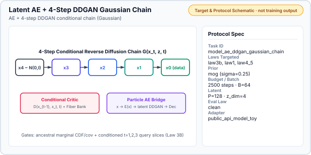

<!-- Generated Forge experiment page — do not edit manually; regenerate via `python -m experiments.forge.experiment_docs` -->

[← Leaderboard](../technique-inventory.md) · [Experiment Catalog](README.md) · [Explore by Laws](../LAWS_HUB.md) · [Research Portal](https://hypergan.github.io/ParticleGAN/)

# Latent AE + 4-Step DDGAN Gaussian Chain (`model_ae_ddgan_gaussian_chain`)

| Field | Value |
| --- | --- |
| **Laws Tested** | [Law 3B](../LAWS_HUB.md#law3b) · [Law 1](../LAWS_HUB.md#law1) · [Law 4.5](../LAWS_HUB.md#law4_5) |
| **Edge Cases** | `conditional-chain` `latent-diffusion` `multi-objective-conflict` |
| **Primary View (`discriminator_stability`)** | Tier 2 (required) |
| **Four Laws Adherence Role** | law3 (anchor) |
| **Fixed Full-Suite Denominator** | Yes (71-test fixed denominator) |
| **Adapter / Domain** | `public_api_model_toy` / `transfer_sustained` |
| **Prior** | `mog` (sigma=`0.25`, standardize=`False`) |
| **Update Budget** | `2500` steps |

## What This Experiment Tests

Couples a learned particle autoencoder with a 4-step latent DDGAN reverse chain on a correlated Gaussian, requiring simultaneous AE reconstruction fidelity, ancestral generation quality, and conditioned transition accuracy.

> [!NOTE]
> **Protocol notes:** Tier-2 required benchmark and Four Laws Adherence Law 3 anchor.

## Laws & Edge Cases Targeted

- **[Law 3B: Conditional Fiber & Stratum Identifiability](../LAWS_HUB.md#law3b)** ([Law 3B theory](../../../docs/four-laws.md#law-3--transport-identifiability)) — Does the learning system possess enough information to determine appropriate transport?
- **[Law 1: Representational Geometry](../LAWS_HUB.md#law1)** ([Law 1 theory](../../../docs/four-laws.md#law-1--representational-geometry)) — Can the system represent the required probability measure efficiently and faithfully?
- **[Law 4.5: Coupled Minimax Contraction](../LAWS_HUB.md#law4_5)** ([Law 4.5 theory](../../../docs/four-laws.md#law-4--functional-and-game-dynamics)) — Can the learning system realize useful functional changes and exhibit appropriate coupled learning dynamics?
- **Edge-case tags:** `conditional-chain`, `latent-diffusion`, `multi-objective-conflict`

## Common Failure Mode

Moving latent coordinates from AE updates destabilize the conditional DDGAN fiber transitions, degrading conditioned slice CDFs even when reconstruction looks clean.

**Historical audit diagnosis** (`reports/forge/problem-definitions.json`): Selected `atlas-particle-normal-v4` passes every paired four-step reconstruction gate (`paired_nmse = 0.0147 <= 0.10`, `paired_worst_axis_nrmse = 0.1333 <= 0.25`, `paired_shuffled_gain = 134.67 >= 3.0`) and `final_projection_cdf = 0.1199 <= 0.12`, matching the bounded `bispf-optimized-quintic-v1` research pattern where paired encoding succeeds (`paired_nmse = 0.0441`) while independent ancestral covariance (`final_covariance_eigen_min = 0.4226 < 0.65`) and `t1`/`t2` reverse-transition bounds fail (`t1_q0_projection_cdf = 0.5950 > 0.12`).

- *Recommended research focus:* Align the ancestral prior and reverse chain with the encoder latent manifold at `t=1, 2` so independent ancestral sampling retains full variance (`>= 0.65`) without degrading paired reconstruction.

## Visual Schematic



*Target & Protocol Schematic · not training output — generated deterministically from the declared task contract.*

## Protocol & Architecture Diagram


## Task Contract & Numerical Gates

### Execution & Sampling Contract

| Contract Field | Declared Value |
| --- | --- |
| Initializer | `deterministic_orthogonal` |
| Prior | `mog` (sigma=`0.25`, standardize=`False`) |
| Update Budget | `2500` steps |
| Batch Size | `64` |
| Particles / Latent Dim | `P=128` / `z_dim=4` |
| Sampling Law | `task_model_kernel_and_posterior_without_serving_noise` |
| Evaluation Output Noise | `clean` |
| Scoring Weights | `live` |
| Integrity Guards | `finite_state`, `rng_isolation`, `optimizer_roles`, `exact_optimizer_updates`, `mechanism_exercised` |
| Assigned Views | `discriminator_stability` (T2 required), `four-laws-adherence-v1` (T1 diagnostic), `prior-ablation-full-suite-v1` (T1 diagnostic), `t3_factorial_ablation` (T1 diagnostic) |

### Numerical Pass/Fail Thresholds

| Metric | Operator | Threshold |
| --- | :---: | ---: |
| `final_projection_cdf` | `<=` | `0.2` |
| `final_normalized_mean` | `<=` | `0.45` |
| `final_covariance_eigen_min` | `>=` | `0.65` |
| `final_covariance_eigen_max` | `<=` | `1.4` |
| `t1_q0_projection_cdf` | `<=` | `0.26` |
| `t1_q0_normalized_mean` | `<=` | `0.65` |
| `t1_q0_covariance_eigen_min` | `>=` | `0.4` |
| `t1_q0_covariance_eigen_max` | `<=` | `1.8` |
| `t1_q1_projection_cdf` | `<=` | `0.26` |
| `t1_q1_normalized_mean` | `<=` | `0.65` |
| `t1_q1_covariance_eigen_min` | `>=` | `0.4` |
| `t1_q1_covariance_eigen_max` | `<=` | `1.8` |
| `t2_q0_projection_cdf` | `<=` | `0.2` |
| `t2_q0_normalized_mean` | `<=` | `0.35` |
| `t2_q0_covariance_eigen_min` | `>=` | `0.6` |
| `t2_q0_covariance_eigen_max` | `<=` | `1.4` |
| `t2_q1_projection_cdf` | `<=` | `0.2` |
| `t2_q1_normalized_mean` | `<=` | `0.35` |
| `t2_q1_covariance_eigen_min` | `>=` | `0.6` |
| `t2_q1_covariance_eigen_max` | `<=` | `1.4` |
| `t3_q0_projection_cdf` | `<=` | `0.12` |
| `t3_q0_normalized_mean` | `<=` | `0.25` |
| `t3_q0_covariance_eigen_min` | `>=` | `0.65` |
| `t3_q0_covariance_eigen_max` | `<=` | `1.4` |
| `t3_q1_projection_cdf` | `<=` | `0.12` |
| `t3_q1_normalized_mean` | `<=` | `0.25` |
| `t3_q1_covariance_eigen_min` | `>=` | `0.65` |
| `t3_q1_covariance_eigen_max` | `<=` | `1.4` |
| `t4_q0_projection_cdf` | `<=` | `0.12` |
| `t4_q0_normalized_mean` | `<=` | `0.25` |
| `t4_q0_covariance_eigen_min` | `>=` | `0.65` |
| `t4_q0_covariance_eigen_max` | `<=` | `1.4` |
| `t4_q1_projection_cdf` | `<=` | `0.12` |
| `t4_q1_normalized_mean` | `<=` | `0.25` |
| `t4_q1_covariance_eigen_min` | `>=` | `0.65` |
| `t4_q1_covariance_eigen_max` | `<=` | `1.4` |
| `panel_count` | `==` | `8` |
| `samples_per_panel` | `>=` | `2048` |
| `paired_nmse` | `<=` | `0.1` |
| `paired_worst_axis_nrmse` | `<=` | `0.25` |
| `paired_shuffled_gain` | `>=` | `3.0` |
| `paired_reverse_steps` | `==` | `4` |

## Recorded Family Results

> [!IMPORTANT]
> Screening outcomes below come from recorded single-seed (`seed = 0`) Forge evidence. `NOT MEASURED`, `BLOCKED`, and `INCOMPATIBLE` are non-numerical states — not scientific failures — and confer no pass or qualification credit.

| Family | Selected Candidate | Outcome | Key Recorded Metrics | Family Report | Training Media |
| --- | --- | :---: | --- | --- | --- |
| **Atlas** | `atlas-particle-normal-v4` | **FAIL** | recomputed complete live curve and terminal suffix | [Atlas](../families/atlas.md#cohort-cuda-bc3debd3fa5e) | — |
| **BCAP** | `recipe-prior-refactor-bcap-pure-v1` | `NOT MEASURED` | No recorded result for this selected configuration and source. | [BCAP](../families/bcap-pure.md#cohort-cuda-1bf9d7d34422) | — |
| **BISPF** | `bispf-optimized-quintic-v1` | `NOT MEASURED` | No recorded result for this selected configuration and source. | [BISPF](../families/bispf.md#cohort-cuda-1bf9d7d34422) | — |
| **E22** | `e22` | `NOT MEASURED` | No recorded result for this selected configuration and source. | [E22](../families/e22.md#cohort-cuda-1bf9d7d34422) | — |
| **EMPF** | `empf-v8` | **FAIL** | recomputed complete live curve and terminal suffix | [EMPF](../families/empf.md#cohort-cuda-23a94f16ca88) | — |
| **GAN v3 release 0.7** | `recipe-prior-refactor-release07-gan-v3-v1` | `NOT MEASURED` | No recorded result for this selected configuration and source. | [GAN v3 release 0.7](../families/release07-gan-v3.md#cohort-cuda-1bf9d7d34422) | — |
| **K3P** | `recipe-prior-refactor-k3p-v1` | `NOT MEASURED` | No recorded result for this selected configuration and source. | [K3P](../families/k3p.md#cohort-cuda-1bf9d7d34422) | — |
| **KA2** | `recipe-prior-refactor-ka2-v1` | `NOT MEASURED` | No recorded result for this selected configuration and source. | [KA2](../families/ka2.md#cohort-cuda-1bf9d7d34422) | — |
| **R1/R2** | `recipe-prior-refactor-r1r2-v1` | `NOT MEASURED` | No recorded result for this selected configuration and source. | [R1/R2](../families/r1r2.md#cohort-cuda-1bf9d7d34422) | — |
| **RHBI** | `rhbi-v12` | **FAIL** | recomputed complete live curve and terminal suffix | [RHBI](../families/rhbi.md#cohort-cuda-23a94f16ca88) | — |
| **Unified** | `unified-v11` | **FAIL** | recomputed complete live curve and terminal suffix | [Unified](../families/unified.md#cohort-cuda-42a130a78fc3) | — |

### Four Laws Adherence Diagnostic Receipts (Separate Cohort)

*Diagnostic readouts and Colab matched-GPU receipts for `four-laws-adherence-v1` (protocol seed `0`, unchanged recipes; research telemetry only — separate from ordinary selected-cohort qualification above and confers no qualification or default-adoption credit):*

| Candidate | Family | GPU | Outcome | `min_margin` | NVML Energy | Key Recorded Metrics | Receipt |
| --- | --- | --- | :---: | ---: | ---: | --- | --- |
| `atlas-particle-normal-v4` | `atlas` | NVIDIA L4 | **FAIL** | — | 2.36 kJ | final_covariance_eigen_max=0.4876, final_covariance_eigen_min=0.4533, final_normalized_mean=0.03281, final_projection_cdf=0.1293 | [af854405a8f64f979faabf744f89a03e.json](../technique-receipts/af854405a8f64f979faabf744f89a03e.json) |
| `bispf-optimized-quintic-v1` | `bispf` | NVIDIA L4 | **FAIL** | — | 4.30 kJ | final_covariance_eigen_max=1.022, final_covariance_eigen_min=0.6077, final_normalized_mean=0.4723, final_projection_cdf=0.1987 | [5a649f78421848d6b5fdaf5f48e376cc.json](../technique-receipts/5a649f78421848d6b5fdaf5f48e376cc.json) |
| `empf-v8` | `empf` | NVIDIA L4 | **FAIL** | — | 4.02 kJ | final_covariance_eigen_max=0.9707, final_covariance_eigen_min=0.6892, final_normalized_mean=0.1054, final_projection_cdf=0.08276 | [ab04b2e9a1b34893b67c0ff5939bb386.json](../technique-receipts/ab04b2e9a1b34893b67c0ff5939bb386.json) |
| `recipe-prior-refactor-bcap-pure-v1` | `bcap-dualnorm` | NVIDIA L4 | **FAIL** | — | 3.35 kJ | final_covariance_eigen_max=1.155, final_covariance_eigen_min=0.7146, final_normalized_mean=0.2538, final_projection_cdf=0.1254 | [dbaca67b80884965b177dd74f30cb042.json](../technique-receipts/dbaca67b80884965b177dd74f30cb042.json) |
| `recipe-prior-refactor-r1r2-v1` | `r1r2` | NVIDIA L4 | **FAIL** | — | 2.33 kJ | final_covariance_eigen_max=0.9115, final_covariance_eigen_min=0.8444, final_normalized_mean=0.3675, final_projection_cdf=0.1513 | [5dd3fba66aca4de69e0b3f734e8cd5c1.json](../technique-receipts/5dd3fba66aca4de69e0b3f734e8cd5c1.json) |
| `recipe-prior-refactor-release07-gan-v3-v1` | `release07-gan-v3` | NVIDIA L4 | **FAIL** | — | 2.34 kJ | final_covariance_eigen_max=1.041, final_covariance_eigen_min=0.8286, final_normalized_mean=0.205, final_projection_cdf=0.1092 | [37dbe2c668ee4c7fa32107f892ee59d9.json](../technique-receipts/37dbe2c668ee4c7fa32107f892ee59d9.json) |
| `rhbi-v12` | `rhbi` | NVIDIA L4 | **FAIL** | — | 4.67 kJ | final_covariance_eigen_max=0.9354, final_covariance_eigen_min=0.7718, final_normalized_mean=0.1392, final_projection_cdf=0.09515 | [2d38a91c931e437782057570f4496fc8.json](../technique-receipts/2d38a91c931e437782057570f4496fc8.json) |
| `law4-energy-v11` | `unified` | NVIDIA L4 | `INCOMPLETE` | — | — | — | [a86b29cdb5fd43c381c1b4d8efa8d4ae.json](../technique-receipts/a86b29cdb5fd43c381c1b4d8efa8d4ae.json) |
| `minimal-v2` | `minimal` | NVIDIA L4 | `INCOMPLETE` | — | — | — | [df4c9c2d3b4a4347973504058cfbd996.json](../technique-receipts/df4c9c2d3b4a4347973504058cfbd996.json) |
| `unified-v11` | `unified` | NVIDIA L4 | `INCOMPLETE` | — | — | — | [9790f6999bc04b25aaa7e9e2ee275930.json](../technique-receipts/9790f6999bc04b25aaa7e9e2ee275930.json) |
| `unified-v12` | `unified` | NVIDIA L4 | `INCOMPLETE` | — | — | — | [db86e31f48804f6e9bdc9feae9b1258b.json](../technique-receipts/db86e31f48804f6e9bdc9feae9b1258b.json) |

## Reproduce This Experiment

```bash
# Validate this task declaration and inspect planned dependencies
python -m experiments.forge validate
python -m experiments.forge plan --view discriminator_stability --candidate unified-v12 --tasks model_ae_ddgan_gaussian_chain
```

**Declaration & Source Files:**

- Task contract: [configs/forge/tasks/model_ae_ddgan_gaussian_chain.json](../../../configs/forge/tasks/model_ae_ddgan_gaussian_chain.json)
- Source code: [benchmarks/toy_audit/api_model_ae_ddgan.py](../../../benchmarks/toy_audit/api_model_ae_ddgan.py)
- Source code: [benchmarks/toy_audit/api_contract.py](../../../benchmarks/toy_audit/api_contract.py)
- Source code: [benchmarks/toy_audit/api_model_ddgan.py](../../../benchmarks/toy_audit/api_model_ddgan.py)
- Source code: [benchmarks/toy_audit/api_run.py](../../../benchmarks/toy_audit/api_run.py)
- Source code: [benchmarks/toy_audit/reproducibility.py](../../../benchmarks/toy_audit/reproducibility.py)
- Source code: [experiments/forge/model_toy_adapter.py](../../../experiments/forge/model_toy_adapter.py)
- Source code: [particlegan/policy.py](../../../particlegan/policy.py)

## Annotation Provenance

This page was assembled read-only from the following versioned inputs without altering any task execution/evaluation fingerprint:

- **Task contract JSON:** [configs/forge/tasks/model_ae_ddgan_gaussian_chain.json](../../../configs/forge/tasks/model_ae_ddgan_gaussian_chain.json)
- **Editorial task documentation sidecar:** [configs/forge/task-documentation/model_ae_ddgan_gaussian_chain.json](../../../configs/forge/task-documentation/model_ae_ddgan_gaussian_chain.json)
- **Read-only Python AST source:** [benchmarks/toy_audit/api_model_ae_ddgan.py](../../../benchmarks/toy_audit/api_model_ae_ddgan.py) (AST symbols: `__doc__`)
- **Read-only Python AST source:** [benchmarks/toy_audit/api_contract.py](../../../benchmarks/toy_audit/api_contract.py) (AST symbols: `__doc__`)
- **Read-only Python AST source:** [benchmarks/toy_audit/api_model_ddgan.py](../../../benchmarks/toy_audit/api_model_ddgan.py) (AST symbols: `__doc__`)
- **Read-only Python AST source:** [benchmarks/toy_audit/api_run.py](../../../benchmarks/toy_audit/api_run.py) (AST symbols: `__doc__`)
- **Read-only Python AST source:** [benchmarks/toy_audit/reproducibility.py](../../../benchmarks/toy_audit/reproducibility.py) (AST symbols: `__doc__`)
- **Read-only Python AST source:** [experiments/forge/model_toy_adapter.py](../../../experiments/forge/model_toy_adapter.py) (AST symbols: `__doc__`)
- **Read-only Python AST source:** [particlegan/policy.py](../../../particlegan/policy.py) (AST symbols: `__doc__`)
