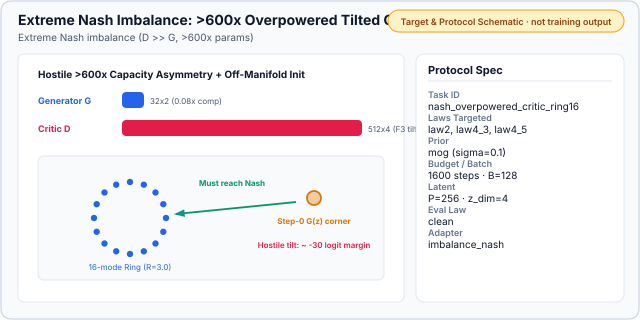
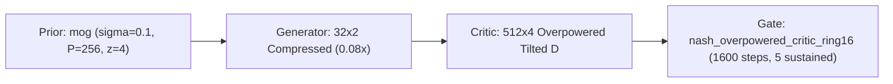

<!-- Generated Forge experiment page — do not edit manually; regenerate via `python -m experiments.forge.experiment_docs` -->

[← Leaderboard](../technique-inventory.md) · [Experiment Catalog](README.md) · [Explore by Laws](../LAWS_HUB.md) · [Research Portal](https://hypergan.github.io/ParticleGAN/)

# Extreme Nash Imbalance: >600x Overpowered Tilted Critic (D >> G) (`nash_overpowered_critic_ring16`)

| Field | Value |
| --- | --- |
| **Laws Tested** | [Law 2](../LAWS_HUB.md#law2) · [Law 4.3](../LAWS_HUB.md#law4_3) · [Law 4.5](../LAWS_HUB.md#law4_5) |
| **Edge Cases** | `hostile-nash-imbalance` `off-manifold-init` `ring-mixture` |
| **Primary View (`discriminator_stability`)** | Tier 2 (stretch) |
| **Four Laws Adherence Role** | law2 (anchor) |
| **Fixed Full-Suite Denominator** | Yes (59-test active runnable denominator) |
| **Adapter / Domain** | `imbalance_nash` / `nash_overpowered_critic_ring16` |
| **Prior** | `mog` (sigma=`0.1`, standardize=`False`) |
| **Update Budget** | `1600` steps |

## What This Experiment Tests

Pairs a tiny 0.08x-compressed off-manifold generator (32x2) against a >600x larger 512x4 Fourier-3 critic initialized with a hostile upside-down linear tilt (~ -30 logit margins) on a 16-mode ring.

> [!NOTE]
> **Protocol notes:** Tier-2 stretch task and Four Laws Adherence Law 2 anchor (1,600 updates).

## Laws & Edge Cases Targeted

- **[Law 2: Potential Geometry](../LAWS_HUB.md#law2)** ([Law 2 theory](../../../docs/four-laws.md#law-2--potential-geometry)) — Does the critic communicate useful learning forces with appropriate geometric control and computational efficiency?
- **[Law 4.3: Displacement & Kreiss Control](../LAWS_HUB.md#law4_3)** ([Law 4.3 theory](../../../docs/four-laws.md#law-4--functional-and-game-dynamics)) — Can the learning system realize useful functional changes and exhibit appropriate coupled learning dynamics?
- **[Law 4.5: Coupled Minimax Contraction](../LAWS_HUB.md#law4_5)** ([Law 4.5 theory](../../../docs/four-laws.md#law-4--functional-and-game-dynamics)) — Can the learning system realize useful functional changes and exhibit appropriate coupled learning dynamics?
- **Edge-case tags:** `hostile-nash-imbalance`, `off-manifold-init`, `ring-mixture`

## Common Failure Mode

The overpowered critic immediately saturates margins and crushes generator gradients, leaving the tiny generator trapped far off-manifold in its initial corner.

## Visual Schematic



*Target & Protocol Schematic · not training output — generated deterministically from the declared task contract.*

## Protocol & Architecture Diagram



## Task Contract & Numerical Gates

### Execution & Sampling Contract

| Contract Field | Declared Value |
| --- | --- |
| Initializer | `deterministic_orthogonal` |
| Prior | `mog` (sigma=`0.1`, standardize=`False`) |
| Update Budget | `1600` steps |
| Batch Size | `128` |
| Particles / Latent Dim | `P=256` / `z_dim=4` |
| Sampling Law | `public_prior_without_output_noise` |
| Evaluation Output Noise | `clean` |
| Scoring Weights | `live` |
| Integrity Guards | `finite_state`, `optimizer_roles`, `exact_optimizer_updates`, `mechanism_exercised`, `rng_isolation` |
| Assigned Views | `discriminator_stability` (T2 stretch), `four-laws-adherence-v1` (T1 diagnostic), `four-laws-adherence-v2` (T1 diagnostic), `r4-occam-ablation-v1` (T1 diagnostic), `t4_imbalance_nash_stretch` (T1 diagnostic) |

### Numerical Pass/Fail Thresholds

| Metric | Operator | Threshold |
| --- | :---: | ---: |
| `finite_fraction` | `==` | `1.0` |
| `modes` | `==` | `16` |
| `hq` | `>=` | `0.8` |
| `mass_tv` | `<=` | `0.18` |
| `sw1_normalized` | `<=` | `0.12` |
| `component_core_covariance_error` | `<=` | `0.98` |
| `component_core_min_eigen_ratio` | `>=` | `0.15` |

## Recorded Family Results

> [!IMPORTANT]
> Screening outcomes below come from recorded single-seed (`seed = 0`) Forge evidence. `NOT MEASURED`, `BLOCKED`, and `INCOMPATIBLE` are non-numerical states — not scientific failures — and confer no pass or qualification credit.

| Family | Selected Candidate | Outcome | Key Recorded Metrics | Family Report | Training Media |
| --- | --- | :---: | --- | --- | --- |
| **Axiom** | `axiom-v4` | **PASS** | recomputed nash_overpowered_critic_ring16 gates (5/5 terminal checks passed) | [Axiom](../families/axiom.md#cohort-cuda-daa283c8a640) | [HF GIF](https://huggingface.co/datasets/HyperGAN/particlegan-forge-evidence/resolve/main/media/forge/leaderboard/axiom/axiom-v4/nash_overpowered_critic_ring16.gif) |
| **Unified** | `unified-v11` | **PASS** | recomputed nash_overpowered_critic_ring16 gates (5/5 terminal checks passed) | [Unified](../families/unified.md#cohort-cuda-42a130a78fc3) | — |
| **Atlas** | `atlas-particle-normal-v4` | `BLOCKED` | imbalance_nash requires an effective MoGParticlePrior | [Atlas](../families/atlas.md#cohort-cuda-daa283c8a640) | — |
| **BCAP** | `recipe-prior-refactor-bcap-pure-v1` | `NOT MEASURED` | No recorded result for this selected configuration and source. | [BCAP](../families/bcap-pure.md#cohort-cuda-1bf9d7d34422) | — |
| **BISPF** | `bispf-optimized-quintic-v1` | `NOT MEASURED` | No recorded result for this selected configuration and source. | [BISPF](../families/bispf.md#cohort-cuda-1bf9d7d34422) | [HF GIF](https://huggingface.co/datasets/HyperGAN/particlegan-forge-evidence/resolve/main/media/forge/leaderboard/bispf/bispf-optimized-quintic-v1/nash_overpowered_critic_ring16.gif) |
| **E22** | `e22` | `NOT MEASURED` | No recorded result for this selected configuration and source. | [E22](../families/e22.md#cohort-cuda-1bf9d7d34422) | — |
| **EMPF** | `empf-v8` | `NOT MEASURED` | No recorded result for this selected configuration and source. | [EMPF](../families/empf.md#cohort-cuda-23a94f16ca88) | — |
| **GAN v3 release 0.7** | `recipe-prior-refactor-release07-gan-v3-v1` | `NOT MEASURED` | no compatible result | [GAN v3 release 0.7](../families/release07-gan-v3.md#cohort-cuda-daa283c8a640) | — |
| **K3P** | `recipe-prior-refactor-k3p-v1` | `NOT MEASURED` | no compatible result | [K3P](../families/k3p.md#cohort-cuda-daa283c8a640) | — |
| **KA2** | `recipe-prior-refactor-ka2-v1` | `NOT MEASURED` | no compatible result | [KA2](../families/ka2.md#cohort-cuda-daa283c8a640) | — |
| **R1/R2** | `recipe-prior-refactor-r1r2-v1` | `NOT MEASURED` | no compatible result | [R1/R2](../families/r1r2.md#cohort-cuda-daa283c8a640) | — |
| **RHBI** | `rhbi-v12` | `NOT MEASURED` | No recorded result for this selected configuration and source. | [RHBI](../families/rhbi.md#cohort-cuda-23a94f16ca88) | [HF GIF](https://huggingface.co/datasets/HyperGAN/particlegan-forge-evidence/resolve/main/media/forge/leaderboard/rhbi/rhbi-v12/nash_overpowered_critic_ring16.gif) |

### Four Laws Adherence Diagnostic Receipts (Separate Cohort)

*Diagnostic readouts and Colab matched-GPU receipts for `four-laws-adherence-v1` (protocol seed `0`, unchanged recipes; research telemetry only — separate from ordinary selected-cohort qualification above and confers no qualification or default-adoption credit):*

| Candidate | Family | GPU | Outcome | `min_margin` | NVML Energy | Key Recorded Metrics | Receipt |
| --- | --- | --- | :---: | ---: | ---: | --- | --- |
| `axiom-v4` | `axiom` | NVIDIA L4 | **PASS** | — | 1.93 kJ (J-to-PASS) | component_core_covariance_error=0.285, component_core_min_eigen_ratio=0.4236, component_covariance_error=0.6746, component_min_eigen_ratio=0.4236 | [7ba9ad8ae0324360bbf108829764982a.json](../technique-receipts/7ba9ad8ae0324360bbf108829764982a.json) |
| `axiom-v4` | `axiom` | NVIDIA RTX A6000 | **PASS** | — | 7.85 kJ (J-to-PASS) | component_core_covariance_error=0.3327, component_core_min_eigen_ratio=0.3521, component_covariance_error=0.554, component_min_eigen_ratio=0.3521 | [readout-9066cb4353eb435be7819b0c.json](../records/readout-9066cb4353eb435be7819b0c.json) |
| `axiom-v5` | `axiom` | NVIDIA L4 | **PASS** | — | 2.24 kJ (J-to-PASS) | component_core_covariance_error=0.4025, component_core_min_eigen_ratio=0.3559, component_covariance_error=0.4267, component_min_eigen_ratio=0.3559 | [dccd3d7b7e494c55a477020b43b6f8f8.json](../technique-receipts/dccd3d7b7e494c55a477020b43b6f8f8.json) |
| `law4-energy-v11` | `unified` | NVIDIA L4 | **PASS** | — | 1.99 kJ (J-to-PASS) | component_core_covariance_error=0.2086, component_core_min_eigen_ratio=0.4598, component_covariance_error=0.5151, component_min_eigen_ratio=0.4598 | [cb5f86c0393a45d5a79b35b9b4c5f622.json](../technique-receipts/cb5f86c0393a45d5a79b35b9b4c5f622.json) |
| `minimal-v2` | `minimal` | NVIDIA L4 | **PASS** | — | 1.95 kJ (J-to-PASS) | component_core_covariance_error=0.3713, component_core_min_eigen_ratio=0.2297, component_covariance_error=0.3946, component_min_eigen_ratio=0.2297 | [bb916eae8edc4e92a159df6c50b6ad72.json](../technique-receipts/bb916eae8edc4e92a159df6c50b6ad72.json) |
| `unified-v11` | `unified` | NVIDIA L4 | **PASS** | — | 3.01 kJ (J-to-PASS) | component_core_covariance_error=0.3587, component_core_min_eigen_ratio=0.4566, component_covariance_error=0.5778, component_min_eigen_ratio=0.4566 | [18302fce89404ede8c476b9bc27c73f9.json](../technique-receipts/18302fce89404ede8c476b9bc27c73f9.json) |
| `unified-v12` | `unified` | NVIDIA L4 | **PASS** | — | 2.17 kJ (J-to-PASS) | component_core_covariance_error=0.2574, component_core_min_eigen_ratio=0.5255, component_covariance_error=0.5879, component_min_eigen_ratio=0.5255 | [ac7102b2ea9f4acd93aee7bc6584ce5a.json](../technique-receipts/ac7102b2ea9f4acd93aee7bc6584ce5a.json) |
| `unified-v15` | `unified` | NVIDIA L4 | **PASS** | — | 2.26 kJ (J-to-PASS) | component_core_covariance_error=0.1599, component_core_min_eigen_ratio=0.6874, component_covariance_error=0.1708, component_min_eigen_ratio=0.6874 | [95f0521e85f64540a056768c34c29fc7.json](../technique-receipts/95f0521e85f64540a056768c34c29fc7.json) |
| `bispf-optimized-quintic-v1` | `bispf` | NVIDIA L4 | **FAIL** | — | 5.64 kJ | component_core_covariance_error=2.163, component_core_min_eigen_ratio=0, component_covariance_error=38.93, component_min_eigen_ratio=2.731 | [8d6e5a5ef18345e281219d97e23ef2d3.json](../technique-receipts/8d6e5a5ef18345e281219d97e23ef2d3.json) |
| `empf-v8` | `empf` | NVIDIA L4 | **FAIL** | — | 9.14 kJ | component_core_covariance_error=0.9512, component_core_min_eigen_ratio=0.5064, component_covariance_error=1.413, component_min_eigen_ratio=0.5064 | [bb39b4ec66984b3db235b9b8e778fcff.json](../technique-receipts/bb39b4ec66984b3db235b9b8e778fcff.json) |
| `recipe-prior-refactor-bcap-pure-v1` | `bcap-dualnorm` | NVIDIA L4 | **FAIL** | — | 13.08 kJ | component_core_covariance_error=1.017, component_core_min_eigen_ratio=0.7619, component_covariance_error=1.43, component_min_eigen_ratio=0.7619 | [fbe7d35c6bad45d2bfa3f6740a858341.json](../technique-receipts/fbe7d35c6bad45d2bfa3f6740a858341.json) |
| `recipe-prior-refactor-k3p-v1` | `k3p` | NVIDIA L4 | **FAIL** | — | 1.61 kJ | component_core_covariance_error=1.735, component_core_min_eigen_ratio=1.6, component_covariance_error=55.57, component_min_eigen_ratio=2.851 | [9a2125e56630431f97fc9a821b9ee891.json](../technique-receipts/9a2125e56630431f97fc9a821b9ee891.json) |
| `recipe-prior-refactor-ka2-v1` | `ka2` | NVIDIA L4 | **FAIL** | — | 1.71 kJ | component_core_covariance_error=1.876, component_core_min_eigen_ratio=1.45, component_covariance_error=58.18, component_min_eigen_ratio=2.793 | [123f56eb8ff44c4ebdf4442bd8e698da.json](../technique-receipts/123f56eb8ff44c4ebdf4442bd8e698da.json) |
| `recipe-prior-refactor-r1r2-v1` | `r1r2` | NVIDIA L4 | **FAIL** | — | 1.34 kJ | component_core_covariance_error=2.401, component_core_min_eigen_ratio=0, component_covariance_error=53.47, component_min_eigen_ratio=0 | [171712585b4046c99d7d609184cedd0c.json](../technique-receipts/171712585b4046c99d7d609184cedd0c.json) |
| `recipe-prior-refactor-release07-gan-v3-v1` | `release07-gan-v3` | NVIDIA L4 | **FAIL** | — | 1.34 kJ | component_core_covariance_error=1, component_core_min_eigen_ratio=0, component_covariance_error=4594, component_min_eigen_ratio=0 | [cf528fba1e7f414ba028ebf85df99ff4.json](../technique-receipts/cf528fba1e7f414ba028ebf85df99ff4.json) |
| `rhbi-v12` | `rhbi` | NVIDIA L4 | **FAIL** | — | 6.54 kJ | component_core_covariance_error=1.086, component_core_min_eigen_ratio=0.5622, component_covariance_error=3.937, component_min_eigen_ratio=0.5636 | [07b7dbd752fb4cfd9143ea9ec642bc65.json](../technique-receipts/07b7dbd752fb4cfd9143ea9ec642bc65.json) |
| `bispf-optimized-quintic-v1` | `bispf` | — | `INCOMPLETE` | — | — | — | [708bd9ea8c614df49b76f55bc020b589.json](../technique-receipts/708bd9ea8c614df49b76f55bc020b589.json) |
| `rhbi-v12` | `rhbi` | — | `INCOMPLETE` | — | — | — | [50a1862e79e34c8db08d7bec95722cf7.json](../technique-receipts/50a1862e79e34c8db08d7bec95722cf7.json) |

## Reproduce This Experiment

```bash
# Validate this task declaration and inspect planned dependencies
python -m experiments.forge validate
python -m experiments.forge plan --view discriminator_stability --candidate unified-v12 --tasks nash_overpowered_critic_ring16
```

**Declaration & Source Files:**

- Task contract: [configs/forge/tasks/nash_overpowered_critic_ring16.json](../../../configs/forge/tasks/nash_overpowered_critic_ring16.json)
- Source code: [benchmarks/toy_audit/api_imbalance_nash.py](../../../benchmarks/toy_audit/api_imbalance_nash.py)
- Source code: [experiments/forge/imbalance_nash.py](../../../experiments/forge/imbalance_nash.py)

## Annotation Provenance

This page was assembled read-only from the following versioned inputs without altering any task execution/evaluation fingerprint:

- **Task contract JSON:** [configs/forge/tasks/nash_overpowered_critic_ring16.json](../../../configs/forge/tasks/nash_overpowered_critic_ring16.json)
- **Editorial task documentation sidecar:** [configs/forge/task-documentation/nash_overpowered_critic_ring16.json](../../../configs/forge/task-documentation/nash_overpowered_critic_ring16.json)
- **Read-only Python AST source:** [benchmarks/toy_audit/api_imbalance_nash.py](../../../benchmarks/toy_audit/api_imbalance_nash.py) (AST symbols: `__doc__`, `THRESHOLDS`)
- **Read-only Python AST source:** [experiments/forge/imbalance_nash.py](../../../experiments/forge/imbalance_nash.py) (AST symbols: `__doc__`)
