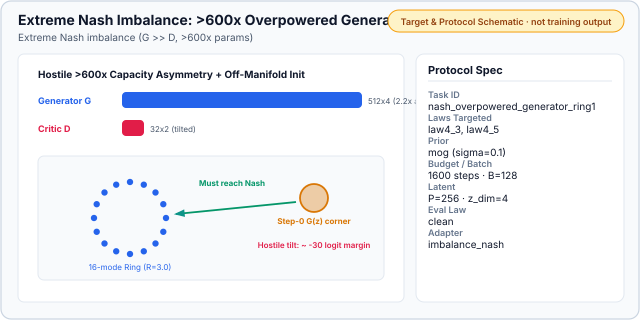
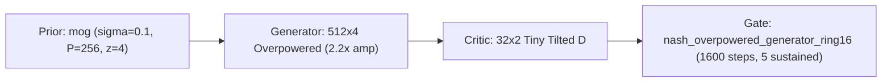

<!-- Generated Forge experiment page — do not edit manually; regenerate via `python -m experiments.forge.experiment_docs` -->

[← Leaderboard](../technique-inventory.md) · [Experiment Catalog](README.md) · [Explore by Laws](../LAWS_HUB.md) · [Research Portal](https://hypergan.github.io/ParticleGAN/)

# Extreme Nash Imbalance: >600x Overpowered Generator (G >> D) (`nash_overpowered_generator_ring16`)

| Field | Value |
| --- | --- |
| **Laws Tested** | [Law 4.3](../LAWS_HUB.md#law4_3) · [Law 4.5](../LAWS_HUB.md#law4_5) |
| **Edge Cases** | `hostile-nash-imbalance` `kreiss-blowup` `ring-mixture` |
| **Primary View (`discriminator_stability`)** | Tier 2 (stretch) |
| **Four Laws Adherence Role** | — |
| **Fixed Full-Suite Denominator** | Yes (71-test fixed denominator) |
| **Adapter / Domain** | `imbalance_nash` / `nash_overpowered_generator_ring16` |
| **Prior** | `mog` (sigma=`0.1`, standardize=`False`) |
| **Update Budget** | `1600` steps |

## What This Experiment Tests

Reverses capacity asymmetry: pits a >600x larger 2.2x-amplified off-manifold generator (512x4) against a tiny 32x2 Fourier-1 tilted critic on a 16-mode ring, directly stressing Law 4.3 displacement/Kreiss control.

> [!NOTE]
> **Protocol notes:** Tier-2 stretch task (1,600 updates).

## Laws & Edge Cases Targeted

- **[Law 4.3: Displacement & Kreiss Control](../LAWS_HUB.md#law4_3)** ([Law 4.3 theory](../../../docs/four-laws.md#law-4--functional-and-game-dynamics)) — Can the learning system realize useful functional changes and exhibit appropriate coupled learning dynamics?
- **[Law 4.5: Coupled Minimax Contraction](../LAWS_HUB.md#law4_5)** ([Law 4.5 theory](../../../docs/four-laws.md#law-4--functional-and-game-dynamics)) — Can the learning system realize useful functional changes and exhibit appropriate coupled learning dynamics?
- **Edge-case tags:** `hostile-nash-imbalance`, `kreiss-blowup`, `ring-mixture`

## Common Failure Mode

Without displacement and Kreiss control, the massive generator rockets past the tiny critic in violent non-normal excursions before the critic can build an informative potential.

## Visual Schematic



*Target & Protocol Schematic · not training output — generated deterministically from the declared task contract.*

## Protocol & Architecture Diagram



## Task Contract & Numerical Gates

### Execution & Sampling Contract

| Contract Field | Declared Value |
| --- | --- |
| Initializer | `deterministic_orthogonal` |
| Prior | `mog` (sigma=`0.1`, standardize=`False`) |
| Update Budget | `1600` steps |
| Batch Size | `128` |
| Particles / Latent Dim | `P=256` / `z_dim=4` |
| Sampling Law | `public_prior_without_output_noise` |
| Evaluation Output Noise | `clean` |
| Scoring Weights | `live` |
| Integrity Guards | `finite_state`, `optimizer_roles`, `exact_optimizer_updates`, `mechanism_exercised`, `rng_isolation` |
| Assigned Views | `discriminator_stability` (T2 stretch), `r4-occam-ablation-v1` (T1 diagnostic), `t4_imbalance_nash_stretch` (T1 diagnostic) |

### Numerical Pass/Fail Thresholds

| Metric | Operator | Threshold |
| --- | :---: | ---: |
| `finite_fraction` | `==` | `1.0` |
| `modes` | `==` | `16` |
| `hq` | `>=` | `0.72` |
| `mass_tv` | `<=` | `0.18` |
| `sw1_normalized` | `<=` | `0.12` |
| `component_core_covariance_error` | `<=` | `1.28` |
| `component_core_min_eigen_ratio` | `>=` | `0.15` |

## Recorded Family Results

> [!IMPORTANT]
> Screening outcomes below come from recorded single-seed (`seed = 0`) Forge evidence. `NOT MEASURED`, `BLOCKED`, and `INCOMPATIBLE` are non-numerical states — not scientific failures — and confer no pass or qualification credit.

| Family | Selected Candidate | Outcome | Key Recorded Metrics | Family Report | Training Media |
| --- | --- | :---: | --- | --- | --- |
| **Unified** | `unified-v11` | **PASS** | recomputed nash_overpowered_generator_ring16 gates (5/5 terminal checks passed) | [Unified](../families/unified.md#cohort-cuda-42a130a78fc3) | — |
| **Atlas** | `atlas-particle-normal-v4` | `NOT MEASURED` | No recorded result for this selected configuration and source. | [Atlas](../families/atlas.md#cohort-cuda-bc3debd3fa5e) | — |
| **BCAP** | `recipe-prior-refactor-bcap-pure-v1` | `NOT MEASURED` | No recorded result for this selected configuration and source. | [BCAP](../families/bcap-pure.md#cohort-cuda-1bf9d7d34422) | — |
| **BISPF** | `bispf-optimized-quintic-v1` | `NOT MEASURED` | No recorded result for this selected configuration and source. | [BISPF](../families/bispf.md#cohort-cuda-1bf9d7d34422) | — |
| **E22** | `e22` | `NOT MEASURED` | No recorded result for this selected configuration and source. | [E22](../families/e22.md#cohort-cuda-1bf9d7d34422) | — |
| **EMPF** | `empf-v8` | `NOT MEASURED` | No recorded result for this selected configuration and source. | [EMPF](../families/empf.md#cohort-cuda-23a94f16ca88) | — |
| **GAN v3 release 0.7** | `recipe-prior-refactor-release07-gan-v3-v1` | `NOT MEASURED` | No recorded result for this selected configuration and source. | [GAN v3 release 0.7](../families/release07-gan-v3.md#cohort-cuda-1bf9d7d34422) | — |
| **K3P** | `recipe-prior-refactor-k3p-v1` | `NOT MEASURED` | No recorded result for this selected configuration and source. | [K3P](../families/k3p.md#cohort-cuda-1bf9d7d34422) | — |
| **KA2** | `recipe-prior-refactor-ka2-v1` | `NOT MEASURED` | No recorded result for this selected configuration and source. | [KA2](../families/ka2.md#cohort-cuda-1bf9d7d34422) | — |
| **R1/R2** | `recipe-prior-refactor-r1r2-v1` | `NOT MEASURED` | No recorded result for this selected configuration and source. | [R1/R2](../families/r1r2.md#cohort-cuda-1bf9d7d34422) | — |
| **RHBI** | `rhbi-v12` | `NOT MEASURED` | No recorded result for this selected configuration and source. | [RHBI](../families/rhbi.md#cohort-cuda-23a94f16ca88) | — |

## Reproduce This Experiment

```bash
# Validate this task declaration and inspect planned dependencies
python -m experiments.forge validate
python -m experiments.forge plan --view discriminator_stability --candidate unified-v12 --tasks nash_overpowered_generator_ring16
```

**Declaration & Source Files:**

- Task contract: [configs/forge/tasks/nash_overpowered_generator_ring16.json](../../../configs/forge/tasks/nash_overpowered_generator_ring16.json)
- Source code: [benchmarks/toy_audit/api_imbalance_nash.py](../../../benchmarks/toy_audit/api_imbalance_nash.py)
- Source code: [experiments/forge/imbalance_nash.py](../../../experiments/forge/imbalance_nash.py)

## Annotation Provenance

This page was assembled read-only from the following versioned inputs without altering any task execution/evaluation fingerprint:

- **Task contract JSON:** [configs/forge/tasks/nash_overpowered_generator_ring16.json](../../../configs/forge/tasks/nash_overpowered_generator_ring16.json)
- **Editorial task documentation sidecar:** [configs/forge/task-documentation/nash_overpowered_generator_ring16.json](../../../configs/forge/task-documentation/nash_overpowered_generator_ring16.json)
- **Read-only Python AST source:** [benchmarks/toy_audit/api_imbalance_nash.py](../../../benchmarks/toy_audit/api_imbalance_nash.py) (AST symbols: `__doc__`, `THRESHOLDS`)
- **Read-only Python AST source:** [experiments/forge/imbalance_nash.py](../../../experiments/forge/imbalance_nash.py) (AST symbols: `__doc__`)
