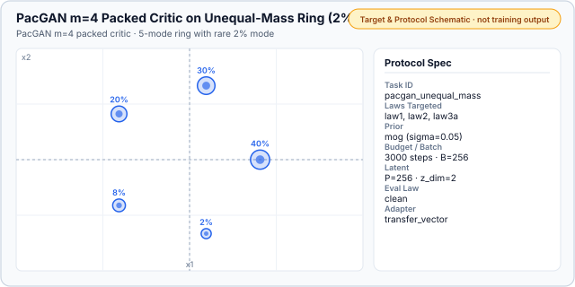
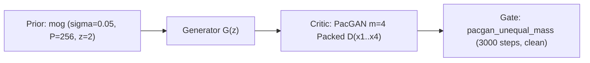

<!-- Generated Forge experiment page — do not edit manually; regenerate via `python -m experiments.forge.experiment_docs` -->

[← Leaderboard](../technique-inventory.md) · [Experiment Catalog](README.md) · [Explore by Laws](../LAWS_HUB.md) · [Research Portal](https://hypergan.github.io/ParticleGAN/)

# PacGAN m=4 Packed Critic on Unequal-Mass Ring (2% Rare Mode) (`pacgan_unequal_mass`)

| Field | Value |
| --- | --- |
| **Laws Tested** | [Law 1](../LAWS_HUB.md#law1) · [Law 2](../LAWS_HUB.md#law2) · [Law 3A](../LAWS_HUB.md#law3a) |
| **Edge Cases** | `packed-critic` `rare-mode` `unequal-mass` |
| **Primary View (`discriminator_stability`)** | Tier 4 (stretch) |
| **Four Laws Adherence Role** | — |
| **Fixed Full-Suite Denominator** | Unimplemented Tier-4 adapter backlog (planned; excluded from active runnable denominator) |
| **Adapter / Domain** | `transfer_vector` / `pacgan_unequal_mass` |
| **Prior** | `mog` (sigma=`0.05`, standardize=`False`) |
| **Update Budget** | `3000` steps |

## What This Experiment Tests

Applies a PacGAN m=4 packed discriminator to a 5-mode ring with weights [40%, 30%, 20%, 8%, 2%], testing whether packing preserves rare 2% mode survival (min_mode_mass >= 0.01) without distorting overall mass TV.

> [!NOTE]
> **Protocol notes:** Tier-4 stretch benchmark (3,000 updates).

## Laws & Edge Cases Targeted

- **[Law 1: Representational Geometry](../LAWS_HUB.md#law1)** ([Law 1 theory](../../../docs/four-laws.md#law-1--representational-geometry)) — Can the system represent the required probability measure efficiently and faithfully?
- **[Law 2: Potential Geometry](../LAWS_HUB.md#law2)** ([Law 2 theory](../../../docs/four-laws.md#law-2--potential-geometry)) — Does the critic communicate useful learning forces with appropriate geometric control and computational efficiency?
- **[Law 3A: Unconditional W1 Ray-Length & Feature-Space Screening Identifiability](../LAWS_HUB.md#law3a)** ([Law 3A theory](../../../docs/four-laws.md#law-3--transport-identifiability)) — Does the learning system possess enough information to determine appropriate transport?
- **Edge-case tags:** `packed-critic`, `rare-mode`, `unequal-mass`

## Common Failure Mode

The 2% mode appears in only ~8% of m=4 packed tuples, allowing uncalibrated critics to ignore or over-equalize it.

## Visual Schematic



*Target & Protocol Schematic · not training output — generated deterministically from the declared task contract.*

## Protocol & Architecture Diagram



## Task Contract & Numerical Gates

### Execution & Sampling Contract

| Contract Field | Declared Value |
| --- | --- |
| Initializer | `deterministic_orthogonal` |
| Prior | `mog` (sigma=`0.05`, standardize=`False`) |
| Update Budget | `3000` steps |
| Batch Size | `256` |
| Particles / Latent Dim | `P=256` / `z_dim=2` |
| Sampling Law | `public_prior_without_output_noise` |
| Evaluation Output Noise | `clean` |
| Scoring Weights | `live` |
| Assigned Views | `discriminator_stability` (T4 stretch), `r3-tier4-frontier-holdout-v1` (T1 diagnostic) |

### Numerical Pass/Fail Thresholds

| Metric | Operator | Threshold |
| --- | :---: | ---: |
| `modes` | `==` | `5` |
| `min_mode_mass` | `>=` | `0.01` |
| `mass_tv` | `<=` | `0.1` |
| `hq` | `>=` | `0.88` |
| `min_cov_eig_ratio` | `>=` | `0.2` |

## Recorded Family Results

> [!IMPORTANT]
> Screening outcomes below come from recorded single-seed (`seed = 0`) Forge evidence. `NOT MEASURED`, `BLOCKED`, and `INCOMPATIBLE` are non-numerical states — not scientific failures — and confer no pass or qualification credit.

| Family | Selected Candidate | Outcome | Key Recorded Metrics | Family Report | Training Media |
| --- | --- | :---: | --- | --- | --- |
| **BCAP** | `recipe-prior-refactor-bcap-pure-v1` | **PASS** | No recorded result for this selected configuration and source. | [BCAP](../families/bcap-pure.md#cohort-cuda-1bf9d7d34422) | — |
| **BISPF** | `bispf-optimized-quintic-v1` | **PASS** | No recorded result for this selected configuration and source. | [BISPF](../families/bispf.md#cohort-cuda-1bf9d7d34422) | — |
| **E22** | `e22` | **PASS** | No recorded result for this selected configuration and source. | [E22](../families/e22.md#cohort-cuda-1bf9d7d34422) | — |
| **Atlas** | `atlas-particle-normal-v4` | `BLOCKED` | pacgan_unequal_mass: no registered public Forge adapter for this stretch host; declare and | [Atlas](../families/atlas.md#cohort-cuda-daa283c8a640) | — |
| **Axiom** | `axiom-v4` | `BLOCKED` | pacgan_unequal_mass: no registered public Forge adapter for this stretch host; declare and | [Axiom](../families/axiom.md#cohort-cuda-daa283c8a640) | — |
| **EMPF** | `empf-v8` | `BLOCKED` | pacgan_unequal_mass: no registered public Forge adapter for this stretch host; declare and | [EMPF](../families/empf.md#cohort-cuda-23a94f16ca88) | — |
| **GAN v3 release 0.7** | `recipe-prior-refactor-release07-gan-v3-v1` | `BLOCKED` | pacgan_unequal_mass: no registered public Forge adapter for this stretch host; declare and | [GAN v3 release 0.7](../families/release07-gan-v3.md#cohort-cuda-daa283c8a640) | — |
| **K3P** | `recipe-prior-refactor-k3p-v1` | `BLOCKED` | pacgan_unequal_mass: no registered public Forge adapter for this stretch host; declare and | [K3P](../families/k3p.md#cohort-cuda-daa283c8a640) | — |
| **KA2** | `recipe-prior-refactor-ka2-v1` | `BLOCKED` | pacgan_unequal_mass: no registered public Forge adapter for this stretch host; declare and | [KA2](../families/ka2.md#cohort-cuda-daa283c8a640) | — |
| **R1/R2** | `recipe-prior-refactor-r1r2-v1` | `BLOCKED` | pacgan_unequal_mass: no registered public Forge adapter for this stretch host; declare and | [R1/R2](../families/r1r2.md#cohort-cuda-daa283c8a640) | — |
| **RHBI** | `rhbi-v12` | `BLOCKED` | pacgan_unequal_mass: no registered public Forge adapter for this stretch host; declare and | [RHBI](../families/rhbi.md#cohort-cuda-23a94f16ca88) | — |
| **Unified** | `unified-v11` | `BLOCKED` | pacgan_unequal_mass: no registered public Forge adapter for this stretch host; declare and | [Unified](../families/unified.md#cohort-cuda-42a130a78fc3) | — |

## Reproduce This Experiment

```bash
# Validate this task declaration and inspect planned dependencies
python -m experiments.forge validate
python -m experiments.forge plan --view discriminator_stability --candidate unified-v12 --tasks pacgan_unequal_mass
```

**Declaration & Source Files:**

- Task contract: [configs/forge/tasks/pacgan_unequal_mass.json](../../../configs/forge/tasks/pacgan_unequal_mass.json)

## Annotation Provenance

This page was assembled read-only from the following versioned inputs without altering any task execution/evaluation fingerprint:

- **Task contract JSON:** [configs/forge/tasks/pacgan_unequal_mass.json](../../../configs/forge/tasks/pacgan_unequal_mass.json)
- **Editorial task documentation sidecar:** [configs/forge/task-documentation/pacgan_unequal_mass.json](../../../configs/forge/task-documentation/pacgan_unequal_mass.json)
