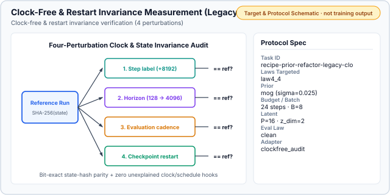
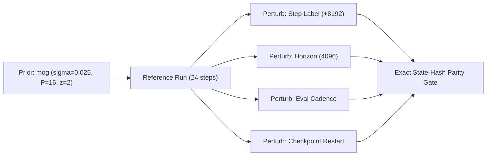

<!-- Generated Forge experiment page — do not edit manually; regenerate via `python -m experiments.forge.experiment_docs` -->

[← Leaderboard](../technique-inventory.md) · [Experiment Catalog](README.md) · [Explore by Laws](../LAWS_HUB.md) · [Research Portal](https://hypergan.github.io/ParticleGAN/)

# Clock-Free & Restart Invariance Measurement (Legacy Prior Cohort) (`recipe-prior-refactor-legacy-clockfree_audit_measurement_v1`)

| Field | Value |
| --- | --- |
| **Laws Tested** | [Law 4.4](../LAWS_HUB.md#law4_4) |
| **Edge Cases** | `clock-invariance` `restart-parity` `state-hygiene` `legacy-prior-cohort` |
| **Primary View (`discriminator_stability`)** | Not in `discriminator_stability` |
| **Four Laws Adherence Role** | — |
| **Fixed Full-Suite Denominator** | No (diagnostic / auxiliary cohort) |
| **Adapter / Domain** | `clockfree_audit` / `clockfree_parity` |
| **Prior** | `mog` (sigma=`0.025`, standardize=`False`) |
| **Update Budget** | `24` steps |

## What This Experiment Tests

Historical pre-refactor comparison cohort of `clockfree_audit_measurement_v1` retained under its original prior ownership contract so legacy baselines stay strictly separated from `recipe_owned_v1` tasks. Diagnostic measurement version of `clockfree_audit` that executes all four clock/restart parity perturbations even on explicitly scheduled recipes so hidden clock dependencies are transparently measured rather than refused.

> [!NOTE]
> **Protocol notes:** Retained legacy diagnostic cohort for `clockfree_audit_measurement_v1` before the recipe-owned prior refactor; cannot substitute for current ordinary qualification cells.

## Laws & Edge Cases Targeted

- **[Law 4.4: Trajectory Scale vs. Settling](../LAWS_HUB.md#law4_4)** ([Law 4.4 theory](../../../docs/four-laws.md#law-4--functional-and-game-dynamics)) — Can the learning system realize useful functional changes and exhibit appropriate coupled learning dynamics?
- **Edge-case tags:** `clock-invariance`, `restart-parity`, `state-hygiene`, `legacy-prior-cohort`

## Common Failure Mode

Scheduled baselines (e.g., cosine decay or lazy penalty intervals) diverge across horizon and step-label perturbations, exposing non-stationary clock dependence.

## Visual Schematic



*Target & Protocol Schematic · not training output — generated deterministically from the declared task contract.*

## Protocol & Architecture Diagram



## Task Contract & Numerical Gates

### Execution & Sampling Contract

| Contract Field | Declared Value |
| --- | --- |
| Initializer | `deterministic_orthogonal` |
| Prior | `mog` (sigma=`0.025`, standardize=`False`) |
| Update Budget | `24` steps |
| Batch Size | `8` |
| Particles / Latent Dim | `P=16` / `z_dim=2` |
| Sampling Law | `public_prior_without_output_noise` |
| Evaluation Output Noise | `clean` |
| Scoring Weights | `live` |
| Architecture | `fourier=2, hidden=16, layers=2` |

### Numerical Pass/Fail Thresholds

| Metric | Operator | Threshold |
| --- | :---: | ---: |
| `parity.step_label` | `==` | `exact state hash` |
| `parity.horizon` | `==` | `exact state hash` |
| `parity.evaluation_cadence` | `==` | `exact state hash` |
| `parity.restart` | `==` | `exact state hash` |

## Recorded Family Results

> [!IMPORTANT]
> Screening outcomes below come from recorded single-seed (`seed = 0`) Forge evidence. `NOT MEASURED`, `BLOCKED`, and `INCOMPATIBLE` are non-numerical states — not scientific failures — and confer no pass or qualification credit.

No selected-family cohort cells are recorded for this task in the current `reports/forge/technique-inventory.json`.

## Reproduce This Experiment

```bash
# Validate this task declaration and inspect planned dependencies
python -m experiments.forge validate
python -m experiments.forge plan --view discriminator_stability --candidate unified-v12 --tasks recipe-prior-refactor-legacy-clockfree_audit_measurement_v1
```

**Declaration & Source Files:**

- Task contract: [configs/forge/tasks/recipe-prior-refactor-legacy-clockfree_audit_measurement_v1.json](../../../configs/forge/tasks/recipe-prior-refactor-legacy-clockfree_audit_measurement_v1.json)

## Annotation Provenance

This page was assembled read-only from the following versioned inputs without altering any task execution/evaluation fingerprint:

- **Task contract JSON:** [configs/forge/tasks/recipe-prior-refactor-legacy-clockfree_audit_measurement_v1.json](../../../configs/forge/tasks/recipe-prior-refactor-legacy-clockfree_audit_measurement_v1.json)
- **Editorial task documentation sidecar:** [configs/forge/task-documentation/recipe-prior-refactor-legacy-clockfree_audit_measurement_v1.json](../../../configs/forge/task-documentation/recipe-prior-refactor-legacy-clockfree_audit_measurement_v1.json)
