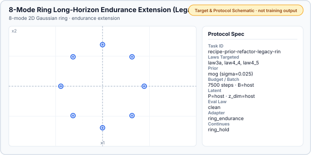
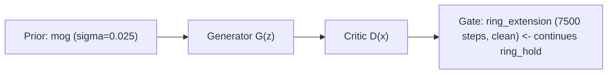

<!-- Generated Forge experiment page — do not edit manually; regenerate via `python -m experiments.forge.experiment_docs` -->

[← Leaderboard](../technique-inventory.md) · [Experiment Catalog](README.md) · [Explore by Laws](../LAWS_HUB.md) · [Research Portal](https://hypergan.github.io/ParticleGAN/)

# 8-Mode Ring Long-Horizon Endurance Extension (Legacy Prior Cohort) (`recipe-prior-refactor-legacy-ring_extension`)

| Field | Value |
| --- | --- |
| **Laws Tested** | [Law 3A](../LAWS_HUB.md#law3a) · [Law 4.4](../LAWS_HUB.md#law4_4) · [Law 4.5](../LAWS_HUB.md#law4_5) |
| **Edge Cases** | `long-horizon-stability` `checkpoint-continuation` `mode-retention` `legacy-prior-cohort` |
| **Primary View (`discriminator_stability`)** | Not in `discriminator_stability` |
| **Four Laws Adherence Role** | — |
| **Fixed Full-Suite Denominator** | No (diagnostic / auxiliary cohort) |
| **Adapter / Domain** | `ring_endurance` / `ring_extension` |
| **Prior** | `mog` (sigma=`0.025`, standardize=`False`) |
| **Update Budget** | `7500` steps |

## What This Experiment Tests

Historical pre-refactor comparison cohort of `ring_extension` retained under its original prior ownership contract so legacy baselines stay strictly separated from `recipe_owned_v1` tasks. Continues the candidate's converged `ring_hold` state without resetting or re-annealing to test whether all 8 modes and high sample quality (hq >= 0.90) persist over an extended training horizon.

> [!NOTE]
> **Protocol notes:** Retained legacy diagnostic cohort for `ring_extension` before the recipe-owned prior refactor; cannot substitute for current ordinary qualification cells.

## Laws & Edge Cases Targeted

- **[Law 3A: Unconditional W1 Ray-Length & Screening Identifiability](../LAWS_HUB.md#law3a)** ([Law 3A theory](../../../docs/four-laws.md#law-3--transport-identifiability)) — Does the learning system possess enough information to determine appropriate transport?
- **[Law 4.4: Trajectory Scale vs. Settling](../LAWS_HUB.md#law4_4)** ([Law 4.4 theory](../../../docs/four-laws.md#law-4--functional-and-game-dynamics)) — Can the learning system realize useful functional changes and exhibit appropriate coupled learning dynamics?
- **[Law 4.5: Coupled Minimax Contraction](../LAWS_HUB.md#law4_5)** ([Law 4.5 theory](../../../docs/four-laws.md#law-4--functional-and-game-dynamics)) — Can the learning system realize useful functional changes and exhibit appropriate coupled learning dynamics?
- **Edge-case tags:** `long-horizon-stability`, `checkpoint-continuation`, `mode-retention`, `legacy-prior-cohort`

## Common Failure Mode

Slow prior drift, step-size decay artifacts, or undamped minimax cycles cause delayed mode collapse hundreds of updates after initial convergence.

## Visual Schematic



*Target & Protocol Schematic · not training output — generated deterministically from the declared task contract.*

## Protocol & Architecture Diagram



## Task Contract & Numerical Gates

### Execution & Sampling Contract

| Contract Field | Declared Value |
| --- | --- |
| Initializer | `deterministic_orthogonal` |
| Prior | `mog` (sigma=`0.025`, standardize=`False`) |
| Update Budget | `7500` steps |
| Batch Size | `host-declared` |
| Particles / Latent Dim | `P=host` / `z_dim=host` |
| Sampling Law | `public_prior_without_output_noise` |
| Evaluation Output Noise | `clean` |
| Scoring Weights | `live` |
| Continuation Parent | [`ring_hold`](ring_hold.md) |
| Dependencies | [`ring_hold`](ring_hold.md) (`checkpoint`) |

### Numerical Pass/Fail Thresholds

| Metric | Operator | Threshold |
| --- | :---: | ---: |
| `modes` | `==` | `8` |
| `hq` | `>=` | `0.9` |
| `hq` | `<=` | `1.0` |

## Recorded Family Results

> [!IMPORTANT]
> Screening outcomes below come from recorded single-seed (`seed = 0`) Forge evidence. `NOT MEASURED`, `BLOCKED`, and `INCOMPATIBLE` are non-numerical states — not scientific failures — and confer no pass or qualification credit.

No selected-family cohort cells are recorded for this task in the current `reports/forge/technique-inventory.json`.

## Reproduce This Experiment

```bash
# Validate this task declaration and inspect planned dependencies
python -m experiments.forge validate
python -m experiments.forge plan --view discriminator_stability --candidate unified-v12 --tasks recipe-prior-refactor-legacy-ring_extension
```

**Declaration & Source Files:**

- Task contract: [configs/forge/tasks/recipe-prior-refactor-legacy-ring_extension.json](../../../configs/forge/tasks/recipe-prior-refactor-legacy-ring_extension.json)
- Source code: [reports/toy100/gap-fill-20260925/sources/k3p/convergence_gate.py](../../toy100/gap-fill-20260925/sources/k3p/convergence_gate.py)

## Annotation Provenance

This page was assembled read-only from the following versioned inputs without altering any task execution/evaluation fingerprint:

- **Task contract JSON:** [configs/forge/tasks/recipe-prior-refactor-legacy-ring_extension.json](../../../configs/forge/tasks/recipe-prior-refactor-legacy-ring_extension.json)
- **Editorial task documentation sidecar:** [configs/forge/task-documentation/recipe-prior-refactor-legacy-ring_extension.json](../../../configs/forge/task-documentation/recipe-prior-refactor-legacy-ring_extension.json)
- **Read-only Python AST source:** [reports/toy100/gap-fill-20260925/sources/k3p/convergence_gate.py](../../toy100/gap-fill-20260925/sources/k3p/convergence_gate.py) (AST symbols: `__doc__`)
