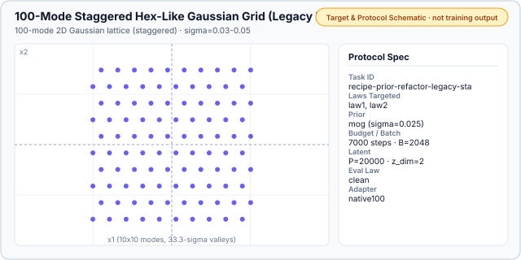
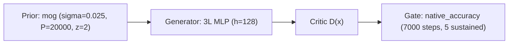

<!-- Generated Forge experiment page — do not edit manually; regenerate via `python -m experiments.forge.experiment_docs` -->

[← Leaderboard](../technique-inventory.md) · [Experiment Catalog](README.md) · [Explore by Laws](../LAWS_HUB.md) · [Research Portal](https://hypergan.github.io/ParticleGAN/)

# 100-Mode Staggered Hex-Like Gaussian Grid (Legacy Prior Cohort) (`recipe-prior-refactor-legacy-staggered100`)

| Field | Value |
| --- | --- |
| **Laws Tested** | [Law 1](../LAWS_HUB.md#law1) · [Law 2](../LAWS_HUB.md#law2) |
| **Edge Cases** | `disconnected-support` `100-modes` `staggered-lattice` `legacy-prior-cohort` |
| **Primary View (`discriminator_stability`)** | Not in `discriminator_stability` |
| **Four Laws Adherence Role** | — |
| **Fixed Full-Suite Denominator** | No (diagnostic / auxiliary cohort) |
| **Adapter / Domain** | `native100` / `native_accuracy` |
| **Prior** | `mog` (sigma=`0.025`, standardize=`False`) |
| **Update Budget** | `7000` steps |

## What This Experiment Tests

Historical pre-refactor comparison cohort of `staggered100` retained under its original prior ownership contract so legacy baselines stay strictly separated from `recipe_owned_v1` tasks. Shifts alternating rows of the 10x10 Gaussian lattice by half a spacing, breaking rectangular grid symmetry to stress streaming prototype assignment and continuous local pushforward geometry.

> [!NOTE]
> **Protocol notes:** Retained legacy diagnostic cohort for `staggered100` before the recipe-owned prior refactor; cannot substitute for current ordinary qualification cells.

## Laws & Edge Cases Targeted

- **[Law 1: Representational Geometry](../LAWS_HUB.md#law1)** ([Law 1 theory](../../../docs/four-laws.md#law-1--representational-geometry)) — Can the system represent the required probability measure efficiently and faithfully?
- **[Law 2: Potential Geometry](../LAWS_HUB.md#law2)** ([Law 2 theory](../../../docs/four-laws.md#law-2--potential-geometry)) — Does the critic communicate useful learning forces with appropriate geometric control and computational efficiency?
- **Edge-case tags:** `disconnected-support`, `100-modes`, `staggered-lattice`, `legacy-prior-cohort`

## Common Failure Mode

Voronoi/Laguerre charts or coordinate-aligned representations struggle with staggered neighbor topology, causing lingering bridge samples or under-covered rows.

## Visual Schematic



*Target & Protocol Schematic · not training output — generated deterministically from the declared task contract.*

## Protocol & Architecture Diagram



## Task Contract & Numerical Gates

### Execution & Sampling Contract

| Contract Field | Declared Value |
| --- | --- |
| Initializer | `deterministic_orthogonal` |
| Prior | `mog` (sigma=`0.025`, standardize=`False`) |
| Update Budget | `7000` steps |
| Batch Size | `2048` |
| Particles / Latent Dim | `P=20000` / `z_dim=2` |
| Sampling Law | `public_prior_without_output_noise` |
| Evaluation Output Noise | `clean` |
| Scoring Weights | `live` |
| Architecture | `fourier=2, hidden=128, layers=3` |

### Numerical Pass/Fail Thresholds

| Metric | Operator | Threshold |
| --- | :---: | ---: |
| `all_finite` | `==` | `True` |
| `max_cov_eig_ratio` | `<=` | `1.7` |
| `max_mass_tv` | `<=` | `0.1` |
| `max_mode_mass` | `<=` | `0.02` |
| `max_radial_median_ratio` | `<=` | `1.4` |
| `min_cov_eig_ratio` | `>=` | `0.4` |
| `min_hq_mode_mass` | `>=` | `0.005` |
| `min_modes` | `>=` | `100` |
| `min_precision` | `>=` | `0.97` |
| `min_radial_median_ratio` | `>=` | `0.65` |
| `min_samples` | `>=` | `20000` |
| `accuracy.abs_cov_trace_bias` | `<=` | `0.1` |
| `accuracy.center_rms_sigma` | `<=` | `0.2` |
| `accuracy.mass_tv` | `<=` | `0.06` |
| `accuracy.radial_ks` | `<=` | `0.04` |

## Recorded Family Results

> [!IMPORTANT]
> Screening outcomes below come from recorded single-seed (`seed = 0`) Forge evidence. `NOT MEASURED`, `BLOCKED`, and `INCOMPATIBLE` are non-numerical states — not scientific failures — and confer no pass or qualification credit.

No selected-family cohort cells are recorded for this task in the current `reports/forge/technique-inventory.json`.

## Reproduce This Experiment

```bash
# Validate this task declaration and inspect planned dependencies
python -m experiments.forge validate
python -m experiments.forge plan --view discriminator_stability --candidate unified-v12 --tasks recipe-prior-refactor-legacy-staggered100
```

**Declaration & Source Files:**

- Task contract: [configs/forge/tasks/recipe-prior-refactor-legacy-staggered100.json](../../../configs/forge/tasks/recipe-prior-refactor-legacy-staggered100.json)
- Source code: [benchmarks/toy100/__main__.py](../../../benchmarks/toy100/__main__.py)
- Source code: [benchmarks/toy100/accuracy.py](../../../benchmarks/toy100/accuracy.py)
- Source code: [benchmarks/toy100/accuracy_gate.py](../../../benchmarks/toy100/accuracy_gate.py)
- Source code: [benchmarks/toy100/affine_replay.py](../../../benchmarks/toy100/affine_replay.py)
- Source code: [benchmarks/toy100/device.py](../../../benchmarks/toy100/device.py)
- Source code: [benchmarks/toy100/gate.py](../../../benchmarks/toy100/gate.py)
- Source code: [benchmarks/toy100/metrics.py](../../../benchmarks/toy100/metrics.py)
- Source code: [benchmarks/toy100/train.py](../../../benchmarks/toy100/train.py)
- Source code: [benchmarks/toy_suite.py](../../../benchmarks/toy_suite.py)

## Annotation Provenance

This page was assembled read-only from the following versioned inputs without altering any task execution/evaluation fingerprint:

- **Task contract JSON:** [configs/forge/tasks/recipe-prior-refactor-legacy-staggered100.json](../../../configs/forge/tasks/recipe-prior-refactor-legacy-staggered100.json)
- **Editorial task documentation sidecar:** [configs/forge/task-documentation/recipe-prior-refactor-legacy-staggered100.json](../../../configs/forge/task-documentation/recipe-prior-refactor-legacy-staggered100.json)
- **Read-only Python AST source:** [benchmarks/toy100/__main__.py](../../../benchmarks/toy100/__main__.py) (AST symbols: `__doc__`)
- **Read-only Python AST source:** [benchmarks/toy100/accuracy.py](../../../benchmarks/toy100/accuracy.py) (AST symbols: `__doc__`)
- **Read-only Python AST source:** [benchmarks/toy100/accuracy_gate.py](../../../benchmarks/toy100/accuracy_gate.py) (AST symbols: `__doc__`)
- **Read-only Python AST source:** [benchmarks/toy100/affine_replay.py](../../../benchmarks/toy100/affine_replay.py) (AST symbols: `__doc__`)
- **Read-only Python AST source:** [benchmarks/toy100/device.py](../../../benchmarks/toy100/device.py) (AST symbols: `__doc__`)
- **Read-only Python AST source:** [benchmarks/toy100/gate.py](../../../benchmarks/toy100/gate.py) (AST symbols: `__doc__`)
- **Read-only Python AST source:** [benchmarks/toy100/metrics.py](../../../benchmarks/toy100/metrics.py) (AST symbols: `__doc__`)
- **Read-only Python AST source:** [benchmarks/toy100/train.py](../../../benchmarks/toy100/train.py) (AST symbols: `__doc__`)
- **Read-only Python AST source:** [benchmarks/toy_suite.py](../../../benchmarks/toy_suite.py) (AST symbols: `__doc__`)
