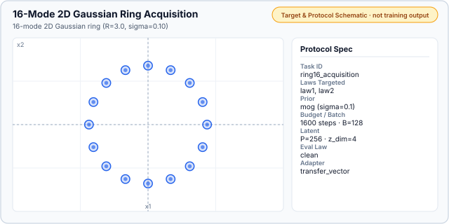
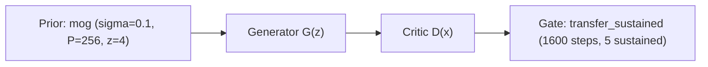

<!-- Generated Forge experiment page — do not edit manually; regenerate via `python -m experiments.forge.experiment_docs` -->

[← Leaderboard](../technique-inventory.md) · [Experiment Catalog](README.md) · [Explore by Laws](../LAWS_HUB.md) · [Research Portal](https://hypergan.github.io/ParticleGAN/)

# 16-Mode 2D Gaussian Ring Acquisition (`ring16_acquisition`)

| Field | Value |
| --- | --- |
| **Laws Tested** | [Law 1](../LAWS_HUB.md#law1) · [Law 2](../LAWS_HUB.md#law2) |
| **Edge Cases** | `disconnected-support` `ring-mixture` `covariance-calibration` |
| **Primary View (`discriminator_stability`)** | Tier 1 (required) |
| **Four Laws Adherence Role** | — |
| **Fixed Full-Suite Denominator** | Yes (71-test fixed denominator) |
| **Adapter / Domain** | `transfer_vector` / `transfer_sustained` |
| **Prior** | `mog` (sigma=`0.1`, standardize=`False`) |
| **Update Budget** | `1600` steps |

## What This Experiment Tests

Core Tier-1 multimodal acquisition test: recover all 16 equally weighted 2D Gaussians arranged on a circle (R=3.0, sigma=0.10) with balanced occupancy (mass_tv <= 0.15), high quality (hq >= 0.85), and non-collapsed per-mode covariance.

> [!NOTE]
> **Protocol notes:** Tier-1 required benchmark (clean live evaluation over 4,096 samples, 24 observations).

## Laws & Edge Cases Targeted

- **[Law 1: Representational Geometry](../LAWS_HUB.md#law1)** ([Law 1 theory](../../../docs/four-laws.md#law-1--representational-geometry)) — Can the system represent the required probability measure efficiently and faithfully?
- **[Law 2: Potential Geometry](../LAWS_HUB.md#law2)** ([Law 2 theory](../../../docs/four-laws.md#law-2--potential-geometry)) — Does the critic communicate useful learning forces with appropriate geometric control and computational efficiency?
- **Edge-case tags:** `disconnected-support`, `ring-mixture`, `covariance-calibration`

## Common Failure Mode

Mode dropping, inter-mode bridges along chords of the circle, or collapsed per-mode eigenvalues (component_min_eigen_ratio < 0.15) caused by poor Law 1 support geometry or unstable critic forces.

**Historical audit diagnosis** (`reports/forge/problem-definitions.json`): The selected K3P, KA2, R1/R2 and GAN v3 measurements fail this Tier 1 gate, preventing later qualification. Their results on other questions do not erase this acquisition failure.

- *Recommended research focus:* Retain the passing ring baseline while repairing the held tests. Longer-budget or changed-schedule results must remain explicitly separate until adopted and measured.

## Visual Schematic



*Target & Protocol Schematic · not training output — generated deterministically from the declared task contract.*

## Protocol & Architecture Diagram



## Task Contract & Numerical Gates

### Execution & Sampling Contract

| Contract Field | Declared Value |
| --- | --- |
| Initializer | `deterministic_orthogonal` |
| Prior | `mog` (sigma=`0.1`, standardize=`False`) |
| Update Budget | `1600` steps |
| Batch Size | `128` |
| Particles / Latent Dim | `P=256` / `z_dim=4` |
| Sampling Law | `public_prior_without_output_noise` |
| Evaluation Output Noise | `clean` |
| Scoring Weights | `live` |
| Assigned Views | `bcap-projection-baseline-repair-diagnostic-v1` (T1 diagnostic), `discriminator_stability` (T1 required), `lazy_cadence_coverage` (T1 diagnostic), `prior-ablation-full-suite-v1` (T1 diagnostic), `r4-occam-ablation-v1` (T1 diagnostic) |

### Numerical Pass/Fail Thresholds

| Metric | Operator | Threshold |
| --- | :---: | ---: |
| `sample_count` | `>=` | `4096` |
| `modes` | `>=` | `16` |
| `mass_tv` | `<=` | `0.15` |
| `hq` | `>=` | `0.85` |
| `component_covariance_error` | `<=` | `0.85` |
| `component_min_eigen_ratio` | `>=` | `0.15` |

## Recorded Family Results

> [!IMPORTANT]
> Screening outcomes below come from recorded single-seed (`seed = 0`) Forge evidence. `NOT MEASURED`, `BLOCKED`, and `INCOMPATIBLE` are non-numerical states — not scientific failures — and confer no pass or qualification credit.

| Family | Selected Candidate | Outcome | Key Recorded Metrics | Family Report | Training Media |
| --- | --- | :---: | --- | --- | --- |
| **Axiom** | `axiom-v4` | **PASS** | recomputed complete live curve and terminal suffix | [Axiom](../families/axiom.md#cohort-cuda-daa283c8a640) | — |
| **BCAP** | `recipe-prior-refactor-bcap-pure-v1` | **PASS** | recomputed complete live curve and terminal suffix | [BCAP](../families/bcap-pure.md#cohort-cuda-1bf9d7d34422) | [HF GIF](https://huggingface.co/datasets/HyperGAN/particlegan-forge-evidence/resolve/main/media/forge/pure-bcap/media/5ea5bdbb2d71/ring16_acquisition.gif) |
| **BISPF** | `bispf-optimized-quintic-v1` | **PASS** | recomputed complete live curve and terminal suffix | [BISPF](../families/bispf.md#cohort-cuda-1bf9d7d34422) | — |
| **EMPF** | `empf-v8` | **PASS** | recomputed complete live curve and terminal suffix | [EMPF](../families/empf.md#cohort-cuda-23a94f16ca88) | — |
| **RHBI** | `rhbi-v12` | **PASS** | recomputed complete live curve and terminal suffix | [RHBI](../families/rhbi.md#cohort-cuda-23a94f16ca88) | — |
| **Unified** | `unified-v11` | **PASS** | recomputed complete live curve and terminal suffix | [Unified](../families/unified.md#cohort-cuda-42a130a78fc3) | — |
| **Atlas** | `atlas-particle-normal-v4` | **FAIL** | recomputed complete live curve and terminal suffix | [Atlas](../families/atlas.md#cohort-cuda-bc3debd3fa5e) | — |
| **E22** | `e22` | `BLOCKED` | Skipped incompatible test: ring16_acquisition: clean/live scoring has no declared policy-c | [E22](../families/e22.md#cohort-cuda-1bf9d7d34422) | — |
| **GAN v3 release 0.7** | `recipe-prior-refactor-release07-gan-v3-v1` | **FAIL** | recomputed complete live curve and terminal suffix | [GAN v3 release 0.7](../families/release07-gan-v3.md#cohort-cuda-1bf9d7d34422) | [HF GIF](https://huggingface.co/datasets/HyperGAN/particlegan-forge-evidence/resolve/main/media/forge/tier1-completion/media/release07-gan-v3/d151441783bc409aaff7320fe9789542/ring16_acquisition.gif) |
| **K3P** | `recipe-prior-refactor-k3p-v1` | **FAIL** | recomputed complete live curve and terminal suffix | [K3P](../families/k3p.md#cohort-cuda-1bf9d7d34422) | [HF GIF](https://huggingface.co/datasets/HyperGAN/particlegan-forge-evidence/resolve/main/media/forge/tier1-completion/media/k3p/d6d907c833524c1ea23374d90c548cf6/ring16_acquisition.gif) |
| **KA2** | `recipe-prior-refactor-ka2-v1` | **FAIL** | recomputed complete live curve and terminal suffix | [KA2](../families/ka2.md#cohort-cuda-1bf9d7d34422) | [HF GIF](https://huggingface.co/datasets/HyperGAN/particlegan-forge-evidence/resolve/main/media/forge/tier1-completion/media/ka2/764fcd21c0de4d95a8bb898609dfaa72/ring16_acquisition.gif) |
| **R1/R2** | `recipe-prior-refactor-r1r2-v1` | **FAIL** | recomputed complete live curve and terminal suffix | [R1/R2](../families/r1r2.md#cohort-cuda-1bf9d7d34422) | [HF GIF](https://huggingface.co/datasets/HyperGAN/particlegan-forge-evidence/resolve/main/media/forge/tier1-completion/media/r1r2/b191bd3f88c4487086908f0a1bd51469/ring16_acquisition.gif) |

## Reproduce This Experiment

```bash
# Validate this task declaration and inspect planned dependencies
python -m experiments.forge validate
python -m experiments.forge plan --view discriminator_stability --candidate unified-v12 --tasks ring16_acquisition
```

**Declaration & Source Files:**

- Task contract: [configs/forge/tasks/ring16_acquisition.json](../../../configs/forge/tasks/ring16_acquisition.json)
- Source code: [benchmarks/transfer_suite/vector_tasks.py](../../../benchmarks/transfer_suite/vector_tasks.py)
- Source code: [benchmarks/locked_shared/observation.py](../../../benchmarks/locked_shared/observation.py)
- Source code: [benchmarks/toy_audit/ring16_quality.py](../../../benchmarks/toy_audit/ring16_quality.py)
- Source code: [benchmarks/transfer_suite/protocol.py](../../../benchmarks/transfer_suite/protocol.py)
- Source code: [experiments/forge/transfer_cadence.py](../../../experiments/forge/transfer_cadence.py)

## Annotation Provenance

This page was assembled read-only from the following versioned inputs without altering any task execution/evaluation fingerprint:

- **Task contract JSON:** [configs/forge/tasks/ring16_acquisition.json](../../../configs/forge/tasks/ring16_acquisition.json)
- **Editorial task documentation sidecar:** [configs/forge/task-documentation/ring16_acquisition.json](../../../configs/forge/task-documentation/ring16_acquisition.json)
- **Read-only Python AST source:** [benchmarks/transfer_suite/vector_tasks.py](../../../benchmarks/transfer_suite/vector_tasks.py) (AST symbols: `__doc__`)
- **Read-only Python AST source:** [benchmarks/locked_shared/observation.py](../../../benchmarks/locked_shared/observation.py) (AST symbols: `__doc__`)
- **Read-only Python AST source:** [benchmarks/toy_audit/ring16_quality.py](../../../benchmarks/toy_audit/ring16_quality.py) (AST symbols: `__doc__`)
- **Read-only Python AST source:** [benchmarks/transfer_suite/protocol.py](../../../benchmarks/transfer_suite/protocol.py) (AST symbols: `__doc__`)
- **Read-only Python AST source:** [experiments/forge/transfer_cadence.py](../../../experiments/forge/transfer_cadence.py) (AST symbols: `__doc__`)
