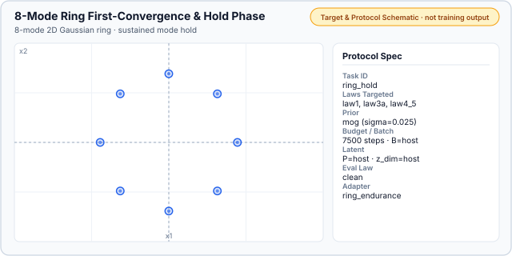
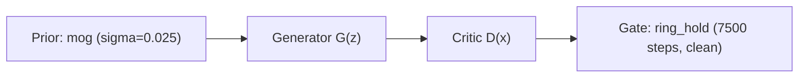

<!-- Generated Forge experiment page — do not edit manually; regenerate via `python -m experiments.forge.experiment_docs` -->

[← Leaderboard](../technique-inventory.md) · [Experiment Catalog](README.md) · [Explore by Laws](../LAWS_HUB.md) · [Research Portal](https://hypergan.github.io/ParticleGAN/)

# 8-Mode Ring First-Convergence & Hold Phase (`ring_hold`)

| Field | Value |
| --- | --- |
| **Laws Tested** | [Law 1](../LAWS_HUB.md#law1) · [Law 3A](../LAWS_HUB.md#law3a) · [Law 4.5](../LAWS_HUB.md#law4_5) |
| **Edge Cases** | `long-horizon-stability` `uninterrupted-endurance` `checkpoint-producer` |
| **Primary View (`discriminator_stability`)** | Tier 3 (diagnostic) |
| **Four Laws Adherence Role** | prerequisite (prerequisite) |
| **Fixed Full-Suite Denominator** | No (diagnostic / auxiliary cohort) |
| **Adapter / Domain** | `ring_endurance` / `ring_hold` |
| **Prior** | `mog` (sigma=`0.025`, standardize=`False`) |
| **Update Budget** | `7500` steps |

## What This Experiment Tests

Monitors dense first-convergence and sustained hold on an 8-mode 2D Gaussian ring (modes == 8, hq >= 0.90) using the archived K3P ConvergenceGate, producing the exact state extended by `ring_extension`.

> [!NOTE]
> **Protocol notes:** Phase parent of `ring_extension` in one uninterrupted execution group; also prerequisite in Four Laws Adherence.

## Laws & Edge Cases Targeted

- **[Law 1: Representational Geometry](../LAWS_HUB.md#law1)** ([Law 1 theory](../../../docs/four-laws.md#law-1--representational-geometry)) — Can the system represent the required probability measure efficiently and faithfully?
- **[Law 3A: Unconditional W1 Ray-Length & Screening Identifiability](../LAWS_HUB.md#law3a)** ([Law 3A theory](../../../docs/four-laws.md#law-3--transport-identifiability)) — Does the learning system possess enough information to determine appropriate transport?
- **[Law 4.5: Coupled Minimax Contraction](../LAWS_HUB.md#law4_5)** ([Law 4.5 theory](../../../docs/four-laws.md#law-4--functional-and-game-dynamics)) — Can the learning system realize useful functional changes and exhibit appropriate coupled learning dynamics?
- **Edge-case tags:** `long-horizon-stability`, `uninterrupted-endurance`, `checkpoint-producer`

## Common Failure Mode

Recipes that briefly hit 8/8 modes and then drift below hq=0.90 or drop a mode fail to lock in a valid hold state.

## Visual Schematic



*Target & Protocol Schematic · not training output — generated deterministically from the declared task contract.*

## Protocol & Architecture Diagram



## Task Contract & Numerical Gates

### Execution & Sampling Contract

| Contract Field | Declared Value |
| --- | --- |
| Initializer | `deterministic_orthogonal` |
| Prior | `mog` (sigma=`0.025`, standardize=`False`) |
| Update Budget | `7500` steps |
| Batch Size | `host-declared` |
| Particles / Latent Dim | `P=host` / `z_dim=host` |
| Sampling Law | `public_prior_without_output_noise` |
| Evaluation Output Noise | `clean` |
| Scoring Weights | `live` |
| Dependencies | [`mode_hold`](mode_hold.md) (`gate`) |
| Assigned Views | `bispf_throughput_endurance` (T1 diagnostic), `clockfree_continuous` (T3 diagnostic), `discriminator_stability` (T3 diagnostic), `formulation_comparison` (T3 diagnostic), `four-laws-adherence-v1` (T1 diagnostic), `host_profile_transfer` (T3 diagnostic), `lazy_cadence_coverage` (T1 diagnostic), `prior-ablation-full-suite-v1` (T1 diagnostic) (+1 more) |

### Numerical Pass/Fail Thresholds

| Metric | Operator | Threshold |
| --- | :---: | ---: |
| `modes` | `==` | `8` |
| `hq` | `>=` | `0.9` |
| `hq` | `<=` | `1.0` |

## Recorded Family Results

> [!IMPORTANT]
> Screening outcomes below come from recorded single-seed (`seed = 0`) Forge evidence. `NOT MEASURED`, `BLOCKED`, and `INCOMPATIBLE` are non-numerical states — not scientific failures — and confer no pass or qualification credit.

| Family | Selected Candidate | Outcome | Key Recorded Metrics | Family Report | Training Media |
| --- | --- | :---: | --- | --- | --- |
| **BISPF** | `bispf-optimized-quintic-v1` | **PASS** | recomputed first-convergence hold | [BISPF](../families/bispf.md#cohort-cuda-1bf9d7d34422) | — |
| **EMPF** | `empf-v8` | **PASS** | no compatible result | [EMPF](../families/empf.md#cohort-cuda-23a94f16ca88) | — |
| **Atlas** | `atlas-particle-normal-v4` | **FAIL** | no compatible result | [Atlas](../families/atlas.md#cohort-cuda-bc3debd3fa5e) | — |
| **Axiom** | `axiom-v4` | `NOT MEASURED` | no compatible result | [Axiom](../families/axiom.md#cohort-cuda-daa283c8a640) | — |
| **BCAP** | `recipe-prior-refactor-bcap-pure-v1` | **FAIL** | Executable: completed in a separate-runtime diagnostic. This ordinary cohort remains not r | [BCAP](../families/bcap-pure.md#cohort-cuda-1bf9d7d34422) | — |
| **E22** | `e22` | `BLOCKED` | Skipped incompatible test: ring_hold: clean/live scoring has no declared policy-control ev | [E22](../families/e22.md#cohort-cuda-1bf9d7d34422) | — |
| **GAN v3 release 0.7** | `recipe-prior-refactor-release07-gan-v3-v1` | **FAIL** | Executable: completed in a separate-runtime diagnostic. This ordinary cohort remains not r | [GAN v3 release 0.7](../families/release07-gan-v3.md#cohort-cuda-1bf9d7d34422) | — |
| **K3P** | `recipe-prior-refactor-k3p-v1` | **FAIL** | Executable: completed in a separate-runtime diagnostic. This ordinary cohort remains not r | [K3P](../families/k3p.md#cohort-cuda-1bf9d7d34422) | — |
| **KA2** | `recipe-prior-refactor-ka2-v1` | **FAIL** | Executable: completed in a separate-runtime diagnostic. This ordinary cohort remains not r | [KA2](../families/ka2.md#cohort-cuda-1bf9d7d34422) | — |
| **R1/R2** | `recipe-prior-refactor-r1r2-v1` | **FAIL** | Executable: completed in a separate-runtime diagnostic. This ordinary cohort remains not r | [R1/R2](../families/r1r2.md#cohort-cuda-1bf9d7d34422) | — |
| **RHBI** | `rhbi-v12` | `NOT MEASURED` | no compatible result | [RHBI](../families/rhbi.md#cohort-cuda-23a94f16ca88) | — |
| **Unified** | `unified-v11` | `NOT MEASURED` | no compatible result | [Unified](../families/unified.md#cohort-cuda-42a130a78fc3) | — |

### Four Laws Adherence Diagnostic Receipts (Separate Cohort)

*Diagnostic readouts and Colab matched-GPU receipts for `four-laws-adherence-v1` (protocol seed `0`, unchanged recipes; research telemetry only — separate from ordinary selected-cohort qualification above and confers no qualification or default-adoption credit):*

| Candidate | Family | GPU | Outcome | `min_margin` | NVML Energy | Key Recorded Metrics | Receipt |
| --- | --- | --- | :---: | ---: | ---: | --- | --- |
| `axiom-v4` | `axiom` | NVIDIA RTX A6000 | **PASS** | — | 9.19 kJ (J-to-PASS) | confirmation_checks=200, converged_step=1400, hold_budget=1200, hold_checks=1200 | [readout-9066cb4353eb435be7819b0c.json](../records/readout-9066cb4353eb435be7819b0c.json) |
| `law4-energy-v11` | `unified` | NVIDIA L4 | **PASS** | — | 2.32 kJ (J-to-PASS) | confirmation_checks=200, converged_step=1400, hold_budget=1200, hold_checks=1200 | [8eece46c65204b8a9942ed6c23439b00.json](../technique-receipts/8eece46c65204b8a9942ed6c23439b00.json) |
| `unified-v11` | `unified` | NVIDIA L4 | **PASS** | — | 3.49 kJ (J-to-PASS) | confirmation_checks=200, converged_step=1400, hold_budget=1200, hold_checks=1200 | [af5d214a8eab426586b8fa2191e1efc1.json](../technique-receipts/af5d214a8eab426586b8fa2191e1efc1.json) |
| `unified-v12` | `unified` | NVIDIA L4 | **PASS** | — | 2.27 kJ (J-to-PASS) | confirmation_checks=200, converged_step=1400, hold_budget=1200, hold_checks=1200 | [d5de4369af7f46dca241b99a499339c0.json](../technique-receipts/d5de4369af7f46dca241b99a499339c0.json) |
| `unified-v14` | `unified` | NVIDIA L4 | **PASS** | — | 2.49 kJ (J-to-PASS) | confirmation_checks=200, converged_step=1400, hold_budget=1200, hold_checks=1200 | [2136c47e66e747808acefb3d265916a6.json](../technique-receipts/2136c47e66e747808acefb3d265916a6.json) |
| `minimal-v2` | `minimal` | NVIDIA L4 | **FAIL** | — | 7.36 kJ | confirmation_checks=200, converged_step=2816, first_hold_failure=2841, hold_budget=1200 | [bff5b9ea00b94159bc757045832938c8.json](../technique-receipts/bff5b9ea00b94159bc757045832938c8.json) |

## Reproduce This Experiment

```bash
# Validate this task declaration and inspect planned dependencies
python -m experiments.forge validate
python -m experiments.forge plan --view discriminator_stability --candidate unified-v12 --tasks ring_hold
```

**Declaration & Source Files:**

- Task contract: [configs/forge/tasks/ring_hold.json](../../../configs/forge/tasks/ring_hold.json)
- Source code: [reports/toy100/gap-fill-20260925/sources/k3p/convergence_gate.py](../../toy100/gap-fill-20260925/sources/k3p/convergence_gate.py)

## Annotation Provenance

This page was assembled read-only from the following versioned inputs without altering any task execution/evaluation fingerprint:

- **Task contract JSON:** [configs/forge/tasks/ring_hold.json](../../../configs/forge/tasks/ring_hold.json)
- **Editorial task documentation sidecar:** [configs/forge/task-documentation/ring_hold.json](../../../configs/forge/task-documentation/ring_hold.json)
- **Read-only Python AST source:** [reports/toy100/gap-fill-20260925/sources/k3p/convergence_gate.py](../../toy100/gap-fill-20260925/sources/k3p/convergence_gate.py) (AST symbols: `__doc__`)
