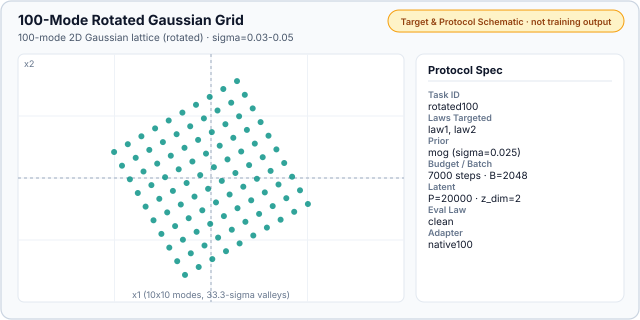
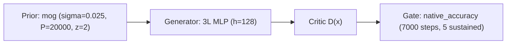

<!-- Generated Forge experiment page — do not edit manually; regenerate via `python -m experiments.forge.experiment_docs` -->

[← Leaderboard](../technique-inventory.md) · [Experiment Catalog](README.md) · [Explore by Laws](../LAWS_HUB.md) · [Research Portal](https://hypergan.github.io/ParticleGAN/)

# 100-Mode Rotated Gaussian Grid (`rotated100`)

| Field | Value |
| --- | --- |
| **Laws Tested** | [Law 1](../LAWS_HUB.md#law1) · [Law 2](../LAWS_HUB.md#law2) |
| **Edge Cases** | `disconnected-support` `100-modes` `non-axis-aligned` |
| **Primary View (`discriminator_stability`)** | Tier 2 (required) |
| **Four Laws Adherence Role** | — |
| **Fixed Full-Suite Denominator** | Yes (71-test fixed denominator) |
| **Adapter / Domain** | `native100` / `native_accuracy` |
| **Prior** | `mog` (sigma=`0.025`, standardize=`False`) |
| **Update Budget** | `7000` steps |

## What This Experiment Tests

Rotates the 10x10 Gaussian grid off the coordinate axes to verify that a trainer's 100-mode recovery is geometrically invariant and not exploiting axis-aligned separability.

> [!NOTE]
> **Protocol notes:** Tier-2 required benchmark (7,000 updates, clean live weights, untouched holdout gate).

## Laws & Edge Cases Targeted

- **[Law 1: Representational Geometry](../LAWS_HUB.md#law1)** ([Law 1 theory](../../../docs/four-laws.md#law-1--representational-geometry)) — Can the system represent the required probability measure efficiently and faithfully?
- **[Law 2: Potential Geometry](../LAWS_HUB.md#law2)** ([Law 2 theory](../../../docs/four-laws.md#law-2--potential-geometry)) — Does the critic communicate useful learning forces with appropriate geometric control and computational efficiency?
- **Edge-case tags:** `disconnected-support`, `100-modes`, `non-axis-aligned`

## Common Failure Mode

Axis-biased quantizers, separable coordinate heuristics, or poorly conditioned generators leave bridge mass along rotated diagonals and miss precision or covariance gates.

**Historical audit diagnosis** (`reports/forge/problem-definitions.json`): BCAP/BISPF put only 26–27% of samples on target, against 97% required. Some blobs are thin or nearly empty; the best audited 7,000-update result reaches 51%, still below the gate.

- *Recommended research focus:* Improve both precise placement and within-cluster shape, then meet the sustained checks and independent holdout. Longer training alone has not solved it.

## Visual Schematic



*Target & Protocol Schematic · not training output — generated deterministically from the declared task contract.*

## Protocol & Architecture Diagram



## Task Contract & Numerical Gates

### Execution & Sampling Contract

| Contract Field | Declared Value |
| --- | --- |
| Initializer | `deterministic_orthogonal` |
| Prior | `mog` (sigma=`0.025`, standardize=`False`) |
| Update Budget | `7000` steps |
| Batch Size | `2048` |
| Particles / Latent Dim | `P=20000` / `z_dim=2` |
| Sampling Law | `public_prior_without_output_noise` |
| Evaluation Output Noise | `clean` |
| Scoring Weights | `live` |
| Architecture | `hidden=128, layers=3, fourier=2` |
| Assigned Views | `adaptation` (T2 required), `bcap-develop-integration-deeper-diagnostic-v1` (T1 diagnostic), `bcap-projection-baseline-repair-diagnostic-v1` (T1 diagnostic), `clockfree_continuous` (T2 required), `discriminator_stability` (T2 required), `formulation_comparison` (T2 required), `host_profile_transfer` (T2 required), `lazy_cadence_coverage` (T1 diagnostic) (+7 more) |

### Numerical Pass/Fail Thresholds

| Metric | Operator | Threshold |
| --- | :---: | ---: |
| `min_samples` | `>=` | `20000` |
| `min_modes` | `>=` | `100` |
| `min_hq_mode_mass` | `>=` | `0.005` |
| `min_precision` | `>=` | `0.75` |
| `max_mass_tv` | `<=` | `0.1` |
| `max_mode_mass` | `<=` | `0.02` |
| `min_cov_eig_ratio` | `>=` | `0.4` |
| `max_cov_eig_ratio` | `<=` | `1.7` |
| `min_radial_median_ratio` | `>=` | `0.65` |
| `max_radial_median_ratio` | `<=` | `1.4` |
| `all_finite` | `==` | `True` |
| `accuracy.mass_tv` | `<=` | `0.06` |
| `accuracy.center_rms_sigma` | `<=` | `0.2` |
| `accuracy.abs_cov_trace_bias` | `<=` | `0.1` |
| `accuracy.radial_ks` | `<=` | `0.04` |

## Recorded Family Results

> [!IMPORTANT]
> Screening outcomes below come from recorded single-seed (`seed = 0`) Forge evidence. `NOT MEASURED`, `BLOCKED`, and `INCOMPATIBLE` are non-numerical states — not scientific failures — and confer no pass or qualification credit.

| Family | Selected Candidate | Outcome | Key Recorded Metrics | Family Report | Training Media |
| --- | --- | :---: | --- | --- | --- |
| **Axiom** | `axiom-v4` | **PASS** | sustained live accuracy and independent holdout pass | [Axiom](../families/axiom.md#cohort-cuda-daa283c8a640) | — |
| **Unified** | `unified-v11` | **PASS** | sustained live accuracy and independent holdout pass | [Unified](../families/unified.md#cohort-cuda-42a130a78fc3) | — |
| **Atlas** | `atlas-particle-normal-v4` | **FAIL** | no compatible result | [Atlas](../families/atlas.md#cohort-cuda-bc3debd3fa5e) | — |
| **BCAP** | `recipe-prior-refactor-bcap-pure-v1` | **FAIL** | coverage, sustained live accuracy, or independent holdout failed | [BCAP](../families/bcap-pure.md#cohort-cuda-1bf9d7d34422) | — |
| **BISPF** | `bispf-optimized-quintic-v1` | **FAIL** | coverage, sustained live accuracy, or independent holdout failed | [BISPF](../families/bispf.md#cohort-cuda-1bf9d7d34422) | — |
| **E22** | `e22` | `BLOCKED` | Skipped incompatible test: rotated100: clean/live scoring has no declared policy-control e | [E22](../families/e22.md#cohort-cuda-1bf9d7d34422) | — |
| **EMPF** | `empf-v8` | **FAIL** | coverage, sustained live accuracy, or independent holdout failed | [EMPF](../families/empf.md#cohort-cuda-23a94f16ca88) | — |
| **GAN v3 release 0.7** | `recipe-prior-refactor-release07-gan-v3-v1` | **FAIL** | no compatible result | [GAN v3 release 0.7](../families/release07-gan-v3.md#cohort-cuda-1bf9d7d34422) | — |
| **K3P** | `recipe-prior-refactor-k3p-v1` | **FAIL** | no compatible result | [K3P](../families/k3p.md#cohort-cuda-1bf9d7d34422) | — |
| **KA2** | `recipe-prior-refactor-ka2-v1` | **FAIL** | no compatible result | [KA2](../families/ka2.md#cohort-cuda-1bf9d7d34422) | — |
| **R1/R2** | `recipe-prior-refactor-r1r2-v1` | **FAIL** | no compatible result | [R1/R2](../families/r1r2.md#cohort-cuda-1bf9d7d34422) | — |
| **RHBI** | `rhbi-v12` | **FAIL** | coverage, sustained live accuracy, or independent holdout failed | [RHBI](../families/rhbi.md#cohort-cuda-23a94f16ca88) | — |

## Reproduce This Experiment

```bash
# Validate this task declaration and inspect planned dependencies
python -m experiments.forge validate
python -m experiments.forge plan --view discriminator_stability --candidate unified-v12 --tasks rotated100
```

**Declaration & Source Files:**

- Task contract: [configs/forge/tasks/rotated100.json](../../../configs/forge/tasks/rotated100.json)
- Source code: [benchmarks/toy100/__main__.py](../../../benchmarks/toy100/__main__.py)
- Source code: [benchmarks/toy100/accuracy.py](../../../benchmarks/toy100/accuracy.py)
- Source code: [benchmarks/toy100/accuracy_gate.py](../../../benchmarks/toy100/accuracy_gate.py)
- Source code: [benchmarks/toy100/affine_replay.py](../../../benchmarks/toy100/affine_replay.py)
- Source code: [benchmarks/toy100/device.py](../../../benchmarks/toy100/device.py)
- Source code: [benchmarks/toy100/gate.py](../../../benchmarks/toy100/gate.py)
- Source code: [benchmarks/toy100/metrics.py](../../../benchmarks/toy100/metrics.py)
- Source code: [benchmarks/toy100/train.py](../../../benchmarks/toy100/train.py)
- Source code: [benchmarks/toy_suite.py](../../../benchmarks/toy_suite.py)

## Annotation Provenance

This page was assembled read-only from the following versioned inputs without altering any task execution/evaluation fingerprint:

- **Task contract JSON:** [configs/forge/tasks/rotated100.json](../../../configs/forge/tasks/rotated100.json)
- **Editorial task documentation sidecar:** [configs/forge/task-documentation/rotated100.json](../../../configs/forge/task-documentation/rotated100.json)
- **Read-only Python AST source:** [benchmarks/toy100/__main__.py](../../../benchmarks/toy100/__main__.py) (AST symbols: `__doc__`)
- **Read-only Python AST source:** [benchmarks/toy100/accuracy.py](../../../benchmarks/toy100/accuracy.py) (AST symbols: `__doc__`)
- **Read-only Python AST source:** [benchmarks/toy100/accuracy_gate.py](../../../benchmarks/toy100/accuracy_gate.py) (AST symbols: `__doc__`)
- **Read-only Python AST source:** [benchmarks/toy100/affine_replay.py](../../../benchmarks/toy100/affine_replay.py) (AST symbols: `__doc__`)
- **Read-only Python AST source:** [benchmarks/toy100/device.py](../../../benchmarks/toy100/device.py) (AST symbols: `__doc__`)
- **Read-only Python AST source:** [benchmarks/toy100/gate.py](../../../benchmarks/toy100/gate.py) (AST symbols: `__doc__`)
- **Read-only Python AST source:** [benchmarks/toy100/metrics.py](../../../benchmarks/toy100/metrics.py) (AST symbols: `__doc__`)
- **Read-only Python AST source:** [benchmarks/toy100/train.py](../../../benchmarks/toy100/train.py) (AST symbols: `__doc__`)
- **Read-only Python AST source:** [benchmarks/toy_suite.py](../../../benchmarks/toy_suite.py) (AST symbols: `__doc__`)
