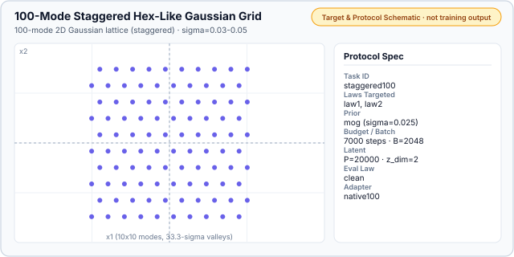
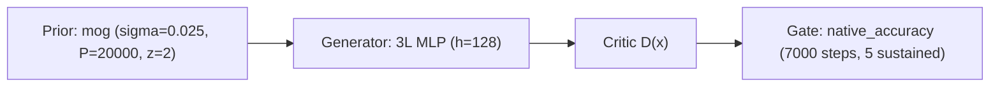

<!-- Generated Forge experiment page — do not edit manually; regenerate via `python -m experiments.forge.experiment_docs` -->

[← Leaderboard](../technique-inventory.md) · [Experiment Catalog](README.md) · [Explore by Laws](../LAWS_HUB.md) · [Research Portal](https://hypergan.github.io/ParticleGAN/)

# 100-Mode Staggered Hex-Like Gaussian Grid (`staggered100`)

| Field | Value |
| --- | --- |
| **Laws Tested** | [Law 1](../LAWS_HUB.md#law1) · [Law 2](../LAWS_HUB.md#law2) |
| **Edge Cases** | `disconnected-support` `100-modes` `staggered-lattice` |
| **Primary View (`discriminator_stability`)** | Tier 2 (required) |
| **Four Laws Adherence Role** | law1 (anchor) |
| **Fixed Full-Suite Denominator** | Yes (71-test fixed denominator) |
| **Adapter / Domain** | `native100` / `native_accuracy` |
| **Prior** | `mog` (sigma=`0.025`, standardize=`False`) |
| **Update Budget** | `7000` steps |

## What This Experiment Tests

Shifts alternating rows of the 10x10 Gaussian lattice by half a spacing, breaking rectangular grid symmetry to stress streaming prototype assignment and continuous local pushforward geometry.

> [!NOTE]
> **Protocol notes:** Tier-2 required benchmark and Law 1 anchor (7,000 updates, clean live weights).

## Laws & Edge Cases Targeted

- **[Law 1: Representational Geometry](../LAWS_HUB.md#law1)** ([Law 1 theory](../../../docs/four-laws.md#law-1--representational-geometry)) — Can the system represent the required probability measure efficiently and faithfully?
- **[Law 2: Potential Geometry](../LAWS_HUB.md#law2)** ([Law 2 theory](../../../docs/four-laws.md#law-2--potential-geometry)) — Does the critic communicate useful learning forces with appropriate geometric control and computational efficiency?
- **Edge-case tags:** `disconnected-support`, `100-modes`, `staggered-lattice`

## Common Failure Mode

Voronoi/Laguerre charts or coordinate-aligned representations struggle with staggered neighbor topology, causing lingering bridge samples or under-covered rows.

**Historical audit diagnosis** (`reports/forge/problem-definitions.json`): BCAP/BISPF put only 30–34% of samples on target, against 97% required. Some blobs are thin or nearly empty; the best audited 7,000-update result reaches 56%, still below the gate.

- *Recommended research focus:* Improve both precise placement and within-cluster shape, then meet the sustained checks and independent holdout. Longer training alone has not solved it.

## Visual Schematic



*Target & Protocol Schematic · not training output — generated deterministically from the declared task contract.*

## Protocol & Architecture Diagram



## Task Contract & Numerical Gates

### Execution & Sampling Contract

| Contract Field | Declared Value |
| --- | --- |
| Initializer | `deterministic_orthogonal` |
| Prior | `mog` (sigma=`0.025`, standardize=`False`) |
| Update Budget | `7000` steps |
| Batch Size | `2048` |
| Particles / Latent Dim | `P=20000` / `z_dim=2` |
| Sampling Law | `public_prior_without_output_noise` |
| Evaluation Output Noise | `clean` |
| Scoring Weights | `live` |
| Architecture | `hidden=128, layers=3, fourier=2` |
| Assigned Views | `adaptation` (T2 required), `bcap-develop-integration-deeper-diagnostic-v1` (T1 diagnostic), `bcap-projection-baseline-repair-diagnostic-v1` (T1 diagnostic), `clockfree_continuous` (T2 required), `discriminator_stability` (T2 required), `formulation_comparison` (T2 required), `four-laws-adherence-v1` (T1 diagnostic), `host_profile_transfer` (T2 required) (+8 more) |

### Numerical Pass/Fail Thresholds

| Metric | Operator | Threshold |
| --- | :---: | ---: |
| `min_samples` | `>=` | `20000` |
| `min_modes` | `>=` | `100` |
| `min_hq_mode_mass` | `>=` | `0.005` |
| `min_precision` | `>=` | `0.75` |
| `max_mass_tv` | `<=` | `0.1` |
| `max_mode_mass` | `<=` | `0.02` |
| `min_cov_eig_ratio` | `>=` | `0.4` |
| `max_cov_eig_ratio` | `<=` | `1.7` |
| `min_radial_median_ratio` | `>=` | `0.65` |
| `max_radial_median_ratio` | `<=` | `1.4` |
| `all_finite` | `==` | `True` |
| `accuracy.mass_tv` | `<=` | `0.06` |
| `accuracy.center_rms_sigma` | `<=` | `0.2` |
| `accuracy.abs_cov_trace_bias` | `<=` | `0.1` |
| `accuracy.radial_ks` | `<=` | `0.04` |

## Recorded Family Results

> [!IMPORTANT]
> Screening outcomes below come from recorded single-seed (`seed = 0`) Forge evidence. `NOT MEASURED`, `BLOCKED`, and `INCOMPATIBLE` are non-numerical states — not scientific failures — and confer no pass or qualification credit.

| Family | Selected Candidate | Outcome | Key Recorded Metrics | Family Report | Training Media |
| --- | --- | :---: | --- | --- | --- |
| **Axiom** | `axiom-v4` | **PASS** | sustained live accuracy and independent holdout pass | [Axiom](../families/axiom.md#cohort-cuda-daa283c8a640) | — |
| **Atlas** | `atlas-particle-normal-v4` | `NOT MEASURED` | no compatible result | [Atlas](../families/atlas.md#cohort-cuda-daa283c8a640) | — |
| **BCAP** | `recipe-prior-refactor-bcap-pure-v1` | **FAIL** | coverage, sustained live accuracy, or independent holdout failed | [BCAP](../families/bcap-pure.md#cohort-cuda-1bf9d7d34422) | — |
| **BISPF** | `bispf-optimized-quintic-v1` | **FAIL** | coverage, sustained live accuracy, or independent holdout failed | [BISPF](../families/bispf.md#cohort-cuda-1bf9d7d34422) | — |
| **E22** | `e22` | `BLOCKED` | Skipped incompatible test: staggered100: clean/live scoring has no declared policy-control | [E22](../families/e22.md#cohort-cuda-1bf9d7d34422) | — |
| **EMPF** | `empf-v8` | **FAIL** | coverage, sustained live accuracy, or independent holdout failed | [EMPF](../families/empf.md#cohort-cuda-23a94f16ca88) | — |
| **GAN v3 release 0.7** | `recipe-prior-refactor-release07-gan-v3-v1` | `NOT MEASURED` | no compatible result | [GAN v3 release 0.7](../families/release07-gan-v3.md#cohort-cuda-daa283c8a640) | — |
| **K3P** | `recipe-prior-refactor-k3p-v1` | `NOT MEASURED` | no compatible result | [K3P](../families/k3p.md#cohort-cuda-daa283c8a640) | — |
| **KA2** | `recipe-prior-refactor-ka2-v1` | `NOT MEASURED` | no compatible result | [KA2](../families/ka2.md#cohort-cuda-daa283c8a640) | — |
| **R1/R2** | `recipe-prior-refactor-r1r2-v1` | `NOT MEASURED` | no compatible result | [R1/R2](../families/r1r2.md#cohort-cuda-daa283c8a640) | — |
| **RHBI** | `rhbi-v12` | **FAIL** | coverage, sustained live accuracy, or independent holdout failed | [RHBI](../families/rhbi.md#cohort-cuda-23a94f16ca88) | — |
| **Unified** | `unified-v11` | **FAIL** | coverage, sustained live accuracy, or independent holdout failed | [Unified](../families/unified.md#cohort-cuda-42a130a78fc3) | — |

### Four Laws Adherence Diagnostic Receipts (Separate Cohort)

*Diagnostic readouts and Colab matched-GPU receipts for `four-laws-adherence-v1` (protocol seed `0`, unchanged recipes; research telemetry only — separate from ordinary selected-cohort qualification above and confers no qualification or default-adoption credit):*

| Candidate | Family | GPU | Outcome | `min_margin` | NVML Energy | Key Recorded Metrics | Receipt |
| --- | --- | --- | :---: | ---: | ---: | --- | --- |
| `axiom-v4` | `axiom` | NVIDIA RTX A6000 | **PASS** | — | 69.11 kJ | abs_cov_trace_bias=0.05485, accuracy_score=0.4587, center_max_sigma=0.1635, center_rms_sigma=0.06944 | [readout-9066cb4353eb435be7819b0c.json](../records/readout-9066cb4353eb435be7819b0c.json) |
| `law4-energy-v11` | `unified` | NVIDIA L4 | **PASS** | — | 18.90 kJ | abs_cov_trace_bias=0.03871, accuracy_score=0.4476, center_max_sigma=0.2325, center_rms_sigma=0.09043 | [22c9dc76c68843e5b38c21ee871e2c1d.json](../technique-receipts/22c9dc76c68843e5b38c21ee871e2c1d.json) |
| `minimal-v2` | `minimal` | NVIDIA L4 | **PASS** | — | 26.81 kJ | abs_cov_trace_bias=0.01851, accuracy_score=0.3363, center_max_sigma=0.2252, center_rms_sigma=0.06795 | [5c7ee8b637954c2eb32d909e9f882540.json](../technique-receipts/5c7ee8b637954c2eb32d909e9f882540.json) |
| `unified-v11` | `unified` | NVIDIA L4 | **PASS** | — | 22.80 kJ | abs_cov_trace_bias=0.07611, accuracy_score=0.6374, center_max_sigma=0.242, center_rms_sigma=0.08875 | [a9f3d355419949758942bbe149d3dcfe.json](../technique-receipts/a9f3d355419949758942bbe149d3dcfe.json) |
| `unified-v12` | `unified` | NVIDIA L4 | **PASS** | — | 22.67 kJ | abs_cov_trace_bias=0.06831, accuracy_score=0.5811, center_max_sigma=0.1384, center_rms_sigma=0.06433 | [e411bea11094438a896d550bf43ddc5a.json](../technique-receipts/e411bea11094438a896d550bf43ddc5a.json) |
| `atlas-particle-normal-v4` | `atlas` | NVIDIA L4 | **FAIL** | — | 55.47 kJ | mass_tv=0.3661, n=100000, precision=0.1718, precision_gap=0.8171 | [cc86462d45ac4b62972498e8d976927e.json](../technique-receipts/cc86462d45ac4b62972498e8d976927e.json) |
| `bispf-optimized-quintic-v1` | `bispf` | NVIDIA L4 | **FAIL** | — | 17.12 kJ | mass_tv=0.1417, n=100000, precision=0.1434, precision_gap=0.8455 | [970cc79a4a9f45548f419a9fd815b30f.json](../technique-receipts/970cc79a4a9f45548f419a9fd815b30f.json) |
| `empf-v8` | `empf` | NVIDIA L4 | **FAIL** | — | 14.23 kJ | abs_cov_trace_bias=0.5769, accuracy_score=6.212, center_max_sigma=2.268, center_rms_sigma=1.209 | [a9a0e272d67c452bb57e3711191fae94.json](../technique-receipts/a9a0e272d67c452bb57e3711191fae94.json) |
| `recipe-prior-refactor-bcap-pure-v1` | `bcap-dualnorm` | NVIDIA L4 | **FAIL** | — | 11.01 kJ | abs_cov_trace_bias=0.5149, accuracy_score=5.829, center_max_sigma=2.469, center_rms_sigma=1.214 | [2ccb8d19ecad46fa877b29ed4d3f0b6e.json](../technique-receipts/2ccb8d19ecad46fa877b29ed4d3f0b6e.json) |
| `recipe-prior-refactor-k3p-v1` | `k3p` | NVIDIA L4 | **FAIL** | — | 5.77 kJ | abs_cov_trace_bias=0.6529, accuracy_score=4.655, center_max_sigma=1.695, center_rms_sigma=0.5205 | [2be6c36bc4684c07998e2cf930a7bec7.json](../technique-receipts/2be6c36bc4684c07998e2cf930a7bec7.json) |
| `recipe-prior-refactor-ka2-v1` | `ka2` | NVIDIA L4 | **FAIL** | — | 6.76 kJ | mass_tv=0.1709, n=100000, precision=0.7074, precision_gap=0.2815 | [eac1c0a94b954a4693094da82a9edbba.json](../technique-receipts/eac1c0a94b954a4693094da82a9edbba.json) |
| `recipe-prior-refactor-r1r2-v1` | `r1r2` | NVIDIA L4 | **FAIL** | — | 5.03 kJ | abs_cov_trace_bias=0.6855, accuracy_score=4.766, center_max_sigma=1.434, center_rms_sigma=0.5834 | [4711f772692b487fa39f0c3a96ea22ce.json](../technique-receipts/4711f772692b487fa39f0c3a96ea22ce.json) |
| `recipe-prior-refactor-release07-gan-v3-v1` | `release07-gan-v3` | NVIDIA L4 | **FAIL** | — | 4.22 kJ | mass_tv=0.2013, n=100000, precision=0.5107, precision_gap=0.4782 | [021742dafd6342b3a9042beb11457416.json](../technique-receipts/021742dafd6342b3a9042beb11457416.json) |

## Reproduce This Experiment

```bash
# Validate this task declaration and inspect planned dependencies
python -m experiments.forge validate
python -m experiments.forge plan --view discriminator_stability --candidate unified-v12 --tasks staggered100
```

**Declaration & Source Files:**

- Task contract: [configs/forge/tasks/staggered100.json](../../../configs/forge/tasks/staggered100.json)
- Source code: [benchmarks/toy100/__main__.py](../../../benchmarks/toy100/__main__.py)
- Source code: [benchmarks/toy100/accuracy.py](../../../benchmarks/toy100/accuracy.py)
- Source code: [benchmarks/toy100/accuracy_gate.py](../../../benchmarks/toy100/accuracy_gate.py)
- Source code: [benchmarks/toy100/affine_replay.py](../../../benchmarks/toy100/affine_replay.py)
- Source code: [benchmarks/toy100/device.py](../../../benchmarks/toy100/device.py)
- Source code: [benchmarks/toy100/gate.py](../../../benchmarks/toy100/gate.py)
- Source code: [benchmarks/toy100/metrics.py](../../../benchmarks/toy100/metrics.py)
- Source code: [benchmarks/toy100/train.py](../../../benchmarks/toy100/train.py)
- Source code: [benchmarks/toy_suite.py](../../../benchmarks/toy_suite.py)

## Annotation Provenance

This page was assembled read-only from the following versioned inputs without altering any task execution/evaluation fingerprint:

- **Task contract JSON:** [configs/forge/tasks/staggered100.json](../../../configs/forge/tasks/staggered100.json)
- **Editorial task documentation sidecar:** [configs/forge/task-documentation/staggered100.json](../../../configs/forge/task-documentation/staggered100.json)
- **Read-only Python AST source:** [benchmarks/toy100/__main__.py](../../../benchmarks/toy100/__main__.py) (AST symbols: `__doc__`)
- **Read-only Python AST source:** [benchmarks/toy100/accuracy.py](../../../benchmarks/toy100/accuracy.py) (AST symbols: `__doc__`)
- **Read-only Python AST source:** [benchmarks/toy100/accuracy_gate.py](../../../benchmarks/toy100/accuracy_gate.py) (AST symbols: `__doc__`)
- **Read-only Python AST source:** [benchmarks/toy100/affine_replay.py](../../../benchmarks/toy100/affine_replay.py) (AST symbols: `__doc__`)
- **Read-only Python AST source:** [benchmarks/toy100/device.py](../../../benchmarks/toy100/device.py) (AST symbols: `__doc__`)
- **Read-only Python AST source:** [benchmarks/toy100/gate.py](../../../benchmarks/toy100/gate.py) (AST symbols: `__doc__`)
- **Read-only Python AST source:** [benchmarks/toy100/metrics.py](../../../benchmarks/toy100/metrics.py) (AST symbols: `__doc__`)
- **Read-only Python AST source:** [benchmarks/toy100/train.py](../../../benchmarks/toy100/train.py) (AST symbols: `__doc__`)
- **Read-only Python AST source:** [benchmarks/toy_suite.py](../../../benchmarks/toy_suite.py) (AST symbols: `__doc__`)
