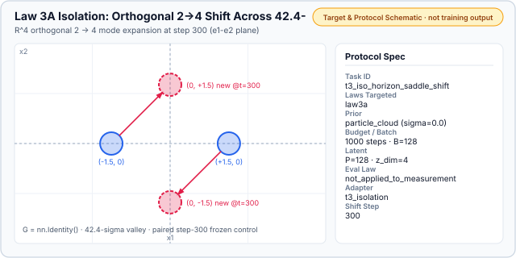
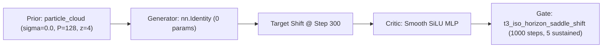

<!-- Generated Forge experiment page — do not edit manually; regenerate via `python -m experiments.forge.experiment_docs` -->

[← Leaderboard](../technique-inventory.md) · [Experiment Catalog](README.md) · [Explore by Laws](../LAWS_HUB.md) · [Research Portal](https://hypergan.github.io/ParticleGAN/)

# Law 3A Isolation: Orthogonal 2->4 Shift Across 42.4-Sigma Valley (`t3_iso_horizon_saddle_shift`)

| Field | Value |
| --- | --- |
| **Laws Tested** | [Law 3A](../LAWS_HUB.md#law3a) |
| **Edge Cases** | `theory-isolation` `non-stationary-shift` `screening-horizon` |
| **Primary View (`discriminator_stability`)** | Tier 2 (stretch) |
| **Four Laws Adherence Role** | law3 (anchor) |
| **Fixed Full-Suite Denominator** | Yes (59-test active runnable denominator) |
| **Adapter / Domain** | `t3_isolation` / `t3_iso_horizon_saddle_shift` |
| **Prior** | `particle_cloud` (sigma=`0.0`, standardize=`False`) |
| **Update Budget** | `1000` steps |

## What This Experiment Tests

With G = nn.Identity() and a smooth SiLU critic, expands an R^4 target at step 300 from 2 modes (+-1.5 e1) to 4 equidistant orthogonal modes (+-1.5 e1, +-1.5 e2) separated by a 42.4-sigma valley, paired with a frozen control.

> [!NOTE]
> **Protocol notes:** Tier-2 stretch benchmark and Four Laws Adherence Law 3 anchor (step-300 shift + paired frozen control).

## Laws & Edge Cases Targeted

- **[Law 3A: Unconditional W1 Ray-Length & Feature-Space Screening Identifiability](../LAWS_HUB.md#law3a)** ([Law 3A theory](../../../docs/four-laws.md#law-3--transport-identifiability)) — Does the learning system possess enough information to determine appropriate transport?
- **Edge-case tags:** `theory-isolation`, `non-stationary-shift`, `screening-horizon`

## Common Failure Mode

Beyond-horizon screening traps particles at the pre-shift symmetric saddle (remaining at 2/4 modes) because local critic forces vanish or cancel across the 42.4-sigma empty valley.

## Visual Schematic



*Target & Protocol Schematic · not training output — generated deterministically from the declared task contract.*

## Protocol & Architecture Diagram



## Task Contract & Numerical Gates

### Execution & Sampling Contract

| Contract Field | Declared Value |
| --- | --- |
| Initializer | `deterministic_orthogonal` |
| Prior | `particle_cloud` (sigma=`0.0`, standardize=`False`) |
| Update Budget | `1000` steps |
| Batch Size | `128` |
| Particles / Latent Dim | `P=128` / `z_dim=4` |
| Sampling Law | `learned_particles_and_critic_gradient` |
| Evaluation Output Noise | `not_applied_to_measurement` |
| Scoring Weights | `live` |
| Architecture | `generator=nn.Identity (0 trainable parameters; direct data-space ParticlePrior), discriminator_family=smooth_silu_mlp, hidden=64, layers=2, in_dim=4` |
| Shift Step | `300` |
| Integrity Guards | `finite_state`, `optimizer_roles`, `exact_optimizer_updates`, `mechanism_exercised`, `rng_isolation` |
| Assigned Views | `discriminator_stability` (T2 stretch), `four-laws-adherence-v1` (T1 diagnostic), `four-laws-adherence-v2` (T1 diagnostic), `r4-occam-ablation-v1` (T1 diagnostic), `t3_causal_isolation_stretch` (T1 diagnostic), `t3_factorial_ablation` (T1 diagnostic) |

### Numerical Pass/Fail Thresholds

| Metric | Operator | Threshold |
| --- | :---: | ---: |
| `finite_fraction` | `==` | `1.0` |
| `critic_grad_med` | `<=` | `1.0` |
| `pre_shift_hq` | `>=` | `0.92` |
| `modes` | `==` | `4` |
| `mass_tv` | `<=` | `0.12` |
| `hq` | `>=` | `0.92` |
| `frozen_control_modes` | `==` | `2` |

## Recorded Family Results

> [!IMPORTANT]
> Screening outcomes below come from recorded single-seed (`seed = 0`) Forge evidence. `NOT MEASURED`, `BLOCKED`, and `INCOMPATIBLE` are non-numerical states — not scientific failures — and confer no pass or qualification credit.

| Family | Selected Candidate | Outcome | Key Recorded Metrics | Family Report | Training Media |
| --- | --- | :---: | --- | --- | --- |
| **Axiom** | `axiom-v4` | **PASS** | recomputed t3_iso_horizon_saddle_shift gates (5/5 terminal checks passed) | [Axiom](../families/axiom.md#cohort-cuda-daa283c8a640) | [HF GIF](https://huggingface.co/datasets/HyperGAN/particlegan-forge-evidence/resolve/main/media/forge/leaderboard/axiom/axiom-v4/t3_iso_horizon_saddle_shift.gif) |
| **Unified** | `unified-v11` | **PASS** | recomputed t3_iso_horizon_saddle_shift gates (5/5 terminal checks passed) | [Unified](../families/unified.md#cohort-cuda-42a130a78fc3) | — |
| **Atlas** | `atlas-particle-normal-v4` | `BLOCKED` | t3_iso_horizon_saddle_shift: clean/live scoring has no declared policy-control evidence an | [Atlas](../families/atlas.md#cohort-cuda-daa283c8a640) | — |
| **BCAP** | `recipe-prior-refactor-bcap-pure-v1` | `NOT MEASURED` | No recorded result for this selected configuration and source. | [BCAP](../families/bcap-pure.md#cohort-cuda-1bf9d7d34422) | — |
| **BISPF** | `bispf-optimized-quintic-v1` | `NOT MEASURED` | No recorded result for this selected configuration and source. | [BISPF](../families/bispf.md#cohort-cuda-1bf9d7d34422) | — |
| **E22** | `e22` | `NOT MEASURED` | No recorded result for this selected configuration and source. | [E22](../families/e22.md#cohort-cuda-1bf9d7d34422) | — |
| **EMPF** | `empf-v8` | `NOT MEASURED` | No recorded result for this selected configuration and source. | [EMPF](../families/empf.md#cohort-cuda-23a94f16ca88) | — |
| **GAN v3 release 0.7** | `recipe-prior-refactor-release07-gan-v3-v1` | `NOT MEASURED` | no compatible result | [GAN v3 release 0.7](../families/release07-gan-v3.md#cohort-cuda-daa283c8a640) | — |
| **K3P** | `recipe-prior-refactor-k3p-v1` | `NOT MEASURED` | no compatible result | [K3P](../families/k3p.md#cohort-cuda-daa283c8a640) | — |
| **KA2** | `recipe-prior-refactor-ka2-v1` | `NOT MEASURED` | no compatible result | [KA2](../families/ka2.md#cohort-cuda-daa283c8a640) | — |
| **R1/R2** | `recipe-prior-refactor-r1r2-v1` | `NOT MEASURED` | no compatible result | [R1/R2](../families/r1r2.md#cohort-cuda-daa283c8a640) | — |
| **RHBI** | `rhbi-v12` | `NOT MEASURED` | No recorded result for this selected configuration and source. | [RHBI](../families/rhbi.md#cohort-cuda-23a94f16ca88) | — |

### Four Laws Adherence Diagnostic Receipts (Separate Cohort)

*Diagnostic readouts and Colab matched-GPU receipts for `four-laws-adherence-v1` (protocol seed `0`, unchanged recipes; research telemetry only — separate from ordinary selected-cohort qualification above and confers no qualification or default-adoption credit):*

| Candidate | Family | GPU | Outcome | `min_margin` | NVML Energy | Key Recorded Metrics | Receipt |
| --- | --- | --- | :---: | ---: | ---: | --- | --- |
| `axiom-v4` | `axiom` | NVIDIA L4 | **PASS** | — | 1.43 kJ (J-to-PASS) | core_component_covariance_error=0.591, critic_grad_med=7.893e-06, finite_fraction=1, frozen_control_modes=2 | [afcecfe2bb134ae0a12d4d65ec248a36.json](../technique-receipts/afcecfe2bb134ae0a12d4d65ec248a36.json) |
| `axiom-v4` | `axiom` | NVIDIA RTX A6000 | **PASS** | — | 6.11 kJ (J-to-PASS) | core_component_covariance_error=0.6081, critic_grad_med=8.083e-06, finite_fraction=1, frozen_control_modes=2 | [readout-9066cb4353eb435be7819b0c.json](../records/readout-9066cb4353eb435be7819b0c.json) |
| `axiom-v5` | `axiom` | NVIDIA L4 | **PASS** | — | 1.43 kJ (J-to-PASS) | core_component_covariance_error=0.6097, critic_grad_med=6.857e-06, finite_fraction=1, frozen_control_modes=2 | [d9118052c92f4e758e11623889a76f7f.json](../technique-receipts/d9118052c92f4e758e11623889a76f7f.json) |
| `law4-energy-v11` | `unified` | NVIDIA L4 | **PASS** | — | 1.45 kJ (J-to-PASS) | core_component_covariance_error=0.6394, critic_grad_med=7.43e-07, finite_fraction=1, frozen_control_modes=2 | [95e512cbb2eb45c9947b681cbce0e4ce.json](../technique-receipts/95e512cbb2eb45c9947b681cbce0e4ce.json) |
| `unified-v11` | `unified` | NVIDIA L4 | **PASS** | — | 1.73 kJ (J-to-PASS) | core_component_covariance_error=0.6394, critic_grad_med=7.43e-07, finite_fraction=1, frozen_control_modes=2 | [64f481b3ef55403aaea13c363a34a9bc.json](../technique-receipts/64f481b3ef55403aaea13c363a34a9bc.json) |
| `unified-v12` | `unified` | NVIDIA L4 | **PASS** | — | 1.41 kJ (J-to-PASS) | core_component_covariance_error=0.6394, critic_grad_med=7.43e-07, finite_fraction=1, frozen_control_modes=2 | [5ab75798535340179b063c0551336d89.json](../technique-receipts/5ab75798535340179b063c0551336d89.json) |
| `unified-v15` | `unified` | NVIDIA L4 | **PASS** | — | 1.46 kJ (J-to-PASS) | core_component_covariance_error=0.6625, critic_grad_med=7.478e-07, finite_fraction=1, frozen_control_modes=2 | [3891cd9606be4527bad9aab7a9ddd2f0.json](../technique-receipts/3891cd9606be4527bad9aab7a9ddd2f0.json) |
| `bispf-optimized-quintic-v1` | `bispf` | NVIDIA L4 | **FAIL** | — | 921 J | core_component_covariance_error=10, critic_grad_med=3.063, finite_fraction=1, frozen_control_modes=0 | [e896fa919ebb4d72b9f5d6ec09dc9b64.json](../technique-receipts/e896fa919ebb4d72b9f5d6ec09dc9b64.json) |
| `empf-v8` | `empf` | NVIDIA L4 | **FAIL** | — | 976 J | core_component_covariance_error=0.7706, critic_grad_med=0.27, finite_fraction=1, frozen_control_modes=2 | [d7d5eecb1851490dbb1f21c34f070614.json](../technique-receipts/d7d5eecb1851490dbb1f21c34f070614.json) |
| `minimal-v2` | `minimal` | NVIDIA L4 | **FAIL** | — | 1.80 kJ | core_component_covariance_error=0.1042, critic_grad_med=0.04421, finite_fraction=1, frozen_control_modes=2 | [7da8b0f058f44766b556a509f7bdf077.json](../technique-receipts/7da8b0f058f44766b556a509f7bdf077.json) |
| `recipe-prior-refactor-bcap-pure-v1` | `bcap-dualnorm` | NVIDIA L4 | **FAIL** | — | 713 J | core_component_covariance_error=0.7124, critic_grad_med=0.2888, finite_fraction=1, frozen_control_modes=2 | [854f1f9c0d5540aaaadac1c796fdd0af.json](../technique-receipts/854f1f9c0d5540aaaadac1c796fdd0af.json) |
| `recipe-prior-refactor-k3p-v1` | `k3p` | NVIDIA L4 | **FAIL** | — | 590 J | core_component_covariance_error=3.114, critic_grad_med=0.3039, finite_fraction=1, frozen_control_modes=2 | [cfe842b129544b70af2b78189b0cd923.json](../technique-receipts/cfe842b129544b70af2b78189b0cd923.json) |
| `recipe-prior-refactor-ka2-v1` | `ka2` | NVIDIA L4 | **FAIL** | — | 661 J | core_component_covariance_error=3.114, critic_grad_med=0.3081, finite_fraction=1, frozen_control_modes=2 | [b5d9f572f6104d8dbb3f94f3c20ede6e.json](../technique-receipts/b5d9f572f6104d8dbb3f94f3c20ede6e.json) |
| `recipe-prior-refactor-r1r2-v1` | `r1r2` | NVIDIA L4 | **FAIL** | — | 505 J | core_component_covariance_error=0.9, critic_grad_med=0.4239, finite_fraction=1, frozen_control_modes=2 | [7f97870ed320476eaa8f1a3d99ef3f9e.json](../technique-receipts/7f97870ed320476eaa8f1a3d99ef3f9e.json) |
| `recipe-prior-refactor-release07-gan-v3-v1` | `release07-gan-v3` | NVIDIA L4 | **FAIL** | — | 504 J | core_component_covariance_error=0.9273, critic_grad_med=0.424, finite_fraction=1, frozen_control_modes=2 | [81003b9f4e114a45bc80785f94d6f84b.json](../technique-receipts/81003b9f4e114a45bc80785f94d6f84b.json) |
| `rhbi-v12` | `rhbi` | NVIDIA L4 | **FAIL** | — | 1.34 kJ | core_component_covariance_error=0.5383, critic_grad_med=3.627e-07, finite_fraction=1, frozen_control_modes=2 | [b414123820bf46db8d92ead2f7462291.json](../technique-receipts/b414123820bf46db8d92ead2f7462291.json) |

## Reproduce This Experiment

```bash
# Validate this task declaration and inspect planned dependencies
python -m experiments.forge validate
python -m experiments.forge plan --view discriminator_stability --candidate unified-v12 --tasks t3_iso_horizon_saddle_shift
```

**Declaration & Source Files:**

- Task contract: [configs/forge/tasks/t3_iso_horizon_saddle_shift.json](../../../configs/forge/tasks/t3_iso_horizon_saddle_shift.json)
- Source code: [benchmarks/toy_audit/api_t3_isolation.py](../../../benchmarks/toy_audit/api_t3_isolation.py)
- Source code: [experiments/forge/t3_isolation.py](../../../experiments/forge/t3_isolation.py)

## Annotation Provenance

This page was assembled read-only from the following versioned inputs without altering any task execution/evaluation fingerprint:

- **Task contract JSON:** [configs/forge/tasks/t3_iso_horizon_saddle_shift.json](../../../configs/forge/tasks/t3_iso_horizon_saddle_shift.json)
- **Editorial task documentation sidecar:** [configs/forge/task-documentation/t3_iso_horizon_saddle_shift.json](../../../configs/forge/task-documentation/t3_iso_horizon_saddle_shift.json)
- **Read-only Python AST source:** [benchmarks/toy_audit/api_t3_isolation.py](../../../benchmarks/toy_audit/api_t3_isolation.py) (AST symbols: `__doc__`, `THRESHOLDS`, `HOST_DEFINITIONS`)
- **Read-only Python AST source:** [experiments/forge/t3_isolation.py](../../../experiments/forge/t3_isolation.py) (AST symbols: `__doc__`)
