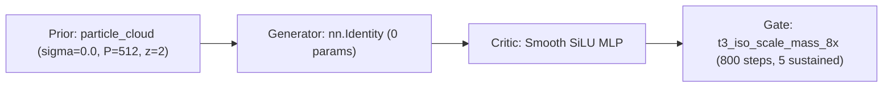

<!-- Generated Forge experiment page — do not edit manually; regenerate via `python -m experiments.forge.experiment_docs` -->

[← Leaderboard](../technique-inventory.md) · [Experiment Catalog](README.md) · [Explore by Laws](../LAWS_HUB.md) · [Research Portal](https://hypergan.github.io/ParticleGAN/)

# Law 3A Isolation: 8x Width & 6x Mass Disparity (G = Identity) (`t3_iso_scale_mass_8x`)

| Field | Value |
| --- | --- |
| **Laws Tested** | [Law 3A](../LAWS_HUB.md#law3a) |
| **Edge Cases** | `theory-isolation` `multi-scale-width` `ray-length-ambiguity` |
| **Primary View (`discriminator_stability`)** | Tier 1 (stretch) |
| **Four Laws Adherence Role** | law3 (anchor) |
| **Fixed Full-Suite Denominator** | Yes (59-test active runnable denominator) |
| **Adapter / Domain** | `t3_isolation` / `t3_iso_scale_mass_8x` |
| **Prior** | `particle_cloud` (sigma=`0.0`, standardize=`False`) |
| **Update Budget** | `800` steps |

## What This Experiment Tests

Eliminates Law 1 completely via parameterless G = nn.Identity() over a direct 512-particle cloud and verifies Law 2 via a smooth SiLU critic (critic_grad_med <= 1.0), isolating pure Law 3A W1 ray-length non-identifiability across an 8x mode-width ratio (sigma = [0.04..0.32]) and 6x mass ratio.

> [!NOTE]
> **Protocol notes:** Tier-1 stretch benchmark and Four Laws Adherence Law 3 anchor (G = nn.Identity, 800 updates).

## Laws & Edge Cases Targeted

- **[Law 3A: Unconditional W1 Ray-Length & Feature-Space Screening Identifiability](../LAWS_HUB.md#law3a)** ([Law 3A theory](../../../docs/four-laws.md#law-3--transport-identifiability)) — Does the learning system possess enough information to determine appropriate transport?
- **Edge-case tags:** `theory-isolation`, `multi-scale-width`, `ray-length-ambiguity`

## Common Failure Mode

Pure 1-Lipschitz adversarial gradients lack width sensitivity, causing the wide sigma=0.32 mode to shrink or misallocate mass even with zero generator topology distortion.

## Visual Schematic


*Target & Protocol Schematic · not training output — generated deterministically from the declared task contract.*

## Protocol & Architecture Diagram



## Task Contract & Numerical Gates

### Execution & Sampling Contract

| Contract Field | Declared Value |
| --- | --- |
| Initializer | `deterministic_orthogonal` |
| Prior | `particle_cloud` (sigma=`0.0`, standardize=`False`) |
| Update Budget | `800` steps |
| Batch Size | `128` |
| Particles / Latent Dim | `P=512` / `z_dim=2` |
| Sampling Law | `learned_particles_and_critic_gradient` |
| Evaluation Output Noise | `not_applied_to_measurement` |
| Scoring Weights | `live` |
| Architecture | `generator=nn.Identity (0 trainable parameters; direct data-space ParticlePrior), discriminator_family=smooth_silu_mlp, hidden=64, layers=2, in_dim=2` |
| Integrity Guards | `finite_state`, `optimizer_roles`, `exact_optimizer_updates`, `mechanism_exercised`, `rng_isolation` |
| Assigned Views | `discriminator_stability` (T1 stretch), `four-laws-adherence-v1` (T1 diagnostic), `four-laws-adherence-v2` (T1 diagnostic), `r4-occam-ablation-v1` (T1 diagnostic), `t3_causal_isolation_stretch` (T1 diagnostic), `t3_factorial_ablation` (T1 diagnostic) |

### Numerical Pass/Fail Thresholds

| Metric | Operator | Threshold |
| --- | :---: | ---: |
| `finite_fraction` | `==` | `1.0` |
| `critic_grad_med` | `<=` | `1.0` |
| `modes` | `==` | `4` |
| `mass_tv` | `<=` | `0.1` |
| `hq` | `>=` | `0.94` |
| `core_component_covariance_error` | `<=` | `0.45` |
| `core_min_eigen_ratio` | `>=` | `0.45` |

## Recorded Family Results

> [!IMPORTANT]
> Screening outcomes below come from recorded single-seed (`seed = 0`) Forge evidence. `NOT MEASURED`, `BLOCKED`, and `INCOMPATIBLE` are non-numerical states — not scientific failures — and confer no pass or qualification credit.

| Family | Selected Candidate | Outcome | Key Recorded Metrics | Family Report | Training Media |
| --- | --- | :---: | --- | --- | --- |
| **Axiom** | `axiom-v5` | **PASS** | recomputed t3_iso_scale_mass_8x gates (5/5 terminal checks passed) | [Axiom](../families/axiom.md#cohort-cuda-42a130a78fc3) | [HF GIF](https://huggingface.co/datasets/HyperGAN/particlegan-forge-evidence/resolve/main/media/forge/leaderboard/axiom/axiom-v4/t3_iso_scale_mass_8x.gif) |
| **Unified** | `unified-v15` | **PASS** | recomputed t3_iso_scale_mass_8x gates (5/5 terminal checks passed) | [Unified](../families/unified.md#cohort-cuda-42a130a78fc3) | — |
| **Atlas** | `atlas-particle-normal-v4` | `BLOCKED` | t3_iso_scale_mass_8x: clean/live scoring has no declared policy-control evidence and serve | [Atlas](../families/atlas.md#cohort-cuda-daa283c8a640) | — |
| **BCAP** | `recipe-prior-refactor-bcap-pure-v1` | `NOT MEASURED` | No recorded result for this selected configuration and source. | [BCAP](../families/bcap-pure.md#cohort-cuda-1bf9d7d34422) | — |
| **BISPF** | `bispf-optimized-quintic-v1` | `NOT MEASURED` | No recorded result for this selected configuration and source. | [BISPF](../families/bispf.md#cohort-cuda-1bf9d7d34422) | — |
| **E22** | `e22` | `NOT MEASURED` | No recorded result for this selected configuration and source. | [E22](../families/e22.md#cohort-cuda-1bf9d7d34422) | — |
| **EMPF** | `empf-v8` | `NOT MEASURED` | No recorded result for this selected configuration and source. | [EMPF](../families/empf.md#cohort-cuda-23a94f16ca88) | — |
| **GAN v3 release 0.7** | `recipe-prior-refactor-release07-gan-v3-v1` | **FAIL** | failed t3_iso_scale_mass_8x thresholds: core_component_covariance_error <= 0.45, core_min_ | [GAN v3 release 0.7](../families/release07-gan-v3.md#cohort-cuda-daa283c8a640) | [HF GIF](https://huggingface.co/datasets/HyperGAN/particlegan-forge-evidence/resolve/main/media/forge/leaderboard/release07-gan-v3/recipe-prior-refactor-release07-gan-v3-v1/t3_iso_scale_mass_8x.gif) |
| **K3P** | `recipe-prior-refactor-k3p-v1` | **FAIL** | failed t3_iso_scale_mass_8x thresholds: core_component_covariance_error <= 0.45, core_min_ | [K3P](../families/k3p.md#cohort-cuda-daa283c8a640) | [HF GIF](https://huggingface.co/datasets/HyperGAN/particlegan-forge-evidence/resolve/main/media/forge/leaderboard/k3p/recipe-prior-refactor-k3p-v1/t3_iso_scale_mass_8x.gif) |
| **KA2** | `recipe-prior-refactor-ka2-v1` | **FAIL** | failed t3_iso_scale_mass_8x thresholds: core_component_covariance_error <= 0.45, core_min_ | [KA2](../families/ka2.md#cohort-cuda-daa283c8a640) | [HF GIF](https://huggingface.co/datasets/HyperGAN/particlegan-forge-evidence/resolve/main/media/forge/leaderboard/ka2/recipe-prior-refactor-ka2-v1/t3_iso_scale_mass_8x.gif) |
| **R1/R2** | `recipe-prior-refactor-r1r2-v1` | **FAIL** | failed t3_iso_scale_mass_8x thresholds: core_component_covariance_error <= 0.45, core_min_ | [R1/R2](../families/r1r2.md#cohort-cuda-daa283c8a640) | [HF GIF](https://huggingface.co/datasets/HyperGAN/particlegan-forge-evidence/resolve/main/media/forge/leaderboard/r1r2/recipe-prior-refactor-r1r2-v1/t3_iso_scale_mass_8x.gif) |
| **RHBI** | `rhbi-v12` | `NOT MEASURED` | No recorded result for this selected configuration and source. | [RHBI](../families/rhbi.md#cohort-cuda-23a94f16ca88) | — |

### Four Laws Adherence Diagnostic Receipts (Separate Cohort)

*Diagnostic readouts and Colab matched-GPU receipts for `four-laws-adherence-v1` (protocol seed `0`, unchanged recipes; research telemetry only — separate from ordinary selected-cohort qualification above and confers no qualification or default-adoption credit):*

| Candidate | Family | GPU | Outcome | `min_margin` | NVML Energy | Key Recorded Metrics | Receipt |
| --- | --- | --- | :---: | ---: | ---: | --- | --- |
| `axiom-v4` | `axiom` | NVIDIA RTX A6000 | **PASS** | — | 4.29 kJ (J-to-PASS) | core_component_covariance_error=0.2376, core_min_eigen_ratio=0.5447, critic_grad_med=6.115e-06, finite_fraction=1 | [readout-9066cb4353eb435be7819b0c.json](../records/readout-9066cb4353eb435be7819b0c.json) |
| `axiom-v5` | `axiom` | NVIDIA L4 | **PASS** | — | 865 J (J-to-PASS) | core_component_covariance_error=0.2555, core_min_eigen_ratio=0.4715, critic_grad_med=4.616e-06, finite_fraction=1 | [1a04d59c6f1c4f658fdf8081dc9847a8.json](../technique-receipts/1a04d59c6f1c4f658fdf8081dc9847a8.json) |
| `law4-energy-v11` | `unified` | NVIDIA L4 | **PASS** | — | 941 J (J-to-PASS) | core_component_covariance_error=0.3094, core_min_eigen_ratio=0.4989, critic_grad_med=5.931e-07, finite_fraction=1 | [e14c5ab7d2ca4bada1174b9fc10ba198.json](../technique-receipts/e14c5ab7d2ca4bada1174b9fc10ba198.json) |
| `minimal-v2` | `minimal` | NVIDIA L4 | **PASS** | — | 799 J (J-to-PASS) | core_component_covariance_error=0.1126, core_min_eigen_ratio=0.8363, critic_grad_med=0.01497, finite_fraction=1 | [aa47e9599f6d4162aab7751dc8541a99.json](../technique-receipts/aa47e9599f6d4162aab7751dc8541a99.json) |
| `unified-v11` | `unified` | NVIDIA L4 | **PASS** | — | 1.07 kJ (J-to-PASS) | core_component_covariance_error=0.3094, core_min_eigen_ratio=0.4989, critic_grad_med=5.931e-07, finite_fraction=1 | [59a7b85bda474271ac6a254cf980051b.json](../technique-receipts/59a7b85bda474271ac6a254cf980051b.json) |
| `unified-v12` | `unified` | NVIDIA L4 | **PASS** | — | 1.03 kJ (J-to-PASS) | core_component_covariance_error=0.3094, core_min_eigen_ratio=0.4989, critic_grad_med=5.931e-07, finite_fraction=1 | [7827ae0f7d8e42bb85325bd4e9bbfb8c.json](../technique-receipts/7827ae0f7d8e42bb85325bd4e9bbfb8c.json) |
| `unified-v15` | `unified` | NVIDIA L4 | **PASS** | — | 941 J (J-to-PASS) | core_component_covariance_error=0.2692, core_min_eigen_ratio=0.5833, critic_grad_med=6.055e-07, finite_fraction=1 | [4dfa4b3c14fd4c8693c72d8c0f6b1997.json](../technique-receipts/4dfa4b3c14fd4c8693c72d8c0f6b1997.json) |
| `axiom-v4` | `axiom` | NVIDIA L4 | **FAIL** | — | 1.88 kJ | core_component_covariance_error=0.3672, core_min_eigen_ratio=0.2153, critic_grad_med=6.184e-06, finite_fraction=1 | [1448a1aa57d94adfa14c73f58fc6e8a0.json](../technique-receipts/1448a1aa57d94adfa14c73f58fc6e8a0.json) |
| `bispf-optimized-quintic-v1` | `bispf` | NVIDIA L4 | **FAIL** | — | 816 J | core_component_covariance_error=3.596, core_min_eigen_ratio=0, critic_grad_med=1.075, finite_fraction=1 | [784064531f724be0b6d3216cbd4bc7e9.json](../technique-receipts/784064531f724be0b6d3216cbd4bc7e9.json) |
| `empf-v8` | `empf` | NVIDIA L4 | **FAIL** | — | 828 J | core_component_covariance_error=0.6289, core_min_eigen_ratio=0.06856, critic_grad_med=0.1007, finite_fraction=1 | [6d966a6cd67443a88516a2380c395843.json](../technique-receipts/6d966a6cd67443a88516a2380c395843.json) |
| `recipe-prior-refactor-bcap-pure-v1` | `bcap-dualnorm` | NVIDIA L4 | **FAIL** | — | 593 J | core_component_covariance_error=0.5789, core_min_eigen_ratio=0.09839, critic_grad_med=0.1767, finite_fraction=1 | [40ded33dddc3489b8e30cc87307e7a1f.json](../technique-receipts/40ded33dddc3489b8e30cc87307e7a1f.json) |
| `recipe-prior-refactor-k3p-v1` | `k3p` | NVIDIA L4 | **FAIL** | — | 514 J | core_component_covariance_error=0.5077, core_min_eigen_ratio=0.1988, critic_grad_med=0.06193, finite_fraction=1 | [2ab44c612dd94abfac4f2ec198eea1fc.json](../technique-receipts/2ab44c612dd94abfac4f2ec198eea1fc.json) |
| `recipe-prior-refactor-ka2-v1` | `ka2` | NVIDIA L4 | **FAIL** | — | 551 J | core_component_covariance_error=0.5069, core_min_eigen_ratio=0.1955, critic_grad_med=0.05114, finite_fraction=1 | [aa9d534be7d8414583a7e2e09e4c4563.json](../technique-receipts/aa9d534be7d8414583a7e2e09e4c4563.json) |
| `recipe-prior-refactor-r1r2-v1` | `r1r2` | NVIDIA L4 | **FAIL** | — | 416 J | core_component_covariance_error=0.6078, core_min_eigen_ratio=0.1351, critic_grad_med=0.02438, finite_fraction=1 | [9effd626741140b6b82916224c93f90a.json](../technique-receipts/9effd626741140b6b82916224c93f90a.json) |
| `recipe-prior-refactor-release07-gan-v3-v1` | `release07-gan-v3` | NVIDIA L4 | **FAIL** | — | 435 J | core_component_covariance_error=0.6928, core_min_eigen_ratio=0.02734, critic_grad_med=0.1458, finite_fraction=1 | [62ba33fc702047459ab15347cea072aa.json](../technique-receipts/62ba33fc702047459ab15347cea072aa.json) |

## Reproduce This Experiment

```bash
# Validate this task declaration and inspect planned dependencies
python -m experiments.forge validate
python -m experiments.forge plan --view discriminator_stability --candidate unified-v12 --tasks t3_iso_scale_mass_8x
```

**Declaration & Source Files:**

- Task contract: [configs/forge/tasks/t3_iso_scale_mass_8x.json](../../../configs/forge/tasks/t3_iso_scale_mass_8x.json)
- Source code: [benchmarks/toy_audit/api_t3_isolation.py](../../../benchmarks/toy_audit/api_t3_isolation.py)
- Source code: [experiments/forge/t3_isolation.py](../../../experiments/forge/t3_isolation.py)

## Annotation Provenance

This page was assembled read-only from the following versioned inputs without altering any task execution/evaluation fingerprint:

- **Task contract JSON:** [configs/forge/tasks/t3_iso_scale_mass_8x.json](../../../configs/forge/tasks/t3_iso_scale_mass_8x.json)
- **Editorial task documentation sidecar:** [configs/forge/task-documentation/t3_iso_scale_mass_8x.json](../../../configs/forge/task-documentation/t3_iso_scale_mass_8x.json)
- **Read-only Python AST source:** [benchmarks/toy_audit/api_t3_isolation.py](../../../benchmarks/toy_audit/api_t3_isolation.py) (AST symbols: `__doc__`, `THRESHOLDS`, `HOST_DEFINITIONS`)
- **Read-only Python AST source:** [experiments/forge/t3_isolation.py](../../../experiments/forge/t3_isolation.py) (AST symbols: `__doc__`)
