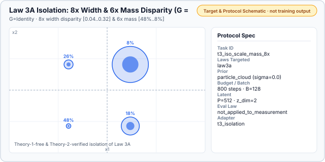
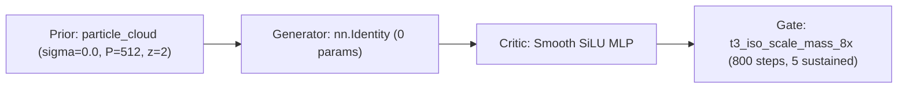

<!-- Generated Forge experiment page — do not edit manually; regenerate via `python -m experiments.forge.experiment_docs` -->

[← Leaderboard](../technique-inventory.md) · [Experiment Catalog](README.md) · [Explore by Laws](../LAWS_HUB.md) · [Research Portal](https://hypergan.github.io/ParticleGAN/)

# Law 3A Isolation: 8x Width & 6x Mass Disparity (G = Identity) (`t3_iso_scale_mass_8x`)

| Field | Value |
| --- | --- |
| **Laws Tested** | [Law 3A](../LAWS_HUB.md#law3a) |
| **Edge Cases** | `theory-isolation` `multi-scale-width` `ray-length-ambiguity` |
| **Primary View (`discriminator_stability`)** | Tier 1 (stretch) |
| **Four Laws Adherence Role** | law3 (anchor) |
| **Fixed Full-Suite Denominator** | Yes (71-test fixed denominator) |
| **Adapter / Domain** | `t3_isolation` / `t3_iso_scale_mass_8x` |
| **Prior** | `particle_cloud` (sigma=`0.0`, standardize=`False`) |
| **Update Budget** | `800` steps |

## What This Experiment Tests

Eliminates Law 1 completely via parameterless G = nn.Identity() over a direct 512-particle cloud and verifies Law 2 via a smooth SiLU critic (critic_grad_med <= 1.0), isolating pure Law 3A W1 ray-length non-identifiability across an 8x mode-width ratio (sigma = [0.04..0.32]) and 6x mass ratio.

> [!NOTE]
> **Protocol notes:** Tier-1 stretch benchmark and Four Laws Adherence Law 3 anchor (G = nn.Identity, 800 updates).

## Laws & Edge Cases Targeted

- **[Law 3A: Unconditional W1 Ray-Length & Screening Identifiability](../LAWS_HUB.md#law3a)** ([Law 3A theory](../../../docs/four-laws.md#law-3--transport-identifiability)) — Does the learning system possess enough information to determine appropriate transport?
- **Edge-case tags:** `theory-isolation`, `multi-scale-width`, `ray-length-ambiguity`

## Common Failure Mode

Pure 1-Lipschitz adversarial gradients lack width sensitivity, causing the wide sigma=0.32 mode to shrink or misallocate mass even with zero generator topology distortion.

## Visual Schematic



*Target & Protocol Schematic · not training output — generated deterministically from the declared task contract.*

## Protocol & Architecture Diagram



## Task Contract & Numerical Gates

### Execution & Sampling Contract

| Contract Field | Declared Value |
| --- | --- |
| Initializer | `deterministic_orthogonal` |
| Prior | `particle_cloud` (sigma=`0.0`, standardize=`False`) |
| Update Budget | `800` steps |
| Batch Size | `128` |
| Particles / Latent Dim | `P=512` / `z_dim=2` |
| Sampling Law | `learned_particles_and_critic_gradient` |
| Evaluation Output Noise | `not_applied_to_measurement` |
| Scoring Weights | `live` |
| Architecture | `generator=nn.Identity (0 trainable parameters; direct data-space ParticlePrior), discriminator_family=smooth_silu_mlp, hidden=64, layers=2, in_dim=2` |
| Integrity Guards | `finite_state`, `optimizer_roles`, `exact_optimizer_updates`, `mechanism_exercised`, `rng_isolation` |
| Assigned Views | `discriminator_stability` (T1 stretch), `four-laws-adherence-v1` (T1 diagnostic), `r4-occam-ablation-v1` (T1 diagnostic), `t3_causal_isolation_stretch` (T1 diagnostic), `t3_factorial_ablation` (T1 diagnostic) |

### Numerical Pass/Fail Thresholds

| Metric | Operator | Threshold |
| --- | :---: | ---: |
| `finite_fraction` | `==` | `1.0` |
| `critic_grad_med` | `<=` | `1.0` |
| `modes` | `==` | `4` |
| `mass_tv` | `<=` | `0.1` |
| `hq` | `>=` | `0.94` |
| `core_component_covariance_error` | `<=` | `0.45` |
| `core_min_eigen_ratio` | `>=` | `0.45` |

## Recorded Family Results

> [!IMPORTANT]
> Screening outcomes below come from recorded single-seed (`seed = 0`) Forge evidence. `NOT MEASURED`, `BLOCKED`, and `INCOMPATIBLE` are non-numerical states — not scientific failures — and confer no pass or qualification credit.

| Family | Selected Candidate | Outcome | Key Recorded Metrics | Family Report | Training Media |
| --- | --- | :---: | --- | --- | --- |
| **Unified** | `unified-v11` | **PASS** | recomputed t3_iso_scale_mass_8x gates (5/5 terminal checks passed) | [Unified](../families/unified.md#cohort-cuda-42a130a78fc3) | — |
| **Atlas** | `atlas-particle-normal-v4` | `NOT MEASURED` | No recorded result for this selected configuration and source. | [Atlas](../families/atlas.md#cohort-cuda-bc3debd3fa5e) | — |
| **BCAP** | `recipe-prior-refactor-bcap-pure-v1` | `NOT MEASURED` | No recorded result for this selected configuration and source. | [BCAP](../families/bcap-pure.md#cohort-cuda-1bf9d7d34422) | — |
| **BISPF** | `bispf-optimized-quintic-v1` | `NOT MEASURED` | No recorded result for this selected configuration and source. | [BISPF](../families/bispf.md#cohort-cuda-1bf9d7d34422) | — |
| **E22** | `e22` | `NOT MEASURED` | No recorded result for this selected configuration and source. | [E22](../families/e22.md#cohort-cuda-1bf9d7d34422) | — |
| **EMPF** | `empf-v8` | `NOT MEASURED` | No recorded result for this selected configuration and source. | [EMPF](../families/empf.md#cohort-cuda-23a94f16ca88) | — |
| **GAN v3 release 0.7** | `recipe-prior-refactor-release07-gan-v3-v1` | `NOT MEASURED` | No recorded result for this selected configuration and source. | [GAN v3 release 0.7](../families/release07-gan-v3.md#cohort-cuda-1bf9d7d34422) | — |
| **K3P** | `recipe-prior-refactor-k3p-v1` | `NOT MEASURED` | No recorded result for this selected configuration and source. | [K3P](../families/k3p.md#cohort-cuda-1bf9d7d34422) | — |
| **KA2** | `recipe-prior-refactor-ka2-v1` | `NOT MEASURED` | No recorded result for this selected configuration and source. | [KA2](../families/ka2.md#cohort-cuda-1bf9d7d34422) | — |
| **R1/R2** | `recipe-prior-refactor-r1r2-v1` | `NOT MEASURED` | No recorded result for this selected configuration and source. | [R1/R2](../families/r1r2.md#cohort-cuda-1bf9d7d34422) | — |
| **RHBI** | `rhbi-v12` | `NOT MEASURED` | No recorded result for this selected configuration and source. | [RHBI](../families/rhbi.md#cohort-cuda-23a94f16ca88) | — |

## Reproduce This Experiment

```bash
# Validate this task declaration and inspect planned dependencies
python -m experiments.forge validate
python -m experiments.forge plan --view discriminator_stability --candidate unified-v12 --tasks t3_iso_scale_mass_8x
```

**Declaration & Source Files:**

- Task contract: [configs/forge/tasks/t3_iso_scale_mass_8x.json](../../../configs/forge/tasks/t3_iso_scale_mass_8x.json)
- Source code: [benchmarks/toy_audit/api_t3_isolation.py](../../../benchmarks/toy_audit/api_t3_isolation.py)
- Source code: [experiments/forge/t3_isolation.py](../../../experiments/forge/t3_isolation.py)

## Annotation Provenance

This page was assembled read-only from the following versioned inputs without altering any task execution/evaluation fingerprint:

- **Task contract JSON:** [configs/forge/tasks/t3_iso_scale_mass_8x.json](../../../configs/forge/tasks/t3_iso_scale_mass_8x.json)
- **Editorial task documentation sidecar:** [configs/forge/task-documentation/t3_iso_scale_mass_8x.json](../../../configs/forge/task-documentation/t3_iso_scale_mass_8x.json)
- **Read-only Python AST source:** [benchmarks/toy_audit/api_t3_isolation.py](../../../benchmarks/toy_audit/api_t3_isolation.py) (AST symbols: `__doc__`, `THRESHOLDS`, `HOST_DEFINITIONS`)
- **Read-only Python AST source:** [experiments/forge/t3_isolation.py](../../../experiments/forge/t3_isolation.py) (AST symbols: `__doc__`)
