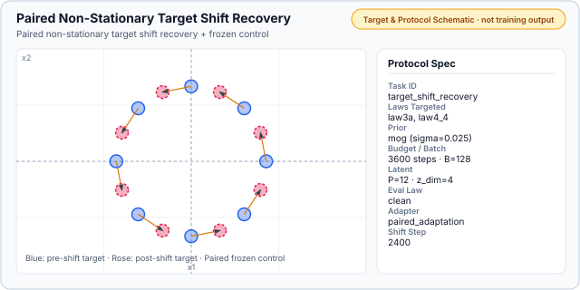
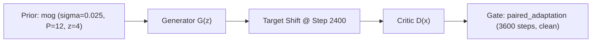

<!-- Generated Forge experiment page — do not edit manually; regenerate via `python -m experiments.forge.experiment_docs` -->

[← Leaderboard](../technique-inventory.md) · [Experiment Catalog](README.md) · [Explore by Laws](../LAWS_HUB.md) · [Research Portal](https://hypergan.github.io/ParticleGAN/)

# Paired Non-Stationary Target Shift Recovery (`target_shift_recovery`)

| Field | Value |
| --- | --- |
| **Laws Tested** | [Law 3A](../LAWS_HUB.md#law3a) · [Law 4.4](../LAWS_HUB.md#law4_4) |
| **Edge Cases** | `non-stationary-shift` `paired-frozen-control` `settling-vs-tracking` |
| **Primary View (`discriminator_stability`)** | Not in `discriminator_stability` |
| **Four Laws Adherence Role** | law3 (anchor) |
| **Fixed Full-Suite Denominator** | Yes (71-test fixed denominator) |
| **Adapter / Domain** | `paired_adaptation` / `paired_adaptation` |
| **Prior** | `mog` (sigma=`0.025`, standardize=`False`) |
| **Update Budget** | `3600` steps |

## What This Experiment Tests

Tests whether a converged multimodal model adapts cleanly when the target distribution shifts mid-run, verified against a paired frozen-target control to confirm genuine adaptation rather than noisy drift.

> [!NOTE]
> **Protocol notes:** Four Laws Adherence Law 3 anchor; paired adaptation evaluator with recovery deadline.

## Laws & Edge Cases Targeted

- **[Law 3A: Unconditional W1 Ray-Length & Screening Identifiability](../LAWS_HUB.md#law3a)** ([Law 3A theory](../../../docs/four-laws.md#law-3--transport-identifiability)) — Does the learning system possess enough information to determine appropriate transport?
- **[Law 4.4: Trajectory Scale vs. Settling](../LAWS_HUB.md#law4_4)** ([Law 4.4 theory](../../../docs/four-laws.md#law-4--functional-and-game-dynamics)) — Can the learning system realize useful functional changes and exhibit appropriate coupled learning dynamics?
- **Edge-case tags:** `non-stationary-shift`, `paired-frozen-control`, `settling-vs-tracking`

## Common Failure Mode

Over-settled optimizers or frozen priors fail to migrate particles to the shifted modes within the recovery deadline, while unstable recipes fail the stationary pre-shift checks.

**Historical audit diagnosis** (`reports/forge/problem-definitions.json`): BISPF learns and holds the original ring, then recovers too late: it becomes steady 620 updates after the shift, missing the 400-update deadline. This is an adaptation-speed failure, not an inability to recover at all.

- *Recommended research focus:* Improve adaptation speed while keeping stationary stability. If the deadline itself is reconsidered, use an explicitly versioned task and preserve the old failure.

## Visual Schematic



*Target & Protocol Schematic · not training output — generated deterministically from the declared task contract.*

## Protocol & Architecture Diagram



## Task Contract & Numerical Gates

### Execution & Sampling Contract

| Contract Field | Declared Value |
| --- | --- |
| Initializer | `deterministic_orthogonal` |
| Prior | `mog` (sigma=`0.025`, standardize=`False`) |
| Update Budget | `3600` steps |
| Batch Size | `128` |
| Particles / Latent Dim | `P=12` / `z_dim=4` |
| Sampling Law | `public_prior_without_output_noise` |
| Evaluation Output Noise | `clean` |
| Scoring Weights | `live` |
| Shift Step | `2400` |
| Dependencies | [`mode_hold`](mode_hold.md) (`gate`) |
| Assigned Views | `adaptation` (T3 required), `clockfree_continuous` (T3 required), `four-laws-adherence-v1` (T1 diagnostic), `prior-ablation-full-suite-v1` (T1 diagnostic), `r3-tier3-long-horizon-holdout-v1` (T1 diagnostic), `t3-shift-recovery-diagnostic-v1` (T1 diagnostic) |

### Numerical Pass/Fail Thresholds

No fixed scalar threshold list declared (see evaluator contract above).

## Recorded Family Results

> [!IMPORTANT]
> Screening outcomes below come from recorded single-seed (`seed = 0`) Forge evidence. `NOT MEASURED`, `BLOCKED`, and `INCOMPATIBLE` are non-numerical states — not scientific failures — and confer no pass or qualification credit.

| Family | Selected Candidate | Outcome | Key Recorded Metrics | Family Report | Training Media |
| --- | --- | :---: | --- | --- | --- |
| **EMPF** | `empf-v8` | **PASS** | No recorded result for this selected configuration and source. | [EMPF](../families/empf.md#cohort-cuda-23a94f16ca88) | — |
| **Atlas** | `atlas-particle-normal-v4` | `NOT MEASURED` | No recorded result for this selected configuration and source. | [Atlas](../families/atlas.md#cohort-cuda-daa283c8a640) | — |
| **Axiom** | `axiom-v4` | `NOT MEASURED` | No recorded result for this selected configuration and source. | [Axiom](../families/axiom.md#cohort-cuda-daa283c8a640) | — |
| **BCAP** | `recipe-prior-refactor-bcap-pure-v1` | **FAIL** | Executable: completed in a separate-runtime diagnostic. This ordinary cohort remains not r | [BCAP](../families/bcap-pure.md#cohort-cuda-1bf9d7d34422) | — |
| **BISPF** | `bispf-optimized-quintic-v1` | **FAIL** | No recorded result for this selected configuration and source. | [BISPF](../families/bispf.md#cohort-cuda-1bf9d7d34422) | — |
| **E22** | `e22` | **FAIL** | Skipped incompatible test: target_shift_recovery: clean/live scoring has no declared polic | [E22](../families/e22.md#cohort-cuda-1bf9d7d34422) | — |
| **GAN v3 release 0.7** | `recipe-prior-refactor-release07-gan-v3-v1` | `NOT MEASURED` | No recorded result for this selected configuration and source. | [GAN v3 release 0.7](../families/release07-gan-v3.md#cohort-cuda-daa283c8a640) | — |
| **K3P** | `recipe-prior-refactor-k3p-v1` | `NOT MEASURED` | No recorded result for this selected configuration and source. | [K3P](../families/k3p.md#cohort-cuda-daa283c8a640) | — |
| **KA2** | `recipe-prior-refactor-ka2-v1` | `NOT MEASURED` | No recorded result for this selected configuration and source. | [KA2](../families/ka2.md#cohort-cuda-daa283c8a640) | — |
| **R1/R2** | `recipe-prior-refactor-r1r2-v1` | `NOT MEASURED` | No recorded result for this selected configuration and source. | [R1/R2](../families/r1r2.md#cohort-cuda-daa283c8a640) | — |
| **RHBI** | `rhbi-v12` | `NOT MEASURED` | No recorded result for this selected configuration and source. | [RHBI](../families/rhbi.md#cohort-cuda-23a94f16ca88) | — |
| **Unified** | `unified-v11` | `NOT MEASURED` | No recorded result for this selected configuration and source. | [Unified](../families/unified.md#cohort-cuda-42a130a78fc3) | — |

### Four Laws Adherence Diagnostic Receipts (Separate Cohort)

*Diagnostic readouts and Colab matched-GPU receipts for `four-laws-adherence-v1` (protocol seed `0`, unchanged recipes; research telemetry only — separate from ordinary selected-cohort qualification above and confers no qualification or default-adoption credit):*

| Candidate | Family | GPU | Outcome | `min_margin` | NVML Energy | Key Recorded Metrics | Receipt |
| --- | --- | --- | :---: | ---: | ---: | --- | --- |
| `axiom-v4` | `axiom` | NVIDIA RTX A6000 | **PASS** | — | 20.02 kJ | — | [readout-9066cb4353eb435be7819b0c.json](../records/readout-9066cb4353eb435be7819b0c.json) |
| `unified-v12` | `unified` | NVIDIA L4 | **PASS** | — | 7.93 kJ | — | [434e74270dd340c4848a2743a07c0145.json](../technique-receipts/434e74270dd340c4848a2743a07c0145.json) |
| `unified-v14` | `unified` | NVIDIA L4 | **PASS** | — | 8.11 kJ | — | [49e38a634c304da9a209931875bd0e63.json](../technique-receipts/49e38a634c304da9a209931875bd0e63.json) |
| `minimal-v2` | `minimal` | NVIDIA L4 | **FAIL** | — | 9.33 kJ | — | [f54082b52daa41709e4a623a816b30fd.json](../technique-receipts/f54082b52daa41709e4a623a816b30fd.json) |

## Reproduce This Experiment

```bash
# Validate this task declaration and inspect planned dependencies
python -m experiments.forge validate
python -m experiments.forge plan --view four-laws-adherence-v1 --candidate unified-v12 --tasks target_shift_recovery
```

**Declaration & Source Files:**

- Task contract: [configs/forge/tasks/target_shift_recovery.json](../../../configs/forge/tasks/target_shift_recovery.json)
- Source code: [benchmarks/toy100/continuous_probe.py](../../../benchmarks/toy100/continuous_probe.py)

## Annotation Provenance

This page was assembled read-only from the following versioned inputs without altering any task execution/evaluation fingerprint:

- **Task contract JSON:** [configs/forge/tasks/target_shift_recovery.json](../../../configs/forge/tasks/target_shift_recovery.json)
- **Editorial task documentation sidecar:** [configs/forge/task-documentation/target_shift_recovery.json](../../../configs/forge/task-documentation/target_shift_recovery.json)
- **Read-only Python AST source:** [benchmarks/toy100/continuous_probe.py](../../../benchmarks/toy100/continuous_probe.py) (AST symbols: `__doc__`)
