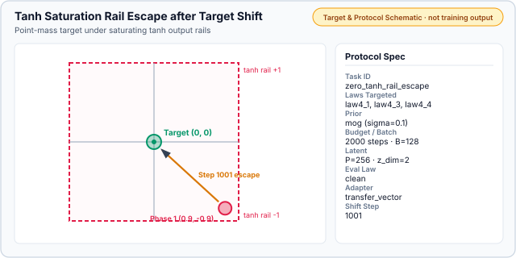
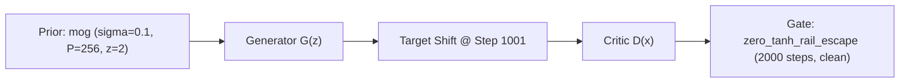

<!-- Generated Forge experiment page — do not edit manually; regenerate via `python -m experiments.forge.experiment_docs` -->

[← Leaderboard](../technique-inventory.md) · [Experiment Catalog](README.md) · [Explore by Laws](../LAWS_HUB.md) · [Research Portal](https://hypergan.github.io/ParticleGAN/)

# Tanh Saturation Rail Escape after Target Shift (`zero_tanh_rail_escape`)

| Field | Value |
| --- | --- |
| **Laws Tested** | [Law 4.1](../LAWS_HUB.md#law4_1) · [Law 4.3](../LAWS_HUB.md#law4_3) · [Law 4.4](../LAWS_HUB.md#law4_4) |
| **Edge Cases** | `tanh-saturation` `vanishing-jacobian` `non-stationary-shift` |
| **Primary View (`discriminator_stability`)** | Tier 3 (held) |
| **Four Laws Adherence Role** | law4 (anchor) |
| **Fixed Full-Suite Denominator** | Yes (71-test fixed denominator) |
| **Adapter / Domain** | `transfer_vector` / `zero_tanh_rail_escape` |
| **Prior** | `mog` (sigma=`0.1`, standardize=`False`) |
| **Update Budget** | `2000` steps |

## What This Experiment Tests

Directly probes Law 4.1 (Functional Realization): Phase 1 trains a tanh generator onto corner (0.9, -0.9) near the saturation rail, then at step 1,001 shifts the target to (0, 0). The optimizer must escape vanishing tanh derivatives within a 400-step deadline and settle with zero saturated samples.

> [!NOTE]
> **Protocol notes:** Gated by `zero_tanh_smoke`; Four Laws Adherence Law 4 anchor (shift at step 1,001, recovery deadline 400 steps).

## Laws & Edge Cases Targeted

- **[Law 4.1: Functional Realization](../LAWS_HUB.md#law4_1)** ([Law 4.1 theory](../../../docs/four-laws.md#law-4--functional-and-game-dynamics)) — Can the learning system realize useful functional changes and exhibit appropriate coupled learning dynamics?
- **[Law 4.3: Displacement & Kreiss Control](../LAWS_HUB.md#law4_3)** ([Law 4.3 theory](../../../docs/four-laws.md#law-4--functional-and-game-dynamics)) — Can the learning system realize useful functional changes and exhibit appropriate coupled learning dynamics?
- **[Law 4.4: Trajectory Scale vs. Settling](../LAWS_HUB.md#law4_4)** ([Law 4.4 theory](../../../docs/four-laws.md#law-4--functional-and-game-dynamics)) — Can the learning system realize useful functional changes and exhibit appropriate coupled learning dynamics?
- **Edge-case tags:** `tanh-saturation`, `vanishing-jacobian`, `non-stationary-shift`

## Common Failure Mode

Because tanh'(z) -> 0 near +/-1, standard unconditioned gradients vanish and leave generator outputs permanently trapped at the rail (0.9, -0.9) after the shift.

**Historical audit diagnosis** (`reports/forge/problem-definitions.json`): Bounded tanh heads attenuate pre-activation gradients near +/-1. Recipes that allow large pre-activation drift during the first 1,000 updates can lock into the rail or overshoot and oscillate around zero after the shift; no ordinary selected-cohort qualification run has been recorded on this newly added Tier 3 gate yet.

- *Recommended research focus:* Run the full Tier 3 qualified family roster (`k3p`, `ka2`, `r1r2`, `bcap-pure`, `bcap-dualnorm`, `atlas`, `e22`, `release07-gan-v3`) in ordinary cohorts and promote from held to required once a global recipe passes it together with all counted Tier 1-3 requirements.

## Visual Schematic



*Target & Protocol Schematic · not training output — generated deterministically from the declared task contract.*

## Protocol & Architecture Diagram



## Task Contract & Numerical Gates

### Execution & Sampling Contract

| Contract Field | Declared Value |
| --- | --- |
| Initializer | `deterministic_orthogonal` |
| Prior | `mog` (sigma=`0.1`, standardize=`False`) |
| Update Budget | `2000` steps |
| Batch Size | `128` |
| Particles / Latent Dim | `P=256` / `z_dim=2` |
| Sampling Law | `public_prior_without_output_noise` |
| Evaluation Output Noise | `clean` |
| Scoring Weights | `live` |
| Shift Step | `1001` |
| Dependencies | [`zero_tanh_smoke`](zero_tanh_smoke.md) (`gate`) |
| Assigned Views | `discriminator_stability` (T3 held), `four-laws-adherence-v1` (T1 diagnostic), `prior-ablation-full-suite-v1` (T1 diagnostic), `r3-tier3-long-horizon-holdout-v1` (T1 diagnostic), `r4-occam-ablation-v1` (T1 diagnostic), `t3-shift-recovery-diagnostic-v1` (T1 diagnostic), `t4-strange-architectures-v1` (T1 diagnostic) |

### Numerical Pass/Fail Thresholds

| Metric | Operator | Threshold |
| --- | :---: | ---: |
| `mean_abs_error` | `<=` | `0.005` |
| `rms_error` | `<=` | `0.01` |
| `p99_abs_error` | `<=` | `0.025` |
| `saturated_fraction` | `==` | `0.0` |

## Recorded Family Results

> [!IMPORTANT]
> Screening outcomes below come from recorded single-seed (`seed = 0`) Forge evidence. `NOT MEASURED`, `BLOCKED`, and `INCOMPATIBLE` are non-numerical states — not scientific failures — and confer no pass or qualification credit.

| Family | Selected Candidate | Outcome | Key Recorded Metrics | Family Report | Training Media |
| --- | --- | :---: | --- | --- | --- |
| **E22** | `e22` | **PASS** | No recorded result for this selected configuration and source. | [E22](../families/e22.md#cohort-cuda-1bf9d7d34422) | — |
| **Atlas** | `atlas-particle-normal-v4` | `NOT MEASURED` | no compatible result | [Atlas](../families/atlas.md#cohort-cuda-daa283c8a640) | — |
| **Axiom** | `axiom-v4` | `NOT MEASURED` | no compatible result | [Axiom](../families/axiom.md#cohort-cuda-daa283c8a640) | — |
| **BCAP** | `recipe-prior-refactor-bcap-pure-v1` | **FAIL** | No recorded result for this selected configuration and source. | [BCAP](../families/bcap-pure.md#cohort-cuda-1bf9d7d34422) | — |
| **BISPF** | `bispf-optimized-quintic-v1` | **FAIL** | No recorded result for this selected configuration and source. | [BISPF](../families/bispf.md#cohort-cuda-1bf9d7d34422) | — |
| **EMPF** | `empf-v8` | `BLOCKED` | zero_tanh_rail_escape: zero_tanh_rail_escape: unsupported tanh host zero_tanh_rail_escape; | [EMPF](../families/empf.md#cohort-cuda-23a94f16ca88) | — |
| **GAN v3 release 0.7** | `recipe-prior-refactor-release07-gan-v3-v1` | `NOT MEASURED` | no compatible result | [GAN v3 release 0.7](../families/release07-gan-v3.md#cohort-cuda-daa283c8a640) | — |
| **K3P** | `recipe-prior-refactor-k3p-v1` | `NOT MEASURED` | no compatible result | [K3P](../families/k3p.md#cohort-cuda-daa283c8a640) | — |
| **KA2** | `recipe-prior-refactor-ka2-v1` | `NOT MEASURED` | no compatible result | [KA2](../families/ka2.md#cohort-cuda-daa283c8a640) | — |
| **R1/R2** | `recipe-prior-refactor-r1r2-v1` | `NOT MEASURED` | no compatible result | [R1/R2](../families/r1r2.md#cohort-cuda-daa283c8a640) | — |
| **RHBI** | `rhbi-v12` | `BLOCKED` | zero_tanh_rail_escape: zero_tanh_rail_escape: unsupported tanh host zero_tanh_rail_escape; | [RHBI](../families/rhbi.md#cohort-cuda-23a94f16ca88) | — |
| **Unified** | `unified-v11` | `NOT MEASURED` | no compatible result | [Unified](../families/unified.md#cohort-cuda-42a130a78fc3) | — |

### Four Laws Adherence Diagnostic Receipts (Separate Cohort)

*Diagnostic readouts and Colab matched-GPU receipts for `four-laws-adherence-v1` (protocol seed `0`, unchanged recipes; research telemetry only — separate from ordinary selected-cohort qualification above and confers no qualification or default-adoption credit):*

| Candidate | Family | GPU | Outcome | `min_margin` | NVML Energy | Key Recorded Metrics | Receipt |
| --- | --- | --- | :---: | ---: | ---: | --- | --- |
| `atlas-particle-normal-v4` | `atlas` | NVIDIA L4 | **PASS** | — | 752 J (J-to-PASS) | mean_abs_error=0.001829, p99_abs_error=0.006108, rms_error=0.002357, saturated_fraction=0 | [f8ddd87df4cf46168629a5bbb614b410.json](../technique-receipts/f8ddd87df4cf46168629a5bbb614b410.json) |
| `axiom-v4` | `axiom` | NVIDIA L4 | **PASS** | — | 498 J (J-to-PASS) | mean_abs_error=0.002041, p99_abs_error=0.01999, rms_error=0.004805, saturated_fraction=0 | [c614ad45546349d8b776e055db7888e8.json](../technique-receipts/c614ad45546349d8b776e055db7888e8.json) |
| `axiom-v4` | `axiom` | NVIDIA RTX A6000 | **PASS** | — | 1.80 kJ (J-to-PASS) | mean_abs_error=0.001275, p99_abs_error=0.01079, rms_error=0.002909, saturated_fraction=0 | [readout-9066cb4353eb435be7819b0c.json](../records/readout-9066cb4353eb435be7819b0c.json) |
| `law4-energy-v11` | `unified` | NVIDIA L4 | **PASS** | — | 496 J (J-to-PASS) | mean_abs_error=0.000974, p99_abs_error=0.005887, rms_error=0.001559, saturated_fraction=0 | [717cda2561634f24874e5dedf5b83e8f.json](../technique-receipts/717cda2561634f24874e5dedf5b83e8f.json) |
| `recipe-prior-refactor-bcap-pure-v1` | `bcap-dualnorm` | NVIDIA L4 | **PASS** | — | 360 J (J-to-PASS) | mean_abs_error=0.001603, p99_abs_error=0.007366, rms_error=0.002267, saturated_fraction=0 | [7e8c1f1997434c47a25ca8f2880a2ea6.json](../technique-receipts/7e8c1f1997434c47a25ca8f2880a2ea6.json) |
| `recipe-prior-refactor-k3p-v1` | `k3p` | NVIDIA L4 | **PASS** | — | 832 J (J-to-PASS) | mean_abs_error=0.001127, p99_abs_error=0.003373, rms_error=0.001386, saturated_fraction=0 | [6216bd2d5e684746b24f97d408f0e434.json](../technique-receipts/6216bd2d5e684746b24f97d408f0e434.json) |
| `recipe-prior-refactor-ka2-v1` | `ka2` | NVIDIA L4 | **PASS** | — | 870 J (J-to-PASS) | mean_abs_error=0.001048, p99_abs_error=0.004045, rms_error=0.001437, saturated_fraction=0 | [0224b37e31b84cc79209c4bb3f4ff0d5.json](../technique-receipts/0224b37e31b84cc79209c4bb3f4ff0d5.json) |
| `unified-v11` | `unified` | NVIDIA L4 | **PASS** | — | 703 J (J-to-PASS) | mean_abs_error=0.001431, p99_abs_error=0.006468, rms_error=0.002003, saturated_fraction=0 | [916e4a6a23ed47028b97e4c0ab7fb5ba.json](../technique-receipts/916e4a6a23ed47028b97e4c0ab7fb5ba.json) |
| `unified-v12` | `unified` | NVIDIA L4 | **PASS** | — | 491 J (J-to-PASS) | mean_abs_error=0.001636, p99_abs_error=0.01005, rms_error=0.002673, saturated_fraction=0 | [10948fa21d2147d3b97bffead27e3d2e.json](../technique-receipts/10948fa21d2147d3b97bffead27e3d2e.json) |
| `bispf-optimized-quintic-v1` | `bispf` | NVIDIA L4 | **FAIL** | — | 2.20 kJ | mean_abs_error=0.003191, p99_abs_error=0.01423, rms_error=0.004307, saturated_fraction=0 | [e1b97daee53c4d29b7c5c12d5240a4b7.json](../technique-receipts/e1b97daee53c4d29b7c5c12d5240a4b7.json) |
| `recipe-prior-refactor-r1r2-v1` | `r1r2` | NVIDIA L4 | **FAIL** | — | 862 J | mean_abs_error=0.002675, p99_abs_error=0.008516, rms_error=0.003251, saturated_fraction=0 | [461c27264f3548d6a7ed461ee3e1308a.json](../technique-receipts/461c27264f3548d6a7ed461ee3e1308a.json) |
| `recipe-prior-refactor-release07-gan-v3-v1` | `release07-gan-v3` | NVIDIA L4 | **FAIL** | — | 935 J | mean_abs_error=0.001408, p99_abs_error=0.005257, rms_error=0.001831, saturated_fraction=0 | [0bf36ce7c62444b9b06e491e09c07d19.json](../technique-receipts/0bf36ce7c62444b9b06e491e09c07d19.json) |

## Reproduce This Experiment

```bash
# Validate this task declaration and inspect planned dependencies
python -m experiments.forge validate
python -m experiments.forge plan --view discriminator_stability --candidate unified-v12 --tasks zero_tanh_rail_escape
```

**Declaration & Source Files:**

- Task contract: [configs/forge/tasks/zero_tanh_rail_escape.json](../../../configs/forge/tasks/zero_tanh_rail_escape.json)

## Annotation Provenance

This page was assembled read-only from the following versioned inputs without altering any task execution/evaluation fingerprint:

- **Task contract JSON:** [configs/forge/tasks/zero_tanh_rail_escape.json](../../../configs/forge/tasks/zero_tanh_rail_escape.json)
- **Editorial task documentation sidecar:** [configs/forge/task-documentation/zero_tanh_rail_escape.json](../../../configs/forge/task-documentation/zero_tanh_rail_escape.json)
