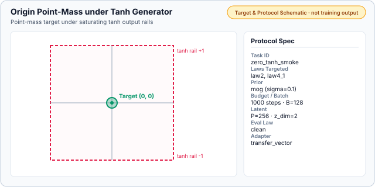
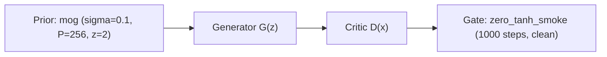

<!-- Generated Forge experiment page — do not edit manually; regenerate via `python -m experiments.forge.experiment_docs` -->

[← Leaderboard](../technique-inventory.md) · [Experiment Catalog](README.md) · [Explore by Laws](../LAWS_HUB.md) · [Research Portal](https://hypergan.github.io/ParticleGAN/)

# Origin Point-Mass under Tanh Generator (`zero_tanh_smoke`)

| Field | Value |
| --- | --- |
| **Laws Tested** | [Law 2](../LAWS_HUB.md#law2) · [Law 4.1](../LAWS_HUB.md#law4_1) |
| **Edge Cases** | `tanh-saturation` `point-mass-dirac` `checkpoint-producer` |
| **Primary View (`discriminator_stability`)** | Tier 1 (required) |
| **Four Laws Adherence Role** | prerequisite (prerequisite) |
| **Fixed Full-Suite Denominator** | Yes (59-test active runnable denominator) |
| **Adapter / Domain** | `transfer_vector` / `zero_tanh_smoke` |
| **Prior** | `mog` (sigma=`0.1`, standardize=`False`) |
| **Update Budget** | `1000` steps |

## What This Experiment Tests

Tests whether a 2D generator ending in a bounded `tanh` activation can contract cleanly onto the origin Dirac point mass (0, 0) within 1,000 updates with zero saturated outputs (saturated_fraction == 0.0).

> [!NOTE]
> **Protocol notes:** Tier-1 required gate; serves as prerequisite for `zero_tanh_rail_escape`.

## Laws & Edge Cases Targeted

- **[Law 2: Potential Geometry](../LAWS_HUB.md#law2)** ([Law 2 theory](../../../docs/four-laws.md#law-2--potential-geometry)) — Does the critic communicate useful learning forces with appropriate geometric control and computational efficiency?
- **[Law 4.1: Functional Realization](../LAWS_HUB.md#law4_1)** ([Law 4.1 theory](../../../docs/four-laws.md#law-4--functional-and-game-dynamics)) — Can the learning system realize useful functional changes and exhibit appropriate coupled learning dynamics?
- **Edge-case tags:** `tanh-saturation`, `point-mass-dirac`, `checkpoint-producer`

## Common Failure Mode

Overshooting updates slam generator pre-activations into the +/-1 tanh rails where derivatives vanish, leaving saturated samples stuck on the boundary.

## Visual Schematic



*Target & Protocol Schematic · not training output — generated deterministically from the declared task contract.*

## Protocol & Architecture Diagram



## Task Contract & Numerical Gates

### Execution & Sampling Contract

| Contract Field | Declared Value |
| --- | --- |
| Initializer | `deterministic_orthogonal` |
| Prior | `mog` (sigma=`0.1`, standardize=`False`) |
| Update Budget | `1000` steps |
| Batch Size | `128` |
| Particles / Latent Dim | `P=256` / `z_dim=2` |
| Sampling Law | `public_prior_without_output_noise` |
| Evaluation Output Noise | `clean` |
| Scoring Weights | `live` |
| Assigned Views | `discriminator_stability` (T1 required), `four-laws-adherence-v1` (T1 diagnostic), `four-laws-adherence-v2` (T1 diagnostic), `prior-ablation-full-suite-v1` (T1 diagnostic), `r3-tier3-long-horizon-holdout-v1` (T1 diagnostic), `r4-occam-ablation-v1` (T1 diagnostic), `t3-shift-recovery-diagnostic-v1` (T1 diagnostic), `t4-strange-architectures-v1` (T1 diagnostic) |

### Numerical Pass/Fail Thresholds

| Metric | Operator | Threshold |
| --- | :---: | ---: |
| `mean_abs_error` | `<=` | `0.005` |
| `rms_error` | `<=` | `0.01` |
| `p99_abs_error` | `<=` | `0.025` |
| `saturated_fraction` | `==` | `0.0` |

## Recorded Family Results

> [!IMPORTANT]
> Screening outcomes below come from recorded single-seed (`seed = 0`) Forge evidence. `NOT MEASURED`, `BLOCKED`, and `INCOMPATIBLE` are non-numerical states — not scientific failures — and confer no pass or qualification credit.

| Family | Selected Candidate | Outcome | Key Recorded Metrics | Family Report | Training Media |
| --- | --- | :---: | --- | --- | --- |
| **Atlas** | `atlas-particle-normal-v4` | **PASS** | recomputed the declared final zero-tanh bounds | [Atlas](../families/atlas.md#cohort-cuda-daa283c8a640) | [HF GIF](https://huggingface.co/datasets/HyperGAN/particlegan-forge-evidence/resolve/main/media/forge/leaderboard/atlas/atlas-particle-normal-v4/zero_tanh_smoke.gif) |
| **Axiom** | `axiom-v5` | **PASS** | recomputed the declared final zero-tanh bounds | [Axiom](../families/axiom.md#cohort-cuda-42a130a78fc3) | [HF GIF](https://huggingface.co/datasets/HyperGAN/particlegan-forge-evidence/resolve/main/media/forge/leaderboard/axiom/axiom-v4/zero_tanh_smoke.gif) |
| **E22** | `e22` | **PASS** | No recorded result for this selected configuration and source. | [E22](../families/e22.md#cohort-cuda-1bf9d7d34422) | — |
| **EMPF** | `empf-v8` | **PASS** | recomputed the declared final zero-tanh bounds | [EMPF](../families/empf.md#cohort-cuda-23a94f16ca88) | [HF GIF](https://huggingface.co/datasets/HyperGAN/particlegan-forge-evidence/resolve/main/media/forge/leaderboard/empf/empf-v8/zero_tanh_smoke.gif) |
| **GAN v3 release 0.7** | `recipe-prior-refactor-release07-gan-v3-v1` | **PASS** | recomputed the declared final zero-tanh bounds | [GAN v3 release 0.7](../families/release07-gan-v3.md#cohort-cuda-daa283c8a640) | [HF GIF](https://huggingface.co/datasets/HyperGAN/particlegan-forge-evidence/resolve/main/media/forge/leaderboard/release07-gan-v3/recipe-prior-refactor-release07-gan-v3-v1/zero_tanh_smoke.gif) |
| **K3P** | `recipe-prior-refactor-k3p-v1` | **PASS** | recomputed the declared final zero-tanh bounds | [K3P](../families/k3p.md#cohort-cuda-daa283c8a640) | [HF GIF](https://huggingface.co/datasets/HyperGAN/particlegan-forge-evidence/resolve/main/media/forge/leaderboard/k3p/recipe-prior-refactor-k3p-v1/zero_tanh_smoke.gif) |
| **KA2** | `recipe-prior-refactor-ka2-v1` | **PASS** | recomputed the declared final zero-tanh bounds | [KA2](../families/ka2.md#cohort-cuda-daa283c8a640) | [HF GIF](https://huggingface.co/datasets/HyperGAN/particlegan-forge-evidence/resolve/main/media/forge/leaderboard/ka2/recipe-prior-refactor-ka2-v1/zero_tanh_smoke.gif) |
| **R1/R2** | `recipe-prior-refactor-r1r2-v1` | **PASS** | recomputed the declared final zero-tanh bounds | [R1/R2](../families/r1r2.md#cohort-cuda-daa283c8a640) | [HF GIF](https://huggingface.co/datasets/HyperGAN/particlegan-forge-evidence/resolve/main/media/forge/leaderboard/r1r2/recipe-prior-refactor-r1r2-v1/zero_tanh_smoke.gif) |
| **RHBI** | `rhbi-v12` | **PASS** | recomputed the declared final zero-tanh bounds | [RHBI](../families/rhbi.md#cohort-cuda-23a94f16ca88) | [HF GIF](https://huggingface.co/datasets/HyperGAN/particlegan-forge-evidence/resolve/main/media/forge/leaderboard/rhbi/rhbi-v12/zero_tanh_smoke.gif) |
| **Unified** | `unified-v15` | **PASS** | recomputed the declared final zero-tanh bounds | [Unified](../families/unified.md#cohort-cuda-42a130a78fc3) | [HF GIF](https://huggingface.co/datasets/HyperGAN/particlegan-forge-evidence/resolve/main/media/forge/leaderboard/unified/unified-v11/zero_tanh_smoke.gif) |
| **BCAP** | `recipe-prior-refactor-bcap-pure-v1` | **FAIL** | No recorded result for this selected configuration and source. | [BCAP](../families/bcap-pure.md#cohort-cuda-1bf9d7d34422) | — |
| **BISPF** | `bispf-optimized-quintic-v1` | **FAIL** | No recorded result for this selected configuration and source. | [BISPF](../families/bispf.md#cohort-cuda-1bf9d7d34422) | — |

### Four Laws Adherence Diagnostic Receipts (Separate Cohort)

*Diagnostic readouts and Colab matched-GPU receipts for `four-laws-adherence-v1` (protocol seed `0`, unchanged recipes; research telemetry only — separate from ordinary selected-cohort qualification above and confers no qualification or default-adoption credit):*

| Candidate | Family | GPU | Outcome | `min_margin` | NVML Energy | Key Recorded Metrics | Receipt |
| --- | --- | --- | :---: | ---: | ---: | --- | --- |
| `atlas-particle-normal-v4` | `atlas` | NVIDIA L4 | **PASS** | — | 409 J (J-to-PASS) | mean_abs_error=0.001996, p99_abs_error=0.007618, rms_error=0.002508, saturated_fraction=0 | [91b5b661538b4f56a628886e9a286b8e.json](../technique-receipts/91b5b661538b4f56a628886e9a286b8e.json) |
| `axiom-v4` | `axiom` | NVIDIA L4 | **PASS** | — | 297 J (J-to-PASS) | mean_abs_error=0.002121, p99_abs_error=0.01618, rms_error=0.003806, saturated_fraction=0 | [caf808b3dd6142adb43bc96595a02a33.json](../technique-receipts/caf808b3dd6142adb43bc96595a02a33.json) |
| `axiom-v4` | `axiom` | NVIDIA RTX A6000 | **PASS** | — | 1.29 kJ (J-to-PASS) | mean_abs_error=0.002037, p99_abs_error=0.01572, rms_error=0.00363, saturated_fraction=0 | [readout-9066cb4353eb435be7819b0c.json](../records/readout-9066cb4353eb435be7819b0c.json) |
| `axiom-v5` | `axiom` | NVIDIA L4 | **PASS** | — | 381 J (J-to-PASS) | mean_abs_error=0.002953, p99_abs_error=0.01756, rms_error=0.004696, saturated_fraction=0 | [8870f30d704e4151a420e99fccceb364.json](../technique-receipts/8870f30d704e4151a420e99fccceb364.json) |
| `axiom-v6` | `axiom` | NVIDIA RTX A6000 | **PASS** | — | 700 J (J-to-PASS) | mean_abs_error=0.001226, p99_abs_error=0.01094, rms_error=0.002338, saturated_fraction=0 | [readout-69f7d043a14e2780fb2cdd4a.json](../records/readout-69f7d043a14e2780fb2cdd4a.json) |
| `bispf-optimized-quintic-v1` | `bispf` | NVIDIA L4 | **PASS** | — | 497 J (J-to-PASS) | mean_abs_error=0.00264, p99_abs_error=0.01034, rms_error=0.003506, saturated_fraction=0 | [398e2ca2bc524599b37f03c18367e0ac.json](../technique-receipts/398e2ca2bc524599b37f03c18367e0ac.json) |
| `empf-v8` | `empf` | NVIDIA L4 | **PASS** | — | 460 J (J-to-PASS) | mean_abs_error=0.002195, p99_abs_error=0.008354, rms_error=0.002884, saturated_fraction=0 | [89f3e83c01a44d9f8337f9ba2fd62f4a.json](../technique-receipts/89f3e83c01a44d9f8337f9ba2fd62f4a.json) |
| `law4-energy-v11` | `unified` | NVIDIA L4 | **PASS** | — | 496 J (J-to-PASS) | mean_abs_error=0.001224, p99_abs_error=0.01102, rms_error=0.002518, saturated_fraction=0 | [fe350a41b9274265ab54b1273d52eefe.json](../technique-receipts/fe350a41b9274265ab54b1273d52eefe.json) |
| `recipe-prior-refactor-bcap-pure-v1` | `bcap-dualnorm` | NVIDIA L4 | **PASS** | — | 238 J (J-to-PASS) | mean_abs_error=0.002023, p99_abs_error=0.008016, rms_error=0.002694, saturated_fraction=0 | [2bb332f7dc074347a1f73004431866b1.json](../technique-receipts/2bb332f7dc074347a1f73004431866b1.json) |
| `recipe-prior-refactor-k3p-v1` | `k3p` | NVIDIA L4 | **PASS** | — | 574 J (J-to-PASS) | mean_abs_error=0.0009578, p99_abs_error=0.00332, rms_error=0.001201, saturated_fraction=0 | [732ee1c820344fb584cc28b57a4493bc.json](../technique-receipts/732ee1c820344fb584cc28b57a4493bc.json) |
| `recipe-prior-refactor-ka2-v1` | `ka2` | NVIDIA L4 | **PASS** | — | 586 J (J-to-PASS) | mean_abs_error=0.0008816, p99_abs_error=0.003389, rms_error=0.001139, saturated_fraction=0 | [bc27d0ffbe414fbea993eecab023da62.json](../technique-receipts/bc27d0ffbe414fbea993eecab023da62.json) |
| `recipe-prior-refactor-r1r2-v1` | `r1r2` | NVIDIA L4 | **PASS** | — | 163 J (J-to-PASS) | mean_abs_error=0.002344, p99_abs_error=0.004948, rms_error=0.002611, saturated_fraction=0 | [09d45d5374f54280a45b5691865ba5a3.json](../technique-receipts/09d45d5374f54280a45b5691865ba5a3.json) |
| `recipe-prior-refactor-release07-gan-v3-v1` | `release07-gan-v3` | NVIDIA L4 | **PASS** | — | 139 J (J-to-PASS) | mean_abs_error=0.001291, p99_abs_error=0.005825, rms_error=0.001798, saturated_fraction=0 | [8b4f80eb94d34fac9117eec7eeabbc8c.json](../technique-receipts/8b4f80eb94d34fac9117eec7eeabbc8c.json) |
| `unified-v11` | `unified` | NVIDIA L4 | **PASS** | — | 439 J (J-to-PASS) | mean_abs_error=0.001703, p99_abs_error=0.01183, rms_error=0.002936, saturated_fraction=0 | [219afeda72564b0c98ded425ed329642.json](../technique-receipts/219afeda72564b0c98ded425ed329642.json) |
| `unified-v12` | `unified` | NVIDIA L4 | **PASS** | — | 571 J (J-to-PASS) | mean_abs_error=0.001193, p99_abs_error=0.01115, rms_error=0.002571, saturated_fraction=0 | [64ca441018b94a158387f5ccc3a71500.json](../technique-receipts/64ca441018b94a158387f5ccc3a71500.json) |
| `unified-v15` | `unified` | NVIDIA L4 | **PASS** | — | 505 J (J-to-PASS) | mean_abs_error=0.001973, p99_abs_error=0.01246, rms_error=0.003204, saturated_fraction=0 | [71cc65d8e8794f68874739eb8a2a38a2.json](../technique-receipts/71cc65d8e8794f68874739eb8a2a38a2.json) |

## Reproduce This Experiment

```bash
# Validate this task declaration and inspect planned dependencies
python -m experiments.forge validate
python -m experiments.forge plan --view discriminator_stability --candidate unified-v12 --tasks zero_tanh_smoke
```

**Declaration & Source Files:**

- Task contract: [configs/forge/tasks/zero_tanh_smoke.json](../../../configs/forge/tasks/zero_tanh_smoke.json)

## Annotation Provenance

This page was assembled read-only from the following versioned inputs without altering any task execution/evaluation fingerprint:

- **Task contract JSON:** [configs/forge/tasks/zero_tanh_smoke.json](../../../configs/forge/tasks/zero_tanh_smoke.json)
- **Editorial task documentation sidecar:** [configs/forge/task-documentation/zero_tanh_smoke.json](../../../configs/forge/task-documentation/zero_tanh_smoke.json)
