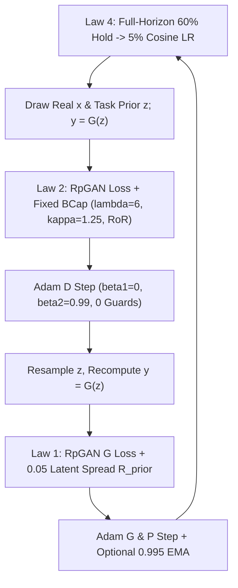

<!-- Generated Forge family report -->

# GAN v3 release 0.7

[← Family leaderboard](../technique-inventory.md) · [Explore by Laws](../LAWS_HUB.md) · [Experiment Catalog](../experiments/README.md) · [Unresolved Problems](../problems.md) · [Research Portal](https://hypergan.github.io/ParticleGAN/) · [HF Space](https://huggingface.co/spaces/HyperGAN/particlegan-leaderboard)

## Executive summary

| Field | Value |
| --- | --- |
| Selected candidate | `recipe-prior-refactor-release07-gan-v3-v1` |
| Distinct full-suite outcomes | **9 PASS** · **7 FAIL** · 43 not measured (of 59 distinct tests; fixed list `technique-inventory-full-suite-2026-11-25`) |
| Counted view requirements | Tier 1: 24/27 · Tier 2: 0/78 (78 not run) · Tier 3: 0/10 (10 not run) · Tier 4: 0/0 · Total: 24/115 (88 not run) |
| DCGAN r256 speed | [252.38 ms/step](../scaling-receipts/dcgan-performance-cloud-e132cf1f36af/release07-gan-v3-dcgan_performance_r256-69dad7c16b6bec97.json) |
| Screening status | Measured (7 fails) |
| Tags | [adversarial-training](../technique-inventory.md#tag-adversarial-training) · [capped-input-gradients](../technique-inventory.md#tag-capped-input-gradients) · [critic-gradient-penalty](../technique-inventory.md#tag-critic-gradient-penalty) · [learning-rate-annealing](../technique-inventory.md#tag-learning-rate-annealing) |

### Quickstart

Public preset: `bcap_adam`

```python
import torch
from torch import nn
from particlegan import BatchDistanceDiscriminator, GANTrainer, get_recipe, init

# Release 0.7 GAN v3 settings via public Recipe overrides
recipe = get_recipe(
    'bcap_adam', reg_arm='b_cap', reg_coeff=6.0, reg_kappa=1.25,
    betas=(0.0, 0.99), prior_reg=0.05, lr_floor=0.05, network_lr_floor=0.05,
    ema_decay=0.995, total_steps=1000,
)
G = init.deterministic_orthogonal_(nn.Sequential(
    nn.Linear(recipe.z_dim, 64), nn.LeakyReLU(0.2), nn.Linear(64, 2)), seed=0)
D = init.deterministic_orthogonal_(BatchDistanceDiscriminator(), seed=1)
prior = init.deterministic_orthogonal_(recipe.make_prior())
trainer = GANTrainer(recipe, G, D, prior=prior, seed=0)
stats = trainer.step(torch.randn(recipe.batch_size, 2))
```

**Tags:** [adversarial-training](../technique-inventory.md#tag-adversarial-training) · [capped-input-gradients](../technique-inventory.md#tag-capped-input-gradients) · [critic-gradient-penalty](../technique-inventory.md#tag-critic-gradient-penalty) · [learning-rate-annealing](../technique-inventory.md#tag-learning-rate-annealing)

## Technique overview

The released v0.7 GAN v3 family uses paired relativistic logistic loss with a fixed L2 cap on critic input gradients, plus latent spread regularization and a full-horizon cosine LR schedule. Its K3P-derived optimizer wrappers have the spike guard, anchor, A2 and direct-particle gain disabled. Forge's reusable card delegates host resources and auxiliary objectives explicitly; the historical MoG and cloud host cards retain their separate identities.

<a name="how-it-addresses-laws"></a>

## How GAN v3 release 0.7 addresses the current laws

> *"Our goal is not to preserve the four laws. Our goal is to discover the laws of learning, even if doing so ultimately requires abandoning the current four."*

This law taxonomy is a living scientific framework derived from current mathematical and empirical audits. Individual laws may be refined, split, merged, or replaced as new counterexamples and evidence emerge. [Explore by Laws hub](../LAWS_HUB.md) · [Current laws framework](../../../docs/four-laws.md).

| Law | Status | Primary mechanism |
| --- | --- | --- |
| [Law 1: Representational Geometry](../../../docs/four-laws.md) | 🟡 Partial | VICReg-inspired latent variance/covariance spread penalty (0.05 * R_prior) |
| [Law 2: Potential Geometry](../../../docs/four-laws.md) | 🟡 Partial | Fixed strong real/fake one-sided squared L2 input-gradient cap (lambda=6, kappa=1.25, RoR) |
| [Law 3: Transport Identifiability](../../../docs/four-laws.md) | ⬜ Unaddressed | Paired relativistic scalar critic (RpGAN) only |
| [Law 4: Functional and Game Dynamics](../../../docs/four-laws.md) | 🟡 Partial | Beta1=0, beta2=0.99 Adam + full-horizon 60%-hold cosine LR decay to 5% + 1:1 alternation |

### Law 1 — Representational Geometry (Partial)

*Can the system represent the required probability measure efficiently and faithfully?*

- **Mechanism:** VICReg-inspired latent variance/covariance spread penalty (0.05 * R_prior)
- **How it works:** Adds a `0.05` variance-hinge and off-diagonal covariance penalty on scalar latent tables to discourage total latent collapse without enforcing a Gaussian density.
- **Known limits:** Isotropic variance/covariance spread does not build a multimodal prototype atlas or pullback isometry, so separated targets still incur continuous-pushforward valley bridging.

### Law 2 — Potential Geometry (Partial)

*Does the critic communicate useful learning forces with appropriate geometric control and computational efficiency?*

- **Mechanism:** Fixed strong real/fake one-sided squared L2 input-gradient cap (lambda=6, kappa=1.25, RoR)
- **How it works:** Penalizes real and fake critic input-gradient norms above `kappa=1.25` with strength `lambda=6` on every update via exact RoR without handover or EMA critic anchoring.
- **Known limits:** Zero interior normal-direction curvature (`mu_D = 0`) whenever `||grad D||_2 <= 1.25`, no zero-mean logit gauge anchor, and high exact-RoR compute cost on images.

### Law 3 — Transport Identifiability (Unaddressed)

*Does the learning system possess enough information to determine appropriate transport?*

- **Mechanism:** Paired relativistic scalar critic (RpGAN) only
- **How it works:** Evaluates paired relativistic logistic loss on raw critic scores without optimal-transport horizons, beyond-horizon orphan rescue, or conditional fiber drift-variance deconfounding.
- **Known limits:** Fails multi-scale width recovery, beyond-horizon shifts, and conditional reverse-diffusion stratum variance.

### Law 4 — Functional and Game Dynamics (Partial)

*Can the learning system realize useful functional changes and exhibit appropriate coupled learning dynamics?*

- **Mechanism:** Beta1=0, beta2=0.99 Adam + full-horizon 60%-hold cosine LR decay to 5% + 1:1 alternation
- **How it works:** Runs 1:1 alternating zero-momentum Adam with full-horizon cosine learning-rate annealing and all K3P optimizer guards/damping disabled.
- **Known limits:** Horizon-dependent LR schedule fails clock-free invariance; `mu_D = 0` one-sided cap leaves equilibrium rotational modes undamped (Law 4.5); and ordinary Adam lacks spectral conditioning (4.2) and realized pushforward trust (4.1/4.3).

## Update loop diagram



## Mathematical formulation

$G$ is the generator, $D$ the raw-score critic, $P$ the task prior, $x$ a real batch, $z\sim P$ a latent batch and $y$ the generated batch, including any declared output noise. $C$ is the critic actually evaluated: $C=D$ without input noise; otherwise every forward evaluates $`D(u+\epsilon_{\mathrm{in}})`$ with a fresh draw. $\mathbb E$ means a sample mean, $\lVert\cdot\rVert_2$ is the Euclidean norm, $`(a)_+=\max(a,0)`$ and $\mathrm{softplus}(a)=\log(1+e^a)$. The scalar sketch detaches $y$ during the critic update and resamples differentiable $y$ after that update; joint and auxiliary hosts retain task-owned objectives. $g_r=\nabla_x C(x)$ and $g_f=\nabla_y C(y)$ are per-sample input gradients; $d$ counts critic-input coordinates. $\lambda$ is penalty strength and $\kappa$ the cap threshold. $`R_{\mathrm{prior}}`$ is the VICReg-inspired latent spread term, $d_z$ the latent dimension, $\Sigma_z$ the unbiased sample covariance and $\epsilon=10^{-4}$ the variance stabilizer. $t$ counts completed updates, $T$ is the declared recipe horizon, $q=t/T$, $\eta^{(0)}$ a base LR and $a(q)$ its multiplier. EMA denotes a parameter exponential moving average.

**Default paired adversarial loss**

$$
\begin{aligned}\ell_D&=\mathbb E\left[\mathrm{softplus}(C(y)-C(x))\right],\\\ell_G&=\mathbb E\left[\mathrm{softplus}(C(x)-C(y))\right].\end{aligned}
$$

These scalar losses are minimized. The critic objective is $\ell_D+R$; the generator adds only its declared auxiliary objectives. Critic fakes are detached, and generator fakes and both scores are recomputed after the critic step. $C$ includes any declared fresh input noise.

**Fixed capped input-gradient penalty**

$$
R_{\mathrm{BCAP}}=\frac{\lambda}{2}\left\lbrace\mathbb E\left[(\lVert g_r\rVert_2-\kappa)_+^2\right]+\mathbb E\left[(\lVert g_f\rVert_2-\kappa)_+^2\right]\right\rbrace.
$$

The full release recipe fixes $\lambda=6$ and $\kappa=1.25$, applied every critic update. This is the same soft L2 cap mechanism with stronger and wider settings; K3P handover, critic proximity and optimizer interventions are disabled.

**Latent spread auxiliary objective**

$$
\begin{aligned}R_{\mathrm{prior}}&=\frac{1}{d_z}\sum_{a=1}^{d_z}\left(1-\sqrt{(\Sigma_z)_{aa}+10^{-4}}\right)_+\\&\quad+\frac{1}{d_z}\sum_{a\ne b}(\Sigma_z)_{ab}^2,\\L_G&=\ell_G+0.05R_{\mathrm{prior}}.\end{aligned}
$$

For scalar hosts that expose this auxiliary, use the unbiased sample covariance of the supplied latent batch. It discourages standard deviations below $1$ and off-diagonal covariance, without requiring a Gaussian topology. Batches with fewer than two rows return zero. Behavioral hosts retain their explicitly bound auxiliary objectives.

**Full-horizon learning-rate cosine**

$$
a(q)=\begin{cases}1,&q\le0.6,\\0.05+\dfrac{0.95}{2}\left[1+\cos\left(\pi\min\left(1,\dfrac{q-0.6}{0.4}\right)\right)\right],&q>0.6,\end{cases}\qquad \eta(t)=\eta^{(0)}a(t/T).
$$

Hold each role at its base rate for $`60\%`$ of the declared recipe horizon, then decay to a $`5\%`$ floor and hold. The reusable task-adapted card resolves $T$ explicitly; the historical native MoG/cloud cards retain $T=7000$. An external execution cap does not redefine the schedule.

## Simplified pseudocode

```text
For each training iteration:
  Use the resolved task horizon: hold LR through 60%, then cosine-decay toward 5% of its base value.
  Draw real x and task-prior z; fake = detach(G(z)).
  Compute the paired critic adversarial loss shown above.
  g_r = gradient(D(x),x); g_f = gradient(D(fake),fake), using detached input copies.
  Add the fixed real/fake input-gradient penalty shown above.
  Backpropagate; take the critic Adam step with guard and gradient anchor disabled.
  Freeze D parameters; draw fresh z, regenerate fake and recompute both scores.
  Compute the paired generator adversarial loss from the updated critic.
  On scalar latent-table hosts, add .05 * R_prior to L_G; behavioral hosts retain their original objectives.
  Backpropagate; update G/prior with A2 and direct response gain disabled.
  Maintain the configured .995 generator/prior EMA where the host implements it.
  Score with the frozen task's declared weights, prior and noise law; ordinary gates use clean live outputs.
```

## Training details

| Characteristic | Behavior |
| --- | --- |
| Adversarial loss | Paired relativistic logistic, with the fixed real/fake cap regularizer below. Scalar hosts add the declared $0.05$ latent variance/covariance term; behavioral hosts keep their task-owned reconstruction, conditional or direct-particle objectives. |
| Optimizer | K3P-derived Adam wrappers selected by the explicit fixed b_cap arm. $\beta_1=0$, $\beta_2=0.99$, AMSGrad off; guard, anchor, A2 and direct gain are disabled. Observer bookkeeping remains. This recipe is not selected through optimizer_family='adam', despite having its intervention switches off. Direct sample-particle hosts can retain separately declared response moments even when response gain is disabled; inspect the host binding. |
| Learning rates and annealing | Reference base LR $0.00425$, critic multiplier $1$, latent-prior multiplier $2$; full resolved horizon, $`60\%`$ hold followed by cosine decay to $`5\%`$, with no separate short network horizon. The current selected whole variant uses $0.006375$ and prior multiplier $1$. Task-adapted fields delegate the horizon explicitly; an external cap does not redefine it. |
| Parameter-gradient clipping | No critic spike guard or global gradient-norm clipping. The cap penalizes excess critic input-gradient magnitude in the loss; it does not clamp critic parameter gradients or weights. |
| Critic penalties and anchors | Fixed $\lambda=6$ and L2 cap $\kappa=1.25$ on both real and fake samples, applied every step. No RMS normalization, K3P handover or critic-gradient proximity term. |
| Damping and update guards | A2, critic spike guard, critic anchor and direct sample-particle gain are all disabled. This distinguishes the full release recipe from a fixed BCap penalty swapped into an otherwise intact K3P recipe. |
| Training and sampling noise | No additive critic-input or generated-output training noise. The task's prior still owns its latent sampling noise: learned-MoG and particle-cloud hosts remain distinct. Paired noisy/EMA diagnostics do not replace the required clean/live result. |
| Parameter averaging and serving | Generator/prior EMA decay $0.995$ is configured where the host implements it; selected ordinary gates use live weights. Behavioral hosts may own no scored EMA or latent table. No critic-gradient anchor average is active. |

## Configuration differences

- Each result retains its executed source, recipe, task prior, initialization, budget and sampling law. These descriptions do not change or requalify recorded measurements.
- Task-owned objectives and active components matter: direct sample particles, learned latent rows and a generator network are different parameter roles. A declared recipe switch does not imply that every host can apply it.
- The canonical release07-gan-v3-task-adapted-v1 delegates only declared task resources/objectives. Its reference recipe uses LR .00425/prior multiplier 2. The selected release07-gan-v3-mog--1e266b5a2986ee4cb2f2fdc46437cc82982bf1cf02707eeba95743f4890e8a0c at source 928b485ffbe6e17d79b41d307ae8b6275489b37a uses .006375/prior multiplier 1.
- Historical release07-gan-v3-mog and release07-gan-v3-cloud entries are retained host/source cohorts, not additional current solution families. They cannot fill selected-row cells.
- The .05 scalar spread coefficient multiplies a variance/covariance helper, not the complete VICReg self-supervised objective. Task-owned direct-particle hosts instead retain their original objective and parameter roles.

<details>
<summary>Implementation and recipe sources</summary>

These links support the explanation. Recorded results below remain bound to their own executed source.

- [configs/forge/ideas/release07-gan-v3-task-adapted-v1.json](../../../configs/forge/ideas/release07-gan-v3-task-adapted-v1.json)
- [configs/forge/configurations/release07-gan-v3-mog--1e266b5a2986ee4cb2f2fdc46437cc82982bf1cf02707eeba95743f4890e8a0c.json](../../../configs/forge/configurations/release07-gan-v3-mog--1e266b5a2986ee4cb2f2fdc46437cc82982bf1cf02707eeba95743f4890e8a0c.json)
- [experiments/forge/taskrecipes.py](../../../experiments/forge/taskrecipes.py)
- [particlegan/grad_regularizers.py](../../../particlegan/grad_regularizers.py)
- [particlegan/k3p.py](../../../particlegan/k3p.py)
- [particlegan/vicreg_loss.py](../../../particlegan/vicreg_loss.py)
- [particlegan/training.py](../../../particlegan/training.py)
- [reports/forge/RELEASE07_TASK_ADAPTATION_READOUT.md](../RELEASE07_TASK_ADAPTATION_READOUT.md)
- [https://github.com/255BITS/ParticleGAN/blob/928b485ffbe6e17d79b41d307ae8b6275489b37a/particlegan/recipes.py](https://github.com/255BITS/ParticleGAN/blob/928b485ffbe6e17d79b41d307ae8b6275489b37a/particlegan/recipes.py)

</details>

Generated from one selected configuration per runtime. Recorded verdicts retain their original scientific contracts; grouping them under current views grants no new qualification.

## Performance

DCGAN on deterministic mock RGB data measures finite-update speed and memory. These separate performance-source receipts confer no image-quality, scientific qualification or default-promotion credit. Standard BatchNorm is retained in generator and critic; critic input gradients therefore include batch coupling. The shared critic uses a flattened 4×4 Linear scalar head for policy feature extraction; its module layout is fixed across recipes.

Synchronized wall time for one public trainer update, including its critic/generator/prior work; warmup, construction, mock-data generation, evaluation, GIFs and checkpoint writes are excluded.

Every cell is one run; timings are never pooled across devices or contention states. Compare only rows with the same task and matched key (source, runtime/dtype, physical device, initialization and batch streams). Unknown or contended observations are unpaired. Resolution progression changes the task, while each candidate keeps one global recipe. Images/s is B divided by full update time (one D and one G/prior update with separate real batches). Three warmup and ten measured updates give short-window median/p95 measurements; long-horizon policy costs and component phase times remain unknown.

[Compact performance evidence index](../scaling-performance.json) · [Protocol and bounded reproduction](../../../docs/forge-scaling-performance.md)

This registration covers 11 complete recipes. Historical alternatives outside its registered family roster add no missing benchmark cells. A changed selected recipe within a registered family remains unknown until measured.

### NVIDIA RTX A6000 · GPU-548116b7-9dbe-de58-b3d9-a6e27b0f74ce

Performance source `243b8746446b` (commit `d438ade7020f07a8d8518ade2babeffc8dc5d2b3`); runtime `8be0f1612c1a`; torch.float32; PyTorch 2.15.0+cu132; 48592.125 MiB device memory.

Task prior: particle_cloud, sigma 0.0, 256 initial locations. The common finite-table performance exception retains each recipe's prior update policy and regularizer. Exact prior and resource specifications remain part of every task key.

| Family / recipe | Task (RGB size, batch, width) | Execution | Median / p95 update ms | Images/s | GPU peak allocated / reserved MiB | Contention | Matched key / evidence |
| --- | --- | --- | ---: | ---: | ---: | --- | --- |
| GAN v3 release 0.7 · `recipe-prior-refactor-release07-gan-v3-v1` | dcgan_performance_r32: 32², B16, W64 | COMPLETE | 9.90 / 10.03 | 1,614.50 | 90.52 / 118.00 | clear | `b23130f46ae9` · [receipt](../scaling-receipts/dcgan-performance-cloud-e132cf1f36af/release07-gan-v3-dcgan_performance_r32-5c8de66a87d69094.json) |
| GAN v3 release 0.7 · `recipe-prior-refactor-release07-gan-v3-v1` | dcgan_performance_r64: 64², B16, W64 | COMPLETE | 25.13 / 25.78 | 633.77 | 257.54 / 316.00 | clear | `8224f2b29e8f` · [receipt](../scaling-receipts/dcgan-performance-cloud-e132cf1f36af/release07-gan-v3-dcgan_performance_r64-8b24e460fecd348d.json) |
| GAN v3 release 0.7 · `recipe-prior-refactor-release07-gan-v3-v1` | dcgan_performance_w128: 64², B16, W128 | COMPLETE | 55.40 / 55.71 | 289.16 | 715.93 / 746.00 | clear | `dea8c1563dc2` · [receipt](../scaling-receipts/dcgan-performance-cloud-e132cf1f36af/release07-gan-v3-dcgan_performance_w128-b6ec992a207a779f.json) |
| GAN v3 release 0.7 · `recipe-prior-refactor-release07-gan-v3-v1` | dcgan_performance_b64: 64², B64, W64 | COMPLETE | 61.29 / 63.32 | 1,038.67 | 582.04 / 626.00 | clear | `29a528c7ad6b` · [receipt](../scaling-receipts/dcgan-performance-cloud-e132cf1f36af/release07-gan-v3-dcgan_performance_b64-984af554b2d19474.json) |
| GAN v3 release 0.7 · `recipe-prior-refactor-release07-gan-v3-v1` | dcgan_performance_r128: 128², B16, W64 | COMPLETE | 71.45 / 71.69 | 224.13 | 741.08 / 762.00 | clear | `fb14c59178bb` · [receipt](../scaling-receipts/dcgan-performance-cloud-e132cf1f36af/release07-gan-v3-dcgan_performance_r128-8b76647e79d7080e.json) |
| GAN v3 release 0.7 · `recipe-prior-refactor-release07-gan-v3-v1` | dcgan_performance_r256: 256², B16, W64 | COMPLETE | 252.38 / 253.39 | 63.42 | 2,307.15 / 2,410.00 | clear | `5b379f921afb` · [receipt](../scaling-receipts/dcgan-performance-cloud-e132cf1f36af/release07-gan-v3-dcgan_performance_r256-69dad7c16b6bec97.json) |

<a name="cohort-cuda-daa283c8a640"></a>

## Current benchmark

Runtime: **cuda**. Selected configuration: [recipe-prior-refactor-release07-gan-v3-v1](../../../configs/forge/ideas/recipe-prior-refactor-release07-gan-v3-v1.json).

Comparison policy: discriminator_stability revision 9, **tier 0**. Actual executed-policy qualification: **tier 0**, discriminator_stability revision 20 (FAIL). These are separate policy results; no qualification reuse.

<details>
<summary>Configuration, source and runtime provenance</summary>

Source digest: `adaba79cf3213145668362097d4c9c73d71ed8be263ac1dbe7cf134ba7b37d1b`. Candidate revision: `2c9722a3931adc3b6f7d09d019185490c926e4dc07ca9025552e18eb23a32772`. Runtime cohort: `709e0c8d464dffc422cb3fdb43947341ae33a019eafc5257c0491de5be750125`.

[Frozen numerical evidence](../technique-evidence/cd6c7a0e9946e818d197334e689992e5df13f3edd23000adba9c359b03b4d949.json) · [Complete recipe, prior, initialization and sampling bindings](../technique-inventory.json)

Selection: current_measurement. Refresh recipe-prior-refactor-release07-gan-v3-v1 under current discriminator_stability revision-20 CUDA contracts on NVIDIA RTX A6000 (9/11 required Tier 1 PASS, 9/17 executed Tier 1 PASS with 0 INCOMPLETE; 2 required Tier 1 numerical failures explicitly visible: five_word_joint_smoke, ring16_acquisition). Actual executed-policy qualification and comparison-policy projection retain their separate source-bound proofs; no public-default adoption claim.

</details>

Complete current Tier 1 measurement in: discriminator_stability. PASS and FAIL are both measured outcomes; other cohorts retain their own required cells.

| View | Tier 1 tests | Tier 2 tests | Tier 3 tests | Tier 4 tests | Total distinct tests | Held (measured, not counted) |
| --- | ---: | ---: | ---: | ---: | ---: | ---: |
| [adaptation](release07-gan-v3.md#cohort-cuda-daa283c8a640-adaptation) | [3/3](release07-gan-v3.md#cohort-cuda-daa283c8a640-adaptation-tier-1) | [0/12 (12 not run)](release07-gan-v3.md#cohort-cuda-daa283c8a640-adaptation-tier-2) | [0/1 (1 not run)](release07-gan-v3.md#cohort-cuda-daa283c8a640-adaptation-tier-3) | [0/0](release07-gan-v3.md#cohort-cuda-daa283c8a640-adaptation-tier-4) | [3/16 (13 not run)](release07-gan-v3.md#cohort-cuda-daa283c8a640-adaptation) | [0/7 (7 not run)](release07-gan-v3.md#cohort-cuda-daa283c8a640-held) |
| [clockfree_continuous](release07-gan-v3.md#cohort-cuda-daa283c8a640-clockfree_continuous) | [3/4](release07-gan-v3.md#cohort-cuda-daa283c8a640-clockfree_continuous-tier-1) | [0/12 (12 not run)](release07-gan-v3.md#cohort-cuda-daa283c8a640-clockfree_continuous-tier-2) | [0/6 (6 not run)](release07-gan-v3.md#cohort-cuda-daa283c8a640-clockfree_continuous-tier-3) | [0/0](release07-gan-v3.md#cohort-cuda-daa283c8a640-clockfree_continuous-tier-4) | [3/22 (18 not run)](release07-gan-v3.md#cohort-cuda-daa283c8a640-clockfree_continuous) | [0/7 (7 not run)](release07-gan-v3.md#cohort-cuda-daa283c8a640-held) |
| [discriminator_stability](release07-gan-v3.md#cohort-cuda-daa283c8a640-discriminator_stability) | [9/11](release07-gan-v3.md#cohort-cuda-daa283c8a640-discriminator_stability-tier-1) | [0/18 (18 not run)](release07-gan-v3.md#cohort-cuda-daa283c8a640-discriminator_stability-tier-2) | [0/1 (1 not run)](release07-gan-v3.md#cohort-cuda-daa283c8a640-discriminator_stability-tier-3) | [0/0](release07-gan-v3.md#cohort-cuda-daa283c8a640-discriminator_stability-tier-4) | [9/30 (19 not run)](release07-gan-v3.md#cohort-cuda-daa283c8a640-discriminator_stability) | [0/35 (19 not run, 12 incompatible)](release07-gan-v3.md#cohort-cuda-daa283c8a640-held) |
| [formulation_comparison](release07-gan-v3.md#cohort-cuda-daa283c8a640-formulation_comparison) | [3/3](release07-gan-v3.md#cohort-cuda-daa283c8a640-formulation_comparison-tier-1) | [0/12 (12 not run)](release07-gan-v3.md#cohort-cuda-daa283c8a640-formulation_comparison-tier-2) | [0/1 (1 not run)](release07-gan-v3.md#cohort-cuda-daa283c8a640-formulation_comparison-tier-3) | [0/0](release07-gan-v3.md#cohort-cuda-daa283c8a640-formulation_comparison-tier-4) | [3/16 (13 not run)](release07-gan-v3.md#cohort-cuda-daa283c8a640-formulation_comparison) | [0/7 (7 not run)](release07-gan-v3.md#cohort-cuda-daa283c8a640-held) |
| [host_profile_transfer](release07-gan-v3.md#cohort-cuda-daa283c8a640-host_profile_transfer) | [3/3](release07-gan-v3.md#cohort-cuda-daa283c8a640-host_profile_transfer-tier-1) | [0/12 (12 not run)](release07-gan-v3.md#cohort-cuda-daa283c8a640-host_profile_transfer-tier-2) | [0/1 (1 not run)](release07-gan-v3.md#cohort-cuda-daa283c8a640-host_profile_transfer-tier-3) | [0/0](release07-gan-v3.md#cohort-cuda-daa283c8a640-host_profile_transfer-tier-4) | [3/16 (13 not run)](release07-gan-v3.md#cohort-cuda-daa283c8a640-host_profile_transfer) | [0/7 (7 not run)](release07-gan-v3.md#cohort-cuda-daa283c8a640-held) |
| [quality_coverage](release07-gan-v3.md#cohort-cuda-daa283c8a640-quality_coverage) | [3/3](release07-gan-v3.md#cohort-cuda-daa283c8a640-quality_coverage-tier-1) | [0/12 (12 not run)](release07-gan-v3.md#cohort-cuda-daa283c8a640-quality_coverage-tier-2) | [0/0](release07-gan-v3.md#cohort-cuda-daa283c8a640-quality_coverage-tier-3) | [0/0](release07-gan-v3.md#cohort-cuda-daa283c8a640-quality_coverage-tier-4) | [3/15 (12 not run)](release07-gan-v3.md#cohort-cuda-daa283c8a640-quality_coverage) | [0/7 (7 not run)](release07-gan-v3.md#cohort-cuda-daa283c8a640-held) |

Separate cohort coverage (excluded from family totals):

| View | Tier 1 tests | Tier 2 tests | Tier 3 tests | Tier 4 tests | Total distinct tests |
| --- | ---: | ---: | ---: | ---: | ---: |
| [lazy_cadence_coverage](release07-gan-v3.md#cohort-cuda-daa283c8a640-lazy_cadence_coverage) | [0/0](release07-gan-v3.md#cohort-cuda-daa283c8a640-lazy_cadence_coverage-tier-1) | [0/0](release07-gan-v3.md#cohort-cuda-daa283c8a640-lazy_cadence_coverage-tier-2) | [0/0](release07-gan-v3.md#cohort-cuda-daa283c8a640-lazy_cadence_coverage-tier-3) | [0/0](release07-gan-v3.md#cohort-cuda-daa283c8a640-lazy_cadence_coverage-tier-4) | [0/0](release07-gan-v3.md#cohort-cuda-daa283c8a640-lazy_cadence_coverage) |
| [tier1_policy_coverage](release07-gan-v3.md#cohort-cuda-daa283c8a640-tier1_policy_coverage) | [0/7 (7 not run)](release07-gan-v3.md#cohort-cuda-daa283c8a640-tier1_policy_coverage-tier-1) | [0/0](release07-gan-v3.md#cohort-cuda-daa283c8a640-tier1_policy_coverage-tier-2) | [0/0](release07-gan-v3.md#cohort-cuda-daa283c8a640-tier1_policy_coverage-tier-3) | [0/0](release07-gan-v3.md#cohort-cuda-daa283c8a640-tier1_policy_coverage-tier-4) | [0/7 (7 not run)](release07-gan-v3.md#cohort-cuda-daa283c8a640-tier1_policy_coverage) |

With run-attempt coverage, not run means no attempt; incompatible means a constructor refusal; blocked means a missing required artifact; diagnostic attempts retain separate-runtime outcomes. Other cohorts retain their recorded missing/preflight counts. All remain in the required denominator. PASS and FAIL both count as executed. Attempted errors retain their status and cause; changes to today's test definition are shown separately from execution coverage.

<a name="cohort-cuda-daa283c8a640-tier-1"></a>

### Tier 1 across views

Shared experiments appear once in this list; the family numerator/denominator count their view requirements.

| Experiment | Required by | Recorded result | Test definition |
| --- | --- | --- | --- |
| [ae_gan_hold](release07-gan-v3.md#cohort-cuda-daa283c8a640-experiment-ae_gan_hold) | [adaptation](release07-gan-v3.md#cohort-cuda-daa283c8a640-adaptation-tier-1), [clockfree_continuous](release07-gan-v3.md#cohort-cuda-daa283c8a640-clockfree_continuous-tier-1), [discriminator_stability](release07-gan-v3.md#cohort-cuda-daa283c8a640-discriminator_stability-tier-1), [formulation_comparison](release07-gan-v3.md#cohort-cuda-daa283c8a640-formulation_comparison-tier-1), [host_profile_transfer](release07-gan-v3.md#cohort-cuda-daa283c8a640-host_profile_transfer-tier-1), [quality_coverage](release07-gan-v3.md#cohort-cuda-daa283c8a640-quality_coverage-tier-1) | PASS | matches recorded run |
| [clockfree_audit_measurement_v1](release07-gan-v3.md#cohort-cuda-daa283c8a640-experiment-clockfree_audit_measurement_v1) | [clockfree_continuous](release07-gan-v3.md#cohort-cuda-daa283c8a640-clockfree_continuous-tier-1) | FAIL | matches recorded run |
| [five_word_joint_smoke](release07-gan-v3.md#cohort-cuda-daa283c8a640-experiment-five_word_joint_smoke) | [discriminator_stability](release07-gan-v3.md#cohort-cuda-daa283c8a640-discriminator_stability-tier-1) | FAIL | matches recorded run |
| [gaussian1d_smoke](release07-gan-v3.md#cohort-cuda-daa283c8a640-experiment-gaussian1d_smoke) | [discriminator_stability](release07-gan-v3.md#cohort-cuda-daa283c8a640-discriminator_stability-tier-1) | PASS | matches recorded run |
| [model_ae_gan_multimodal](release07-gan-v3.md#cohort-cuda-daa283c8a640-experiment-model_ae_gan_multimodal) | [discriminator_stability](release07-gan-v3.md#cohort-cuda-daa283c8a640-discriminator_stability-tier-1) | PASS | matches recorded run |
| [model_ae_reconstruction](release07-gan-v3.md#cohort-cuda-daa283c8a640-experiment-model_ae_reconstruction) | [discriminator_stability](release07-gan-v3.md#cohort-cuda-daa283c8a640-discriminator_stability-tier-1) | PASS | matches recorded run |
| [model_vae_categorical](release07-gan-v3.md#cohort-cuda-daa283c8a640-experiment-model_vae_categorical) | [discriminator_stability](release07-gan-v3.md#cohort-cuda-daa283c8a640-discriminator_stability-tier-1) | PASS | matches recorded run |
| [model_vae_hard](release07-gan-v3.md#cohort-cuda-daa283c8a640-experiment-model_vae_hard) | [discriminator_stability](release07-gan-v3.md#cohort-cuda-daa283c8a640-discriminator_stability-tier-1) | PASS | matches recorded run |
| [ring16_acquisition](release07-gan-v3.md#cohort-cuda-daa283c8a640-experiment-ring16_acquisition) | [discriminator_stability](release07-gan-v3.md#cohort-cuda-daa283c8a640-discriminator_stability-tier-1) | FAIL | matches recorded run |
| [two_pole](release07-gan-v3.md#cohort-cuda-daa283c8a640-experiment-two_pole) | [adaptation](release07-gan-v3.md#cohort-cuda-daa283c8a640-adaptation-tier-1), [clockfree_continuous](release07-gan-v3.md#cohort-cuda-daa283c8a640-clockfree_continuous-tier-1), [discriminator_stability](release07-gan-v3.md#cohort-cuda-daa283c8a640-discriminator_stability-tier-1), [formulation_comparison](release07-gan-v3.md#cohort-cuda-daa283c8a640-formulation_comparison-tier-1), [host_profile_transfer](release07-gan-v3.md#cohort-cuda-daa283c8a640-host_profile_transfer-tier-1), [quality_coverage](release07-gan-v3.md#cohort-cuda-daa283c8a640-quality_coverage-tier-1) | PASS | matches recorded run |
| [unused_token_hold](release07-gan-v3.md#cohort-cuda-daa283c8a640-experiment-unused_token_hold) | [adaptation](release07-gan-v3.md#cohort-cuda-daa283c8a640-adaptation-tier-1), [clockfree_continuous](release07-gan-v3.md#cohort-cuda-daa283c8a640-clockfree_continuous-tier-1), [discriminator_stability](release07-gan-v3.md#cohort-cuda-daa283c8a640-discriminator_stability-tier-1), [formulation_comparison](release07-gan-v3.md#cohort-cuda-daa283c8a640-formulation_comparison-tier-1), [host_profile_transfer](release07-gan-v3.md#cohort-cuda-daa283c8a640-host_profile_transfer-tier-1), [quality_coverage](release07-gan-v3.md#cohort-cuda-daa283c8a640-quality_coverage-tier-1) | PASS | matches recorded run |
| [zero_tanh_smoke](release07-gan-v3.md#cohort-cuda-daa283c8a640-experiment-zero_tanh_smoke) | [discriminator_stability](release07-gan-v3.md#cohort-cuda-daa283c8a640-discriminator_stability-tier-1) | PASS | matches recorded run |

Held at this tier (measured and shown, not counted):

| Experiment | Held in | Recorded result | Test definition |
| --- | --- | --- | --- |
| [interp_sparse_arc](release07-gan-v3.md#cohort-cuda-daa283c8a640-experiment-interp_sparse_arc) | [discriminator_stability](release07-gan-v3.md#cohort-cuda-daa283c8a640-discriminator_stability-tier-1) | FAIL | changed since run |
| [precision_gaussian_mxfp8](release07-gan-v3.md#cohort-cuda-daa283c8a640-experiment-precision_gaussian_mxfp8) | [discriminator_stability](release07-gan-v3.md#cohort-cuda-daa283c8a640-discriminator_stability-tier-1) | FAIL | matches recorded run |
| [precision_gaussian_nvfp4](release07-gan-v3.md#cohort-cuda-daa283c8a640-experiment-precision_gaussian_nvfp4) | [discriminator_stability](release07-gan-v3.md#cohort-cuda-daa283c8a640-discriminator_stability-tier-1) | FAIL | matches recorded run |
| [t3_iso_scale_mass_8x](release07-gan-v3.md#cohort-cuda-daa283c8a640-experiment-t3_iso_scale_mass_8x) | [discriminator_stability](release07-gan-v3.md#cohort-cuda-daa283c8a640-discriminator_stability-tier-1) | FAIL | changed since run |

<a name="cohort-cuda-daa283c8a640-tier-2"></a>

### Tier 2 across views

Shared experiments appear once in this list; the family numerator/denominator count their view requirements.

| Experiment | Required by | Recorded result | Test definition |
| --- | --- | --- | --- |
| [cover_leftover](release07-gan-v3.md#cohort-cuda-daa283c8a640-experiment-cover_leftover) | [adaptation](release07-gan-v3.md#cohort-cuda-daa283c8a640-adaptation-tier-2), [clockfree_continuous](release07-gan-v3.md#cohort-cuda-daa283c8a640-clockfree_continuous-tier-2), [discriminator_stability](release07-gan-v3.md#cohort-cuda-daa283c8a640-discriminator_stability-tier-2), [formulation_comparison](release07-gan-v3.md#cohort-cuda-daa283c8a640-formulation_comparison-tier-2), [host_profile_transfer](release07-gan-v3.md#cohort-cuda-daa283c8a640-host_profile_transfer-tier-2), [quality_coverage](release07-gan-v3.md#cohort-cuda-daa283c8a640-quality_coverage-tier-2) | UNKNOWN | matches recorded run |
| [five_word_joint_hold](release07-gan-v3.md#cohort-cuda-daa283c8a640-experiment-five_word_joint_hold) | [discriminator_stability](release07-gan-v3.md#cohort-cuda-daa283c8a640-discriminator_stability-tier-2) | UNKNOWN | matches recorded run |
| [gaussian1d_stability](release07-gan-v3.md#cohort-cuda-daa283c8a640-experiment-gaussian1d_stability) | [discriminator_stability](release07-gan-v3.md#cohort-cuda-daa283c8a640-discriminator_stability-tier-2) | UNKNOWN | matches recorded run |
| [grid100](release07-gan-v3.md#cohort-cuda-daa283c8a640-experiment-grid100) | [adaptation](release07-gan-v3.md#cohort-cuda-daa283c8a640-adaptation-tier-2), [clockfree_continuous](release07-gan-v3.md#cohort-cuda-daa283c8a640-clockfree_continuous-tier-2), [discriminator_stability](release07-gan-v3.md#cohort-cuda-daa283c8a640-discriminator_stability-tier-2), [formulation_comparison](release07-gan-v3.md#cohort-cuda-daa283c8a640-formulation_comparison-tier-2), [host_profile_transfer](release07-gan-v3.md#cohort-cuda-daa283c8a640-host_profile_transfer-tier-2), [quality_coverage](release07-gan-v3.md#cohort-cuda-daa283c8a640-quality_coverage-tier-2) | UNKNOWN | matches recorded run |
| [img_stripes2](release07-gan-v3.md#cohort-cuda-daa283c8a640-experiment-img_stripes2) | [adaptation](release07-gan-v3.md#cohort-cuda-daa283c8a640-adaptation-tier-2), [clockfree_continuous](release07-gan-v3.md#cohort-cuda-daa283c8a640-clockfree_continuous-tier-2), [discriminator_stability](release07-gan-v3.md#cohort-cuda-daa283c8a640-discriminator_stability-tier-2), [formulation_comparison](release07-gan-v3.md#cohort-cuda-daa283c8a640-formulation_comparison-tier-2), [host_profile_transfer](release07-gan-v3.md#cohort-cuda-daa283c8a640-host_profile_transfer-tier-2), [quality_coverage](release07-gan-v3.md#cohort-cuda-daa283c8a640-quality_coverage-tier-2) | UNKNOWN | matches recorded run |
| [mid_scale_identity](release07-gan-v3.md#cohort-cuda-daa283c8a640-experiment-mid_scale_identity) | [adaptation](release07-gan-v3.md#cohort-cuda-daa283c8a640-adaptation-tier-2), [clockfree_continuous](release07-gan-v3.md#cohort-cuda-daa283c8a640-clockfree_continuous-tier-2), [discriminator_stability](release07-gan-v3.md#cohort-cuda-daa283c8a640-discriminator_stability-tier-2), [formulation_comparison](release07-gan-v3.md#cohort-cuda-daa283c8a640-formulation_comparison-tier-2), [host_profile_transfer](release07-gan-v3.md#cohort-cuda-daa283c8a640-host_profile_transfer-tier-2), [quality_coverage](release07-gan-v3.md#cohort-cuda-daa283c8a640-quality_coverage-tier-2) | UNKNOWN | matches recorded run |
| [mode_hold](release07-gan-v3.md#cohort-cuda-daa283c8a640-experiment-mode_hold) | [adaptation](release07-gan-v3.md#cohort-cuda-daa283c8a640-adaptation-tier-2), [clockfree_continuous](release07-gan-v3.md#cohort-cuda-daa283c8a640-clockfree_continuous-tier-2), [discriminator_stability](release07-gan-v3.md#cohort-cuda-daa283c8a640-discriminator_stability-tier-2), [formulation_comparison](release07-gan-v3.md#cohort-cuda-daa283c8a640-formulation_comparison-tier-2), [host_profile_transfer](release07-gan-v3.md#cohort-cuda-daa283c8a640-host_profile_transfer-tier-2), [quality_coverage](release07-gan-v3.md#cohort-cuda-daa283c8a640-quality_coverage-tier-2) | UNKNOWN | matches recorded run |
| [model_ae_ddgan_bimodal_chain](release07-gan-v3.md#cohort-cuda-daa283c8a640-experiment-model_ae_ddgan_bimodal_chain) | [discriminator_stability](release07-gan-v3.md#cohort-cuda-daa283c8a640-discriminator_stability-tier-2) | UNKNOWN | matches recorded run |
| [model_ae_ddgan_gaussian_chain](release07-gan-v3.md#cohort-cuda-daa283c8a640-experiment-model_ae_ddgan_gaussian_chain) | [discriminator_stability](release07-gan-v3.md#cohort-cuda-daa283c8a640-discriminator_stability-tier-2) | UNKNOWN | matches recorded run |
| [model_ddgan_bimodal_chain](release07-gan-v3.md#cohort-cuda-daa283c8a640-experiment-model_ddgan_bimodal_chain) | [discriminator_stability](release07-gan-v3.md#cohort-cuda-daa283c8a640-discriminator_stability-tier-2) | UNKNOWN | matches recorded run |
| [model_ddgan_gaussian_chain](release07-gan-v3.md#cohort-cuda-daa283c8a640-experiment-model_ddgan_gaussian_chain) | [discriminator_stability](release07-gan-v3.md#cohort-cuda-daa283c8a640-discriminator_stability-tier-2) | UNKNOWN | matches recorded run |
| [residual_student](release07-gan-v3.md#cohort-cuda-daa283c8a640-experiment-residual_student) | [adaptation](release07-gan-v3.md#cohort-cuda-daa283c8a640-adaptation-tier-2), [clockfree_continuous](release07-gan-v3.md#cohort-cuda-daa283c8a640-clockfree_continuous-tier-2), [discriminator_stability](release07-gan-v3.md#cohort-cuda-daa283c8a640-discriminator_stability-tier-2), [formulation_comparison](release07-gan-v3.md#cohort-cuda-daa283c8a640-formulation_comparison-tier-2), [host_profile_transfer](release07-gan-v3.md#cohort-cuda-daa283c8a640-host_profile_transfer-tier-2), [quality_coverage](release07-gan-v3.md#cohort-cuda-daa283c8a640-quality_coverage-tier-2) | UNKNOWN | matches recorded run |
| [rotated100](release07-gan-v3.md#cohort-cuda-daa283c8a640-experiment-rotated100) | [adaptation](release07-gan-v3.md#cohort-cuda-daa283c8a640-adaptation-tier-2), [clockfree_continuous](release07-gan-v3.md#cohort-cuda-daa283c8a640-clockfree_continuous-tier-2), [discriminator_stability](release07-gan-v3.md#cohort-cuda-daa283c8a640-discriminator_stability-tier-2), [formulation_comparison](release07-gan-v3.md#cohort-cuda-daa283c8a640-formulation_comparison-tier-2), [host_profile_transfer](release07-gan-v3.md#cohort-cuda-daa283c8a640-host_profile_transfer-tier-2), [quality_coverage](release07-gan-v3.md#cohort-cuda-daa283c8a640-quality_coverage-tier-2) | UNKNOWN | matches recorded run |
| [staggered100](release07-gan-v3.md#cohort-cuda-daa283c8a640-experiment-staggered100) | [adaptation](release07-gan-v3.md#cohort-cuda-daa283c8a640-adaptation-tier-2), [clockfree_continuous](release07-gan-v3.md#cohort-cuda-daa283c8a640-clockfree_continuous-tier-2), [discriminator_stability](release07-gan-v3.md#cohort-cuda-daa283c8a640-discriminator_stability-tier-2), [formulation_comparison](release07-gan-v3.md#cohort-cuda-daa283c8a640-formulation_comparison-tier-2), [host_profile_transfer](release07-gan-v3.md#cohort-cuda-daa283c8a640-host_profile_transfer-tier-2), [quality_coverage](release07-gan-v3.md#cohort-cuda-daa283c8a640-quality_coverage-tier-2) | UNKNOWN | matches recorded run |
| [trajectory](release07-gan-v3.md#cohort-cuda-daa283c8a640-experiment-trajectory) | [adaptation](release07-gan-v3.md#cohort-cuda-daa283c8a640-adaptation-tier-2), [clockfree_continuous](release07-gan-v3.md#cohort-cuda-daa283c8a640-clockfree_continuous-tier-2), [discriminator_stability](release07-gan-v3.md#cohort-cuda-daa283c8a640-discriminator_stability-tier-2), [formulation_comparison](release07-gan-v3.md#cohort-cuda-daa283c8a640-formulation_comparison-tier-2), [host_profile_transfer](release07-gan-v3.md#cohort-cuda-daa283c8a640-host_profile_transfer-tier-2), [quality_coverage](release07-gan-v3.md#cohort-cuda-daa283c8a640-quality_coverage-tier-2) | UNKNOWN | matches recorded run |
| [unipolar](release07-gan-v3.md#cohort-cuda-daa283c8a640-experiment-unipolar) | [adaptation](release07-gan-v3.md#cohort-cuda-daa283c8a640-adaptation-tier-2), [clockfree_continuous](release07-gan-v3.md#cohort-cuda-daa283c8a640-clockfree_continuous-tier-2), [discriminator_stability](release07-gan-v3.md#cohort-cuda-daa283c8a640-discriminator_stability-tier-2), [formulation_comparison](release07-gan-v3.md#cohort-cuda-daa283c8a640-formulation_comparison-tier-2), [host_profile_transfer](release07-gan-v3.md#cohort-cuda-daa283c8a640-host_profile_transfer-tier-2), [quality_coverage](release07-gan-v3.md#cohort-cuda-daa283c8a640-quality_coverage-tier-2) | UNKNOWN | matches recorded run |
| [vector_spiral](release07-gan-v3.md#cohort-cuda-daa283c8a640-experiment-vector_spiral) | [adaptation](release07-gan-v3.md#cohort-cuda-daa283c8a640-adaptation-tier-2), [clockfree_continuous](release07-gan-v3.md#cohort-cuda-daa283c8a640-clockfree_continuous-tier-2), [discriminator_stability](release07-gan-v3.md#cohort-cuda-daa283c8a640-discriminator_stability-tier-2), [formulation_comparison](release07-gan-v3.md#cohort-cuda-daa283c8a640-formulation_comparison-tier-2), [host_profile_transfer](release07-gan-v3.md#cohort-cuda-daa283c8a640-host_profile_transfer-tier-2), [quality_coverage](release07-gan-v3.md#cohort-cuda-daa283c8a640-quality_coverage-tier-2) | UNKNOWN | matches recorded run |
| [vector_two_broad](release07-gan-v3.md#cohort-cuda-daa283c8a640-experiment-vector_two_broad) | [adaptation](release07-gan-v3.md#cohort-cuda-daa283c8a640-adaptation-tier-2), [clockfree_continuous](release07-gan-v3.md#cohort-cuda-daa283c8a640-clockfree_continuous-tier-2), [discriminator_stability](release07-gan-v3.md#cohort-cuda-daa283c8a640-discriminator_stability-tier-2), [formulation_comparison](release07-gan-v3.md#cohort-cuda-daa283c8a640-formulation_comparison-tier-2), [host_profile_transfer](release07-gan-v3.md#cohort-cuda-daa283c8a640-host_profile_transfer-tier-2), [quality_coverage](release07-gan-v3.md#cohort-cuda-daa283c8a640-quality_coverage-tier-2) | UNKNOWN | matches recorded run |

Held at this tier (measured and shown, not counted):

| Experiment | Held in | Recorded result | Test definition |
| --- | --- | --- | --- |
| [bytegan_hypercube8](release07-gan-v3.md#cohort-cuda-daa283c8a640-experiment-bytegan_hypercube8) | [discriminator_stability](release07-gan-v3.md#cohort-cuda-daa283c8a640-discriminator_stability-tier-2) | UNKNOWN | matches recorded run |
| [img_bars4](release07-gan-v3.md#cohort-cuda-daa283c8a640-experiment-img_bars4) | [adaptation](release07-gan-v3.md#cohort-cuda-daa283c8a640-adaptation-tier-2), [clockfree_continuous](release07-gan-v3.md#cohort-cuda-daa283c8a640-clockfree_continuous-tier-2), [discriminator_stability](release07-gan-v3.md#cohort-cuda-daa283c8a640-discriminator_stability-tier-2), [formulation_comparison](release07-gan-v3.md#cohort-cuda-daa283c8a640-formulation_comparison-tier-2), [host_profile_transfer](release07-gan-v3.md#cohort-cuda-daa283c8a640-host_profile_transfer-tier-2), [quality_coverage](release07-gan-v3.md#cohort-cuda-daa283c8a640-quality_coverage-tier-2) | UNKNOWN | matches recorded run |
| [img_blobs4](release07-gan-v3.md#cohort-cuda-daa283c8a640-experiment-img_blobs4) | [adaptation](release07-gan-v3.md#cohort-cuda-daa283c8a640-adaptation-tier-2), [clockfree_continuous](release07-gan-v3.md#cohort-cuda-daa283c8a640-clockfree_continuous-tier-2), [discriminator_stability](release07-gan-v3.md#cohort-cuda-daa283c8a640-discriminator_stability-tier-2), [formulation_comparison](release07-gan-v3.md#cohort-cuda-daa283c8a640-formulation_comparison-tier-2), [host_profile_transfer](release07-gan-v3.md#cohort-cuda-daa283c8a640-host_profile_transfer-tier-2), [quality_coverage](release07-gan-v3.md#cohort-cuda-daa283c8a640-quality_coverage-tier-2) | UNKNOWN | matches recorded run |
| [img_intensity2](release07-gan-v3.md#cohort-cuda-daa283c8a640-experiment-img_intensity2) | [adaptation](release07-gan-v3.md#cohort-cuda-daa283c8a640-adaptation-tier-2), [clockfree_continuous](release07-gan-v3.md#cohort-cuda-daa283c8a640-clockfree_continuous-tier-2), [discriminator_stability](release07-gan-v3.md#cohort-cuda-daa283c8a640-discriminator_stability-tier-2), [formulation_comparison](release07-gan-v3.md#cohort-cuda-daa283c8a640-formulation_comparison-tier-2), [host_profile_transfer](release07-gan-v3.md#cohort-cuda-daa283c8a640-host_profile_transfer-tier-2), [quality_coverage](release07-gan-v3.md#cohort-cuda-daa283c8a640-quality_coverage-tier-2) | UNKNOWN | matches recorded run |
| [interp_img_patch_shift](release07-gan-v3.md#cohort-cuda-daa283c8a640-experiment-interp_img_patch_shift) | [discriminator_stability](release07-gan-v3.md#cohort-cuda-daa283c8a640-discriminator_stability-tier-2) | DIAG_PASS | changed since run |
| [interp_saddle_barycentric](release07-gan-v3.md#cohort-cuda-daa283c8a640-experiment-interp_saddle_barycentric) | [discriminator_stability](release07-gan-v3.md#cohort-cuda-daa283c8a640-discriminator_stability-tier-2) | UNKNOWN | changed since run |
| [nash_overpowered_critic_ring16](release07-gan-v3.md#cohort-cuda-daa283c8a640-experiment-nash_overpowered_critic_ring16) | [discriminator_stability](release07-gan-v3.md#cohort-cuda-daa283c8a640-discriminator_stability-tier-2) | UNKNOWN | matches recorded run |
| [nash_overpowered_generator_ring16](release07-gan-v3.md#cohort-cuda-daa283c8a640-experiment-nash_overpowered_generator_ring16) | [discriminator_stability](release07-gan-v3.md#cohort-cuda-daa283c8a640-discriminator_stability-tier-2) | UNKNOWN | matches recorded run |
| [nash_unequal_width_hostile_imbalance](release07-gan-v3.md#cohort-cuda-daa283c8a640-experiment-nash_unequal_width_hostile_imbalance) | [discriminator_stability](release07-gan-v3.md#cohort-cuda-daa283c8a640-discriminator_stability-tier-2) | UNKNOWN | matches recorded run |
| [t3_iso_horizon_saddle_shift](release07-gan-v3.md#cohort-cuda-daa283c8a640-experiment-t3_iso_horizon_saddle_shift) | [discriminator_stability](release07-gan-v3.md#cohort-cuda-daa283c8a640-discriminator_stability-tier-2) | UNKNOWN | changed since run |
| [vector_anisotropic](release07-gan-v3.md#cohort-cuda-daa283c8a640-experiment-vector_anisotropic) | [adaptation](release07-gan-v3.md#cohort-cuda-daa283c8a640-adaptation-tier-2), [clockfree_continuous](release07-gan-v3.md#cohort-cuda-daa283c8a640-clockfree_continuous-tier-2), [discriminator_stability](release07-gan-v3.md#cohort-cuda-daa283c8a640-discriminator_stability-tier-2), [formulation_comparison](release07-gan-v3.md#cohort-cuda-daa283c8a640-formulation_comparison-tier-2), [host_profile_transfer](release07-gan-v3.md#cohort-cuda-daa283c8a640-host_profile_transfer-tier-2), [quality_coverage](release07-gan-v3.md#cohort-cuda-daa283c8a640-quality_coverage-tier-2) | UNKNOWN | matches recorded run |
| [vector_overlap](release07-gan-v3.md#cohort-cuda-daa283c8a640-experiment-vector_overlap) | [adaptation](release07-gan-v3.md#cohort-cuda-daa283c8a640-adaptation-tier-2), [clockfree_continuous](release07-gan-v3.md#cohort-cuda-daa283c8a640-clockfree_continuous-tier-2), [discriminator_stability](release07-gan-v3.md#cohort-cuda-daa283c8a640-discriminator_stability-tier-2), [formulation_comparison](release07-gan-v3.md#cohort-cuda-daa283c8a640-formulation_comparison-tier-2), [host_profile_transfer](release07-gan-v3.md#cohort-cuda-daa283c8a640-host_profile_transfer-tier-2), [quality_coverage](release07-gan-v3.md#cohort-cuda-daa283c8a640-quality_coverage-tier-2) | UNKNOWN | matches recorded run |
| [vector_unequal_mass](release07-gan-v3.md#cohort-cuda-daa283c8a640-experiment-vector_unequal_mass) | [adaptation](release07-gan-v3.md#cohort-cuda-daa283c8a640-adaptation-tier-2), [clockfree_continuous](release07-gan-v3.md#cohort-cuda-daa283c8a640-clockfree_continuous-tier-2), [discriminator_stability](release07-gan-v3.md#cohort-cuda-daa283c8a640-discriminator_stability-tier-2), [formulation_comparison](release07-gan-v3.md#cohort-cuda-daa283c8a640-formulation_comparison-tier-2), [host_profile_transfer](release07-gan-v3.md#cohort-cuda-daa283c8a640-host_profile_transfer-tier-2), [quality_coverage](release07-gan-v3.md#cohort-cuda-daa283c8a640-quality_coverage-tier-2) | UNKNOWN | matches recorded run |
| [vector_unequal_width](release07-gan-v3.md#cohort-cuda-daa283c8a640-experiment-vector_unequal_width) | [adaptation](release07-gan-v3.md#cohort-cuda-daa283c8a640-adaptation-tier-2), [clockfree_continuous](release07-gan-v3.md#cohort-cuda-daa283c8a640-clockfree_continuous-tier-2), [discriminator_stability](release07-gan-v3.md#cohort-cuda-daa283c8a640-discriminator_stability-tier-2), [formulation_comparison](release07-gan-v3.md#cohort-cuda-daa283c8a640-formulation_comparison-tier-2), [host_profile_transfer](release07-gan-v3.md#cohort-cuda-daa283c8a640-host_profile_transfer-tier-2), [quality_coverage](release07-gan-v3.md#cohort-cuda-daa283c8a640-quality_coverage-tier-2) | UNKNOWN | matches recorded run |

<a name="cohort-cuda-daa283c8a640-tier-3"></a>

### Tier 3 across views

Shared experiments appear once in this list; the family numerator/denominator count their view requirements.

| Experiment | Required by | Recorded result | Test definition |
| --- | --- | --- | --- |
| [clockfree_audit](release07-gan-v3.md#cohort-cuda-daa283c8a640-experiment-clockfree_audit) | [clockfree_continuous](release07-gan-v3.md#cohort-cuda-daa283c8a640-clockfree_continuous-tier-3) | UNKNOWN | recorded definition unavailable |
| [grid100_14k](release07-gan-v3.md#cohort-cuda-daa283c8a640-experiment-grid100_14k) | [clockfree_continuous](release07-gan-v3.md#cohort-cuda-daa283c8a640-clockfree_continuous-tier-3) | UNKNOWN | recorded definition unavailable |
| [ring_extension](release07-gan-v3.md#cohort-cuda-daa283c8a640-experiment-ring_extension) | [clockfree_continuous](release07-gan-v3.md#cohort-cuda-daa283c8a640-clockfree_continuous-tier-3), [discriminator_stability](release07-gan-v3.md#cohort-cuda-daa283c8a640-discriminator_stability-tier-3), [formulation_comparison](release07-gan-v3.md#cohort-cuda-daa283c8a640-formulation_comparison-tier-3), [host_profile_transfer](release07-gan-v3.md#cohort-cuda-daa283c8a640-host_profile_transfer-tier-3) | UNKNOWN | matches recorded run |
| [rotated100_14k](release07-gan-v3.md#cohort-cuda-daa283c8a640-experiment-rotated100_14k) | [clockfree_continuous](release07-gan-v3.md#cohort-cuda-daa283c8a640-clockfree_continuous-tier-3) | UNKNOWN | recorded definition unavailable |
| [staggered100_14k](release07-gan-v3.md#cohort-cuda-daa283c8a640-experiment-staggered100_14k) | [clockfree_continuous](release07-gan-v3.md#cohort-cuda-daa283c8a640-clockfree_continuous-tier-3) | UNKNOWN | recorded definition unavailable |
| [target_shift_recovery](release07-gan-v3.md#cohort-cuda-daa283c8a640-experiment-target_shift_recovery) | [adaptation](release07-gan-v3.md#cohort-cuda-daa283c8a640-adaptation-tier-3), [clockfree_continuous](release07-gan-v3.md#cohort-cuda-daa283c8a640-clockfree_continuous-tier-3) | UNKNOWN | recorded definition unavailable |

Held at this tier (measured and shown, not counted):

| Experiment | Held in | Recorded result | Test definition |
| --- | --- | --- | --- |
| [zero_tanh_rail_escape](release07-gan-v3.md#cohort-cuda-daa283c8a640-experiment-zero_tanh_rail_escape) | [discriminator_stability](release07-gan-v3.md#cohort-cuda-daa283c8a640-discriminator_stability-tier-3) | UNKNOWN | matches recorded run |

Removed from the count at this tier (still measured):

| Experiment | Removed in | Reason | Recorded result |
| --- | --- | --- | --- |
| [ring_hold](release07-gan-v3.md#cohort-cuda-daa283c8a640-experiment-ring_hold) | [clockfree_continuous](release07-gan-v3.md#cohort-cuda-daa283c8a640-clockfree_continuous-tier-3), [discriminator_stability](release07-gan-v3.md#cohort-cuda-daa283c8a640-discriminator_stability-tier-3), [formulation_comparison](release07-gan-v3.md#cohort-cuda-daa283c8a640-formulation_comparison-tier-3), [host_profile_transfer](release07-gan-v3.md#cohort-cuda-daa283c8a640-host_profile_transfer-tier-3) | [removed: phase of ring_extension (counted there)](../test-dispositions-20261015/README.md#ring_hold) | UNKNOWN |

<a name="cohort-cuda-daa283c8a640-tier-4"></a>

### Tier 4 across views

Shared experiments appear once in this list; the family numerator/denominator count their view requirements.

| Experiment | Required by | Recorded result | Test definition |
| --- | --- | --- | --- |

Held at this tier (measured and shown, not counted):

| Experiment | Held in | Recorded result | Test definition |
| --- | --- | --- | --- |
| [alice_spiral_bigan](release07-gan-v3.md#cohort-cuda-daa283c8a640-experiment-alice_spiral_bigan) | [discriminator_stability](release07-gan-v3.md#cohort-cuda-daa283c8a640-discriminator_stability-tier-4) | BLOCKED | matches recorded run |
| [bytegan_bigan_dictionary](release07-gan-v3.md#cohort-cuda-daa283c8a640-experiment-bytegan_bigan_dictionary) | [discriminator_stability](release07-gan-v3.md#cohort-cuda-daa283c8a640-discriminator_stability-tier-4) | UNKNOWN | matches recorded run |
| [cgan_overlapping_classes](release07-gan-v3.md#cohort-cuda-daa283c8a640-experiment-cgan_overlapping_classes) | [discriminator_stability](release07-gan-v3.md#cohort-cuda-daa283c8a640-discriminator_stability-tier-4) | BLOCKED | matches recorded run |
| [cramer_energy_overlap](release07-gan-v3.md#cohort-cuda-daa283c8a640-experiment-cramer_energy_overlap) | [discriminator_stability](release07-gan-v3.md#cohort-cuda-daa283c8a640-discriminator_stability-tier-4) | BLOCKED | matches recorded run |
| [cyclegan_unpaired_constellation](release07-gan-v3.md#cohort-cuda-daa283c8a640-experiment-cyclegan_unpaired_constellation) | [discriminator_stability](release07-gan-v3.md#cohort-cuda-daa283c8a640-discriminator_stability-tier-4) | BLOCKED | matches recorded run |
| [grid100_mlp16](release07-gan-v3.md#cohort-cuda-daa283c8a640-experiment-grid100_mlp16) | [discriminator_stability](release07-gan-v3.md#cohort-cuda-daa283c8a640-discriminator_stability-tier-4) | UNKNOWN | matches recorded run |
| [grid100_res16_scaled_tanh](release07-gan-v3.md#cohort-cuda-daa283c8a640-experiment-grid100_res16_scaled_tanh) | [discriminator_stability](release07-gan-v3.md#cohort-cuda-daa283c8a640-discriminator_stability-tier-4) | UNKNOWN | matches recorded run |
| [grid100_res16_tanh](release07-gan-v3.md#cohort-cuda-daa283c8a640-experiment-grid100_res16_tanh) | [discriminator_stability](release07-gan-v3.md#cohort-cuda-daa283c8a640-discriminator_stability-tier-4) | UNKNOWN | matches recorded run |
| [infogan_anisotropic_modes](release07-gan-v3.md#cohort-cuda-daa283c8a640-experiment-infogan_anisotropic_modes) | [discriminator_stability](release07-gan-v3.md#cohort-cuda-daa283c8a640-discriminator_stability-tier-4) | BLOCKED | matches recorded run |
| [misgan_block_neural_imputer](release07-gan-v3.md#cohort-cuda-daa283c8a640-experiment-misgan_block_neural_imputer) | [discriminator_stability](release07-gan-v3.md#cohort-cuda-daa283c8a640-discriminator_stability-tier-4) | BLOCKED | matches recorded run |
| [misgan_block_recovery](release07-gan-v3.md#cohort-cuda-daa283c8a640-experiment-misgan_block_recovery) | [discriminator_stability](release07-gan-v3.md#cohort-cuda-daa283c8a640-discriminator_stability-tier-4) | BLOCKED | matches recorded run |
| [misgan_mcar_p50_recovery](release07-gan-v3.md#cohort-cuda-daa283c8a640-experiment-misgan_mcar_p50_recovery) | [discriminator_stability](release07-gan-v3.md#cohort-cuda-daa283c8a640-discriminator_stability-tier-4) | BLOCKED | matches recorded run |
| [misgan_mcar_p80_anchored](release07-gan-v3.md#cohort-cuda-daa283c8a640-experiment-misgan_mcar_p80_anchored) | [discriminator_stability](release07-gan-v3.md#cohort-cuda-daa283c8a640-discriminator_stability-tier-4) | BLOCKED | matches recorded run |
| [pacgan8_grid100](release07-gan-v3.md#cohort-cuda-daa283c8a640-experiment-pacgan8_grid100) | [discriminator_stability](release07-gan-v3.md#cohort-cuda-daa283c8a640-discriminator_stability-tier-4) | BLOCKED | matches recorded run |
| [pacgan_unequal_mass](release07-gan-v3.md#cohort-cuda-daa283c8a640-experiment-pacgan_unequal_mass) | [discriminator_stability](release07-gan-v3.md#cohort-cuda-daa283c8a640-discriminator_stability-tier-4) | BLOCKED | matches recorded run |
| [ring16_bigan_continuous](release07-gan-v3.md#cohort-cuda-daa283c8a640-experiment-ring16_bigan_continuous) | [discriminator_stability](release07-gan-v3.md#cohort-cuda-daa283c8a640-discriminator_stability-tier-4) | BLOCKED | matches recorded run |

<a name="cohort-cuda-daa283c8a640-held"></a>

### Held tests (still measured)

These tests keep running and keep this recipe's recorded result, but they do not count toward its totals or qualification. Each counts again once its re-entry rule is met.

| Experiment | Held in | Recorded result | Reason | Summary | Re-entry rule |
| --- | --- | --- | --- | --- | --- |
| [interp_sparse_arc](release07-gan-v3.md#cohort-cuda-daa283c8a640-experiment-interp_sparse_arc) | [discriminator_stability / Tier 1](release07-gan-v3.md#cohort-cuda-daa283c8a640-discriminator_stability-tier-1) | FAIL | [stretch: frontier stretch benchmark beyond the required suite](../particle-interpolation-stretch/README.md#interp_sparse_arc) | Can 12 zero-sigma ParticlePrior locations learn a 270-degree circular arc without MoG so unseen latent k-NN chords stay on the arc without snapping? | Consider counted status only after independent calibration and one global recipe that passes chord interpolation while retaining every counted pass. |
| [precision_gaussian_mxfp8](release07-gan-v3.md#cohort-cuda-daa283c8a640-experiment-precision_gaussian_mxfp8) | [discriminator_stability / Tier 1](release07-gan-v3.md#cohort-cuda-daa283c8a640-discriminator_stability-tier-1) | FAIL | [stretch: frontier stretch benchmark beyond the required suite](../precision-stretch/README.md#precision-stretch) | Can one unchanged family recipe learn the scalar Gaussian with Blackwell-format MXFP8 software-reference training arithmetic? | Consider counted status only after native parity, independent calibration and a global recipe that retains every counted pass. |
| [precision_gaussian_nvfp4](release07-gan-v3.md#cohort-cuda-daa283c8a640-experiment-precision_gaussian_nvfp4) | [discriminator_stability / Tier 1](release07-gan-v3.md#cohort-cuda-daa283c8a640-discriminator_stability-tier-1) | FAIL | [stretch: frontier stretch benchmark beyond the required suite](../precision-stretch/README.md#precision-stretch) | Can one unchanged family recipe learn the scalar Gaussian with Blackwell-format NVFP4 software-reference training arithmetic? | Consider counted status only after native parity, independent calibration and a global recipe that retains every counted pass. |
| [t3_iso_scale_mass_8x](release07-gan-v3.md#cohort-cuda-daa283c8a640-experiment-t3_iso_scale_mass_8x) | [discriminator_stability / Tier 1](release07-gan-v3.md#cohort-cuda-daa283c8a640-discriminator_stability-tier-1) | FAIL | [stretch: frontier stretch benchmark beyond the required suite](../studies/t3-third-piece-proof.md#t3_iso_scale_mass_8x) | Can a generator-free (G=nn.Identity) zero-sigma ParticlePrior with a smooth critic (grad_med<=1.0) resolve 8x mode-width and 6x mode-mass disparity without collapsing broad-mode eigenvalues? | Consider counted status only after independent calibration and one global recipe that passes heteroscedastic scale-mass isolation while retaining every counted pass. |
| [bytegan_hypercube8](release07-gan-v3.md#cohort-cuda-daa283c8a640-experiment-bytegan_hypercube8) | [discriminator_stability / Tier 2](release07-gan-v3.md#cohort-cuda-daa283c8a640-discriminator_stability-tier-2) | UNKNOWN | [stretch: frontier stretch benchmark beyond the required suite](../bytegan-stretch/README.md#bytegan_hypercube8) | Can 256 zero-sigma ParticlePrior codes learn all 256 uint8 bytes on {-1, +1}^8 in an exact 1-to-1 bijection without collisions or barycentric ghosts? | Consider counted status only after independent calibration and one global recipe that passes 256-byte bijection while retaining every counted pass. |
| [img_bars4](release07-gan-v3.md#cohort-cuda-daa283c8a640-experiment-img_bars4) | [adaptation / Tier 2](release07-gan-v3.md#cohort-cuda-daa283c8a640-adaptation-tier-2), [clockfree_continuous / Tier 2](release07-gan-v3.md#cohort-cuda-daa283c8a640-clockfree_continuous-tier-2), [discriminator_stability / Tier 2](release07-gan-v3.md#cohort-cuda-daa283c8a640-discriminator_stability-tier-2), [formulation_comparison / Tier 2](release07-gan-v3.md#cohort-cuda-daa283c8a640-formulation_comparison-tier-2), [host_profile_transfer / Tier 2](release07-gan-v3.md#cohort-cuda-daa283c8a640-host_profile_transfer-tier-2), [quality_coverage / Tier 2](release07-gan-v3.md#cohort-cuda-daa283c8a640-quality_coverage-tier-2) | UNKNOWN | [held: no one recipe passes it together with the counted tests](../test-dispositions-20261015/README.md#img_bars4) | Four bar pictures: BCAP and BISPF draw clean bars but only 2 of the 4. R1/R2 and GAN v3 pass it but fail Tier 1 tests and img_stripes2; under the current declarations no recipe passes both bars4 and stripes2. | Count again when one global recipe has an ordinary PASS on this unchanged declaration and, with the same configuration, still passes img_stripes2 and every other counted Tier 1 and Tier 2 test. |
| [img_blobs4](release07-gan-v3.md#cohort-cuda-daa283c8a640-experiment-img_blobs4) | [adaptation / Tier 2](release07-gan-v3.md#cohort-cuda-daa283c8a640-adaptation-tier-2), [clockfree_continuous / Tier 2](release07-gan-v3.md#cohort-cuda-daa283c8a640-clockfree_continuous-tier-2), [discriminator_stability / Tier 2](release07-gan-v3.md#cohort-cuda-daa283c8a640-discriminator_stability-tier-2), [formulation_comparison / Tier 2](release07-gan-v3.md#cohort-cuda-daa283c8a640-formulation_comparison-tier-2), [host_profile_transfer / Tier 2](release07-gan-v3.md#cohort-cuda-daa283c8a640-host_profile_transfer-tier-2), [quality_coverage / Tier 2](release07-gan-v3.md#cohort-cuda-daa283c8a640-quality_coverage-tier-2) | UNKNOWN | [held: no one recipe passes it together with the counted tests](../test-dispositions-20261015/README.md#img_blobs4) | Four corner-blob pictures: BCAP covers 2 corners (24/32 clean), BISPF 3 (28/32); the test needs all 4 corners and 29/32 clean. Every recipe passing its current declaration fails or cannot run Tier 1 tests. | Count again when one global recipe has an ordinary PASS on this unchanged declaration and, with the same configuration, still passes img_stripes2 and every other counted Tier 1 and Tier 2 test. |
| [img_intensity2](release07-gan-v3.md#cohort-cuda-daa283c8a640-experiment-img_intensity2) | [adaptation / Tier 2](release07-gan-v3.md#cohort-cuda-daa283c8a640-adaptation-tier-2), [clockfree_continuous / Tier 2](release07-gan-v3.md#cohort-cuda-daa283c8a640-clockfree_continuous-tier-2), [discriminator_stability / Tier 2](release07-gan-v3.md#cohort-cuda-daa283c8a640-discriminator_stability-tier-2), [formulation_comparison / Tier 2](release07-gan-v3.md#cohort-cuda-daa283c8a640-formulation_comparison-tier-2), [host_profile_transfer / Tier 2](release07-gan-v3.md#cohort-cuda-daa283c8a640-host_profile_transfer-tier-2), [quality_coverage / Tier 2](release07-gan-v3.md#cohort-cuda-daa283c8a640-quality_coverage-tier-2) | UNKNOWN | [held: no one recipe passes it together with the counted tests](../test-dispositions-20261015/README.md#img_intensity2) | Two brightness levels: BCAP draws both but 10 of 32 pictures are off in brightness; BISPF collapses to one level. The three recipes passing its current declaration fail Tier 1 tests that BCAP and BISPF pass. | Count again when one global recipe has an ordinary PASS on this unchanged declaration and, with the same configuration, still passes img_stripes2 and every other counted Tier 1 and Tier 2 test. |
| [interp_img_patch_shift](release07-gan-v3.md#cohort-cuda-daa283c8a640-experiment-interp_img_patch_shift) | [discriminator_stability / Tier 2](release07-gan-v3.md#cohort-cuda-daa283c8a640-discriminator_stability-tier-2) | UNKNOWN | [stretch: frontier stretch benchmark beyond the required suite](../particle-interpolation-stretch/README.md#interp_img_patch_shift) | Can 16 zero-sigma ParticlePrior codes learn continuous 8x8 single-patch images without MoG so unseen latent chords shift one bright patch instead of 0.5 ghosts? | Consider counted status only after independent calibration and one global recipe that passes image latent interpolation while retaining every counted pass. |
| [interp_saddle_barycentric](release07-gan-v3.md#cohort-cuda-daa283c8a640-experiment-interp_saddle_barycentric) | [discriminator_stability / Tier 2](release07-gan-v3.md#cohort-cuda-daa283c8a640-discriminator_stability-tier-2) | UNKNOWN | [stretch: frontier stretch benchmark beyond the required suite](../particle-interpolation-stretch/README.md#interp_saddle_barycentric) | Can 24 zero-sigma ParticlePrior locations learn a curved 3D saddle sheet without MoG so unseen 2D latent triangle barycenters stay on the curved surface? | Consider counted status only after independent calibration and one global recipe that passes 2D simplex interpolation while retaining every counted pass. |
| [nash_overpowered_critic_ring16](release07-gan-v3.md#cohort-cuda-daa283c8a640-experiment-nash_overpowered_critic_ring16) | [discriminator_stability / Tier 2](release07-gan-v3.md#cohort-cuda-daa283c8a640-discriminator_stability-tier-2) | UNKNOWN | [stretch: frontier stretch benchmark beyond the required suite](../studies/t4-imbalance-nash.md#nash_overpowered_critic_ring16) | Can one global recipe recover all 16 equal-mass Gaussian ring modes under >600x critic overcapacity (512x4 Fourier-3 critic vs 32x2 0.08x-compressed generator) and -30-logit hostile initialization? | Consider counted status only after independent calibration and one global recipe that passes severe D>>G hostile-init ring recovery while retaining every counted pass. |
| [nash_overpowered_generator_ring16](release07-gan-v3.md#cohort-cuda-daa283c8a640-experiment-nash_overpowered_generator_ring16) | [discriminator_stability / Tier 2](release07-gan-v3.md#cohort-cuda-daa283c8a640-discriminator_stability-tier-2) | UNKNOWN | [stretch: frontier stretch benchmark beyond the required suite](../studies/t4-imbalance-nash.md#nash_overpowered_generator_ring16) | Can one global recipe recover all 16 equal-mass Gaussian ring modes under >540x generator overcapacity (512x4 2.2x-amplified generator vs tiny 32x2 Fourier-2 0.25x-gain critic) and hostile initialization? | Consider counted status only after independent calibration and one global recipe that passes severe G>>D hostile-init ring recovery while retaining every counted pass. |
| [nash_unequal_width_hostile_imbalance](release07-gan-v3.md#cohort-cuda-daa283c8a640-experiment-nash_unequal_width_hostile_imbalance) | [discriminator_stability / Tier 2](release07-gan-v3.md#cohort-cuda-daa283c8a640-discriminator_stability-tier-2) | UNKNOWN | [stretch: frontier stretch benchmark beyond the required suite](../studies/t4-imbalance-nash.md#nash_unequal_width_hostile_imbalance) | Can one global recipe recover all 4 heteroscedastic unequal-width Gaussian modes (sigma in {0.07, 0.12, 0.20, 0.30}) and core covariances under >600x critic overcapacity and hostile initialization? | Consider counted status only after independent calibration and one global recipe that passes unequal-width hostile-imbalance recovery while retaining every counted pass. |
| [t3_iso_horizon_saddle_shift](release07-gan-v3.md#cohort-cuda-daa283c8a640-experiment-t3_iso_horizon_saddle_shift) | [discriminator_stability / Tier 2](release07-gan-v3.md#cohort-cuda-daa283c8a640-discriminator_stability-tier-2) | UNKNOWN | [stretch: frontier stretch benchmark beyond the required suite](../studies/t3-third-piece-proof.md#t3_iso_horizon_saddle_shift) | Can a generator-free (G=nn.Identity) zero-sigma ParticlePrior with a smooth critic (grad_med<=1.0) split cleanly across a step-300 42.4-sigma equidistant orthogonal mode shift in R^4? | Consider counted status only after independent calibration and one global recipe that passes beyond-horizon orthogonal saddle shift while retaining every counted pass. |
| [vector_anisotropic](release07-gan-v3.md#cohort-cuda-daa283c8a640-experiment-vector_anisotropic) | [adaptation / Tier 2](release07-gan-v3.md#cohort-cuda-daa283c8a640-adaptation-tier-2), [clockfree_continuous / Tier 2](release07-gan-v3.md#cohort-cuda-daa283c8a640-clockfree_continuous-tier-2), [discriminator_stability / Tier 2](release07-gan-v3.md#cohort-cuda-daa283c8a640-discriminator_stability-tier-2), [formulation_comparison / Tier 2](release07-gan-v3.md#cohort-cuda-daa283c8a640-formulation_comparison-tier-2), [host_profile_transfer / Tier 2](release07-gan-v3.md#cohort-cuda-daa283c8a640-host_profile_transfer-tier-2), [quality_coverage / Tier 2](release07-gan-v3.md#cohort-cuda-daa283c8a640-quality_coverage-tier-2) | UNKNOWN | [held: no one recipe passes it together with the counted tests](../test-dispositions-20261015/README.md#vector_anisotropic) | Three stretched, tilted blobs: BCAP and BISPF draw the shapes but the wrong amounts (mass TV 0.196 and 0.191; limit 0.15). Of the 16 recipes passing its current declaration, 12 fail Tier 1 ring16_acquisition, 1 timed out on it and 3 fail mode_hold. | Count again when one global recipe (one recipe hash and source, seed 0, the public initializer and one runtime) passes this test under its unchanged declaration and also passes every counted Tier 1 and Tier 2 test, including ring16_acquisition and mode_hold. |
| [vector_overlap](release07-gan-v3.md#cohort-cuda-daa283c8a640-experiment-vector_overlap) | [adaptation / Tier 2](release07-gan-v3.md#cohort-cuda-daa283c8a640-adaptation-tier-2), [clockfree_continuous / Tier 2](release07-gan-v3.md#cohort-cuda-daa283c8a640-clockfree_continuous-tier-2), [discriminator_stability / Tier 2](release07-gan-v3.md#cohort-cuda-daa283c8a640-discriminator_stability-tier-2), [formulation_comparison / Tier 2](release07-gan-v3.md#cohort-cuda-daa283c8a640-formulation_comparison-tier-2), [host_profile_transfer / Tier 2](release07-gan-v3.md#cohort-cuda-daa283c8a640-host_profile_transfer-tier-2), [quality_coverage / Tier 2](release07-gan-v3.md#cohort-cuda-daa283c8a640-quality_coverage-tier-2) | UNKNOWN | [held: no one recipe passes it together with the counted tests](../test-dispositions-20261015/README.md#vector_overlap) | One broad cloud made of two overlapping blobs: BCAP and BISPF reach it early, then drift (centre error 0.39 and 0.28; limit 0.15). All 15 recipes passing its current declaration fail Tier 1 ring16_acquisition or mode_hold. | Count again when one global recipe (one recipe hash and source, seed 0, the public initializer and one runtime) passes this test under its unchanged declaration and also passes every counted Tier 1 and Tier 2 test, including ring16_acquisition and mode_hold. |
| [vector_unequal_mass](release07-gan-v3.md#cohort-cuda-daa283c8a640-experiment-vector_unequal_mass) | [adaptation / Tier 2](release07-gan-v3.md#cohort-cuda-daa283c8a640-adaptation-tier-2), [clockfree_continuous / Tier 2](release07-gan-v3.md#cohort-cuda-daa283c8a640-clockfree_continuous-tier-2), [discriminator_stability / Tier 2](release07-gan-v3.md#cohort-cuda-daa283c8a640-discriminator_stability-tier-2), [formulation_comparison / Tier 2](release07-gan-v3.md#cohort-cuda-daa283c8a640-formulation_comparison-tier-2), [host_profile_transfer / Tier 2](release07-gan-v3.md#cohort-cuda-daa283c8a640-host_profile_transfer-tier-2), [quality_coverage / Tier 2](release07-gan-v3.md#cohort-cuda-daa283c8a640-quality_coverage-tier-2) | UNKNOWN | [held: no one recipe passes it together with the counted tests](../test-dispositions-20261015/README.md#vector_unequal_mass) | The rare 2% blob loses its share or collapses (BCAP eigen ratio 0.009, BISPF 0.004; need 0.15). Perfect samples pass 200/200 runs. Its passers fail counted tests, except some round-5 research recipes that fail only held tests and never ran most of the counted suite. | Count again when one global recipe (one recipe hash and source, seed 0, the public initializer and one runtime) passes this test under its unchanged declaration and also passes every counted Tier 1 and Tier 2 test, including ring16_acquisition and mode_hold. Round 5 shows it trades off against vector_unequal_width, so the two will likely return together. |
| [vector_unequal_width](release07-gan-v3.md#cohort-cuda-daa283c8a640-experiment-vector_unequal_width) | [adaptation / Tier 2](release07-gan-v3.md#cohort-cuda-daa283c8a640-adaptation-tier-2), [clockfree_continuous / Tier 2](release07-gan-v3.md#cohort-cuda-daa283c8a640-clockfree_continuous-tier-2), [discriminator_stability / Tier 2](release07-gan-v3.md#cohort-cuda-daa283c8a640-discriminator_stability-tier-2), [formulation_comparison / Tier 2](release07-gan-v3.md#cohort-cuda-daa283c8a640-formulation_comparison-tier-2), [host_profile_transfer / Tier 2](release07-gan-v3.md#cohort-cuda-daa283c8a640-host_profile_transfer-tier-2), [quality_coverage / Tier 2](release07-gan-v3.md#cohort-cuda-daa283c8a640-quality_coverage-tier-2) | UNKNOWN | [held: no one recipe passes it together with the counted tests](../test-dispositions-20261015/README.md#vector_unequal_width) | Equal shares, very different widths: BCAP and BISPF get the shares wrong (mass TV 0.29 and 0.25; limit 0.15). Perfect samples pass 200/200 runs. Cell-moment passers fail counted tests; round-5 balanced assignment fails only held tests but never ran most of the counted suite. | Count again when one global recipe (one recipe hash and source, seed 0, the public initializer and one runtime) passes this test under its unchanged declaration and also passes every counted Tier 1 and Tier 2 test, including ring16_acquisition and mode_hold. Round 5 shows it trades off against vector_unequal_mass, so the two will likely return together. |
| [zero_tanh_rail_escape](release07-gan-v3.md#cohort-cuda-daa283c8a640-experiment-zero_tanh_rail_escape) | [discriminator_stability / Tier 3](release07-gan-v3.md#cohort-cuda-daa283c8a640-discriminator_stability-tier-3) | UNKNOWN | [held: no recipe has passed its current declaration](../test-dispositions-20261015/README.md#unresolved) | Dynamic target shift (+0.90, -0.90) -> (0.0, 0.0) rail escape with 400-update deadline held pending passing recipe. | Count again when one global recipe passes zero_tanh_rail_escape under its unchanged declaration and satisfies all Tier 1-3 requirements. |
| [alice_spiral_bigan](release07-gan-v3.md#cohort-cuda-daa283c8a640-experiment-alice_spiral_bigan) | [discriminator_stability / Tier 4](release07-gan-v3.md#cohort-cuda-daa283c8a640-discriminator_stability-tier-4) | BLOCKED | [stretch: frontier stretch benchmark beyond the required suite](../test-dispositions-20261015/README.md#unresolved) | ALICE cycle-consistent BiGAN (G, E, D_xz) on a 1D curved spiral manifold in 2D testing cycle reconstruction. | — |
| [bytegan_bigan_dictionary](release07-gan-v3.md#cohort-cuda-daa283c8a640-experiment-bytegan_bigan_dictionary) | [discriminator_stability / Tier 4](release07-gan-v3.md#cohort-cuda-daa283c8a640-discriminator_stability-tier-4) | UNKNOWN | [stretch: frontier stretch benchmark beyond the required suite](../bytegan-stretch/README.md#bytegan_bigan_dictionary) | Can a joint BiGAN (G, E, D) with 256 zero-sigma ParticlePrior codes learn a bidirectional 1-to-1 byte dictionary over {-1, +1}^8 with exact generation, byte reconstruction, and particle indexing? | Consider counted status only after independent calibration and one global recipe that passes bidirectional 256-byte dictionary lookup while retaining every counted pass. |
| [cgan_overlapping_classes](release07-gan-v3.md#cohort-cuda-daa283c8a640-experiment-cgan_overlapping_classes) | [discriminator_stability / Tier 4](release07-gan-v3.md#cohort-cuda-daa283c8a640-discriminator_stability-tier-4) | BLOCKED | [stretch: frontier stretch benchmark beyond the required suite](../test-dispositions-20261015/README.md#unresolved) | Mirza-Osindero concat vs Miyato-Koyama projection cGAN on 4 overlapping annular rings testing class separability. | — |
| [cramer_energy_overlap](release07-gan-v3.md#cohort-cuda-daa283c8a640-experiment-cramer_energy_overlap) | [discriminator_stability / Tier 4](release07-gan-v3.md#cohort-cuda-daa283c8a640-discriminator_stability-tier-4) | BLOCKED | [stretch: frontier stretch benchmark beyond the required suite](../test-dispositions-20261015/README.md#unresolved) | Bellemare CramerGAN 16D critic embedding with surrogate energy potential on a tight 25-mode 5x5 Gaussian grid. | — |
| [cyclegan_unpaired_constellation](release07-gan-v3.md#cohort-cuda-daa283c8a640-experiment-cyclegan_unpaired_constellation) | [discriminator_stability / Tier 4](release07-gan-v3.md#cohort-cuda-daa283c8a640-discriminator_stability-tier-4) | BLOCKED | [stretch: frontier stretch benchmark beyond the required suite](../test-dispositions-20261015/README.md#unresolved) | Unpaired CycleGAN/DiscoGAN dual generators and cycle-consistency on rotated and scaled 8-mode constellations. | — |
| [grid100_mlp16](release07-gan-v3.md#cohort-cuda-daa283c8a640-experiment-grid100_mlp16) | [discriminator_stability / Tier 4](release07-gan-v3.md#cohort-cuda-daa283c8a640-discriminator_stability-tier-4) | UNKNOWN | [held: no recipe has passed its current declaration](../test-dispositions-20261015/README.md#unresolved) | 16-hidden-layer 128-wide LeakyReLU MLP generator on grid100 target held pending passing recipe across all 100 modes. | Count again when one global recipe passes grid100_mlp16 under its unchanged declaration and satisfies all counted requirements. |
| [grid100_res16_scaled_tanh](release07-gan-v3.md#cohort-cuda-daa283c8a640-experiment-grid100_res16_scaled_tanh) | [discriminator_stability / Tier 4](release07-gan-v3.md#cohort-cuda-daa283c8a640-discriminator_stability-tier-4) | UNKNOWN | [stretch: frontier stretch benchmark beyond the required suite](../test-dispositions-20261015/README.md#unresolved) | Paired 16-layer ScaledResidualMLPGenerator + TanhRailGuard on the 10x10 100-mode Gaussian grid isolating residual depth transport from unscaled initialization explosion. | — |
| [grid100_res16_tanh](release07-gan-v3.md#cohort-cuda-daa283c8a640-experiment-grid100_res16_tanh) | [discriminator_stability / Tier 4](release07-gan-v3.md#cohort-cuda-daa283c8a640-discriminator_stability-tier-4) | UNKNOWN | [held: no recipe has passed its current declaration](../test-dispositions-20261015/README.md#unresolved) | 16-layer residual MLP with S=5.25 bounded tanh head on grid100 target held pending non-saturating passing recipe. | Count again when one global recipe passes grid100_res16_tanh under its unchanged declaration without saturation. |
| [infogan_anisotropic_modes](release07-gan-v3.md#cohort-cuda-daa283c8a640-experiment-infogan_anisotropic_modes) | [discriminator_stability / Tier 4](release07-gan-v3.md#cohort-cuda-daa283c8a640-discriminator_stability-tier-4) | BLOCKED | [stretch: frontier stretch benchmark beyond the required suite](../test-dispositions-20261015/README.md#unresolved) | InfoGAN mutual-information auxiliary head Q(c\|x) on 8 anisotropic rotated Gaussian modes testing factor disentanglement. | — |
| [misgan_block_neural_imputer](release07-gan-v3.md#cohort-cuda-daa283c8a640-experiment-misgan_block_neural_imputer) | [discriminator_stability / Tier 4](release07-gan-v3.md#cohort-cuda-daa283c8a640-discriminator_stability-tier-4) | BLOCKED | [held: no recipe has passed its current declaration](../test-dispositions-20261015/README.md#unresolved) | 3-pair MisGAN neural imputer on ambiguous single-sensor queries held pending passing recipe without ppost fallback. | Count again when one global recipe passes misgan_block_neural_imputer under its unchanged declaration. |
| [misgan_block_recovery](release07-gan-v3.md#cohort-cuda-daa283c8a640-experiment-misgan_block_recovery) | [discriminator_stability / Tier 4](release07-gan-v3.md#cohort-cuda-daa283c8a640-discriminator_stability-tier-4) | BLOCKED | [held: no recipe has passed its current declaration](../test-dispositions-20261015/README.md#unresolved) | 2-pair incomplete-data MisGAN on 8D block problem held pending passing recipe for manifold recovery and ppost imputation. | Count again when one global recipe passes misgan_block_recovery under its unchanged declaration. |
| [misgan_mcar_p50_recovery](release07-gan-v3.md#cohort-cuda-daa283c8a640-experiment-misgan_mcar_p50_recovery) | [discriminator_stability / Tier 4](release07-gan-v3.md#cohort-cuda-daa283c8a640-discriminator_stability-tier-4) | BLOCKED | [stretch: frontier stretch benchmark beyond the required suite](../test-dispositions-20261015/README.md#unresolved) | Independent coordinatewise MCAR p=0.50 MisGAN on the 8-mode 8D block manifold with data/mask generator pair. | — |
| [misgan_mcar_p80_anchored](release07-gan-v3.md#cohort-cuda-daa283c8a640-experiment-misgan_mcar_p80_anchored) | [discriminator_stability / Tier 4](release07-gan-v3.md#cohort-cuda-daa283c8a640-discriminator_stability-tier-4) | BLOCKED | [stretch: frontier stretch benchmark beyond the required suite](../test-dispositions-20261015/README.md#unresolved) | Extreme MCAR p=0.80 MisGAN on the 8-mode 8D block manifold with a 10% fully observed anchor subset. | — |
| [pacgan8_grid100](release07-gan-v3.md#cohort-cuda-daa283c8a640-experiment-pacgan8_grid100) | [discriminator_stability / Tier 4](release07-gan-v3.md#cohort-cuda-daa283c8a640-discriminator_stability-tier-4) | BLOCKED | [stretch: frontier stretch benchmark beyond the required suite](../test-dispositions-20261015/README.md#unresolved) | PacGAN-8 packed critic on the 10x10 100-mode 2D Gaussian grid testing 100/100 mode coverage. | — |
| [pacgan_unequal_mass](release07-gan-v3.md#cohort-cuda-daa283c8a640-experiment-pacgan_unequal_mass) | [discriminator_stability / Tier 4](release07-gan-v3.md#cohort-cuda-daa283c8a640-discriminator_stability-tier-4) | BLOCKED | [stretch: frontier stretch benchmark beyond the required suite](../test-dispositions-20261015/README.md#unresolved) | PacGAN-4 packed critic on an unequal-mass 8-mode ring with 20:1 weight ratio between heavy and light modes. | — |
| [ring16_bigan_continuous](release07-gan-v3.md#cohort-cuda-daa283c8a640-experiment-ring16_bigan_continuous) | [discriminator_stability / Tier 4](release07-gan-v3.md#cohort-cuda-daa283c8a640-discriminator_stability-tier-4) | BLOCKED | [held: no recipe has passed its current declaration](../test-dispositions-20261015/README.md#unresolved) | Continuous 2D multimodal joint BiGAN (G, E, D) on 16-Gaussian ring held pending passing generation and reconstruction recipe. | Count again when one global recipe passes ring16_bigan_continuous under its unchanged declaration. |

<a name="cohort-cuda-daa283c8a640-adaptation"></a>

## adaptation

**adaptation — revision 4**. [View declaration](../../../configs/forge/views/adaptation.json).

Qualification requires every required experiment to pass, with all lower tiers and task dependencies passed first. Required counts (Tier 1 / 2 / 3 / 4): **3 / 12 / 1 / 0**. Held counts (measured and shown, not counted): **0 / 7 / 0 / 0**.

Calibration: **provisional**. Phase D historical calibration remains required

<a name="cohort-cuda-daa283c8a640-adaptation-tier-1"></a>

### Tier 1

<details>
<summary>Tier 1 assignments (3 tests)</summary>

| Experiment | Role | Recorded result | Test definition |
| --- | --- | --- | --- |
| [two_pole](release07-gan-v3.md#cohort-cuda-daa283c8a640-experiment-two_pole) | required | PASS | matches recorded run |
| [unused_token_hold](release07-gan-v3.md#cohort-cuda-daa283c8a640-experiment-unused_token_hold) | required | PASS | matches recorded run |
| [ae_gan_hold](release07-gan-v3.md#cohort-cuda-daa283c8a640-experiment-ae_gan_hold) | required | PASS | matches recorded run |

</details>

<a name="cohort-cuda-daa283c8a640-adaptation-tier-2"></a>

### Tier 2

<details>
<summary>Tier 2 assignments (19 tests)</summary>

| Experiment | Role | Recorded result | Test definition |
| --- | --- | --- | --- |
| [trajectory](release07-gan-v3.md#cohort-cuda-daa283c8a640-experiment-trajectory) | required | UNKNOWN | matches recorded run |
| [residual_student](release07-gan-v3.md#cohort-cuda-daa283c8a640-experiment-residual_student) | required | UNKNOWN | matches recorded run |
| [unipolar](release07-gan-v3.md#cohort-cuda-daa283c8a640-experiment-unipolar) | required | UNKNOWN | matches recorded run |
| [cover_leftover](release07-gan-v3.md#cohort-cuda-daa283c8a640-experiment-cover_leftover) | required | UNKNOWN | matches recorded run |
| [mid_scale_identity](release07-gan-v3.md#cohort-cuda-daa283c8a640-experiment-mid_scale_identity) | required | UNKNOWN | matches recorded run |
| [mode_hold](release07-gan-v3.md#cohort-cuda-daa283c8a640-experiment-mode_hold) | required | UNKNOWN | matches recorded run |
| [vector_two_broad](release07-gan-v3.md#cohort-cuda-daa283c8a640-experiment-vector_two_broad) | required | UNKNOWN | matches recorded run |
| [vector_unequal_mass](release07-gan-v3.md#cohort-cuda-daa283c8a640-experiment-vector_unequal_mass) | [held: no one recipe passes it together with the counted tests](../test-dispositions-20261015/README.md#vector_unequal_mass) | UNKNOWN | matches recorded run |
| [vector_unequal_width](release07-gan-v3.md#cohort-cuda-daa283c8a640-experiment-vector_unequal_width) | [held: no one recipe passes it together with the counted tests](../test-dispositions-20261015/README.md#vector_unequal_width) | UNKNOWN | matches recorded run |
| [vector_anisotropic](release07-gan-v3.md#cohort-cuda-daa283c8a640-experiment-vector_anisotropic) | [held: no one recipe passes it together with the counted tests](../test-dispositions-20261015/README.md#vector_anisotropic) | UNKNOWN | matches recorded run |
| [vector_overlap](release07-gan-v3.md#cohort-cuda-daa283c8a640-experiment-vector_overlap) | [held: no one recipe passes it together with the counted tests](../test-dispositions-20261015/README.md#vector_overlap) | UNKNOWN | matches recorded run |
| [vector_spiral](release07-gan-v3.md#cohort-cuda-daa283c8a640-experiment-vector_spiral) | required | UNKNOWN | matches recorded run |
| [img_stripes2](release07-gan-v3.md#cohort-cuda-daa283c8a640-experiment-img_stripes2) | required | UNKNOWN | matches recorded run |
| [img_bars4](release07-gan-v3.md#cohort-cuda-daa283c8a640-experiment-img_bars4) | [held: no one recipe passes it together with the counted tests](../test-dispositions-20261015/README.md#img_bars4) | UNKNOWN | matches recorded run |
| [img_blobs4](release07-gan-v3.md#cohort-cuda-daa283c8a640-experiment-img_blobs4) | [held: no one recipe passes it together with the counted tests](../test-dispositions-20261015/README.md#img_blobs4) | UNKNOWN | matches recorded run |
| [img_intensity2](release07-gan-v3.md#cohort-cuda-daa283c8a640-experiment-img_intensity2) | [held: no one recipe passes it together with the counted tests](../test-dispositions-20261015/README.md#img_intensity2) | UNKNOWN | matches recorded run |
| [grid100](release07-gan-v3.md#cohort-cuda-daa283c8a640-experiment-grid100) | required | UNKNOWN | matches recorded run |
| [rotated100](release07-gan-v3.md#cohort-cuda-daa283c8a640-experiment-rotated100) | required | UNKNOWN | matches recorded run |
| [staggered100](release07-gan-v3.md#cohort-cuda-daa283c8a640-experiment-staggered100) | required | UNKNOWN | matches recorded run |

</details>

<a name="cohort-cuda-daa283c8a640-adaptation-tier-3"></a>

### Tier 3

<details>
<summary>Tier 3 assignments (1 test)</summary>

| Experiment | Role | Recorded result | Test definition |
| --- | --- | --- | --- |
| [target_shift_recovery](release07-gan-v3.md#cohort-cuda-daa283c8a640-experiment-target_shift_recovery) | required | UNKNOWN | recorded definition unavailable |

</details>

<a name="cohort-cuda-daa283c8a640-adaptation-tier-4"></a>

### Tier 4

No experiments assigned.

<a name="cohort-cuda-daa283c8a640-bcap-develop-integration-deeper-diagnostic-v1"></a>

## bcap-develop-integration-deeper-diagnostic-v1

**bcap-develop-integration-deeper-diagnostic-v1 — revision 1**. [View declaration](../../../configs/forge/views/bcap-develop-integration-deeper-diagnostic-v1.json).

Diagnostic-only view; its outcomes are excluded from the family totals and grant no qualification.

Calibration: **provisional**. Revision8 acquisition/hold separation is provisional and requires bounded calibration before default adoption. Historical task declarations and gates retain their original identities.

<a name="cohort-cuda-daa283c8a640-bcap-develop-integration-deeper-diagnostic-v1-tier-1"></a>

### Tier 1

<details>
<summary>Tier 1 assignments (21 tests)</summary>

| Experiment | Role | Recorded result | Test definition |
| --- | --- | --- | --- |
| [gaussian1d_smoke](release07-gan-v3.md#cohort-cuda-daa283c8a640-experiment-gaussian1d_smoke) | diagnostic | PASS | matches recorded run |
| [gaussian1d_stability](release07-gan-v3.md#cohort-cuda-daa283c8a640-experiment-gaussian1d_stability) | diagnostic | UNKNOWN | matches recorded run |
| [trajectory](release07-gan-v3.md#cohort-cuda-daa283c8a640-experiment-trajectory) | diagnostic | UNKNOWN | matches recorded run |
| [residual_student](release07-gan-v3.md#cohort-cuda-daa283c8a640-experiment-residual_student) | diagnostic | UNKNOWN | matches recorded run |
| [unipolar](release07-gan-v3.md#cohort-cuda-daa283c8a640-experiment-unipolar) | diagnostic | UNKNOWN | matches recorded run |
| [cover_leftover](release07-gan-v3.md#cohort-cuda-daa283c8a640-experiment-cover_leftover) | diagnostic | UNKNOWN | matches recorded run |
| [mid_scale_identity](release07-gan-v3.md#cohort-cuda-daa283c8a640-experiment-mid_scale_identity) | diagnostic | UNKNOWN | matches recorded run |
| [mode_hold](release07-gan-v3.md#cohort-cuda-daa283c8a640-experiment-mode_hold) | diagnostic | UNKNOWN | matches recorded run |
| [vector_two_broad](release07-gan-v3.md#cohort-cuda-daa283c8a640-experiment-vector_two_broad) | diagnostic | UNKNOWN | matches recorded run |
| [vector_unequal_mass](release07-gan-v3.md#cohort-cuda-daa283c8a640-experiment-vector_unequal_mass) | diagnostic | UNKNOWN | matches recorded run |
| [vector_unequal_width](release07-gan-v3.md#cohort-cuda-daa283c8a640-experiment-vector_unequal_width) | diagnostic | UNKNOWN | matches recorded run |
| [vector_anisotropic](release07-gan-v3.md#cohort-cuda-daa283c8a640-experiment-vector_anisotropic) | diagnostic | UNKNOWN | matches recorded run |
| [vector_overlap](release07-gan-v3.md#cohort-cuda-daa283c8a640-experiment-vector_overlap) | diagnostic | UNKNOWN | matches recorded run |
| [vector_spiral](release07-gan-v3.md#cohort-cuda-daa283c8a640-experiment-vector_spiral) | diagnostic | UNKNOWN | matches recorded run |
| [img_stripes2](release07-gan-v3.md#cohort-cuda-daa283c8a640-experiment-img_stripes2) | diagnostic | UNKNOWN | matches recorded run |
| [img_bars4](release07-gan-v3.md#cohort-cuda-daa283c8a640-experiment-img_bars4) | diagnostic | UNKNOWN | matches recorded run |
| [img_blobs4](release07-gan-v3.md#cohort-cuda-daa283c8a640-experiment-img_blobs4) | diagnostic | UNKNOWN | matches recorded run |
| [img_intensity2](release07-gan-v3.md#cohort-cuda-daa283c8a640-experiment-img_intensity2) | diagnostic | UNKNOWN | matches recorded run |
| [grid100](release07-gan-v3.md#cohort-cuda-daa283c8a640-experiment-grid100) | diagnostic | UNKNOWN | matches recorded run |
| [rotated100](release07-gan-v3.md#cohort-cuda-daa283c8a640-experiment-rotated100) | diagnostic | UNKNOWN | matches recorded run |
| [staggered100](release07-gan-v3.md#cohort-cuda-daa283c8a640-experiment-staggered100) | diagnostic | UNKNOWN | matches recorded run |

</details>

<a name="cohort-cuda-daa283c8a640-bcap-develop-integration-deeper-diagnostic-v1-tier-2"></a>

### Tier 2

No experiments assigned.

<a name="cohort-cuda-daa283c8a640-bcap-develop-integration-deeper-diagnostic-v1-tier-3"></a>

### Tier 3

No experiments assigned.

<a name="cohort-cuda-daa283c8a640-bcap-develop-integration-deeper-diagnostic-v1-tier-4"></a>

### Tier 4

No experiments assigned.

<a name="cohort-cuda-daa283c8a640-bcap-projection-baseline-repair-diagnostic-v1"></a>

## bcap-projection-baseline-repair-diagnostic-v1

**bcap-projection-baseline-repair-diagnostic-v1 — revision 1**. [View declaration](../../../configs/forge/views/bcap-projection-baseline-repair-diagnostic-v1.json).

Diagnostic-only view; its outcomes are excluded from the family totals and grant no qualification.

Calibration: **provisional**. Revision8 acquisition/hold separation is provisional and requires bounded calibration before default adoption. Historical task declarations and gates retain their original identities.

<a name="cohort-cuda-daa283c8a640-bcap-projection-baseline-repair-diagnostic-v1-tier-1"></a>

### Tier 1

<details>
<summary>Tier 1 assignments (16 tests)</summary>

| Experiment | Role | Recorded result | Test definition |
| --- | --- | --- | --- |
| [gaussian1d_smoke](release07-gan-v3.md#cohort-cuda-daa283c8a640-experiment-gaussian1d_smoke) | diagnostic | PASS | matches recorded run |
| [two_pole](release07-gan-v3.md#cohort-cuda-daa283c8a640-experiment-two_pole) | diagnostic | PASS | matches recorded run |
| [unused_token_hold](release07-gan-v3.md#cohort-cuda-daa283c8a640-experiment-unused_token_hold) | diagnostic | PASS | matches recorded run |
| [ae_gan_hold](release07-gan-v3.md#cohort-cuda-daa283c8a640-experiment-ae_gan_hold) | diagnostic | PASS | matches recorded run |
| [ring16_acquisition](release07-gan-v3.md#cohort-cuda-daa283c8a640-experiment-ring16_acquisition) | diagnostic | FAIL | matches recorded run |
| [five_word_joint_smoke](release07-gan-v3.md#cohort-cuda-daa283c8a640-experiment-five_word_joint_smoke) | diagnostic | FAIL | matches recorded run |
| [gaussian1d_stability](release07-gan-v3.md#cohort-cuda-daa283c8a640-experiment-gaussian1d_stability) | diagnostic | UNKNOWN | matches recorded run |
| [five_word_joint_hold](release07-gan-v3.md#cohort-cuda-daa283c8a640-experiment-five_word_joint_hold) | diagnostic | UNKNOWN | matches recorded run |
| [trajectory](release07-gan-v3.md#cohort-cuda-daa283c8a640-experiment-trajectory) | diagnostic | UNKNOWN | matches recorded run |
| [residual_student](release07-gan-v3.md#cohort-cuda-daa283c8a640-experiment-residual_student) | diagnostic | UNKNOWN | matches recorded run |
| [vector_unequal_mass](release07-gan-v3.md#cohort-cuda-daa283c8a640-experiment-vector_unequal_mass) | diagnostic | UNKNOWN | matches recorded run |
| [vector_unequal_width](release07-gan-v3.md#cohort-cuda-daa283c8a640-experiment-vector_unequal_width) | diagnostic | UNKNOWN | matches recorded run |
| [vector_anisotropic](release07-gan-v3.md#cohort-cuda-daa283c8a640-experiment-vector_anisotropic) | diagnostic | UNKNOWN | matches recorded run |
| [grid100](release07-gan-v3.md#cohort-cuda-daa283c8a640-experiment-grid100) | diagnostic | UNKNOWN | matches recorded run |
| [rotated100](release07-gan-v3.md#cohort-cuda-daa283c8a640-experiment-rotated100) | diagnostic | UNKNOWN | matches recorded run |
| [staggered100](release07-gan-v3.md#cohort-cuda-daa283c8a640-experiment-staggered100) | diagnostic | UNKNOWN | matches recorded run |

</details>

<a name="cohort-cuda-daa283c8a640-bcap-projection-baseline-repair-diagnostic-v1-tier-2"></a>

### Tier 2

No experiments assigned.

<a name="cohort-cuda-daa283c8a640-bcap-projection-baseline-repair-diagnostic-v1-tier-3"></a>

### Tier 3

No experiments assigned.

<a name="cohort-cuda-daa283c8a640-bcap-projection-baseline-repair-diagnostic-v1-tier-4"></a>

### Tier 4

No experiments assigned.

<a name="cohort-cuda-daa283c8a640-bcap-tier1-stability-diagnostic-v1"></a>

## bcap-tier1-stability-diagnostic-v1

**bcap-tier1-stability-diagnostic-v1 — revision 1**. [View declaration](../../../configs/forge/views/bcap-tier1-stability-diagnostic-v1.json).

Diagnostic-only view; its outcomes are excluded from the family totals and grant no qualification.

Calibration: **provisional**. Revision8 acquisition/hold separation is provisional and requires bounded calibration before default adoption. Historical task declarations and gates retain their original identities.

<a name="cohort-cuda-daa283c8a640-bcap-tier1-stability-diagnostic-v1-tier-1"></a>

### Tier 1

<details>
<summary>Tier 1 assignments (1 test)</summary>

| Experiment | Role | Recorded result | Test definition |
| --- | --- | --- | --- |
| [two_pole](release07-gan-v3.md#cohort-cuda-daa283c8a640-experiment-two_pole) | diagnostic | PASS | matches recorded run |

</details>

<a name="cohort-cuda-daa283c8a640-bcap-tier1-stability-diagnostic-v1-tier-2"></a>

### Tier 2

No experiments assigned.

<a name="cohort-cuda-daa283c8a640-bcap-tier1-stability-diagnostic-v1-tier-3"></a>

### Tier 3

No experiments assigned.

<a name="cohort-cuda-daa283c8a640-bcap-tier1-stability-diagnostic-v1-tier-4"></a>

### Tier 4

No experiments assigned.

<a name="cohort-cuda-daa283c8a640-bcap-tier1-stability-repairs-diagnostic-v1"></a>

## bcap-tier1-stability-repairs-diagnostic-v1

**bcap-tier1-stability-repairs-diagnostic-v1 — revision 1**. [View declaration](../../../configs/forge/views/bcap-tier1-stability-repairs-diagnostic-v1.json).

Diagnostic-only view; its outcomes are excluded from the family totals and grant no qualification.

Calibration: **provisional**. Revision8 acquisition/hold separation is provisional and requires bounded calibration before default adoption. Historical task declarations and gates retain their original identities.

<a name="cohort-cuda-daa283c8a640-bcap-tier1-stability-repairs-diagnostic-v1-tier-1"></a>

### Tier 1

<details>
<summary>Tier 1 assignments (1 test)</summary>

| Experiment | Role | Recorded result | Test definition |
| --- | --- | --- | --- |
| [two_pole](release07-gan-v3.md#cohort-cuda-daa283c8a640-experiment-two_pole) | diagnostic | PASS | matches recorded run |

</details>

<a name="cohort-cuda-daa283c8a640-bcap-tier1-stability-repairs-diagnostic-v1-tier-2"></a>

### Tier 2

No experiments assigned.

<a name="cohort-cuda-daa283c8a640-bcap-tier1-stability-repairs-diagnostic-v1-tier-3"></a>

### Tier 3

No experiments assigned.

<a name="cohort-cuda-daa283c8a640-bcap-tier1-stability-repairs-diagnostic-v1-tier-4"></a>

### Tier 4

No experiments assigned.

<a name="cohort-cuda-daa283c8a640-bcap_convolution_images"></a>

## bcap_convolution_images

**bcap_convolution_images — revision 1**. [View declaration](../../../configs/forge/views/bcap_convolution_images.json).

Diagnostic-only view; its outcomes are excluded from the family totals and grant no qualification.

Calibration: **provisional**. Four source-bound image diagnostics do not qualify a new source or adopt public defaults.

<a name="cohort-cuda-daa283c8a640-bcap_convolution_images-tier-1"></a>

### Tier 1

<details>
<summary>Tier 1 assignments (4 tests)</summary>

| Experiment | Role | Recorded result | Test definition |
| --- | --- | --- | --- |
| [img_stripes2](release07-gan-v3.md#cohort-cuda-daa283c8a640-experiment-img_stripes2) | diagnostic | UNKNOWN | matches recorded run |
| [img_bars4](release07-gan-v3.md#cohort-cuda-daa283c8a640-experiment-img_bars4) | diagnostic | UNKNOWN | matches recorded run |
| [img_blobs4](release07-gan-v3.md#cohort-cuda-daa283c8a640-experiment-img_blobs4) | diagnostic | UNKNOWN | matches recorded run |
| [img_intensity2](release07-gan-v3.md#cohort-cuda-daa283c8a640-experiment-img_intensity2) | diagnostic | UNKNOWN | matches recorded run |

</details>

<a name="cohort-cuda-daa283c8a640-bcap_convolution_images-tier-2"></a>

### Tier 2

No experiments assigned.

<a name="cohort-cuda-daa283c8a640-bcap_convolution_images-tier-3"></a>

### Tier 3

No experiments assigned.

<a name="cohort-cuda-daa283c8a640-bcap_convolution_images-tier-4"></a>

### Tier 4

No experiments assigned.

<a name="cohort-cuda-daa283c8a640-bispf_fastpath_quality"></a>

## bispf_fastpath_quality

**bispf_fastpath_quality — revision 1**. [View declaration](../../../configs/forge/views/bispf_fastpath_quality.json).

Diagnostic-only view; its outcomes are excluded from the family totals and grant no qualification.

Calibration: **undeclared**. Calibration and robustness are separate from recorded task passes.

<a name="cohort-cuda-daa283c8a640-bispf_fastpath_quality-tier-1"></a>

### Tier 1

<details>
<summary>Tier 1 assignments (2 tests)</summary>

| Experiment | Role | Recorded result | Test definition |
| --- | --- | --- | --- |
| [img_stripes2_w64_optimizer_diagnostic](release07-gan-v3.md#cohort-cuda-daa283c8a640-experiment-img_stripes2_w64_optimizer_diagnostic) | diagnostic | UNKNOWN | recorded definition unavailable |
| [img_bars4_w64_optimizer_diagnostic](release07-gan-v3.md#cohort-cuda-daa283c8a640-experiment-img_bars4_w64_optimizer_diagnostic) | diagnostic | UNKNOWN | recorded definition unavailable |

</details>

<a name="cohort-cuda-daa283c8a640-bispf_fastpath_quality-tier-2"></a>

### Tier 2

No experiments assigned.

<a name="cohort-cuda-daa283c8a640-bispf_fastpath_quality-tier-3"></a>

### Tier 3

No experiments assigned.

<a name="cohort-cuda-daa283c8a640-bispf_fastpath_quality-tier-4"></a>

### Tier 4

No experiments assigned.

<a name="cohort-cuda-daa283c8a640-bytegan_stretch"></a>

## bytegan_stretch

**bytegan_stretch — revision 1**. [View declaration](../../../configs/forge/views/bytegan_stretch.json).

Diagnostic-only view; its outcomes are excluded from the family totals and grant no qualification.

Calibration: **provisional**. Two zero-sigma 256-byte codebook stretch toys do not establish whole-suite screen calibration or default adoption.

<a name="cohort-cuda-daa283c8a640-bytegan_stretch-tier-1"></a>

### Tier 1

<details>
<summary>Tier 1 assignments (2 tests)</summary>

| Experiment | Role | Recorded result | Test definition |
| --- | --- | --- | --- |
| [bytegan_hypercube8](release07-gan-v3.md#cohort-cuda-daa283c8a640-experiment-bytegan_hypercube8) | diagnostic | UNKNOWN | matches recorded run |
| [bytegan_bigan_dictionary](release07-gan-v3.md#cohort-cuda-daa283c8a640-experiment-bytegan_bigan_dictionary) | diagnostic | UNKNOWN | matches recorded run |

</details>

<a name="cohort-cuda-daa283c8a640-bytegan_stretch-tier-2"></a>

### Tier 2

No experiments assigned.

<a name="cohort-cuda-daa283c8a640-bytegan_stretch-tier-3"></a>

### Tier 3

No experiments assigned.

<a name="cohort-cuda-daa283c8a640-bytegan_stretch-tier-4"></a>

### Tier 4

No experiments assigned.

<a name="cohort-cuda-daa283c8a640-clockfree_continuous"></a>

## clockfree_continuous

**clockfree_continuous — revision 5**. [View declaration](../../../configs/forge/views/clockfree_continuous.json).

Qualification requires every required experiment to pass, with all lower tiers and task dependencies passed first. Required counts (Tier 1 / 2 / 3 / 4): **4 / 12 / 6 / 0**. Held counts (measured and shown, not counted): **0 / 7 / 0 / 0**.

Calibration: **provisional**. Phase D historical calibration remains required

Additional eligibility requirements:

- Capability: named_rng
- Capability: checkpoint
- Claim learning: clockfree
- Claim shared_settings: True

<a name="cohort-cuda-daa283c8a640-clockfree_continuous-tier-1"></a>

### Tier 1

<details>
<summary>Tier 1 assignments (4 tests)</summary>

| Experiment | Role | Recorded result | Test definition |
| --- | --- | --- | --- |
| [two_pole](release07-gan-v3.md#cohort-cuda-daa283c8a640-experiment-two_pole) | required | PASS | matches recorded run |
| [unused_token_hold](release07-gan-v3.md#cohort-cuda-daa283c8a640-experiment-unused_token_hold) | required | PASS | matches recorded run |
| [ae_gan_hold](release07-gan-v3.md#cohort-cuda-daa283c8a640-experiment-ae_gan_hold) | required | PASS | matches recorded run |
| [clockfree_audit_measurement_v1](release07-gan-v3.md#cohort-cuda-daa283c8a640-experiment-clockfree_audit_measurement_v1) | required | FAIL | matches recorded run |

</details>

<a name="cohort-cuda-daa283c8a640-clockfree_continuous-tier-2"></a>

### Tier 2

<details>
<summary>Tier 2 assignments (19 tests)</summary>

| Experiment | Role | Recorded result | Test definition |
| --- | --- | --- | --- |
| [trajectory](release07-gan-v3.md#cohort-cuda-daa283c8a640-experiment-trajectory) | required | UNKNOWN | matches recorded run |
| [residual_student](release07-gan-v3.md#cohort-cuda-daa283c8a640-experiment-residual_student) | required | UNKNOWN | matches recorded run |
| [unipolar](release07-gan-v3.md#cohort-cuda-daa283c8a640-experiment-unipolar) | required | UNKNOWN | matches recorded run |
| [cover_leftover](release07-gan-v3.md#cohort-cuda-daa283c8a640-experiment-cover_leftover) | required | UNKNOWN | matches recorded run |
| [mid_scale_identity](release07-gan-v3.md#cohort-cuda-daa283c8a640-experiment-mid_scale_identity) | required | UNKNOWN | matches recorded run |
| [mode_hold](release07-gan-v3.md#cohort-cuda-daa283c8a640-experiment-mode_hold) | required | UNKNOWN | matches recorded run |
| [vector_two_broad](release07-gan-v3.md#cohort-cuda-daa283c8a640-experiment-vector_two_broad) | required | UNKNOWN | matches recorded run |
| [vector_unequal_mass](release07-gan-v3.md#cohort-cuda-daa283c8a640-experiment-vector_unequal_mass) | [held: no one recipe passes it together with the counted tests](../test-dispositions-20261015/README.md#vector_unequal_mass) | UNKNOWN | matches recorded run |
| [vector_unequal_width](release07-gan-v3.md#cohort-cuda-daa283c8a640-experiment-vector_unequal_width) | [held: no one recipe passes it together with the counted tests](../test-dispositions-20261015/README.md#vector_unequal_width) | UNKNOWN | matches recorded run |
| [vector_anisotropic](release07-gan-v3.md#cohort-cuda-daa283c8a640-experiment-vector_anisotropic) | [held: no one recipe passes it together with the counted tests](../test-dispositions-20261015/README.md#vector_anisotropic) | UNKNOWN | matches recorded run |
| [vector_overlap](release07-gan-v3.md#cohort-cuda-daa283c8a640-experiment-vector_overlap) | [held: no one recipe passes it together with the counted tests](../test-dispositions-20261015/README.md#vector_overlap) | UNKNOWN | matches recorded run |
| [vector_spiral](release07-gan-v3.md#cohort-cuda-daa283c8a640-experiment-vector_spiral) | required | UNKNOWN | matches recorded run |
| [img_stripes2](release07-gan-v3.md#cohort-cuda-daa283c8a640-experiment-img_stripes2) | required | UNKNOWN | matches recorded run |
| [img_bars4](release07-gan-v3.md#cohort-cuda-daa283c8a640-experiment-img_bars4) | [held: no one recipe passes it together with the counted tests](../test-dispositions-20261015/README.md#img_bars4) | UNKNOWN | matches recorded run |
| [img_blobs4](release07-gan-v3.md#cohort-cuda-daa283c8a640-experiment-img_blobs4) | [held: no one recipe passes it together with the counted tests](../test-dispositions-20261015/README.md#img_blobs4) | UNKNOWN | matches recorded run |
| [img_intensity2](release07-gan-v3.md#cohort-cuda-daa283c8a640-experiment-img_intensity2) | [held: no one recipe passes it together with the counted tests](../test-dispositions-20261015/README.md#img_intensity2) | UNKNOWN | matches recorded run |
| [grid100](release07-gan-v3.md#cohort-cuda-daa283c8a640-experiment-grid100) | required | UNKNOWN | matches recorded run |
| [rotated100](release07-gan-v3.md#cohort-cuda-daa283c8a640-experiment-rotated100) | required | UNKNOWN | matches recorded run |
| [staggered100](release07-gan-v3.md#cohort-cuda-daa283c8a640-experiment-staggered100) | required | UNKNOWN | matches recorded run |

</details>

<a name="cohort-cuda-daa283c8a640-clockfree_continuous-tier-3"></a>

### Tier 3

<details>
<summary>Tier 3 assignments (7 tests)</summary>

| Experiment | Role | Recorded result | Test definition |
| --- | --- | --- | --- |
| [clockfree_audit](release07-gan-v3.md#cohort-cuda-daa283c8a640-experiment-clockfree_audit) | required | UNKNOWN | recorded definition unavailable |
| [ring_hold](release07-gan-v3.md#cohort-cuda-daa283c8a640-experiment-ring_hold) | [removed: phase of ring_extension (counted there)](../test-dispositions-20261015/README.md#ring_hold) | UNKNOWN | matches recorded run |
| [ring_extension](release07-gan-v3.md#cohort-cuda-daa283c8a640-experiment-ring_extension) | required | UNKNOWN | matches recorded run |
| [grid100_14k](release07-gan-v3.md#cohort-cuda-daa283c8a640-experiment-grid100_14k) | required | UNKNOWN | recorded definition unavailable |
| [rotated100_14k](release07-gan-v3.md#cohort-cuda-daa283c8a640-experiment-rotated100_14k) | required | UNKNOWN | recorded definition unavailable |
| [staggered100_14k](release07-gan-v3.md#cohort-cuda-daa283c8a640-experiment-staggered100_14k) | required | UNKNOWN | recorded definition unavailable |
| [target_shift_recovery](release07-gan-v3.md#cohort-cuda-daa283c8a640-experiment-target_shift_recovery) | required | UNKNOWN | recorded definition unavailable |

</details>

<a name="cohort-cuda-daa283c8a640-clockfree_continuous-tier-4"></a>

### Tier 4

No experiments assigned.

<a name="cohort-cuda-daa283c8a640-dcgan_performance"></a>

## dcgan_performance

**dcgan_performance — revision 1**. [View declaration](../../../configs/forge/views/dcgan_performance.json).

Diagnostic-only view; its outcomes are excluded from the family totals and grant no qualification.

Calibration: **undeclared**. Calibration and robustness are separate from recorded task passes.

<a name="cohort-cuda-daa283c8a640-dcgan_performance-tier-1"></a>

### Tier 1

<details>
<summary>Tier 1 assignments (6 tests)</summary>

| Experiment | Role | Recorded result | Test definition |
| --- | --- | --- | --- |
| [dcgan_performance_r32](release07-gan-v3.md#cohort-cuda-daa283c8a640-experiment-dcgan_performance_r32) | diagnostic | DIAG_PASS | recorded definition unavailable |
| [dcgan_performance_r64](release07-gan-v3.md#cohort-cuda-daa283c8a640-experiment-dcgan_performance_r64) | diagnostic | DIAG_PASS | recorded definition unavailable |
| [dcgan_performance_r128](release07-gan-v3.md#cohort-cuda-daa283c8a640-experiment-dcgan_performance_r128) | diagnostic | DIAG_PASS | recorded definition unavailable |
| [dcgan_performance_r256](release07-gan-v3.md#cohort-cuda-daa283c8a640-experiment-dcgan_performance_r256) | diagnostic | DIAG_PASS | recorded definition unavailable |
| [dcgan_performance_b64](release07-gan-v3.md#cohort-cuda-daa283c8a640-experiment-dcgan_performance_b64) | diagnostic | DIAG_PASS | recorded definition unavailable |
| [dcgan_performance_w128](release07-gan-v3.md#cohort-cuda-daa283c8a640-experiment-dcgan_performance_w128) | diagnostic | DIAG_PASS | recorded definition unavailable |

</details>

<a name="cohort-cuda-daa283c8a640-dcgan_performance-tier-2"></a>

### Tier 2

No experiments assigned.

<a name="cohort-cuda-daa283c8a640-dcgan_performance-tier-3"></a>

### Tier 3

No experiments assigned.

<a name="cohort-cuda-daa283c8a640-dcgan_performance-tier-4"></a>

### Tier 4

No experiments assigned.

<a name="cohort-cuda-daa283c8a640-dcgan_performance_cpu_smoke"></a>

## dcgan_performance_cpu_smoke

**dcgan_performance_cpu_smoke — revision 1**. [View declaration](../../../configs/forge/views/dcgan_performance_cpu_smoke.json).

Diagnostic-only view; its outcomes are excluded from the family totals and grant no qualification.

Calibration: **undeclared**. Calibration and robustness are separate from recorded task passes.

<a name="cohort-cuda-daa283c8a640-dcgan_performance_cpu_smoke-tier-1"></a>

### Tier 1

<details>
<summary>Tier 1 assignments (1 test)</summary>

| Experiment | Role | Recorded result | Test definition |
| --- | --- | --- | --- |
| [dcgan_performance_cpu_smoke](release07-gan-v3.md#cohort-cuda-daa283c8a640-experiment-dcgan_performance_cpu_smoke) | diagnostic | UNKNOWN | recorded definition unavailable |

</details>

<a name="cohort-cuda-daa283c8a640-dcgan_performance_cpu_smoke-tier-2"></a>

### Tier 2

No experiments assigned.

<a name="cohort-cuda-daa283c8a640-dcgan_performance_cpu_smoke-tier-3"></a>

### Tier 3

No experiments assigned.

<a name="cohort-cuda-daa283c8a640-dcgan_performance_cpu_smoke-tier-4"></a>

### Tier 4

No experiments assigned.

<a name="cohort-cuda-daa283c8a640-ddgan-conditional-repair-v1"></a>

## ddgan-conditional-repair-v1

**ddgan-conditional-repair-v1 — revision 2**. [View declaration](../../../configs/forge/views/ddgan-conditional-repair-v1.json).

Diagnostic-only view; its outcomes are excluded from the family totals and grant no qualification.

Calibration: **undeclared**. Calibration and robustness are separate from recorded task passes.

<a name="cohort-cuda-daa283c8a640-ddgan-conditional-repair-v1-tier-1"></a>

### Tier 1

<details>
<summary>Tier 1 assignments (2 tests)</summary>

| Experiment | Role | Recorded result | Test definition |
| --- | --- | --- | --- |
| [ddgan_repair_gaussian_chain_v1](release07-gan-v3.md#cohort-cuda-daa283c8a640-experiment-ddgan_repair_gaussian_chain_v1) | diagnostic | UNKNOWN | recorded definition unavailable |
| [ddgan_repair_bimodal_chain_wall_v2](release07-gan-v3.md#cohort-cuda-daa283c8a640-experiment-ddgan_repair_bimodal_chain_wall_v2) | diagnostic | UNKNOWN | recorded definition unavailable |

</details>

<a name="cohort-cuda-daa283c8a640-ddgan-conditional-repair-v1-tier-2"></a>

### Tier 2

No experiments assigned.

<a name="cohort-cuda-daa283c8a640-ddgan-conditional-repair-v1-tier-3"></a>

### Tier 3

No experiments assigned.

<a name="cohort-cuda-daa283c8a640-ddgan-conditional-repair-v1-tier-4"></a>

### Tier 4

No experiments assigned.

<a name="cohort-cuda-daa283c8a640-discriminator_stability"></a>

## discriminator_stability

**discriminator_stability — revision 20**. [View declaration](../../../configs/forge/views/discriminator_stability.json).

Qualification requires every required experiment to pass, with all lower tiers and task dependencies passed first. Required counts (Tier 1 / 2 / 3 / 4): **11 / 18 / 1 / 0**. Held counts (measured and shown, not counted): **4 / 14 / 1 / 16**. Its highest tier, Tier 4, has only held tests, so while they are held the view never shows PASS: a recipe that passes every counted tier gets HELD.

Calibration: **provisional**. Revision9 recipe-owned prior comparisons are provisional and require bounded calibration before scientific default adoption. Archived task declarations and gates retain their original identities.

<a name="cohort-cuda-daa283c8a640-discriminator_stability-tier-1"></a>

### Tier 1

<details>
<summary>Tier 1 assignments (17 tests)</summary>

| Experiment | Role | Recorded result | Test definition |
| --- | --- | --- | --- |
| [gaussian1d_smoke](release07-gan-v3.md#cohort-cuda-daa283c8a640-experiment-gaussian1d_smoke) | required | PASS | matches recorded run |
| [two_pole](release07-gan-v3.md#cohort-cuda-daa283c8a640-experiment-two_pole) | required | PASS | matches recorded run |
| [unused_token_hold](release07-gan-v3.md#cohort-cuda-daa283c8a640-experiment-unused_token_hold) | required | PASS | matches recorded run |
| [ae_gan_hold](release07-gan-v3.md#cohort-cuda-daa283c8a640-experiment-ae_gan_hold) | required | PASS | matches recorded run |
| [ring16_acquisition](release07-gan-v3.md#cohort-cuda-daa283c8a640-experiment-ring16_acquisition) | required | FAIL | matches recorded run |
| [five_word_joint_smoke](release07-gan-v3.md#cohort-cuda-daa283c8a640-experiment-five_word_joint_smoke) | required | FAIL | matches recorded run |
| [zero_tanh_smoke](release07-gan-v3.md#cohort-cuda-daa283c8a640-experiment-zero_tanh_smoke) | required | PASS | matches recorded run |
| [model_ae_gan_multimodal](release07-gan-v3.md#cohort-cuda-daa283c8a640-experiment-model_ae_gan_multimodal) | required | PASS | matches recorded run |
| [model_ae_reconstruction](release07-gan-v3.md#cohort-cuda-daa283c8a640-experiment-model_ae_reconstruction) | required | PASS | matches recorded run |
| [model_vae_categorical](release07-gan-v3.md#cohort-cuda-daa283c8a640-experiment-model_vae_categorical) | required | PASS | matches recorded run |
| [model_vae_hard](release07-gan-v3.md#cohort-cuda-daa283c8a640-experiment-model_vae_hard) | required | PASS | matches recorded run |
| [clockfree_audit_measurement_v1](release07-gan-v3.md#cohort-cuda-daa283c8a640-experiment-clockfree_audit_measurement_v1) | diagnostic | FAIL | matches recorded run |
| [precision_gaussian_fp32](release07-gan-v3.md#cohort-cuda-daa283c8a640-experiment-precision_gaussian_fp32) | diagnostic | FAIL | matches recorded run |
| [precision_gaussian_mxfp8](release07-gan-v3.md#cohort-cuda-daa283c8a640-experiment-precision_gaussian_mxfp8) | [stretch: frontier stretch benchmark beyond the required suite](../precision-stretch/README.md#precision-stretch) | FAIL | matches recorded run |
| [precision_gaussian_nvfp4](release07-gan-v3.md#cohort-cuda-daa283c8a640-experiment-precision_gaussian_nvfp4) | [stretch: frontier stretch benchmark beyond the required suite](../precision-stretch/README.md#precision-stretch) | FAIL | matches recorded run |
| [interp_sparse_arc](release07-gan-v3.md#cohort-cuda-daa283c8a640-experiment-interp_sparse_arc) | [stretch: frontier stretch benchmark beyond the required suite](../particle-interpolation-stretch/README.md#interp_sparse_arc) | FAIL | changed since run |
| [t3_iso_scale_mass_8x](release07-gan-v3.md#cohort-cuda-daa283c8a640-experiment-t3_iso_scale_mass_8x) | [stretch: frontier stretch benchmark beyond the required suite](../studies/t3-third-piece-proof.md#t3_iso_scale_mass_8x) | FAIL | changed since run |

</details>

<a name="cohort-cuda-daa283c8a640-discriminator_stability-tier-2"></a>

### Tier 2

<details>
<summary>Tier 2 assignments (32 tests)</summary>

| Experiment | Role | Recorded result | Test definition |
| --- | --- | --- | --- |
| [gaussian1d_stability](release07-gan-v3.md#cohort-cuda-daa283c8a640-experiment-gaussian1d_stability) | required | UNKNOWN | matches recorded run |
| [five_word_joint_hold](release07-gan-v3.md#cohort-cuda-daa283c8a640-experiment-five_word_joint_hold) | required | UNKNOWN | matches recorded run |
| [trajectory](release07-gan-v3.md#cohort-cuda-daa283c8a640-experiment-trajectory) | required | UNKNOWN | matches recorded run |
| [residual_student](release07-gan-v3.md#cohort-cuda-daa283c8a640-experiment-residual_student) | required | UNKNOWN | matches recorded run |
| [unipolar](release07-gan-v3.md#cohort-cuda-daa283c8a640-experiment-unipolar) | required | UNKNOWN | matches recorded run |
| [cover_leftover](release07-gan-v3.md#cohort-cuda-daa283c8a640-experiment-cover_leftover) | required | UNKNOWN | matches recorded run |
| [mid_scale_identity](release07-gan-v3.md#cohort-cuda-daa283c8a640-experiment-mid_scale_identity) | required | UNKNOWN | matches recorded run |
| [mode_hold](release07-gan-v3.md#cohort-cuda-daa283c8a640-experiment-mode_hold) | required | UNKNOWN | matches recorded run |
| [model_ae_ddgan_gaussian_chain](release07-gan-v3.md#cohort-cuda-daa283c8a640-experiment-model_ae_ddgan_gaussian_chain) | required | UNKNOWN | matches recorded run |
| [vector_two_broad](release07-gan-v3.md#cohort-cuda-daa283c8a640-experiment-vector_two_broad) | required | UNKNOWN | matches recorded run |
| [vector_unequal_mass](release07-gan-v3.md#cohort-cuda-daa283c8a640-experiment-vector_unequal_mass) | [held: no one recipe passes it together with the counted tests](../test-dispositions-20261015/README.md#vector_unequal_mass) | UNKNOWN | matches recorded run |
| [model_ddgan_gaussian_chain](release07-gan-v3.md#cohort-cuda-daa283c8a640-experiment-model_ddgan_gaussian_chain) | required | UNKNOWN | matches recorded run |
| [vector_unequal_width](release07-gan-v3.md#cohort-cuda-daa283c8a640-experiment-vector_unequal_width) | [held: no one recipe passes it together with the counted tests](../test-dispositions-20261015/README.md#vector_unequal_width) | UNKNOWN | matches recorded run |
| [vector_anisotropic](release07-gan-v3.md#cohort-cuda-daa283c8a640-experiment-vector_anisotropic) | [held: no one recipe passes it together with the counted tests](../test-dispositions-20261015/README.md#vector_anisotropic) | UNKNOWN | matches recorded run |
| [vector_overlap](release07-gan-v3.md#cohort-cuda-daa283c8a640-experiment-vector_overlap) | [held: no one recipe passes it together with the counted tests](../test-dispositions-20261015/README.md#vector_overlap) | UNKNOWN | matches recorded run |
| [vector_spiral](release07-gan-v3.md#cohort-cuda-daa283c8a640-experiment-vector_spiral) | required | UNKNOWN | matches recorded run |
| [img_stripes2](release07-gan-v3.md#cohort-cuda-daa283c8a640-experiment-img_stripes2) | required | UNKNOWN | matches recorded run |
| [img_bars4](release07-gan-v3.md#cohort-cuda-daa283c8a640-experiment-img_bars4) | [held: no one recipe passes it together with the counted tests](../test-dispositions-20261015/README.md#img_bars4) | UNKNOWN | matches recorded run |
| [img_blobs4](release07-gan-v3.md#cohort-cuda-daa283c8a640-experiment-img_blobs4) | [held: no one recipe passes it together with the counted tests](../test-dispositions-20261015/README.md#img_blobs4) | UNKNOWN | matches recorded run |
| [img_intensity2](release07-gan-v3.md#cohort-cuda-daa283c8a640-experiment-img_intensity2) | [held: no one recipe passes it together with the counted tests](../test-dispositions-20261015/README.md#img_intensity2) | UNKNOWN | matches recorded run |
| [grid100](release07-gan-v3.md#cohort-cuda-daa283c8a640-experiment-grid100) | required | UNKNOWN | matches recorded run |
| [rotated100](release07-gan-v3.md#cohort-cuda-daa283c8a640-experiment-rotated100) | required | UNKNOWN | matches recorded run |
| [staggered100](release07-gan-v3.md#cohort-cuda-daa283c8a640-experiment-staggered100) | required | UNKNOWN | matches recorded run |
| [model_ae_ddgan_bimodal_chain](release07-gan-v3.md#cohort-cuda-daa283c8a640-experiment-model_ae_ddgan_bimodal_chain) | required | UNKNOWN | matches recorded run |
| [model_ddgan_bimodal_chain](release07-gan-v3.md#cohort-cuda-daa283c8a640-experiment-model_ddgan_bimodal_chain) | required | UNKNOWN | matches recorded run |
| [interp_img_patch_shift](release07-gan-v3.md#cohort-cuda-daa283c8a640-experiment-interp_img_patch_shift) | [stretch: frontier stretch benchmark beyond the required suite](../particle-interpolation-stretch/README.md#interp_img_patch_shift) | DIAG_PASS | changed since run |
| [interp_saddle_barycentric](release07-gan-v3.md#cohort-cuda-daa283c8a640-experiment-interp_saddle_barycentric) | [stretch: frontier stretch benchmark beyond the required suite](../particle-interpolation-stretch/README.md#interp_saddle_barycentric) | UNKNOWN | changed since run |
| [t3_iso_horizon_saddle_shift](release07-gan-v3.md#cohort-cuda-daa283c8a640-experiment-t3_iso_horizon_saddle_shift) | [stretch: frontier stretch benchmark beyond the required suite](../studies/t3-third-piece-proof.md#t3_iso_horizon_saddle_shift) | UNKNOWN | changed since run |
| [nash_overpowered_critic_ring16](release07-gan-v3.md#cohort-cuda-daa283c8a640-experiment-nash_overpowered_critic_ring16) | [stretch: frontier stretch benchmark beyond the required suite](../studies/t4-imbalance-nash.md#nash_overpowered_critic_ring16) | UNKNOWN | matches recorded run |
| [nash_overpowered_generator_ring16](release07-gan-v3.md#cohort-cuda-daa283c8a640-experiment-nash_overpowered_generator_ring16) | [stretch: frontier stretch benchmark beyond the required suite](../studies/t4-imbalance-nash.md#nash_overpowered_generator_ring16) | UNKNOWN | matches recorded run |
| [nash_unequal_width_hostile_imbalance](release07-gan-v3.md#cohort-cuda-daa283c8a640-experiment-nash_unequal_width_hostile_imbalance) | [stretch: frontier stretch benchmark beyond the required suite](../studies/t4-imbalance-nash.md#nash_unequal_width_hostile_imbalance) | UNKNOWN | matches recorded run |
| [bytegan_hypercube8](release07-gan-v3.md#cohort-cuda-daa283c8a640-experiment-bytegan_hypercube8) | [stretch: frontier stretch benchmark beyond the required suite](../bytegan-stretch/README.md#bytegan_hypercube8) | UNKNOWN | matches recorded run |

</details>

<a name="cohort-cuda-daa283c8a640-discriminator_stability-tier-3"></a>

### Tier 3

<details>
<summary>Tier 3 assignments (3 tests)</summary>

| Experiment | Role | Recorded result | Test definition |
| --- | --- | --- | --- |
| [ring_hold](release07-gan-v3.md#cohort-cuda-daa283c8a640-experiment-ring_hold) | [removed: phase of ring_extension (counted there)](../test-dispositions-20261015/README.md#ring_hold) | UNKNOWN | matches recorded run |
| [ring_extension](release07-gan-v3.md#cohort-cuda-daa283c8a640-experiment-ring_extension) | required | UNKNOWN | matches recorded run |
| [zero_tanh_rail_escape](release07-gan-v3.md#cohort-cuda-daa283c8a640-experiment-zero_tanh_rail_escape) | [held: no recipe has passed its current declaration](../test-dispositions-20261015/README.md#unresolved) | UNKNOWN | matches recorded run |

</details>

<a name="cohort-cuda-daa283c8a640-discriminator_stability-tier-4"></a>

### Tier 4

<details>
<summary>Tier 4 assignments (16 tests)</summary>

| Experiment | Role | Recorded result | Test definition |
| --- | --- | --- | --- |
| [grid100_mlp16](release07-gan-v3.md#cohort-cuda-daa283c8a640-experiment-grid100_mlp16) | [held: no recipe has passed its current declaration](../test-dispositions-20261015/README.md#unresolved) | UNKNOWN | matches recorded run |
| [grid100_res16_tanh](release07-gan-v3.md#cohort-cuda-daa283c8a640-experiment-grid100_res16_tanh) | [held: no recipe has passed its current declaration](../test-dispositions-20261015/README.md#unresolved) | UNKNOWN | matches recorded run |
| [misgan_block_recovery](release07-gan-v3.md#cohort-cuda-daa283c8a640-experiment-misgan_block_recovery) | [held: no recipe has passed its current declaration](../test-dispositions-20261015/README.md#unresolved) | BLOCKED | matches recorded run |
| [misgan_block_neural_imputer](release07-gan-v3.md#cohort-cuda-daa283c8a640-experiment-misgan_block_neural_imputer) | [held: no recipe has passed its current declaration](../test-dispositions-20261015/README.md#unresolved) | BLOCKED | matches recorded run |
| [ring16_bigan_continuous](release07-gan-v3.md#cohort-cuda-daa283c8a640-experiment-ring16_bigan_continuous) | [held: no recipe has passed its current declaration](../test-dispositions-20261015/README.md#unresolved) | BLOCKED | matches recorded run |
| [misgan_mcar_p50_recovery](release07-gan-v3.md#cohort-cuda-daa283c8a640-experiment-misgan_mcar_p50_recovery) | [stretch: frontier stretch benchmark beyond the required suite](../test-dispositions-20261015/README.md#unresolved) | BLOCKED | matches recorded run |
| [misgan_mcar_p80_anchored](release07-gan-v3.md#cohort-cuda-daa283c8a640-experiment-misgan_mcar_p80_anchored) | [stretch: frontier stretch benchmark beyond the required suite](../test-dispositions-20261015/README.md#unresolved) | BLOCKED | matches recorded run |
| [pacgan_unequal_mass](release07-gan-v3.md#cohort-cuda-daa283c8a640-experiment-pacgan_unequal_mass) | [stretch: frontier stretch benchmark beyond the required suite](../test-dispositions-20261015/README.md#unresolved) | BLOCKED | matches recorded run |
| [pacgan8_grid100](release07-gan-v3.md#cohort-cuda-daa283c8a640-experiment-pacgan8_grid100) | [stretch: frontier stretch benchmark beyond the required suite](../test-dispositions-20261015/README.md#unresolved) | BLOCKED | matches recorded run |
| [alice_spiral_bigan](release07-gan-v3.md#cohort-cuda-daa283c8a640-experiment-alice_spiral_bigan) | [stretch: frontier stretch benchmark beyond the required suite](../test-dispositions-20261015/README.md#unresolved) | BLOCKED | matches recorded run |
| [infogan_anisotropic_modes](release07-gan-v3.md#cohort-cuda-daa283c8a640-experiment-infogan_anisotropic_modes) | [stretch: frontier stretch benchmark beyond the required suite](../test-dispositions-20261015/README.md#unresolved) | BLOCKED | matches recorded run |
| [cgan_overlapping_classes](release07-gan-v3.md#cohort-cuda-daa283c8a640-experiment-cgan_overlapping_classes) | [stretch: frontier stretch benchmark beyond the required suite](../test-dispositions-20261015/README.md#unresolved) | BLOCKED | matches recorded run |
| [cramer_energy_overlap](release07-gan-v3.md#cohort-cuda-daa283c8a640-experiment-cramer_energy_overlap) | [stretch: frontier stretch benchmark beyond the required suite](../test-dispositions-20261015/README.md#unresolved) | BLOCKED | matches recorded run |
| [cyclegan_unpaired_constellation](release07-gan-v3.md#cohort-cuda-daa283c8a640-experiment-cyclegan_unpaired_constellation) | [stretch: frontier stretch benchmark beyond the required suite](../test-dispositions-20261015/README.md#unresolved) | BLOCKED | matches recorded run |
| [grid100_res16_scaled_tanh](release07-gan-v3.md#cohort-cuda-daa283c8a640-experiment-grid100_res16_scaled_tanh) | [stretch: frontier stretch benchmark beyond the required suite](../test-dispositions-20261015/README.md#unresolved) | UNKNOWN | matches recorded run |
| [bytegan_bigan_dictionary](release07-gan-v3.md#cohort-cuda-daa283c8a640-experiment-bytegan_bigan_dictionary) | [stretch: frontier stretch benchmark beyond the required suite](../bytegan-stretch/README.md#bytegan_bigan_dictionary) | UNKNOWN | matches recorded run |

</details>

<a name="cohort-cuda-daa283c8a640-formulation_comparison"></a>

## formulation_comparison

**formulation_comparison — revision 3**. [View declaration](../../../configs/forge/views/formulation_comparison.json).

Qualification requires every required experiment to pass, with all lower tiers and task dependencies passed first. Required counts (Tier 1 / 2 / 3 / 4): **3 / 12 / 1 / 0**. Held counts (measured and shown, not counted): **0 / 7 / 0 / 0**.

Calibration: **provisional**. Host-profile transfer and full current-cohort positive/negative reference calibration remain required; no archived pass is imported.

<a name="cohort-cuda-daa283c8a640-formulation_comparison-tier-1"></a>

### Tier 1

<details>
<summary>Tier 1 assignments (3 tests)</summary>

| Experiment | Role | Recorded result | Test definition |
| --- | --- | --- | --- |
| [two_pole](release07-gan-v3.md#cohort-cuda-daa283c8a640-experiment-two_pole) | required | PASS | matches recorded run |
| [unused_token_hold](release07-gan-v3.md#cohort-cuda-daa283c8a640-experiment-unused_token_hold) | required | PASS | matches recorded run |
| [ae_gan_hold](release07-gan-v3.md#cohort-cuda-daa283c8a640-experiment-ae_gan_hold) | required | PASS | matches recorded run |

</details>

<a name="cohort-cuda-daa283c8a640-formulation_comparison-tier-2"></a>

### Tier 2

<details>
<summary>Tier 2 assignments (34 tests)</summary>

| Experiment | Role | Recorded result | Test definition |
| --- | --- | --- | --- |
| [trajectory](release07-gan-v3.md#cohort-cuda-daa283c8a640-experiment-trajectory) | required | UNKNOWN | matches recorded run |
| [residual_student](release07-gan-v3.md#cohort-cuda-daa283c8a640-experiment-residual_student) | required | UNKNOWN | matches recorded run |
| [unipolar](release07-gan-v3.md#cohort-cuda-daa283c8a640-experiment-unipolar) | required | UNKNOWN | matches recorded run |
| [cover_leftover](release07-gan-v3.md#cohort-cuda-daa283c8a640-experiment-cover_leftover) | required | UNKNOWN | matches recorded run |
| [mid_scale_identity](release07-gan-v3.md#cohort-cuda-daa283c8a640-experiment-mid_scale_identity) | required | UNKNOWN | matches recorded run |
| [mode_hold](release07-gan-v3.md#cohort-cuda-daa283c8a640-experiment-mode_hold) | required | UNKNOWN | matches recorded run |
| [vector_two_broad](release07-gan-v3.md#cohort-cuda-daa283c8a640-experiment-vector_two_broad) | required | UNKNOWN | matches recorded run |
| [vector_unequal_mass](release07-gan-v3.md#cohort-cuda-daa283c8a640-experiment-vector_unequal_mass) | [held: no one recipe passes it together with the counted tests](../test-dispositions-20261015/README.md#vector_unequal_mass) | UNKNOWN | matches recorded run |
| [vector_unequal_width](release07-gan-v3.md#cohort-cuda-daa283c8a640-experiment-vector_unequal_width) | [held: no one recipe passes it together with the counted tests](../test-dispositions-20261015/README.md#vector_unequal_width) | UNKNOWN | matches recorded run |
| [vector_anisotropic](release07-gan-v3.md#cohort-cuda-daa283c8a640-experiment-vector_anisotropic) | [held: no one recipe passes it together with the counted tests](../test-dispositions-20261015/README.md#vector_anisotropic) | UNKNOWN | matches recorded run |
| [vector_overlap](release07-gan-v3.md#cohort-cuda-daa283c8a640-experiment-vector_overlap) | [held: no one recipe passes it together with the counted tests](../test-dispositions-20261015/README.md#vector_overlap) | UNKNOWN | matches recorded run |
| [vector_spiral](release07-gan-v3.md#cohort-cuda-daa283c8a640-experiment-vector_spiral) | required | UNKNOWN | matches recorded run |
| [img_stripes2](release07-gan-v3.md#cohort-cuda-daa283c8a640-experiment-img_stripes2) | required | UNKNOWN | matches recorded run |
| [img_bars4](release07-gan-v3.md#cohort-cuda-daa283c8a640-experiment-img_bars4) | [held: no one recipe passes it together with the counted tests](../test-dispositions-20261015/README.md#img_bars4) | UNKNOWN | matches recorded run |
| [img_blobs4](release07-gan-v3.md#cohort-cuda-daa283c8a640-experiment-img_blobs4) | [held: no one recipe passes it together with the counted tests](../test-dispositions-20261015/README.md#img_blobs4) | UNKNOWN | matches recorded run |
| [img_intensity2](release07-gan-v3.md#cohort-cuda-daa283c8a640-experiment-img_intensity2) | [held: no one recipe passes it together with the counted tests](../test-dispositions-20261015/README.md#img_intensity2) | UNKNOWN | matches recorded run |
| [grid100](release07-gan-v3.md#cohort-cuda-daa283c8a640-experiment-grid100) | required | UNKNOWN | matches recorded run |
| [rotated100](release07-gan-v3.md#cohort-cuda-daa283c8a640-experiment-rotated100) | required | UNKNOWN | matches recorded run |
| [staggered100](release07-gan-v3.md#cohort-cuda-daa283c8a640-experiment-staggered100) | required | UNKNOWN | matches recorded run |
| [img_intensity2_residual16](release07-gan-v3.md#cohort-cuda-daa283c8a640-experiment-img_intensity2_residual16) | diagnostic | UNKNOWN | recorded definition unavailable |
| [vector_two_broad_published](release07-gan-v3.md#cohort-cuda-daa283c8a640-experiment-vector_two_broad_published) | diagnostic | UNKNOWN | recorded definition unavailable |
| [vector_unequal_mass_published](release07-gan-v3.md#cohort-cuda-daa283c8a640-experiment-vector_unequal_mass_published) | diagnostic | UNKNOWN | recorded definition unavailable |
| [vector_unequal_width_published](release07-gan-v3.md#cohort-cuda-daa283c8a640-experiment-vector_unequal_width_published) | diagnostic | UNKNOWN | recorded definition unavailable |
| [vector_anisotropic_published](release07-gan-v3.md#cohort-cuda-daa283c8a640-experiment-vector_anisotropic_published) | diagnostic | UNKNOWN | recorded definition unavailable |
| [vector_overlap_published](release07-gan-v3.md#cohort-cuda-daa283c8a640-experiment-vector_overlap_published) | diagnostic | UNKNOWN | recorded definition unavailable |
| [vector_spiral_published](release07-gan-v3.md#cohort-cuda-daa283c8a640-experiment-vector_spiral_published) | diagnostic | UNKNOWN | recorded definition unavailable |
| [img_stripes2_residual16](release07-gan-v3.md#cohort-cuda-daa283c8a640-experiment-img_stripes2_residual16) | diagnostic | UNKNOWN | recorded definition unavailable |
| [img_bars4_residual16](release07-gan-v3.md#cohort-cuda-daa283c8a640-experiment-img_bars4_residual16) | diagnostic | UNKNOWN | recorded definition unavailable |
| [img_blobs4_residual16](release07-gan-v3.md#cohort-cuda-daa283c8a640-experiment-img_blobs4_residual16) | diagnostic | UNKNOWN | recorded definition unavailable |
| [grid100_affine_square_named_v1](release07-gan-v3.md#cohort-cuda-daa283c8a640-experiment-grid100_affine_square_named_v1) | diagnostic | UNKNOWN | recorded definition unavailable |
| [rotated100_affine_square_named_v1](release07-gan-v3.md#cohort-cuda-daa283c8a640-experiment-rotated100_affine_square_named_v1) | diagnostic | UNKNOWN | recorded definition unavailable |
| [staggered100_affine_square_named_v1](release07-gan-v3.md#cohort-cuda-daa283c8a640-experiment-staggered100_affine_square_named_v1) | diagnostic | UNKNOWN | recorded definition unavailable |
| [grid100_affine_paired_laws_v1](release07-gan-v3.md#cohort-cuda-daa283c8a640-experiment-grid100_affine_paired_laws_v1) | diagnostic | UNKNOWN | recorded definition unavailable |
| [grid100_release07_cloud_named_v1](release07-gan-v3.md#cohort-cuda-daa283c8a640-experiment-grid100_release07_cloud_named_v1) | diagnostic | UNKNOWN | recorded definition unavailable |

</details>

<a name="cohort-cuda-daa283c8a640-formulation_comparison-tier-3"></a>

### Tier 3

<details>
<summary>Tier 3 assignments (2 tests)</summary>

| Experiment | Role | Recorded result | Test definition |
| --- | --- | --- | --- |
| [ring_hold](release07-gan-v3.md#cohort-cuda-daa283c8a640-experiment-ring_hold) | [removed: phase of ring_extension (counted there)](../test-dispositions-20261015/README.md#ring_hold) | UNKNOWN | matches recorded run |
| [ring_extension](release07-gan-v3.md#cohort-cuda-daa283c8a640-experiment-ring_extension) | required | UNKNOWN | matches recorded run |

</details>

<a name="cohort-cuda-daa283c8a640-formulation_comparison-tier-4"></a>

### Tier 4

No experiments assigned.

<a name="cohort-cuda-daa283c8a640-four-laws-adherence-v1"></a>

## four-laws-adherence-v1

**four-laws-adherence-v1 — revision 1**. [View declaration](../../../configs/forge/views/four-laws-adherence-v1.json).

Diagnostic-only view; its outcomes are excluded from the family totals and grant no qualification.

Calibration: **provisional**. Four Laws Adherence diagnostic suite combines 20 curated Forge anchors (+ 4 required prerequisite smoke/hold dependencies) with 9 new public-API dynamical falsification probes targeting Laws 1-4; supplies research diagnostic telemetry only and no ordinary qualification or default-adoption credit.

<a name="cohort-cuda-daa283c8a640-four-laws-adherence-v1-tier-1"></a>

### Tier 1

<details>
<summary>Tier 1 assignments (33 tests)</summary>

| Experiment | Role | Recorded result | Test definition |
| --- | --- | --- | --- |
| [mode_hold](release07-gan-v3.md#cohort-cuda-daa283c8a640-experiment-mode_hold) | diagnostic | UNKNOWN | matches recorded run |
| [ring_hold](release07-gan-v3.md#cohort-cuda-daa283c8a640-experiment-ring_hold) | diagnostic | UNKNOWN | matches recorded run |
| [zero_tanh_smoke](release07-gan-v3.md#cohort-cuda-daa283c8a640-experiment-zero_tanh_smoke) | diagnostic | PASS | matches recorded run |
| [gaussian1d_smoke](release07-gan-v3.md#cohort-cuda-daa283c8a640-experiment-gaussian1d_smoke) | diagnostic | PASS | matches recorded run |
| [grid100](release07-gan-v3.md#cohort-cuda-daa283c8a640-experiment-grid100) | diagnostic | UNKNOWN | matches recorded run |
| [staggered100](release07-gan-v3.md#cohort-cuda-daa283c8a640-experiment-staggered100) | diagnostic | UNKNOWN | matches recorded run |
| [bytegan_hypercube8](release07-gan-v3.md#cohort-cuda-daa283c8a640-experiment-bytegan_hypercube8) | diagnostic | UNKNOWN | matches recorded run |
| [bytegan_bigan_dictionary](release07-gan-v3.md#cohort-cuda-daa283c8a640-experiment-bytegan_bigan_dictionary) | diagnostic | UNKNOWN | matches recorded run |
| [interp_sparse_arc](release07-gan-v3.md#cohort-cuda-daa283c8a640-experiment-interp_sparse_arc) | diagnostic | FAIL | changed since run |
| [interp_saddle_barycentric](release07-gan-v3.md#cohort-cuda-daa283c8a640-experiment-interp_saddle_barycentric) | diagnostic | UNKNOWN | changed since run |
| [fl_law1_aniso_unequal_modes](release07-gan-v3.md#cohort-cuda-daa283c8a640-experiment-fl_law1_aniso_unequal_modes) | diagnostic | UNKNOWN | recorded definition unavailable |
| [fl_law1_noisy_atomic_codebook](release07-gan-v3.md#cohort-cuda-daa283c8a640-experiment-fl_law1_noisy_atomic_codebook) | diagnostic | UNKNOWN | recorded definition unavailable |
| [img_bars4](release07-gan-v3.md#cohort-cuda-daa283c8a640-experiment-img_bars4) | diagnostic | UNKNOWN | matches recorded run |
| [img_stripes2](release07-gan-v3.md#cohort-cuda-daa283c8a640-experiment-img_stripes2) | diagnostic | UNKNOWN | matches recorded run |
| [nash_overpowered_critic_ring16](release07-gan-v3.md#cohort-cuda-daa283c8a640-experiment-nash_overpowered_critic_ring16) | diagnostic | UNKNOWN | matches recorded run |
| [dcgan_performance_r256](release07-gan-v3.md#cohort-cuda-daa283c8a640-experiment-dcgan_performance_r256) | diagnostic | DIAG_PASS | recorded definition unavailable |
| [fl_law2_pure_adversarial_codim1](release07-gan-v3.md#cohort-cuda-daa283c8a640-experiment-fl_law2_pure_adversarial_codim1) | diagnostic | UNKNOWN | recorded definition unavailable |
| [fl_law2_groupnorm_and_vit_sprites](release07-gan-v3.md#cohort-cuda-daa283c8a640-experiment-fl_law2_groupnorm_and_vit_sprites) | diagnostic | UNKNOWN | recorded definition unavailable |
| [t3_iso_scale_mass_8x](release07-gan-v3.md#cohort-cuda-daa283c8a640-experiment-t3_iso_scale_mass_8x) | diagnostic | FAIL | changed since run |
| [t3_iso_horizon_saddle_shift](release07-gan-v3.md#cohort-cuda-daa283c8a640-experiment-t3_iso_horizon_saddle_shift) | diagnostic | UNKNOWN | changed since run |
| [ring_extension](release07-gan-v3.md#cohort-cuda-daa283c8a640-experiment-ring_extension) | diagnostic | UNKNOWN | matches recorded run |
| [target_shift_recovery](release07-gan-v3.md#cohort-cuda-daa283c8a640-experiment-target_shift_recovery) | diagnostic | UNKNOWN | recorded definition unavailable |
| [model_ae_ddgan_gaussian_chain](release07-gan-v3.md#cohort-cuda-daa283c8a640-experiment-model_ae_ddgan_gaussian_chain) | diagnostic | UNKNOWN | matches recorded run |
| [fl_law3_highd_orphan_d32](release07-gan-v3.md#cohort-cuda-daa283c8a640-experiment-fl_law3_highd_orphan_d32) | diagnostic | UNKNOWN | recorded definition unavailable |
| [grid100_mlp16](release07-gan-v3.md#cohort-cuda-daa283c8a640-experiment-grid100_mlp16) | diagnostic | UNKNOWN | matches recorded run |
| [grid100_res16_tanh](release07-gan-v3.md#cohort-cuda-daa283c8a640-experiment-grid100_res16_tanh) | diagnostic | UNKNOWN | matches recorded run |
| [zero_tanh_rail_escape](release07-gan-v3.md#cohort-cuda-daa283c8a640-experiment-zero_tanh_rail_escape) | diagnostic | UNKNOWN | matches recorded run |
| [clockfree_audit_measurement_v1](release07-gan-v3.md#cohort-cuda-daa283c8a640-experiment-clockfree_audit_measurement_v1) | diagnostic | FAIL | matches recorded run |
| [gaussian1d_stability](release07-gan-v3.md#cohort-cuda-daa283c8a640-experiment-gaussian1d_stability) | diagnostic | UNKNOWN | matches recorded run |
| [fl_law41_trust_rare1pct_tanh](release07-gan-v3.md#cohort-cuda-daa283c8a640-experiment-fl_law41_trust_rare1pct_tanh) | diagnostic | UNKNOWN | recorded definition unavailable |
| [fl_law42_swap_deep_critic_16l](release07-gan-v3.md#cohort-cuda-daa283c8a640-experiment-fl_law42_swap_deep_critic_16l) | diagnostic | UNKNOWN | recorded definition unavailable |
| [fl_law42_deep_resbn_and_conv1x1](release07-gan-v3.md#cohort-cuda-daa283c8a640-experiment-fl_law42_deep_resbn_and_conv1x1) | diagnostic | UNKNOWN | recorded definition unavailable |
| [fl_law44_highd_sparse_prior_and_shock](release07-gan-v3.md#cohort-cuda-daa283c8a640-experiment-fl_law44_highd_sparse_prior_and_shock) | diagnostic | UNKNOWN | recorded definition unavailable |

</details>

<a name="cohort-cuda-daa283c8a640-four-laws-adherence-v1-tier-2"></a>

### Tier 2

No experiments assigned.

<a name="cohort-cuda-daa283c8a640-four-laws-adherence-v1-tier-3"></a>

### Tier 3

No experiments assigned.

<a name="cohort-cuda-daa283c8a640-four-laws-adherence-v1-tier-4"></a>

### Tier 4

No experiments assigned.

<a name="cohort-cuda-daa283c8a640-four-laws-adherence-v2"></a>

## four-laws-adherence-v2

**four-laws-adherence-v2 — revision 1**. [View declaration](../../../configs/forge/views/four-laws-adherence-v2.json).

Diagnostic-only view; its outcomes are excluded from the family totals and grant no qualification.

Calibration: **provisional**. Four Laws Adherence v2 diagnostic suite combines 20 curated Forge anchors (upgrading ae_ddgan_gaussian_chain_v2 and grid100_mlp16_10k, plus 4 required prerequisite smoke/hold dependencies) with 10 clean public-API dynamical falsification probes targeting Laws 1-4 (retiring the broken compound R^512 10%-masked probe in favor of standalone 1000-step fl_law44_scale_shock, splitting Law 3A orphan transport from Law 1 full-32D rank, replacing the pathological Conv1x1 inverse-quality ratio with absolute parity <=0.015, matching noisy codebook prior sigma <= target_sigma with P=160, and raising the RGB ViT sprite budget to 1600 steps). Supplies research diagnostic telemetry only; preserves four-laws-adherence-v1 and all historical v1 receipts untouched.

<a name="cohort-cuda-daa283c8a640-four-laws-adherence-v2-tier-1"></a>

### Tier 1

<details>
<summary>Tier 1 assignments (34 tests)</summary>

| Experiment | Role | Recorded result | Test definition |
| --- | --- | --- | --- |
| [mode_hold](release07-gan-v3.md#cohort-cuda-daa283c8a640-experiment-mode_hold) | diagnostic | UNKNOWN | matches recorded run |
| [ring_hold](release07-gan-v3.md#cohort-cuda-daa283c8a640-experiment-ring_hold) | diagnostic | UNKNOWN | matches recorded run |
| [zero_tanh_smoke](release07-gan-v3.md#cohort-cuda-daa283c8a640-experiment-zero_tanh_smoke) | diagnostic | PASS | matches recorded run |
| [gaussian1d_smoke](release07-gan-v3.md#cohort-cuda-daa283c8a640-experiment-gaussian1d_smoke) | diagnostic | PASS | matches recorded run |
| [grid100](release07-gan-v3.md#cohort-cuda-daa283c8a640-experiment-grid100) | diagnostic | UNKNOWN | matches recorded run |
| [staggered100](release07-gan-v3.md#cohort-cuda-daa283c8a640-experiment-staggered100) | diagnostic | UNKNOWN | matches recorded run |
| [bytegan_hypercube8](release07-gan-v3.md#cohort-cuda-daa283c8a640-experiment-bytegan_hypercube8) | diagnostic | UNKNOWN | matches recorded run |
| [bytegan_bigan_dictionary](release07-gan-v3.md#cohort-cuda-daa283c8a640-experiment-bytegan_bigan_dictionary) | diagnostic | UNKNOWN | matches recorded run |
| [interp_sparse_arc](release07-gan-v3.md#cohort-cuda-daa283c8a640-experiment-interp_sparse_arc) | diagnostic | FAIL | changed since run |
| [interp_saddle_barycentric](release07-gan-v3.md#cohort-cuda-daa283c8a640-experiment-interp_saddle_barycentric) | diagnostic | UNKNOWN | changed since run |
| [fl_law1_aniso_unequal_modes](release07-gan-v3.md#cohort-cuda-daa283c8a640-experiment-fl_law1_aniso_unequal_modes) | diagnostic | UNKNOWN | recorded definition unavailable |
| [fl_law1_noisy_atomic_codebook_v2](release07-gan-v3.md#cohort-cuda-daa283c8a640-experiment-fl_law1_noisy_atomic_codebook_v2) | diagnostic | UNKNOWN | recorded definition unavailable |
| [fl_law1_highd_rank_d32_v2](release07-gan-v3.md#cohort-cuda-daa283c8a640-experiment-fl_law1_highd_rank_d32_v2) | diagnostic | UNKNOWN | recorded definition unavailable |
| [img_bars4](release07-gan-v3.md#cohort-cuda-daa283c8a640-experiment-img_bars4) | diagnostic | UNKNOWN | matches recorded run |
| [img_stripes2](release07-gan-v3.md#cohort-cuda-daa283c8a640-experiment-img_stripes2) | diagnostic | UNKNOWN | matches recorded run |
| [nash_overpowered_critic_ring16](release07-gan-v3.md#cohort-cuda-daa283c8a640-experiment-nash_overpowered_critic_ring16) | diagnostic | UNKNOWN | matches recorded run |
| [dcgan_performance_r256](release07-gan-v3.md#cohort-cuda-daa283c8a640-experiment-dcgan_performance_r256) | diagnostic | DIAG_PASS | recorded definition unavailable |
| [fl_law2_pure_adversarial_codim1](release07-gan-v3.md#cohort-cuda-daa283c8a640-experiment-fl_law2_pure_adversarial_codim1) | diagnostic | UNKNOWN | recorded definition unavailable |
| [fl_law2_groupnorm_and_vit_sprites_v2](release07-gan-v3.md#cohort-cuda-daa283c8a640-experiment-fl_law2_groupnorm_and_vit_sprites_v2) | diagnostic | UNKNOWN | recorded definition unavailable |
| [t3_iso_scale_mass_8x](release07-gan-v3.md#cohort-cuda-daa283c8a640-experiment-t3_iso_scale_mass_8x) | diagnostic | FAIL | changed since run |
| [t3_iso_horizon_saddle_shift](release07-gan-v3.md#cohort-cuda-daa283c8a640-experiment-t3_iso_horizon_saddle_shift) | diagnostic | UNKNOWN | changed since run |
| [ring_extension](release07-gan-v3.md#cohort-cuda-daa283c8a640-experiment-ring_extension) | diagnostic | UNKNOWN | matches recorded run |
| [target_shift_recovery](release07-gan-v3.md#cohort-cuda-daa283c8a640-experiment-target_shift_recovery) | diagnostic | UNKNOWN | recorded definition unavailable |
| [ae_ddgan_gaussian_chain_v2](release07-gan-v3.md#cohort-cuda-daa283c8a640-experiment-ae_ddgan_gaussian_chain_v2) | diagnostic | UNKNOWN | recorded definition unavailable |
| [fl_law3_highd_orphan_d32_v2](release07-gan-v3.md#cohort-cuda-daa283c8a640-experiment-fl_law3_highd_orphan_d32_v2) | diagnostic | UNKNOWN | recorded definition unavailable |
| [grid100_mlp16_10k](release07-gan-v3.md#cohort-cuda-daa283c8a640-experiment-grid100_mlp16_10k) | diagnostic | UNKNOWN | recorded definition unavailable |
| [grid100_res16_tanh](release07-gan-v3.md#cohort-cuda-daa283c8a640-experiment-grid100_res16_tanh) | diagnostic | UNKNOWN | matches recorded run |
| [zero_tanh_rail_escape](release07-gan-v3.md#cohort-cuda-daa283c8a640-experiment-zero_tanh_rail_escape) | diagnostic | UNKNOWN | matches recorded run |
| [clockfree_audit_measurement_v1](release07-gan-v3.md#cohort-cuda-daa283c8a640-experiment-clockfree_audit_measurement_v1) | diagnostic | FAIL | matches recorded run |
| [gaussian1d_stability](release07-gan-v3.md#cohort-cuda-daa283c8a640-experiment-gaussian1d_stability) | diagnostic | UNKNOWN | matches recorded run |
| [fl_law41_trust_rare1pct_tanh](release07-gan-v3.md#cohort-cuda-daa283c8a640-experiment-fl_law41_trust_rare1pct_tanh) | diagnostic | UNKNOWN | recorded definition unavailable |
| [fl_law42_swap_deep_critic_16l](release07-gan-v3.md#cohort-cuda-daa283c8a640-experiment-fl_law42_swap_deep_critic_16l) | diagnostic | UNKNOWN | recorded definition unavailable |
| [fl_law42_deep_resbn_and_conv1x1_v2](release07-gan-v3.md#cohort-cuda-daa283c8a640-experiment-fl_law42_deep_resbn_and_conv1x1_v2) | diagnostic | UNKNOWN | recorded definition unavailable |
| [fl_law44_scale_shock](release07-gan-v3.md#cohort-cuda-daa283c8a640-experiment-fl_law44_scale_shock) | diagnostic | UNKNOWN | recorded definition unavailable |

</details>

<a name="cohort-cuda-daa283c8a640-four-laws-adherence-v2-tier-2"></a>

### Tier 2

No experiments assigned.

<a name="cohort-cuda-daa283c8a640-four-laws-adherence-v2-tier-3"></a>

### Tier 3

No experiments assigned.

<a name="cohort-cuda-daa283c8a640-four-laws-adherence-v2-tier-4"></a>

### Tier 4

No experiments assigned.

<a name="cohort-cuda-daa283c8a640-host_profile_transfer"></a>

## host_profile_transfer

**host_profile_transfer — revision 6**. [View declaration](../../../configs/forge/views/host_profile_transfer.json).

Qualification requires every required experiment to pass, with all lower tiers and task dependencies passed first. Required counts (Tier 1 / 2 / 3 / 4): **3 / 12 / 1 / 0**. Held counts (measured and shown, not counted): **0 / 7 / 0 / 0**.

Calibration: **provisional**. Host-profile transfer and full current-cohort positive/negative reference calibration remain required; no archived pass is imported.

<a name="cohort-cuda-daa283c8a640-host_profile_transfer-tier-1"></a>

### Tier 1

<details>
<summary>Tier 1 assignments (3 tests)</summary>

| Experiment | Role | Recorded result | Test definition |
| --- | --- | --- | --- |
| [two_pole](release07-gan-v3.md#cohort-cuda-daa283c8a640-experiment-two_pole) | required | PASS | matches recorded run |
| [unused_token_hold](release07-gan-v3.md#cohort-cuda-daa283c8a640-experiment-unused_token_hold) | required | PASS | matches recorded run |
| [ae_gan_hold](release07-gan-v3.md#cohort-cuda-daa283c8a640-experiment-ae_gan_hold) | required | PASS | matches recorded run |

</details>

<a name="cohort-cuda-daa283c8a640-host_profile_transfer-tier-2"></a>

### Tier 2

<details>
<summary>Tier 2 assignments (32 tests)</summary>

| Experiment | Role | Recorded result | Test definition |
| --- | --- | --- | --- |
| [trajectory](release07-gan-v3.md#cohort-cuda-daa283c8a640-experiment-trajectory) | required | UNKNOWN | matches recorded run |
| [residual_student](release07-gan-v3.md#cohort-cuda-daa283c8a640-experiment-residual_student) | required | UNKNOWN | matches recorded run |
| [unipolar](release07-gan-v3.md#cohort-cuda-daa283c8a640-experiment-unipolar) | required | UNKNOWN | matches recorded run |
| [cover_leftover](release07-gan-v3.md#cohort-cuda-daa283c8a640-experiment-cover_leftover) | required | UNKNOWN | matches recorded run |
| [mid_scale_identity](release07-gan-v3.md#cohort-cuda-daa283c8a640-experiment-mid_scale_identity) | required | UNKNOWN | matches recorded run |
| [mode_hold](release07-gan-v3.md#cohort-cuda-daa283c8a640-experiment-mode_hold) | required | UNKNOWN | matches recorded run |
| [vector_two_broad](release07-gan-v3.md#cohort-cuda-daa283c8a640-experiment-vector_two_broad) | required | UNKNOWN | matches recorded run |
| [vector_unequal_mass](release07-gan-v3.md#cohort-cuda-daa283c8a640-experiment-vector_unequal_mass) | [held: no one recipe passes it together with the counted tests](../test-dispositions-20261015/README.md#vector_unequal_mass) | UNKNOWN | matches recorded run |
| [vector_unequal_width](release07-gan-v3.md#cohort-cuda-daa283c8a640-experiment-vector_unequal_width) | [held: no one recipe passes it together with the counted tests](../test-dispositions-20261015/README.md#vector_unequal_width) | UNKNOWN | matches recorded run |
| [vector_anisotropic](release07-gan-v3.md#cohort-cuda-daa283c8a640-experiment-vector_anisotropic) | [held: no one recipe passes it together with the counted tests](../test-dispositions-20261015/README.md#vector_anisotropic) | UNKNOWN | matches recorded run |
| [vector_overlap](release07-gan-v3.md#cohort-cuda-daa283c8a640-experiment-vector_overlap) | [held: no one recipe passes it together with the counted tests](../test-dispositions-20261015/README.md#vector_overlap) | UNKNOWN | matches recorded run |
| [vector_spiral](release07-gan-v3.md#cohort-cuda-daa283c8a640-experiment-vector_spiral) | required | UNKNOWN | matches recorded run |
| [img_stripes2](release07-gan-v3.md#cohort-cuda-daa283c8a640-experiment-img_stripes2) | required | UNKNOWN | matches recorded run |
| [img_bars4](release07-gan-v3.md#cohort-cuda-daa283c8a640-experiment-img_bars4) | [held: no one recipe passes it together with the counted tests](../test-dispositions-20261015/README.md#img_bars4) | UNKNOWN | matches recorded run |
| [img_blobs4](release07-gan-v3.md#cohort-cuda-daa283c8a640-experiment-img_blobs4) | [held: no one recipe passes it together with the counted tests](../test-dispositions-20261015/README.md#img_blobs4) | UNKNOWN | matches recorded run |
| [img_intensity2](release07-gan-v3.md#cohort-cuda-daa283c8a640-experiment-img_intensity2) | [held: no one recipe passes it together with the counted tests](../test-dispositions-20261015/README.md#img_intensity2) | UNKNOWN | matches recorded run |
| [grid100](release07-gan-v3.md#cohort-cuda-daa283c8a640-experiment-grid100) | required | UNKNOWN | matches recorded run |
| [rotated100](release07-gan-v3.md#cohort-cuda-daa283c8a640-experiment-rotated100) | required | UNKNOWN | matches recorded run |
| [staggered100](release07-gan-v3.md#cohort-cuda-daa283c8a640-experiment-staggered100) | required | UNKNOWN | matches recorded run |
| [img_intensity2_residual16](release07-gan-v3.md#cohort-cuda-daa283c8a640-experiment-img_intensity2_residual16) | diagnostic | UNKNOWN | recorded definition unavailable |
| [vector_two_broad_published](release07-gan-v3.md#cohort-cuda-daa283c8a640-experiment-vector_two_broad_published) | diagnostic | UNKNOWN | recorded definition unavailable |
| [vector_unequal_mass_published](release07-gan-v3.md#cohort-cuda-daa283c8a640-experiment-vector_unequal_mass_published) | diagnostic | UNKNOWN | recorded definition unavailable |
| [vector_unequal_width_published](release07-gan-v3.md#cohort-cuda-daa283c8a640-experiment-vector_unequal_width_published) | diagnostic | UNKNOWN | recorded definition unavailable |
| [vector_anisotropic_published](release07-gan-v3.md#cohort-cuda-daa283c8a640-experiment-vector_anisotropic_published) | diagnostic | UNKNOWN | recorded definition unavailable |
| [vector_overlap_published](release07-gan-v3.md#cohort-cuda-daa283c8a640-experiment-vector_overlap_published) | diagnostic | UNKNOWN | recorded definition unavailable |
| [vector_spiral_published](release07-gan-v3.md#cohort-cuda-daa283c8a640-experiment-vector_spiral_published) | diagnostic | UNKNOWN | recorded definition unavailable |
| [img_stripes2_residual16](release07-gan-v3.md#cohort-cuda-daa283c8a640-experiment-img_stripes2_residual16) | diagnostic | UNKNOWN | recorded definition unavailable |
| [img_bars4_residual16](release07-gan-v3.md#cohort-cuda-daa283c8a640-experiment-img_bars4_residual16) | diagnostic | UNKNOWN | recorded definition unavailable |
| [img_blobs4_residual16](release07-gan-v3.md#cohort-cuda-daa283c8a640-experiment-img_blobs4_residual16) | diagnostic | UNKNOWN | recorded definition unavailable |
| [grid100_affine_square_named_v1](release07-gan-v3.md#cohort-cuda-daa283c8a640-experiment-grid100_affine_square_named_v1) | diagnostic | UNKNOWN | recorded definition unavailable |
| [rotated100_affine_square_named_v1](release07-gan-v3.md#cohort-cuda-daa283c8a640-experiment-rotated100_affine_square_named_v1) | diagnostic | UNKNOWN | recorded definition unavailable |
| [staggered100_affine_square_named_v1](release07-gan-v3.md#cohort-cuda-daa283c8a640-experiment-staggered100_affine_square_named_v1) | diagnostic | UNKNOWN | recorded definition unavailable |

</details>

<a name="cohort-cuda-daa283c8a640-host_profile_transfer-tier-3"></a>

### Tier 3

<details>
<summary>Tier 3 assignments (2 tests)</summary>

| Experiment | Role | Recorded result | Test definition |
| --- | --- | --- | --- |
| [ring_hold](release07-gan-v3.md#cohort-cuda-daa283c8a640-experiment-ring_hold) | [removed: phase of ring_extension (counted there)](../test-dispositions-20261015/README.md#ring_hold) | UNKNOWN | matches recorded run |
| [ring_extension](release07-gan-v3.md#cohort-cuda-daa283c8a640-experiment-ring_extension) | required | UNKNOWN | matches recorded run |

</details>

<a name="cohort-cuda-daa283c8a640-host_profile_transfer-tier-4"></a>

### Tier 4

No experiments assigned.

<a name="cohort-cuda-daa283c8a640-k3p_two_pole_horizon"></a>

## k3p_two_pole_horizon

**k3p_two_pole_horizon — revision 1**. [View declaration](../../../configs/forge/views/k3p_two_pole_horizon.json).

Diagnostic-only view; its outcomes are excluded from the family totals and grant no qualification.

Calibration: **provisional**. Bounded budget/schedule diagnostic supplies no ordinary qualification, screen calibration or default adoption.

<a name="cohort-cuda-daa283c8a640-k3p_two_pole_horizon-tier-1"></a>

### Tier 1

<details>
<summary>Tier 1 assignments (2 tests)</summary>

| Experiment | Role | Recorded result | Test definition |
| --- | --- | --- | --- |
| [two_pole_800_schedule80_diagnostic_v1](release07-gan-v3.md#cohort-cuda-daa283c8a640-experiment-two_pole_800_schedule80_diagnostic_v1) | diagnostic | UNKNOWN | recorded definition unavailable |
| [two_pole_800_schedule800_diagnostic_v1](release07-gan-v3.md#cohort-cuda-daa283c8a640-experiment-two_pole_800_schedule800_diagnostic_v1) | diagnostic | UNKNOWN | recorded definition unavailable |

</details>

<a name="cohort-cuda-daa283c8a640-k3p_two_pole_horizon-tier-2"></a>

### Tier 2

No experiments assigned.

<a name="cohort-cuda-daa283c8a640-k3p_two_pole_horizon-tier-3"></a>

### Tier 3

No experiments assigned.

<a name="cohort-cuda-daa283c8a640-k3p_two_pole_horizon-tier-4"></a>

### Tier 4

No experiments assigned.

<a name="cohort-cuda-daa283c8a640-lazy_cadence_coverage"></a>

## lazy_cadence_coverage

**lazy_cadence_coverage — revision 1**. [View declaration](../../../configs/forge/views/lazy_cadence_coverage.json).

Separately scoped cohort. This ordinary lane retains its own required gates and execution policy; its measurements are excluded from family totals and give no parent-cohort credit.

Qualification requires every required experiment to pass, with all lower tiers and task dependencies passed first. Required counts (Tier 1 / 2 / 3 / 4): **0 / 0 / 0 / 0**.

Calibration: **undeclared**. Calibration and robustness are separate from recorded task passes.

<a name="cohort-cuda-daa283c8a640-lazy_cadence_coverage-tier-1"></a>

### Tier 1

<details>
<summary>Tier 1 assignments (30 tests)</summary>

| Experiment | Role | Recorded result | Test definition |
| --- | --- | --- | --- |
| [gaussian1d_smoke](release07-gan-v3.md#cohort-cuda-daa283c8a640-experiment-gaussian1d_smoke) | diagnostic | PASS | matches recorded run |
| [two_pole](release07-gan-v3.md#cohort-cuda-daa283c8a640-experiment-two_pole) | diagnostic | PASS | matches recorded run |
| [unused_token_hold](release07-gan-v3.md#cohort-cuda-daa283c8a640-experiment-unused_token_hold) | diagnostic | PASS | matches recorded run |
| [ae_gan_hold](release07-gan-v3.md#cohort-cuda-daa283c8a640-experiment-ae_gan_hold) | diagnostic | PASS | matches recorded run |
| [ring16_acquisition](release07-gan-v3.md#cohort-cuda-daa283c8a640-experiment-ring16_acquisition) | diagnostic | FAIL | matches recorded run |
| [five_word_joint_smoke](release07-gan-v3.md#cohort-cuda-daa283c8a640-experiment-five_word_joint_smoke) | diagnostic | FAIL | matches recorded run |
| [gaussian1d_stability](release07-gan-v3.md#cohort-cuda-daa283c8a640-experiment-gaussian1d_stability) | diagnostic | UNKNOWN | matches recorded run |
| [five_word_joint_hold](release07-gan-v3.md#cohort-cuda-daa283c8a640-experiment-five_word_joint_hold) | diagnostic | UNKNOWN | matches recorded run |
| [trajectory](release07-gan-v3.md#cohort-cuda-daa283c8a640-experiment-trajectory) | diagnostic | UNKNOWN | matches recorded run |
| [residual_student](release07-gan-v3.md#cohort-cuda-daa283c8a640-experiment-residual_student) | diagnostic | UNKNOWN | matches recorded run |
| [unipolar](release07-gan-v3.md#cohort-cuda-daa283c8a640-experiment-unipolar) | diagnostic | UNKNOWN | matches recorded run |
| [cover_leftover](release07-gan-v3.md#cohort-cuda-daa283c8a640-experiment-cover_leftover) | diagnostic | UNKNOWN | matches recorded run |
| [mid_scale_identity](release07-gan-v3.md#cohort-cuda-daa283c8a640-experiment-mid_scale_identity) | diagnostic | UNKNOWN | matches recorded run |
| [mode_hold](release07-gan-v3.md#cohort-cuda-daa283c8a640-experiment-mode_hold) | diagnostic | UNKNOWN | matches recorded run |
| [vector_two_broad](release07-gan-v3.md#cohort-cuda-daa283c8a640-experiment-vector_two_broad) | diagnostic | UNKNOWN | matches recorded run |
| [vector_unequal_mass](release07-gan-v3.md#cohort-cuda-daa283c8a640-experiment-vector_unequal_mass) | diagnostic | UNKNOWN | matches recorded run |
| [vector_unequal_width](release07-gan-v3.md#cohort-cuda-daa283c8a640-experiment-vector_unequal_width) | diagnostic | UNKNOWN | matches recorded run |
| [vector_anisotropic](release07-gan-v3.md#cohort-cuda-daa283c8a640-experiment-vector_anisotropic) | diagnostic | UNKNOWN | matches recorded run |
| [vector_overlap](release07-gan-v3.md#cohort-cuda-daa283c8a640-experiment-vector_overlap) | diagnostic | UNKNOWN | matches recorded run |
| [vector_spiral](release07-gan-v3.md#cohort-cuda-daa283c8a640-experiment-vector_spiral) | diagnostic | UNKNOWN | matches recorded run |
| [img_stripes2](release07-gan-v3.md#cohort-cuda-daa283c8a640-experiment-img_stripes2) | diagnostic | UNKNOWN | matches recorded run |
| [img_bars4](release07-gan-v3.md#cohort-cuda-daa283c8a640-experiment-img_bars4) | diagnostic | UNKNOWN | matches recorded run |
| [img_blobs4](release07-gan-v3.md#cohort-cuda-daa283c8a640-experiment-img_blobs4) | diagnostic | UNKNOWN | matches recorded run |
| [img_intensity2](release07-gan-v3.md#cohort-cuda-daa283c8a640-experiment-img_intensity2) | diagnostic | UNKNOWN | matches recorded run |
| [grid100](release07-gan-v3.md#cohort-cuda-daa283c8a640-experiment-grid100) | diagnostic | UNKNOWN | matches recorded run |
| [rotated100](release07-gan-v3.md#cohort-cuda-daa283c8a640-experiment-rotated100) | diagnostic | UNKNOWN | matches recorded run |
| [staggered100](release07-gan-v3.md#cohort-cuda-daa283c8a640-experiment-staggered100) | diagnostic | UNKNOWN | matches recorded run |
| [ring_hold](release07-gan-v3.md#cohort-cuda-daa283c8a640-experiment-ring_hold) | diagnostic | UNKNOWN | matches recorded run |
| [ring_extension](release07-gan-v3.md#cohort-cuda-daa283c8a640-experiment-ring_extension) | diagnostic | UNKNOWN | matches recorded run |
| [clockfree_audit_measurement_v1](release07-gan-v3.md#cohort-cuda-daa283c8a640-experiment-clockfree_audit_measurement_v1) | diagnostic | FAIL | matches recorded run |

</details>

<a name="cohort-cuda-daa283c8a640-lazy_cadence_coverage-tier-2"></a>

### Tier 2

No experiments assigned.

<a name="cohort-cuda-daa283c8a640-lazy_cadence_coverage-tier-3"></a>

### Tier 3

No experiments assigned.

<a name="cohort-cuda-daa283c8a640-lazy_cadence_coverage-tier-4"></a>

### Tier 4

No experiments assigned.

<a name="cohort-cuda-daa283c8a640-misgan-bispf-research-v1"></a>

## misgan-bispf-research-v1

**misgan-bispf-research-v1 — revision 2**. [View declaration](../../../configs/forge/views/misgan-bispf-research-v1.json).

Diagnostic-only view; its outcomes are excluded from the family totals and grant no qualification.

Calibration: **provisional**. Scoped research diagnostic; no ordinary qualification or default adoption.

<a name="cohort-cuda-daa283c8a640-misgan-bispf-research-v1-tier-1"></a>

### Tier 1

<details>
<summary>Tier 1 assignments (1 test)</summary>

| Experiment | Role | Recorded result | Test definition |
| --- | --- | --- | --- |
| [model_misgan_four_mode](release07-gan-v3.md#cohort-cuda-daa283c8a640-experiment-model_misgan_four_mode) | diagnostic | UNKNOWN | recorded definition unavailable |

</details>

<a name="cohort-cuda-daa283c8a640-misgan-bispf-research-v1-tier-2"></a>

### Tier 2

No experiments assigned.

<a name="cohort-cuda-daa283c8a640-misgan-bispf-research-v1-tier-3"></a>

### Tier 3

No experiments assigned.

<a name="cohort-cuda-daa283c8a640-misgan-bispf-research-v1-tier-4"></a>

### Tier 4

No experiments assigned.

<a name="cohort-cuda-daa283c8a640-particle_interpolation_stretch"></a>

## particle_interpolation_stretch

**particle_interpolation_stretch — revision 1**. [View declaration](../../../configs/forge/views/particle_interpolation_stretch.json).

Diagnostic-only view; its outcomes are excluded from the family totals and grant no qualification.

Calibration: **provisional**. Three zero-sigma particle interpolation stretch toys do not establish whole-suite screen calibration or default adoption.

<a name="cohort-cuda-daa283c8a640-particle_interpolation_stretch-tier-1"></a>

### Tier 1

<details>
<summary>Tier 1 assignments (3 tests)</summary>

| Experiment | Role | Recorded result | Test definition |
| --- | --- | --- | --- |
| [interp_sparse_arc](release07-gan-v3.md#cohort-cuda-daa283c8a640-experiment-interp_sparse_arc) | diagnostic | FAIL | changed since run |
| [interp_img_patch_shift](release07-gan-v3.md#cohort-cuda-daa283c8a640-experiment-interp_img_patch_shift) | diagnostic | DIAG_PASS | changed since run |
| [interp_saddle_barycentric](release07-gan-v3.md#cohort-cuda-daa283c8a640-experiment-interp_saddle_barycentric) | diagnostic | UNKNOWN | changed since run |

</details>

<a name="cohort-cuda-daa283c8a640-particle_interpolation_stretch-tier-2"></a>

### Tier 2

No experiments assigned.

<a name="cohort-cuda-daa283c8a640-particle_interpolation_stretch-tier-3"></a>

### Tier 3

No experiments assigned.

<a name="cohort-cuda-daa283c8a640-particle_interpolation_stretch-tier-4"></a>

### Tier 4

No experiments assigned.

<a name="cohort-cuda-daa283c8a640-prior-ablation-full-suite-v1"></a>

## prior-ablation-full-suite-v1

**prior-ablation-full-suite-v1 — revision 1**. [View declaration](../../../configs/forge/views/prior-ablation-full-suite-v1.json).

Diagnostic-only view; its outcomes are excluded from the family totals and grant no qualification.

Calibration: **undeclared**. Calibration and robustness are separate from recorded task passes.

<a name="cohort-cuda-daa283c8a640-prior-ablation-full-suite-v1-tier-1"></a>

### Tier 1

<details>
<summary>Tier 1 assignments (48 tests)</summary>

| Experiment | Role | Recorded result | Test definition |
| --- | --- | --- | --- |
| [gaussian1d_smoke](release07-gan-v3.md#cohort-cuda-daa283c8a640-experiment-gaussian1d_smoke) | diagnostic | PASS | matches recorded run |
| [two_pole](release07-gan-v3.md#cohort-cuda-daa283c8a640-experiment-two_pole) | diagnostic | PASS | matches recorded run |
| [unused_token_hold](release07-gan-v3.md#cohort-cuda-daa283c8a640-experiment-unused_token_hold) | diagnostic | PASS | matches recorded run |
| [ae_gan_hold](release07-gan-v3.md#cohort-cuda-daa283c8a640-experiment-ae_gan_hold) | diagnostic | PASS | matches recorded run |
| [ring16_acquisition](release07-gan-v3.md#cohort-cuda-daa283c8a640-experiment-ring16_acquisition) | diagnostic | FAIL | matches recorded run |
| [five_word_joint_smoke](release07-gan-v3.md#cohort-cuda-daa283c8a640-experiment-five_word_joint_smoke) | diagnostic | FAIL | matches recorded run |
| [zero_tanh_smoke](release07-gan-v3.md#cohort-cuda-daa283c8a640-experiment-zero_tanh_smoke) | diagnostic | PASS | matches recorded run |
| [model_ae_ddgan_gaussian_chain](release07-gan-v3.md#cohort-cuda-daa283c8a640-experiment-model_ae_ddgan_gaussian_chain) | diagnostic | UNKNOWN | matches recorded run |
| [model_ae_gan_multimodal](release07-gan-v3.md#cohort-cuda-daa283c8a640-experiment-model_ae_gan_multimodal) | diagnostic | PASS | matches recorded run |
| [model_ae_reconstruction](release07-gan-v3.md#cohort-cuda-daa283c8a640-experiment-model_ae_reconstruction) | diagnostic | PASS | matches recorded run |
| [model_ddgan_gaussian_chain](release07-gan-v3.md#cohort-cuda-daa283c8a640-experiment-model_ddgan_gaussian_chain) | diagnostic | UNKNOWN | matches recorded run |
| [model_vae_categorical](release07-gan-v3.md#cohort-cuda-daa283c8a640-experiment-model_vae_categorical) | diagnostic | PASS | matches recorded run |
| [model_vae_hard](release07-gan-v3.md#cohort-cuda-daa283c8a640-experiment-model_vae_hard) | diagnostic | PASS | matches recorded run |
| [clockfree_audit_measurement_v1](release07-gan-v3.md#cohort-cuda-daa283c8a640-experiment-clockfree_audit_measurement_v1) | diagnostic | FAIL | matches recorded run |
| [clockfree_audit](release07-gan-v3.md#cohort-cuda-daa283c8a640-experiment-clockfree_audit) | diagnostic | UNKNOWN | recorded definition unavailable |
| [gaussian1d_stability](release07-gan-v3.md#cohort-cuda-daa283c8a640-experiment-gaussian1d_stability) | diagnostic | UNKNOWN | matches recorded run |
| [five_word_joint_hold](release07-gan-v3.md#cohort-cuda-daa283c8a640-experiment-five_word_joint_hold) | diagnostic | UNKNOWN | matches recorded run |
| [trajectory](release07-gan-v3.md#cohort-cuda-daa283c8a640-experiment-trajectory) | diagnostic | UNKNOWN | matches recorded run |
| [residual_student](release07-gan-v3.md#cohort-cuda-daa283c8a640-experiment-residual_student) | diagnostic | UNKNOWN | matches recorded run |
| [unipolar](release07-gan-v3.md#cohort-cuda-daa283c8a640-experiment-unipolar) | diagnostic | UNKNOWN | matches recorded run |
| [cover_leftover](release07-gan-v3.md#cohort-cuda-daa283c8a640-experiment-cover_leftover) | diagnostic | UNKNOWN | matches recorded run |
| [mid_scale_identity](release07-gan-v3.md#cohort-cuda-daa283c8a640-experiment-mid_scale_identity) | diagnostic | UNKNOWN | matches recorded run |
| [mode_hold](release07-gan-v3.md#cohort-cuda-daa283c8a640-experiment-mode_hold) | diagnostic | UNKNOWN | matches recorded run |
| [vector_two_broad](release07-gan-v3.md#cohort-cuda-daa283c8a640-experiment-vector_two_broad) | diagnostic | UNKNOWN | matches recorded run |
| [vector_unequal_mass](release07-gan-v3.md#cohort-cuda-daa283c8a640-experiment-vector_unequal_mass) | diagnostic | UNKNOWN | matches recorded run |
| [vector_unequal_width](release07-gan-v3.md#cohort-cuda-daa283c8a640-experiment-vector_unequal_width) | diagnostic | UNKNOWN | matches recorded run |
| [vector_anisotropic](release07-gan-v3.md#cohort-cuda-daa283c8a640-experiment-vector_anisotropic) | diagnostic | UNKNOWN | matches recorded run |
| [vector_overlap](release07-gan-v3.md#cohort-cuda-daa283c8a640-experiment-vector_overlap) | diagnostic | UNKNOWN | matches recorded run |
| [vector_spiral](release07-gan-v3.md#cohort-cuda-daa283c8a640-experiment-vector_spiral) | diagnostic | UNKNOWN | matches recorded run |
| [img_stripes2_residual16](release07-gan-v3.md#cohort-cuda-daa283c8a640-experiment-img_stripes2_residual16) | diagnostic | UNKNOWN | recorded definition unavailable |
| [img_bars4_residual16](release07-gan-v3.md#cohort-cuda-daa283c8a640-experiment-img_bars4_residual16) | diagnostic | UNKNOWN | recorded definition unavailable |
| [img_blobs4_residual16](release07-gan-v3.md#cohort-cuda-daa283c8a640-experiment-img_blobs4_residual16) | diagnostic | UNKNOWN | recorded definition unavailable |
| [img_intensity2](release07-gan-v3.md#cohort-cuda-daa283c8a640-experiment-img_intensity2) | diagnostic | UNKNOWN | matches recorded run |
| [grid100](release07-gan-v3.md#cohort-cuda-daa283c8a640-experiment-grid100) | diagnostic | UNKNOWN | matches recorded run |
| [rotated100](release07-gan-v3.md#cohort-cuda-daa283c8a640-experiment-rotated100) | diagnostic | UNKNOWN | matches recorded run |
| [staggered100](release07-gan-v3.md#cohort-cuda-daa283c8a640-experiment-staggered100) | diagnostic | UNKNOWN | matches recorded run |
| [model_ae_ddgan_bimodal_chain](release07-gan-v3.md#cohort-cuda-daa283c8a640-experiment-model_ae_ddgan_bimodal_chain) | diagnostic | UNKNOWN | matches recorded run |
| [model_ddgan_bimodal_chain](release07-gan-v3.md#cohort-cuda-daa283c8a640-experiment-model_ddgan_bimodal_chain) | diagnostic | UNKNOWN | matches recorded run |
| [ring_hold](release07-gan-v3.md#cohort-cuda-daa283c8a640-experiment-ring_hold) | diagnostic | UNKNOWN | matches recorded run |
| [ring_extension](release07-gan-v3.md#cohort-cuda-daa283c8a640-experiment-ring_extension) | diagnostic | UNKNOWN | matches recorded run |
| [zero_tanh_rail_escape](release07-gan-v3.md#cohort-cuda-daa283c8a640-experiment-zero_tanh_rail_escape) | diagnostic | UNKNOWN | matches recorded run |
| [grid100_14k](release07-gan-v3.md#cohort-cuda-daa283c8a640-experiment-grid100_14k) | diagnostic | UNKNOWN | recorded definition unavailable |
| [rotated100_14k](release07-gan-v3.md#cohort-cuda-daa283c8a640-experiment-rotated100_14k) | diagnostic | UNKNOWN | recorded definition unavailable |
| [staggered100_14k](release07-gan-v3.md#cohort-cuda-daa283c8a640-experiment-staggered100_14k) | diagnostic | UNKNOWN | recorded definition unavailable |
| [target_shift_recovery](release07-gan-v3.md#cohort-cuda-daa283c8a640-experiment-target_shift_recovery) | diagnostic | UNKNOWN | recorded definition unavailable |
| [misgan_block_recovery](release07-gan-v3.md#cohort-cuda-daa283c8a640-experiment-misgan_block_recovery) | diagnostic | BLOCKED | matches recorded run |
| [misgan_block_neural_imputer](release07-gan-v3.md#cohort-cuda-daa283c8a640-experiment-misgan_block_neural_imputer) | diagnostic | BLOCKED | matches recorded run |
| [ring16_bigan_continuous](release07-gan-v3.md#cohort-cuda-daa283c8a640-experiment-ring16_bigan_continuous) | diagnostic | BLOCKED | matches recorded run |

</details>

<a name="cohort-cuda-daa283c8a640-prior-ablation-full-suite-v1-tier-2"></a>

### Tier 2

No experiments assigned.

<a name="cohort-cuda-daa283c8a640-prior-ablation-full-suite-v1-tier-3"></a>

### Tier 3

No experiments assigned.

<a name="cohort-cuda-daa283c8a640-prior-ablation-full-suite-v1-tier-4"></a>

### Tier 4

No experiments assigned.

<a name="cohort-cuda-daa283c8a640-quality_coverage"></a>

## quality_coverage

**quality_coverage — revision 4**. [View declaration](../../../configs/forge/views/quality_coverage.json).

Qualification requires every required experiment to pass, with all lower tiers and task dependencies passed first. Required counts (Tier 1 / 2 / 3 / 4): **3 / 12 / 0 / 0**. Held counts (measured and shown, not counted): **0 / 7 / 0 / 0**.

Calibration: **provisional**. Phase D historical calibration remains required

<a name="cohort-cuda-daa283c8a640-quality_coverage-tier-1"></a>

### Tier 1

<details>
<summary>Tier 1 assignments (3 tests)</summary>

| Experiment | Role | Recorded result | Test definition |
| --- | --- | --- | --- |
| [two_pole](release07-gan-v3.md#cohort-cuda-daa283c8a640-experiment-two_pole) | required | PASS | matches recorded run |
| [unused_token_hold](release07-gan-v3.md#cohort-cuda-daa283c8a640-experiment-unused_token_hold) | required | PASS | matches recorded run |
| [ae_gan_hold](release07-gan-v3.md#cohort-cuda-daa283c8a640-experiment-ae_gan_hold) | required | PASS | matches recorded run |

</details>

<a name="cohort-cuda-daa283c8a640-quality_coverage-tier-2"></a>

### Tier 2

<details>
<summary>Tier 2 assignments (19 tests)</summary>

| Experiment | Role | Recorded result | Test definition |
| --- | --- | --- | --- |
| [trajectory](release07-gan-v3.md#cohort-cuda-daa283c8a640-experiment-trajectory) | required | UNKNOWN | matches recorded run |
| [residual_student](release07-gan-v3.md#cohort-cuda-daa283c8a640-experiment-residual_student) | required | UNKNOWN | matches recorded run |
| [unipolar](release07-gan-v3.md#cohort-cuda-daa283c8a640-experiment-unipolar) | required | UNKNOWN | matches recorded run |
| [cover_leftover](release07-gan-v3.md#cohort-cuda-daa283c8a640-experiment-cover_leftover) | required | UNKNOWN | matches recorded run |
| [mid_scale_identity](release07-gan-v3.md#cohort-cuda-daa283c8a640-experiment-mid_scale_identity) | required | UNKNOWN | matches recorded run |
| [mode_hold](release07-gan-v3.md#cohort-cuda-daa283c8a640-experiment-mode_hold) | required | UNKNOWN | matches recorded run |
| [vector_two_broad](release07-gan-v3.md#cohort-cuda-daa283c8a640-experiment-vector_two_broad) | required | UNKNOWN | matches recorded run |
| [vector_unequal_mass](release07-gan-v3.md#cohort-cuda-daa283c8a640-experiment-vector_unequal_mass) | [held: no one recipe passes it together with the counted tests](../test-dispositions-20261015/README.md#vector_unequal_mass) | UNKNOWN | matches recorded run |
| [vector_unequal_width](release07-gan-v3.md#cohort-cuda-daa283c8a640-experiment-vector_unequal_width) | [held: no one recipe passes it together with the counted tests](../test-dispositions-20261015/README.md#vector_unequal_width) | UNKNOWN | matches recorded run |
| [vector_anisotropic](release07-gan-v3.md#cohort-cuda-daa283c8a640-experiment-vector_anisotropic) | [held: no one recipe passes it together with the counted tests](../test-dispositions-20261015/README.md#vector_anisotropic) | UNKNOWN | matches recorded run |
| [vector_overlap](release07-gan-v3.md#cohort-cuda-daa283c8a640-experiment-vector_overlap) | [held: no one recipe passes it together with the counted tests](../test-dispositions-20261015/README.md#vector_overlap) | UNKNOWN | matches recorded run |
| [vector_spiral](release07-gan-v3.md#cohort-cuda-daa283c8a640-experiment-vector_spiral) | required | UNKNOWN | matches recorded run |
| [img_stripes2](release07-gan-v3.md#cohort-cuda-daa283c8a640-experiment-img_stripes2) | required | UNKNOWN | matches recorded run |
| [img_bars4](release07-gan-v3.md#cohort-cuda-daa283c8a640-experiment-img_bars4) | [held: no one recipe passes it together with the counted tests](../test-dispositions-20261015/README.md#img_bars4) | UNKNOWN | matches recorded run |
| [img_blobs4](release07-gan-v3.md#cohort-cuda-daa283c8a640-experiment-img_blobs4) | [held: no one recipe passes it together with the counted tests](../test-dispositions-20261015/README.md#img_blobs4) | UNKNOWN | matches recorded run |
| [img_intensity2](release07-gan-v3.md#cohort-cuda-daa283c8a640-experiment-img_intensity2) | [held: no one recipe passes it together with the counted tests](../test-dispositions-20261015/README.md#img_intensity2) | UNKNOWN | matches recorded run |
| [grid100](release07-gan-v3.md#cohort-cuda-daa283c8a640-experiment-grid100) | required | UNKNOWN | matches recorded run |
| [rotated100](release07-gan-v3.md#cohort-cuda-daa283c8a640-experiment-rotated100) | required | UNKNOWN | matches recorded run |
| [staggered100](release07-gan-v3.md#cohort-cuda-daa283c8a640-experiment-staggered100) | required | UNKNOWN | matches recorded run |

</details>

<a name="cohort-cuda-daa283c8a640-quality_coverage-tier-3"></a>

### Tier 3

No experiments assigned.

<a name="cohort-cuda-daa283c8a640-quality_coverage-tier-4"></a>

### Tier 4

No experiments assigned.

<a name="cohort-cuda-daa283c8a640-r1r2-repair-word-retention-20261022"></a>

## r1r2-repair-word-retention-20261022

**r1r2-repair-word-retention-20261022 — revision 1**. [View declaration](../../../configs/forge/views/r1r2-repair-word-retention-20261022.json).

Diagnostic-only view; its outcomes are excluded from the family totals and grant no qualification.

Calibration: **provisional**. Own-checkpoint word retention only; no ordinary tier qualification, source promotion or global recipe adoption.

<a name="cohort-cuda-daa283c8a640-r1r2-repair-word-retention-20261022-tier-1"></a>

### Tier 1

<details>
<summary>Tier 1 assignments (2 tests)</summary>

| Experiment | Role | Recorded result | Test definition |
| --- | --- | --- | --- |
| [five_word_joint_smoke](release07-gan-v3.md#cohort-cuda-daa283c8a640-experiment-five_word_joint_smoke) | diagnostic | FAIL | matches recorded run |
| [five_word_joint_hold](release07-gan-v3.md#cohort-cuda-daa283c8a640-experiment-five_word_joint_hold) | diagnostic | UNKNOWN | matches recorded run |

</details>

<a name="cohort-cuda-daa283c8a640-r1r2-repair-word-retention-20261022-tier-2"></a>

### Tier 2

No experiments assigned.

<a name="cohort-cuda-daa283c8a640-r1r2-repair-word-retention-20261022-tier-3"></a>

### Tier 3

No experiments assigned.

<a name="cohort-cuda-daa283c8a640-r1r2-repair-word-retention-20261022-tier-4"></a>

### Tier 4

No experiments assigned.

<a name="cohort-cuda-daa283c8a640-r3-tier3-long-horizon-holdout-v1"></a>

## r3-tier3-long-horizon-holdout-v1

**r3-tier3-long-horizon-holdout-v1 — revision 1**. [View declaration](../../../configs/forge/views/r3-tier3-long-horizon-holdout-v1.json).

Diagnostic-only view; its outcomes are excluded from the family totals and grant no qualification.

Calibration: **undeclared**. Calibration and robustness are separate from recorded task passes.

<a name="cohort-cuda-daa283c8a640-r3-tier3-long-horizon-holdout-v1-tier-1"></a>

### Tier 1

<details>
<summary>Tier 1 assignments (18 tests)</summary>

| Experiment | Role | Recorded result | Test definition |
| --- | --- | --- | --- |
| [two_pole](release07-gan-v3.md#cohort-cuda-daa283c8a640-experiment-two_pole) | diagnostic | PASS | matches recorded run |
| [unused_token_hold](release07-gan-v3.md#cohort-cuda-daa283c8a640-experiment-unused_token_hold) | diagnostic | PASS | matches recorded run |
| [ae_gan_hold](release07-gan-v3.md#cohort-cuda-daa283c8a640-experiment-ae_gan_hold) | diagnostic | PASS | matches recorded run |
| [clockfree_audit](release07-gan-v3.md#cohort-cuda-daa283c8a640-experiment-clockfree_audit) | diagnostic | UNKNOWN | recorded definition unavailable |
| [zero_tanh_smoke](release07-gan-v3.md#cohort-cuda-daa283c8a640-experiment-zero_tanh_smoke) | diagnostic | PASS | matches recorded run |
| [zero_tanh_rail_escape](release07-gan-v3.md#cohort-cuda-daa283c8a640-experiment-zero_tanh_rail_escape) | diagnostic | UNKNOWN | matches recorded run |
| [five_word_joint_smoke](release07-gan-v3.md#cohort-cuda-daa283c8a640-experiment-five_word_joint_smoke) | diagnostic | FAIL | matches recorded run |
| [five_word_joint_hold](release07-gan-v3.md#cohort-cuda-daa283c8a640-experiment-five_word_joint_hold) | diagnostic | UNKNOWN | matches recorded run |
| [mode_hold](release07-gan-v3.md#cohort-cuda-daa283c8a640-experiment-mode_hold) | diagnostic | UNKNOWN | matches recorded run |
| [ring_hold](release07-gan-v3.md#cohort-cuda-daa283c8a640-experiment-ring_hold) | diagnostic | UNKNOWN | matches recorded run |
| [ring_extension](release07-gan-v3.md#cohort-cuda-daa283c8a640-experiment-ring_extension) | diagnostic | UNKNOWN | matches recorded run |
| [target_shift_recovery](release07-gan-v3.md#cohort-cuda-daa283c8a640-experiment-target_shift_recovery) | diagnostic | UNKNOWN | recorded definition unavailable |
| [grid100](release07-gan-v3.md#cohort-cuda-daa283c8a640-experiment-grid100) | diagnostic | UNKNOWN | matches recorded run |
| [rotated100](release07-gan-v3.md#cohort-cuda-daa283c8a640-experiment-rotated100) | diagnostic | UNKNOWN | matches recorded run |
| [staggered100](release07-gan-v3.md#cohort-cuda-daa283c8a640-experiment-staggered100) | diagnostic | UNKNOWN | matches recorded run |
| [grid100_14k](release07-gan-v3.md#cohort-cuda-daa283c8a640-experiment-grid100_14k) | diagnostic | UNKNOWN | recorded definition unavailable |
| [rotated100_14k](release07-gan-v3.md#cohort-cuda-daa283c8a640-experiment-rotated100_14k) | diagnostic | UNKNOWN | recorded definition unavailable |
| [staggered100_14k](release07-gan-v3.md#cohort-cuda-daa283c8a640-experiment-staggered100_14k) | diagnostic | UNKNOWN | recorded definition unavailable |

</details>

<a name="cohort-cuda-daa283c8a640-r3-tier3-long-horizon-holdout-v1-tier-2"></a>

### Tier 2

No experiments assigned.

<a name="cohort-cuda-daa283c8a640-r3-tier3-long-horizon-holdout-v1-tier-3"></a>

### Tier 3

No experiments assigned.

<a name="cohort-cuda-daa283c8a640-r3-tier3-long-horizon-holdout-v1-tier-4"></a>

### Tier 4

No experiments assigned.

<a name="cohort-cuda-daa283c8a640-r3-tier4-frontier-holdout-v1"></a>

## r3-tier4-frontier-holdout-v1

**r3-tier4-frontier-holdout-v1 — revision 1**. [View declaration](../../../configs/forge/views/r3-tier4-frontier-holdout-v1.json).

Diagnostic-only view; its outcomes are excluded from the family totals and grant no qualification.

Calibration: **undeclared**. Calibration and robustness are separate from recorded task passes.

<a name="cohort-cuda-daa283c8a640-r3-tier4-frontier-holdout-v1-tier-1"></a>

### Tier 1

<details>
<summary>Tier 1 assignments (16 tests)</summary>

| Experiment | Role | Recorded result | Test definition |
| --- | --- | --- | --- |
| [grid100](release07-gan-v3.md#cohort-cuda-daa283c8a640-experiment-grid100) | diagnostic | UNKNOWN | matches recorded run |
| [grid100_mlp16](release07-gan-v3.md#cohort-cuda-daa283c8a640-experiment-grid100_mlp16) | diagnostic | UNKNOWN | matches recorded run |
| [grid100_res16_tanh](release07-gan-v3.md#cohort-cuda-daa283c8a640-experiment-grid100_res16_tanh) | diagnostic | UNKNOWN | matches recorded run |
| [grid100_res16_scaled_tanh](release07-gan-v3.md#cohort-cuda-daa283c8a640-experiment-grid100_res16_scaled_tanh) | diagnostic | UNKNOWN | matches recorded run |
| [misgan_block_recovery](release07-gan-v3.md#cohort-cuda-daa283c8a640-experiment-misgan_block_recovery) | diagnostic | BLOCKED | matches recorded run |
| [misgan_block_neural_imputer](release07-gan-v3.md#cohort-cuda-daa283c8a640-experiment-misgan_block_neural_imputer) | diagnostic | BLOCKED | matches recorded run |
| [ring16_bigan_continuous](release07-gan-v3.md#cohort-cuda-daa283c8a640-experiment-ring16_bigan_continuous) | diagnostic | BLOCKED | matches recorded run |
| [misgan_mcar_p50_recovery](release07-gan-v3.md#cohort-cuda-daa283c8a640-experiment-misgan_mcar_p50_recovery) | diagnostic | BLOCKED | matches recorded run |
| [misgan_mcar_p80_anchored](release07-gan-v3.md#cohort-cuda-daa283c8a640-experiment-misgan_mcar_p80_anchored) | diagnostic | BLOCKED | matches recorded run |
| [pacgan_unequal_mass](release07-gan-v3.md#cohort-cuda-daa283c8a640-experiment-pacgan_unequal_mass) | diagnostic | BLOCKED | matches recorded run |
| [pacgan8_grid100](release07-gan-v3.md#cohort-cuda-daa283c8a640-experiment-pacgan8_grid100) | diagnostic | BLOCKED | matches recorded run |
| [alice_spiral_bigan](release07-gan-v3.md#cohort-cuda-daa283c8a640-experiment-alice_spiral_bigan) | diagnostic | BLOCKED | matches recorded run |
| [infogan_anisotropic_modes](release07-gan-v3.md#cohort-cuda-daa283c8a640-experiment-infogan_anisotropic_modes) | diagnostic | BLOCKED | matches recorded run |
| [cgan_overlapping_classes](release07-gan-v3.md#cohort-cuda-daa283c8a640-experiment-cgan_overlapping_classes) | diagnostic | BLOCKED | matches recorded run |
| [cramer_energy_overlap](release07-gan-v3.md#cohort-cuda-daa283c8a640-experiment-cramer_energy_overlap) | diagnostic | BLOCKED | matches recorded run |
| [cyclegan_unpaired_constellation](release07-gan-v3.md#cohort-cuda-daa283c8a640-experiment-cyclegan_unpaired_constellation) | diagnostic | BLOCKED | matches recorded run |

</details>

<a name="cohort-cuda-daa283c8a640-r3-tier4-frontier-holdout-v1-tier-2"></a>

### Tier 2

No experiments assigned.

<a name="cohort-cuda-daa283c8a640-r3-tier4-frontier-holdout-v1-tier-3"></a>

### Tier 3

No experiments assigned.

<a name="cohort-cuda-daa283c8a640-r3-tier4-frontier-holdout-v1-tier-4"></a>

### Tier 4

No experiments assigned.

<a name="cohort-cuda-daa283c8a640-r4-occam-ablation-v1"></a>

## r4-occam-ablation-v1

**r4-occam-ablation-v1 — revision 1**. [View declaration](../../../configs/forge/views/r4-occam-ablation-v1.json).

Diagnostic-only view; its outcomes are excluded from the family totals and grant no qualification.

Calibration: **provisional**. Fourteen surgical probes plus two prerequisite smoke tasks form a bounded single-factor knockout diagnostic view isolating irreducible Laws 1-4 mechanisms vs redundant epicycles; supplies no ordinary qualification or default-adoption credit.

<a name="cohort-cuda-daa283c8a640-r4-occam-ablation-v1-tier-1"></a>

### Tier 1

<details>
<summary>Tier 1 assignments (16 tests)</summary>

| Experiment | Role | Recorded result | Test definition |
| --- | --- | --- | --- |
| [gaussian1d_smoke](release07-gan-v3.md#cohort-cuda-daa283c8a640-experiment-gaussian1d_smoke) | diagnostic | PASS | matches recorded run |
| [zero_tanh_smoke](release07-gan-v3.md#cohort-cuda-daa283c8a640-experiment-zero_tanh_smoke) | diagnostic | PASS | matches recorded run |
| [ring16_acquisition](release07-gan-v3.md#cohort-cuda-daa283c8a640-experiment-ring16_acquisition) | diagnostic | FAIL | matches recorded run |
| [gaussian1d_stability](release07-gan-v3.md#cohort-cuda-daa283c8a640-experiment-gaussian1d_stability) | diagnostic | UNKNOWN | matches recorded run |
| [vector_unequal_width](release07-gan-v3.md#cohort-cuda-daa283c8a640-experiment-vector_unequal_width) | diagnostic | UNKNOWN | matches recorded run |
| [vector_unequal_mass](release07-gan-v3.md#cohort-cuda-daa283c8a640-experiment-vector_unequal_mass) | diagnostic | UNKNOWN | matches recorded run |
| [img_bars4](release07-gan-v3.md#cohort-cuda-daa283c8a640-experiment-img_bars4) | diagnostic | UNKNOWN | matches recorded run |
| [grid100](release07-gan-v3.md#cohort-cuda-daa283c8a640-experiment-grid100) | diagnostic | UNKNOWN | matches recorded run |
| [model_ddgan_gaussian_chain](release07-gan-v3.md#cohort-cuda-daa283c8a640-experiment-model_ddgan_gaussian_chain) | diagnostic | UNKNOWN | matches recorded run |
| [five_word_joint_smoke](release07-gan-v3.md#cohort-cuda-daa283c8a640-experiment-five_word_joint_smoke) | diagnostic | FAIL | matches recorded run |
| [zero_tanh_rail_escape](release07-gan-v3.md#cohort-cuda-daa283c8a640-experiment-zero_tanh_rail_escape) | diagnostic | UNKNOWN | matches recorded run |
| [grid100_mlp16](release07-gan-v3.md#cohort-cuda-daa283c8a640-experiment-grid100_mlp16) | diagnostic | UNKNOWN | matches recorded run |
| [nash_overpowered_critic_ring16](release07-gan-v3.md#cohort-cuda-daa283c8a640-experiment-nash_overpowered_critic_ring16) | diagnostic | UNKNOWN | matches recorded run |
| [nash_overpowered_generator_ring16](release07-gan-v3.md#cohort-cuda-daa283c8a640-experiment-nash_overpowered_generator_ring16) | diagnostic | UNKNOWN | matches recorded run |
| [t3_iso_scale_mass_8x](release07-gan-v3.md#cohort-cuda-daa283c8a640-experiment-t3_iso_scale_mass_8x) | diagnostic | FAIL | changed since run |
| [t3_iso_horizon_saddle_shift](release07-gan-v3.md#cohort-cuda-daa283c8a640-experiment-t3_iso_horizon_saddle_shift) | diagnostic | UNKNOWN | changed since run |

</details>

<a name="cohort-cuda-daa283c8a640-r4-occam-ablation-v1-tier-2"></a>

### Tier 2

No experiments assigned.

<a name="cohort-cuda-daa283c8a640-r4-occam-ablation-v1-tier-3"></a>

### Tier 3

No experiments assigned.

<a name="cohort-cuda-daa283c8a640-r4-occam-ablation-v1-tier-4"></a>

### Tier 4

No experiments assigned.

<a name="cohort-cuda-daa283c8a640-recipe-prior-refactor-k3p-diagnostic-v1"></a>

## recipe-prior-refactor-k3p-diagnostic-v1

**recipe-prior-refactor-k3p-diagnostic-v1 — revision 1**. [View declaration](../../../configs/forge/views/recipe-prior-refactor-k3p-diagnostic-v1.json).

Diagnostic-only view; its outcomes are excluded from the family totals and grant no qualification.

Calibration: **provisional**. Revision9 recipe-owned prior comparisons are provisional and require bounded calibration before scientific default adoption. Archived task declarations and gates retain their original identities.

<a name="cohort-cuda-daa283c8a640-recipe-prior-refactor-k3p-diagnostic-v1-tier-1"></a>

### Tier 1

<details>
<summary>Tier 1 assignments (23 tests)</summary>

| Experiment | Role | Recorded result | Test definition |
| --- | --- | --- | --- |
| [five_word_joint_smoke](release07-gan-v3.md#cohort-cuda-daa283c8a640-experiment-five_word_joint_smoke) | diagnostic | FAIL | matches recorded run |
| [gaussian1d_smoke](release07-gan-v3.md#cohort-cuda-daa283c8a640-experiment-gaussian1d_smoke) | diagnostic | PASS | matches recorded run |
| [gaussian1d_stability](release07-gan-v3.md#cohort-cuda-daa283c8a640-experiment-gaussian1d_stability) | diagnostic | UNKNOWN | matches recorded run |
| [five_word_joint_hold](release07-gan-v3.md#cohort-cuda-daa283c8a640-experiment-five_word_joint_hold) | diagnostic | UNKNOWN | matches recorded run |
| [trajectory](release07-gan-v3.md#cohort-cuda-daa283c8a640-experiment-trajectory) | diagnostic | UNKNOWN | matches recorded run |
| [residual_student](release07-gan-v3.md#cohort-cuda-daa283c8a640-experiment-residual_student) | diagnostic | UNKNOWN | matches recorded run |
| [unipolar](release07-gan-v3.md#cohort-cuda-daa283c8a640-experiment-unipolar) | diagnostic | UNKNOWN | matches recorded run |
| [cover_leftover](release07-gan-v3.md#cohort-cuda-daa283c8a640-experiment-cover_leftover) | diagnostic | UNKNOWN | matches recorded run |
| [mid_scale_identity](release07-gan-v3.md#cohort-cuda-daa283c8a640-experiment-mid_scale_identity) | diagnostic | UNKNOWN | matches recorded run |
| [mode_hold](release07-gan-v3.md#cohort-cuda-daa283c8a640-experiment-mode_hold) | diagnostic | UNKNOWN | matches recorded run |
| [vector_two_broad](release07-gan-v3.md#cohort-cuda-daa283c8a640-experiment-vector_two_broad) | diagnostic | UNKNOWN | matches recorded run |
| [vector_unequal_mass](release07-gan-v3.md#cohort-cuda-daa283c8a640-experiment-vector_unequal_mass) | diagnostic | UNKNOWN | matches recorded run |
| [vector_unequal_width](release07-gan-v3.md#cohort-cuda-daa283c8a640-experiment-vector_unequal_width) | diagnostic | UNKNOWN | matches recorded run |
| [vector_anisotropic](release07-gan-v3.md#cohort-cuda-daa283c8a640-experiment-vector_anisotropic) | diagnostic | UNKNOWN | matches recorded run |
| [vector_overlap](release07-gan-v3.md#cohort-cuda-daa283c8a640-experiment-vector_overlap) | diagnostic | UNKNOWN | matches recorded run |
| [vector_spiral](release07-gan-v3.md#cohort-cuda-daa283c8a640-experiment-vector_spiral) | diagnostic | UNKNOWN | matches recorded run |
| [img_stripes2](release07-gan-v3.md#cohort-cuda-daa283c8a640-experiment-img_stripes2) | diagnostic | UNKNOWN | matches recorded run |
| [img_bars4](release07-gan-v3.md#cohort-cuda-daa283c8a640-experiment-img_bars4) | diagnostic | UNKNOWN | matches recorded run |
| [img_blobs4](release07-gan-v3.md#cohort-cuda-daa283c8a640-experiment-img_blobs4) | diagnostic | UNKNOWN | matches recorded run |
| [img_intensity2](release07-gan-v3.md#cohort-cuda-daa283c8a640-experiment-img_intensity2) | diagnostic | UNKNOWN | matches recorded run |
| [grid100](release07-gan-v3.md#cohort-cuda-daa283c8a640-experiment-grid100) | diagnostic | UNKNOWN | matches recorded run |
| [rotated100](release07-gan-v3.md#cohort-cuda-daa283c8a640-experiment-rotated100) | diagnostic | UNKNOWN | matches recorded run |
| [staggered100](release07-gan-v3.md#cohort-cuda-daa283c8a640-experiment-staggered100) | diagnostic | UNKNOWN | matches recorded run |

</details>

<a name="cohort-cuda-daa283c8a640-recipe-prior-refactor-k3p-diagnostic-v1-tier-2"></a>

### Tier 2

No experiments assigned.

<a name="cohort-cuda-daa283c8a640-recipe-prior-refactor-k3p-diagnostic-v1-tier-3"></a>

### Tier 3

No experiments assigned.

<a name="cohort-cuda-daa283c8a640-recipe-prior-refactor-k3p-diagnostic-v1-tier-4"></a>

### Tier 4

No experiments assigned.

<a name="cohort-cuda-daa283c8a640-recipe-prior-refactor-ka2-diagnostic-v1"></a>

## recipe-prior-refactor-ka2-diagnostic-v1

**recipe-prior-refactor-ka2-diagnostic-v1 — revision 1**. [View declaration](../../../configs/forge/views/recipe-prior-refactor-ka2-diagnostic-v1.json).

Diagnostic-only view; its outcomes are excluded from the family totals and grant no qualification.

Calibration: **provisional**. Revision9 recipe-owned prior comparisons are provisional and require bounded calibration before scientific default adoption. Archived task declarations and gates retain their original identities.

<a name="cohort-cuda-daa283c8a640-recipe-prior-refactor-ka2-diagnostic-v1-tier-1"></a>

### Tier 1

<details>
<summary>Tier 1 assignments (23 tests)</summary>

| Experiment | Role | Recorded result | Test definition |
| --- | --- | --- | --- |
| [five_word_joint_smoke](release07-gan-v3.md#cohort-cuda-daa283c8a640-experiment-five_word_joint_smoke) | diagnostic | FAIL | matches recorded run |
| [gaussian1d_smoke](release07-gan-v3.md#cohort-cuda-daa283c8a640-experiment-gaussian1d_smoke) | diagnostic | PASS | matches recorded run |
| [gaussian1d_stability](release07-gan-v3.md#cohort-cuda-daa283c8a640-experiment-gaussian1d_stability) | diagnostic | UNKNOWN | matches recorded run |
| [five_word_joint_hold](release07-gan-v3.md#cohort-cuda-daa283c8a640-experiment-five_word_joint_hold) | diagnostic | UNKNOWN | matches recorded run |
| [trajectory](release07-gan-v3.md#cohort-cuda-daa283c8a640-experiment-trajectory) | diagnostic | UNKNOWN | matches recorded run |
| [residual_student](release07-gan-v3.md#cohort-cuda-daa283c8a640-experiment-residual_student) | diagnostic | UNKNOWN | matches recorded run |
| [unipolar](release07-gan-v3.md#cohort-cuda-daa283c8a640-experiment-unipolar) | diagnostic | UNKNOWN | matches recorded run |
| [cover_leftover](release07-gan-v3.md#cohort-cuda-daa283c8a640-experiment-cover_leftover) | diagnostic | UNKNOWN | matches recorded run |
| [mid_scale_identity](release07-gan-v3.md#cohort-cuda-daa283c8a640-experiment-mid_scale_identity) | diagnostic | UNKNOWN | matches recorded run |
| [mode_hold](release07-gan-v3.md#cohort-cuda-daa283c8a640-experiment-mode_hold) | diagnostic | UNKNOWN | matches recorded run |
| [vector_two_broad](release07-gan-v3.md#cohort-cuda-daa283c8a640-experiment-vector_two_broad) | diagnostic | UNKNOWN | matches recorded run |
| [vector_unequal_mass](release07-gan-v3.md#cohort-cuda-daa283c8a640-experiment-vector_unequal_mass) | diagnostic | UNKNOWN | matches recorded run |
| [vector_unequal_width](release07-gan-v3.md#cohort-cuda-daa283c8a640-experiment-vector_unequal_width) | diagnostic | UNKNOWN | matches recorded run |
| [vector_anisotropic](release07-gan-v3.md#cohort-cuda-daa283c8a640-experiment-vector_anisotropic) | diagnostic | UNKNOWN | matches recorded run |
| [vector_overlap](release07-gan-v3.md#cohort-cuda-daa283c8a640-experiment-vector_overlap) | diagnostic | UNKNOWN | matches recorded run |
| [vector_spiral](release07-gan-v3.md#cohort-cuda-daa283c8a640-experiment-vector_spiral) | diagnostic | UNKNOWN | matches recorded run |
| [img_stripes2](release07-gan-v3.md#cohort-cuda-daa283c8a640-experiment-img_stripes2) | diagnostic | UNKNOWN | matches recorded run |
| [img_bars4](release07-gan-v3.md#cohort-cuda-daa283c8a640-experiment-img_bars4) | diagnostic | UNKNOWN | matches recorded run |
| [img_blobs4](release07-gan-v3.md#cohort-cuda-daa283c8a640-experiment-img_blobs4) | diagnostic | UNKNOWN | matches recorded run |
| [img_intensity2](release07-gan-v3.md#cohort-cuda-daa283c8a640-experiment-img_intensity2) | diagnostic | UNKNOWN | matches recorded run |
| [grid100](release07-gan-v3.md#cohort-cuda-daa283c8a640-experiment-grid100) | diagnostic | UNKNOWN | matches recorded run |
| [rotated100](release07-gan-v3.md#cohort-cuda-daa283c8a640-experiment-rotated100) | diagnostic | UNKNOWN | matches recorded run |
| [staggered100](release07-gan-v3.md#cohort-cuda-daa283c8a640-experiment-staggered100) | diagnostic | UNKNOWN | matches recorded run |

</details>

<a name="cohort-cuda-daa283c8a640-recipe-prior-refactor-ka2-diagnostic-v1-tier-2"></a>

### Tier 2

No experiments assigned.

<a name="cohort-cuda-daa283c8a640-recipe-prior-refactor-ka2-diagnostic-v1-tier-3"></a>

### Tier 3

No experiments assigned.

<a name="cohort-cuda-daa283c8a640-recipe-prior-refactor-ka2-diagnostic-v1-tier-4"></a>

### Tier 4

No experiments assigned.

<a name="cohort-cuda-daa283c8a640-recipe-prior-refactor-r1r2-diagnostic-v1"></a>

## recipe-prior-refactor-r1r2-diagnostic-v1

**recipe-prior-refactor-r1r2-diagnostic-v1 — revision 1**. [View declaration](../../../configs/forge/views/recipe-prior-refactor-r1r2-diagnostic-v1.json).

Diagnostic-only view; its outcomes are excluded from the family totals and grant no qualification.

Calibration: **provisional**. Revision9 recipe-owned prior comparisons are provisional and require bounded calibration before scientific default adoption. Archived task declarations and gates retain their original identities.

<a name="cohort-cuda-daa283c8a640-recipe-prior-refactor-r1r2-diagnostic-v1-tier-1"></a>

### Tier 1

<details>
<summary>Tier 1 assignments (23 tests)</summary>

| Experiment | Role | Recorded result | Test definition |
| --- | --- | --- | --- |
| [five_word_joint_smoke](release07-gan-v3.md#cohort-cuda-daa283c8a640-experiment-five_word_joint_smoke) | diagnostic | FAIL | matches recorded run |
| [gaussian1d_smoke](release07-gan-v3.md#cohort-cuda-daa283c8a640-experiment-gaussian1d_smoke) | diagnostic | PASS | matches recorded run |
| [gaussian1d_stability](release07-gan-v3.md#cohort-cuda-daa283c8a640-experiment-gaussian1d_stability) | diagnostic | UNKNOWN | matches recorded run |
| [five_word_joint_hold](release07-gan-v3.md#cohort-cuda-daa283c8a640-experiment-five_word_joint_hold) | diagnostic | UNKNOWN | matches recorded run |
| [trajectory](release07-gan-v3.md#cohort-cuda-daa283c8a640-experiment-trajectory) | diagnostic | UNKNOWN | matches recorded run |
| [residual_student](release07-gan-v3.md#cohort-cuda-daa283c8a640-experiment-residual_student) | diagnostic | UNKNOWN | matches recorded run |
| [unipolar](release07-gan-v3.md#cohort-cuda-daa283c8a640-experiment-unipolar) | diagnostic | UNKNOWN | matches recorded run |
| [cover_leftover](release07-gan-v3.md#cohort-cuda-daa283c8a640-experiment-cover_leftover) | diagnostic | UNKNOWN | matches recorded run |
| [mid_scale_identity](release07-gan-v3.md#cohort-cuda-daa283c8a640-experiment-mid_scale_identity) | diagnostic | UNKNOWN | matches recorded run |
| [mode_hold](release07-gan-v3.md#cohort-cuda-daa283c8a640-experiment-mode_hold) | diagnostic | UNKNOWN | matches recorded run |
| [vector_two_broad](release07-gan-v3.md#cohort-cuda-daa283c8a640-experiment-vector_two_broad) | diagnostic | UNKNOWN | matches recorded run |
| [vector_unequal_mass](release07-gan-v3.md#cohort-cuda-daa283c8a640-experiment-vector_unequal_mass) | diagnostic | UNKNOWN | matches recorded run |
| [vector_unequal_width](release07-gan-v3.md#cohort-cuda-daa283c8a640-experiment-vector_unequal_width) | diagnostic | UNKNOWN | matches recorded run |
| [vector_anisotropic](release07-gan-v3.md#cohort-cuda-daa283c8a640-experiment-vector_anisotropic) | diagnostic | UNKNOWN | matches recorded run |
| [vector_overlap](release07-gan-v3.md#cohort-cuda-daa283c8a640-experiment-vector_overlap) | diagnostic | UNKNOWN | matches recorded run |
| [vector_spiral](release07-gan-v3.md#cohort-cuda-daa283c8a640-experiment-vector_spiral) | diagnostic | UNKNOWN | matches recorded run |
| [img_stripes2](release07-gan-v3.md#cohort-cuda-daa283c8a640-experiment-img_stripes2) | diagnostic | UNKNOWN | matches recorded run |
| [img_bars4](release07-gan-v3.md#cohort-cuda-daa283c8a640-experiment-img_bars4) | diagnostic | UNKNOWN | matches recorded run |
| [img_blobs4](release07-gan-v3.md#cohort-cuda-daa283c8a640-experiment-img_blobs4) | diagnostic | UNKNOWN | matches recorded run |
| [img_intensity2](release07-gan-v3.md#cohort-cuda-daa283c8a640-experiment-img_intensity2) | diagnostic | UNKNOWN | matches recorded run |
| [grid100](release07-gan-v3.md#cohort-cuda-daa283c8a640-experiment-grid100) | diagnostic | UNKNOWN | matches recorded run |
| [rotated100](release07-gan-v3.md#cohort-cuda-daa283c8a640-experiment-rotated100) | diagnostic | UNKNOWN | matches recorded run |
| [staggered100](release07-gan-v3.md#cohort-cuda-daa283c8a640-experiment-staggered100) | diagnostic | UNKNOWN | matches recorded run |

</details>

<a name="cohort-cuda-daa283c8a640-recipe-prior-refactor-r1r2-diagnostic-v1-tier-2"></a>

### Tier 2

No experiments assigned.

<a name="cohort-cuda-daa283c8a640-recipe-prior-refactor-r1r2-diagnostic-v1-tier-3"></a>

### Tier 3

No experiments assigned.

<a name="cohort-cuda-daa283c8a640-recipe-prior-refactor-r1r2-diagnostic-v1-tier-4"></a>

### Tier 4

No experiments assigned.

<a name="cohort-cuda-daa283c8a640-recipe-prior-refactor-release07-gan-v3-diagnostic-v1"></a>

## recipe-prior-refactor-release07-gan-v3-diagnostic-v1

**recipe-prior-refactor-release07-gan-v3-diagnostic-v1 — revision 1**. [View declaration](../../../configs/forge/views/recipe-prior-refactor-release07-gan-v3-diagnostic-v1.json).

Diagnostic-only view; its outcomes are excluded from the family totals and grant no qualification.

Calibration: **provisional**. Revision9 recipe-owned prior comparisons are provisional and require bounded calibration before scientific default adoption. Archived task declarations and gates retain their original identities.

<a name="cohort-cuda-daa283c8a640-recipe-prior-refactor-release07-gan-v3-diagnostic-v1-tier-1"></a>

### Tier 1

<details>
<summary>Tier 1 assignments (23 tests)</summary>

| Experiment | Role | Recorded result | Test definition |
| --- | --- | --- | --- |
| [five_word_joint_smoke](release07-gan-v3.md#cohort-cuda-daa283c8a640-experiment-five_word_joint_smoke) | diagnostic | FAIL | matches recorded run |
| [gaussian1d_smoke](release07-gan-v3.md#cohort-cuda-daa283c8a640-experiment-gaussian1d_smoke) | diagnostic | PASS | matches recorded run |
| [gaussian1d_stability](release07-gan-v3.md#cohort-cuda-daa283c8a640-experiment-gaussian1d_stability) | diagnostic | UNKNOWN | matches recorded run |
| [five_word_joint_hold](release07-gan-v3.md#cohort-cuda-daa283c8a640-experiment-five_word_joint_hold) | diagnostic | UNKNOWN | matches recorded run |
| [trajectory](release07-gan-v3.md#cohort-cuda-daa283c8a640-experiment-trajectory) | diagnostic | UNKNOWN | matches recorded run |
| [residual_student](release07-gan-v3.md#cohort-cuda-daa283c8a640-experiment-residual_student) | diagnostic | UNKNOWN | matches recorded run |
| [unipolar](release07-gan-v3.md#cohort-cuda-daa283c8a640-experiment-unipolar) | diagnostic | UNKNOWN | matches recorded run |
| [cover_leftover](release07-gan-v3.md#cohort-cuda-daa283c8a640-experiment-cover_leftover) | diagnostic | UNKNOWN | matches recorded run |
| [mid_scale_identity](release07-gan-v3.md#cohort-cuda-daa283c8a640-experiment-mid_scale_identity) | diagnostic | UNKNOWN | matches recorded run |
| [mode_hold](release07-gan-v3.md#cohort-cuda-daa283c8a640-experiment-mode_hold) | diagnostic | UNKNOWN | matches recorded run |
| [vector_two_broad](release07-gan-v3.md#cohort-cuda-daa283c8a640-experiment-vector_two_broad) | diagnostic | UNKNOWN | matches recorded run |
| [vector_unequal_mass](release07-gan-v3.md#cohort-cuda-daa283c8a640-experiment-vector_unequal_mass) | diagnostic | UNKNOWN | matches recorded run |
| [vector_unequal_width](release07-gan-v3.md#cohort-cuda-daa283c8a640-experiment-vector_unequal_width) | diagnostic | UNKNOWN | matches recorded run |
| [vector_anisotropic](release07-gan-v3.md#cohort-cuda-daa283c8a640-experiment-vector_anisotropic) | diagnostic | UNKNOWN | matches recorded run |
| [vector_overlap](release07-gan-v3.md#cohort-cuda-daa283c8a640-experiment-vector_overlap) | diagnostic | UNKNOWN | matches recorded run |
| [vector_spiral](release07-gan-v3.md#cohort-cuda-daa283c8a640-experiment-vector_spiral) | diagnostic | UNKNOWN | matches recorded run |
| [img_stripes2](release07-gan-v3.md#cohort-cuda-daa283c8a640-experiment-img_stripes2) | diagnostic | UNKNOWN | matches recorded run |
| [img_bars4](release07-gan-v3.md#cohort-cuda-daa283c8a640-experiment-img_bars4) | diagnostic | UNKNOWN | matches recorded run |
| [img_blobs4](release07-gan-v3.md#cohort-cuda-daa283c8a640-experiment-img_blobs4) | diagnostic | UNKNOWN | matches recorded run |
| [img_intensity2](release07-gan-v3.md#cohort-cuda-daa283c8a640-experiment-img_intensity2) | diagnostic | UNKNOWN | matches recorded run |
| [grid100](release07-gan-v3.md#cohort-cuda-daa283c8a640-experiment-grid100) | diagnostic | UNKNOWN | matches recorded run |
| [rotated100](release07-gan-v3.md#cohort-cuda-daa283c8a640-experiment-rotated100) | diagnostic | UNKNOWN | matches recorded run |
| [staggered100](release07-gan-v3.md#cohort-cuda-daa283c8a640-experiment-staggered100) | diagnostic | UNKNOWN | matches recorded run |

</details>

<a name="cohort-cuda-daa283c8a640-recipe-prior-refactor-release07-gan-v3-diagnostic-v1-tier-2"></a>

### Tier 2

No experiments assigned.

<a name="cohort-cuda-daa283c8a640-recipe-prior-refactor-release07-gan-v3-diagnostic-v1-tier-3"></a>

### Tier 3

No experiments assigned.

<a name="cohort-cuda-daa283c8a640-recipe-prior-refactor-release07-gan-v3-diagnostic-v1-tier-4"></a>

### Tier 4

No experiments assigned.

<a name="cohort-cuda-daa283c8a640-selected-family-coverage-diagnostic-v1"></a>

## selected-family-coverage-diagnostic-v1

**selected-family-coverage-diagnostic-v1 — revision 1**. [View declaration](../../../configs/forge/views/selected-family-coverage-diagnostic-v1.json).

Diagnostic-only view; its outcomes are excluded from the family totals and grant no qualification.

Calibration: **undeclared**. Calibration and robustness are separate from recorded task passes.

<a name="cohort-cuda-daa283c8a640-selected-family-coverage-diagnostic-v1-tier-1"></a>

### Tier 1

<details>
<summary>Tier 1 assignments (1 test)</summary>

| Experiment | Role | Recorded result | Test definition |
| --- | --- | --- | --- |
| [clockfree_audit](release07-gan-v3.md#cohort-cuda-daa283c8a640-experiment-clockfree_audit) | diagnostic | UNKNOWN | recorded definition unavailable |

</details>

<a name="cohort-cuda-daa283c8a640-selected-family-coverage-diagnostic-v1-tier-2"></a>

### Tier 2

No experiments assigned.

<a name="cohort-cuda-daa283c8a640-selected-family-coverage-diagnostic-v1-tier-3"></a>

### Tier 3

No experiments assigned.

<a name="cohort-cuda-daa283c8a640-selected-family-coverage-diagnostic-v1-tier-4"></a>

### Tier 4

No experiments assigned.

<a name="cohort-cuda-daa283c8a640-t3-shift-recovery-diagnostic-v1"></a>

## t3-shift-recovery-diagnostic-v1

**t3-shift-recovery-diagnostic-v1 — revision 1**. [View declaration](../../../configs/forge/views/t3-shift-recovery-diagnostic-v1.json).

Diagnostic-only view; its outcomes are excluded from the family totals and grant no qualification.

Calibration: **undeclared**. Calibration and robustness are separate from recorded task passes.

<a name="cohort-cuda-daa283c8a640-t3-shift-recovery-diagnostic-v1-tier-1"></a>

### Tier 1

<details>
<summary>Tier 1 assignments (5 tests)</summary>

| Experiment | Role | Recorded result | Test definition |
| --- | --- | --- | --- |
| [ae_gan_hold](release07-gan-v3.md#cohort-cuda-daa283c8a640-experiment-ae_gan_hold) | diagnostic | PASS | matches recorded run |
| [mode_hold](release07-gan-v3.md#cohort-cuda-daa283c8a640-experiment-mode_hold) | diagnostic | UNKNOWN | matches recorded run |
| [target_shift_recovery](release07-gan-v3.md#cohort-cuda-daa283c8a640-experiment-target_shift_recovery) | diagnostic | UNKNOWN | recorded definition unavailable |
| [zero_tanh_smoke](release07-gan-v3.md#cohort-cuda-daa283c8a640-experiment-zero_tanh_smoke) | diagnostic | PASS | matches recorded run |
| [zero_tanh_rail_escape](release07-gan-v3.md#cohort-cuda-daa283c8a640-experiment-zero_tanh_rail_escape) | diagnostic | UNKNOWN | matches recorded run |

</details>

<a name="cohort-cuda-daa283c8a640-t3-shift-recovery-diagnostic-v1-tier-2"></a>

### Tier 2

No experiments assigned.

<a name="cohort-cuda-daa283c8a640-t3-shift-recovery-diagnostic-v1-tier-3"></a>

### Tier 3

No experiments assigned.

<a name="cohort-cuda-daa283c8a640-t3-shift-recovery-diagnostic-v1-tier-4"></a>

### Tier 4

No experiments assigned.

<a name="cohort-cuda-daa283c8a640-t3_causal_isolation_stretch"></a>

## t3_causal_isolation_stretch

**t3_causal_isolation_stretch — revision 1**. [View declaration](../../../configs/forge/views/t3_causal_isolation_stretch.json).

Diagnostic-only view; its outcomes are excluded from the family totals and grant no qualification.

Calibration: **provisional**. Two Theory-1-free, Theory-2-verified causal isolation stretch probes do not establish whole-suite screen calibration or default adoption.

<a name="cohort-cuda-daa283c8a640-t3_causal_isolation_stretch-tier-1"></a>

### Tier 1

<details>
<summary>Tier 1 assignments (2 tests)</summary>

| Experiment | Role | Recorded result | Test definition |
| --- | --- | --- | --- |
| [t3_iso_scale_mass_8x](release07-gan-v3.md#cohort-cuda-daa283c8a640-experiment-t3_iso_scale_mass_8x) | diagnostic | FAIL | changed since run |
| [t3_iso_horizon_saddle_shift](release07-gan-v3.md#cohort-cuda-daa283c8a640-experiment-t3_iso_horizon_saddle_shift) | diagnostic | UNKNOWN | changed since run |

</details>

<a name="cohort-cuda-daa283c8a640-t3_causal_isolation_stretch-tier-2"></a>

### Tier 2

No experiments assigned.

<a name="cohort-cuda-daa283c8a640-t3_causal_isolation_stretch-tier-3"></a>

### Tier 3

No experiments assigned.

<a name="cohort-cuda-daa283c8a640-t3_causal_isolation_stretch-tier-4"></a>

### Tier 4

No experiments assigned.

<a name="cohort-cuda-daa283c8a640-t3_factorial_ablation"></a>

## t3_factorial_ablation

**t3_factorial_ablation — revision 1**. [View declaration](../../../configs/forge/views/t3_factorial_ablation.json).

Diagnostic-only view; its outcomes are excluded from the family totals and grant no qualification.

Calibration: **provisional**. Bounded 8-task factorial ablation isolating RGDT Pillars 1-3 does not establish whole-suite qualification or default adoption.

<a name="cohort-cuda-daa283c8a640-t3_factorial_ablation-tier-1"></a>

### Tier 1

<details>
<summary>Tier 1 assignments (8 tests)</summary>

| Experiment | Role | Recorded result | Test definition |
| --- | --- | --- | --- |
| [t3_iso_scale_mass_8x](release07-gan-v3.md#cohort-cuda-daa283c8a640-experiment-t3_iso_scale_mass_8x) | diagnostic | FAIL | changed since run |
| [t3_iso_horizon_saddle_shift](release07-gan-v3.md#cohort-cuda-daa283c8a640-experiment-t3_iso_horizon_saddle_shift) | diagnostic | UNKNOWN | changed since run |
| [vector_unequal_width](release07-gan-v3.md#cohort-cuda-daa283c8a640-experiment-vector_unequal_width) | diagnostic | UNKNOWN | matches recorded run |
| [vector_unequal_mass](release07-gan-v3.md#cohort-cuda-daa283c8a640-experiment-vector_unequal_mass) | diagnostic | UNKNOWN | matches recorded run |
| [vector_anisotropic](release07-gan-v3.md#cohort-cuda-daa283c8a640-experiment-vector_anisotropic) | diagnostic | UNKNOWN | matches recorded run |
| [img_bars4](release07-gan-v3.md#cohort-cuda-daa283c8a640-experiment-img_bars4) | diagnostic | UNKNOWN | matches recorded run |
| [model_ddgan_gaussian_chain](release07-gan-v3.md#cohort-cuda-daa283c8a640-experiment-model_ddgan_gaussian_chain) | diagnostic | UNKNOWN | matches recorded run |
| [model_ae_ddgan_gaussian_chain](release07-gan-v3.md#cohort-cuda-daa283c8a640-experiment-model_ae_ddgan_gaussian_chain) | diagnostic | UNKNOWN | matches recorded run |

</details>

<a name="cohort-cuda-daa283c8a640-t3_factorial_ablation-tier-2"></a>

### Tier 2

No experiments assigned.

<a name="cohort-cuda-daa283c8a640-t3_factorial_ablation-tier-3"></a>

### Tier 3

No experiments assigned.

<a name="cohort-cuda-daa283c8a640-t3_factorial_ablation-tier-4"></a>

### Tier 4

No experiments assigned.

<a name="cohort-cuda-daa283c8a640-t4-strange-architectures-v1"></a>

## t4-strange-architectures-v1

**t4-strange-architectures-v1 — revision 1**. [View declaration](../../../configs/forge/views/t4-strange-architectures-v1.json).

Diagnostic-only view; its outcomes are excluded from the family totals and grant no qualification.

Calibration: **undeclared**. Calibration and robustness are separate from recorded task passes.

<a name="cohort-cuda-daa283c8a640-t4-strange-architectures-v1-tier-1"></a>

### Tier 1

<details>
<summary>Tier 1 assignments (7 tests)</summary>

| Experiment | Role | Recorded result | Test definition |
| --- | --- | --- | --- |
| [clockfree_audit_measurement_v1](release07-gan-v3.md#cohort-cuda-daa283c8a640-experiment-clockfree_audit_measurement_v1) | diagnostic | FAIL | matches recorded run |
| [zero_tanh_smoke](release07-gan-v3.md#cohort-cuda-daa283c8a640-experiment-zero_tanh_smoke) | diagnostic | PASS | matches recorded run |
| [zero_tanh_rail_escape](release07-gan-v3.md#cohort-cuda-daa283c8a640-experiment-zero_tanh_rail_escape) | diagnostic | UNKNOWN | matches recorded run |
| [grid100](release07-gan-v3.md#cohort-cuda-daa283c8a640-experiment-grid100) | diagnostic | UNKNOWN | matches recorded run |
| [grid100_mlp16](release07-gan-v3.md#cohort-cuda-daa283c8a640-experiment-grid100_mlp16) | diagnostic | UNKNOWN | matches recorded run |
| [grid100_res16_tanh](release07-gan-v3.md#cohort-cuda-daa283c8a640-experiment-grid100_res16_tanh) | diagnostic | UNKNOWN | matches recorded run |
| [grid100_res16_scaled_tanh](release07-gan-v3.md#cohort-cuda-daa283c8a640-experiment-grid100_res16_scaled_tanh) | diagnostic | UNKNOWN | matches recorded run |

</details>

<a name="cohort-cuda-daa283c8a640-t4-strange-architectures-v1-tier-2"></a>

### Tier 2

No experiments assigned.

<a name="cohort-cuda-daa283c8a640-t4-strange-architectures-v1-tier-3"></a>

### Tier 3

No experiments assigned.

<a name="cohort-cuda-daa283c8a640-t4-strange-architectures-v1-tier-4"></a>

### Tier 4

No experiments assigned.

<a name="cohort-cuda-daa283c8a640-t4_imbalance_nash_stretch"></a>

## t4_imbalance_nash_stretch

**t4_imbalance_nash_stretch — revision 1**. [View declaration](../../../configs/forge/views/t4_imbalance_nash_stretch.json).

Diagnostic-only view; its outcomes are excluded from the family totals and grant no qualification.

Calibration: **provisional**. Three severe G/D capacity-imbalance and hostile non-complementary initialization stretch tasks do not establish whole-suite screen calibration or default adoption.

<a name="cohort-cuda-daa283c8a640-t4_imbalance_nash_stretch-tier-1"></a>

### Tier 1

<details>
<summary>Tier 1 assignments (3 tests)</summary>

| Experiment | Role | Recorded result | Test definition |
| --- | --- | --- | --- |
| [nash_overpowered_critic_ring16](release07-gan-v3.md#cohort-cuda-daa283c8a640-experiment-nash_overpowered_critic_ring16) | diagnostic | UNKNOWN | matches recorded run |
| [nash_overpowered_generator_ring16](release07-gan-v3.md#cohort-cuda-daa283c8a640-experiment-nash_overpowered_generator_ring16) | diagnostic | UNKNOWN | matches recorded run |
| [nash_unequal_width_hostile_imbalance](release07-gan-v3.md#cohort-cuda-daa283c8a640-experiment-nash_unequal_width_hostile_imbalance) | diagnostic | UNKNOWN | matches recorded run |

</details>

<a name="cohort-cuda-daa283c8a640-t4_imbalance_nash_stretch-tier-2"></a>

### Tier 2

No experiments assigned.

<a name="cohort-cuda-daa283c8a640-t4_imbalance_nash_stretch-tier-3"></a>

### Tier 3

No experiments assigned.

<a name="cohort-cuda-daa283c8a640-t4_imbalance_nash_stretch-tier-4"></a>

### Tier 4

No experiments assigned.

<a name="cohort-cuda-daa283c8a640-tier1_policy_coverage"></a>

## tier1_policy_coverage

**tier1_policy_coverage — revision 1**. [View declaration](../../../configs/forge/views/tier1_policy_coverage.json).

Separately scoped cohort. This ordinary lane retains its own required gates and execution policy; its measurements are excluded from family totals and give no parent-cohort credit.

Qualification requires every required experiment to pass, with all lower tiers and task dependencies passed first. Required counts (Tier 1 / 2 / 3 / 4): **7 / 0 / 0 / 0**.

Calibration: **undeclared**. Calibration and robustness are separate from recorded task passes.

<a name="cohort-cuda-daa283c8a640-tier1_policy_coverage-tier-1"></a>

### Tier 1

<details>
<summary>Tier 1 assignments (7 tests)</summary>

| Experiment | Role | Recorded result | Test definition |
| --- | --- | --- | --- |
| [gaussian1d_acquisition_tier1_policy_selected_cloud_v1](release07-gan-v3.md#cohort-cuda-daa283c8a640-experiment-gaussian1d_acquisition_tier1_policy_selected_cloud_v1) | required | UNKNOWN | recorded definition unavailable |
| [two_pole_tier1_policy_selected_cloud_v1](release07-gan-v3.md#cohort-cuda-daa283c8a640-experiment-two_pole_tier1_policy_selected_cloud_v1) | required | UNKNOWN | recorded definition unavailable |
| [unused_token_hold_tier1_policy_selected_cloud_v1](release07-gan-v3.md#cohort-cuda-daa283c8a640-experiment-unused_token_hold_tier1_policy_selected_cloud_v1) | required | UNKNOWN | recorded definition unavailable |
| [ae_gan_hold_tier1_policy_selected_cloud_v1](release07-gan-v3.md#cohort-cuda-daa283c8a640-experiment-ae_gan_hold_tier1_policy_selected_cloud_v1) | required | UNKNOWN | recorded definition unavailable |
| [ring16_acquisition_tier1_policy_selected_cloud_v1](release07-gan-v3.md#cohort-cuda-daa283c8a640-experiment-ring16_acquisition_tier1_policy_selected_cloud_v1) | required | UNKNOWN | recorded definition unavailable |
| [five_word_joint_acquisition_tier1_policy_selected_cloud_v1](release07-gan-v3.md#cohort-cuda-daa283c8a640-experiment-five_word_joint_acquisition_tier1_policy_selected_cloud_v1) | required | UNKNOWN | recorded definition unavailable |
| [clockfree_audit_tier1_policy_selected_cloud_v1](release07-gan-v3.md#cohort-cuda-daa283c8a640-experiment-clockfree_audit_tier1_policy_selected_cloud_v1) | required | UNKNOWN | recorded definition unavailable |

</details>

<a name="cohort-cuda-daa283c8a640-tier1_policy_coverage-tier-2"></a>

### Tier 2

No experiments assigned.

<a name="cohort-cuda-daa283c8a640-tier1_policy_coverage-tier-3"></a>

### Tier 3

No experiments assigned.

<a name="cohort-cuda-daa283c8a640-tier1_policy_coverage-tier-4"></a>

### Tier 4

No experiments assigned.

<a name="cohort-cuda-daa283c8a640-vaegan_coverage"></a>

## vaegan_coverage

**vaegan_coverage — revision 1**. [View declaration](../../../configs/forge/views/vaegan_coverage.json).

Diagnostic-only view; its outcomes are excluded from the family totals and grant no qualification.

Calibration: **provisional**. Two toy gates do not establish screen calibration or whole-suite adoption.

<a name="cohort-cuda-daa283c8a640-vaegan_coverage-tier-1"></a>

### Tier 1

<details>
<summary>Tier 1 assignments (2 tests)</summary>

| Experiment | Role | Recorded result | Test definition |
| --- | --- | --- | --- |
| [model_vae_hard](release07-gan-v3.md#cohort-cuda-daa283c8a640-experiment-model_vae_hard) | diagnostic | PASS | matches recorded run |
| [model_vae_categorical](release07-gan-v3.md#cohort-cuda-daa283c8a640-experiment-model_vae_categorical) | diagnostic | PASS | matches recorded run |

</details>

<a name="cohort-cuda-daa283c8a640-vaegan_coverage-tier-2"></a>

### Tier 2

No experiments assigned.

<a name="cohort-cuda-daa283c8a640-vaegan_coverage-tier-3"></a>

### Tier 3

No experiments assigned.

<a name="cohort-cuda-daa283c8a640-vaegan_coverage-tier-4"></a>

### Tier 4

No experiments assigned.

<a name="cohort-cuda-daa283c8a640-experiments"></a>

## Experiment metrics and pass criteria

One evidence entry per experiment is shared by its view rows. Test-definition changes describe differences from the recorded run, independently of whether it was executed. Earlier verdicts are preserved.

<a name="cohort-cuda-daa283c8a640-experiment-ae_ddgan_gaussian_chain_v2"></a>

### ae_ddgan_gaussian_chain_v2

**ae_ddgan_gaussian_chain_v2: UNKNOWN**. [Current experiment declaration](../../../configs/forge/tasks/ae_ddgan_gaussian_chain_v2.json).

<details>
<summary>Metrics, pass criteria &amp; provenance (UNKNOWN)</summary>

Test definition: **recorded definition unavailable**. Recorded test definition unavailable; compatibility with today's declaration cannot be checked. No recorded result for this selected configuration and source.

Execution: **not run**.

Used by: [four-laws-adherence-v2 / Tier 1](release07-gan-v3.md#cohort-cuda-daa283c8a640-four-laws-adherence-v2-tier-1).

Current pass criteria:

| Metric | Required bound |
| --- | --- |
| final_projection_cdf | <= 0.2 |
| final_normalized_mean | <= 0.45 |
| final_covariance_eigen_min | >= 0.65 |
| final_covariance_eigen_max | <= 1.4 |
| t1_q0_projection_cdf | <= 0.26 |
| t1_q0_normalized_mean | <= 0.65 |
| t1_q0_covariance_eigen_min | >= 0.4 |
| t1_q0_covariance_eigen_max | <= 1.8 |
| t1_q1_projection_cdf | <= 0.26 |
| t1_q1_normalized_mean | <= 0.65 |
| t1_q1_covariance_eigen_min | >= 0.4 |
| t1_q1_covariance_eigen_max | <= 1.8 |
| t2_q0_projection_cdf | <= 0.2 |
| t2_q0_normalized_mean | <= 0.35 |
| t2_q0_covariance_eigen_min | >= 0.6 |
| t2_q0_covariance_eigen_max | <= 1.4 |
| t2_q1_projection_cdf | <= 0.2 |
| t2_q1_normalized_mean | <= 0.35 |
| t2_q1_covariance_eigen_min | >= 0.6 |
| t2_q1_covariance_eigen_max | <= 1.4 |
| t3_q0_projection_cdf | <= 0.12 |
| t3_q0_normalized_mean | <= 0.25 |
| t3_q0_covariance_eigen_min | >= 0.65 |
| t3_q0_covariance_eigen_max | <= 1.4 |
| t3_q1_projection_cdf | <= 0.12 |
| t3_q1_normalized_mean | <= 0.25 |
| t3_q1_covariance_eigen_min | >= 0.65 |
| t3_q1_covariance_eigen_max | <= 1.4 |
| t4_q0_projection_cdf | <= 0.12 |
| t4_q0_normalized_mean | <= 0.25 |
| t4_q0_covariance_eigen_min | >= 0.65 |
| t4_q0_covariance_eigen_max | <= 1.4 |
| t4_q1_projection_cdf | <= 0.12 |
| t4_q1_normalized_mean | <= 0.25 |
| t4_q1_covariance_eigen_min | >= 0.65 |
| t4_q1_covariance_eigen_max | <= 1.4 |
| panel_count | == 8 |
| samples_per_panel | >= 2048 |
| paired_nmse | <= 0.1 |
| paired_worst_axis_nrmse | <= 0.25 |
| paired_shuffled_gain | >= 3 |
| paired_reverse_steps | == 4 |

At least 1 consecutive passing terminal observations.
All 24 declared observations and final live metrics are required.
Execution guards: finite state = True; rng isolation = True; optimizer roles = generator, encoder, prior, discriminator; exact optimizer updates = True; mechanism exercised = True.

Declared budget: 2500 updates; timeout 600 seconds.

Current measurement: mog prior (sigma 0.25); task_model_kernel_and_posterior_without_serving_noise; weights live; output noise clean.

[Explanation and existing training artifacts](../../axiom/axiom-v4-failure-analysis.md)

</details>

<a name="cohort-cuda-daa283c8a640-experiment-ae_gan_hold"></a>

### ae_gan_hold

**ae_gan_hold: PASS**. [Current experiment declaration](../../../configs/forge/tasks/ae_gan_hold.json) · [Experiment page](../experiments/ae_gan_hold.md).

<details>
<summary>Metrics, pass criteria &amp; provenance (PASS)</summary>

Test definition: **matches recorded run**. Test definition matches the recorded conditions. recomputed complete live curve and terminal suffix

Actual task device: `cuda:0` (recorded execution receipt).

Used by: [adaptation / Tier 1](release07-gan-v3.md#cohort-cuda-daa283c8a640-adaptation-tier-1) · [bcap-projection-baseline-repair-diagnostic-v1 / Tier 1](release07-gan-v3.md#cohort-cuda-daa283c8a640-bcap-projection-baseline-repair-diagnostic-v1-tier-1) · [clockfree_continuous / Tier 1](release07-gan-v3.md#cohort-cuda-daa283c8a640-clockfree_continuous-tier-1) · [discriminator_stability / Tier 1](release07-gan-v3.md#cohort-cuda-daa283c8a640-discriminator_stability-tier-1) · [formulation_comparison / Tier 1](release07-gan-v3.md#cohort-cuda-daa283c8a640-formulation_comparison-tier-1) · [host_profile_transfer / Tier 1](release07-gan-v3.md#cohort-cuda-daa283c8a640-host_profile_transfer-tier-1) · [lazy_cadence_coverage / Tier 1](release07-gan-v3.md#cohort-cuda-daa283c8a640-lazy_cadence_coverage-tier-1) · [prior-ablation-full-suite-v1 / Tier 1](release07-gan-v3.md#cohort-cuda-daa283c8a640-prior-ablation-full-suite-v1-tier-1) · [quality_coverage / Tier 1](release07-gan-v3.md#cohort-cuda-daa283c8a640-quality_coverage-tier-1) · [r3-tier3-long-horizon-holdout-v1 / Tier 1](release07-gan-v3.md#cohort-cuda-daa283c8a640-r3-tier3-long-horizon-holdout-v1-tier-1) · [t3-shift-recovery-diagnostic-v1 / Tier 1](release07-gan-v3.md#cohort-cuda-daa283c8a640-t3-shift-recovery-diagnostic-v1-tier-1).

Recorded final metric checks:

| Metric | Measured | Recorded bound | Recorded check |
| --- | ---: | --- | --- |
| hold | 0.000976562 | <= 0.35 | PASS |
| recon_mse | 0.00300262 | <= 0.05 | PASS |

Recorded terminal passing observations: **15**; required: 5.

[Compact metrics and receipt provenance](../technique-receipts/ae40d7719b77431aa3d9b834449862b0.json)

Recorded conditions: mog prior (sigma 0.025); generated_and_reconstructed_prior_with_scheduled_output_noise; weights live; output noise public_recipe_schedule.

Current pass criteria:

| Metric | Required bound |
| --- | --- |
| recon_mse | <= 0.05 |
| hold | <= 0.35 |

At least 5 consecutive passing terminal observations.
All 24 declared observations and final live metrics are required.
Execution guards: finite state = True; optimizer roles = encoder, generator, prior, discriminator; mechanism exercised = True; rng isolation = True.

Declared budget: 250 updates; timeout 300 seconds.

Current measurement: mog prior (sigma 0.025); generated_and_reconstructed_prior_with_scheduled_output_noise; weights live; output noise public_recipe_schedule.

</details>

<a name="cohort-cuda-daa283c8a640-experiment-ae_gan_hold_tier1_policy_selected_cloud_v1"></a>

### ae_gan_hold_tier1_policy_selected_cloud_v1

**ae_gan_hold_tier1_policy_selected_cloud_v1: UNKNOWN**. [Current experiment declaration](../../../configs/forge/task-variants/tier1_policy_selected_cloud_v1/ae_gan_hold_tier1_policy_selected_cloud_v1.json).

<details>
<summary>Metrics, pass criteria &amp; provenance (UNKNOWN)</summary>

Test definition: **recorded definition unavailable**. Recorded test definition unavailable; compatibility with today's declaration cannot be checked. No recorded result for this selected configuration and source.

Execution: **not run**.

Policy-cohort variant of [ae_gan_hold](../../../configs/forge/tasks/ae_gan_hold.json); parent task SHA256 `607689de7b76e774f30f3d0cc26f5c5524b40d36ed86e353f29c29134a5a8c8b`. This measurement supplies no cells to the parent clean cohort.

Used by: [tier1_policy_coverage / Tier 1](release07-gan-v3.md#cohort-cuda-daa283c8a640-tier1_policy_coverage-tier-1).

Current pass criteria:

| Metric | Required bound |
| --- | --- |
| recon_mse | <= 0.05 |
| hold | <= 0.35 |

At least 5 consecutive passing terminal observations.
All 24 declared observations and final live metrics are required.
Execution guards: finite state = True; mechanism exercised = True; optimizer roles = encoder, generator, prior, discriminator; rng isolation = True.

Declared budget: 250 updates; timeout 300 seconds.

Current measurement: particle_cloud prior (sigma 0); tier1_selected_generated_and_reconstructed_prior_with_scheduled_output_noise; weights state_selected; output noise public_recipe_schedule.

</details>

<a name="cohort-cuda-daa283c8a640-experiment-alice_spiral_bigan"></a>

### alice_spiral_bigan

**alice_spiral_bigan: BLOCKED**. [Current experiment declaration](../../../configs/forge/tasks/alice_spiral_bigan.json) · [Experiment page](../experiments/alice_spiral_bigan.md).

<details>
<summary>Metrics, pass criteria &amp; provenance (BLOCKED)</summary>

Test definition: **matches recorded run**. Test definition matches the recorded conditions. alice_spiral_bigan: no registered public Forge adapter for this stretch host; declare and implement its complete recipe, sampling and checkpoint contracts before training

Execution: **incompatible; skipped**.

Used by: [discriminator_stability / Tier 4](release07-gan-v3.md#cohort-cuda-daa283c8a640-discriminator_stability-tier-4) · [r3-tier4-frontier-holdout-v1 / Tier 1](release07-gan-v3.md#cohort-cuda-daa283c8a640-r3-tier4-frontier-holdout-v1-tier-1).

Recorded conditions: mog prior (sigma 0.06); public_prior_without_output_noise; weights unavailable; output noise clean.

Current pass criteria:

| Metric | Required bound |
| --- | --- |
| arc_bins | >= 15 |
| hq | >= 0.85 |
| mass_tv | <= 0.16 |
| recon_rmse | <= 0.14 |
| latent_recon_rmse | <= 0.25 |
| arc_consistency | >= 0.9 |


Declared budget: 4000 updates; timeout 600 seconds.

Current measurement: mog prior (sigma 0.06); public_prior_without_output_noise; weights unbound; output noise clean.

</details>

<a name="cohort-cuda-daa283c8a640-experiment-bytegan_bigan_dictionary"></a>

### bytegan_bigan_dictionary

**bytegan_bigan_dictionary: UNKNOWN**. [Current experiment declaration](../../../configs/forge/tasks/bytegan_bigan_dictionary.json) · [Experiment page](../experiments/bytegan_bigan_dictionary.md).

<details>
<summary>Metrics, pass criteria &amp; provenance (UNKNOWN)</summary>

Test definition: **matches recorded run**. Test definition matches the recorded conditions. no compatible result

Execution: **not run**.

Used by: [bytegan_stretch / Tier 1](release07-gan-v3.md#cohort-cuda-daa283c8a640-bytegan_stretch-tier-1) · [discriminator_stability / Tier 4](release07-gan-v3.md#cohort-cuda-daa283c8a640-discriminator_stability-tier-4) · [four-laws-adherence-v1 / Tier 1](release07-gan-v3.md#cohort-cuda-daa283c8a640-four-laws-adherence-v1-tier-1) · [four-laws-adherence-v2 / Tier 1](release07-gan-v3.md#cohort-cuda-daa283c8a640-four-laws-adherence-v2-tier-1).

Recorded conditions: particle_cloud prior (sigma 0); generated_and_paired_reconstructed_prior_without_output_noise; weights live; output noise clean.

Current pass criteria:

| Metric | Required bound |
| --- | --- |
| finite_fraction | == 1 |
| valid_particle_fraction | == 1 |
| valid_unique_bytes | == 256 |
| rms_bit_error | <= 0.12 |
| recon_valid_exact_bytes | == 256 |
| recon_rms_bit_error | <= 0.12 |
| encoder_particle_bijection_bytes | == 256 |

At least 5 consecutive passing terminal observations.
Execution guards: finite state = True; optimizer roles = generator, encoder, prior, discriminator; exact optimizer updates = True; mechanism exercised = True; rng isolation = True.

Declared budget: 6000 updates; timeout 900 seconds.

Current measurement: particle_cloud prior (sigma 0); generated_and_paired_reconstructed_prior_without_output_noise; weights live; output noise clean.

[Explanation and existing training artifacts](../bytegan-stretch/README.md)

</details>

<a name="cohort-cuda-daa283c8a640-experiment-bytegan_hypercube8"></a>

### bytegan_hypercube8

**bytegan_hypercube8: UNKNOWN**. [Current experiment declaration](../../../configs/forge/tasks/bytegan_hypercube8.json) · [Experiment page](../experiments/bytegan_hypercube8.md).

<details>
<summary>Metrics, pass criteria &amp; provenance (UNKNOWN)</summary>

Test definition: **matches recorded run**. Test definition matches the recorded conditions. no compatible result

Execution: **not run**.

Used by: [bytegan_stretch / Tier 1](release07-gan-v3.md#cohort-cuda-daa283c8a640-bytegan_stretch-tier-1) · [discriminator_stability / Tier 2](release07-gan-v3.md#cohort-cuda-daa283c8a640-discriminator_stability-tier-2) · [four-laws-adherence-v1 / Tier 1](release07-gan-v3.md#cohort-cuda-daa283c8a640-four-laws-adherence-v1-tier-1) · [four-laws-adherence-v2 / Tier 1](release07-gan-v3.md#cohort-cuda-daa283c8a640-four-laws-adherence-v2-tier-1).

Recorded conditions: particle_cloud prior (sigma 0); enumerated_prior_without_output_noise; weights live; output noise clean.

Current pass criteria:

| Metric | Required bound |
| --- | --- |
| finite_fraction | == 1 |
| valid_particle_fraction | == 1 |
| valid_unique_bytes | == 256 |
| rms_bit_error | <= 0.12 |

At least 5 consecutive passing terminal observations.
Execution guards: finite state = True; optimizer roles = generator, discriminator, prior; exact optimizer updates = True; mechanism exercised = True; rng isolation = True.

Declared budget: 4000 updates; timeout 600 seconds.

Current measurement: particle_cloud prior (sigma 0); enumerated_prior_without_output_noise; weights live; output noise clean.

[Explanation and existing training artifacts](../bytegan-stretch/README.md)

</details>

<a name="cohort-cuda-daa283c8a640-experiment-cgan_overlapping_classes"></a>

### cgan_overlapping_classes

**cgan_overlapping_classes: BLOCKED**. [Current experiment declaration](../../../configs/forge/tasks/cgan_overlapping_classes.json) · [Experiment page](../experiments/cgan_overlapping_classes.md).

<details>
<summary>Metrics, pass criteria &amp; provenance (BLOCKED)</summary>

Test definition: **matches recorded run**. Test definition matches the recorded conditions. cgan_overlapping_classes: no registered public Forge adapter for this stretch host; declare and implement its complete recipe, sampling and checkpoint contracts before training

Execution: **incompatible; skipped**.

Used by: [discriminator_stability / Tier 4](release07-gan-v3.md#cohort-cuda-daa283c8a640-discriminator_stability-tier-4) · [r3-tier4-frontier-holdout-v1 / Tier 1](release07-gan-v3.md#cohort-cuda-daa283c8a640-r3-tier4-frontier-holdout-v1-tier-1).

Recorded conditions: mog prior (sigma 0.025); public_prior_without_output_noise; weights unavailable; output noise clean.

Current pass criteria:

| Metric | Required bound |
| --- | --- |
| classes_covered | == 4 |
| class_mass_tv | <= 0.08 |
| mean_center_err | <= 0.12 |
| min_cov_eig_ratio | >= 0.6 |
| max_cov_eig_ratio | <= 1.5 |
| overlap_density_ratio | >= 0.55 |


Declared budget: 3000 updates; timeout 600 seconds.

Current measurement: mog prior (sigma 0.025); public_prior_without_output_noise; weights unbound; output noise clean.

</details>

<a name="cohort-cuda-daa283c8a640-experiment-clockfree_audit"></a>

### clockfree_audit

**clockfree_audit: UNKNOWN**. [Current experiment declaration](../../../configs/forge/tasks/clockfree_audit.json) · [Experiment page](../experiments/clockfree_audit.md).

<details>
<summary>Metrics, pass criteria &amp; provenance (UNKNOWN)</summary>

Test definition: **recorded definition unavailable**. Recorded test definition unavailable; compatibility with today's declaration cannot be checked. No recorded result for this selected configuration and source.

Execution: **not run**.

Used by: [clockfree_continuous / Tier 3](release07-gan-v3.md#cohort-cuda-daa283c8a640-clockfree_continuous-tier-3) · [prior-ablation-full-suite-v1 / Tier 1](release07-gan-v3.md#cohort-cuda-daa283c8a640-prior-ablation-full-suite-v1-tier-1) · [r3-tier3-long-horizon-holdout-v1 / Tier 1](release07-gan-v3.md#cohort-cuda-daa283c8a640-r3-tier3-long-horizon-holdout-v1-tier-1) · [selected-family-coverage-diagnostic-v1 / Tier 1](release07-gan-v3.md#cohort-cuda-daa283c8a640-selected-family-coverage-diagnostic-v1-tier-1).

Current pass criteria:

Exact state/output parity for: step_label, horizon, evaluation_cadence, restart; bound source audit required.

Declared budget: 24 updates; timeout 300 seconds.

Current measurement: mog prior (sigma 0.025); public_prior_without_output_noise; weights live; output noise clean.

</details>

<a name="cohort-cuda-daa283c8a640-experiment-clockfree_audit_measurement_v1"></a>

### clockfree_audit_measurement_v1

**clockfree_audit_measurement_v1: FAIL**. [Current experiment declaration](../../../configs/forge/tasks/clockfree_audit_measurement_v1.json) · [Experiment page](../experiments/clockfree_audit_measurement_v1.md).

<details>
<summary>Metrics, pass criteria &amp; provenance (FAIL)</summary>

Test definition: **matches recorded run**. Test definition matches the recorded conditions. step_label changed the update or common-prefix state

Actual task device: `0` (recorded execution receipt).

Used by: [clockfree_continuous / Tier 1](release07-gan-v3.md#cohort-cuda-daa283c8a640-clockfree_continuous-tier-1) · [discriminator_stability / Tier 1](release07-gan-v3.md#cohort-cuda-daa283c8a640-discriminator_stability-tier-1) · [four-laws-adherence-v1 / Tier 1](release07-gan-v3.md#cohort-cuda-daa283c8a640-four-laws-adherence-v1-tier-1) · [four-laws-adherence-v2 / Tier 1](release07-gan-v3.md#cohort-cuda-daa283c8a640-four-laws-adherence-v2-tier-1) · [lazy_cadence_coverage / Tier 1](release07-gan-v3.md#cohort-cuda-daa283c8a640-lazy_cadence_coverage-tier-1) · [prior-ablation-full-suite-v1 / Tier 1](release07-gan-v3.md#cohort-cuda-daa283c8a640-prior-ablation-full-suite-v1-tier-1) · [t4-strange-architectures-v1 / Tier 1](release07-gan-v3.md#cohort-cuda-daa283c8a640-t4-strange-architectures-v1-tier-1).

[Compact metrics and receipt provenance](../technique-receipts/7672df4399064d9d8b8342abe2d8c801.json)

Recorded conditions: mog prior (sigma 0.025); public_prior_without_output_noise; weights live; output noise clean.

Current pass criteria:

Exact state/output parity for: step_label, horizon, evaluation_cadence, restart; bound source audit required.

Declared budget: 24 updates; timeout 300 seconds.

Current measurement: mog prior (sigma 0.025); public_prior_without_output_noise; weights live; output noise clean.

</details>

<a name="cohort-cuda-daa283c8a640-experiment-clockfree_audit_tier1_policy_selected_cloud_v1"></a>

### clockfree_audit_tier1_policy_selected_cloud_v1

**clockfree_audit_tier1_policy_selected_cloud_v1: UNKNOWN**. [Current experiment declaration](../../../configs/forge/task-variants/tier1_policy_selected_cloud_v1/clockfree_audit_tier1_policy_selected_cloud_v1.json).

<details>
<summary>Metrics, pass criteria &amp; provenance (UNKNOWN)</summary>

Test definition: **recorded definition unavailable**. Recorded test definition unavailable; compatibility with today's declaration cannot be checked. No recorded result for this selected configuration and source.

Execution: **not run**.

Policy-cohort variant of [clockfree_audit](../../../configs/forge/tasks/clockfree_audit.json); parent task SHA256 `d7748d04db85633e5c678622486b94b2a44f0e462ffb9c4b0179216db7840258`. This measurement supplies no cells to the parent clean cohort.

Used by: [tier1_policy_coverage / Tier 1](release07-gan-v3.md#cohort-cuda-daa283c8a640-tier1_policy_coverage-tier-1).

Current pass criteria:

Exact state/output parity for: step_label, horizon, evaluation_cadence, restart; bound source audit required.

Declared budget: 24 updates; timeout 300 seconds.

Current measurement: particle_cloud prior (sigma 0); tier1_selected_public_prior_without_output_noise; weights state_selected; output noise clean.

</details>

<a name="cohort-cuda-daa283c8a640-experiment-cover_leftover"></a>

### cover_leftover

**cover_leftover: UNKNOWN**. [Current experiment declaration](../../../configs/forge/tasks/cover_leftover.json) · [Experiment page](../experiments/cover_leftover.md).

<details>
<summary>Metrics, pass criteria &amp; provenance (UNKNOWN)</summary>

Test definition: **matches recorded run**. Test definition matches the recorded conditions. no compatible result

Execution: **not run**.

Used by: [adaptation / Tier 2](release07-gan-v3.md#cohort-cuda-daa283c8a640-adaptation-tier-2) · [bcap-develop-integration-deeper-diagnostic-v1 / Tier 1](release07-gan-v3.md#cohort-cuda-daa283c8a640-bcap-develop-integration-deeper-diagnostic-v1-tier-1) · [clockfree_continuous / Tier 2](release07-gan-v3.md#cohort-cuda-daa283c8a640-clockfree_continuous-tier-2) · [discriminator_stability / Tier 2](release07-gan-v3.md#cohort-cuda-daa283c8a640-discriminator_stability-tier-2) · [formulation_comparison / Tier 2](release07-gan-v3.md#cohort-cuda-daa283c8a640-formulation_comparison-tier-2) · [host_profile_transfer / Tier 2](release07-gan-v3.md#cohort-cuda-daa283c8a640-host_profile_transfer-tier-2) · [lazy_cadence_coverage / Tier 1](release07-gan-v3.md#cohort-cuda-daa283c8a640-lazy_cadence_coverage-tier-1) · [prior-ablation-full-suite-v1 / Tier 1](release07-gan-v3.md#cohort-cuda-daa283c8a640-prior-ablation-full-suite-v1-tier-1) · [quality_coverage / Tier 2](release07-gan-v3.md#cohort-cuda-daa283c8a640-quality_coverage-tier-2) · [recipe-prior-refactor-k3p-diagnostic-v1 / Tier 1](release07-gan-v3.md#cohort-cuda-daa283c8a640-recipe-prior-refactor-k3p-diagnostic-v1-tier-1) · [recipe-prior-refactor-ka2-diagnostic-v1 / Tier 1](release07-gan-v3.md#cohort-cuda-daa283c8a640-recipe-prior-refactor-ka2-diagnostic-v1-tier-1) · [recipe-prior-refactor-r1r2-diagnostic-v1 / Tier 1](release07-gan-v3.md#cohort-cuda-daa283c8a640-recipe-prior-refactor-r1r2-diagnostic-v1-tier-1) · [recipe-prior-refactor-release07-gan-v3-diagnostic-v1 / Tier 1](release07-gan-v3.md#cohort-cuda-daa283c8a640-recipe-prior-refactor-release07-gan-v3-diagnostic-v1-tier-1).

Recorded conditions: particle_cloud prior (sigma 0); learned_parameter_measurement; weights live; output noise not_applied_to_measurement.

Current pass criteria:

| Metric | Required bound |
| --- | --- |
| u_kept | >= 0.85 |
| content_kept | >= 0.75 |
| leak_ratio | <= 0.2 |
| pole_rel_err_plus | <= 0.2 |
| pole_rel_err_minus | <= 0.2 |
| same_dir | <= 0.25 |

At least 5 consecutive passing terminal observations.
All 24 declared observations and final live metrics are required.

Declared budget: 800 updates; timeout 1800 seconds.

Current measurement: particle_cloud prior (sigma 0); learned_parameter_measurement; weights live; output noise not_applied_to_measurement.

</details>

<a name="cohort-cuda-daa283c8a640-experiment-cramer_energy_overlap"></a>

### cramer_energy_overlap

**cramer_energy_overlap: BLOCKED**. [Current experiment declaration](../../../configs/forge/tasks/cramer_energy_overlap.json) · [Experiment page](../experiments/cramer_energy_overlap.md).

<details>
<summary>Metrics, pass criteria &amp; provenance (BLOCKED)</summary>

Test definition: **matches recorded run**. Test definition matches the recorded conditions. cramer_energy_overlap: no registered public Forge adapter for this stretch host; declare and implement its complete recipe, sampling and checkpoint contracts before training

Execution: **incompatible; skipped**.

Used by: [discriminator_stability / Tier 4](release07-gan-v3.md#cohort-cuda-daa283c8a640-discriminator_stability-tier-4) · [r3-tier4-frontier-holdout-v1 / Tier 1](release07-gan-v3.md#cohort-cuda-daa283c8a640-r3-tier4-frontier-holdout-v1-tier-1).

Recorded conditions: mog prior (sigma 0.1); public_prior_without_output_noise; weights unavailable; output noise clean.

Current pass criteria:

| Metric | Required bound |
| --- | --- |
| modes | == 9 |
| hq | >= 0.88 |
| mass_tv | <= 0.1 |
| energy_distance | <= 0.06 |
| min_cov_eig_ratio | >= 0.35 |


Declared budget: 3000 updates; timeout 600 seconds.

Current measurement: mog prior (sigma 0.1); public_prior_without_output_noise; weights unbound; output noise clean.

</details>

<a name="cohort-cuda-daa283c8a640-experiment-cyclegan_unpaired_constellation"></a>

### cyclegan_unpaired_constellation

**cyclegan_unpaired_constellation: BLOCKED**. [Current experiment declaration](../../../configs/forge/tasks/cyclegan_unpaired_constellation.json) · [Experiment page](../experiments/cyclegan_unpaired_constellation.md).

<details>
<summary>Metrics, pass criteria &amp; provenance (BLOCKED)</summary>

Test definition: **matches recorded run**. Test definition matches the recorded conditions. cyclegan_unpaired_constellation: no registered public Forge adapter for this stretch host; declare and implement its complete recipe, sampling and checkpoint contracts before training

Execution: **incompatible; skipped**.

Used by: [discriminator_stability / Tier 4](release07-gan-v3.md#cohort-cuda-daa283c8a640-discriminator_stability-tier-4) · [r3-tier4-frontier-holdout-v1 / Tier 1](release07-gan-v3.md#cohort-cuda-daa283c8a640-r3-tier4-frontier-holdout-v1-tier-1).

Recorded conditions: mog prior (sigma 0.08); public_prior_without_output_noise; weights unavailable; output noise clean.

Current pass criteria:

| Metric | Required bound |
| --- | --- |
| modes_y | >= 7 |
| modes_x | >= 7 |
| hq_y | >= 0.85 |
| hq_x | >= 0.85 |
| mass_tv_y | <= 0.15 |
| cycle_rmse | <= 0.12 |
| bijection_ber | <= 0.15 |


Declared budget: 3500 updates; timeout 600 seconds.

Current measurement: mog prior (sigma 0.08); public_prior_without_output_noise; weights unbound; output noise clean.

</details>

<a name="cohort-cuda-daa283c8a640-experiment-dcgan_performance_b64"></a>

### dcgan_performance_b64

**dcgan_performance_b64: DIAG_PASS** *(recorded selected-cohort status: `UNKNOWN`; separate diagnostic pass does not alter qualification)*. [Current experiment declaration](../../../configs/forge/tasks/dcgan_performance_b64.json) · [Experiment page](../experiments/dcgan_performance_b64.md).

<details>
<summary>Metrics, pass criteria &amp; provenance (DIAG_PASS)</summary>

Test definition: **recorded definition unavailable**. Recorded test definition unavailable; compatibility with today's declaration cannot be checked. No recorded result for this selected configuration and source.

Separate diagnostic evidence: **DIAG_PASS** (`research_diagnostic`, cohort match `separate_diagnostic_revision`, [readout-dd6ed9cfc7ac77bebc9b2bda](../records/readout-dd6ed9cfc7ac77bebc9b2bda.json); excluded from ordinary qualification and selected-cohort pass counts).

Execution: **not run**.

Used by: [dcgan_performance / Tier 1](release07-gan-v3.md#cohort-cuda-daa283c8a640-dcgan_performance-tier-1).

Current pass criteria:


Declared budget: 13 updates; timeout 180 seconds.

Current measurement: particle_cloud prior (sigma 0); training_update_measurement; weights live; output noise not_applied_to_measurement.

</details>

<a name="cohort-cuda-daa283c8a640-experiment-dcgan_performance_cpu_smoke"></a>

### dcgan_performance_cpu_smoke

**dcgan_performance_cpu_smoke: UNKNOWN**. [Current experiment declaration](../../../configs/forge/tasks/dcgan_performance_cpu_smoke.json) · [Experiment page](../experiments/dcgan_performance_cpu_smoke.md).

<details>
<summary>Metrics, pass criteria &amp; provenance (UNKNOWN)</summary>

Test definition: **recorded definition unavailable**. Recorded test definition unavailable; compatibility with today's declaration cannot be checked. No recorded result for this selected configuration and source.

Execution: **not run**.

Used by: [dcgan_performance_cpu_smoke / Tier 1](release07-gan-v3.md#cohort-cuda-daa283c8a640-dcgan_performance_cpu_smoke-tier-1).

Current pass criteria:


Declared budget: 3 updates; timeout 120 seconds.

Current measurement: mog prior (sigma 0.1); training_update_measurement; weights live; output noise not_applied_to_measurement.

</details>

<a name="cohort-cuda-daa283c8a640-experiment-dcgan_performance_r128"></a>

### dcgan_performance_r128

**dcgan_performance_r128: DIAG_PASS** *(recorded selected-cohort status: `UNKNOWN`; separate diagnostic pass does not alter qualification)*. [Current experiment declaration](../../../configs/forge/tasks/dcgan_performance_r128.json) · [Experiment page](../experiments/dcgan_performance_r128.md).

<details>
<summary>Metrics, pass criteria &amp; provenance (DIAG_PASS)</summary>

Test definition: **recorded definition unavailable**. Recorded test definition unavailable; compatibility with today's declaration cannot be checked. No recorded result for this selected configuration and source.

Separate diagnostic evidence: **DIAG_PASS** (`research_diagnostic`, cohort match `separate_diagnostic_revision`, [readout-dd6ed9cfc7ac77bebc9b2bda](../records/readout-dd6ed9cfc7ac77bebc9b2bda.json); excluded from ordinary qualification and selected-cohort pass counts).

Execution: **not run**.

Used by: [dcgan_performance / Tier 1](release07-gan-v3.md#cohort-cuda-daa283c8a640-dcgan_performance-tier-1).

Current pass criteria:


Declared budget: 13 updates; timeout 180 seconds.

Current measurement: particle_cloud prior (sigma 0); training_update_measurement; weights live; output noise not_applied_to_measurement.

</details>

<a name="cohort-cuda-daa283c8a640-experiment-dcgan_performance_r256"></a>

### dcgan_performance_r256

**dcgan_performance_r256: DIAG_PASS** *(recorded selected-cohort status: `UNKNOWN`; separate diagnostic pass does not alter qualification)*. [Current experiment declaration](../../../configs/forge/tasks/dcgan_performance_r256.json) · [Experiment page](../experiments/dcgan_performance_r256.md).

<details>
<summary>Metrics, pass criteria &amp; provenance (DIAG_PASS)</summary>

Test definition: **recorded definition unavailable**. Recorded test definition unavailable; compatibility with today's declaration cannot be checked. No recorded result for this selected configuration and source.

Separate diagnostic evidence: **DIAG_PASS** (`research_diagnostic`, cohort match `separate_diagnostic_revision`, [readout-dd6ed9cfc7ac77bebc9b2bda](../records/readout-dd6ed9cfc7ac77bebc9b2bda.json); excluded from ordinary qualification and selected-cohort pass counts).

Execution: **not run**.

Used by: [dcgan_performance / Tier 1](release07-gan-v3.md#cohort-cuda-daa283c8a640-dcgan_performance-tier-1) · [four-laws-adherence-v1 / Tier 1](release07-gan-v3.md#cohort-cuda-daa283c8a640-four-laws-adherence-v1-tier-1) · [four-laws-adherence-v2 / Tier 1](release07-gan-v3.md#cohort-cuda-daa283c8a640-four-laws-adherence-v2-tier-1).

Current pass criteria:


Declared budget: 13 updates; timeout 300 seconds.

Current measurement: particle_cloud prior (sigma 0); training_update_measurement; weights live; output noise not_applied_to_measurement.

</details>

<a name="cohort-cuda-daa283c8a640-experiment-dcgan_performance_r32"></a>

### dcgan_performance_r32

**dcgan_performance_r32: DIAG_PASS** *(recorded selected-cohort status: `UNKNOWN`; separate diagnostic pass does not alter qualification)*. [Current experiment declaration](../../../configs/forge/tasks/dcgan_performance_r32.json) · [Experiment page](../experiments/dcgan_performance_r32.md).

<details>
<summary>Metrics, pass criteria &amp; provenance (DIAG_PASS)</summary>

Test definition: **recorded definition unavailable**. Recorded test definition unavailable; compatibility with today's declaration cannot be checked. No recorded result for this selected configuration and source.

Separate diagnostic evidence: **DIAG_PASS** (`research_diagnostic`, cohort match `separate_diagnostic_revision`, [readout-dd6ed9cfc7ac77bebc9b2bda](../records/readout-dd6ed9cfc7ac77bebc9b2bda.json); excluded from ordinary qualification and selected-cohort pass counts).

Execution: **not run**.

Used by: [dcgan_performance / Tier 1](release07-gan-v3.md#cohort-cuda-daa283c8a640-dcgan_performance-tier-1).

Current pass criteria:


Declared budget: 13 updates; timeout 180 seconds.

Current measurement: particle_cloud prior (sigma 0); training_update_measurement; weights live; output noise not_applied_to_measurement.

</details>

<a name="cohort-cuda-daa283c8a640-experiment-dcgan_performance_r64"></a>

### dcgan_performance_r64

**dcgan_performance_r64: DIAG_PASS** *(recorded selected-cohort status: `UNKNOWN`; separate diagnostic pass does not alter qualification)*. [Current experiment declaration](../../../configs/forge/tasks/dcgan_performance_r64.json) · [Experiment page](../experiments/dcgan_performance_r64.md).

<details>
<summary>Metrics, pass criteria &amp; provenance (DIAG_PASS)</summary>

Test definition: **recorded definition unavailable**. Recorded test definition unavailable; compatibility with today's declaration cannot be checked. No recorded result for this selected configuration and source.

Separate diagnostic evidence: **DIAG_PASS** (`research_diagnostic`, cohort match `separate_diagnostic_revision`, [readout-dd6ed9cfc7ac77bebc9b2bda](../records/readout-dd6ed9cfc7ac77bebc9b2bda.json); excluded from ordinary qualification and selected-cohort pass counts).

Execution: **not run**.

Used by: [dcgan_performance / Tier 1](release07-gan-v3.md#cohort-cuda-daa283c8a640-dcgan_performance-tier-1).

Current pass criteria:


Declared budget: 13 updates; timeout 180 seconds.

Current measurement: particle_cloud prior (sigma 0); training_update_measurement; weights live; output noise not_applied_to_measurement.

</details>

<a name="cohort-cuda-daa283c8a640-experiment-dcgan_performance_w128"></a>

### dcgan_performance_w128

**dcgan_performance_w128: DIAG_PASS** *(recorded selected-cohort status: `UNKNOWN`; separate diagnostic pass does not alter qualification)*. [Current experiment declaration](../../../configs/forge/tasks/dcgan_performance_w128.json) · [Experiment page](../experiments/dcgan_performance_w128.md).

<details>
<summary>Metrics, pass criteria &amp; provenance (DIAG_PASS)</summary>

Test definition: **recorded definition unavailable**. Recorded test definition unavailable; compatibility with today's declaration cannot be checked. No recorded result for this selected configuration and source.

Separate diagnostic evidence: **DIAG_PASS** (`research_diagnostic`, cohort match `separate_diagnostic_revision`, [readout-dd6ed9cfc7ac77bebc9b2bda](../records/readout-dd6ed9cfc7ac77bebc9b2bda.json); excluded from ordinary qualification and selected-cohort pass counts).

Execution: **not run**.

Used by: [dcgan_performance / Tier 1](release07-gan-v3.md#cohort-cuda-daa283c8a640-dcgan_performance-tier-1).

Current pass criteria:


Declared budget: 13 updates; timeout 180 seconds.

Current measurement: particle_cloud prior (sigma 0); training_update_measurement; weights live; output noise not_applied_to_measurement.

</details>

<a name="cohort-cuda-daa283c8a640-experiment-ddgan_repair_bimodal_chain_wall_v2"></a>

### ddgan_repair_bimodal_chain_wall_v2

**ddgan_repair_bimodal_chain_wall_v2: UNKNOWN**. [Current experiment declaration](../../../configs/forge/tasks/ddgan_repair_bimodal_chain_wall_v2.json) · [Experiment page](../experiments/ddgan_repair_bimodal_chain_wall_v2.md).

<details>
<summary>Metrics, pass criteria &amp; provenance (UNKNOWN)</summary>

Test definition: **recorded definition unavailable**. Recorded test definition unavailable; compatibility with today's declaration cannot be checked. No recorded result for this selected configuration and source.

Execution: **not run**.

Used by: [ddgan-conditional-repair-v1 / Tier 1](release07-gan-v3.md#cohort-cuda-daa283c8a640-ddgan-conditional-repair-v1-tier-1).

Current pass criteria:

| Metric | Required bound |
| --- | --- |
| final_projection_cdf | <= 0.12 |
| final_normalized_mean | <= 0.25 |
| final_covariance_eigen_min | >= 0.65 |
| final_covariance_eigen_max | <= 1.4 |
| t1_q0_projection_cdf | <= 0.12 |
| t1_q0_normalized_mean | <= 0.25 |
| t1_q0_covariance_eigen_min | >= 0.65 |
| t1_q0_covariance_eigen_max | <= 1.4 |
| t1_q1_projection_cdf | <= 0.12 |
| t1_q1_normalized_mean | <= 0.25 |
| t1_q1_covariance_eigen_min | >= 0.65 |
| t1_q1_covariance_eigen_max | <= 1.4 |
| t2_q0_projection_cdf | <= 0.12 |
| t2_q0_normalized_mean | <= 0.25 |
| t2_q0_covariance_eigen_min | >= 0.65 |
| t2_q0_covariance_eigen_max | <= 1.4 |
| t2_q1_projection_cdf | <= 0.12 |
| t2_q1_normalized_mean | <= 0.25 |
| t2_q1_covariance_eigen_min | >= 0.65 |
| t2_q1_covariance_eigen_max | <= 1.4 |
| t3_q0_projection_cdf | <= 0.12 |
| t3_q0_normalized_mean | <= 0.25 |
| t3_q0_covariance_eigen_min | >= 0.65 |
| t3_q0_covariance_eigen_max | <= 1.4 |
| t3_q1_projection_cdf | <= 0.12 |
| t3_q1_normalized_mean | <= 0.25 |
| t3_q1_covariance_eigen_min | >= 0.65 |
| t3_q1_covariance_eigen_max | <= 1.4 |
| t4_q0_projection_cdf | <= 0.12 |
| t4_q0_normalized_mean | <= 0.25 |
| t4_q0_covariance_eigen_min | >= 0.65 |
| t4_q0_covariance_eigen_max | <= 1.4 |
| t4_q1_projection_cdf | <= 0.12 |
| t4_q1_normalized_mean | <= 0.25 |
| t4_q1_covariance_eigen_min | >= 0.65 |
| t4_q1_covariance_eigen_max | <= 1.4 |
| panel_count | == 8 |
| samples_per_panel | >= 2048 |
| final_hq | >= 0.95 |
| final_mode_mass_tv | <= 0.1 |
| final_local_mean_sigma | <= 0.5 |
| final_local_covariance_min | >= 0.5 |
| final_local_covariance_max | <= 1.5 |

At least 5 consecutive passing terminal observations.
All 24 declared observations and final live metrics are required.
Execution guards: finite state = True; rng isolation = True; optimizer roles = generator, prior, discriminator; exact optimizer updates = True; mechanism exercised = True.

Declared budget: 5000 updates; timeout 1200 seconds.

Current measurement: mog prior (sigma 0.25); task_model_kernel_and_posterior_without_serving_noise; weights live; output noise clean.

[Explanation and existing training artifacts](../ddgan-conditional-repair/README.md)

</details>

<a name="cohort-cuda-daa283c8a640-experiment-ddgan_repair_gaussian_chain_v1"></a>

### ddgan_repair_gaussian_chain_v1

**ddgan_repair_gaussian_chain_v1: UNKNOWN**. [Current experiment declaration](../../../configs/forge/tasks/ddgan_repair_gaussian_chain_v1.json) · [Experiment page](../experiments/ddgan_repair_gaussian_chain_v1.md).

<details>
<summary>Metrics, pass criteria &amp; provenance (UNKNOWN)</summary>

Test definition: **recorded definition unavailable**. Recorded test definition unavailable; compatibility with today's declaration cannot be checked. No recorded result for this selected configuration and source.

Execution: **not run**.

Used by: [ddgan-conditional-repair-v1 / Tier 1](release07-gan-v3.md#cohort-cuda-daa283c8a640-ddgan-conditional-repair-v1-tier-1).

Current pass criteria:

| Metric | Required bound |
| --- | --- |
| final_projection_cdf | <= 0.12 |
| final_normalized_mean | <= 0.25 |
| final_covariance_eigen_min | >= 0.65 |
| final_covariance_eigen_max | <= 1.4 |
| t1_q0_projection_cdf | <= 0.12 |
| t1_q0_normalized_mean | <= 0.25 |
| t1_q0_covariance_eigen_min | >= 0.65 |
| t1_q0_covariance_eigen_max | <= 1.4 |
| t1_q1_projection_cdf | <= 0.12 |
| t1_q1_normalized_mean | <= 0.25 |
| t1_q1_covariance_eigen_min | >= 0.65 |
| t1_q1_covariance_eigen_max | <= 1.4 |
| t2_q0_projection_cdf | <= 0.12 |
| t2_q0_normalized_mean | <= 0.25 |
| t2_q0_covariance_eigen_min | >= 0.65 |
| t2_q0_covariance_eigen_max | <= 1.4 |
| t2_q1_projection_cdf | <= 0.12 |
| t2_q1_normalized_mean | <= 0.25 |
| t2_q1_covariance_eigen_min | >= 0.65 |
| t2_q1_covariance_eigen_max | <= 1.4 |
| t3_q0_projection_cdf | <= 0.12 |
| t3_q0_normalized_mean | <= 0.25 |
| t3_q0_covariance_eigen_min | >= 0.65 |
| t3_q0_covariance_eigen_max | <= 1.4 |
| t3_q1_projection_cdf | <= 0.12 |
| t3_q1_normalized_mean | <= 0.25 |
| t3_q1_covariance_eigen_min | >= 0.65 |
| t3_q1_covariance_eigen_max | <= 1.4 |
| t4_q0_projection_cdf | <= 0.12 |
| t4_q0_normalized_mean | <= 0.25 |
| t4_q0_covariance_eigen_min | >= 0.65 |
| t4_q0_covariance_eigen_max | <= 1.4 |
| t4_q1_projection_cdf | <= 0.12 |
| t4_q1_normalized_mean | <= 0.25 |
| t4_q1_covariance_eigen_min | >= 0.65 |
| t4_q1_covariance_eigen_max | <= 1.4 |
| panel_count | == 8 |
| samples_per_panel | >= 2048 |

At least 5 consecutive passing terminal observations.
All 24 declared observations and final live metrics are required.
Execution guards: finite state = True; rng isolation = True; optimizer roles = generator, prior, discriminator; exact optimizer updates = True; mechanism exercised = True.

Declared budget: 2500 updates; timeout 600 seconds.

Current measurement: mog prior (sigma 0.25); task_model_kernel_and_posterior_without_serving_noise; weights live; output noise clean.

[Explanation and existing training artifacts](../ddgan-conditional-repair/README.md)

</details>

<a name="cohort-cuda-daa283c8a640-experiment-five_word_joint_acquisition_tier1_policy_selected_cloud_v1"></a>

### five_word_joint_acquisition_tier1_policy_selected_cloud_v1

**five_word_joint_acquisition_tier1_policy_selected_cloud_v1: UNKNOWN**. [Current experiment declaration](../../../configs/forge/task-variants/tier1_policy_selected_cloud_v1/five_word_joint_acquisition_tier1_policy_selected_cloud_v1.json).

<details>
<summary>Metrics, pass criteria &amp; provenance (UNKNOWN)</summary>

Test definition: **recorded definition unavailable**. Recorded test definition unavailable; compatibility with today's declaration cannot be checked. No recorded result for this selected configuration and source.

Execution: **not run**.

Policy-cohort variant of [five_word_joint_acquisition](../../../configs/forge/tasks/five_word_joint_acquisition.json); parent task SHA256 `26875d18d2d8572a479fe8170894bb8cde0798de38e639514fb077c88344d1f8`. This measurement supplies no cells to the parent clean cohort.

Used by: [tier1_policy_coverage / Tier 1](release07-gan-v3.md#cohort-cuda-daa283c8a640-tier1_policy_coverage-tier-1).

Current pass criteria:

| Metric | Required bound |
| --- | --- |
| sample_count | >= 1024 |
| quality_fraction | >= 0.95 |
| modes | == 5 |
| mass_tv | <= 0.1 |
| reconstruction_exact | == 1 |
| minimum_reconstruction_token_probability | >= 0.9 |

At least 5 consecutive passing terminal observations.
All 24 declared observations and final live metrics are required.
Execution guards: exact optimizer updates = True; finite state = True; mechanism exercised = True; optimizer roles = generator, encoder, prior, discriminator; rng isolation = True.

Declared budget: 20001 updates; timeout 900 seconds.

Current measurement: particle_cloud prior (sigma 0); tier1_selected_generated_and_paired_reconstructed_prior_without_output_noise; weights state_selected; output noise clean.

[Explanation and existing training artifacts](../five-word-joint/README.md)

</details>

<a name="cohort-cuda-daa283c8a640-experiment-five_word_joint_hold"></a>

### five_word_joint_hold

**five_word_joint_hold: UNKNOWN**. [Current experiment declaration](../../../configs/forge/tasks/five_word_joint_hold.json) · [Experiment page](../experiments/five_word_joint_hold.md).

<details>
<summary>Metrics, pass criteria &amp; provenance (UNKNOWN)</summary>

Test definition: **matches recorded run**. Test definition matches the recorded conditions. no compatible result

Execution: **not run**.

Used by: [bcap-projection-baseline-repair-diagnostic-v1 / Tier 1](release07-gan-v3.md#cohort-cuda-daa283c8a640-bcap-projection-baseline-repair-diagnostic-v1-tier-1) · [discriminator_stability / Tier 2](release07-gan-v3.md#cohort-cuda-daa283c8a640-discriminator_stability-tier-2) · [lazy_cadence_coverage / Tier 1](release07-gan-v3.md#cohort-cuda-daa283c8a640-lazy_cadence_coverage-tier-1) · [prior-ablation-full-suite-v1 / Tier 1](release07-gan-v3.md#cohort-cuda-daa283c8a640-prior-ablation-full-suite-v1-tier-1) · [r1r2-repair-word-retention-20261022 / Tier 1](release07-gan-v3.md#cohort-cuda-daa283c8a640-r1r2-repair-word-retention-20261022-tier-1) · [r3-tier3-long-horizon-holdout-v1 / Tier 1](release07-gan-v3.md#cohort-cuda-daa283c8a640-r3-tier3-long-horizon-holdout-v1-tier-1) · [recipe-prior-refactor-k3p-diagnostic-v1 / Tier 1](release07-gan-v3.md#cohort-cuda-daa283c8a640-recipe-prior-refactor-k3p-diagnostic-v1-tier-1) · [recipe-prior-refactor-ka2-diagnostic-v1 / Tier 1](release07-gan-v3.md#cohort-cuda-daa283c8a640-recipe-prior-refactor-ka2-diagnostic-v1-tier-1) · [recipe-prior-refactor-r1r2-diagnostic-v1 / Tier 1](release07-gan-v3.md#cohort-cuda-daa283c8a640-recipe-prior-refactor-r1r2-diagnostic-v1-tier-1) · [recipe-prior-refactor-release07-gan-v3-diagnostic-v1 / Tier 1](release07-gan-v3.md#cohort-cuda-daa283c8a640-recipe-prior-refactor-release07-gan-v3-diagnostic-v1-tier-1).

Recorded conditions: particle_cloud prior (sigma 0); generated_and_paired_reconstructed_prior_without_output_noise; weights live; output noise clean.

Current pass criteria:

| Metric | Required bound |
| --- | --- |
| sample_count | >= 1024 |
| quality_fraction | >= 0.95 |
| modes | == 5 |
| mass_tv | <= 0.1 |
| reconstruction_exact | == 1 |
| minimum_reconstruction_token_probability | >= 0.9 |

Execution guards: finite state = True; optimizer roles = generator, encoder, prior, discriminator; mechanism exercised = True; rng isolation = True; exact optimizer updates = False.

Declared budget: 4000 updates; timeout 300 seconds.

Current measurement: particle_cloud prior (sigma 0); generated_and_paired_reconstructed_prior_without_output_noise; weights live; output noise clean.

Dependencies: five_word_joint_smoke (checkpoint).

[Explanation and existing training artifacts](../five-word-tier-split/README.md)

</details>

<a name="cohort-cuda-daa283c8a640-experiment-five_word_joint_smoke"></a>

### five_word_joint_smoke

**five_word_joint_smoke: FAIL**. [Current experiment declaration](../../../configs/forge/tasks/five_word_joint_smoke.json) · [Experiment page](../experiments/five_word_joint_smoke.md).

<details>
<summary>Metrics, pass criteria &amp; provenance (FAIL)</summary>

Test definition: **matches recorded run**. Test definition matches the recorded conditions. any scheduled full joint pass plus independent same-state confirmation

Actual task device: `1` (recorded execution receipt).

Used by: [bcap-projection-baseline-repair-diagnostic-v1 / Tier 1](release07-gan-v3.md#cohort-cuda-daa283c8a640-bcap-projection-baseline-repair-diagnostic-v1-tier-1) · [discriminator_stability / Tier 1](release07-gan-v3.md#cohort-cuda-daa283c8a640-discriminator_stability-tier-1) · [lazy_cadence_coverage / Tier 1](release07-gan-v3.md#cohort-cuda-daa283c8a640-lazy_cadence_coverage-tier-1) · [prior-ablation-full-suite-v1 / Tier 1](release07-gan-v3.md#cohort-cuda-daa283c8a640-prior-ablation-full-suite-v1-tier-1) · [r1r2-repair-word-retention-20261022 / Tier 1](release07-gan-v3.md#cohort-cuda-daa283c8a640-r1r2-repair-word-retention-20261022-tier-1) · [r3-tier3-long-horizon-holdout-v1 / Tier 1](release07-gan-v3.md#cohort-cuda-daa283c8a640-r3-tier3-long-horizon-holdout-v1-tier-1) · [r4-occam-ablation-v1 / Tier 1](release07-gan-v3.md#cohort-cuda-daa283c8a640-r4-occam-ablation-v1-tier-1) · [recipe-prior-refactor-k3p-diagnostic-v1 / Tier 1](release07-gan-v3.md#cohort-cuda-daa283c8a640-recipe-prior-refactor-k3p-diagnostic-v1-tier-1) · [recipe-prior-refactor-ka2-diagnostic-v1 / Tier 1](release07-gan-v3.md#cohort-cuda-daa283c8a640-recipe-prior-refactor-ka2-diagnostic-v1-tier-1) · [recipe-prior-refactor-r1r2-diagnostic-v1 / Tier 1](release07-gan-v3.md#cohort-cuda-daa283c8a640-recipe-prior-refactor-r1r2-diagnostic-v1-tier-1) · [recipe-prior-refactor-release07-gan-v3-diagnostic-v1 / Tier 1](release07-gan-v3.md#cohort-cuda-daa283c8a640-recipe-prior-refactor-release07-gan-v3-diagnostic-v1-tier-1).

Recorded final metrics:

| Metric | Measured |
| --- | ---: |
| completed_steps | 20001 |
| mass_apple | 0 |
| mass_berry | 0.1875 |
| mass_grape | 0 |
| mass_lemon | 0.604492 |
| mass_melon | 0 |
| mass_tv | 0.6125 |
| minimum_reconstruction_token_probability | 0 |
| modes | 2 |
| output_noise_added | 0 |
| policy_latent_perturbation | 0 |
| quality_fraction | 0.791992 |
| reconstruction_exact | 0 |
| reconstruction_nll | 8.28931 |
| sample_count | 1024 |
| served_averaged | 0 |
| step | 20001 |

[Compact metrics and receipt provenance](../technique-receipts/8fd4aa3aea004175b581fa8095d64dd0.json)

Recorded conditions: particle_cloud prior (sigma 0); generated_and_paired_reconstructed_prior_without_output_noise; weights live; output noise clean.

Current pass criteria:

| Metric | Required bound |
| --- | --- |
| sample_count | >= 1024 |
| quality_fraction | >= 0.95 |
| modes | == 5 |
| mass_tv | <= 0.1 |
| reconstruction_exact | == 1 |
| minimum_reconstruction_token_probability | >= 0.9 |

Execution guards: finite state = True; optimizer roles = generator, encoder, prior, discriminator; mechanism exercised = True; rng isolation = True; exact optimizer updates = True.

Declared budget: 20001 updates; timeout 900 seconds.

Current measurement: particle_cloud prior (sigma 0); generated_and_paired_reconstructed_prior_without_output_noise; weights live; output noise clean.

[Explanation and existing training artifacts](../five-word-tier-split/README.md)

</details>

<a name="cohort-cuda-daa283c8a640-experiment-fl_law1_aniso_unequal_modes"></a>

### fl_law1_aniso_unequal_modes

**fl_law1_aniso_unequal_modes: UNKNOWN**. [Current experiment declaration](../../../configs/forge/tasks/fl_law1_aniso_unequal_modes.json) · [Experiment page](../experiments/fl_law1_aniso_unequal_modes.md).

<details>
<summary>Metrics, pass criteria &amp; provenance (UNKNOWN)</summary>

Test definition: **recorded definition unavailable**. Recorded test definition unavailable; compatibility with today's declaration cannot be checked. No recorded result for this selected configuration and source.

Execution: **not run**.

Used by: [four-laws-adherence-v1 / Tier 1](release07-gan-v3.md#cohort-cuda-daa283c8a640-four-laws-adherence-v1-tier-1) · [four-laws-adherence-v2 / Tier 1](release07-gan-v3.md#cohort-cuda-daa283c8a640-four-laws-adherence-v2-tier-1).

Current pass criteria:

| Metric | Required bound |
| --- | --- |
| finite_fraction | == 1 |
| mode_recall | >= 1 |
| precision | >= 0.85 |
| mass_tv | <= 0.14 |
| min_cov_eig_ratio | >= 0.35 |
| max_cov_eig_ratio | <= 2.2 |

At least 5 consecutive passing terminal observations.
Execution guards: finite state = True; optimizer roles = generator, discriminator, prior; exact optimizer updates = True; mechanism exercised = True; rng isolation = True.

Declared budget: 1500 updates; timeout 600 seconds.

Current measurement: mog prior (sigma 0.05); public_prior_without_output_noise; weights live; output noise clean.

</details>

<a name="cohort-cuda-daa283c8a640-experiment-fl_law1_highd_rank_d32_v2"></a>

### fl_law1_highd_rank_d32_v2

**fl_law1_highd_rank_d32_v2: UNKNOWN**. [Current experiment declaration](../../../configs/forge/tasks/fl_law1_highd_rank_d32_v2.json).

<details>
<summary>Metrics, pass criteria &amp; provenance (UNKNOWN)</summary>

Test definition: **recorded definition unavailable**. Recorded test definition unavailable; compatibility with today's declaration cannot be checked. No recorded result for this selected configuration and source.

Execution: **not run**.

Used by: [four-laws-adherence-v2 / Tier 1](release07-gan-v3.md#cohort-cuda-daa283c8a640-four-laws-adherence-v2-tier-1).

Current pass criteria:

| Metric | Required bound |
| --- | --- |
| finite_fraction | == 1 |
| modes | == 5 |
| core_eig_min | >= 0.25 |
| precision | >= 0.85 |
| mass_tv | <= 0.14 |

At least 5 consecutive passing terminal observations.
Execution guards: finite state = True; optimizer roles = generator, discriminator, prior; exact optimizer updates = True; mechanism exercised = True; rng isolation = True.

Declared budget: 1400 updates; timeout 900 seconds.

Current measurement: mog prior (sigma 0.05); public_prior_without_output_noise; weights live; output noise clean.

</details>

<a name="cohort-cuda-daa283c8a640-experiment-fl_law1_noisy_atomic_codebook"></a>

### fl_law1_noisy_atomic_codebook

**fl_law1_noisy_atomic_codebook: UNKNOWN**. [Current experiment declaration](../../../configs/forge/tasks/fl_law1_noisy_atomic_codebook.json) · [Experiment page](../experiments/fl_law1_noisy_atomic_codebook.md).

<details>
<summary>Metrics, pass criteria &amp; provenance (UNKNOWN)</summary>

Test definition: **recorded definition unavailable**. Recorded test definition unavailable; compatibility with today's declaration cannot be checked. No recorded result for this selected configuration and source.

Execution: **not run**.

Used by: [four-laws-adherence-v1 / Tier 1](release07-gan-v3.md#cohort-cuda-daa283c8a640-four-laws-adherence-v1-tier-1).

Current pass criteria:

| Metric | Required bound |
| --- | --- |
| finite_fraction | == 1 |
| atom_recall | >= 0.96 |
| mass_tv | <= 0.12 |
| rms_nearest_dist | <= 0.08 |
| outlier_rate | <= 0.05 |

At least 5 consecutive passing terminal observations.
Execution guards: finite state = True; optimizer roles = generator, discriminator, prior; exact optimizer updates = True; mechanism exercised = True; rng isolation = True.

Declared budget: 1600 updates; timeout 600 seconds.

Current measurement: mog prior (sigma 0.015); public_prior_without_output_noise; weights live; output noise clean.

</details>

<a name="cohort-cuda-daa283c8a640-experiment-fl_law1_noisy_atomic_codebook_v2"></a>

### fl_law1_noisy_atomic_codebook_v2

**fl_law1_noisy_atomic_codebook_v2: UNKNOWN**. [Current experiment declaration](../../../configs/forge/tasks/fl_law1_noisy_atomic_codebook_v2.json).

<details>
<summary>Metrics, pass criteria &amp; provenance (UNKNOWN)</summary>

Test definition: **recorded definition unavailable**. Recorded test definition unavailable; compatibility with today's declaration cannot be checked. No recorded result for this selected configuration and source.

Execution: **not run**.

Used by: [four-laws-adherence-v2 / Tier 1](release07-gan-v3.md#cohort-cuda-daa283c8a640-four-laws-adherence-v2-tier-1).

Current pass criteria:

| Metric | Required bound |
| --- | --- |
| finite_fraction | == 1 |
| atom_recall | >= 0.96 |
| mass_tv | <= 0.15 |
| rms_nearest_dist | <= 0.08 |
| outlier_rate | <= 0.1 |

At least 5 consecutive passing terminal observations.
Execution guards: finite state = True; optimizer roles = generator, discriminator, prior; exact optimizer updates = True; mechanism exercised = True; rng isolation = True.

Declared budget: 1600 updates; timeout 600 seconds.

Current measurement: mog prior (sigma 0.01); public_prior_without_output_noise; weights live; output noise clean.

</details>

<a name="cohort-cuda-daa283c8a640-experiment-fl_law2_groupnorm_and_vit_sprites"></a>

### fl_law2_groupnorm_and_vit_sprites

**fl_law2_groupnorm_and_vit_sprites: UNKNOWN**. [Current experiment declaration](../../../configs/forge/tasks/fl_law2_groupnorm_and_vit_sprites.json) · [Experiment page](../experiments/fl_law2_groupnorm_and_vit_sprites.md).

<details>
<summary>Metrics, pass criteria &amp; provenance (UNKNOWN)</summary>

Test definition: **recorded definition unavailable**. Recorded test definition unavailable; compatibility with today's declaration cannot be checked. No recorded result for this selected configuration and source.

Execution: **not run**.

Used by: [four-laws-adherence-v1 / Tier 1](release07-gan-v3.md#cohort-cuda-daa283c8a640-four-laws-adherence-v1-tier-1).

Current pass criteria:

| Metric | Required bound |
| --- | --- |
| finite_fraction | == 1 |
| mode_coverage | >= 1 |
| sprite_hq | >= 0.85 |
| template_rmse | <= 0.12 |
| mass_tv | <= 0.14 |

At least 5 consecutive passing terminal observations.
Execution guards: finite state = True; optimizer roles = generator, discriminator, prior; exact optimizer updates = True; mechanism exercised = True; rng isolation = True.

Declared budget: 600 updates; timeout 600 seconds.

Current measurement: mog prior (sigma 0.05); public_prior_without_output_noise; weights live; output noise clean.

</details>

<a name="cohort-cuda-daa283c8a640-experiment-fl_law2_groupnorm_and_vit_sprites_v2"></a>

### fl_law2_groupnorm_and_vit_sprites_v2

**fl_law2_groupnorm_and_vit_sprites_v2: UNKNOWN**. [Current experiment declaration](../../../configs/forge/tasks/fl_law2_groupnorm_and_vit_sprites_v2.json).

<details>
<summary>Metrics, pass criteria &amp; provenance (UNKNOWN)</summary>

Test definition: **recorded definition unavailable**. Recorded test definition unavailable; compatibility with today's declaration cannot be checked. No recorded result for this selected configuration and source.

Execution: **not run**.

Used by: [four-laws-adherence-v2 / Tier 1](release07-gan-v3.md#cohort-cuda-daa283c8a640-four-laws-adherence-v2-tier-1).

Current pass criteria:

| Metric | Required bound |
| --- | --- |
| finite_fraction | == 1 |
| mode_coverage | >= 1 |
| sprite_hq | >= 0.85 |
| template_rmse | <= 0.12 |
| mass_tv | <= 0.14 |

At least 5 consecutive passing terminal observations.
Execution guards: finite state = True; optimizer roles = generator, discriminator, prior; exact optimizer updates = True; mechanism exercised = True; rng isolation = True.

Declared budget: 1600 updates; timeout 1500 seconds.

Current measurement: mog prior (sigma 0.05); public_prior_without_output_noise; weights live; output noise clean.

</details>

<a name="cohort-cuda-daa283c8a640-experiment-fl_law2_pure_adversarial_codim1"></a>

### fl_law2_pure_adversarial_codim1

**fl_law2_pure_adversarial_codim1: UNKNOWN**. [Current experiment declaration](../../../configs/forge/tasks/fl_law2_pure_adversarial_codim1.json) · [Experiment page](../experiments/fl_law2_pure_adversarial_codim1.md).

<details>
<summary>Metrics, pass criteria &amp; provenance (UNKNOWN)</summary>

Test definition: **recorded definition unavailable**. Recorded test definition unavailable; compatibility with today's declaration cannot be checked. No recorded result for this selected configuration and source.

Execution: **not run**.

Used by: [four-laws-adherence-v1 / Tier 1](release07-gan-v3.md#cohort-cuda-daa283c8a640-four-laws-adherence-v1-tier-1) · [four-laws-adherence-v2 / Tier 1](release07-gan-v3.md#cohort-cuda-daa283c8a640-four-laws-adherence-v2-tier-1).

Current pass criteria:

| Metric | Required bound |
| --- | --- |
| finite_fraction | == 1 |
| normal_orbit_r_tail | <= 0.06 |
| normal_orbit_ptp | <= 0.12 |
| manifold_mae | <= 0.06 |
| manifold_coverage | >= 0.9375 |
| angular_tv | <= 0.15 |

At least 5 consecutive passing terminal observations.
Execution guards: finite state = True; optimizer roles = generator, discriminator, prior; exact optimizer updates = True; mechanism exercised = True; rng isolation = True.

Declared budget: 1200 updates; timeout 600 seconds.

Current measurement: mog prior (sigma 0.05); public_prior_without_output_noise; weights live; output noise clean.

</details>

<a name="cohort-cuda-daa283c8a640-experiment-fl_law3_highd_orphan_d32"></a>

### fl_law3_highd_orphan_d32

**fl_law3_highd_orphan_d32: UNKNOWN**. [Current experiment declaration](../../../configs/forge/tasks/fl_law3_highd_orphan_d32.json) · [Experiment page](../experiments/fl_law3_highd_orphan_d32.md).

<details>
<summary>Metrics, pass criteria &amp; provenance (UNKNOWN)</summary>

Test definition: **recorded definition unavailable**. Recorded test definition unavailable; compatibility with today's declaration cannot be checked. No recorded result for this selected configuration and source.

Execution: **not run**.

Used by: [four-laws-adherence-v1 / Tier 1](release07-gan-v3.md#cohort-cuda-daa283c8a640-four-laws-adherence-v1-tier-1).

Current pass criteria:

| Metric | Required bound |
| --- | --- |
| finite_fraction | == 1 |
| modes | == 5 |
| core_eig_min | >= 0.25 |
| orphan_recall | >= 0.5 |
| precision | >= 0.85 |
| mass_tv | <= 0.14 |

At least 5 consecutive passing terminal observations.
Execution guards: finite state = True; optimizer roles = generator, discriminator, prior; exact optimizer updates = True; mechanism exercised = True; rng isolation = True.

Declared budget: 1200 updates; timeout 600 seconds.

Current measurement: mog prior (sigma 0.05); public_prior_without_output_noise; weights live; output noise clean.

</details>

<a name="cohort-cuda-daa283c8a640-experiment-fl_law3_highd_orphan_d32_v2"></a>

### fl_law3_highd_orphan_d32_v2

**fl_law3_highd_orphan_d32_v2: UNKNOWN**. [Current experiment declaration](../../../configs/forge/tasks/fl_law3_highd_orphan_d32_v2.json).

<details>
<summary>Metrics, pass criteria &amp; provenance (UNKNOWN)</summary>

Test definition: **recorded definition unavailable**. Recorded test definition unavailable; compatibility with today's declaration cannot be checked. No recorded result for this selected configuration and source.

Execution: **not run**.

Used by: [four-laws-adherence-v2 / Tier 1](release07-gan-v3.md#cohort-cuda-daa283c8a640-four-laws-adherence-v2-tier-1).

Current pass criteria:

| Metric | Required bound |
| --- | --- |
| finite_fraction | == 1 |
| modes | == 5 |
| orphan_recall | >= 0.5 |
| precision | >= 0.85 |
| mass_tv | <= 0.14 |
| canon_plane_eig_min | >= 0.25 |

At least 5 consecutive passing terminal observations.
Execution guards: finite state = True; optimizer roles = generator, discriminator, prior; exact optimizer updates = True; mechanism exercised = True; rng isolation = True.

Declared budget: 1200 updates; timeout 600 seconds.

Current measurement: mog prior (sigma 0.05); public_prior_without_output_noise; weights live; output noise clean.

</details>

<a name="cohort-cuda-daa283c8a640-experiment-fl_law41_trust_rare1pct_tanh"></a>

### fl_law41_trust_rare1pct_tanh

**fl_law41_trust_rare1pct_tanh: UNKNOWN**. [Current experiment declaration](../../../configs/forge/tasks/fl_law41_trust_rare1pct_tanh.json) · [Experiment page](../experiments/fl_law41_trust_rare1pct_tanh.md).

<details>
<summary>Metrics, pass criteria &amp; provenance (UNKNOWN)</summary>

Test definition: **recorded definition unavailable**. Recorded test definition unavailable; compatibility with today's declaration cannot be checked. No recorded result for this selected configuration and source.

Execution: **not run**.

Used by: [four-laws-adherence-v1 / Tier 1](release07-gan-v3.md#cohort-cuda-daa283c8a640-four-laws-adherence-v1-tier-1) · [four-laws-adherence-v2 / Tier 1](release07-gan-v3.md#cohort-cuda-daa283c8a640-four-laws-adherence-v2-tier-1).

Current pass criteria:

| Metric | Required bound |
| --- | --- |
| finite_fraction | == 1 |
| modes | == 5 |
| rare_mode_recall | >= 0.45 |
| precision | >= 0.85 |
| mass_tv | <= 0.1 |

At least 5 consecutive passing terminal observations.
Execution guards: finite state = True; optimizer roles = generator, discriminator, prior; exact optimizer updates = True; mechanism exercised = True; rng isolation = True.

Declared budget: 800 updates; timeout 600 seconds.

Current measurement: mog prior (sigma 0.08); public_prior_without_output_noise; weights live; output noise clean.

</details>

<a name="cohort-cuda-daa283c8a640-experiment-fl_law42_deep_resbn_and_conv1x1"></a>

### fl_law42_deep_resbn_and_conv1x1

**fl_law42_deep_resbn_and_conv1x1: UNKNOWN**. [Current experiment declaration](../../../configs/forge/tasks/fl_law42_deep_resbn_and_conv1x1.json) · [Experiment page](../experiments/fl_law42_deep_resbn_and_conv1x1.md).

<details>
<summary>Metrics, pass criteria &amp; provenance (UNKNOWN)</summary>

Test definition: **recorded definition unavailable**. Recorded test definition unavailable; compatibility with today's declaration cannot be checked. No recorded result for this selected configuration and source.

Execution: **not run**.

Used by: [four-laws-adherence-v1 / Tier 1](release07-gan-v3.md#cohort-cuda-daa283c8a640-four-laws-adherence-v1-tier-1).

Current pass criteria:

| Metric | Required bound |
| --- | --- |
| finite_fraction | == 1 |
| sw1 | <= 0.1 |
| var_ratio_err | <= 0.25 |
| conv1x1_sw1 | <= 0.1 |
| conv1x1_sw1_ratio | <= 1.05 |

At least 5 consecutive passing terminal observations.
Execution guards: finite state = True; optimizer roles = generator, discriminator, prior; exact optimizer updates = True; mechanism exercised = True; rng isolation = True.

Declared budget: 500 updates; timeout 600 seconds.

Current measurement: mog prior (sigma 0.1); public_prior_without_output_noise; weights live; output noise clean.

</details>

<a name="cohort-cuda-daa283c8a640-experiment-fl_law42_deep_resbn_and_conv1x1_v2"></a>

### fl_law42_deep_resbn_and_conv1x1_v2

**fl_law42_deep_resbn_and_conv1x1_v2: UNKNOWN**. [Current experiment declaration](../../../configs/forge/tasks/fl_law42_deep_resbn_and_conv1x1_v2.json).

<details>
<summary>Metrics, pass criteria &amp; provenance (UNKNOWN)</summary>

Test definition: **recorded definition unavailable**. Recorded test definition unavailable; compatibility with today's declaration cannot be checked. No recorded result for this selected configuration and source.

Execution: **not run**.

Used by: [four-laws-adherence-v2 / Tier 1](release07-gan-v3.md#cohort-cuda-daa283c8a640-four-laws-adherence-v2-tier-1).

Current pass criteria:

| Metric | Required bound |
| --- | --- |
| finite_fraction | == 1 |
| sw1 | <= 0.1 |
| var_ratio_err | <= 0.25 |
| conv1x1_sw1 | <= 0.1 |
| conv1x1_sw1_abs_diff | <= 0.015 |

At least 5 consecutive passing terminal observations.
Execution guards: finite state = True; optimizer roles = generator, discriminator, prior; exact optimizer updates = True; mechanism exercised = True; rng isolation = True.

Declared budget: 500 updates; timeout 600 seconds.

Current measurement: mog prior (sigma 0.1); public_prior_without_output_noise; weights live; output noise clean.

</details>

<a name="cohort-cuda-daa283c8a640-experiment-fl_law42_swap_deep_critic_16l"></a>

### fl_law42_swap_deep_critic_16l

**fl_law42_swap_deep_critic_16l: UNKNOWN**. [Current experiment declaration](../../../configs/forge/tasks/fl_law42_swap_deep_critic_16l.json) · [Experiment page](../experiments/fl_law42_swap_deep_critic_16l.md).

<details>
<summary>Metrics, pass criteria &amp; provenance (UNKNOWN)</summary>

Test definition: **recorded definition unavailable**. Recorded test definition unavailable; compatibility with today's declaration cannot be checked. No recorded result for this selected configuration and source.

Execution: **not run**.

Used by: [four-laws-adherence-v1 / Tier 1](release07-gan-v3.md#cohort-cuda-daa283c8a640-four-laws-adherence-v1-tier-1) · [four-laws-adherence-v2 / Tier 1](release07-gan-v3.md#cohort-cuda-daa283c8a640-four-laws-adherence-v2-tier-1).

Current pass criteria:

| Metric | Required bound |
| --- | --- |
| finite_fraction | == 1 |
| modes | == 8 |
| hq | >= 0.85 |
| mass_tv | <= 0.12 |
| valley_fraction | <= 0.05 |

At least 5 consecutive passing terminal observations.
Execution guards: finite state = True; optimizer roles = generator, discriminator, prior; exact optimizer updates = True; mechanism exercised = True; rng isolation = True.

Declared budget: 800 updates; timeout 600 seconds.

Current measurement: mog prior (sigma 0.08); public_prior_without_output_noise; weights live; output noise clean.

</details>

<a name="cohort-cuda-daa283c8a640-experiment-fl_law44_highd_sparse_prior_and_shock"></a>

### fl_law44_highd_sparse_prior_and_shock

**fl_law44_highd_sparse_prior_and_shock: UNKNOWN**. [Current experiment declaration](../../../configs/forge/tasks/fl_law44_highd_sparse_prior_and_shock.json) · [Experiment page](../experiments/fl_law44_highd_sparse_prior_and_shock.md).

<details>
<summary>Metrics, pass criteria &amp; provenance (UNKNOWN)</summary>

Test definition: **recorded definition unavailable**. Recorded test definition unavailable; compatibility with today's declaration cannot be checked. No recorded result for this selected configuration and source.

Execution: **not run**.

Used by: [four-laws-adherence-v1 / Tier 1](release07-gan-v3.md#cohort-cuda-daa283c8a640-four-laws-adherence-v1-tier-1).

Current pass criteria:

| Metric | Required bound |
| --- | --- |
| finite_fraction | == 1 |
| sw1 | <= 0.14 |
| mode_recall | >= 0.75 |
| var_ratio_err | <= 0.25 |
| shock_modes | == 4 |
| shock_hq | >= 0.65 |
| shock_sw1 | <= 0.35 |

At least 5 consecutive passing terminal observations.
Execution guards: finite state = True; optimizer roles = generator, discriminator, prior; exact optimizer updates = True; mechanism exercised = True; rng isolation = True.

Declared budget: 400 updates; timeout 600 seconds.

Current measurement: mog prior (sigma 0.1); public_prior_without_output_noise; weights live; output noise clean.

</details>

<a name="cohort-cuda-daa283c8a640-experiment-fl_law44_scale_shock"></a>

### fl_law44_scale_shock

**fl_law44_scale_shock: UNKNOWN**. [Current experiment declaration](../../../configs/forge/tasks/fl_law44_scale_shock.json).

<details>
<summary>Metrics, pass criteria &amp; provenance (UNKNOWN)</summary>

Test definition: **recorded definition unavailable**. Recorded test definition unavailable; compatibility with today's declaration cannot be checked. No recorded result for this selected configuration and source.

Execution: **not run**.

Used by: [four-laws-adherence-v2 / Tier 1](release07-gan-v3.md#cohort-cuda-daa283c8a640-four-laws-adherence-v2-tier-1).

Current pass criteria:

| Metric | Required bound |
| --- | --- |
| finite_fraction | == 1 |
| shock_modes | == 4 |
| shock_hq | >= 0.65 |
| shock_sw1 | <= 0.35 |
| shock_mass_tv | <= 0.15 |

At least 5 consecutive passing terminal observations.
Execution guards: finite state = True; optimizer roles = generator, discriminator, prior; exact optimizer updates = True; mechanism exercised = True; rng isolation = True.

Declared budget: 1000 updates; timeout 600 seconds.

Current measurement: mog prior (sigma 0.08); public_prior_without_output_noise; weights live; output noise clean.

</details>

<a name="cohort-cuda-daa283c8a640-experiment-gaussian1d_acquisition_tier1_policy_selected_cloud_v1"></a>

### gaussian1d_acquisition_tier1_policy_selected_cloud_v1

**gaussian1d_acquisition_tier1_policy_selected_cloud_v1: UNKNOWN**. [Current experiment declaration](../../../configs/forge/task-variants/tier1_policy_selected_cloud_v1/gaussian1d_acquisition_tier1_policy_selected_cloud_v1.json).

<details>
<summary>Metrics, pass criteria &amp; provenance (UNKNOWN)</summary>

Test definition: **recorded definition unavailable**. Recorded test definition unavailable; compatibility with today's declaration cannot be checked. No recorded result for this selected configuration and source.

Execution: **not run**.

Policy-cohort variant of [gaussian1d_acquisition](../../../configs/forge/tasks/gaussian1d_acquisition.json); parent task SHA256 `b31df784dbe09357810a191247bbb0b17d3bb67918595334d16ff728fd5c2d13`. This measurement supplies no cells to the parent clean cohort.

Used by: [tier1_policy_coverage / Tier 1](release07-gan-v3.md#cohort-cuda-daa283c8a640-tier1_policy_coverage-tier-1).

Current pass criteria:

| Metric | Required bound |
| --- | --- |
| sample_count | >= 4096 |
| finite_fraction | == 1 |
| mean_error_sigma | <= 0.2 |
| std_ratio | >= 0.8 |
| std_ratio | <= 1.2 |
| cdf_ks | <= 0.05 |

At least 5 consecutive passing terminal observations.
All 24 declared observations and final live metrics are required.

Declared budget: 1000 updates; timeout 120 seconds.

Current measurement: particle_cloud prior (sigma 0); tier1_selected_public_prior_without_output_noise; weights state_selected; output noise clean.

[Explanation and existing training artifacts](../../toy_audit/api_contract/gaussian1d/README.md)

</details>

<a name="cohort-cuda-daa283c8a640-experiment-gaussian1d_smoke"></a>

### gaussian1d_smoke

**gaussian1d_smoke: PASS**. [Current experiment declaration](../../../configs/forge/tasks/gaussian1d_smoke.json) · [Experiment page](../experiments/gaussian1d_smoke.md).

<details>
<summary>Metrics, pass criteria &amp; provenance (PASS)</summary>

Test definition: **matches recorded run**. Test definition matches the recorded conditions. any scheduled full pass with independent same-state confirmation

Actual task device: `0` (recorded execution receipt).

Used by: [bcap-develop-integration-deeper-diagnostic-v1 / Tier 1](release07-gan-v3.md#cohort-cuda-daa283c8a640-bcap-develop-integration-deeper-diagnostic-v1-tier-1) · [bcap-projection-baseline-repair-diagnostic-v1 / Tier 1](release07-gan-v3.md#cohort-cuda-daa283c8a640-bcap-projection-baseline-repair-diagnostic-v1-tier-1) · [discriminator_stability / Tier 1](release07-gan-v3.md#cohort-cuda-daa283c8a640-discriminator_stability-tier-1) · [four-laws-adherence-v1 / Tier 1](release07-gan-v3.md#cohort-cuda-daa283c8a640-four-laws-adherence-v1-tier-1) · [four-laws-adherence-v2 / Tier 1](release07-gan-v3.md#cohort-cuda-daa283c8a640-four-laws-adherence-v2-tier-1) · [lazy_cadence_coverage / Tier 1](release07-gan-v3.md#cohort-cuda-daa283c8a640-lazy_cadence_coverage-tier-1) · [prior-ablation-full-suite-v1 / Tier 1](release07-gan-v3.md#cohort-cuda-daa283c8a640-prior-ablation-full-suite-v1-tier-1) · [r4-occam-ablation-v1 / Tier 1](release07-gan-v3.md#cohort-cuda-daa283c8a640-r4-occam-ablation-v1-tier-1) · [recipe-prior-refactor-k3p-diagnostic-v1 / Tier 1](release07-gan-v3.md#cohort-cuda-daa283c8a640-recipe-prior-refactor-k3p-diagnostic-v1-tier-1) · [recipe-prior-refactor-ka2-diagnostic-v1 / Tier 1](release07-gan-v3.md#cohort-cuda-daa283c8a640-recipe-prior-refactor-ka2-diagnostic-v1-tier-1) · [recipe-prior-refactor-r1r2-diagnostic-v1 / Tier 1](release07-gan-v3.md#cohort-cuda-daa283c8a640-recipe-prior-refactor-r1r2-diagnostic-v1-tier-1) · [recipe-prior-refactor-release07-gan-v3-diagnostic-v1 / Tier 1](release07-gan-v3.md#cohort-cuda-daa283c8a640-recipe-prior-refactor-release07-gan-v3-diagnostic-v1-tier-1).

Recorded final metrics:

| Metric | Measured |
| --- | ---: |
| cdf_ks | 0.380894 |
| finite_fraction | 1 |
| mean | 2.50433 |
| mean_error_sigma | 1.00867 |
| sample_count | 4096 |
| std | 0.492678 |
| std_ratio | 0.985356 |
| step | 1000 |

[Compact metrics and receipt provenance](../technique-receipts/e82dddef07d94496807ad18050e4e5ab.json)

Recorded conditions: mog prior (sigma 0.1); public_prior_without_output_noise; weights live; output noise clean.

Current pass criteria:

| Metric | Required bound |
| --- | --- |
| sample_count | >= 4096 |
| finite_fraction | == 1 |
| mean_error_sigma | <= 0.2 |
| std_ratio | >= 0.8 |
| std_ratio | <= 1.2 |
| cdf_ks | <= 0.05 |

Execution guards: finite state = True; rng isolation = True; mechanism exercised = True; optimizer roles = generator, discriminator, prior.

Declared budget: 1000 updates; timeout 120 seconds.

Current measurement: mog prior (sigma 0.1); public_prior_without_output_noise; weights live; output noise clean.

[Explanation and existing training artifacts](../gaussian-smoke-tier-split/README.md)

</details>

<a name="cohort-cuda-daa283c8a640-experiment-gaussian1d_stability"></a>

### gaussian1d_stability

**gaussian1d_stability: UNKNOWN**. [Current experiment declaration](../../../configs/forge/tasks/gaussian1d_stability.json) · [Experiment page](../experiments/gaussian1d_stability.md).

<details>
<summary>Metrics, pass criteria &amp; provenance (UNKNOWN)</summary>

Test definition: **matches recorded run**. Test definition matches the recorded conditions. no compatible result

Execution: **not run**.

Used by: [bcap-develop-integration-deeper-diagnostic-v1 / Tier 1](release07-gan-v3.md#cohort-cuda-daa283c8a640-bcap-develop-integration-deeper-diagnostic-v1-tier-1) · [bcap-projection-baseline-repair-diagnostic-v1 / Tier 1](release07-gan-v3.md#cohort-cuda-daa283c8a640-bcap-projection-baseline-repair-diagnostic-v1-tier-1) · [discriminator_stability / Tier 2](release07-gan-v3.md#cohort-cuda-daa283c8a640-discriminator_stability-tier-2) · [four-laws-adherence-v1 / Tier 1](release07-gan-v3.md#cohort-cuda-daa283c8a640-four-laws-adherence-v1-tier-1) · [four-laws-adherence-v2 / Tier 1](release07-gan-v3.md#cohort-cuda-daa283c8a640-four-laws-adherence-v2-tier-1) · [lazy_cadence_coverage / Tier 1](release07-gan-v3.md#cohort-cuda-daa283c8a640-lazy_cadence_coverage-tier-1) · [prior-ablation-full-suite-v1 / Tier 1](release07-gan-v3.md#cohort-cuda-daa283c8a640-prior-ablation-full-suite-v1-tier-1) · [r4-occam-ablation-v1 / Tier 1](release07-gan-v3.md#cohort-cuda-daa283c8a640-r4-occam-ablation-v1-tier-1) · [recipe-prior-refactor-k3p-diagnostic-v1 / Tier 1](release07-gan-v3.md#cohort-cuda-daa283c8a640-recipe-prior-refactor-k3p-diagnostic-v1-tier-1) · [recipe-prior-refactor-ka2-diagnostic-v1 / Tier 1](release07-gan-v3.md#cohort-cuda-daa283c8a640-recipe-prior-refactor-ka2-diagnostic-v1-tier-1) · [recipe-prior-refactor-r1r2-diagnostic-v1 / Tier 1](release07-gan-v3.md#cohort-cuda-daa283c8a640-recipe-prior-refactor-r1r2-diagnostic-v1-tier-1) · [recipe-prior-refactor-release07-gan-v3-diagnostic-v1 / Tier 1](release07-gan-v3.md#cohort-cuda-daa283c8a640-recipe-prior-refactor-release07-gan-v3-diagnostic-v1-tier-1).

Recorded conditions: mog prior (sigma 0.1); public_prior_without_output_noise; weights live; output noise clean.

Current pass criteria:

| Metric | Required bound |
| --- | --- |
| sample_count | >= 4096 |
| finite_fraction | == 1 |
| mean_error_sigma | <= 0.2 |
| std_ratio | >= 0.8 |
| std_ratio | <= 1.2 |
| cdf_ks | <= 0.05 |

At least 5 consecutive passing terminal observations.
Execution guards: finite state = True; rng isolation = True; mechanism exercised = True; optimizer roles = generator, discriminator, prior.

Declared budget: 6000 updates; timeout 600 seconds.

Current measurement: mog prior (sigma 0.1); public_prior_without_output_noise; weights live; output noise clean.

Dependencies: gaussian1d_smoke (checkpoint).

[Explanation and existing training artifacts](../gaussian-smoke-tier-split/README.md)

</details>

<a name="cohort-cuda-daa283c8a640-experiment-grid100"></a>

### grid100

**grid100: UNKNOWN**. [Current experiment declaration](../../../configs/forge/tasks/grid100.json) · [Experiment page](../experiments/grid100.md).

<details>
<summary>Metrics, pass criteria &amp; provenance (UNKNOWN)</summary>

Test definition: **matches recorded run**. Test definition matches the recorded conditions. no compatible result

Execution: **not run**.

Used by: [adaptation / Tier 2](release07-gan-v3.md#cohort-cuda-daa283c8a640-adaptation-tier-2) · [bcap-develop-integration-deeper-diagnostic-v1 / Tier 1](release07-gan-v3.md#cohort-cuda-daa283c8a640-bcap-develop-integration-deeper-diagnostic-v1-tier-1) · [bcap-projection-baseline-repair-diagnostic-v1 / Tier 1](release07-gan-v3.md#cohort-cuda-daa283c8a640-bcap-projection-baseline-repair-diagnostic-v1-tier-1) · [clockfree_continuous / Tier 2](release07-gan-v3.md#cohort-cuda-daa283c8a640-clockfree_continuous-tier-2) · [discriminator_stability / Tier 2](release07-gan-v3.md#cohort-cuda-daa283c8a640-discriminator_stability-tier-2) · [formulation_comparison / Tier 2](release07-gan-v3.md#cohort-cuda-daa283c8a640-formulation_comparison-tier-2) · [four-laws-adherence-v1 / Tier 1](release07-gan-v3.md#cohort-cuda-daa283c8a640-four-laws-adherence-v1-tier-1) · [four-laws-adherence-v2 / Tier 1](release07-gan-v3.md#cohort-cuda-daa283c8a640-four-laws-adherence-v2-tier-1) · [host_profile_transfer / Tier 2](release07-gan-v3.md#cohort-cuda-daa283c8a640-host_profile_transfer-tier-2) · [lazy_cadence_coverage / Tier 1](release07-gan-v3.md#cohort-cuda-daa283c8a640-lazy_cadence_coverage-tier-1) · [prior-ablation-full-suite-v1 / Tier 1](release07-gan-v3.md#cohort-cuda-daa283c8a640-prior-ablation-full-suite-v1-tier-1) · [quality_coverage / Tier 2](release07-gan-v3.md#cohort-cuda-daa283c8a640-quality_coverage-tier-2) · [r3-tier3-long-horizon-holdout-v1 / Tier 1](release07-gan-v3.md#cohort-cuda-daa283c8a640-r3-tier3-long-horizon-holdout-v1-tier-1) · [r3-tier4-frontier-holdout-v1 / Tier 1](release07-gan-v3.md#cohort-cuda-daa283c8a640-r3-tier4-frontier-holdout-v1-tier-1) · [r4-occam-ablation-v1 / Tier 1](release07-gan-v3.md#cohort-cuda-daa283c8a640-r4-occam-ablation-v1-tier-1) · [recipe-prior-refactor-k3p-diagnostic-v1 / Tier 1](release07-gan-v3.md#cohort-cuda-daa283c8a640-recipe-prior-refactor-k3p-diagnostic-v1-tier-1) · [recipe-prior-refactor-ka2-diagnostic-v1 / Tier 1](release07-gan-v3.md#cohort-cuda-daa283c8a640-recipe-prior-refactor-ka2-diagnostic-v1-tier-1) · [recipe-prior-refactor-r1r2-diagnostic-v1 / Tier 1](release07-gan-v3.md#cohort-cuda-daa283c8a640-recipe-prior-refactor-r1r2-diagnostic-v1-tier-1) · [recipe-prior-refactor-release07-gan-v3-diagnostic-v1 / Tier 1](release07-gan-v3.md#cohort-cuda-daa283c8a640-recipe-prior-refactor-release07-gan-v3-diagnostic-v1-tier-1) · [t4-strange-architectures-v1 / Tier 1](release07-gan-v3.md#cohort-cuda-daa283c8a640-t4-strange-architectures-v1-tier-1).

Recorded conditions: mog prior (sigma 0.025); public_prior_without_output_noise; weights live; output noise clean.

Current pass criteria:

| Metric | Required bound |
| --- | --- |
| coverage.min_samples | >= 20000 |
| coverage.min_modes | >= 100 |
| coverage.min_hq_mode_mass | >= 0.005 |
| coverage.min_precision | >= 0.75 |
| coverage.max_mass_tv | <= 0.1 |
| coverage.max_mode_mass | <= 0.02 |
| coverage.min_cov_eig_ratio | >= 0.4 |
| coverage.max_cov_eig_ratio | <= 1.7 |
| coverage.min_radial_median_ratio | >= 0.65 |
| coverage.max_radial_median_ratio | <= 1.4 |
| coverage.all_finite | == True |
| accuracy.mass_tv | <= 0.06 |
| accuracy.center_rms_sigma | <= 0.2 |
| accuracy.abs_cov_trace_bias | <= 0.1 |
| accuracy.radial_ks | <= 0.04 |

At least 5 consecutive passing terminal observations.
Both sustained coverage and independent holdout accuracy must pass.

Declared budget: 7000 updates; timeout 3600 seconds.

Current measurement: mog prior (sigma 0.025); public_prior_without_output_noise; weights live; output noise clean.

</details>

<a name="cohort-cuda-daa283c8a640-experiment-grid100_14k"></a>

### grid100_14k

**grid100_14k: UNKNOWN**. [Current experiment declaration](../../../configs/forge/tasks/grid100_14k.json) · [Experiment page](../experiments/grid100_14k.md).

<details>
<summary>Metrics, pass criteria &amp; provenance (UNKNOWN)</summary>

Test definition: **recorded definition unavailable**. Recorded test definition unavailable; compatibility with today's declaration cannot be checked. No recorded result for this selected configuration and source.

Execution: **not run**.

Used by: [clockfree_continuous / Tier 3](release07-gan-v3.md#cohort-cuda-daa283c8a640-clockfree_continuous-tier-3) · [prior-ablation-full-suite-v1 / Tier 1](release07-gan-v3.md#cohort-cuda-daa283c8a640-prior-ablation-full-suite-v1-tier-1) · [r3-tier3-long-horizon-holdout-v1 / Tier 1](release07-gan-v3.md#cohort-cuda-daa283c8a640-r3-tier3-long-horizon-holdout-v1-tier-1).

Current pass criteria:

| Metric | Required bound |
| --- | --- |
| coverage.min_samples | >= 20000 |
| coverage.min_modes | >= 100 |
| coverage.min_hq_mode_mass | >= 0.005 |
| coverage.min_precision | >= 0.75 |
| coverage.max_mass_tv | <= 0.1 |
| coverage.max_mode_mass | <= 0.02 |
| coverage.min_cov_eig_ratio | >= 0.4 |
| coverage.max_cov_eig_ratio | <= 1.7 |
| coverage.min_radial_median_ratio | >= 0.65 |
| coverage.max_radial_median_ratio | <= 1.4 |
| coverage.all_finite | == True |
| accuracy.mass_tv | <= 0.06 |
| accuracy.center_rms_sigma | <= 0.2 |
| accuracy.abs_cov_trace_bias | <= 0.1 |
| accuracy.radial_ks | <= 0.04 |

At least 5 consecutive passing terminal observations.
Both sustained coverage and independent holdout accuracy must pass.

Declared budget: 14000 updates; timeout 7200 seconds.

Current measurement: mog prior (sigma 0.025); public_prior_without_output_noise; weights live; output noise clean.

Dependencies: grid100 (checkpoint), clockfree_audit (gate).

</details>

<a name="cohort-cuda-daa283c8a640-experiment-grid100_affine_paired_laws_v1"></a>

### grid100_affine_paired_laws_v1

**grid100_affine_paired_laws_v1: UNKNOWN**. [Current experiment declaration](../../../configs/forge/tasks/grid100_affine_paired_laws_v1.json) · [Experiment page](../experiments/grid100_affine_paired_laws_v1.md).

<details>
<summary>Metrics, pass criteria &amp; provenance (UNKNOWN)</summary>

Test definition: **recorded definition unavailable**. Recorded test definition unavailable; compatibility with today's declaration cannot be checked. No recorded result for this selected configuration and source.

Execution: **not run**.

Used by: [formulation_comparison / Tier 2](release07-gan-v3.md#cohort-cuda-daa283c8a640-formulation_comparison-tier-2).

Current pass criteria:

| Metric | Required bound |
| --- | --- |
| coverage.min_samples | >= 20000 |
| coverage.min_modes | >= 100 |
| coverage.min_hq_mode_mass | >= 0.005 |
| coverage.min_precision | >= 0.75 |
| coverage.max_mass_tv | <= 0.1 |
| coverage.max_mode_mass | <= 0.02 |
| coverage.min_cov_eig_ratio | >= 0.4 |
| coverage.max_cov_eig_ratio | <= 1.7 |
| coverage.min_radial_median_ratio | >= 0.65 |
| coverage.max_radial_median_ratio | <= 1.4 |
| coverage.all_finite | == True |
| accuracy.mass_tv | <= 0.06 |
| accuracy.center_rms_sigma | <= 0.2 |
| accuracy.abs_cov_trace_bias | <= 0.1 |
| accuracy.radial_ks | <= 0.04 |

At least 5 consecutive passing terminal observations.
Both sustained coverage and independent holdout accuracy must pass.

Declared budget: 7000 updates; timeout 3600 seconds.

Current measurement: mog prior (sigma 0.025); public_prior_without_output_noise; weights live; output noise clean.

</details>

<a name="cohort-cuda-daa283c8a640-experiment-grid100_affine_square_named_v1"></a>

### grid100_affine_square_named_v1

**grid100_affine_square_named_v1: UNKNOWN**. [Current experiment declaration](../../../configs/forge/tasks/grid100_affine_square_named_v1.json) · [Experiment page](../experiments/grid100_affine_square_named_v1.md).

<details>
<summary>Metrics, pass criteria &amp; provenance (UNKNOWN)</summary>

Test definition: **recorded definition unavailable**. Recorded test definition unavailable; compatibility with today's declaration cannot be checked. No recorded result for this selected configuration and source.

Execution: **not run**.

Used by: [formulation_comparison / Tier 2](release07-gan-v3.md#cohort-cuda-daa283c8a640-formulation_comparison-tier-2) · [host_profile_transfer / Tier 2](release07-gan-v3.md#cohort-cuda-daa283c8a640-host_profile_transfer-tier-2).

Current pass criteria:

| Metric | Required bound |
| --- | --- |
| coverage.min_samples | >= 20000 |
| coverage.min_modes | >= 100 |
| coverage.min_hq_mode_mass | >= 0.005 |
| coverage.min_precision | >= 0.75 |
| coverage.max_mass_tv | <= 0.1 |
| coverage.max_mode_mass | <= 0.02 |
| coverage.min_cov_eig_ratio | >= 0.4 |
| coverage.max_cov_eig_ratio | <= 1.7 |
| coverage.min_radial_median_ratio | >= 0.65 |
| coverage.max_radial_median_ratio | <= 1.4 |
| coverage.all_finite | == True |
| accuracy.mass_tv | <= 0.06 |
| accuracy.center_rms_sigma | <= 0.2 |
| accuracy.abs_cov_trace_bias | <= 0.1 |
| accuracy.radial_ks | <= 0.04 |

At least 5 consecutive passing terminal observations.
Both sustained coverage and independent holdout accuracy must pass.

Declared budget: 7000 updates; timeout 3600 seconds.

Current measurement: mog prior (sigma 0.025); public_prior_without_output_noise; weights live; output noise clean.

</details>

<a name="cohort-cuda-daa283c8a640-experiment-grid100_mlp16"></a>

### grid100_mlp16

**grid100_mlp16: UNKNOWN**. [Current experiment declaration](../../../configs/forge/tasks/grid100_mlp16.json) · [Experiment page](../experiments/grid100_mlp16.md).

<details>
<summary>Metrics, pass criteria &amp; provenance (UNKNOWN)</summary>

Test definition: **matches recorded run**. Test definition matches the recorded conditions. no compatible result

Execution: **not run**.

Used by: [discriminator_stability / Tier 4](release07-gan-v3.md#cohort-cuda-daa283c8a640-discriminator_stability-tier-4) · [four-laws-adherence-v1 / Tier 1](release07-gan-v3.md#cohort-cuda-daa283c8a640-four-laws-adherence-v1-tier-1) · [r3-tier4-frontier-holdout-v1 / Tier 1](release07-gan-v3.md#cohort-cuda-daa283c8a640-r3-tier4-frontier-holdout-v1-tier-1) · [r4-occam-ablation-v1 / Tier 1](release07-gan-v3.md#cohort-cuda-daa283c8a640-r4-occam-ablation-v1-tier-1) · [t4-strange-architectures-v1 / Tier 1](release07-gan-v3.md#cohort-cuda-daa283c8a640-t4-strange-architectures-v1-tier-1).

Recorded conditions: mog prior (sigma 0.025); public_prior_without_output_noise; weights live; output noise clean.

Current pass criteria:

| Metric | Required bound |
| --- | --- |
| coverage.min_samples | >= 20000 |
| coverage.min_modes | >= 100 |
| coverage.min_hq_mode_mass | >= 0.005 |
| coverage.min_precision | >= 0.75 |
| coverage.max_mass_tv | <= 0.1 |
| coverage.max_mode_mass | <= 0.02 |
| coverage.min_cov_eig_ratio | >= 0.4 |
| coverage.max_cov_eig_ratio | <= 1.7 |
| coverage.min_radial_median_ratio | >= 0.65 |
| coverage.max_radial_median_ratio | <= 1.4 |
| coverage.all_finite | == True |
| accuracy.mass_tv | <= 0.06 |
| accuracy.center_rms_sigma | <= 0.2 |
| accuracy.abs_cov_trace_bias | <= 0.1 |
| accuracy.radial_ks | <= 0.04 |

At least 5 consecutive passing terminal observations.
Both sustained coverage and independent holdout accuracy must pass.

Declared budget: 7000 updates; timeout 3600 seconds.

Current measurement: mog prior (sigma 0.025); public_prior_without_output_noise; weights live; output noise clean.

Dependencies: grid100 (gate).

</details>

<a name="cohort-cuda-daa283c8a640-experiment-grid100_mlp16_10k"></a>

### grid100_mlp16_10k

**grid100_mlp16_10k: UNKNOWN**. [Current experiment declaration](../../../configs/forge/tasks/grid100_mlp16_10k.json).

<details>
<summary>Metrics, pass criteria &amp; provenance (UNKNOWN)</summary>

Test definition: **recorded definition unavailable**. Recorded test definition unavailable; compatibility with today's declaration cannot be checked. No recorded result for this selected configuration and source.

Execution: **not run**.

Used by: [four-laws-adherence-v2 / Tier 1](release07-gan-v3.md#cohort-cuda-daa283c8a640-four-laws-adherence-v2-tier-1).

Current pass criteria:

| Metric | Required bound |
| --- | --- |
| coverage.min_samples | >= 20000 |
| coverage.min_modes | >= 100 |
| coverage.min_hq_mode_mass | >= 0.005 |
| coverage.min_precision | >= 0.75 |
| coverage.max_mass_tv | <= 0.1 |
| coverage.max_mode_mass | <= 0.02 |
| coverage.min_cov_eig_ratio | >= 0.4 |
| coverage.max_cov_eig_ratio | <= 1.7 |
| coverage.min_radial_median_ratio | >= 0.65 |
| coverage.max_radial_median_ratio | <= 1.4 |
| coverage.all_finite | == True |
| accuracy.mass_tv | <= 0.06 |
| accuracy.center_rms_sigma | <= 0.2 |
| accuracy.abs_cov_trace_bias | <= 0.1 |
| accuracy.radial_ks | <= 0.04 |

At least 5 consecutive passing terminal observations.
Both sustained coverage and independent holdout accuracy must pass.

Declared budget: 10000 updates; timeout 5400 seconds.

Current measurement: mog prior (sigma 0.025); public_prior_without_output_noise; weights live; output noise clean.

Dependencies: grid100 (gate).

</details>

<a name="cohort-cuda-daa283c8a640-experiment-grid100_release07_cloud_named_v1"></a>

### grid100_release07_cloud_named_v1

**grid100_release07_cloud_named_v1: UNKNOWN**. [Current experiment declaration](../../../configs/forge/tasks/grid100_release07_cloud_named_v1.json) · [Experiment page](../experiments/grid100_release07_cloud_named_v1.md).

<details>
<summary>Metrics, pass criteria &amp; provenance (UNKNOWN)</summary>

Test definition: **recorded definition unavailable**. Recorded test definition unavailable; compatibility with today's declaration cannot be checked. No recorded result for this selected configuration and source.

Execution: **not run**.

Used by: [formulation_comparison / Tier 2](release07-gan-v3.md#cohort-cuda-daa283c8a640-formulation_comparison-tier-2).

Current pass criteria:

| Metric | Required bound |
| --- | --- |
| coverage.min_samples | >= 20000 |
| coverage.min_modes | >= 100 |
| coverage.min_hq_mode_mass | >= 0.005 |
| coverage.min_precision | >= 0.75 |
| coverage.max_mass_tv | <= 0.1 |
| coverage.max_mode_mass | <= 0.02 |
| coverage.min_cov_eig_ratio | >= 0.4 |
| coverage.max_cov_eig_ratio | <= 1.7 |
| coverage.min_radial_median_ratio | >= 0.65 |
| coverage.max_radial_median_ratio | <= 1.4 |
| coverage.all_finite | == True |
| accuracy.mass_tv | <= 0.06 |
| accuracy.center_rms_sigma | <= 0.2 |
| accuracy.abs_cov_trace_bias | <= 0.1 |
| accuracy.radial_ks | <= 0.04 |

At least 5 consecutive passing terminal observations.
Both sustained coverage and independent holdout accuracy must pass.

Declared budget: 7000 updates; timeout 3600 seconds.

Current measurement: particle_cloud prior (sigma 0); public_prior_without_output_noise; weights live; output noise clean.

</details>

<a name="cohort-cuda-daa283c8a640-experiment-grid100_res16_scaled_tanh"></a>

### grid100_res16_scaled_tanh

**grid100_res16_scaled_tanh: UNKNOWN**. [Current experiment declaration](../../../configs/forge/tasks/grid100_res16_scaled_tanh.json) · [Experiment page](../experiments/grid100_res16_scaled_tanh.md).

<details>
<summary>Metrics, pass criteria &amp; provenance (UNKNOWN)</summary>

Test definition: **matches recorded run**. Test definition matches the recorded conditions. no compatible result

Execution: **not run**.

Used by: [discriminator_stability / Tier 4](release07-gan-v3.md#cohort-cuda-daa283c8a640-discriminator_stability-tier-4) · [r3-tier4-frontier-holdout-v1 / Tier 1](release07-gan-v3.md#cohort-cuda-daa283c8a640-r3-tier4-frontier-holdout-v1-tier-1) · [t4-strange-architectures-v1 / Tier 1](release07-gan-v3.md#cohort-cuda-daa283c8a640-t4-strange-architectures-v1-tier-1).

Recorded conditions: mog prior (sigma 0.025); public_prior_without_output_noise; weights live; output noise clean.

Current pass criteria:

| Metric | Required bound |
| --- | --- |
| coverage.min_samples | >= 20000 |
| coverage.min_modes | >= 100 |
| coverage.min_hq_mode_mass | >= 0.005 |
| coverage.min_precision | >= 0.75 |
| coverage.max_mass_tv | <= 0.1 |
| coverage.max_mode_mass | <= 0.02 |
| coverage.min_cov_eig_ratio | >= 0.4 |
| coverage.max_cov_eig_ratio | <= 1.7 |
| coverage.min_radial_median_ratio | >= 0.65 |
| coverage.max_radial_median_ratio | <= 1.4 |
| coverage.all_finite | == True |
| accuracy.mass_tv | <= 0.06 |
| accuracy.center_rms_sigma | <= 0.2 |
| accuracy.abs_cov_trace_bias | <= 0.1 |
| accuracy.radial_ks | <= 0.04 |

At least 5 consecutive passing terminal observations.
Both sustained coverage and independent holdout accuracy must pass.

Declared budget: 7000 updates; timeout 3600 seconds.

Current measurement: mog prior (sigma 0.025); public_prior_without_output_noise; weights live; output noise clean.

Dependencies: grid100 (gate).

</details>

<a name="cohort-cuda-daa283c8a640-experiment-grid100_res16_tanh"></a>

### grid100_res16_tanh

**grid100_res16_tanh: UNKNOWN**. [Current experiment declaration](../../../configs/forge/tasks/grid100_res16_tanh.json) · [Experiment page](../experiments/grid100_res16_tanh.md).

<details>
<summary>Metrics, pass criteria &amp; provenance (UNKNOWN)</summary>

Test definition: **matches recorded run**. Test definition matches the recorded conditions. no compatible result

Execution: **not run**.

Used by: [discriminator_stability / Tier 4](release07-gan-v3.md#cohort-cuda-daa283c8a640-discriminator_stability-tier-4) · [four-laws-adherence-v1 / Tier 1](release07-gan-v3.md#cohort-cuda-daa283c8a640-four-laws-adherence-v1-tier-1) · [four-laws-adherence-v2 / Tier 1](release07-gan-v3.md#cohort-cuda-daa283c8a640-four-laws-adherence-v2-tier-1) · [r3-tier4-frontier-holdout-v1 / Tier 1](release07-gan-v3.md#cohort-cuda-daa283c8a640-r3-tier4-frontier-holdout-v1-tier-1) · [t4-strange-architectures-v1 / Tier 1](release07-gan-v3.md#cohort-cuda-daa283c8a640-t4-strange-architectures-v1-tier-1).

Recorded conditions: mog prior (sigma 0.025); public_prior_without_output_noise; weights live; output noise clean.

Current pass criteria:

| Metric | Required bound |
| --- | --- |
| coverage.min_samples | >= 20000 |
| coverage.min_modes | >= 100 |
| coverage.min_hq_mode_mass | >= 0.005 |
| coverage.min_precision | >= 0.75 |
| coverage.max_mass_tv | <= 0.1 |
| coverage.max_mode_mass | <= 0.02 |
| coverage.min_cov_eig_ratio | >= 0.4 |
| coverage.max_cov_eig_ratio | <= 1.7 |
| coverage.min_radial_median_ratio | >= 0.65 |
| coverage.max_radial_median_ratio | <= 1.4 |
| coverage.all_finite | == True |
| accuracy.mass_tv | <= 0.06 |
| accuracy.center_rms_sigma | <= 0.2 |
| accuracy.abs_cov_trace_bias | <= 0.1 |
| accuracy.radial_ks | <= 0.04 |

At least 5 consecutive passing terminal observations.
Both sustained coverage and independent holdout accuracy must pass.

Declared budget: 7000 updates; timeout 3600 seconds.

Current measurement: mog prior (sigma 0.025); public_prior_without_output_noise; weights live; output noise clean.

Dependencies: grid100 (gate).

</details>

<a name="cohort-cuda-daa283c8a640-experiment-img_bars4"></a>

### img_bars4

**img_bars4: UNKNOWN**. [Current experiment declaration](../../../configs/forge/tasks/img_bars4.json) · [Experiment page](../experiments/img_bars4.md).

<details>
<summary>Metrics, pass criteria &amp; provenance (UNKNOWN)</summary>

Test definition: **matches recorded run**. Test definition matches the recorded conditions. no compatible result

Execution: **not run**.

Used by: [adaptation / Tier 2](release07-gan-v3.md#cohort-cuda-daa283c8a640-adaptation-tier-2) · [bcap-develop-integration-deeper-diagnostic-v1 / Tier 1](release07-gan-v3.md#cohort-cuda-daa283c8a640-bcap-develop-integration-deeper-diagnostic-v1-tier-1) · [bcap_convolution_images / Tier 1](release07-gan-v3.md#cohort-cuda-daa283c8a640-bcap_convolution_images-tier-1) · [clockfree_continuous / Tier 2](release07-gan-v3.md#cohort-cuda-daa283c8a640-clockfree_continuous-tier-2) · [discriminator_stability / Tier 2](release07-gan-v3.md#cohort-cuda-daa283c8a640-discriminator_stability-tier-2) · [formulation_comparison / Tier 2](release07-gan-v3.md#cohort-cuda-daa283c8a640-formulation_comparison-tier-2) · [four-laws-adherence-v1 / Tier 1](release07-gan-v3.md#cohort-cuda-daa283c8a640-four-laws-adherence-v1-tier-1) · [four-laws-adherence-v2 / Tier 1](release07-gan-v3.md#cohort-cuda-daa283c8a640-four-laws-adherence-v2-tier-1) · [host_profile_transfer / Tier 2](release07-gan-v3.md#cohort-cuda-daa283c8a640-host_profile_transfer-tier-2) · [lazy_cadence_coverage / Tier 1](release07-gan-v3.md#cohort-cuda-daa283c8a640-lazy_cadence_coverage-tier-1) · [quality_coverage / Tier 2](release07-gan-v3.md#cohort-cuda-daa283c8a640-quality_coverage-tier-2) · [r4-occam-ablation-v1 / Tier 1](release07-gan-v3.md#cohort-cuda-daa283c8a640-r4-occam-ablation-v1-tier-1) · [recipe-prior-refactor-k3p-diagnostic-v1 / Tier 1](release07-gan-v3.md#cohort-cuda-daa283c8a640-recipe-prior-refactor-k3p-diagnostic-v1-tier-1) · [recipe-prior-refactor-ka2-diagnostic-v1 / Tier 1](release07-gan-v3.md#cohort-cuda-daa283c8a640-recipe-prior-refactor-ka2-diagnostic-v1-tier-1) · [recipe-prior-refactor-r1r2-diagnostic-v1 / Tier 1](release07-gan-v3.md#cohort-cuda-daa283c8a640-recipe-prior-refactor-r1r2-diagnostic-v1-tier-1) · [recipe-prior-refactor-release07-gan-v3-diagnostic-v1 / Tier 1](release07-gan-v3.md#cohort-cuda-daa283c8a640-recipe-prior-refactor-release07-gan-v3-diagnostic-v1-tier-1) · [t3_factorial_ablation / Tier 1](release07-gan-v3.md#cohort-cuda-daa283c8a640-t3_factorial_ablation-tier-1).

Recorded conditions: particle_cloud prior (sigma 0); enumerated_prior_without_output_noise; weights live; output noise clean.

Current pass criteria:

| Metric | Required bound |
| --- | --- |
| modes | >= 4 |
| hq | >= 0.9 |

At least 5 consecutive passing terminal observations.
All 24 declared observations and final live metrics are required.

Declared budget: 600 updates; timeout 1800 seconds.

Current measurement: particle_cloud prior (sigma 0); enumerated_prior_without_output_noise; weights live; output noise clean.

</details>

<a name="cohort-cuda-daa283c8a640-experiment-img_bars4_residual16"></a>

### img_bars4_residual16

**img_bars4_residual16: UNKNOWN**. [Current experiment declaration](../../../configs/forge/tasks/img_bars4_residual16.json) · [Experiment page](../experiments/img_bars4_residual16.md).

<details>
<summary>Metrics, pass criteria &amp; provenance (UNKNOWN)</summary>

Test definition: **recorded definition unavailable**. Recorded test definition unavailable; compatibility with today's declaration cannot be checked. No recorded result for this selected configuration and source.

Execution: **not run**.

Used by: [formulation_comparison / Tier 2](release07-gan-v3.md#cohort-cuda-daa283c8a640-formulation_comparison-tier-2) · [host_profile_transfer / Tier 2](release07-gan-v3.md#cohort-cuda-daa283c8a640-host_profile_transfer-tier-2) · [prior-ablation-full-suite-v1 / Tier 1](release07-gan-v3.md#cohort-cuda-daa283c8a640-prior-ablation-full-suite-v1-tier-1).

Current pass criteria:

| Metric | Required bound |
| --- | --- |
| modes | >= 4 |
| hq | >= 0.9 |

At least 5 consecutive passing terminal observations.
All 24 declared observations and final live metrics are required.

Declared budget: 600 updates; timeout 1800 seconds.

Current measurement: particle_cloud prior (sigma 0); enumerated_prior_without_output_noise; weights live; output noise clean.

</details>

<a name="cohort-cuda-daa283c8a640-experiment-img_bars4_w64_optimizer_diagnostic"></a>

### img_bars4_w64_optimizer_diagnostic

**img_bars4_w64_optimizer_diagnostic: UNKNOWN**. [Current experiment declaration](../../../configs/forge/tasks/img_bars4_w64_optimizer_diagnostic.json) · [Experiment page](../experiments/img_bars4_w64_optimizer_diagnostic.md).

<details>
<summary>Metrics, pass criteria &amp; provenance (UNKNOWN)</summary>

Test definition: **recorded definition unavailable**. Recorded test definition unavailable; compatibility with today's declaration cannot be checked. No recorded result for this selected configuration and source.

Execution: **not run**.

Used by: [bispf_fastpath_quality / Tier 1](release07-gan-v3.md#cohort-cuda-daa283c8a640-bispf_fastpath_quality-tier-1).

Current pass criteria:

| Metric | Required bound |
| --- | --- |
| modes | >= 4 |
| hq | >= 0.9 |

At least 5 consecutive passing terminal observations.
All 24 declared observations and final live metrics are required.

Declared budget: 600 updates; timeout 300 seconds.

Current measurement: particle_cloud prior (sigma 0); enumerated_prior_without_output_noise; weights live; output noise clean.

</details>

<a name="cohort-cuda-daa283c8a640-experiment-img_blobs4"></a>

### img_blobs4

**img_blobs4: UNKNOWN**. [Current experiment declaration](../../../configs/forge/tasks/img_blobs4.json) · [Experiment page](../experiments/img_blobs4.md).

<details>
<summary>Metrics, pass criteria &amp; provenance (UNKNOWN)</summary>

Test definition: **matches recorded run**. Test definition matches the recorded conditions. no compatible result

Execution: **not run**.

Used by: [adaptation / Tier 2](release07-gan-v3.md#cohort-cuda-daa283c8a640-adaptation-tier-2) · [bcap-develop-integration-deeper-diagnostic-v1 / Tier 1](release07-gan-v3.md#cohort-cuda-daa283c8a640-bcap-develop-integration-deeper-diagnostic-v1-tier-1) · [bcap_convolution_images / Tier 1](release07-gan-v3.md#cohort-cuda-daa283c8a640-bcap_convolution_images-tier-1) · [clockfree_continuous / Tier 2](release07-gan-v3.md#cohort-cuda-daa283c8a640-clockfree_continuous-tier-2) · [discriminator_stability / Tier 2](release07-gan-v3.md#cohort-cuda-daa283c8a640-discriminator_stability-tier-2) · [formulation_comparison / Tier 2](release07-gan-v3.md#cohort-cuda-daa283c8a640-formulation_comparison-tier-2) · [host_profile_transfer / Tier 2](release07-gan-v3.md#cohort-cuda-daa283c8a640-host_profile_transfer-tier-2) · [lazy_cadence_coverage / Tier 1](release07-gan-v3.md#cohort-cuda-daa283c8a640-lazy_cadence_coverage-tier-1) · [quality_coverage / Tier 2](release07-gan-v3.md#cohort-cuda-daa283c8a640-quality_coverage-tier-2) · [recipe-prior-refactor-k3p-diagnostic-v1 / Tier 1](release07-gan-v3.md#cohort-cuda-daa283c8a640-recipe-prior-refactor-k3p-diagnostic-v1-tier-1) · [recipe-prior-refactor-ka2-diagnostic-v1 / Tier 1](release07-gan-v3.md#cohort-cuda-daa283c8a640-recipe-prior-refactor-ka2-diagnostic-v1-tier-1) · [recipe-prior-refactor-r1r2-diagnostic-v1 / Tier 1](release07-gan-v3.md#cohort-cuda-daa283c8a640-recipe-prior-refactor-r1r2-diagnostic-v1-tier-1) · [recipe-prior-refactor-release07-gan-v3-diagnostic-v1 / Tier 1](release07-gan-v3.md#cohort-cuda-daa283c8a640-recipe-prior-refactor-release07-gan-v3-diagnostic-v1-tier-1).

Recorded conditions: particle_cloud prior (sigma 0); enumerated_prior_without_output_noise; weights live; output noise clean.

Current pass criteria:

| Metric | Required bound |
| --- | --- |
| modes | >= 4 |
| hq | >= 0.9 |

At least 5 consecutive passing terminal observations.
All 24 declared observations and final live metrics are required.

Declared budget: 600 updates; timeout 1800 seconds.

Current measurement: particle_cloud prior (sigma 0); enumerated_prior_without_output_noise; weights live; output noise clean.

</details>

<a name="cohort-cuda-daa283c8a640-experiment-img_blobs4_residual16"></a>

### img_blobs4_residual16

**img_blobs4_residual16: UNKNOWN**. [Current experiment declaration](../../../configs/forge/tasks/img_blobs4_residual16.json) · [Experiment page](../experiments/img_blobs4_residual16.md).

<details>
<summary>Metrics, pass criteria &amp; provenance (UNKNOWN)</summary>

Test definition: **recorded definition unavailable**. Recorded test definition unavailable; compatibility with today's declaration cannot be checked. No recorded result for this selected configuration and source.

Execution: **not run**.

Used by: [formulation_comparison / Tier 2](release07-gan-v3.md#cohort-cuda-daa283c8a640-formulation_comparison-tier-2) · [host_profile_transfer / Tier 2](release07-gan-v3.md#cohort-cuda-daa283c8a640-host_profile_transfer-tier-2) · [prior-ablation-full-suite-v1 / Tier 1](release07-gan-v3.md#cohort-cuda-daa283c8a640-prior-ablation-full-suite-v1-tier-1).

Current pass criteria:

| Metric | Required bound |
| --- | --- |
| modes | >= 4 |
| hq | >= 0.9 |

At least 5 consecutive passing terminal observations.
All 24 declared observations and final live metrics are required.

Declared budget: 600 updates; timeout 1800 seconds.

Current measurement: particle_cloud prior (sigma 0); enumerated_prior_without_output_noise; weights live; output noise clean.

</details>

<a name="cohort-cuda-daa283c8a640-experiment-img_intensity2"></a>

### img_intensity2

**img_intensity2: UNKNOWN**. [Current experiment declaration](../../../configs/forge/tasks/img_intensity2.json) · [Experiment page](../experiments/img_intensity2.md).

<details>
<summary>Metrics, pass criteria &amp; provenance (UNKNOWN)</summary>

Test definition: **matches recorded run**. Test definition matches the recorded conditions. no compatible result

Execution: **not run**.

Used by: [adaptation / Tier 2](release07-gan-v3.md#cohort-cuda-daa283c8a640-adaptation-tier-2) · [bcap-develop-integration-deeper-diagnostic-v1 / Tier 1](release07-gan-v3.md#cohort-cuda-daa283c8a640-bcap-develop-integration-deeper-diagnostic-v1-tier-1) · [bcap_convolution_images / Tier 1](release07-gan-v3.md#cohort-cuda-daa283c8a640-bcap_convolution_images-tier-1) · [clockfree_continuous / Tier 2](release07-gan-v3.md#cohort-cuda-daa283c8a640-clockfree_continuous-tier-2) · [discriminator_stability / Tier 2](release07-gan-v3.md#cohort-cuda-daa283c8a640-discriminator_stability-tier-2) · [formulation_comparison / Tier 2](release07-gan-v3.md#cohort-cuda-daa283c8a640-formulation_comparison-tier-2) · [host_profile_transfer / Tier 2](release07-gan-v3.md#cohort-cuda-daa283c8a640-host_profile_transfer-tier-2) · [lazy_cadence_coverage / Tier 1](release07-gan-v3.md#cohort-cuda-daa283c8a640-lazy_cadence_coverage-tier-1) · [prior-ablation-full-suite-v1 / Tier 1](release07-gan-v3.md#cohort-cuda-daa283c8a640-prior-ablation-full-suite-v1-tier-1) · [quality_coverage / Tier 2](release07-gan-v3.md#cohort-cuda-daa283c8a640-quality_coverage-tier-2) · [recipe-prior-refactor-k3p-diagnostic-v1 / Tier 1](release07-gan-v3.md#cohort-cuda-daa283c8a640-recipe-prior-refactor-k3p-diagnostic-v1-tier-1) · [recipe-prior-refactor-ka2-diagnostic-v1 / Tier 1](release07-gan-v3.md#cohort-cuda-daa283c8a640-recipe-prior-refactor-ka2-diagnostic-v1-tier-1) · [recipe-prior-refactor-r1r2-diagnostic-v1 / Tier 1](release07-gan-v3.md#cohort-cuda-daa283c8a640-recipe-prior-refactor-r1r2-diagnostic-v1-tier-1) · [recipe-prior-refactor-release07-gan-v3-diagnostic-v1 / Tier 1](release07-gan-v3.md#cohort-cuda-daa283c8a640-recipe-prior-refactor-release07-gan-v3-diagnostic-v1-tier-1).

Recorded conditions: particle_cloud prior (sigma 0); enumerated_prior_without_output_noise; weights live; output noise clean.

Current pass criteria:

| Metric | Required bound |
| --- | --- |
| modes | >= 2 |
| hq | >= 0.9 |

At least 5 consecutive passing terminal observations.
All 24 declared observations and final live metrics are required.

Declared budget: 600 updates; timeout 1800 seconds.

Current measurement: particle_cloud prior (sigma 0); enumerated_prior_without_output_noise; weights live; output noise clean.

</details>

<a name="cohort-cuda-daa283c8a640-experiment-img_intensity2_residual16"></a>

### img_intensity2_residual16

**img_intensity2_residual16: UNKNOWN**. [Current experiment declaration](../../../configs/forge/tasks/img_intensity2_residual16.json) · [Experiment page](../experiments/img_intensity2_residual16.md).

<details>
<summary>Metrics, pass criteria &amp; provenance (UNKNOWN)</summary>

Test definition: **recorded definition unavailable**. Recorded test definition unavailable; compatibility with today's declaration cannot be checked. No recorded result for this selected configuration and source.

Execution: **not run**.

Used by: [formulation_comparison / Tier 2](release07-gan-v3.md#cohort-cuda-daa283c8a640-formulation_comparison-tier-2) · [host_profile_transfer / Tier 2](release07-gan-v3.md#cohort-cuda-daa283c8a640-host_profile_transfer-tier-2).

Current pass criteria:

| Metric | Required bound |
| --- | --- |
| modes | >= 2 |
| hq | >= 0.9 |

At least 5 consecutive passing terminal observations.
All 24 declared observations and final live metrics are required.

Declared budget: 600 updates; timeout 1800 seconds.

Current measurement: particle_cloud prior (sigma 0); enumerated_prior_without_output_noise; weights live; output noise clean.

</details>

<a name="cohort-cuda-daa283c8a640-experiment-img_stripes2"></a>

### img_stripes2

**img_stripes2: UNKNOWN**. [Current experiment declaration](../../../configs/forge/tasks/img_stripes2.json) · [Experiment page](../experiments/img_stripes2.md).

<details>
<summary>Metrics, pass criteria &amp; provenance (UNKNOWN)</summary>

Test definition: **matches recorded run**. Test definition matches the recorded conditions. no compatible result

Execution: **not run**.

Used by: [adaptation / Tier 2](release07-gan-v3.md#cohort-cuda-daa283c8a640-adaptation-tier-2) · [bcap-develop-integration-deeper-diagnostic-v1 / Tier 1](release07-gan-v3.md#cohort-cuda-daa283c8a640-bcap-develop-integration-deeper-diagnostic-v1-tier-1) · [bcap_convolution_images / Tier 1](release07-gan-v3.md#cohort-cuda-daa283c8a640-bcap_convolution_images-tier-1) · [clockfree_continuous / Tier 2](release07-gan-v3.md#cohort-cuda-daa283c8a640-clockfree_continuous-tier-2) · [discriminator_stability / Tier 2](release07-gan-v3.md#cohort-cuda-daa283c8a640-discriminator_stability-tier-2) · [formulation_comparison / Tier 2](release07-gan-v3.md#cohort-cuda-daa283c8a640-formulation_comparison-tier-2) · [four-laws-adherence-v1 / Tier 1](release07-gan-v3.md#cohort-cuda-daa283c8a640-four-laws-adherence-v1-tier-1) · [four-laws-adherence-v2 / Tier 1](release07-gan-v3.md#cohort-cuda-daa283c8a640-four-laws-adherence-v2-tier-1) · [host_profile_transfer / Tier 2](release07-gan-v3.md#cohort-cuda-daa283c8a640-host_profile_transfer-tier-2) · [lazy_cadence_coverage / Tier 1](release07-gan-v3.md#cohort-cuda-daa283c8a640-lazy_cadence_coverage-tier-1) · [quality_coverage / Tier 2](release07-gan-v3.md#cohort-cuda-daa283c8a640-quality_coverage-tier-2) · [recipe-prior-refactor-k3p-diagnostic-v1 / Tier 1](release07-gan-v3.md#cohort-cuda-daa283c8a640-recipe-prior-refactor-k3p-diagnostic-v1-tier-1) · [recipe-prior-refactor-ka2-diagnostic-v1 / Tier 1](release07-gan-v3.md#cohort-cuda-daa283c8a640-recipe-prior-refactor-ka2-diagnostic-v1-tier-1) · [recipe-prior-refactor-r1r2-diagnostic-v1 / Tier 1](release07-gan-v3.md#cohort-cuda-daa283c8a640-recipe-prior-refactor-r1r2-diagnostic-v1-tier-1) · [recipe-prior-refactor-release07-gan-v3-diagnostic-v1 / Tier 1](release07-gan-v3.md#cohort-cuda-daa283c8a640-recipe-prior-refactor-release07-gan-v3-diagnostic-v1-tier-1).

Recorded conditions: particle_cloud prior (sigma 0); enumerated_prior_without_output_noise; weights live; output noise clean.

Current pass criteria:

| Metric | Required bound |
| --- | --- |
| modes | >= 2 |
| hq | >= 0.9 |

At least 5 consecutive passing terminal observations.
All 24 declared observations and final live metrics are required.

Declared budget: 600 updates; timeout 1800 seconds.

Current measurement: particle_cloud prior (sigma 0); enumerated_prior_without_output_noise; weights live; output noise clean.

</details>

<a name="cohort-cuda-daa283c8a640-experiment-img_stripes2_residual16"></a>

### img_stripes2_residual16

**img_stripes2_residual16: UNKNOWN**. [Current experiment declaration](../../../configs/forge/tasks/img_stripes2_residual16.json) · [Experiment page](../experiments/img_stripes2_residual16.md).

<details>
<summary>Metrics, pass criteria &amp; provenance (UNKNOWN)</summary>

Test definition: **recorded definition unavailable**. Recorded test definition unavailable; compatibility with today's declaration cannot be checked. No recorded result for this selected configuration and source.

Execution: **not run**.

Used by: [formulation_comparison / Tier 2](release07-gan-v3.md#cohort-cuda-daa283c8a640-formulation_comparison-tier-2) · [host_profile_transfer / Tier 2](release07-gan-v3.md#cohort-cuda-daa283c8a640-host_profile_transfer-tier-2) · [prior-ablation-full-suite-v1 / Tier 1](release07-gan-v3.md#cohort-cuda-daa283c8a640-prior-ablation-full-suite-v1-tier-1).

Current pass criteria:

| Metric | Required bound |
| --- | --- |
| modes | >= 2 |
| hq | >= 0.9 |

At least 5 consecutive passing terminal observations.
All 24 declared observations and final live metrics are required.

Declared budget: 600 updates; timeout 1800 seconds.

Current measurement: particle_cloud prior (sigma 0); enumerated_prior_without_output_noise; weights live; output noise clean.

</details>

<a name="cohort-cuda-daa283c8a640-experiment-img_stripes2_w64_optimizer_diagnostic"></a>

### img_stripes2_w64_optimizer_diagnostic

**img_stripes2_w64_optimizer_diagnostic: UNKNOWN**. [Current experiment declaration](../../../configs/forge/tasks/img_stripes2_w64_optimizer_diagnostic.json) · [Experiment page](../experiments/img_stripes2_w64_optimizer_diagnostic.md).

<details>
<summary>Metrics, pass criteria &amp; provenance (UNKNOWN)</summary>

Test definition: **recorded definition unavailable**. Recorded test definition unavailable; compatibility with today's declaration cannot be checked. No recorded result for this selected configuration and source.

Execution: **not run**.

Used by: [bispf_fastpath_quality / Tier 1](release07-gan-v3.md#cohort-cuda-daa283c8a640-bispf_fastpath_quality-tier-1).

Current pass criteria:

| Metric | Required bound |
| --- | --- |
| modes | >= 2 |
| hq | >= 0.9 |

At least 5 consecutive passing terminal observations.
All 24 declared observations and final live metrics are required.

Declared budget: 600 updates; timeout 300 seconds.

Current measurement: particle_cloud prior (sigma 0); enumerated_prior_without_output_noise; weights live; output noise clean.

</details>

<a name="cohort-cuda-daa283c8a640-experiment-infogan_anisotropic_modes"></a>

### infogan_anisotropic_modes

**infogan_anisotropic_modes: BLOCKED**. [Current experiment declaration](../../../configs/forge/tasks/infogan_anisotropic_modes.json) · [Experiment page](../experiments/infogan_anisotropic_modes.md).

<details>
<summary>Metrics, pass criteria &amp; provenance (BLOCKED)</summary>

Test definition: **matches recorded run**. Test definition matches the recorded conditions. infogan_anisotropic_modes: no registered public Forge adapter for this stretch host; declare and implement its complete recipe, sampling and checkpoint contracts before training

Execution: **incompatible; skipped**.

Used by: [discriminator_stability / Tier 4](release07-gan-v3.md#cohort-cuda-daa283c8a640-discriminator_stability-tier-4) · [r3-tier4-frontier-holdout-v1 / Tier 1](release07-gan-v3.md#cohort-cuda-daa283c8a640-r3-tier4-frontier-holdout-v1-tier-1).

Recorded conditions: mog prior (sigma 0.05); public_prior_without_output_noise; weights unavailable; output noise clean.

Current pass criteria:

| Metric | Required bound |
| --- | --- |
| modes | >= 8 |
| hq | >= 0.85 |
| mass_tv | <= 0.12 |
| discrete_nmi | >= 0.85 |
| q_acc | >= 0.9 |
| continuous_r2 | >= 0.65 |

At least 5 consecutive passing terminal observations.

Declared budget: 3500 updates; timeout 600 seconds.

Current measurement: mog prior (sigma 0.05); public_prior_without_output_noise; weights unbound; output noise clean.

</details>

<a name="cohort-cuda-daa283c8a640-experiment-interp_img_patch_shift"></a>

### interp_img_patch_shift

**interp_img_patch_shift: DIAG_PASS** *(recorded selected-cohort status: `UNKNOWN`; separate diagnostic pass does not alter qualification)*. [Current experiment declaration](../../../configs/forge/tasks/interp_img_patch_shift.json) · [Experiment page](../experiments/interp_img_patch_shift.md).

<details>
<summary>Metrics, pass criteria &amp; provenance (DIAG_PASS)</summary>

Test definition: **changed since run**. Test definition changed since this run: evaluation (gates or sampling law). Earlier verdict preserved. no compatible result

Separate diagnostic evidence: **DIAG_PASS** (`research_diagnostic`, cohort match `separate_diagnostic_revision`, [readout-e838608cfd803f50b58f4e21](../records/readout-e838608cfd803f50b58f4e21.json); excluded from ordinary qualification and selected-cohort pass counts).

Execution: **not run**.

Used by: [discriminator_stability / Tier 2](release07-gan-v3.md#cohort-cuda-daa283c8a640-discriminator_stability-tier-2) · [particle_interpolation_stretch / Tier 1](release07-gan-v3.md#cohort-cuda-daa283c8a640-particle_interpolation_stretch-tier-1).

Recorded conditions: particle_cloud prior (sigma 0); enumerated_prior_without_output_noise; weights live; output noise clean.

Current pass criteria:

| Metric | Required bound |
| --- | --- |
| finite_fraction | == 1 |
| endpoint_rmse | <= 0.09 |
| interp_rmse | <= 0.1 |
| interp_peak | >= 0.78 |
| quadrant_coverage | == 4 |
| midpoint_novelty | >= 0.18 |

At least 5 consecutive passing terminal observations.
Execution guards: finite state = True; optimizer roles = generator, discriminator, prior; exact optimizer updates = True; mechanism exercised = True; rng isolation = True.

Declared budget: 800 updates; timeout 300 seconds.

Current measurement: particle_cloud prior (sigma 0); enumerated_prior_without_output_noise; weights live; output noise clean.

[Explanation and existing training artifacts](../particle-interpolation-stretch/README.md)

</details>

<a name="cohort-cuda-daa283c8a640-experiment-interp_saddle_barycentric"></a>

### interp_saddle_barycentric

**interp_saddle_barycentric: UNKNOWN**. [Current experiment declaration](../../../configs/forge/tasks/interp_saddle_barycentric.json) · [Experiment page](../experiments/interp_saddle_barycentric.md).

<details>
<summary>Metrics, pass criteria &amp; provenance (UNKNOWN)</summary>

Test definition: **changed since run**. Test definition changed since this run: execution (host, recipe binding, prior, initialization or budget); evaluation (gates or sampling law). Earlier verdict preserved. no compatible result

Execution: **not run**.

Used by: [discriminator_stability / Tier 2](release07-gan-v3.md#cohort-cuda-daa283c8a640-discriminator_stability-tier-2) · [four-laws-adherence-v1 / Tier 1](release07-gan-v3.md#cohort-cuda-daa283c8a640-four-laws-adherence-v1-tier-1) · [four-laws-adherence-v2 / Tier 1](release07-gan-v3.md#cohort-cuda-daa283c8a640-four-laws-adherence-v2-tier-1) · [particle_interpolation_stretch / Tier 1](release07-gan-v3.md#cohort-cuda-daa283c8a640-particle_interpolation_stretch-tier-1).

Recorded conditions: particle_cloud prior (sigma 0); enumerated_prior_without_output_noise; weights live; output noise clean.

Current pass criteria:

| Metric | Required bound |
| --- | --- |
| finite_fraction | == 1 |
| endpoint_surface_mae | <= 0.08 |
| barycenter_surface_mae | <= 0.09 |
| barycenter_hq | >= 0.72 |
| xy_bins_covered | >= 12 |
| barycenter_novelty | >= 0.18 |

At least 5 consecutive passing terminal observations.
Execution guards: finite state = True; optimizer roles = generator, discriminator, prior; exact optimizer updates = True; mechanism exercised = True; rng isolation = True.

Declared budget: 1000 updates; timeout 300 seconds.

Current measurement: particle_cloud prior (sigma 0); enumerated_prior_without_output_noise; weights live; output noise clean.

[Explanation and existing training artifacts](../particle-interpolation-stretch/README.md)

</details>

<a name="cohort-cuda-daa283c8a640-experiment-interp_sparse_arc"></a>

### interp_sparse_arc

**interp_sparse_arc: FAIL**. [Current experiment declaration](../../../configs/forge/tasks/interp_sparse_arc.json) · [Experiment page](../experiments/interp_sparse_arc.md).

<details>
<summary>Metrics, pass criteria &amp; provenance (FAIL)</summary>

Test definition: **changed since run**. Test definition changed since this run: execution (host, recipe binding, prior, initialization or budget); evaluation (gates or sampling law). Earlier verdict preserved. failed interp_sparse_arc thresholds: interp_hq >= 0.8

Actual task device: `1` (recorded execution receipt).

Used by: [discriminator_stability / Tier 1](release07-gan-v3.md#cohort-cuda-daa283c8a640-discriminator_stability-tier-1) · [four-laws-adherence-v1 / Tier 1](release07-gan-v3.md#cohort-cuda-daa283c8a640-four-laws-adherence-v1-tier-1) · [four-laws-adherence-v2 / Tier 1](release07-gan-v3.md#cohort-cuda-daa283c8a640-four-laws-adherence-v2-tier-1) · [particle_interpolation_stretch / Tier 1](release07-gan-v3.md#cohort-cuda-daa283c8a640-particle_interpolation_stretch-tier-1).

Recorded final metrics:

| Metric | Measured |
| --- | ---: |
| all_pairs_interp_hq | 0.469697 |
| edge_count | 23 |
| endpoint_arc_bins | 12 |
| endpoint_hq | 1 |
| finite_fraction | 1 |
| interp_arc_bins | 28 |
| interp_hq | 0.652174 |
| interp_mean_dist | 0.152734 |
| midpoint_novelty | 0.517346 |
| output_knn_interp_hq | 0.666667 |
| step | 600 |

[Compact metrics and receipt provenance](../technique-receipts/2733867f15a2438a83632bd4b82662c7.json)

Recorded conditions: particle_cloud prior (sigma 0); enumerated_prior_without_output_noise; weights live; output noise clean.

Current pass criteria:

| Metric | Required bound |
| --- | --- |
| finite_fraction | == 1 |
| endpoint_hq | >= 0.85 |
| interp_hq | >= 0.8 |
| interp_arc_bins | >= 22 |
| midpoint_novelty | >= 0.2 |

At least 5 consecutive passing terminal observations.
Execution guards: finite state = True; optimizer roles = generator, discriminator, prior; exact optimizer updates = True; mechanism exercised = True; rng isolation = True.

Declared budget: 900 updates; timeout 300 seconds.

Current measurement: particle_cloud prior (sigma 0); enumerated_prior_without_output_noise; weights live; output noise clean.

[Explanation and existing training artifacts](../particle-interpolation-stretch/README.md)

</details>

<a name="cohort-cuda-daa283c8a640-experiment-mid_scale_identity"></a>

### mid_scale_identity

**mid_scale_identity: UNKNOWN**. [Current experiment declaration](../../../configs/forge/tasks/mid_scale_identity.json) · [Experiment page](../experiments/mid_scale_identity.md).

<details>
<summary>Metrics, pass criteria &amp; provenance (UNKNOWN)</summary>

Test definition: **matches recorded run**. Test definition matches the recorded conditions. no compatible result

Execution: **not run**.

Used by: [adaptation / Tier 2](release07-gan-v3.md#cohort-cuda-daa283c8a640-adaptation-tier-2) · [bcap-develop-integration-deeper-diagnostic-v1 / Tier 1](release07-gan-v3.md#cohort-cuda-daa283c8a640-bcap-develop-integration-deeper-diagnostic-v1-tier-1) · [clockfree_continuous / Tier 2](release07-gan-v3.md#cohort-cuda-daa283c8a640-clockfree_continuous-tier-2) · [discriminator_stability / Tier 2](release07-gan-v3.md#cohort-cuda-daa283c8a640-discriminator_stability-tier-2) · [formulation_comparison / Tier 2](release07-gan-v3.md#cohort-cuda-daa283c8a640-formulation_comparison-tier-2) · [host_profile_transfer / Tier 2](release07-gan-v3.md#cohort-cuda-daa283c8a640-host_profile_transfer-tier-2) · [lazy_cadence_coverage / Tier 1](release07-gan-v3.md#cohort-cuda-daa283c8a640-lazy_cadence_coverage-tier-1) · [prior-ablation-full-suite-v1 / Tier 1](release07-gan-v3.md#cohort-cuda-daa283c8a640-prior-ablation-full-suite-v1-tier-1) · [quality_coverage / Tier 2](release07-gan-v3.md#cohort-cuda-daa283c8a640-quality_coverage-tier-2) · [recipe-prior-refactor-k3p-diagnostic-v1 / Tier 1](release07-gan-v3.md#cohort-cuda-daa283c8a640-recipe-prior-refactor-k3p-diagnostic-v1-tier-1) · [recipe-prior-refactor-ka2-diagnostic-v1 / Tier 1](release07-gan-v3.md#cohort-cuda-daa283c8a640-recipe-prior-refactor-ka2-diagnostic-v1-tier-1) · [recipe-prior-refactor-r1r2-diagnostic-v1 / Tier 1](release07-gan-v3.md#cohort-cuda-daa283c8a640-recipe-prior-refactor-r1r2-diagnostic-v1-tier-1) · [recipe-prior-refactor-release07-gan-v3-diagnostic-v1 / Tier 1](release07-gan-v3.md#cohort-cuda-daa283c8a640-recipe-prior-refactor-release07-gan-v3-diagnostic-v1-tier-1).

Recorded conditions: particle_cloud prior (sigma 0); learned_parameter_measurement; weights live; output noise not_applied_to_measurement.

Current pass criteria:

| Metric | Required bound |
| --- | --- |
| concept_cos_plus | >= 0.85 |
| concept_cos_minus | >= 0.85 |
| concept_mag_plus | >= 0.75 |
| concept_mag_plus | <= 1.25 |
| concept_mag_minus | >= 0.75 |
| concept_mag_minus | <= 1.25 |
| identity_at_0 | >= 0.85 |
| identity_at_mid | >= 0.85 |

At least 5 consecutive passing terminal observations.
All 24 declared observations and final live metrics are required.

Declared budget: 800 updates; timeout 1800 seconds.

Current measurement: particle_cloud prior (sigma 0); learned_parameter_measurement; weights live; output noise not_applied_to_measurement.

</details>

<a name="cohort-cuda-daa283c8a640-experiment-misgan_block_neural_imputer"></a>

### misgan_block_neural_imputer

**misgan_block_neural_imputer: BLOCKED**. [Current experiment declaration](../../../configs/forge/tasks/misgan_block_neural_imputer.json) · [Experiment page](../experiments/misgan_block_neural_imputer.md).

<details>
<summary>Metrics, pass criteria &amp; provenance (BLOCKED)</summary>

Test definition: **matches recorded run**. Test definition matches the recorded conditions. misgan_block_neural_imputer: no registered public Forge adapter for this stretch host; declare and implement its complete recipe, sampling and checkpoint contracts before training

Execution: **incompatible; skipped**.

Used by: [discriminator_stability / Tier 4](release07-gan-v3.md#cohort-cuda-daa283c8a640-discriminator_stability-tier-4) · [prior-ablation-full-suite-v1 / Tier 1](release07-gan-v3.md#cohort-cuda-daa283c8a640-prior-ablation-full-suite-v1-tier-1) · [r3-tier4-frontier-holdout-v1 / Tier 1](release07-gan-v3.md#cohort-cuda-daa283c8a640-r3-tier4-frontier-holdout-v1-tier-1).

Recorded conditions: mog prior (sigma 0.025); public_prior_without_output_noise; weights unavailable; output noise clean.

Current pass criteria:

| Metric | Required bound |
| --- | --- |
| observed_max_error | <= 1e-06 |
| acc | >= 0.95 |
| acc_lo | >= 0.65 |
| missing_std_ratio | >= 0.7 |
| missing_std_ratio | <= 1.3 |


Declared budget: 7000 updates; timeout 1800 seconds.

Current measurement: mog prior (sigma 0.025); public_prior_without_output_noise; weights unbound; output noise clean.

</details>

<a name="cohort-cuda-daa283c8a640-experiment-misgan_block_recovery"></a>

### misgan_block_recovery

**misgan_block_recovery: BLOCKED**. [Current experiment declaration](../../../configs/forge/tasks/misgan_block_recovery.json) · [Experiment page](../experiments/misgan_block_recovery.md).

<details>
<summary>Metrics, pass criteria &amp; provenance (BLOCKED)</summary>

Test definition: **matches recorded run**. Test definition matches the recorded conditions. misgan_block_recovery: no registered public Forge adapter for this stretch host; declare and implement its complete recipe, sampling and checkpoint contracts before training

Execution: **incompatible; skipped**.

Used by: [discriminator_stability / Tier 4](release07-gan-v3.md#cohort-cuda-daa283c8a640-discriminator_stability-tier-4) · [prior-ablation-full-suite-v1 / Tier 1](release07-gan-v3.md#cohort-cuda-daa283c8a640-prior-ablation-full-suite-v1-tier-1) · [r3-tier4-frontier-holdout-v1 / Tier 1](release07-gan-v3.md#cohort-cuda-daa283c8a640-r3-tier4-frontier-holdout-v1-tier-1).

Recorded conditions: mog prior (sigma 0.025); public_prior_without_output_noise; weights unavailable; output noise clean.

Current pass criteria:

| Metric | Required bound |
| --- | --- |
| modes | == 100 |
| hq | >= 0.9 |
| mass_tv | <= 0.1 |
| off_plane | <= 0.04 |
| mask_tv | <= 0.05 |
| acc | >= 0.96 |
| acc_lo | >= 0.7 |


Declared budget: 7000 updates; timeout 1800 seconds.

Current measurement: mog prior (sigma 0.025); public_prior_without_output_noise; weights unbound; output noise clean.

</details>

<a name="cohort-cuda-daa283c8a640-experiment-misgan_mcar_p50_recovery"></a>

### misgan_mcar_p50_recovery

**misgan_mcar_p50_recovery: BLOCKED**. [Current experiment declaration](../../../configs/forge/tasks/misgan_mcar_p50_recovery.json) · [Experiment page](../experiments/misgan_mcar_p50_recovery.md).

<details>
<summary>Metrics, pass criteria &amp; provenance (BLOCKED)</summary>

Test definition: **matches recorded run**. Test definition matches the recorded conditions. misgan_mcar_p50_recovery: no registered public Forge adapter for this stretch host; declare and implement its complete recipe, sampling and checkpoint contracts before training

Execution: **incompatible; skipped**.

Used by: [discriminator_stability / Tier 4](release07-gan-v3.md#cohort-cuda-daa283c8a640-discriminator_stability-tier-4) · [r3-tier4-frontier-holdout-v1 / Tier 1](release07-gan-v3.md#cohort-cuda-daa283c8a640-r3-tier4-frontier-holdout-v1-tier-1).

Recorded conditions: mog prior (sigma 0.025); public_prior_without_output_noise; weights unavailable; output noise clean.

Current pass criteria:

| Metric | Required bound |
| --- | --- |
| modes | >= 90 |
| hq | >= 0.85 |
| mass_tv | <= 0.12 |
| off_plane | <= 0.05 |
| mask_tv | <= 0.05 |
| acc | >= 0.9 |
| impute_rmse | <= 0.12 |


Declared budget: 4000 updates; timeout 1800 seconds.

Current measurement: mog prior (sigma 0.025); public_prior_without_output_noise; weights unbound; output noise clean.

</details>

<a name="cohort-cuda-daa283c8a640-experiment-misgan_mcar_p80_anchored"></a>

### misgan_mcar_p80_anchored

**misgan_mcar_p80_anchored: BLOCKED**. [Current experiment declaration](../../../configs/forge/tasks/misgan_mcar_p80_anchored.json) · [Experiment page](../experiments/misgan_mcar_p80_anchored.md).

<details>
<summary>Metrics, pass criteria &amp; provenance (BLOCKED)</summary>

Test definition: **matches recorded run**. Test definition matches the recorded conditions. misgan_mcar_p80_anchored: no registered public Forge adapter for this stretch host; declare and implement its complete recipe, sampling and checkpoint contracts before training

Execution: **incompatible; skipped**.

Used by: [discriminator_stability / Tier 4](release07-gan-v3.md#cohort-cuda-daa283c8a640-discriminator_stability-tier-4) · [r3-tier4-frontier-holdout-v1 / Tier 1](release07-gan-v3.md#cohort-cuda-daa283c8a640-r3-tier4-frontier-holdout-v1-tier-1).

Recorded conditions: mog prior (sigma 0.025); public_prior_without_output_noise; weights unavailable; output noise clean.

Current pass criteria:

| Metric | Required bound |
| --- | --- |
| modes | >= 80 |
| hq | >= 0.8 |
| mass_tv | <= 0.15 |
| off_plane | <= 0.06 |
| imp_acc | >= 0.65 |
| imp_off_plane | <= 0.06 |
| impute_rmse | <= 0.18 |


Declared budget: 4000 updates; timeout 1800 seconds.

Current measurement: mog prior (sigma 0.025); public_prior_without_output_noise; weights unbound; output noise clean.

</details>

<a name="cohort-cuda-daa283c8a640-experiment-mode_hold"></a>

### mode_hold

**mode_hold: UNKNOWN**. [Current experiment declaration](../../../configs/forge/tasks/mode_hold.json) · [Experiment page](../experiments/mode_hold.md).

<details>
<summary>Metrics, pass criteria &amp; provenance (UNKNOWN)</summary>

Test definition: **matches recorded run**. Test definition matches the recorded conditions. no compatible result

Execution: **not run**.

Used by: [adaptation / Tier 2](release07-gan-v3.md#cohort-cuda-daa283c8a640-adaptation-tier-2) · [bcap-develop-integration-deeper-diagnostic-v1 / Tier 1](release07-gan-v3.md#cohort-cuda-daa283c8a640-bcap-develop-integration-deeper-diagnostic-v1-tier-1) · [clockfree_continuous / Tier 2](release07-gan-v3.md#cohort-cuda-daa283c8a640-clockfree_continuous-tier-2) · [discriminator_stability / Tier 2](release07-gan-v3.md#cohort-cuda-daa283c8a640-discriminator_stability-tier-2) · [formulation_comparison / Tier 2](release07-gan-v3.md#cohort-cuda-daa283c8a640-formulation_comparison-tier-2) · [four-laws-adherence-v1 / Tier 1](release07-gan-v3.md#cohort-cuda-daa283c8a640-four-laws-adherence-v1-tier-1) · [four-laws-adherence-v2 / Tier 1](release07-gan-v3.md#cohort-cuda-daa283c8a640-four-laws-adherence-v2-tier-1) · [host_profile_transfer / Tier 2](release07-gan-v3.md#cohort-cuda-daa283c8a640-host_profile_transfer-tier-2) · [lazy_cadence_coverage / Tier 1](release07-gan-v3.md#cohort-cuda-daa283c8a640-lazy_cadence_coverage-tier-1) · [prior-ablation-full-suite-v1 / Tier 1](release07-gan-v3.md#cohort-cuda-daa283c8a640-prior-ablation-full-suite-v1-tier-1) · [quality_coverage / Tier 2](release07-gan-v3.md#cohort-cuda-daa283c8a640-quality_coverage-tier-2) · [r3-tier3-long-horizon-holdout-v1 / Tier 1](release07-gan-v3.md#cohort-cuda-daa283c8a640-r3-tier3-long-horizon-holdout-v1-tier-1) · [recipe-prior-refactor-k3p-diagnostic-v1 / Tier 1](release07-gan-v3.md#cohort-cuda-daa283c8a640-recipe-prior-refactor-k3p-diagnostic-v1-tier-1) · [recipe-prior-refactor-ka2-diagnostic-v1 / Tier 1](release07-gan-v3.md#cohort-cuda-daa283c8a640-recipe-prior-refactor-ka2-diagnostic-v1-tier-1) · [recipe-prior-refactor-r1r2-diagnostic-v1 / Tier 1](release07-gan-v3.md#cohort-cuda-daa283c8a640-recipe-prior-refactor-r1r2-diagnostic-v1-tier-1) · [recipe-prior-refactor-release07-gan-v3-diagnostic-v1 / Tier 1](release07-gan-v3.md#cohort-cuda-daa283c8a640-recipe-prior-refactor-release07-gan-v3-diagnostic-v1-tier-1) · [t3-shift-recovery-diagnostic-v1 / Tier 1](release07-gan-v3.md#cohort-cuda-daa283c8a640-t3-shift-recovery-diagnostic-v1-tier-1).

Recorded conditions: mog prior (sigma 0.025); public_prior_without_output_noise; weights live; output noise clean.

Current pass criteria:

| Metric | Required bound |
| --- | --- |
| modes | >= 8 |
| hq | >= 0.9 |

At least 5 consecutive passing terminal observations.
All 24 declared observations and final live metrics are required.

Declared budget: 1200 updates; timeout 1800 seconds.

Current measurement: mog prior (sigma 0.025); public_prior_without_output_noise; weights live; output noise clean.

</details>

<a name="cohort-cuda-daa283c8a640-experiment-model_ae_ddgan_bimodal_chain"></a>

### model_ae_ddgan_bimodal_chain

**model_ae_ddgan_bimodal_chain: UNKNOWN**. [Current experiment declaration](../../../configs/forge/tasks/model_ae_ddgan_bimodal_chain.json) · [Experiment page](../experiments/model_ae_ddgan_bimodal_chain.md).

<details>
<summary>Metrics, pass criteria &amp; provenance (UNKNOWN)</summary>

Test definition: **matches recorded run**. Test definition matches the recorded conditions. no compatible result

Execution: **not run**.

Used by: [discriminator_stability / Tier 2](release07-gan-v3.md#cohort-cuda-daa283c8a640-discriminator_stability-tier-2) · [prior-ablation-full-suite-v1 / Tier 1](release07-gan-v3.md#cohort-cuda-daa283c8a640-prior-ablation-full-suite-v1-tier-1).

Recorded conditions: mog prior (sigma 0.25); task_model_kernel_and_posterior_without_serving_noise; weights live; output noise clean.

Current pass criteria:

| Metric | Required bound |
| --- | --- |
| final_projection_cdf | <= 0.32 |
| final_normalized_mean | <= 0.25 |
| final_covariance_eigen_min | >= 0.3 |
| final_covariance_eigen_max | <= 2.6 |
| t1_q0_projection_cdf | <= 0.75 |
| t1_q0_normalized_mean | <= 1.5 |
| t1_q0_covariance_eigen_min | >= 0.4 |
| t1_q0_covariance_eigen_max | <= 4.5 |
| t1_q1_projection_cdf | <= 0.75 |
| t1_q1_normalized_mean | <= 1.5 |
| t1_q1_covariance_eigen_min | >= 0.4 |
| t1_q1_covariance_eigen_max | <= 4.5 |
| t2_q0_projection_cdf | <= 0.28 |
| t2_q0_normalized_mean | <= 0.7 |
| t2_q0_covariance_eigen_min | >= 0.6 |
| t2_q0_covariance_eigen_max | <= 1.4 |
| t2_q1_projection_cdf | <= 0.28 |
| t2_q1_normalized_mean | <= 0.7 |
| t2_q1_covariance_eigen_min | >= 0.6 |
| t2_q1_covariance_eigen_max | <= 1.4 |
| t3_q0_projection_cdf | <= 0.22 |
| t3_q0_normalized_mean | <= 0.5 |
| t3_q0_covariance_eigen_min | >= 0.65 |
| t3_q0_covariance_eigen_max | <= 1.4 |
| t3_q1_projection_cdf | <= 0.22 |
| t3_q1_normalized_mean | <= 0.5 |
| t3_q1_covariance_eigen_min | >= 0.65 |
| t3_q1_covariance_eigen_max | <= 1.4 |
| t4_q0_projection_cdf | <= 0.12 |
| t4_q0_normalized_mean | <= 0.25 |
| t4_q0_covariance_eigen_min | >= 0.65 |
| t4_q0_covariance_eigen_max | <= 1.4 |
| t4_q1_projection_cdf | <= 0.12 |
| t4_q1_normalized_mean | <= 0.25 |
| t4_q1_covariance_eigen_min | >= 0.65 |
| t4_q1_covariance_eigen_max | <= 1.4 |
| panel_count | == 8 |
| samples_per_panel | >= 2048 |
| final_hq | >= 0.9 |
| final_mode_mass_tv | <= 0.1 |
| final_local_mean_sigma | <= 1.5 |
| final_local_covariance_min | >= 0.3 |
| final_local_covariance_max | <= 2.05 |
| paired_nmse | <= 0.1 |
| paired_worst_axis_nrmse | <= 0.25 |
| paired_shuffled_gain | >= 3 |
| paired_reverse_steps | == 4 |

At least 5 consecutive passing terminal observations.
All 24 declared observations and final live metrics are required.
Execution guards: finite state = True; rng isolation = True; optimizer roles = generator, encoder, prior, discriminator; exact optimizer updates = True; mechanism exercised = True.

Declared budget: 5000 updates; timeout 300 seconds.

Current measurement: mog prior (sigma 0.25); task_model_kernel_and_posterior_without_serving_noise; weights live; output noise clean.

Dependencies: model_ae_ddgan_gaussian_chain (gate).

[Explanation and existing training artifacts](../api-model-toys/ae-ddgan.md)

</details>

<a name="cohort-cuda-daa283c8a640-experiment-model_ae_ddgan_gaussian_chain"></a>

### model_ae_ddgan_gaussian_chain

**model_ae_ddgan_gaussian_chain: UNKNOWN**. [Current experiment declaration](../../../configs/forge/tasks/model_ae_ddgan_gaussian_chain.json) · [Experiment page](../experiments/model_ae_ddgan_gaussian_chain.md).

<details>
<summary>Metrics, pass criteria &amp; provenance (UNKNOWN)</summary>

Test definition: **matches recorded run**. Test definition matches the recorded conditions. no compatible result

Execution: **not run**.

Used by: [discriminator_stability / Tier 2](release07-gan-v3.md#cohort-cuda-daa283c8a640-discriminator_stability-tier-2) · [four-laws-adherence-v1 / Tier 1](release07-gan-v3.md#cohort-cuda-daa283c8a640-four-laws-adherence-v1-tier-1) · [prior-ablation-full-suite-v1 / Tier 1](release07-gan-v3.md#cohort-cuda-daa283c8a640-prior-ablation-full-suite-v1-tier-1) · [t3_factorial_ablation / Tier 1](release07-gan-v3.md#cohort-cuda-daa283c8a640-t3_factorial_ablation-tier-1).

Recorded conditions: mog prior (sigma 0.25); task_model_kernel_and_posterior_without_serving_noise; weights live; output noise clean.

Current pass criteria:

| Metric | Required bound |
| --- | --- |
| final_projection_cdf | <= 0.2 |
| final_normalized_mean | <= 0.45 |
| final_covariance_eigen_min | >= 0.65 |
| final_covariance_eigen_max | <= 1.4 |
| t1_q0_projection_cdf | <= 0.26 |
| t1_q0_normalized_mean | <= 0.65 |
| t1_q0_covariance_eigen_min | >= 0.4 |
| t1_q0_covariance_eigen_max | <= 1.8 |
| t1_q1_projection_cdf | <= 0.26 |
| t1_q1_normalized_mean | <= 0.65 |
| t1_q1_covariance_eigen_min | >= 0.4 |
| t1_q1_covariance_eigen_max | <= 1.8 |
| t2_q0_projection_cdf | <= 0.2 |
| t2_q0_normalized_mean | <= 0.35 |
| t2_q0_covariance_eigen_min | >= 0.6 |
| t2_q0_covariance_eigen_max | <= 1.4 |
| t2_q1_projection_cdf | <= 0.2 |
| t2_q1_normalized_mean | <= 0.35 |
| t2_q1_covariance_eigen_min | >= 0.6 |
| t2_q1_covariance_eigen_max | <= 1.4 |
| t3_q0_projection_cdf | <= 0.12 |
| t3_q0_normalized_mean | <= 0.25 |
| t3_q0_covariance_eigen_min | >= 0.65 |
| t3_q0_covariance_eigen_max | <= 1.4 |
| t3_q1_projection_cdf | <= 0.12 |
| t3_q1_normalized_mean | <= 0.25 |
| t3_q1_covariance_eigen_min | >= 0.65 |
| t3_q1_covariance_eigen_max | <= 1.4 |
| t4_q0_projection_cdf | <= 0.12 |
| t4_q0_normalized_mean | <= 0.25 |
| t4_q0_covariance_eigen_min | >= 0.65 |
| t4_q0_covariance_eigen_max | <= 1.4 |
| t4_q1_projection_cdf | <= 0.12 |
| t4_q1_normalized_mean | <= 0.25 |
| t4_q1_covariance_eigen_min | >= 0.65 |
| t4_q1_covariance_eigen_max | <= 1.4 |
| panel_count | == 8 |
| samples_per_panel | >= 2048 |
| paired_nmse | <= 0.1 |
| paired_worst_axis_nrmse | <= 0.25 |
| paired_shuffled_gain | >= 3 |
| paired_reverse_steps | == 4 |

At least 5 consecutive passing terminal observations.
All 24 declared observations and final live metrics are required.
Execution guards: finite state = True; rng isolation = True; optimizer roles = generator, encoder, prior, discriminator; exact optimizer updates = True; mechanism exercised = True.

Declared budget: 2500 updates; timeout 180 seconds.

Current measurement: mog prior (sigma 0.25); task_model_kernel_and_posterior_without_serving_noise; weights live; output noise clean.

[Explanation and existing training artifacts](../api-model-toys/ae-ddgan.md)

</details>

<a name="cohort-cuda-daa283c8a640-experiment-model_ae_gan_multimodal"></a>

### model_ae_gan_multimodal

**model_ae_gan_multimodal: PASS**. [Current experiment declaration](../../../configs/forge/tasks/model_ae_gan_multimodal.json) · [Experiment page](../experiments/model_ae_gan_multimodal.md).

<details>
<summary>Metrics, pass criteria &amp; provenance (PASS)</summary>

Test definition: **matches recorded run**. Test definition matches the recorded conditions. recomputed complete live curve and terminal suffix

Actual task device: `0` (recorded execution receipt).

Used by: [discriminator_stability / Tier 1](release07-gan-v3.md#cohort-cuda-daa283c8a640-discriminator_stability-tier-1) · [prior-ablation-full-suite-v1 / Tier 1](release07-gan-v3.md#cohort-cuda-daa283c8a640-prior-ablation-full-suite-v1-tier-1).

Recorded final metric checks:

| Metric | Measured | Recorded bound | Recorded check |
| --- | ---: | --- | --- |
| component_center_rms_sigma | 0.286293 | <= 1 | PASS |
| component_max_eigen_ratio | 1.50788 | <= 4 | PASS |
| component_min_eigen_ratio | 0.64071 | >= 0.1 | PASS |
| mass_tv | 0.0322266 | <= 0.15 | PASS |
| modes | 4 | >= 4 | PASS |
| precision | 0.971191 | >= 0.9 | PASS |
| reconstruction_mode_agreement | 0.999756 | >= 0.98 | PASS |
| reconstruction_mse | 0.00520214 | <= 0.025 | PASS |

Recorded terminal passing observations: **8**; required: 5.

[Compact metrics and receipt provenance](../technique-receipts/25a641308fc74969bf5ba7a414bc3cd6.json)

Recorded conditions: mog prior (sigma 0.025); task_model_kernel_and_posterior_without_serving_noise; weights live; output noise clean.

Current pass criteria:

| Metric | Required bound |
| --- | --- |
| reconstruction_mse | <= 0.025 |
| reconstruction_mode_agreement | >= 0.98 |
| modes | >= 4 |
| precision | >= 0.9 |
| mass_tv | <= 0.15 |
| component_min_eigen_ratio | >= 0.1 |
| component_max_eigen_ratio | <= 4 |
| component_center_rms_sigma | <= 1 |

At least 5 consecutive passing terminal observations.
All 24 declared observations and final live metrics are required.
Execution guards: finite state = True; rng isolation = True; optimizer roles = generator, encoder, prior, discriminator; exact optimizer updates = True; mechanism exercised = True.

Declared budget: 1200 updates; timeout 600 seconds.

Current measurement: mog prior (sigma 0.025); task_model_kernel_and_posterior_without_serving_noise; weights live; output noise clean.

[Explanation and existing training artifacts](../api-model-toys/ae.md)

</details>

<a name="cohort-cuda-daa283c8a640-experiment-model_ae_reconstruction"></a>

### model_ae_reconstruction

**model_ae_reconstruction: PASS**. [Current experiment declaration](../../../configs/forge/tasks/model_ae_reconstruction.json) · [Experiment page](../experiments/model_ae_reconstruction.md).

<details>
<summary>Metrics, pass criteria &amp; provenance (PASS)</summary>

Test definition: **matches recorded run**. Test definition matches the recorded conditions. recomputed complete live curve and terminal suffix

Actual task device: `0` (recorded execution receipt).

Used by: [discriminator_stability / Tier 1](release07-gan-v3.md#cohort-cuda-daa283c8a640-discriminator_stability-tier-1) · [prior-ablation-full-suite-v1 / Tier 1](release07-gan-v3.md#cohort-cuda-daa283c8a640-prior-ablation-full-suite-v1-tier-1).

Recorded final metric checks:

| Metric | Measured | Recorded bound | Recorded check |
| --- | ---: | --- | --- |
| reconstruction_mode_agreement | 1 | >= 0.98 | PASS |
| reconstruction_mse | 0.003406 | <= 0.025 | PASS |

Recorded terminal passing observations: **16**; required: 5.

[Compact metrics and receipt provenance](../technique-receipts/3569535f72254994857c41a38774e94b.json)

Recorded conditions: mog prior (sigma 0.025); task_model_kernel_and_posterior_without_serving_noise; weights live; output noise clean.

Current pass criteria:

| Metric | Required bound |
| --- | --- |
| reconstruction_mse | <= 0.025 |
| reconstruction_mode_agreement | >= 0.98 |

At least 5 consecutive passing terminal observations.
All 24 declared observations and final live metrics are required.
Execution guards: finite state = True; rng isolation = True; optimizer roles = generator, encoder, prior; exact optimizer updates = True; mechanism exercised = False.

Declared budget: 1200 updates; timeout 600 seconds.

Current measurement: mog prior (sigma 0.025); task_model_kernel_and_posterior_without_serving_noise; weights live; output noise clean.

[Explanation and existing training artifacts](../api-model-toys/ae.md)

</details>

<a name="cohort-cuda-daa283c8a640-experiment-model_ddgan_bimodal_chain"></a>

### model_ddgan_bimodal_chain

**model_ddgan_bimodal_chain: UNKNOWN**. [Current experiment declaration](../../../configs/forge/tasks/model_ddgan_bimodal_chain.json) · [Experiment page](../experiments/model_ddgan_bimodal_chain.md).

<details>
<summary>Metrics, pass criteria &amp; provenance (UNKNOWN)</summary>

Test definition: **matches recorded run**. Test definition matches the recorded conditions. no compatible result

Execution: **not run**.

Used by: [discriminator_stability / Tier 2](release07-gan-v3.md#cohort-cuda-daa283c8a640-discriminator_stability-tier-2) · [prior-ablation-full-suite-v1 / Tier 1](release07-gan-v3.md#cohort-cuda-daa283c8a640-prior-ablation-full-suite-v1-tier-1).

Recorded conditions: mog prior (sigma 0.25); task_model_kernel_and_posterior_without_serving_noise; weights live; output noise clean.

Current pass criteria:

| Metric | Required bound |
| --- | --- |
| final_projection_cdf | <= 0.32 |
| final_normalized_mean | <= 0.25 |
| final_covariance_eigen_min | >= 0.3 |
| final_covariance_eigen_max | <= 2.6 |
| t1_q0_projection_cdf | <= 0.75 |
| t1_q0_normalized_mean | <= 1.5 |
| t1_q0_covariance_eigen_min | >= 0.4 |
| t1_q0_covariance_eigen_max | <= 4.5 |
| t1_q1_projection_cdf | <= 0.75 |
| t1_q1_normalized_mean | <= 1.5 |
| t1_q1_covariance_eigen_min | >= 0.4 |
| t1_q1_covariance_eigen_max | <= 4.5 |
| t2_q0_projection_cdf | <= 0.28 |
| t2_q0_normalized_mean | <= 0.7 |
| t2_q0_covariance_eigen_min | >= 0.6 |
| t2_q0_covariance_eigen_max | <= 1.4 |
| t2_q1_projection_cdf | <= 0.28 |
| t2_q1_normalized_mean | <= 0.7 |
| t2_q1_covariance_eigen_min | >= 0.6 |
| t2_q1_covariance_eigen_max | <= 1.4 |
| t3_q0_projection_cdf | <= 0.22 |
| t3_q0_normalized_mean | <= 0.5 |
| t3_q0_covariance_eigen_min | >= 0.65 |
| t3_q0_covariance_eigen_max | <= 1.4 |
| t3_q1_projection_cdf | <= 0.22 |
| t3_q1_normalized_mean | <= 0.5 |
| t3_q1_covariance_eigen_min | >= 0.65 |
| t3_q1_covariance_eigen_max | <= 1.4 |
| t4_q0_projection_cdf | <= 0.12 |
| t4_q0_normalized_mean | <= 0.25 |
| t4_q0_covariance_eigen_min | >= 0.65 |
| t4_q0_covariance_eigen_max | <= 1.4 |
| t4_q1_projection_cdf | <= 0.12 |
| t4_q1_normalized_mean | <= 0.25 |
| t4_q1_covariance_eigen_min | >= 0.65 |
| t4_q1_covariance_eigen_max | <= 1.4 |
| panel_count | == 8 |
| samples_per_panel | >= 2048 |
| final_hq | >= 0.9 |
| final_mode_mass_tv | <= 0.1 |
| final_local_mean_sigma | <= 1.5 |
| final_local_covariance_min | >= 0.3 |
| final_local_covariance_max | <= 2.05 |

At least 5 consecutive passing terminal observations.
All 24 declared observations and final live metrics are required.
Execution guards: finite state = True; rng isolation = True; optimizer roles = generator, prior, discriminator; exact optimizer updates = True; mechanism exercised = True.

Declared budget: 5000 updates; timeout 600 seconds.

Current measurement: mog prior (sigma 0.25); task_model_kernel_and_posterior_without_serving_noise; weights live; output noise clean.

Dependencies: model_ddgan_gaussian_chain (gate).

[Explanation and existing training artifacts](../api-model-toys/ddgan.md)

</details>

<a name="cohort-cuda-daa283c8a640-experiment-model_ddgan_gaussian_chain"></a>

### model_ddgan_gaussian_chain

**model_ddgan_gaussian_chain: UNKNOWN**. [Current experiment declaration](../../../configs/forge/tasks/model_ddgan_gaussian_chain.json) · [Experiment page](../experiments/model_ddgan_gaussian_chain.md).

<details>
<summary>Metrics, pass criteria &amp; provenance (UNKNOWN)</summary>

Test definition: **matches recorded run**. Test definition matches the recorded conditions. no compatible result

Execution: **not run**.

Used by: [discriminator_stability / Tier 2](release07-gan-v3.md#cohort-cuda-daa283c8a640-discriminator_stability-tier-2) · [prior-ablation-full-suite-v1 / Tier 1](release07-gan-v3.md#cohort-cuda-daa283c8a640-prior-ablation-full-suite-v1-tier-1) · [r4-occam-ablation-v1 / Tier 1](release07-gan-v3.md#cohort-cuda-daa283c8a640-r4-occam-ablation-v1-tier-1) · [t3_factorial_ablation / Tier 1](release07-gan-v3.md#cohort-cuda-daa283c8a640-t3_factorial_ablation-tier-1).

Recorded conditions: mog prior (sigma 0.25); task_model_kernel_and_posterior_without_serving_noise; weights live; output noise clean.

Current pass criteria:

| Metric | Required bound |
| --- | --- |
| final_projection_cdf | <= 0.12 |
| final_normalized_mean | <= 0.25 |
| final_covariance_eigen_min | >= 0.65 |
| final_covariance_eigen_max | <= 1.4 |
| t1_q0_projection_cdf | <= 0.26 |
| t1_q0_normalized_mean | <= 0.45 |
| t1_q0_covariance_eigen_min | >= 0.4 |
| t1_q0_covariance_eigen_max | <= 1.4 |
| t1_q1_projection_cdf | <= 0.26 |
| t1_q1_normalized_mean | <= 0.45 |
| t1_q1_covariance_eigen_min | >= 0.4 |
| t1_q1_covariance_eigen_max | <= 1.4 |
| t2_q0_projection_cdf | <= 0.2 |
| t2_q0_normalized_mean | <= 0.35 |
| t2_q0_covariance_eigen_min | >= 0.6 |
| t2_q0_covariance_eigen_max | <= 1.4 |
| t2_q1_projection_cdf | <= 0.2 |
| t2_q1_normalized_mean | <= 0.35 |
| t2_q1_covariance_eigen_min | >= 0.6 |
| t2_q1_covariance_eigen_max | <= 1.4 |
| t3_q0_projection_cdf | <= 0.12 |
| t3_q0_normalized_mean | <= 0.25 |
| t3_q0_covariance_eigen_min | >= 0.65 |
| t3_q0_covariance_eigen_max | <= 1.4 |
| t3_q1_projection_cdf | <= 0.12 |
| t3_q1_normalized_mean | <= 0.25 |
| t3_q1_covariance_eigen_min | >= 0.65 |
| t3_q1_covariance_eigen_max | <= 1.4 |
| t4_q0_projection_cdf | <= 0.12 |
| t4_q0_normalized_mean | <= 0.25 |
| t4_q0_covariance_eigen_min | >= 0.65 |
| t4_q0_covariance_eigen_max | <= 1.4 |
| t4_q1_projection_cdf | <= 0.12 |
| t4_q1_normalized_mean | <= 0.25 |
| t4_q1_covariance_eigen_min | >= 0.65 |
| t4_q1_covariance_eigen_max | <= 1.4 |
| panel_count | == 8 |
| samples_per_panel | >= 2048 |

At least 5 consecutive passing terminal observations.
All 24 declared observations and final live metrics are required.
Execution guards: finite state = True; rng isolation = True; optimizer roles = generator, prior, discriminator; exact optimizer updates = True; mechanism exercised = True.

Declared budget: 2500 updates; timeout 600 seconds.

Current measurement: mog prior (sigma 0.25); task_model_kernel_and_posterior_without_serving_noise; weights live; output noise clean.

[Explanation and existing training artifacts](../api-model-toys/ddgan.md)

</details>

<a name="cohort-cuda-daa283c8a640-experiment-model_misgan_four_mode"></a>

### model_misgan_four_mode

**model_misgan_four_mode: UNKNOWN**. [Current experiment declaration](../../../configs/forge/tasks/model_misgan_four_mode.json) · [Experiment page](../experiments/model_misgan_four_mode.md).

<details>
<summary>Metrics, pass criteria &amp; provenance (UNKNOWN)</summary>

Test definition: **recorded definition unavailable**. Recorded test definition unavailable; compatibility with today's declaration cannot be checked. No recorded result for this selected configuration and source.

Execution: **not run**.

Used by: [misgan-bispf-research-v1 / Tier 1](release07-gan-v3.md#cohort-cuda-daa283c8a640-misgan-bispf-research-v1-tier-1).

Current pass criteria:

| Metric | Required bound |
| --- | --- |
| modes | >= 4 |
| hq | >= 0.9 |
| mass_tv | <= 0.1 |
| off_plane | <= 0.04 |
| mask_tv | <= 0.05 |
| imputer_observed_error | <= 1e-06 |
| imputer_accuracy | >= 0.94 |
| ambiguous_hq | >= 0.9 |
| ambiguous_mass_tv | <= 0.12 |
| ambiguous_query_coverage | >= 0.9 |
| ambiguous_std_ratio | >= 0.7 |
| ambiguous_std_ratio | <= 1.3 |

At least 5 consecutive passing terminal observations.
All 24 declared observations and final live metrics are required.
Execution guards: finite state = True; rng isolation = True; optimizer roles = generator, prior, discriminator; exact optimizer updates = True; mechanism exercised = True.

Declared budget: 1200 updates; timeout 1800 seconds.

Current measurement: mog prior (sigma 0.025); task_model_kernel_and_posterior_without_serving_noise; weights live; output noise clean.

[Explanation and existing training artifacts](../misgan-bispf/README.md)

</details>

<a name="cohort-cuda-daa283c8a640-experiment-model_vae_categorical"></a>

### model_vae_categorical

**model_vae_categorical: PASS**. [Current experiment declaration](../../../configs/forge/tasks/model_vae_categorical.json) · [Experiment page](../experiments/model_vae_categorical.md).

<details>
<summary>Metrics, pass criteria &amp; provenance (PASS)</summary>

Test definition: **matches recorded run**. Test definition matches the recorded conditions. recomputed complete live curve and terminal suffix

Actual task device: `0` (recorded execution receipt).

Used by: [discriminator_stability / Tier 1](release07-gan-v3.md#cohort-cuda-daa283c8a640-discriminator_stability-tier-1) · [prior-ablation-full-suite-v1 / Tier 1](release07-gan-v3.md#cohort-cuda-daa283c8a640-prior-ablation-full-suite-v1-tier-1) · [vaegan_coverage / Tier 1](release07-gan-v3.md#cohort-cuda-daa283c8a640-vaegan_coverage-tier-1).

Recorded final metric checks:

| Metric | Measured | Recorded bound | Recorded check |
| --- | ---: | --- | --- |
| decoder_mean_hq | 0.928467 | >= 0.85 | PASS |
| decoder_mean_mass_tv | 0.120361 | <= 0.15 | PASS |
| decoder_mean_modes | 2 | >= 2 | PASS |
| elbo_identity_error | 4.44089e-16 | <= 0.0001 | PASS |
| kl_identity_error | 6.53981e-07 | <= 1e-05 | PASS |
| likelihood_hq | 0.92334 | >= 0.85 | PASS |
| likelihood_mass_tv | 0.12085 | <= 0.15 | PASS |
| likelihood_modes | 2 | >= 2 | PASS |
| posterior_mutual_information | 1.30427 | >= 0.3 | PASS |
| posterior_noise_variance_ratio | 1.0033 | <= 1.2 | PASS |
| reconstruction_mse | 0.00309463 | <= 0.05 | PASS |
| shuffle_reconstruction_ratio | 724.806 | >= 5 | PASS |

Recorded terminal passing observations: **5**; required: 5.

[Compact metrics and receipt provenance](../technique-receipts/328b64db1c5145b58a21492b573c8994.json)

Recorded conditions: mog prior (sigma 0.025); task_model_kernel_and_posterior_without_serving_noise; weights live; output noise clean.

Current pass criteria:

| Metric | Required bound |
| --- | --- |
| reconstruction_mse | <= 0.05 |
| shuffle_reconstruction_ratio | >= 5 |
| posterior_mutual_information | >= 0.3 |
| posterior_noise_variance_ratio | >= 0.8 |
| posterior_noise_variance_ratio | <= 1.2 |
| kl_identity_error | <= 1e-05 |
| elbo_identity_error | <= 0.0001 |
| decoder_mean_hq | >= 0.85 |
| decoder_mean_mass_tv | <= 0.15 |
| decoder_mean_modes | >= 2 |
| likelihood_hq | >= 0.85 |
| likelihood_mass_tv | <= 0.15 |
| likelihood_modes | >= 2 |

At least 5 consecutive passing terminal observations.
All 24 declared observations and final live metrics are required.
Execution guards: finite state = True; rng isolation = True; optimizer roles = encoder, generator, prior, discriminator; exact optimizer updates = True; mechanism exercised = True.

Declared budget: 1200 updates; timeout 300 seconds.

Current measurement: mog prior (sigma 0.025); task_model_kernel_and_posterior_without_serving_noise; weights live; output noise clean.

[Explanation and existing training artifacts](../api-model-toys/vae.md)

</details>

<a name="cohort-cuda-daa283c8a640-experiment-model_vae_hard"></a>

### model_vae_hard

**model_vae_hard: PASS**. [Current experiment declaration](../../../configs/forge/tasks/model_vae_hard.json) · [Experiment page](../experiments/model_vae_hard.md).

<details>
<summary>Metrics, pass criteria &amp; provenance (PASS)</summary>

Test definition: **matches recorded run**. Test definition matches the recorded conditions. recomputed complete live curve and terminal suffix

Actual task device: `1` (recorded execution receipt).

Used by: [discriminator_stability / Tier 1](release07-gan-v3.md#cohort-cuda-daa283c8a640-discriminator_stability-tier-1) · [prior-ablation-full-suite-v1 / Tier 1](release07-gan-v3.md#cohort-cuda-daa283c8a640-prior-ablation-full-suite-v1-tier-1) · [vaegan_coverage / Tier 1](release07-gan-v3.md#cohort-cuda-daa283c8a640-vaegan_coverage-tier-1).

Recorded final metric checks:

| Metric | Measured | Recorded bound | Recorded check |
| --- | ---: | --- | --- |
| decoder_mean_hq | 0.999512 | >= 0.85 | PASS |
| decoder_mean_mass_tv | 0.0708008 | <= 0.15 | PASS |
| decoder_mean_modes | 2 | >= 2 | PASS |
| elbo_identity_error | 0 | <= 0.0001 | PASS |
| kl_identity_error | 7.61862e-09 | <= 1e-05 | PASS |
| likelihood_hq | 0.999023 | >= 0.85 | PASS |
| likelihood_mass_tv | 0.0705566 | <= 0.15 | PASS |
| likelihood_modes | 2 | >= 2 | PASS |
| posterior_mutual_information | 2.63334 | >= 0.3 | PASS |
| posterior_noise_variance_ratio | 1.0009 | <= 1.2 | PASS |
| reconstruction_mse | 0.00247002 | <= 0.05 | PASS |
| shuffle_reconstruction_ratio | 927.512 | >= 5 | PASS |

Recorded terminal passing observations: **12**; required: 5.

[Compact metrics and receipt provenance](../technique-receipts/c8e876d6be9045f6a043b7056236f254.json)

Recorded conditions: mog prior (sigma 0.025); task_model_kernel_and_posterior_without_serving_noise; weights live; output noise clean.

Current pass criteria:

| Metric | Required bound |
| --- | --- |
| reconstruction_mse | <= 0.05 |
| shuffle_reconstruction_ratio | >= 5 |
| posterior_mutual_information | >= 0.3 |
| posterior_noise_variance_ratio | >= 0.8 |
| posterior_noise_variance_ratio | <= 1.2 |
| kl_identity_error | <= 1e-05 |
| elbo_identity_error | <= 0.0001 |
| decoder_mean_hq | >= 0.85 |
| decoder_mean_mass_tv | <= 0.15 |
| decoder_mean_modes | >= 2 |
| likelihood_hq | >= 0.85 |
| likelihood_mass_tv | <= 0.15 |
| likelihood_modes | >= 2 |

At least 5 consecutive passing terminal observations.
All 24 declared observations and final live metrics are required.
Execution guards: finite state = True; rng isolation = True; optimizer roles = encoder, generator, prior, discriminator; exact optimizer updates = True; mechanism exercised = True.

Declared budget: 1200 updates; timeout 300 seconds.

Current measurement: mog prior (sigma 0.025); task_model_kernel_and_posterior_without_serving_noise; weights live; output noise clean.

[Explanation and existing training artifacts](../api-model-toys/vae.md)

</details>

<a name="cohort-cuda-daa283c8a640-experiment-nash_overpowered_critic_ring16"></a>

### nash_overpowered_critic_ring16

**nash_overpowered_critic_ring16: UNKNOWN**. [Current experiment declaration](../../../configs/forge/tasks/nash_overpowered_critic_ring16.json) · [Experiment page](../experiments/nash_overpowered_critic_ring16.md).

<details>
<summary>Metrics, pass criteria &amp; provenance (UNKNOWN)</summary>

Test definition: **matches recorded run**. Test definition matches the recorded conditions. no compatible result

Execution: **not run**.

Used by: [discriminator_stability / Tier 2](release07-gan-v3.md#cohort-cuda-daa283c8a640-discriminator_stability-tier-2) · [four-laws-adherence-v1 / Tier 1](release07-gan-v3.md#cohort-cuda-daa283c8a640-four-laws-adherence-v1-tier-1) · [four-laws-adherence-v2 / Tier 1](release07-gan-v3.md#cohort-cuda-daa283c8a640-four-laws-adherence-v2-tier-1) · [r4-occam-ablation-v1 / Tier 1](release07-gan-v3.md#cohort-cuda-daa283c8a640-r4-occam-ablation-v1-tier-1) · [t4_imbalance_nash_stretch / Tier 1](release07-gan-v3.md#cohort-cuda-daa283c8a640-t4_imbalance_nash_stretch-tier-1).

Recorded conditions: mog prior (sigma 0.1); public_prior_without_output_noise; weights live; output noise clean.

Current pass criteria:

| Metric | Required bound |
| --- | --- |
| finite_fraction | == 1 |
| modes | == 16 |
| hq | >= 0.8 |
| mass_tv | <= 0.18 |
| sw1_normalized | <= 0.12 |
| component_core_covariance_error | <= 0.98 |
| component_core_min_eigen_ratio | >= 0.15 |

At least 5 consecutive passing terminal observations.
Execution guards: finite state = True; optimizer roles = generator, discriminator, prior; exact optimizer updates = True; mechanism exercised = True; rng isolation = True.

Declared budget: 1600 updates; timeout 300 seconds.

Current measurement: mog prior (sigma 0.1); public_prior_without_output_noise; weights live; output noise clean.

[Explanation and existing training artifacts](../studies/t4-imbalance-nash.md)

</details>

<a name="cohort-cuda-daa283c8a640-experiment-nash_overpowered_generator_ring16"></a>

### nash_overpowered_generator_ring16

**nash_overpowered_generator_ring16: UNKNOWN**. [Current experiment declaration](../../../configs/forge/tasks/nash_overpowered_generator_ring16.json) · [Experiment page](../experiments/nash_overpowered_generator_ring16.md).

<details>
<summary>Metrics, pass criteria &amp; provenance (UNKNOWN)</summary>

Test definition: **matches recorded run**. Test definition matches the recorded conditions. no compatible result

Execution: **not run**.

Used by: [discriminator_stability / Tier 2](release07-gan-v3.md#cohort-cuda-daa283c8a640-discriminator_stability-tier-2) · [r4-occam-ablation-v1 / Tier 1](release07-gan-v3.md#cohort-cuda-daa283c8a640-r4-occam-ablation-v1-tier-1) · [t4_imbalance_nash_stretch / Tier 1](release07-gan-v3.md#cohort-cuda-daa283c8a640-t4_imbalance_nash_stretch-tier-1).

Recorded conditions: mog prior (sigma 0.1); public_prior_without_output_noise; weights live; output noise clean.

Current pass criteria:

| Metric | Required bound |
| --- | --- |
| finite_fraction | == 1 |
| modes | == 16 |
| hq | >= 0.72 |
| mass_tv | <= 0.18 |
| sw1_normalized | <= 0.12 |
| component_core_covariance_error | <= 1.28 |
| component_core_min_eigen_ratio | >= 0.15 |

At least 5 consecutive passing terminal observations.
Execution guards: finite state = True; optimizer roles = generator, discriminator, prior; exact optimizer updates = True; mechanism exercised = True; rng isolation = True.

Declared budget: 1600 updates; timeout 300 seconds.

Current measurement: mog prior (sigma 0.1); public_prior_without_output_noise; weights live; output noise clean.

[Explanation and existing training artifacts](../studies/t4-imbalance-nash.md)

</details>

<a name="cohort-cuda-daa283c8a640-experiment-nash_unequal_width_hostile_imbalance"></a>

### nash_unequal_width_hostile_imbalance

**nash_unequal_width_hostile_imbalance: UNKNOWN**. [Current experiment declaration](../../../configs/forge/tasks/nash_unequal_width_hostile_imbalance.json) · [Experiment page](../experiments/nash_unequal_width_hostile_imbalance.md).

<details>
<summary>Metrics, pass criteria &amp; provenance (UNKNOWN)</summary>

Test definition: **matches recorded run**. Test definition matches the recorded conditions. no compatible result

Execution: **not run**.

Used by: [discriminator_stability / Tier 2](release07-gan-v3.md#cohort-cuda-daa283c8a640-discriminator_stability-tier-2) · [t4_imbalance_nash_stretch / Tier 1](release07-gan-v3.md#cohort-cuda-daa283c8a640-t4_imbalance_nash_stretch-tier-1).

Recorded conditions: mog prior (sigma 0.025); public_prior_without_output_noise; weights live; output noise clean.

Current pass criteria:

| Metric | Required bound |
| --- | --- |
| finite_fraction | == 1 |
| min_mass_ratio | >= 0.6 |
| hq | >= 0.82 |
| mass_tv | <= 0.18 |
| sw1_normalized | <= 0.16 |
| resolved_core_covariance_error | <= 0.65 |
| resolved_core_min_eigen_ratio | >= 0.15 |

At least 5 consecutive passing terminal observations.
Execution guards: finite state = True; optimizer roles = generator, discriminator, prior; exact optimizer updates = True; mechanism exercised = True; rng isolation = True.

Declared budget: 1100 updates; timeout 300 seconds.

Current measurement: mog prior (sigma 0.025); public_prior_without_output_noise; weights live; output noise clean.

[Explanation and existing training artifacts](../studies/t4-imbalance-nash.md)

</details>

<a name="cohort-cuda-daa283c8a640-experiment-pacgan8_grid100"></a>

### pacgan8_grid100

**pacgan8_grid100: BLOCKED**. [Current experiment declaration](../../../configs/forge/tasks/pacgan8_grid100.json) · [Experiment page](../experiments/pacgan8_grid100.md).

<details>
<summary>Metrics, pass criteria &amp; provenance (BLOCKED)</summary>

Test definition: **matches recorded run**. Test definition matches the recorded conditions. pacgan8_grid100: no registered public Forge adapter for this stretch host; declare and implement its complete recipe, sampling and checkpoint contracts before training

Execution: **incompatible; skipped**.

Used by: [discriminator_stability / Tier 4](release07-gan-v3.md#cohort-cuda-daa283c8a640-discriminator_stability-tier-4) · [r3-tier4-frontier-holdout-v1 / Tier 1](release07-gan-v3.md#cohort-cuda-daa283c8a640-r3-tier4-frontier-holdout-v1-tier-1).

Recorded conditions: mog prior (sigma 0.05); public_prior_without_output_noise; weights unavailable; output noise clean.

Current pass criteria:

| Metric | Required bound |
| --- | --- |
| modes | >= 95 |
| hq | >= 0.85 |
| mass_tv | <= 0.15 |
| min_cov_eig_ratio | >= 0.15 |


Declared budget: 4000 updates; timeout 600 seconds.

Current measurement: mog prior (sigma 0.05); public_prior_without_output_noise; weights unbound; output noise clean.

</details>

<a name="cohort-cuda-daa283c8a640-experiment-pacgan_unequal_mass"></a>

### pacgan_unequal_mass

**pacgan_unequal_mass: BLOCKED**. [Current experiment declaration](../../../configs/forge/tasks/pacgan_unequal_mass.json) · [Experiment page](../experiments/pacgan_unequal_mass.md).

<details>
<summary>Metrics, pass criteria &amp; provenance (BLOCKED)</summary>

Test definition: **matches recorded run**. Test definition matches the recorded conditions. pacgan_unequal_mass: no registered public Forge adapter for this stretch host; declare and implement its complete recipe, sampling and checkpoint contracts before training

Execution: **incompatible; skipped**.

Used by: [discriminator_stability / Tier 4](release07-gan-v3.md#cohort-cuda-daa283c8a640-discriminator_stability-tier-4) · [r3-tier4-frontier-holdout-v1 / Tier 1](release07-gan-v3.md#cohort-cuda-daa283c8a640-r3-tier4-frontier-holdout-v1-tier-1).

Recorded conditions: mog prior (sigma 0.05); public_prior_without_output_noise; weights unavailable; output noise clean.

Current pass criteria:

| Metric | Required bound |
| --- | --- |
| modes | == 5 |
| min_mode_mass | >= 0.01 |
| mass_tv | <= 0.1 |
| hq | >= 0.88 |
| min_cov_eig_ratio | >= 0.2 |


Declared budget: 3000 updates; timeout 600 seconds.

Current measurement: mog prior (sigma 0.05); public_prior_without_output_noise; weights unbound; output noise clean.

</details>

<a name="cohort-cuda-daa283c8a640-experiment-precision_gaussian_fp32"></a>

### precision_gaussian_fp32

**precision_gaussian_fp32: FAIL**. [Current experiment declaration](../../../configs/forge/tasks/precision_gaussian_fp32.json) · [Experiment page](../experiments/precision_gaussian_fp32.md).

<details>
<summary>Metrics, pass criteria &amp; provenance (FAIL)</summary>

Test definition: **matches recorded run**. Test definition matches the recorded conditions. recomputed complete live curve and terminal suffix

Actual task device: `0` (recorded execution receipt).

Used by: [discriminator_stability / Tier 1](release07-gan-v3.md#cohort-cuda-daa283c8a640-discriminator_stability-tier-1).

Recorded final metric checks:

| Metric | Measured | Recorded bound | Recorded check |
| --- | ---: | --- | --- |
| cdf_ks | 0.206029 | <= 0.05 | FAIL |
| finite_fraction | 1 | == 1 | PASS |
| mean_error_sigma | 0.321819 | <= 0.2 | FAIL |
| sample_count | 4096 | >= 4096 | PASS |
| std_ratio | 0.666863 | <= 1.2 | PASS |

Recorded terminal passing observations: **0**; required: 5.

[Compact metrics and receipt provenance](../technique-receipts/5ab192dcf80a462381ccaab029aab368.json)

Recorded conditions: mog prior (sigma 0.025); public_prior_without_output_noise; weights live; output noise clean.

Current pass criteria:

| Metric | Required bound |
| --- | --- |
| sample_count | >= 4096 |
| finite_fraction | == 1 |
| mean_error_sigma | <= 0.2 |
| std_ratio | >= 0.8 |
| std_ratio | <= 1.2 |
| cdf_ks | <= 0.05 |

At least 5 consecutive passing terminal observations.
All 24 declared observations and final live metrics are required.
Execution guards: finite state = True; rng isolation = True; optimizer roles = generator, discriminator, prior; exact optimizer updates = True; mechanism exercised = True.

Declared budget: 1000 updates; timeout 300 seconds.

Current measurement: mog prior (sigma 0.025); public_prior_without_output_noise; weights live; output noise clean.

</details>

<a name="cohort-cuda-daa283c8a640-experiment-precision_gaussian_mxfp8"></a>

### precision_gaussian_mxfp8

**precision_gaussian_mxfp8: FAIL**. [Current experiment declaration](../../../configs/forge/tasks/precision_gaussian_mxfp8.json) · [Experiment page](../experiments/precision_gaussian_mxfp8.md).

<details>
<summary>Metrics, pass criteria &amp; provenance (FAIL)</summary>

Test definition: **matches recorded run**. Test definition matches the recorded conditions. recomputed complete live curve and terminal suffix

Actual task device: `1` (recorded execution receipt).

Used by: [discriminator_stability / Tier 1](release07-gan-v3.md#cohort-cuda-daa283c8a640-discriminator_stability-tier-1).

Recorded final metric checks:

| Metric | Measured | Recorded bound | Recorded check |
| --- | ---: | --- | --- |
| cdf_ks | 0.159314 | <= 0.05 | FAIL |
| finite_fraction | 1 | == 1 | PASS |
| mean_error_sigma | 0.284279 | <= 0.2 | FAIL |
| sample_count | 4096 | >= 4096 | PASS |
| std_ratio | 1.32164 | <= 1.2 | FAIL |

Recorded terminal passing observations: **0**; required: 5.

[Compact metrics and receipt provenance](../technique-receipts/6bdc367ce8a14125bda60866032c3273.json)

Recorded conditions: mog prior (sigma 0.025); public_prior_without_output_noise; weights live; output noise clean.

Current pass criteria:

| Metric | Required bound |
| --- | --- |
| sample_count | >= 4096 |
| finite_fraction | == 1 |
| mean_error_sigma | <= 0.2 |
| std_ratio | >= 0.8 |
| std_ratio | <= 1.2 |
| cdf_ks | <= 0.05 |

At least 5 consecutive passing terminal observations.
All 24 declared observations and final live metrics are required.
Execution guards: finite state = True; rng isolation = True; optimizer roles = generator, discriminator, prior; exact optimizer updates = True; mechanism exercised = True.

Declared budget: 1000 updates; timeout 300 seconds.

Current measurement: mog prior (sigma 0.025); public_prior_without_output_noise; weights live; output noise clean.

</details>

<a name="cohort-cuda-daa283c8a640-experiment-precision_gaussian_nvfp4"></a>

### precision_gaussian_nvfp4

**precision_gaussian_nvfp4: FAIL**. [Current experiment declaration](../../../configs/forge/tasks/precision_gaussian_nvfp4.json) · [Experiment page](../experiments/precision_gaussian_nvfp4.md).

<details>
<summary>Metrics, pass criteria &amp; provenance (FAIL)</summary>

Test definition: **matches recorded run**. Test definition matches the recorded conditions. recomputed complete live curve and terminal suffix

Actual task device: `0` (recorded execution receipt).

Used by: [discriminator_stability / Tier 1](release07-gan-v3.md#cohort-cuda-daa283c8a640-discriminator_stability-tier-1).

Recorded final metric checks:

| Metric | Measured | Recorded bound | Recorded check |
| --- | ---: | --- | --- |
| cdf_ks | 0.064417 | <= 0.05 | FAIL |
| finite_fraction | 1 | == 1 | PASS |
| mean_error_sigma | 0.0159798 | <= 0.2 | PASS |
| sample_count | 4096 | >= 4096 | PASS |
| std_ratio | 0.820312 | <= 1.2 | PASS |

Recorded terminal passing observations: **0**; required: 5.

[Compact metrics and receipt provenance](../technique-receipts/97882f01016f493082841a34c0b3fba0.json)

Recorded conditions: mog prior (sigma 0.025); public_prior_without_output_noise; weights live; output noise clean.

Current pass criteria:

| Metric | Required bound |
| --- | --- |
| sample_count | >= 4096 |
| finite_fraction | == 1 |
| mean_error_sigma | <= 0.2 |
| std_ratio | >= 0.8 |
| std_ratio | <= 1.2 |
| cdf_ks | <= 0.05 |

At least 5 consecutive passing terminal observations.
All 24 declared observations and final live metrics are required.
Execution guards: finite state = True; rng isolation = True; optimizer roles = generator, discriminator, prior; exact optimizer updates = True; mechanism exercised = True.

Declared budget: 1000 updates; timeout 300 seconds.

Current measurement: mog prior (sigma 0.025); public_prior_without_output_noise; weights live; output noise clean.

</details>

<a name="cohort-cuda-daa283c8a640-experiment-residual_student"></a>

### residual_student

**residual_student: UNKNOWN**. [Current experiment declaration](../../../configs/forge/tasks/residual_student.json) · [Experiment page](../experiments/residual_student.md).

<details>
<summary>Metrics, pass criteria &amp; provenance (UNKNOWN)</summary>

Test definition: **matches recorded run**. Test definition matches the recorded conditions. no compatible result

Execution: **not run**.

Used by: [adaptation / Tier 2](release07-gan-v3.md#cohort-cuda-daa283c8a640-adaptation-tier-2) · [bcap-develop-integration-deeper-diagnostic-v1 / Tier 1](release07-gan-v3.md#cohort-cuda-daa283c8a640-bcap-develop-integration-deeper-diagnostic-v1-tier-1) · [bcap-projection-baseline-repair-diagnostic-v1 / Tier 1](release07-gan-v3.md#cohort-cuda-daa283c8a640-bcap-projection-baseline-repair-diagnostic-v1-tier-1) · [clockfree_continuous / Tier 2](release07-gan-v3.md#cohort-cuda-daa283c8a640-clockfree_continuous-tier-2) · [discriminator_stability / Tier 2](release07-gan-v3.md#cohort-cuda-daa283c8a640-discriminator_stability-tier-2) · [formulation_comparison / Tier 2](release07-gan-v3.md#cohort-cuda-daa283c8a640-formulation_comparison-tier-2) · [host_profile_transfer / Tier 2](release07-gan-v3.md#cohort-cuda-daa283c8a640-host_profile_transfer-tier-2) · [lazy_cadence_coverage / Tier 1](release07-gan-v3.md#cohort-cuda-daa283c8a640-lazy_cadence_coverage-tier-1) · [prior-ablation-full-suite-v1 / Tier 1](release07-gan-v3.md#cohort-cuda-daa283c8a640-prior-ablation-full-suite-v1-tier-1) · [quality_coverage / Tier 2](release07-gan-v3.md#cohort-cuda-daa283c8a640-quality_coverage-tier-2) · [recipe-prior-refactor-k3p-diagnostic-v1 / Tier 1](release07-gan-v3.md#cohort-cuda-daa283c8a640-recipe-prior-refactor-k3p-diagnostic-v1-tier-1) · [recipe-prior-refactor-ka2-diagnostic-v1 / Tier 1](release07-gan-v3.md#cohort-cuda-daa283c8a640-recipe-prior-refactor-ka2-diagnostic-v1-tier-1) · [recipe-prior-refactor-r1r2-diagnostic-v1 / Tier 1](release07-gan-v3.md#cohort-cuda-daa283c8a640-recipe-prior-refactor-r1r2-diagnostic-v1-tier-1) · [recipe-prior-refactor-release07-gan-v3-diagnostic-v1 / Tier 1](release07-gan-v3.md#cohort-cuda-daa283c8a640-recipe-prior-refactor-release07-gan-v3-diagnostic-v1-tier-1).

Recorded conditions: particle_cloud prior (sigma 0); conditional_prior_centers_with_scheduled_output_noise; weights live; output noise public_recipe_schedule.

Current pass criteria:

| Metric | Required bound |
| --- | --- |
| identity_mse | <= 0.02 |
| success_rate | >= 1 |
| wrong_pad_rate | <= 0 |

At least 5 consecutive passing terminal observations.
All 24 declared observations and final live metrics are required.

Declared budget: 400 updates; timeout 1800 seconds.

Current measurement: particle_cloud prior (sigma 0); conditional_prior_centers_with_scheduled_output_noise; weights live; output noise public_recipe_schedule.

</details>

<a name="cohort-cuda-daa283c8a640-experiment-ring16_acquisition"></a>

### ring16_acquisition

**ring16_acquisition: FAIL**. [Current experiment declaration](../../../configs/forge/tasks/ring16_acquisition.json) · [Experiment page](../experiments/ring16_acquisition.md).

<details>
<summary>Metrics, pass criteria &amp; provenance (FAIL)</summary>

Test definition: **matches recorded run**. Test definition matches the recorded conditions. recomputed complete live curve and terminal suffix

Actual task device: `0` (recorded execution receipt).

Used by: [bcap-projection-baseline-repair-diagnostic-v1 / Tier 1](release07-gan-v3.md#cohort-cuda-daa283c8a640-bcap-projection-baseline-repair-diagnostic-v1-tier-1) · [discriminator_stability / Tier 1](release07-gan-v3.md#cohort-cuda-daa283c8a640-discriminator_stability-tier-1) · [lazy_cadence_coverage / Tier 1](release07-gan-v3.md#cohort-cuda-daa283c8a640-lazy_cadence_coverage-tier-1) · [prior-ablation-full-suite-v1 / Tier 1](release07-gan-v3.md#cohort-cuda-daa283c8a640-prior-ablation-full-suite-v1-tier-1) · [r4-occam-ablation-v1 / Tier 1](release07-gan-v3.md#cohort-cuda-daa283c8a640-r4-occam-ablation-v1-tier-1).

Recorded final metric checks:

| Metric | Measured | Recorded bound | Recorded check |
| --- | ---: | --- | --- |
| component_covariance_error | 3.48329 | <= 0.85 | FAIL |
| component_min_eigen_ratio | 0.203645 | >= 0.15 | PASS |
| hq | 0.812988 | >= 0.85 | FAIL |
| mass_tv | 0.0463867 | <= 0.15 | PASS |
| modes | 16 | >= 16 | PASS |
| sample_count | 4096 | >= 4096 | PASS |

Recorded terminal passing observations: **0**; required: 5.

[Compact metrics and receipt provenance](../technique-receipts/364df999ac3e426c8d7ca889387a23d5.json)

Recorded conditions: mog prior (sigma 0.1); public_prior_without_output_noise; weights live; output noise clean.

Current pass criteria:

| Metric | Required bound |
| --- | --- |
| sample_count | >= 4096 |
| modes | >= 16 |
| mass_tv | <= 0.15 |
| hq | >= 0.85 |
| component_covariance_error | <= 0.85 |
| component_min_eigen_ratio | >= 0.15 |

At least 5 consecutive passing terminal observations.
All 96 declared observations and final live metrics are required.

Declared budget: 1600 updates; timeout 300 seconds.

Current measurement: mog prior (sigma 0.1); public_prior_without_output_noise; weights live; output noise clean.

</details>

<a name="cohort-cuda-daa283c8a640-experiment-ring16_acquisition_tier1_policy_selected_cloud_v1"></a>

### ring16_acquisition_tier1_policy_selected_cloud_v1

**ring16_acquisition_tier1_policy_selected_cloud_v1: UNKNOWN**. [Current experiment declaration](../../../configs/forge/task-variants/tier1_policy_selected_cloud_v1/ring16_acquisition_tier1_policy_selected_cloud_v1.json).

<details>
<summary>Metrics, pass criteria &amp; provenance (UNKNOWN)</summary>

Test definition: **recorded definition unavailable**. Recorded test definition unavailable; compatibility with today's declaration cannot be checked. No recorded result for this selected configuration and source.

Execution: **not run**.

Policy-cohort variant of [ring16_acquisition](../../../configs/forge/tasks/ring16_acquisition.json); parent task SHA256 `e6b53ba29fbe9ead47e842cfa01e40ba57821bd1b4e6aa5b297631fa0f6525c1`. This measurement supplies no cells to the parent clean cohort.

Used by: [tier1_policy_coverage / Tier 1](release07-gan-v3.md#cohort-cuda-daa283c8a640-tier1_policy_coverage-tier-1).

Current pass criteria:

| Metric | Required bound |
| --- | --- |
| sample_count | >= 4096 |
| modes | >= 16 |
| mass_tv | <= 0.15 |
| hq | >= 0.85 |
| component_covariance_error | <= 0.85 |
| component_min_eigen_ratio | >= 0.15 |

At least 5 consecutive passing terminal observations.
All 24 declared observations and final live metrics are required.

Declared budget: 400 updates; timeout 300 seconds.

Current measurement: particle_cloud prior (sigma 0); tier1_selected_public_prior_without_output_noise; weights state_selected; output noise clean.

</details>

<a name="cohort-cuda-daa283c8a640-experiment-ring16_bigan_continuous"></a>

### ring16_bigan_continuous

**ring16_bigan_continuous: BLOCKED**. [Current experiment declaration](../../../configs/forge/tasks/ring16_bigan_continuous.json) · [Experiment page](../experiments/ring16_bigan_continuous.md).

<details>
<summary>Metrics, pass criteria &amp; provenance (BLOCKED)</summary>

Test definition: **matches recorded run**. Test definition matches the recorded conditions. ring16_bigan_continuous: no registered public Forge adapter for this stretch host; declare and implement its complete recipe, sampling and checkpoint contracts before training

Execution: **incompatible; skipped**.

Used by: [discriminator_stability / Tier 4](release07-gan-v3.md#cohort-cuda-daa283c8a640-discriminator_stability-tier-4) · [prior-ablation-full-suite-v1 / Tier 1](release07-gan-v3.md#cohort-cuda-daa283c8a640-prior-ablation-full-suite-v1-tier-1) · [r3-tier4-frontier-holdout-v1 / Tier 1](release07-gan-v3.md#cohort-cuda-daa283c8a640-r3-tier4-frontier-holdout-v1-tier-1).

Recorded conditions: mog prior (sigma 0.1); public_prior_without_output_noise; weights unavailable; output noise clean.

Current pass criteria:

| Metric | Required bound |
| --- | --- |
| modes | >= 16 |
| hq | >= 0.85 |
| mass_tv | <= 0.15 |
| recon_rmse | <= 0.12 |
| mode_consistency | >= 0.98 |


Declared budget: 4000 updates; timeout 600 seconds.

Current measurement: mog prior (sigma 0.1); public_prior_without_output_noise; weights unbound; output noise clean.

</details>

<a name="cohort-cuda-daa283c8a640-experiment-ring_extension"></a>

### ring_extension

**ring_extension: UNKNOWN**. [Current experiment declaration](../../../configs/forge/tasks/ring_extension.json) · [Experiment page](../experiments/ring_extension.md).

<details>
<summary>Metrics, pass criteria &amp; provenance (UNKNOWN)</summary>

Test definition: **matches recorded run**. Test definition matches the recorded conditions. no compatible result

Execution: **not run**.

Used by: [clockfree_continuous / Tier 3](release07-gan-v3.md#cohort-cuda-daa283c8a640-clockfree_continuous-tier-3) · [discriminator_stability / Tier 3](release07-gan-v3.md#cohort-cuda-daa283c8a640-discriminator_stability-tier-3) · [formulation_comparison / Tier 3](release07-gan-v3.md#cohort-cuda-daa283c8a640-formulation_comparison-tier-3) · [four-laws-adherence-v1 / Tier 1](release07-gan-v3.md#cohort-cuda-daa283c8a640-four-laws-adherence-v1-tier-1) · [four-laws-adherence-v2 / Tier 1](release07-gan-v3.md#cohort-cuda-daa283c8a640-four-laws-adherence-v2-tier-1) · [host_profile_transfer / Tier 3](release07-gan-v3.md#cohort-cuda-daa283c8a640-host_profile_transfer-tier-3) · [lazy_cadence_coverage / Tier 1](release07-gan-v3.md#cohort-cuda-daa283c8a640-lazy_cadence_coverage-tier-1) · [prior-ablation-full-suite-v1 / Tier 1](release07-gan-v3.md#cohort-cuda-daa283c8a640-prior-ablation-full-suite-v1-tier-1) · [r3-tier3-long-horizon-holdout-v1 / Tier 1](release07-gan-v3.md#cohort-cuda-daa283c8a640-r3-tier3-long-horizon-holdout-v1-tier-1).

Recorded conditions: mog prior (sigma 0.025); public_prior_without_output_noise; weights live; output noise clean.

Current pass criteria:

| Metric | Required bound |
| --- | --- |
| modes | == 8 |
| hq | >= 0.9 |
| hq | <= 1 |

Confirmation checks: 200.
Hold updates: 1200.
Extension updates: 300.

Declared budget: 7500 updates; timeout 3600 seconds.

Current measurement: mog prior (sigma 0.025); public_prior_without_output_noise; weights live; output noise clean.

Dependencies: ring_hold (checkpoint).

</details>

<a name="cohort-cuda-daa283c8a640-experiment-ring_hold"></a>

### ring_hold

**ring_hold: UNKNOWN**. [Current experiment declaration](../../../configs/forge/tasks/ring_hold.json) · [Experiment page](../experiments/ring_hold.md).

<details>
<summary>Metrics, pass criteria &amp; provenance (UNKNOWN)</summary>

Test definition: **matches recorded run**. Test definition matches the recorded conditions. no compatible result

Execution: **not run**.

Used by: [clockfree_continuous / Tier 3](release07-gan-v3.md#cohort-cuda-daa283c8a640-clockfree_continuous-tier-3) · [discriminator_stability / Tier 3](release07-gan-v3.md#cohort-cuda-daa283c8a640-discriminator_stability-tier-3) · [formulation_comparison / Tier 3](release07-gan-v3.md#cohort-cuda-daa283c8a640-formulation_comparison-tier-3) · [four-laws-adherence-v1 / Tier 1](release07-gan-v3.md#cohort-cuda-daa283c8a640-four-laws-adherence-v1-tier-1) · [four-laws-adherence-v2 / Tier 1](release07-gan-v3.md#cohort-cuda-daa283c8a640-four-laws-adherence-v2-tier-1) · [host_profile_transfer / Tier 3](release07-gan-v3.md#cohort-cuda-daa283c8a640-host_profile_transfer-tier-3) · [lazy_cadence_coverage / Tier 1](release07-gan-v3.md#cohort-cuda-daa283c8a640-lazy_cadence_coverage-tier-1) · [prior-ablation-full-suite-v1 / Tier 1](release07-gan-v3.md#cohort-cuda-daa283c8a640-prior-ablation-full-suite-v1-tier-1) · [r3-tier3-long-horizon-holdout-v1 / Tier 1](release07-gan-v3.md#cohort-cuda-daa283c8a640-r3-tier3-long-horizon-holdout-v1-tier-1).

Recorded conditions: mog prior (sigma 0.025); public_prior_without_output_noise; weights live; output noise clean.

Current pass criteria:

| Metric | Required bound |
| --- | --- |
| modes | == 8 |
| hq | >= 0.9 |
| hq | <= 1 |

Confirmation checks: 200.
Hold updates: 1200.
Extension updates: 300.

Declared budget: 7500 updates; timeout 3600 seconds.

Current measurement: mog prior (sigma 0.025); public_prior_without_output_noise; weights live; output noise clean.

Dependencies: mode_hold (gate).

</details>

<a name="cohort-cuda-daa283c8a640-experiment-rotated100"></a>

### rotated100

**rotated100: UNKNOWN**. [Current experiment declaration](../../../configs/forge/tasks/rotated100.json) · [Experiment page](../experiments/rotated100.md).

<details>
<summary>Metrics, pass criteria &amp; provenance (UNKNOWN)</summary>

Test definition: **matches recorded run**. Test definition matches the recorded conditions. no compatible result

Execution: **not run**.

Used by: [adaptation / Tier 2](release07-gan-v3.md#cohort-cuda-daa283c8a640-adaptation-tier-2) · [bcap-develop-integration-deeper-diagnostic-v1 / Tier 1](release07-gan-v3.md#cohort-cuda-daa283c8a640-bcap-develop-integration-deeper-diagnostic-v1-tier-1) · [bcap-projection-baseline-repair-diagnostic-v1 / Tier 1](release07-gan-v3.md#cohort-cuda-daa283c8a640-bcap-projection-baseline-repair-diagnostic-v1-tier-1) · [clockfree_continuous / Tier 2](release07-gan-v3.md#cohort-cuda-daa283c8a640-clockfree_continuous-tier-2) · [discriminator_stability / Tier 2](release07-gan-v3.md#cohort-cuda-daa283c8a640-discriminator_stability-tier-2) · [formulation_comparison / Tier 2](release07-gan-v3.md#cohort-cuda-daa283c8a640-formulation_comparison-tier-2) · [host_profile_transfer / Tier 2](release07-gan-v3.md#cohort-cuda-daa283c8a640-host_profile_transfer-tier-2) · [lazy_cadence_coverage / Tier 1](release07-gan-v3.md#cohort-cuda-daa283c8a640-lazy_cadence_coverage-tier-1) · [prior-ablation-full-suite-v1 / Tier 1](release07-gan-v3.md#cohort-cuda-daa283c8a640-prior-ablation-full-suite-v1-tier-1) · [quality_coverage / Tier 2](release07-gan-v3.md#cohort-cuda-daa283c8a640-quality_coverage-tier-2) · [r3-tier3-long-horizon-holdout-v1 / Tier 1](release07-gan-v3.md#cohort-cuda-daa283c8a640-r3-tier3-long-horizon-holdout-v1-tier-1) · [recipe-prior-refactor-k3p-diagnostic-v1 / Tier 1](release07-gan-v3.md#cohort-cuda-daa283c8a640-recipe-prior-refactor-k3p-diagnostic-v1-tier-1) · [recipe-prior-refactor-ka2-diagnostic-v1 / Tier 1](release07-gan-v3.md#cohort-cuda-daa283c8a640-recipe-prior-refactor-ka2-diagnostic-v1-tier-1) · [recipe-prior-refactor-r1r2-diagnostic-v1 / Tier 1](release07-gan-v3.md#cohort-cuda-daa283c8a640-recipe-prior-refactor-r1r2-diagnostic-v1-tier-1) · [recipe-prior-refactor-release07-gan-v3-diagnostic-v1 / Tier 1](release07-gan-v3.md#cohort-cuda-daa283c8a640-recipe-prior-refactor-release07-gan-v3-diagnostic-v1-tier-1).

Recorded conditions: mog prior (sigma 0.025); public_prior_without_output_noise; weights live; output noise clean.

Current pass criteria:

| Metric | Required bound |
| --- | --- |
| coverage.min_samples | >= 20000 |
| coverage.min_modes | >= 100 |
| coverage.min_hq_mode_mass | >= 0.005 |
| coverage.min_precision | >= 0.75 |
| coverage.max_mass_tv | <= 0.1 |
| coverage.max_mode_mass | <= 0.02 |
| coverage.min_cov_eig_ratio | >= 0.4 |
| coverage.max_cov_eig_ratio | <= 1.7 |
| coverage.min_radial_median_ratio | >= 0.65 |
| coverage.max_radial_median_ratio | <= 1.4 |
| coverage.all_finite | == True |
| accuracy.mass_tv | <= 0.06 |
| accuracy.center_rms_sigma | <= 0.2 |
| accuracy.abs_cov_trace_bias | <= 0.1 |
| accuracy.radial_ks | <= 0.04 |

At least 5 consecutive passing terminal observations.
Both sustained coverage and independent holdout accuracy must pass.

Declared budget: 7000 updates; timeout 3600 seconds.

Current measurement: mog prior (sigma 0.025); public_prior_without_output_noise; weights live; output noise clean.

</details>

<a name="cohort-cuda-daa283c8a640-experiment-rotated100_14k"></a>

### rotated100_14k

**rotated100_14k: UNKNOWN**. [Current experiment declaration](../../../configs/forge/tasks/rotated100_14k.json) · [Experiment page](../experiments/rotated100_14k.md).

<details>
<summary>Metrics, pass criteria &amp; provenance (UNKNOWN)</summary>

Test definition: **recorded definition unavailable**. Recorded test definition unavailable; compatibility with today's declaration cannot be checked. No recorded result for this selected configuration and source.

Execution: **not run**.

Used by: [clockfree_continuous / Tier 3](release07-gan-v3.md#cohort-cuda-daa283c8a640-clockfree_continuous-tier-3) · [prior-ablation-full-suite-v1 / Tier 1](release07-gan-v3.md#cohort-cuda-daa283c8a640-prior-ablation-full-suite-v1-tier-1) · [r3-tier3-long-horizon-holdout-v1 / Tier 1](release07-gan-v3.md#cohort-cuda-daa283c8a640-r3-tier3-long-horizon-holdout-v1-tier-1).

Current pass criteria:

| Metric | Required bound |
| --- | --- |
| coverage.min_samples | >= 20000 |
| coverage.min_modes | >= 100 |
| coverage.min_hq_mode_mass | >= 0.005 |
| coverage.min_precision | >= 0.75 |
| coverage.max_mass_tv | <= 0.1 |
| coverage.max_mode_mass | <= 0.02 |
| coverage.min_cov_eig_ratio | >= 0.4 |
| coverage.max_cov_eig_ratio | <= 1.7 |
| coverage.min_radial_median_ratio | >= 0.65 |
| coverage.max_radial_median_ratio | <= 1.4 |
| coverage.all_finite | == True |
| accuracy.mass_tv | <= 0.06 |
| accuracy.center_rms_sigma | <= 0.2 |
| accuracy.abs_cov_trace_bias | <= 0.1 |
| accuracy.radial_ks | <= 0.04 |

At least 5 consecutive passing terminal observations.
Both sustained coverage and independent holdout accuracy must pass.

Declared budget: 14000 updates; timeout 7200 seconds.

Current measurement: mog prior (sigma 0.025); public_prior_without_output_noise; weights live; output noise clean.

Dependencies: rotated100 (checkpoint), clockfree_audit (gate).

</details>

<a name="cohort-cuda-daa283c8a640-experiment-rotated100_affine_square_named_v1"></a>

### rotated100_affine_square_named_v1

**rotated100_affine_square_named_v1: UNKNOWN**. [Current experiment declaration](../../../configs/forge/tasks/rotated100_affine_square_named_v1.json) · [Experiment page](../experiments/rotated100_affine_square_named_v1.md).

<details>
<summary>Metrics, pass criteria &amp; provenance (UNKNOWN)</summary>

Test definition: **recorded definition unavailable**. Recorded test definition unavailable; compatibility with today's declaration cannot be checked. No recorded result for this selected configuration and source.

Execution: **not run**.

Used by: [formulation_comparison / Tier 2](release07-gan-v3.md#cohort-cuda-daa283c8a640-formulation_comparison-tier-2) · [host_profile_transfer / Tier 2](release07-gan-v3.md#cohort-cuda-daa283c8a640-host_profile_transfer-tier-2).

Current pass criteria:

| Metric | Required bound |
| --- | --- |
| coverage.min_samples | >= 20000 |
| coverage.min_modes | >= 100 |
| coverage.min_hq_mode_mass | >= 0.005 |
| coverage.min_precision | >= 0.75 |
| coverage.max_mass_tv | <= 0.1 |
| coverage.max_mode_mass | <= 0.02 |
| coverage.min_cov_eig_ratio | >= 0.4 |
| coverage.max_cov_eig_ratio | <= 1.7 |
| coverage.min_radial_median_ratio | >= 0.65 |
| coverage.max_radial_median_ratio | <= 1.4 |
| coverage.all_finite | == True |
| accuracy.mass_tv | <= 0.06 |
| accuracy.center_rms_sigma | <= 0.2 |
| accuracy.abs_cov_trace_bias | <= 0.1 |
| accuracy.radial_ks | <= 0.04 |

At least 5 consecutive passing terminal observations.
Both sustained coverage and independent holdout accuracy must pass.

Declared budget: 7000 updates; timeout 3600 seconds.

Current measurement: mog prior (sigma 0.025); public_prior_without_output_noise; weights live; output noise clean.

</details>

<a name="cohort-cuda-daa283c8a640-experiment-staggered100"></a>

### staggered100

**staggered100: UNKNOWN**. [Current experiment declaration](../../../configs/forge/tasks/staggered100.json) · [Experiment page](../experiments/staggered100.md).

<details>
<summary>Metrics, pass criteria &amp; provenance (UNKNOWN)</summary>

Test definition: **matches recorded run**. Test definition matches the recorded conditions. no compatible result

Execution: **not run**.

Used by: [adaptation / Tier 2](release07-gan-v3.md#cohort-cuda-daa283c8a640-adaptation-tier-2) · [bcap-develop-integration-deeper-diagnostic-v1 / Tier 1](release07-gan-v3.md#cohort-cuda-daa283c8a640-bcap-develop-integration-deeper-diagnostic-v1-tier-1) · [bcap-projection-baseline-repair-diagnostic-v1 / Tier 1](release07-gan-v3.md#cohort-cuda-daa283c8a640-bcap-projection-baseline-repair-diagnostic-v1-tier-1) · [clockfree_continuous / Tier 2](release07-gan-v3.md#cohort-cuda-daa283c8a640-clockfree_continuous-tier-2) · [discriminator_stability / Tier 2](release07-gan-v3.md#cohort-cuda-daa283c8a640-discriminator_stability-tier-2) · [formulation_comparison / Tier 2](release07-gan-v3.md#cohort-cuda-daa283c8a640-formulation_comparison-tier-2) · [four-laws-adherence-v1 / Tier 1](release07-gan-v3.md#cohort-cuda-daa283c8a640-four-laws-adherence-v1-tier-1) · [four-laws-adherence-v2 / Tier 1](release07-gan-v3.md#cohort-cuda-daa283c8a640-four-laws-adherence-v2-tier-1) · [host_profile_transfer / Tier 2](release07-gan-v3.md#cohort-cuda-daa283c8a640-host_profile_transfer-tier-2) · [lazy_cadence_coverage / Tier 1](release07-gan-v3.md#cohort-cuda-daa283c8a640-lazy_cadence_coverage-tier-1) · [prior-ablation-full-suite-v1 / Tier 1](release07-gan-v3.md#cohort-cuda-daa283c8a640-prior-ablation-full-suite-v1-tier-1) · [quality_coverage / Tier 2](release07-gan-v3.md#cohort-cuda-daa283c8a640-quality_coverage-tier-2) · [r3-tier3-long-horizon-holdout-v1 / Tier 1](release07-gan-v3.md#cohort-cuda-daa283c8a640-r3-tier3-long-horizon-holdout-v1-tier-1) · [recipe-prior-refactor-k3p-diagnostic-v1 / Tier 1](release07-gan-v3.md#cohort-cuda-daa283c8a640-recipe-prior-refactor-k3p-diagnostic-v1-tier-1) · [recipe-prior-refactor-ka2-diagnostic-v1 / Tier 1](release07-gan-v3.md#cohort-cuda-daa283c8a640-recipe-prior-refactor-ka2-diagnostic-v1-tier-1) · [recipe-prior-refactor-r1r2-diagnostic-v1 / Tier 1](release07-gan-v3.md#cohort-cuda-daa283c8a640-recipe-prior-refactor-r1r2-diagnostic-v1-tier-1) · [recipe-prior-refactor-release07-gan-v3-diagnostic-v1 / Tier 1](release07-gan-v3.md#cohort-cuda-daa283c8a640-recipe-prior-refactor-release07-gan-v3-diagnostic-v1-tier-1).

Recorded conditions: mog prior (sigma 0.025); public_prior_without_output_noise; weights live; output noise clean.

Current pass criteria:

| Metric | Required bound |
| --- | --- |
| coverage.min_samples | >= 20000 |
| coverage.min_modes | >= 100 |
| coverage.min_hq_mode_mass | >= 0.005 |
| coverage.min_precision | >= 0.75 |
| coverage.max_mass_tv | <= 0.1 |
| coverage.max_mode_mass | <= 0.02 |
| coverage.min_cov_eig_ratio | >= 0.4 |
| coverage.max_cov_eig_ratio | <= 1.7 |
| coverage.min_radial_median_ratio | >= 0.65 |
| coverage.max_radial_median_ratio | <= 1.4 |
| coverage.all_finite | == True |
| accuracy.mass_tv | <= 0.06 |
| accuracy.center_rms_sigma | <= 0.2 |
| accuracy.abs_cov_trace_bias | <= 0.1 |
| accuracy.radial_ks | <= 0.04 |

At least 5 consecutive passing terminal observations.
Both sustained coverage and independent holdout accuracy must pass.

Declared budget: 7000 updates; timeout 3600 seconds.

Current measurement: mog prior (sigma 0.025); public_prior_without_output_noise; weights live; output noise clean.

</details>

<a name="cohort-cuda-daa283c8a640-experiment-staggered100_14k"></a>

### staggered100_14k

**staggered100_14k: UNKNOWN**. [Current experiment declaration](../../../configs/forge/tasks/staggered100_14k.json) · [Experiment page](../experiments/staggered100_14k.md).

<details>
<summary>Metrics, pass criteria &amp; provenance (UNKNOWN)</summary>

Test definition: **recorded definition unavailable**. Recorded test definition unavailable; compatibility with today's declaration cannot be checked. No recorded result for this selected configuration and source.

Execution: **not run**.

Used by: [clockfree_continuous / Tier 3](release07-gan-v3.md#cohort-cuda-daa283c8a640-clockfree_continuous-tier-3) · [prior-ablation-full-suite-v1 / Tier 1](release07-gan-v3.md#cohort-cuda-daa283c8a640-prior-ablation-full-suite-v1-tier-1) · [r3-tier3-long-horizon-holdout-v1 / Tier 1](release07-gan-v3.md#cohort-cuda-daa283c8a640-r3-tier3-long-horizon-holdout-v1-tier-1).

Current pass criteria:

| Metric | Required bound |
| --- | --- |
| coverage.min_samples | >= 20000 |
| coverage.min_modes | >= 100 |
| coverage.min_hq_mode_mass | >= 0.005 |
| coverage.min_precision | >= 0.75 |
| coverage.max_mass_tv | <= 0.1 |
| coverage.max_mode_mass | <= 0.02 |
| coverage.min_cov_eig_ratio | >= 0.4 |
| coverage.max_cov_eig_ratio | <= 1.7 |
| coverage.min_radial_median_ratio | >= 0.65 |
| coverage.max_radial_median_ratio | <= 1.4 |
| coverage.all_finite | == True |
| accuracy.mass_tv | <= 0.06 |
| accuracy.center_rms_sigma | <= 0.2 |
| accuracy.abs_cov_trace_bias | <= 0.1 |
| accuracy.radial_ks | <= 0.04 |

At least 5 consecutive passing terminal observations.
Both sustained coverage and independent holdout accuracy must pass.

Declared budget: 14000 updates; timeout 7200 seconds.

Current measurement: mog prior (sigma 0.025); public_prior_without_output_noise; weights live; output noise clean.

Dependencies: staggered100 (checkpoint), clockfree_audit (gate).

</details>

<a name="cohort-cuda-daa283c8a640-experiment-staggered100_affine_square_named_v1"></a>

### staggered100_affine_square_named_v1

**staggered100_affine_square_named_v1: UNKNOWN**. [Current experiment declaration](../../../configs/forge/tasks/staggered100_affine_square_named_v1.json) · [Experiment page](../experiments/staggered100_affine_square_named_v1.md).

<details>
<summary>Metrics, pass criteria &amp; provenance (UNKNOWN)</summary>

Test definition: **recorded definition unavailable**. Recorded test definition unavailable; compatibility with today's declaration cannot be checked. No recorded result for this selected configuration and source.

Execution: **not run**.

Used by: [formulation_comparison / Tier 2](release07-gan-v3.md#cohort-cuda-daa283c8a640-formulation_comparison-tier-2) · [host_profile_transfer / Tier 2](release07-gan-v3.md#cohort-cuda-daa283c8a640-host_profile_transfer-tier-2).

Current pass criteria:

| Metric | Required bound |
| --- | --- |
| coverage.min_samples | >= 20000 |
| coverage.min_modes | >= 100 |
| coverage.min_hq_mode_mass | >= 0.005 |
| coverage.min_precision | >= 0.75 |
| coverage.max_mass_tv | <= 0.1 |
| coverage.max_mode_mass | <= 0.02 |
| coverage.min_cov_eig_ratio | >= 0.4 |
| coverage.max_cov_eig_ratio | <= 1.7 |
| coverage.min_radial_median_ratio | >= 0.65 |
| coverage.max_radial_median_ratio | <= 1.4 |
| coverage.all_finite | == True |
| accuracy.mass_tv | <= 0.06 |
| accuracy.center_rms_sigma | <= 0.2 |
| accuracy.abs_cov_trace_bias | <= 0.1 |
| accuracy.radial_ks | <= 0.04 |

At least 5 consecutive passing terminal observations.
Both sustained coverage and independent holdout accuracy must pass.

Declared budget: 7000 updates; timeout 3600 seconds.

Current measurement: mog prior (sigma 0.025); public_prior_without_output_noise; weights live; output noise clean.

</details>

<a name="cohort-cuda-daa283c8a640-experiment-t3_iso_horizon_saddle_shift"></a>

### t3_iso_horizon_saddle_shift

**t3_iso_horizon_saddle_shift: UNKNOWN**. [Current experiment declaration](../../../configs/forge/tasks/t3_iso_horizon_saddle_shift.json) · [Experiment page](../experiments/t3_iso_horizon_saddle_shift.md).

<details>
<summary>Metrics, pass criteria &amp; provenance (UNKNOWN)</summary>

Test definition: **changed since run**. Test definition changed since this run: evaluation (gates or sampling law). Earlier verdict preserved. no compatible result

Execution: **not run**.

Used by: [discriminator_stability / Tier 2](release07-gan-v3.md#cohort-cuda-daa283c8a640-discriminator_stability-tier-2) · [four-laws-adherence-v1 / Tier 1](release07-gan-v3.md#cohort-cuda-daa283c8a640-four-laws-adherence-v1-tier-1) · [four-laws-adherence-v2 / Tier 1](release07-gan-v3.md#cohort-cuda-daa283c8a640-four-laws-adherence-v2-tier-1) · [r4-occam-ablation-v1 / Tier 1](release07-gan-v3.md#cohort-cuda-daa283c8a640-r4-occam-ablation-v1-tier-1) · [t3_causal_isolation_stretch / Tier 1](release07-gan-v3.md#cohort-cuda-daa283c8a640-t3_causal_isolation_stretch-tier-1) · [t3_factorial_ablation / Tier 1](release07-gan-v3.md#cohort-cuda-daa283c8a640-t3_factorial_ablation-tier-1).

Recorded conditions: particle_cloud prior (sigma 0); learned_particles_and_critic_gradient; weights live; output noise not_applied_to_measurement.

Current pass criteria:

| Metric | Required bound |
| --- | --- |
| finite_fraction | == 1 |
| critic_grad_med | <= 1 |
| pre_shift_hq | >= 0.92 |
| modes | == 4 |
| mass_tv | <= 0.12 |
| hq | >= 0.92 |
| frozen_control_modes | == 2 |

At least 5 consecutive passing terminal observations.
Execution guards: finite state = True; optimizer roles = discriminator; exact optimizer updates = True; mechanism exercised = True; rng isolation = True.

Declared budget: 1000 updates; timeout 300 seconds.

Current measurement: particle_cloud prior (sigma 0); learned_particles_and_critic_gradient; weights live; output noise not_applied_to_measurement.

[Explanation and existing training artifacts](../studies/t3-third-piece-proof.md)

</details>

<a name="cohort-cuda-daa283c8a640-experiment-t3_iso_scale_mass_8x"></a>

### t3_iso_scale_mass_8x

**t3_iso_scale_mass_8x: FAIL**. [Current experiment declaration](../../../configs/forge/tasks/t3_iso_scale_mass_8x.json) · [Experiment page](../experiments/t3_iso_scale_mass_8x.md).

<details>
<summary>Metrics, pass criteria &amp; provenance (FAIL)</summary>

Test definition: **changed since run**. Test definition changed since this run: evaluation (gates or sampling law). Earlier verdict preserved. failed t3_iso_scale_mass_8x thresholds: core_component_covariance_error <= 0.45, core_min_eigen_ratio >= 0.45

Actual task device: `1` (recorded execution receipt).

Used by: [discriminator_stability / Tier 1](release07-gan-v3.md#cohort-cuda-daa283c8a640-discriminator_stability-tier-1) · [four-laws-adherence-v1 / Tier 1](release07-gan-v3.md#cohort-cuda-daa283c8a640-four-laws-adherence-v1-tier-1) · [four-laws-adherence-v2 / Tier 1](release07-gan-v3.md#cohort-cuda-daa283c8a640-four-laws-adherence-v2-tier-1) · [r4-occam-ablation-v1 / Tier 1](release07-gan-v3.md#cohort-cuda-daa283c8a640-r4-occam-ablation-v1-tier-1) · [t3_causal_isolation_stretch / Tier 1](release07-gan-v3.md#cohort-cuda-daa283c8a640-t3_causal_isolation_stretch-tier-1) · [t3_factorial_ablation / Tier 1](release07-gan-v3.md#cohort-cuda-daa283c8a640-t3_factorial_ablation-tier-1).

Recorded final metrics:

| Metric | Measured |
| --- | ---: |
| core_component_covariance_error | 0.692765 |
| core_min_eigen_ratio | 0.0273406 |
| critic_grad_med | 0.145821 |
| finite_fraction | 1 |
| full_component_covariance_error | 0.819228 |
| hq | 0.970703 |
| mass_tv | 0.00804687 |
| modes | 4 |
| step | 800 |

[Compact metrics and receipt provenance](../technique-receipts/5c1aa6aba9fc41b7b8f18d6e4fc108b3.json)

Recorded conditions: particle_cloud prior (sigma 0); learned_particles_and_critic_gradient; weights live; output noise not_applied_to_measurement.

Current pass criteria:

| Metric | Required bound |
| --- | --- |
| finite_fraction | == 1 |
| critic_grad_med | <= 1 |
| modes | == 4 |
| mass_tv | <= 0.1 |
| hq | >= 0.94 |
| core_component_covariance_error | <= 0.45 |
| core_min_eigen_ratio | >= 0.45 |

At least 5 consecutive passing terminal observations.
Execution guards: finite state = True; optimizer roles = discriminator; exact optimizer updates = True; mechanism exercised = True; rng isolation = True.

Declared budget: 800 updates; timeout 300 seconds.

Current measurement: particle_cloud prior (sigma 0); learned_particles_and_critic_gradient; weights live; output noise not_applied_to_measurement.

[Explanation and existing training artifacts](../studies/t3-third-piece-proof.md)

</details>

<a name="cohort-cuda-daa283c8a640-experiment-target_shift_recovery"></a>

### target_shift_recovery

**target_shift_recovery: UNKNOWN**. [Current experiment declaration](../../../configs/forge/tasks/target_shift_recovery.json) · [Experiment page](../experiments/target_shift_recovery.md).

<details>
<summary>Metrics, pass criteria &amp; provenance (UNKNOWN)</summary>

Test definition: **recorded definition unavailable**. Recorded test definition unavailable; compatibility with today's declaration cannot be checked. No recorded result for this selected configuration and source.

Execution: **not run**.

Used by: [adaptation / Tier 3](release07-gan-v3.md#cohort-cuda-daa283c8a640-adaptation-tier-3) · [clockfree_continuous / Tier 3](release07-gan-v3.md#cohort-cuda-daa283c8a640-clockfree_continuous-tier-3) · [four-laws-adherence-v1 / Tier 1](release07-gan-v3.md#cohort-cuda-daa283c8a640-four-laws-adherence-v1-tier-1) · [four-laws-adherence-v2 / Tier 1](release07-gan-v3.md#cohort-cuda-daa283c8a640-four-laws-adherence-v2-tier-1) · [prior-ablation-full-suite-v1 / Tier 1](release07-gan-v3.md#cohort-cuda-daa283c8a640-prior-ablation-full-suite-v1-tier-1) · [r3-tier3-long-horizon-holdout-v1 / Tier 1](release07-gan-v3.md#cohort-cuda-daa283c8a640-r3-tier3-long-horizon-holdout-v1-tier-1) · [t3-shift-recovery-diagnostic-v1 / Tier 1](release07-gan-v3.md#cohort-cuda-daa283c8a640-t3-shift-recovery-diagnostic-v1-tier-1).

Current pass criteria:

Recovery deadline in updates: 400.
Active quality must hold before the shift and throughout the post-deadline window; the matched frozen control must have zero passing post-deadline checks.

Declared budget: 3600 updates; timeout 3600 seconds.

Current measurement: mog prior (sigma 0.025); public_prior_without_output_noise; weights live; output noise clean.

Dependencies: mode_hold (gate).

</details>

<a name="cohort-cuda-daa283c8a640-experiment-trajectory"></a>

### trajectory

**trajectory: UNKNOWN**. [Current experiment declaration](../../../configs/forge/tasks/trajectory.json) · [Experiment page](../experiments/trajectory.md).

<details>
<summary>Metrics, pass criteria &amp; provenance (UNKNOWN)</summary>

Test definition: **matches recorded run**. Test definition matches the recorded conditions. no compatible result

Execution: **not run**.

Used by: [adaptation / Tier 2](release07-gan-v3.md#cohort-cuda-daa283c8a640-adaptation-tier-2) · [bcap-develop-integration-deeper-diagnostic-v1 / Tier 1](release07-gan-v3.md#cohort-cuda-daa283c8a640-bcap-develop-integration-deeper-diagnostic-v1-tier-1) · [bcap-projection-baseline-repair-diagnostic-v1 / Tier 1](release07-gan-v3.md#cohort-cuda-daa283c8a640-bcap-projection-baseline-repair-diagnostic-v1-tier-1) · [clockfree_continuous / Tier 2](release07-gan-v3.md#cohort-cuda-daa283c8a640-clockfree_continuous-tier-2) · [discriminator_stability / Tier 2](release07-gan-v3.md#cohort-cuda-daa283c8a640-discriminator_stability-tier-2) · [formulation_comparison / Tier 2](release07-gan-v3.md#cohort-cuda-daa283c8a640-formulation_comparison-tier-2) · [host_profile_transfer / Tier 2](release07-gan-v3.md#cohort-cuda-daa283c8a640-host_profile_transfer-tier-2) · [lazy_cadence_coverage / Tier 1](release07-gan-v3.md#cohort-cuda-daa283c8a640-lazy_cadence_coverage-tier-1) · [prior-ablation-full-suite-v1 / Tier 1](release07-gan-v3.md#cohort-cuda-daa283c8a640-prior-ablation-full-suite-v1-tier-1) · [quality_coverage / Tier 2](release07-gan-v3.md#cohort-cuda-daa283c8a640-quality_coverage-tier-2) · [recipe-prior-refactor-k3p-diagnostic-v1 / Tier 1](release07-gan-v3.md#cohort-cuda-daa283c8a640-recipe-prior-refactor-k3p-diagnostic-v1-tier-1) · [recipe-prior-refactor-ka2-diagnostic-v1 / Tier 1](release07-gan-v3.md#cohort-cuda-daa283c8a640-recipe-prior-refactor-ka2-diagnostic-v1-tier-1) · [recipe-prior-refactor-r1r2-diagnostic-v1 / Tier 1](release07-gan-v3.md#cohort-cuda-daa283c8a640-recipe-prior-refactor-r1r2-diagnostic-v1-tier-1) · [recipe-prior-refactor-release07-gan-v3-diagnostic-v1 / Tier 1](release07-gan-v3.md#cohort-cuda-daa283c8a640-recipe-prior-refactor-release07-gan-v3-diagnostic-v1-tier-1).

Recorded conditions: particle_cloud prior (sigma 0); conditional_prior_centers_with_scheduled_output_noise; weights live; output noise public_recipe_schedule.

Current pass criteria:

| Metric | Required bound |
| --- | --- |
| identity_mse | <= 0.02 |

At least 5 consecutive passing terminal observations.
All 24 declared observations and final live metrics are required.

Declared budget: 400 updates; timeout 1800 seconds.

Current measurement: particle_cloud prior (sigma 0); conditional_prior_centers_with_scheduled_output_noise; weights live; output noise public_recipe_schedule.

</details>

<a name="cohort-cuda-daa283c8a640-experiment-two_pole"></a>

### two_pole

**two_pole: PASS**. [Current experiment declaration](../../../configs/forge/tasks/two_pole.json) · [Experiment page](../experiments/two_pole.md).

<details>
<summary>Metrics, pass criteria &amp; provenance (PASS)</summary>

Test definition: **matches recorded run**. Test definition matches the recorded conditions. recomputed complete live curve and terminal suffix

Actual task device: `cuda:0` (recorded execution receipt).

Used by: [adaptation / Tier 1](release07-gan-v3.md#cohort-cuda-daa283c8a640-adaptation-tier-1) · [bcap-projection-baseline-repair-diagnostic-v1 / Tier 1](release07-gan-v3.md#cohort-cuda-daa283c8a640-bcap-projection-baseline-repair-diagnostic-v1-tier-1) · [bcap-tier1-stability-diagnostic-v1 / Tier 1](release07-gan-v3.md#cohort-cuda-daa283c8a640-bcap-tier1-stability-diagnostic-v1-tier-1) · [bcap-tier1-stability-repairs-diagnostic-v1 / Tier 1](release07-gan-v3.md#cohort-cuda-daa283c8a640-bcap-tier1-stability-repairs-diagnostic-v1-tier-1) · [clockfree_continuous / Tier 1](release07-gan-v3.md#cohort-cuda-daa283c8a640-clockfree_continuous-tier-1) · [discriminator_stability / Tier 1](release07-gan-v3.md#cohort-cuda-daa283c8a640-discriminator_stability-tier-1) · [formulation_comparison / Tier 1](release07-gan-v3.md#cohort-cuda-daa283c8a640-formulation_comparison-tier-1) · [host_profile_transfer / Tier 1](release07-gan-v3.md#cohort-cuda-daa283c8a640-host_profile_transfer-tier-1) · [lazy_cadence_coverage / Tier 1](release07-gan-v3.md#cohort-cuda-daa283c8a640-lazy_cadence_coverage-tier-1) · [prior-ablation-full-suite-v1 / Tier 1](release07-gan-v3.md#cohort-cuda-daa283c8a640-prior-ablation-full-suite-v1-tier-1) · [quality_coverage / Tier 1](release07-gan-v3.md#cohort-cuda-daa283c8a640-quality_coverage-tier-1) · [r3-tier3-long-horizon-holdout-v1 / Tier 1](release07-gan-v3.md#cohort-cuda-daa283c8a640-r3-tier3-long-horizon-holdout-v1-tier-1).

Recorded final metric checks:

| Metric | Measured | Recorded bound | Recorded check |
| --- | ---: | --- | --- |
| grad_med | 0.488171 | <= 1 | PASS |
| mean_abs | 0.455218 | >= 0.3 | PASS |

Recorded terminal passing observations: **11**; required: 5.

[Compact metrics and receipt provenance](../technique-receipts/c9faaecde944472c8a6dbeef45e59dcb.json)

Recorded conditions: particle_cloud prior (sigma 0); learned_particles_and_critic_gradient; weights live; output noise not_applied_to_measurement.

Current pass criteria:

| Metric | Required bound |
| --- | --- |
| mean_abs | >= 0.3 |
| grad_med | <= 1 |

At least 5 consecutive passing terminal observations.
All 24 declared observations and final live metrics are required.
Execution guards: finite state = True; optimizer roles = prior, discriminator; mechanism exercised = True; rng isolation = True.

Declared budget: 80 updates; timeout 300 seconds.

Current measurement: particle_cloud prior (sigma 0); learned_particles_and_critic_gradient; weights live; output noise not_applied_to_measurement.

</details>

<a name="cohort-cuda-daa283c8a640-experiment-two_pole_800_schedule800_diagnostic_v1"></a>

### two_pole_800_schedule800_diagnostic_v1

**two_pole_800_schedule800_diagnostic_v1: UNKNOWN**. [Current experiment declaration](../../../configs/forge/tasks/two_pole_800_schedule800_diagnostic_v1.json) · [Experiment page](../experiments/two_pole_800_schedule800_diagnostic_v1.md).

<details>
<summary>Metrics, pass criteria &amp; provenance (UNKNOWN)</summary>

Test definition: **recorded definition unavailable**. Recorded test definition unavailable; compatibility with today's declaration cannot be checked. No recorded result for this selected configuration and source.

Execution: **not run**.

Used by: [k3p_two_pole_horizon / Tier 1](release07-gan-v3.md#cohort-cuda-daa283c8a640-k3p_two_pole_horizon-tier-1).

Current pass criteria:

| Metric | Required bound |
| --- | --- |
| mean_abs | >= 0.3 |
| grad_med | <= 1 |

At least 5 consecutive passing terminal observations.
All 24 declared observations and final live metrics are required.
Execution guards: finite state = True; mechanism exercised = True; optimizer roles = prior, discriminator; rng isolation = True.

Declared budget: 800 updates; timeout 300 seconds.

Current measurement: particle_cloud prior (sigma 0); learned_particles_and_critic_gradient; weights live; output noise not_applied_to_measurement.

[Explanation and existing training artifacts](../k3p-two-pole-horizon-v1/README.md)

</details>

<a name="cohort-cuda-daa283c8a640-experiment-two_pole_800_schedule80_diagnostic_v1"></a>

### two_pole_800_schedule80_diagnostic_v1

**two_pole_800_schedule80_diagnostic_v1: UNKNOWN**. [Current experiment declaration](../../../configs/forge/tasks/two_pole_800_schedule80_diagnostic_v1.json) · [Experiment page](../experiments/two_pole_800_schedule80_diagnostic_v1.md).

<details>
<summary>Metrics, pass criteria &amp; provenance (UNKNOWN)</summary>

Test definition: **recorded definition unavailable**. Recorded test definition unavailable; compatibility with today's declaration cannot be checked. No recorded result for this selected configuration and source.

Execution: **not run**.

Used by: [k3p_two_pole_horizon / Tier 1](release07-gan-v3.md#cohort-cuda-daa283c8a640-k3p_two_pole_horizon-tier-1).

Current pass criteria:

| Metric | Required bound |
| --- | --- |
| mean_abs | >= 0.3 |
| grad_med | <= 1 |

At least 5 consecutive passing terminal observations.
All 24 declared observations and final live metrics are required.
Execution guards: finite state = True; mechanism exercised = True; optimizer roles = prior, discriminator; rng isolation = True.

Declared budget: 800 updates; timeout 300 seconds.

Current measurement: particle_cloud prior (sigma 0); learned_particles_and_critic_gradient; weights live; output noise not_applied_to_measurement.

[Explanation and existing training artifacts](../k3p-two-pole-horizon-v1/README.md)

</details>

<a name="cohort-cuda-daa283c8a640-experiment-two_pole_tier1_policy_selected_cloud_v1"></a>

### two_pole_tier1_policy_selected_cloud_v1

**two_pole_tier1_policy_selected_cloud_v1: UNKNOWN**. [Current experiment declaration](../../../configs/forge/task-variants/tier1_policy_selected_cloud_v1/two_pole_tier1_policy_selected_cloud_v1.json).

<details>
<summary>Metrics, pass criteria &amp; provenance (UNKNOWN)</summary>

Test definition: **recorded definition unavailable**. Recorded test definition unavailable; compatibility with today's declaration cannot be checked. No recorded result for this selected configuration and source.

Execution: **not run**.

Policy-cohort variant of [two_pole](../../../configs/forge/tasks/two_pole.json); parent task SHA256 `55ac2d3883ba6c173da304fa7f10648a0b559c202fc35b451b1d0c8870f61cf5`. This measurement supplies no cells to the parent clean cohort.

Used by: [tier1_policy_coverage / Tier 1](release07-gan-v3.md#cohort-cuda-daa283c8a640-tier1_policy_coverage-tier-1).

Current pass criteria:

| Metric | Required bound |
| --- | --- |
| mean_abs | >= 0.3 |
| grad_med | <= 1 |

At least 5 consecutive passing terminal observations.
All 24 declared observations and final live metrics are required.
Execution guards: finite state = True; mechanism exercised = True; optimizer roles = prior, discriminator; rng isolation = True.

Declared budget: 80 updates; timeout 300 seconds.

Current measurement: particle_cloud prior (sigma 0); tier1_selected_learned_particles_and_critic_gradient; weights state_selected; output noise not_applied_to_measurement.

</details>

<a name="cohort-cuda-daa283c8a640-experiment-unipolar"></a>

### unipolar

**unipolar: UNKNOWN**. [Current experiment declaration](../../../configs/forge/tasks/unipolar.json) · [Experiment page](../experiments/unipolar.md).

<details>
<summary>Metrics, pass criteria &amp; provenance (UNKNOWN)</summary>

Test definition: **matches recorded run**. Test definition matches the recorded conditions. no compatible result

Execution: **not run**.

Used by: [adaptation / Tier 2](release07-gan-v3.md#cohort-cuda-daa283c8a640-adaptation-tier-2) · [bcap-develop-integration-deeper-diagnostic-v1 / Tier 1](release07-gan-v3.md#cohort-cuda-daa283c8a640-bcap-develop-integration-deeper-diagnostic-v1-tier-1) · [clockfree_continuous / Tier 2](release07-gan-v3.md#cohort-cuda-daa283c8a640-clockfree_continuous-tier-2) · [discriminator_stability / Tier 2](release07-gan-v3.md#cohort-cuda-daa283c8a640-discriminator_stability-tier-2) · [formulation_comparison / Tier 2](release07-gan-v3.md#cohort-cuda-daa283c8a640-formulation_comparison-tier-2) · [host_profile_transfer / Tier 2](release07-gan-v3.md#cohort-cuda-daa283c8a640-host_profile_transfer-tier-2) · [lazy_cadence_coverage / Tier 1](release07-gan-v3.md#cohort-cuda-daa283c8a640-lazy_cadence_coverage-tier-1) · [prior-ablation-full-suite-v1 / Tier 1](release07-gan-v3.md#cohort-cuda-daa283c8a640-prior-ablation-full-suite-v1-tier-1) · [quality_coverage / Tier 2](release07-gan-v3.md#cohort-cuda-daa283c8a640-quality_coverage-tier-2) · [recipe-prior-refactor-k3p-diagnostic-v1 / Tier 1](release07-gan-v3.md#cohort-cuda-daa283c8a640-recipe-prior-refactor-k3p-diagnostic-v1-tier-1) · [recipe-prior-refactor-ka2-diagnostic-v1 / Tier 1](release07-gan-v3.md#cohort-cuda-daa283c8a640-recipe-prior-refactor-ka2-diagnostic-v1-tier-1) · [recipe-prior-refactor-r1r2-diagnostic-v1 / Tier 1](release07-gan-v3.md#cohort-cuda-daa283c8a640-recipe-prior-refactor-r1r2-diagnostic-v1-tier-1) · [recipe-prior-refactor-release07-gan-v3-diagnostic-v1 / Tier 1](release07-gan-v3.md#cohort-cuda-daa283c8a640-recipe-prior-refactor-release07-gan-v3-diagnostic-v1-tier-1).

Recorded conditions: particle_cloud prior (sigma 0); learned_parameter_measurement; weights live; output noise not_applied_to_measurement.

Current pass criteria:

| Metric | Required bound |
| --- | --- |
| cover | >= 0.85 |
| off_caption | <= 0.05 |
| neu_hold | >= 0.85 |

At least 5 consecutive passing terminal observations.
All 24 declared observations and final live metrics are required.

Declared budget: 400 updates; timeout 1800 seconds.

Current measurement: particle_cloud prior (sigma 0); learned_parameter_measurement; weights live; output noise not_applied_to_measurement.

</details>

<a name="cohort-cuda-daa283c8a640-experiment-unused_token_hold"></a>

### unused_token_hold

**unused_token_hold: PASS**. [Current experiment declaration](../../../configs/forge/tasks/unused_token_hold.json) · [Experiment page](../experiments/unused_token_hold.md).

<details>
<summary>Metrics, pass criteria &amp; provenance (PASS)</summary>

Test definition: **matches recorded run**. Test definition matches the recorded conditions. recomputed complete live curve and terminal suffix

Actual task device: `cuda:0` (recorded execution receipt).

Used by: [adaptation / Tier 1](release07-gan-v3.md#cohort-cuda-daa283c8a640-adaptation-tier-1) · [bcap-projection-baseline-repair-diagnostic-v1 / Tier 1](release07-gan-v3.md#cohort-cuda-daa283c8a640-bcap-projection-baseline-repair-diagnostic-v1-tier-1) · [clockfree_continuous / Tier 1](release07-gan-v3.md#cohort-cuda-daa283c8a640-clockfree_continuous-tier-1) · [discriminator_stability / Tier 1](release07-gan-v3.md#cohort-cuda-daa283c8a640-discriminator_stability-tier-1) · [formulation_comparison / Tier 1](release07-gan-v3.md#cohort-cuda-daa283c8a640-formulation_comparison-tier-1) · [host_profile_transfer / Tier 1](release07-gan-v3.md#cohort-cuda-daa283c8a640-host_profile_transfer-tier-1) · [lazy_cadence_coverage / Tier 1](release07-gan-v3.md#cohort-cuda-daa283c8a640-lazy_cadence_coverage-tier-1) · [prior-ablation-full-suite-v1 / Tier 1](release07-gan-v3.md#cohort-cuda-daa283c8a640-prior-ablation-full-suite-v1-tier-1) · [quality_coverage / Tier 1](release07-gan-v3.md#cohort-cuda-daa283c8a640-quality_coverage-tier-1) · [r3-tier3-long-horizon-holdout-v1 / Tier 1](release07-gan-v3.md#cohort-cuda-daa283c8a640-r3-tier3-long-horizon-holdout-v1-tier-1).

Recorded final metric checks:

| Metric | Measured | Recorded bound | Recorded check |
| --- | ---: | --- | --- |
| concept_move | 0.937972 | >= 0.85 | PASS |
| unused_hold | 0.990456 | >= 0.85 | PASS |

Recorded terminal passing observations: **12**; required: 5.

[Compact metrics and receipt provenance](../technique-receipts/7b3956b708144d49a08ef601bec93be0.json)

Recorded conditions: particle_cloud prior (sigma 0); learned_parameter_measurement; weights live; output noise not_applied_to_measurement.

Current pass criteria:

| Metric | Required bound |
| --- | --- |
| unused_hold | >= 0.85 |
| concept_move | >= 0.85 |

At least 5 consecutive passing terminal observations.
All 24 declared observations and final live metrics are required.
Execution guards: finite state = True; optimizer roles = generator, discriminator; mechanism exercised = True; rng isolation = True.

Declared budget: 200 updates; timeout 300 seconds.

Current measurement: particle_cloud prior (sigma 0); learned_parameter_measurement; weights live; output noise not_applied_to_measurement.

</details>

<a name="cohort-cuda-daa283c8a640-experiment-unused_token_hold_tier1_policy_selected_cloud_v1"></a>

### unused_token_hold_tier1_policy_selected_cloud_v1

**unused_token_hold_tier1_policy_selected_cloud_v1: UNKNOWN**. [Current experiment declaration](../../../configs/forge/task-variants/tier1_policy_selected_cloud_v1/unused_token_hold_tier1_policy_selected_cloud_v1.json).

<details>
<summary>Metrics, pass criteria &amp; provenance (UNKNOWN)</summary>

Test definition: **recorded definition unavailable**. Recorded test definition unavailable; compatibility with today's declaration cannot be checked. No recorded result for this selected configuration and source.

Execution: **not run**.

Policy-cohort variant of [unused_token_hold](../../../configs/forge/tasks/unused_token_hold.json); parent task SHA256 `d12cabad3799d268a92325ee128599c171ea5515d474971be4f6d4cb7850c65a`. This measurement supplies no cells to the parent clean cohort.

Used by: [tier1_policy_coverage / Tier 1](release07-gan-v3.md#cohort-cuda-daa283c8a640-tier1_policy_coverage-tier-1).

Current pass criteria:

| Metric | Required bound |
| --- | --- |
| unused_hold | >= 0.85 |
| concept_move | >= 0.85 |

At least 5 consecutive passing terminal observations.
All 24 declared observations and final live metrics are required.
Execution guards: finite state = True; mechanism exercised = True; optimizer roles = generator, discriminator; rng isolation = True.

Declared budget: 200 updates; timeout 300 seconds.

Current measurement: particle_cloud prior (sigma 0); tier1_selected_learned_parameter_measurement; weights state_selected; output noise not_applied_to_measurement.

</details>

<a name="cohort-cuda-daa283c8a640-experiment-vector_anisotropic"></a>

### vector_anisotropic

**vector_anisotropic: UNKNOWN**. [Current experiment declaration](../../../configs/forge/tasks/vector_anisotropic.json) · [Experiment page](../experiments/vector_anisotropic.md).

<details>
<summary>Metrics, pass criteria &amp; provenance (UNKNOWN)</summary>

Test definition: **matches recorded run**. Test definition matches the recorded conditions. no compatible result

Execution: **not run**.

Used by: [adaptation / Tier 2](release07-gan-v3.md#cohort-cuda-daa283c8a640-adaptation-tier-2) · [bcap-develop-integration-deeper-diagnostic-v1 / Tier 1](release07-gan-v3.md#cohort-cuda-daa283c8a640-bcap-develop-integration-deeper-diagnostic-v1-tier-1) · [bcap-projection-baseline-repair-diagnostic-v1 / Tier 1](release07-gan-v3.md#cohort-cuda-daa283c8a640-bcap-projection-baseline-repair-diagnostic-v1-tier-1) · [clockfree_continuous / Tier 2](release07-gan-v3.md#cohort-cuda-daa283c8a640-clockfree_continuous-tier-2) · [discriminator_stability / Tier 2](release07-gan-v3.md#cohort-cuda-daa283c8a640-discriminator_stability-tier-2) · [formulation_comparison / Tier 2](release07-gan-v3.md#cohort-cuda-daa283c8a640-formulation_comparison-tier-2) · [host_profile_transfer / Tier 2](release07-gan-v3.md#cohort-cuda-daa283c8a640-host_profile_transfer-tier-2) · [lazy_cadence_coverage / Tier 1](release07-gan-v3.md#cohort-cuda-daa283c8a640-lazy_cadence_coverage-tier-1) · [prior-ablation-full-suite-v1 / Tier 1](release07-gan-v3.md#cohort-cuda-daa283c8a640-prior-ablation-full-suite-v1-tier-1) · [quality_coverage / Tier 2](release07-gan-v3.md#cohort-cuda-daa283c8a640-quality_coverage-tier-2) · [recipe-prior-refactor-k3p-diagnostic-v1 / Tier 1](release07-gan-v3.md#cohort-cuda-daa283c8a640-recipe-prior-refactor-k3p-diagnostic-v1-tier-1) · [recipe-prior-refactor-ka2-diagnostic-v1 / Tier 1](release07-gan-v3.md#cohort-cuda-daa283c8a640-recipe-prior-refactor-ka2-diagnostic-v1-tier-1) · [recipe-prior-refactor-r1r2-diagnostic-v1 / Tier 1](release07-gan-v3.md#cohort-cuda-daa283c8a640-recipe-prior-refactor-r1r2-diagnostic-v1-tier-1) · [recipe-prior-refactor-release07-gan-v3-diagnostic-v1 / Tier 1](release07-gan-v3.md#cohort-cuda-daa283c8a640-recipe-prior-refactor-release07-gan-v3-diagnostic-v1-tier-1) · [t3_factorial_ablation / Tier 1](release07-gan-v3.md#cohort-cuda-daa283c8a640-t3_factorial_ablation-tier-1).

Recorded conditions: mog prior (sigma 0.025); public_prior_without_output_noise; weights live; output noise clean.

Current pass criteria:

| Metric | Required bound |
| --- | --- |
| sw1_normalized | <= 0.18 |
| mass_tv | <= 0.15 |
| hq | >= 0.85 |
| component_covariance_error | <= 0.85 |
| component_min_eigen_ratio | >= 0.15 |

At least 5 consecutive passing terminal observations.
All 24 declared observations and final live metrics are required.

Declared budget: 1200 updates; timeout 1800 seconds.

Current measurement: mog prior (sigma 0.025); public_prior_without_output_noise; weights live; output noise clean.

</details>

<a name="cohort-cuda-daa283c8a640-experiment-vector_anisotropic_published"></a>

### vector_anisotropic_published

**vector_anisotropic_published: UNKNOWN**. [Current experiment declaration](../../../configs/forge/tasks/vector_anisotropic_published.json) · [Experiment page](../experiments/vector_anisotropic_published.md).

<details>
<summary>Metrics, pass criteria &amp; provenance (UNKNOWN)</summary>

Test definition: **recorded definition unavailable**. Recorded test definition unavailable; compatibility with today's declaration cannot be checked. No recorded result for this selected configuration and source.

Execution: **not run**.

Used by: [formulation_comparison / Tier 2](release07-gan-v3.md#cohort-cuda-daa283c8a640-formulation_comparison-tier-2) · [host_profile_transfer / Tier 2](release07-gan-v3.md#cohort-cuda-daa283c8a640-host_profile_transfer-tier-2).

Current pass criteria:

| Metric | Required bound |
| --- | --- |
| sw1_normalized | <= 0.18 |
| mass_tv | <= 0.15 |
| hq | >= 0.85 |
| component_covariance_error | <= 0.85 |
| component_min_eigen_ratio | >= 0.15 |

At least 5 consecutive passing terminal observations.
All 24 declared observations and final live metrics are required.

Declared budget: 1200 updates; timeout 1800 seconds.

Current measurement: mog prior (sigma 0.025); public_prior_without_output_noise; weights live; output noise clean.

</details>

<a name="cohort-cuda-daa283c8a640-experiment-vector_overlap"></a>

### vector_overlap

**vector_overlap: UNKNOWN**. [Current experiment declaration](../../../configs/forge/tasks/vector_overlap.json) · [Experiment page](../experiments/vector_overlap.md).

<details>
<summary>Metrics, pass criteria &amp; provenance (UNKNOWN)</summary>

Test definition: **matches recorded run**. Test definition matches the recorded conditions. no compatible result

Execution: **not run**.

Used by: [adaptation / Tier 2](release07-gan-v3.md#cohort-cuda-daa283c8a640-adaptation-tier-2) · [bcap-develop-integration-deeper-diagnostic-v1 / Tier 1](release07-gan-v3.md#cohort-cuda-daa283c8a640-bcap-develop-integration-deeper-diagnostic-v1-tier-1) · [clockfree_continuous / Tier 2](release07-gan-v3.md#cohort-cuda-daa283c8a640-clockfree_continuous-tier-2) · [discriminator_stability / Tier 2](release07-gan-v3.md#cohort-cuda-daa283c8a640-discriminator_stability-tier-2) · [formulation_comparison / Tier 2](release07-gan-v3.md#cohort-cuda-daa283c8a640-formulation_comparison-tier-2) · [host_profile_transfer / Tier 2](release07-gan-v3.md#cohort-cuda-daa283c8a640-host_profile_transfer-tier-2) · [lazy_cadence_coverage / Tier 1](release07-gan-v3.md#cohort-cuda-daa283c8a640-lazy_cadence_coverage-tier-1) · [prior-ablation-full-suite-v1 / Tier 1](release07-gan-v3.md#cohort-cuda-daa283c8a640-prior-ablation-full-suite-v1-tier-1) · [quality_coverage / Tier 2](release07-gan-v3.md#cohort-cuda-daa283c8a640-quality_coverage-tier-2) · [recipe-prior-refactor-k3p-diagnostic-v1 / Tier 1](release07-gan-v3.md#cohort-cuda-daa283c8a640-recipe-prior-refactor-k3p-diagnostic-v1-tier-1) · [recipe-prior-refactor-ka2-diagnostic-v1 / Tier 1](release07-gan-v3.md#cohort-cuda-daa283c8a640-recipe-prior-refactor-ka2-diagnostic-v1-tier-1) · [recipe-prior-refactor-r1r2-diagnostic-v1 / Tier 1](release07-gan-v3.md#cohort-cuda-daa283c8a640-recipe-prior-refactor-r1r2-diagnostic-v1-tier-1) · [recipe-prior-refactor-release07-gan-v3-diagnostic-v1 / Tier 1](release07-gan-v3.md#cohort-cuda-daa283c8a640-recipe-prior-refactor-release07-gan-v3-diagnostic-v1-tier-1).

Recorded conditions: mog prior (sigma 0.025); public_prior_without_output_noise; weights live; output noise clean.

Current pass criteria:

| Metric | Required bound |
| --- | --- |
| sw1_normalized | <= 0.18 |
| mean_error | <= 0.15 |
| covariance_error | <= 0.45 |

At least 5 consecutive passing terminal observations.
All 24 declared observations and final live metrics are required.

Declared budget: 1200 updates; timeout 1800 seconds.

Current measurement: mog prior (sigma 0.025); public_prior_without_output_noise; weights live; output noise clean.

</details>

<a name="cohort-cuda-daa283c8a640-experiment-vector_overlap_published"></a>

### vector_overlap_published

**vector_overlap_published: UNKNOWN**. [Current experiment declaration](../../../configs/forge/tasks/vector_overlap_published.json) · [Experiment page](../experiments/vector_overlap_published.md).

<details>
<summary>Metrics, pass criteria &amp; provenance (UNKNOWN)</summary>

Test definition: **recorded definition unavailable**. Recorded test definition unavailable; compatibility with today's declaration cannot be checked. No recorded result for this selected configuration and source.

Execution: **not run**.

Used by: [formulation_comparison / Tier 2](release07-gan-v3.md#cohort-cuda-daa283c8a640-formulation_comparison-tier-2) · [host_profile_transfer / Tier 2](release07-gan-v3.md#cohort-cuda-daa283c8a640-host_profile_transfer-tier-2).

Current pass criteria:

| Metric | Required bound |
| --- | --- |
| sw1_normalized | <= 0.18 |
| mean_error | <= 0.15 |
| covariance_error | <= 0.45 |

At least 5 consecutive passing terminal observations.
All 24 declared observations and final live metrics are required.

Declared budget: 1200 updates; timeout 1800 seconds.

Current measurement: mog prior (sigma 0.025); public_prior_without_output_noise; weights live; output noise clean.

</details>

<a name="cohort-cuda-daa283c8a640-experiment-vector_spiral"></a>

### vector_spiral

**vector_spiral: UNKNOWN**. [Current experiment declaration](../../../configs/forge/tasks/vector_spiral.json) · [Experiment page](../experiments/vector_spiral.md).

<details>
<summary>Metrics, pass criteria &amp; provenance (UNKNOWN)</summary>

Test definition: **matches recorded run**. Test definition matches the recorded conditions. no compatible result

Execution: **not run**.

Used by: [adaptation / Tier 2](release07-gan-v3.md#cohort-cuda-daa283c8a640-adaptation-tier-2) · [bcap-develop-integration-deeper-diagnostic-v1 / Tier 1](release07-gan-v3.md#cohort-cuda-daa283c8a640-bcap-develop-integration-deeper-diagnostic-v1-tier-1) · [clockfree_continuous / Tier 2](release07-gan-v3.md#cohort-cuda-daa283c8a640-clockfree_continuous-tier-2) · [discriminator_stability / Tier 2](release07-gan-v3.md#cohort-cuda-daa283c8a640-discriminator_stability-tier-2) · [formulation_comparison / Tier 2](release07-gan-v3.md#cohort-cuda-daa283c8a640-formulation_comparison-tier-2) · [host_profile_transfer / Tier 2](release07-gan-v3.md#cohort-cuda-daa283c8a640-host_profile_transfer-tier-2) · [lazy_cadence_coverage / Tier 1](release07-gan-v3.md#cohort-cuda-daa283c8a640-lazy_cadence_coverage-tier-1) · [prior-ablation-full-suite-v1 / Tier 1](release07-gan-v3.md#cohort-cuda-daa283c8a640-prior-ablation-full-suite-v1-tier-1) · [quality_coverage / Tier 2](release07-gan-v3.md#cohort-cuda-daa283c8a640-quality_coverage-tier-2) · [recipe-prior-refactor-k3p-diagnostic-v1 / Tier 1](release07-gan-v3.md#cohort-cuda-daa283c8a640-recipe-prior-refactor-k3p-diagnostic-v1-tier-1) · [recipe-prior-refactor-ka2-diagnostic-v1 / Tier 1](release07-gan-v3.md#cohort-cuda-daa283c8a640-recipe-prior-refactor-ka2-diagnostic-v1-tier-1) · [recipe-prior-refactor-r1r2-diagnostic-v1 / Tier 1](release07-gan-v3.md#cohort-cuda-daa283c8a640-recipe-prior-refactor-r1r2-diagnostic-v1-tier-1) · [recipe-prior-refactor-release07-gan-v3-diagnostic-v1 / Tier 1](release07-gan-v3.md#cohort-cuda-daa283c8a640-recipe-prior-refactor-release07-gan-v3-diagnostic-v1-tier-1).

Recorded conditions: mog prior (sigma 0.025); public_prior_without_output_noise; weights live; output noise clean.

Current pass criteria:

| Metric | Required bound |
| --- | --- |
| sw1_normalized | <= 0.18 |
| mean_error | <= 0.15 |
| covariance_error | <= 0.45 |

At least 5 consecutive passing terminal observations.
All 24 declared observations and final live metrics are required.

Declared budget: 1600 updates; timeout 1800 seconds.

Current measurement: mog prior (sigma 0.025); public_prior_without_output_noise; weights live; output noise clean.

</details>

<a name="cohort-cuda-daa283c8a640-experiment-vector_spiral_published"></a>

### vector_spiral_published

**vector_spiral_published: UNKNOWN**. [Current experiment declaration](../../../configs/forge/tasks/vector_spiral_published.json) · [Experiment page](../experiments/vector_spiral_published.md).

<details>
<summary>Metrics, pass criteria &amp; provenance (UNKNOWN)</summary>

Test definition: **recorded definition unavailable**. Recorded test definition unavailable; compatibility with today's declaration cannot be checked. No recorded result for this selected configuration and source.

Execution: **not run**.

Used by: [formulation_comparison / Tier 2](release07-gan-v3.md#cohort-cuda-daa283c8a640-formulation_comparison-tier-2) · [host_profile_transfer / Tier 2](release07-gan-v3.md#cohort-cuda-daa283c8a640-host_profile_transfer-tier-2).

Current pass criteria:

| Metric | Required bound |
| --- | --- |
| sw1_normalized | <= 0.18 |
| mean_error | <= 0.15 |
| covariance_error | <= 0.45 |

At least 5 consecutive passing terminal observations.
All 24 declared observations and final live metrics are required.

Declared budget: 1600 updates; timeout 1800 seconds.

Current measurement: mog prior (sigma 0.025); public_prior_without_output_noise; weights live; output noise clean.

</details>

<a name="cohort-cuda-daa283c8a640-experiment-vector_two_broad"></a>

### vector_two_broad

**vector_two_broad: UNKNOWN**. [Current experiment declaration](../../../configs/forge/tasks/vector_two_broad.json) · [Experiment page](../experiments/vector_two_broad.md).

<details>
<summary>Metrics, pass criteria &amp; provenance (UNKNOWN)</summary>

Test definition: **matches recorded run**. Test definition matches the recorded conditions. no compatible result

Execution: **not run**.

Used by: [adaptation / Tier 2](release07-gan-v3.md#cohort-cuda-daa283c8a640-adaptation-tier-2) · [bcap-develop-integration-deeper-diagnostic-v1 / Tier 1](release07-gan-v3.md#cohort-cuda-daa283c8a640-bcap-develop-integration-deeper-diagnostic-v1-tier-1) · [clockfree_continuous / Tier 2](release07-gan-v3.md#cohort-cuda-daa283c8a640-clockfree_continuous-tier-2) · [discriminator_stability / Tier 2](release07-gan-v3.md#cohort-cuda-daa283c8a640-discriminator_stability-tier-2) · [formulation_comparison / Tier 2](release07-gan-v3.md#cohort-cuda-daa283c8a640-formulation_comparison-tier-2) · [host_profile_transfer / Tier 2](release07-gan-v3.md#cohort-cuda-daa283c8a640-host_profile_transfer-tier-2) · [lazy_cadence_coverage / Tier 1](release07-gan-v3.md#cohort-cuda-daa283c8a640-lazy_cadence_coverage-tier-1) · [prior-ablation-full-suite-v1 / Tier 1](release07-gan-v3.md#cohort-cuda-daa283c8a640-prior-ablation-full-suite-v1-tier-1) · [quality_coverage / Tier 2](release07-gan-v3.md#cohort-cuda-daa283c8a640-quality_coverage-tier-2) · [recipe-prior-refactor-k3p-diagnostic-v1 / Tier 1](release07-gan-v3.md#cohort-cuda-daa283c8a640-recipe-prior-refactor-k3p-diagnostic-v1-tier-1) · [recipe-prior-refactor-ka2-diagnostic-v1 / Tier 1](release07-gan-v3.md#cohort-cuda-daa283c8a640-recipe-prior-refactor-ka2-diagnostic-v1-tier-1) · [recipe-prior-refactor-r1r2-diagnostic-v1 / Tier 1](release07-gan-v3.md#cohort-cuda-daa283c8a640-recipe-prior-refactor-r1r2-diagnostic-v1-tier-1) · [recipe-prior-refactor-release07-gan-v3-diagnostic-v1 / Tier 1](release07-gan-v3.md#cohort-cuda-daa283c8a640-recipe-prior-refactor-release07-gan-v3-diagnostic-v1-tier-1).

Recorded conditions: mog prior (sigma 0.025); public_prior_without_output_noise; weights live; output noise clean.

Current pass criteria:

| Metric | Required bound |
| --- | --- |
| sw1_normalized | <= 0.18 |
| mass_tv | <= 0.15 |
| hq | >= 0.85 |
| component_covariance_error | <= 0.85 |
| component_min_eigen_ratio | >= 0.15 |

At least 5 consecutive passing terminal observations.
All 24 declared observations and final live metrics are required.

Declared budget: 1200 updates; timeout 1800 seconds.

Current measurement: mog prior (sigma 0.025); public_prior_without_output_noise; weights live; output noise clean.

</details>

<a name="cohort-cuda-daa283c8a640-experiment-vector_two_broad_published"></a>

### vector_two_broad_published

**vector_two_broad_published: UNKNOWN**. [Current experiment declaration](../../../configs/forge/tasks/vector_two_broad_published.json) · [Experiment page](../experiments/vector_two_broad_published.md).

<details>
<summary>Metrics, pass criteria &amp; provenance (UNKNOWN)</summary>

Test definition: **recorded definition unavailable**. Recorded test definition unavailable; compatibility with today's declaration cannot be checked. No recorded result for this selected configuration and source.

Execution: **not run**.

Used by: [formulation_comparison / Tier 2](release07-gan-v3.md#cohort-cuda-daa283c8a640-formulation_comparison-tier-2) · [host_profile_transfer / Tier 2](release07-gan-v3.md#cohort-cuda-daa283c8a640-host_profile_transfer-tier-2).

Current pass criteria:

| Metric | Required bound |
| --- | --- |
| sw1_normalized | <= 0.18 |
| mass_tv | <= 0.15 |
| hq | >= 0.85 |
| component_covariance_error | <= 0.85 |
| component_min_eigen_ratio | >= 0.15 |

At least 5 consecutive passing terminal observations.
All 24 declared observations and final live metrics are required.

Declared budget: 1200 updates; timeout 1800 seconds.

Current measurement: mog prior (sigma 0.025); public_prior_without_output_noise; weights live; output noise clean.

</details>

<a name="cohort-cuda-daa283c8a640-experiment-vector_unequal_mass"></a>

### vector_unequal_mass

**vector_unequal_mass: UNKNOWN**. [Current experiment declaration](../../../configs/forge/tasks/vector_unequal_mass.json) · [Experiment page](../experiments/vector_unequal_mass.md).

<details>
<summary>Metrics, pass criteria &amp; provenance (UNKNOWN)</summary>

Test definition: **matches recorded run**. Test definition matches the recorded conditions. no compatible result

Execution: **not run**.

Used by: [adaptation / Tier 2](release07-gan-v3.md#cohort-cuda-daa283c8a640-adaptation-tier-2) · [bcap-develop-integration-deeper-diagnostic-v1 / Tier 1](release07-gan-v3.md#cohort-cuda-daa283c8a640-bcap-develop-integration-deeper-diagnostic-v1-tier-1) · [bcap-projection-baseline-repair-diagnostic-v1 / Tier 1](release07-gan-v3.md#cohort-cuda-daa283c8a640-bcap-projection-baseline-repair-diagnostic-v1-tier-1) · [clockfree_continuous / Tier 2](release07-gan-v3.md#cohort-cuda-daa283c8a640-clockfree_continuous-tier-2) · [discriminator_stability / Tier 2](release07-gan-v3.md#cohort-cuda-daa283c8a640-discriminator_stability-tier-2) · [formulation_comparison / Tier 2](release07-gan-v3.md#cohort-cuda-daa283c8a640-formulation_comparison-tier-2) · [host_profile_transfer / Tier 2](release07-gan-v3.md#cohort-cuda-daa283c8a640-host_profile_transfer-tier-2) · [lazy_cadence_coverage / Tier 1](release07-gan-v3.md#cohort-cuda-daa283c8a640-lazy_cadence_coverage-tier-1) · [prior-ablation-full-suite-v1 / Tier 1](release07-gan-v3.md#cohort-cuda-daa283c8a640-prior-ablation-full-suite-v1-tier-1) · [quality_coverage / Tier 2](release07-gan-v3.md#cohort-cuda-daa283c8a640-quality_coverage-tier-2) · [r4-occam-ablation-v1 / Tier 1](release07-gan-v3.md#cohort-cuda-daa283c8a640-r4-occam-ablation-v1-tier-1) · [recipe-prior-refactor-k3p-diagnostic-v1 / Tier 1](release07-gan-v3.md#cohort-cuda-daa283c8a640-recipe-prior-refactor-k3p-diagnostic-v1-tier-1) · [recipe-prior-refactor-ka2-diagnostic-v1 / Tier 1](release07-gan-v3.md#cohort-cuda-daa283c8a640-recipe-prior-refactor-ka2-diagnostic-v1-tier-1) · [recipe-prior-refactor-r1r2-diagnostic-v1 / Tier 1](release07-gan-v3.md#cohort-cuda-daa283c8a640-recipe-prior-refactor-r1r2-diagnostic-v1-tier-1) · [recipe-prior-refactor-release07-gan-v3-diagnostic-v1 / Tier 1](release07-gan-v3.md#cohort-cuda-daa283c8a640-recipe-prior-refactor-release07-gan-v3-diagnostic-v1-tier-1) · [t3_factorial_ablation / Tier 1](release07-gan-v3.md#cohort-cuda-daa283c8a640-t3_factorial_ablation-tier-1).

Recorded conditions: mog prior (sigma 0.025); public_prior_without_output_noise; weights live; output noise clean.

Current pass criteria:

| Metric | Required bound |
| --- | --- |
| sw1_normalized | <= 0.18 |
| mass_tv | <= 0.15 |
| hq | >= 0.85 |
| component_covariance_error | <= 0.85 |
| component_min_eigen_ratio | >= 0.15 |
| min_mass_ratio | >= 0.25 |

At least 5 consecutive passing terminal observations.
All 24 declared observations and final live metrics are required.

Declared budget: 1200 updates; timeout 1800 seconds.

Current measurement: mog prior (sigma 0.025); public_prior_without_output_noise; weights live; output noise clean.

</details>

<a name="cohort-cuda-daa283c8a640-experiment-vector_unequal_mass_published"></a>

### vector_unequal_mass_published

**vector_unequal_mass_published: UNKNOWN**. [Current experiment declaration](../../../configs/forge/tasks/vector_unequal_mass_published.json) · [Experiment page](../experiments/vector_unequal_mass_published.md).

<details>
<summary>Metrics, pass criteria &amp; provenance (UNKNOWN)</summary>

Test definition: **recorded definition unavailable**. Recorded test definition unavailable; compatibility with today's declaration cannot be checked. No recorded result for this selected configuration and source.

Execution: **not run**.

Used by: [formulation_comparison / Tier 2](release07-gan-v3.md#cohort-cuda-daa283c8a640-formulation_comparison-tier-2) · [host_profile_transfer / Tier 2](release07-gan-v3.md#cohort-cuda-daa283c8a640-host_profile_transfer-tier-2).

Current pass criteria:

| Metric | Required bound |
| --- | --- |
| sw1_normalized | <= 0.18 |
| mass_tv | <= 0.15 |
| hq | >= 0.85 |
| component_covariance_error | <= 0.85 |
| component_min_eigen_ratio | >= 0.15 |
| min_mass_ratio | >= 0.25 |

At least 5 consecutive passing terminal observations.
All 24 declared observations and final live metrics are required.

Declared budget: 1200 updates; timeout 1800 seconds.

Current measurement: mog prior (sigma 0.025); public_prior_without_output_noise; weights live; output noise clean.

</details>

<a name="cohort-cuda-daa283c8a640-experiment-vector_unequal_width"></a>

### vector_unequal_width

**vector_unequal_width: UNKNOWN**. [Current experiment declaration](../../../configs/forge/tasks/vector_unequal_width.json) · [Experiment page](../experiments/vector_unequal_width.md).

<details>
<summary>Metrics, pass criteria &amp; provenance (UNKNOWN)</summary>

Test definition: **matches recorded run**. Test definition matches the recorded conditions. no compatible result

Execution: **not run**.

Used by: [adaptation / Tier 2](release07-gan-v3.md#cohort-cuda-daa283c8a640-adaptation-tier-2) · [bcap-develop-integration-deeper-diagnostic-v1 / Tier 1](release07-gan-v3.md#cohort-cuda-daa283c8a640-bcap-develop-integration-deeper-diagnostic-v1-tier-1) · [bcap-projection-baseline-repair-diagnostic-v1 / Tier 1](release07-gan-v3.md#cohort-cuda-daa283c8a640-bcap-projection-baseline-repair-diagnostic-v1-tier-1) · [clockfree_continuous / Tier 2](release07-gan-v3.md#cohort-cuda-daa283c8a640-clockfree_continuous-tier-2) · [discriminator_stability / Tier 2](release07-gan-v3.md#cohort-cuda-daa283c8a640-discriminator_stability-tier-2) · [formulation_comparison / Tier 2](release07-gan-v3.md#cohort-cuda-daa283c8a640-formulation_comparison-tier-2) · [host_profile_transfer / Tier 2](release07-gan-v3.md#cohort-cuda-daa283c8a640-host_profile_transfer-tier-2) · [lazy_cadence_coverage / Tier 1](release07-gan-v3.md#cohort-cuda-daa283c8a640-lazy_cadence_coverage-tier-1) · [prior-ablation-full-suite-v1 / Tier 1](release07-gan-v3.md#cohort-cuda-daa283c8a640-prior-ablation-full-suite-v1-tier-1) · [quality_coverage / Tier 2](release07-gan-v3.md#cohort-cuda-daa283c8a640-quality_coverage-tier-2) · [r4-occam-ablation-v1 / Tier 1](release07-gan-v3.md#cohort-cuda-daa283c8a640-r4-occam-ablation-v1-tier-1) · [recipe-prior-refactor-k3p-diagnostic-v1 / Tier 1](release07-gan-v3.md#cohort-cuda-daa283c8a640-recipe-prior-refactor-k3p-diagnostic-v1-tier-1) · [recipe-prior-refactor-ka2-diagnostic-v1 / Tier 1](release07-gan-v3.md#cohort-cuda-daa283c8a640-recipe-prior-refactor-ka2-diagnostic-v1-tier-1) · [recipe-prior-refactor-r1r2-diagnostic-v1 / Tier 1](release07-gan-v3.md#cohort-cuda-daa283c8a640-recipe-prior-refactor-r1r2-diagnostic-v1-tier-1) · [recipe-prior-refactor-release07-gan-v3-diagnostic-v1 / Tier 1](release07-gan-v3.md#cohort-cuda-daa283c8a640-recipe-prior-refactor-release07-gan-v3-diagnostic-v1-tier-1) · [t3_factorial_ablation / Tier 1](release07-gan-v3.md#cohort-cuda-daa283c8a640-t3_factorial_ablation-tier-1).

Recorded conditions: mog prior (sigma 0.025); public_prior_without_output_noise; weights live; output noise clean.

Current pass criteria:

| Metric | Required bound |
| --- | --- |
| sw1_normalized | <= 0.18 |
| mass_tv | <= 0.15 |
| hq | >= 0.85 |
| component_covariance_error | <= 0.85 |
| component_min_eigen_ratio | >= 0.15 |

At least 5 consecutive passing terminal observations.
All 24 declared observations and final live metrics are required.

Declared budget: 1200 updates; timeout 1800 seconds.

Current measurement: mog prior (sigma 0.025); public_prior_without_output_noise; weights live; output noise clean.

</details>

<a name="cohort-cuda-daa283c8a640-experiment-vector_unequal_width_published"></a>

### vector_unequal_width_published

**vector_unequal_width_published: UNKNOWN**. [Current experiment declaration](../../../configs/forge/tasks/vector_unequal_width_published.json) · [Experiment page](../experiments/vector_unequal_width_published.md).

<details>
<summary>Metrics, pass criteria &amp; provenance (UNKNOWN)</summary>

Test definition: **recorded definition unavailable**. Recorded test definition unavailable; compatibility with today's declaration cannot be checked. No recorded result for this selected configuration and source.

Execution: **not run**.

Used by: [formulation_comparison / Tier 2](release07-gan-v3.md#cohort-cuda-daa283c8a640-formulation_comparison-tier-2) · [host_profile_transfer / Tier 2](release07-gan-v3.md#cohort-cuda-daa283c8a640-host_profile_transfer-tier-2).

Current pass criteria:

| Metric | Required bound |
| --- | --- |
| sw1_normalized | <= 0.18 |
| mass_tv | <= 0.15 |
| hq | >= 0.85 |
| component_covariance_error | <= 0.85 |
| component_min_eigen_ratio | >= 0.15 |

At least 5 consecutive passing terminal observations.
All 24 declared observations and final live metrics are required.

Declared budget: 1200 updates; timeout 1800 seconds.

Current measurement: mog prior (sigma 0.025); public_prior_without_output_noise; weights live; output noise clean.

</details>

<a name="cohort-cuda-daa283c8a640-experiment-zero_tanh_rail_escape"></a>

### zero_tanh_rail_escape

**zero_tanh_rail_escape: UNKNOWN**. [Current experiment declaration](../../../configs/forge/tasks/zero_tanh_rail_escape.json) · [Experiment page](../experiments/zero_tanh_rail_escape.md).

<details>
<summary>Metrics, pass criteria &amp; provenance (UNKNOWN)</summary>

Test definition: **matches recorded run**. Test definition matches the recorded conditions. no compatible result

Execution: **not run**.

Used by: [discriminator_stability / Tier 3](release07-gan-v3.md#cohort-cuda-daa283c8a640-discriminator_stability-tier-3) · [four-laws-adherence-v1 / Tier 1](release07-gan-v3.md#cohort-cuda-daa283c8a640-four-laws-adherence-v1-tier-1) · [four-laws-adherence-v2 / Tier 1](release07-gan-v3.md#cohort-cuda-daa283c8a640-four-laws-adherence-v2-tier-1) · [prior-ablation-full-suite-v1 / Tier 1](release07-gan-v3.md#cohort-cuda-daa283c8a640-prior-ablation-full-suite-v1-tier-1) · [r3-tier3-long-horizon-holdout-v1 / Tier 1](release07-gan-v3.md#cohort-cuda-daa283c8a640-r3-tier3-long-horizon-holdout-v1-tier-1) · [r4-occam-ablation-v1 / Tier 1](release07-gan-v3.md#cohort-cuda-daa283c8a640-r4-occam-ablation-v1-tier-1) · [t3-shift-recovery-diagnostic-v1 / Tier 1](release07-gan-v3.md#cohort-cuda-daa283c8a640-t3-shift-recovery-diagnostic-v1-tier-1) · [t4-strange-architectures-v1 / Tier 1](release07-gan-v3.md#cohort-cuda-daa283c8a640-t4-strange-architectures-v1-tier-1).

Recorded conditions: mog prior (sigma 0.1); public_prior_without_output_noise; weights unavailable; output noise clean.

Current pass criteria:

| Metric | Required bound |
| --- | --- |
| mean_abs_error | <= 0.005 |
| rms_error | <= 0.01 |
| p99_abs_error | <= 0.025 |
| saturated_fraction | == 0 |

Recovery deadline in updates: 400.

Declared budget: 2000 updates; timeout 300 seconds.

Current measurement: mog prior (sigma 0.1); public_prior_without_output_noise; weights unbound; output noise clean.

Dependencies: zero_tanh_smoke (gate).

</details>

<a name="cohort-cuda-daa283c8a640-experiment-zero_tanh_smoke"></a>

### zero_tanh_smoke

**zero_tanh_smoke: PASS**. [Current experiment declaration](../../../configs/forge/tasks/zero_tanh_smoke.json) · [Experiment page](../experiments/zero_tanh_smoke.md).

<details>
<summary>Metrics, pass criteria &amp; provenance (PASS)</summary>

Test definition: **matches recorded run**. Test definition matches the recorded conditions. recomputed the declared final zero-tanh bounds

Actual task device: `0` (recorded execution receipt).

Used by: [discriminator_stability / Tier 1](release07-gan-v3.md#cohort-cuda-daa283c8a640-discriminator_stability-tier-1) · [four-laws-adherence-v1 / Tier 1](release07-gan-v3.md#cohort-cuda-daa283c8a640-four-laws-adherence-v1-tier-1) · [four-laws-adherence-v2 / Tier 1](release07-gan-v3.md#cohort-cuda-daa283c8a640-four-laws-adherence-v2-tier-1) · [prior-ablation-full-suite-v1 / Tier 1](release07-gan-v3.md#cohort-cuda-daa283c8a640-prior-ablation-full-suite-v1-tier-1) · [r3-tier3-long-horizon-holdout-v1 / Tier 1](release07-gan-v3.md#cohort-cuda-daa283c8a640-r3-tier3-long-horizon-holdout-v1-tier-1) · [r4-occam-ablation-v1 / Tier 1](release07-gan-v3.md#cohort-cuda-daa283c8a640-r4-occam-ablation-v1-tier-1) · [t3-shift-recovery-diagnostic-v1 / Tier 1](release07-gan-v3.md#cohort-cuda-daa283c8a640-t3-shift-recovery-diagnostic-v1-tier-1) · [t4-strange-architectures-v1 / Tier 1](release07-gan-v3.md#cohort-cuda-daa283c8a640-t4-strange-architectures-v1-tier-1).

Recorded final metric checks:

| Metric | Measured | Recorded bound | Recorded check |
| --- | ---: | --- | --- |
| mean_abs_error | 0.00112442 | <= 0.005 | PASS |
| p99_abs_error | 0.00516467 | <= 0.025 | PASS |
| rms_error | 0.00153052 | <= 0.01 | PASS |
| saturated_fraction | 0 | == 0 | PASS |

[Compact metrics and receipt provenance](../technique-receipts/ae06b2374de7424d9ce141f44bdd43e3.json)

Recorded conditions: mog prior (sigma 0.1); public_prior_without_output_noise; weights unavailable; output noise clean.

Current pass criteria:

| Metric | Required bound |
| --- | --- |
| mean_abs_error | <= 0.005 |
| rms_error | <= 0.01 |
| p99_abs_error | <= 0.025 |
| saturated_fraction | == 0 |


Declared budget: 1000 updates; timeout 120 seconds.

Current measurement: mog prior (sigma 0.1); public_prior_without_output_noise; weights unbound; output noise clean.

</details>

<a name="cohort-cuda-0d83d78027c5"></a>

## Archived runtime cohort

Runtime: **cuda**. Selected configuration: [release07-gan-v3-mog · 1e266b5a2986](../../../configs/forge/configurations/release07-gan-v3-mog--1e266b5a2986ee4cb2f2fdc46437cc82982bf1cf02707eeba95743f4890e8a0c.json).

Recorded qualification: **tier 0**, discriminator_stability revision 9. Other view rows below are navigation over recorded task evidence, not recomputed qualification. Their counts follow the declared view revisions (adaptation 4, clockfree_continuous 5, discriminator_stability 20, formulation_comparison 3, host_profile_transfer 6, quality_coverage 4); the recorded qualification keeps discriminator_stability revision 9 until new ordinary evidence is registered.

<details>
<summary>Configuration, source and runtime provenance</summary>

Source digest: `21ec7e3f89402b5d0c77669d5fba0e36bcf4e690069cfdceab383520006c525f`. Candidate revision: `4731f466f19a01c3b9b0b6fb63b8eaa5b9334ad9092e7f37b8abd4017ca14ecc`. Runtime cohort: `83376d33973c9470008315c573baf53fa7b35beb0e1e2dfd5849fe0305e961b3`.

[Frozen numerical evidence](../technique-evidence/ddde64ee936114becac42863847a51e88ec0301bad9f7f69767d0a2fbc3f3d69.json) · [Complete recipe, prior, initialization and sampling bindings](../technique-inventory.json)

Selection: historical_incumbent. Retain the exact complete measurement under its original joint-word evaluator source binding. The current v4 evaluator contract differs; this archived evidence grants no current-measurement or default-adoption claim.

</details>

| View | Tier 1 tests | Tier 2 tests | Tier 3 tests | Tier 4 tests | Total distinct tests | Held (measured, not counted) |
| --- | ---: | ---: | ---: | ---: | ---: | ---: |
| [adaptation](release07-gan-v3.md#cohort-cuda-0d83d78027c5-adaptation) | [3/3](release07-gan-v3.md#cohort-cuda-0d83d78027c5-adaptation-tier-1) | [0/12 (12 not run)](release07-gan-v3.md#cohort-cuda-0d83d78027c5-adaptation-tier-2) | [0/1 (1 not run)](release07-gan-v3.md#cohort-cuda-0d83d78027c5-adaptation-tier-3) | [0/0](release07-gan-v3.md#cohort-cuda-0d83d78027c5-adaptation-tier-4) | [3/16 (13 not run)](release07-gan-v3.md#cohort-cuda-0d83d78027c5-adaptation) | [0/7 (7 not run)](release07-gan-v3.md#cohort-cuda-0d83d78027c5-held) |
| [clockfree_continuous](release07-gan-v3.md#cohort-cuda-0d83d78027c5-clockfree_continuous) | [3/4](release07-gan-v3.md#cohort-cuda-0d83d78027c5-clockfree_continuous-tier-1) | [0/12 (12 not run)](release07-gan-v3.md#cohort-cuda-0d83d78027c5-clockfree_continuous-tier-2) | [0/6 (6 not run)](release07-gan-v3.md#cohort-cuda-0d83d78027c5-clockfree_continuous-tier-3) | [0/0](release07-gan-v3.md#cohort-cuda-0d83d78027c5-clockfree_continuous-tier-4) | [3/22 (18 not run)](release07-gan-v3.md#cohort-cuda-0d83d78027c5-clockfree_continuous) | [0/7 (7 not run)](release07-gan-v3.md#cohort-cuda-0d83d78027c5-held) |
| [discriminator_stability](release07-gan-v3.md#cohort-cuda-0d83d78027c5-discriminator_stability) | [3/11 (7 not run)](release07-gan-v3.md#cohort-cuda-0d83d78027c5-discriminator_stability-tier-1) | [0/18 (18 not run)](release07-gan-v3.md#cohort-cuda-0d83d78027c5-discriminator_stability-tier-2) | [0/1 (1 not run)](release07-gan-v3.md#cohort-cuda-0d83d78027c5-discriminator_stability-tier-3) | [0/0](release07-gan-v3.md#cohort-cuda-0d83d78027c5-discriminator_stability-tier-4) | [3/30 (26 not run)](release07-gan-v3.md#cohort-cuda-0d83d78027c5-discriminator_stability) | [0/35 (35 not run)](release07-gan-v3.md#cohort-cuda-0d83d78027c5-held) |
| [formulation_comparison](release07-gan-v3.md#cohort-cuda-0d83d78027c5-formulation_comparison) | [3/3](release07-gan-v3.md#cohort-cuda-0d83d78027c5-formulation_comparison-tier-1) | [0/12 (12 not run)](release07-gan-v3.md#cohort-cuda-0d83d78027c5-formulation_comparison-tier-2) | [0/1 (1 not run)](release07-gan-v3.md#cohort-cuda-0d83d78027c5-formulation_comparison-tier-3) | [0/0](release07-gan-v3.md#cohort-cuda-0d83d78027c5-formulation_comparison-tier-4) | [3/16 (13 not run)](release07-gan-v3.md#cohort-cuda-0d83d78027c5-formulation_comparison) | [0/7 (7 not run)](release07-gan-v3.md#cohort-cuda-0d83d78027c5-held) |
| [host_profile_transfer](release07-gan-v3.md#cohort-cuda-0d83d78027c5-host_profile_transfer) | [3/3](release07-gan-v3.md#cohort-cuda-0d83d78027c5-host_profile_transfer-tier-1) | [0/12 (12 not run)](release07-gan-v3.md#cohort-cuda-0d83d78027c5-host_profile_transfer-tier-2) | [0/1 (1 not run)](release07-gan-v3.md#cohort-cuda-0d83d78027c5-host_profile_transfer-tier-3) | [0/0](release07-gan-v3.md#cohort-cuda-0d83d78027c5-host_profile_transfer-tier-4) | [3/16 (13 not run)](release07-gan-v3.md#cohort-cuda-0d83d78027c5-host_profile_transfer) | [0/7 (7 not run)](release07-gan-v3.md#cohort-cuda-0d83d78027c5-held) |
| [quality_coverage](release07-gan-v3.md#cohort-cuda-0d83d78027c5-quality_coverage) | [3/3](release07-gan-v3.md#cohort-cuda-0d83d78027c5-quality_coverage-tier-1) | [0/12 (12 not run)](release07-gan-v3.md#cohort-cuda-0d83d78027c5-quality_coverage-tier-2) | [0/0](release07-gan-v3.md#cohort-cuda-0d83d78027c5-quality_coverage-tier-3) | [0/0](release07-gan-v3.md#cohort-cuda-0d83d78027c5-quality_coverage-tier-4) | [3/15 (12 not run)](release07-gan-v3.md#cohort-cuda-0d83d78027c5-quality_coverage) | [0/7 (7 not run)](release07-gan-v3.md#cohort-cuda-0d83d78027c5-held) |

Separate cohort coverage (excluded from family totals):

| View | Tier 1 tests | Tier 2 tests | Tier 3 tests | Tier 4 tests | Total distinct tests |
| --- | ---: | ---: | ---: | ---: | ---: |
| [lazy_cadence_coverage](release07-gan-v3.md#cohort-cuda-0d83d78027c5-lazy_cadence_coverage) | [0/0](release07-gan-v3.md#cohort-cuda-0d83d78027c5-lazy_cadence_coverage-tier-1) | [0/0](release07-gan-v3.md#cohort-cuda-0d83d78027c5-lazy_cadence_coverage-tier-2) | [0/0](release07-gan-v3.md#cohort-cuda-0d83d78027c5-lazy_cadence_coverage-tier-3) | [0/0](release07-gan-v3.md#cohort-cuda-0d83d78027c5-lazy_cadence_coverage-tier-4) | [0/0](release07-gan-v3.md#cohort-cuda-0d83d78027c5-lazy_cadence_coverage) |
| [tier1_policy_coverage](release07-gan-v3.md#cohort-cuda-0d83d78027c5-tier1_policy_coverage) | [0/7 (7 not run)](release07-gan-v3.md#cohort-cuda-0d83d78027c5-tier1_policy_coverage-tier-1) | [0/0](release07-gan-v3.md#cohort-cuda-0d83d78027c5-tier1_policy_coverage-tier-2) | [0/0](release07-gan-v3.md#cohort-cuda-0d83d78027c5-tier1_policy_coverage-tier-3) | [0/0](release07-gan-v3.md#cohort-cuda-0d83d78027c5-tier1_policy_coverage-tier-4) | [0/7 (7 not run)](release07-gan-v3.md#cohort-cuda-0d83d78027c5-tier1_policy_coverage) |

With run-attempt coverage, not run means no attempt; incompatible means a constructor refusal; blocked means a missing required artifact; diagnostic attempts retain separate-runtime outcomes. Other cohorts retain their recorded missing/preflight counts. All remain in the required denominator. PASS and FAIL both count as executed. Attempted errors retain their status and cause; changes to today's test definition are shown separately from execution coverage.

<a name="cohort-cuda-0d83d78027c5-tier-1"></a>

### Tier 1 across views

Shared experiments appear once in this list; the family numerator/denominator count their view requirements.

| Experiment | Required by | Recorded result | Test definition |
| --- | --- | --- | --- |
| [ae_gan_hold](release07-gan-v3.md#cohort-cuda-0d83d78027c5-experiment-ae_gan_hold) | [adaptation](release07-gan-v3.md#cohort-cuda-0d83d78027c5-adaptation-tier-1), [clockfree_continuous](release07-gan-v3.md#cohort-cuda-0d83d78027c5-clockfree_continuous-tier-1), [discriminator_stability](release07-gan-v3.md#cohort-cuda-0d83d78027c5-discriminator_stability-tier-1), [formulation_comparison](release07-gan-v3.md#cohort-cuda-0d83d78027c5-formulation_comparison-tier-1), [host_profile_transfer](release07-gan-v3.md#cohort-cuda-0d83d78027c5-host_profile_transfer-tier-1), [quality_coverage](release07-gan-v3.md#cohort-cuda-0d83d78027c5-quality_coverage-tier-1) | PASS | changed since run |
| [clockfree_audit_measurement_v1](release07-gan-v3.md#cohort-cuda-0d83d78027c5-experiment-clockfree_audit_measurement_v1) | [clockfree_continuous](release07-gan-v3.md#cohort-cuda-0d83d78027c5-clockfree_continuous-tier-1) | FAIL | changed since run |
| [five_word_joint_smoke](release07-gan-v3.md#cohort-cuda-0d83d78027c5-experiment-five_word_joint_smoke) | [discriminator_stability](release07-gan-v3.md#cohort-cuda-0d83d78027c5-discriminator_stability-tier-1) | UNKNOWN | recorded definition unavailable |
| [gaussian1d_smoke](release07-gan-v3.md#cohort-cuda-0d83d78027c5-experiment-gaussian1d_smoke) | [discriminator_stability](release07-gan-v3.md#cohort-cuda-0d83d78027c5-discriminator_stability-tier-1) | UNKNOWN | recorded definition unavailable |
| [model_ae_gan_multimodal](release07-gan-v3.md#cohort-cuda-0d83d78027c5-experiment-model_ae_gan_multimodal) | [discriminator_stability](release07-gan-v3.md#cohort-cuda-0d83d78027c5-discriminator_stability-tier-1) | UNKNOWN | recorded definition unavailable |
| [model_ae_reconstruction](release07-gan-v3.md#cohort-cuda-0d83d78027c5-experiment-model_ae_reconstruction) | [discriminator_stability](release07-gan-v3.md#cohort-cuda-0d83d78027c5-discriminator_stability-tier-1) | UNKNOWN | recorded definition unavailable |
| [model_vae_categorical](release07-gan-v3.md#cohort-cuda-0d83d78027c5-experiment-model_vae_categorical) | [discriminator_stability](release07-gan-v3.md#cohort-cuda-0d83d78027c5-discriminator_stability-tier-1) | UNKNOWN | recorded definition unavailable |
| [model_vae_hard](release07-gan-v3.md#cohort-cuda-0d83d78027c5-experiment-model_vae_hard) | [discriminator_stability](release07-gan-v3.md#cohort-cuda-0d83d78027c5-discriminator_stability-tier-1) | UNKNOWN | recorded definition unavailable |
| [ring16_acquisition](release07-gan-v3.md#cohort-cuda-0d83d78027c5-experiment-ring16_acquisition) | [discriminator_stability](release07-gan-v3.md#cohort-cuda-0d83d78027c5-discriminator_stability-tier-1) | FAIL | changed since run |
| [two_pole](release07-gan-v3.md#cohort-cuda-0d83d78027c5-experiment-two_pole) | [adaptation](release07-gan-v3.md#cohort-cuda-0d83d78027c5-adaptation-tier-1), [clockfree_continuous](release07-gan-v3.md#cohort-cuda-0d83d78027c5-clockfree_continuous-tier-1), [discriminator_stability](release07-gan-v3.md#cohort-cuda-0d83d78027c5-discriminator_stability-tier-1), [formulation_comparison](release07-gan-v3.md#cohort-cuda-0d83d78027c5-formulation_comparison-tier-1), [host_profile_transfer](release07-gan-v3.md#cohort-cuda-0d83d78027c5-host_profile_transfer-tier-1), [quality_coverage](release07-gan-v3.md#cohort-cuda-0d83d78027c5-quality_coverage-tier-1) | PASS | changed since run |
| [unused_token_hold](release07-gan-v3.md#cohort-cuda-0d83d78027c5-experiment-unused_token_hold) | [adaptation](release07-gan-v3.md#cohort-cuda-0d83d78027c5-adaptation-tier-1), [clockfree_continuous](release07-gan-v3.md#cohort-cuda-0d83d78027c5-clockfree_continuous-tier-1), [discriminator_stability](release07-gan-v3.md#cohort-cuda-0d83d78027c5-discriminator_stability-tier-1), [formulation_comparison](release07-gan-v3.md#cohort-cuda-0d83d78027c5-formulation_comparison-tier-1), [host_profile_transfer](release07-gan-v3.md#cohort-cuda-0d83d78027c5-host_profile_transfer-tier-1), [quality_coverage](release07-gan-v3.md#cohort-cuda-0d83d78027c5-quality_coverage-tier-1) | PASS | changed since run |
| [zero_tanh_smoke](release07-gan-v3.md#cohort-cuda-0d83d78027c5-experiment-zero_tanh_smoke) | [discriminator_stability](release07-gan-v3.md#cohort-cuda-0d83d78027c5-discriminator_stability-tier-1) | UNKNOWN | recorded definition unavailable |

Held at this tier (measured and shown, not counted):

| Experiment | Held in | Recorded result | Test definition |
| --- | --- | --- | --- |
| [interp_sparse_arc](release07-gan-v3.md#cohort-cuda-0d83d78027c5-experiment-interp_sparse_arc) | [discriminator_stability](release07-gan-v3.md#cohort-cuda-0d83d78027c5-discriminator_stability-tier-1) | UNKNOWN | recorded definition unavailable |
| [precision_gaussian_mxfp8](release07-gan-v3.md#cohort-cuda-0d83d78027c5-experiment-precision_gaussian_mxfp8) | [discriminator_stability](release07-gan-v3.md#cohort-cuda-0d83d78027c5-discriminator_stability-tier-1) | UNKNOWN | recorded definition unavailable |
| [precision_gaussian_nvfp4](release07-gan-v3.md#cohort-cuda-0d83d78027c5-experiment-precision_gaussian_nvfp4) | [discriminator_stability](release07-gan-v3.md#cohort-cuda-0d83d78027c5-discriminator_stability-tier-1) | UNKNOWN | recorded definition unavailable |
| [t3_iso_scale_mass_8x](release07-gan-v3.md#cohort-cuda-0d83d78027c5-experiment-t3_iso_scale_mass_8x) | [discriminator_stability](release07-gan-v3.md#cohort-cuda-0d83d78027c5-discriminator_stability-tier-1) | UNKNOWN | recorded definition unavailable |

<a name="cohort-cuda-0d83d78027c5-tier-2"></a>

### Tier 2 across views

Shared experiments appear once in this list; the family numerator/denominator count their view requirements.

| Experiment | Required by | Recorded result | Test definition |
| --- | --- | --- | --- |
| [cover_leftover](release07-gan-v3.md#cohort-cuda-0d83d78027c5-experiment-cover_leftover) | [adaptation](release07-gan-v3.md#cohort-cuda-0d83d78027c5-adaptation-tier-2), [clockfree_continuous](release07-gan-v3.md#cohort-cuda-0d83d78027c5-clockfree_continuous-tier-2), [discriminator_stability](release07-gan-v3.md#cohort-cuda-0d83d78027c5-discriminator_stability-tier-2), [formulation_comparison](release07-gan-v3.md#cohort-cuda-0d83d78027c5-formulation_comparison-tier-2), [host_profile_transfer](release07-gan-v3.md#cohort-cuda-0d83d78027c5-host_profile_transfer-tier-2), [quality_coverage](release07-gan-v3.md#cohort-cuda-0d83d78027c5-quality_coverage-tier-2) | UNKNOWN | changed since run |
| [five_word_joint_hold](release07-gan-v3.md#cohort-cuda-0d83d78027c5-experiment-five_word_joint_hold) | [discriminator_stability](release07-gan-v3.md#cohort-cuda-0d83d78027c5-discriminator_stability-tier-2) | UNKNOWN | recorded definition unavailable |
| [gaussian1d_stability](release07-gan-v3.md#cohort-cuda-0d83d78027c5-experiment-gaussian1d_stability) | [discriminator_stability](release07-gan-v3.md#cohort-cuda-0d83d78027c5-discriminator_stability-tier-2) | UNKNOWN | recorded definition unavailable |
| [grid100](release07-gan-v3.md#cohort-cuda-0d83d78027c5-experiment-grid100) | [adaptation](release07-gan-v3.md#cohort-cuda-0d83d78027c5-adaptation-tier-2), [clockfree_continuous](release07-gan-v3.md#cohort-cuda-0d83d78027c5-clockfree_continuous-tier-2), [discriminator_stability](release07-gan-v3.md#cohort-cuda-0d83d78027c5-discriminator_stability-tier-2), [formulation_comparison](release07-gan-v3.md#cohort-cuda-0d83d78027c5-formulation_comparison-tier-2), [host_profile_transfer](release07-gan-v3.md#cohort-cuda-0d83d78027c5-host_profile_transfer-tier-2), [quality_coverage](release07-gan-v3.md#cohort-cuda-0d83d78027c5-quality_coverage-tier-2) | UNKNOWN | changed since run |
| [img_stripes2](release07-gan-v3.md#cohort-cuda-0d83d78027c5-experiment-img_stripes2) | [adaptation](release07-gan-v3.md#cohort-cuda-0d83d78027c5-adaptation-tier-2), [clockfree_continuous](release07-gan-v3.md#cohort-cuda-0d83d78027c5-clockfree_continuous-tier-2), [discriminator_stability](release07-gan-v3.md#cohort-cuda-0d83d78027c5-discriminator_stability-tier-2), [formulation_comparison](release07-gan-v3.md#cohort-cuda-0d83d78027c5-formulation_comparison-tier-2), [host_profile_transfer](release07-gan-v3.md#cohort-cuda-0d83d78027c5-host_profile_transfer-tier-2), [quality_coverage](release07-gan-v3.md#cohort-cuda-0d83d78027c5-quality_coverage-tier-2) | UNKNOWN | changed since run |
| [mid_scale_identity](release07-gan-v3.md#cohort-cuda-0d83d78027c5-experiment-mid_scale_identity) | [adaptation](release07-gan-v3.md#cohort-cuda-0d83d78027c5-adaptation-tier-2), [clockfree_continuous](release07-gan-v3.md#cohort-cuda-0d83d78027c5-clockfree_continuous-tier-2), [discriminator_stability](release07-gan-v3.md#cohort-cuda-0d83d78027c5-discriminator_stability-tier-2), [formulation_comparison](release07-gan-v3.md#cohort-cuda-0d83d78027c5-formulation_comparison-tier-2), [host_profile_transfer](release07-gan-v3.md#cohort-cuda-0d83d78027c5-host_profile_transfer-tier-2), [quality_coverage](release07-gan-v3.md#cohort-cuda-0d83d78027c5-quality_coverage-tier-2) | UNKNOWN | changed since run |
| [mode_hold](release07-gan-v3.md#cohort-cuda-0d83d78027c5-experiment-mode_hold) | [adaptation](release07-gan-v3.md#cohort-cuda-0d83d78027c5-adaptation-tier-2), [clockfree_continuous](release07-gan-v3.md#cohort-cuda-0d83d78027c5-clockfree_continuous-tier-2), [discriminator_stability](release07-gan-v3.md#cohort-cuda-0d83d78027c5-discriminator_stability-tier-2), [formulation_comparison](release07-gan-v3.md#cohort-cuda-0d83d78027c5-formulation_comparison-tier-2), [host_profile_transfer](release07-gan-v3.md#cohort-cuda-0d83d78027c5-host_profile_transfer-tier-2), [quality_coverage](release07-gan-v3.md#cohort-cuda-0d83d78027c5-quality_coverage-tier-2) | UNKNOWN | changed since run |
| [model_ae_ddgan_bimodal_chain](release07-gan-v3.md#cohort-cuda-0d83d78027c5-experiment-model_ae_ddgan_bimodal_chain) | [discriminator_stability](release07-gan-v3.md#cohort-cuda-0d83d78027c5-discriminator_stability-tier-2) | UNKNOWN | recorded definition unavailable |
| [model_ae_ddgan_gaussian_chain](release07-gan-v3.md#cohort-cuda-0d83d78027c5-experiment-model_ae_ddgan_gaussian_chain) | [discriminator_stability](release07-gan-v3.md#cohort-cuda-0d83d78027c5-discriminator_stability-tier-2) | UNKNOWN | recorded definition unavailable |
| [model_ddgan_bimodal_chain](release07-gan-v3.md#cohort-cuda-0d83d78027c5-experiment-model_ddgan_bimodal_chain) | [discriminator_stability](release07-gan-v3.md#cohort-cuda-0d83d78027c5-discriminator_stability-tier-2) | UNKNOWN | recorded definition unavailable |
| [model_ddgan_gaussian_chain](release07-gan-v3.md#cohort-cuda-0d83d78027c5-experiment-model_ddgan_gaussian_chain) | [discriminator_stability](release07-gan-v3.md#cohort-cuda-0d83d78027c5-discriminator_stability-tier-2) | UNKNOWN | recorded definition unavailable |
| [residual_student](release07-gan-v3.md#cohort-cuda-0d83d78027c5-experiment-residual_student) | [adaptation](release07-gan-v3.md#cohort-cuda-0d83d78027c5-adaptation-tier-2), [clockfree_continuous](release07-gan-v3.md#cohort-cuda-0d83d78027c5-clockfree_continuous-tier-2), [discriminator_stability](release07-gan-v3.md#cohort-cuda-0d83d78027c5-discriminator_stability-tier-2), [formulation_comparison](release07-gan-v3.md#cohort-cuda-0d83d78027c5-formulation_comparison-tier-2), [host_profile_transfer](release07-gan-v3.md#cohort-cuda-0d83d78027c5-host_profile_transfer-tier-2), [quality_coverage](release07-gan-v3.md#cohort-cuda-0d83d78027c5-quality_coverage-tier-2) | UNKNOWN | changed since run |
| [rotated100](release07-gan-v3.md#cohort-cuda-0d83d78027c5-experiment-rotated100) | [adaptation](release07-gan-v3.md#cohort-cuda-0d83d78027c5-adaptation-tier-2), [clockfree_continuous](release07-gan-v3.md#cohort-cuda-0d83d78027c5-clockfree_continuous-tier-2), [discriminator_stability](release07-gan-v3.md#cohort-cuda-0d83d78027c5-discriminator_stability-tier-2), [formulation_comparison](release07-gan-v3.md#cohort-cuda-0d83d78027c5-formulation_comparison-tier-2), [host_profile_transfer](release07-gan-v3.md#cohort-cuda-0d83d78027c5-host_profile_transfer-tier-2), [quality_coverage](release07-gan-v3.md#cohort-cuda-0d83d78027c5-quality_coverage-tier-2) | UNKNOWN | changed since run |
| [staggered100](release07-gan-v3.md#cohort-cuda-0d83d78027c5-experiment-staggered100) | [adaptation](release07-gan-v3.md#cohort-cuda-0d83d78027c5-adaptation-tier-2), [clockfree_continuous](release07-gan-v3.md#cohort-cuda-0d83d78027c5-clockfree_continuous-tier-2), [discriminator_stability](release07-gan-v3.md#cohort-cuda-0d83d78027c5-discriminator_stability-tier-2), [formulation_comparison](release07-gan-v3.md#cohort-cuda-0d83d78027c5-formulation_comparison-tier-2), [host_profile_transfer](release07-gan-v3.md#cohort-cuda-0d83d78027c5-host_profile_transfer-tier-2), [quality_coverage](release07-gan-v3.md#cohort-cuda-0d83d78027c5-quality_coverage-tier-2) | UNKNOWN | changed since run |
| [trajectory](release07-gan-v3.md#cohort-cuda-0d83d78027c5-experiment-trajectory) | [adaptation](release07-gan-v3.md#cohort-cuda-0d83d78027c5-adaptation-tier-2), [clockfree_continuous](release07-gan-v3.md#cohort-cuda-0d83d78027c5-clockfree_continuous-tier-2), [discriminator_stability](release07-gan-v3.md#cohort-cuda-0d83d78027c5-discriminator_stability-tier-2), [formulation_comparison](release07-gan-v3.md#cohort-cuda-0d83d78027c5-formulation_comparison-tier-2), [host_profile_transfer](release07-gan-v3.md#cohort-cuda-0d83d78027c5-host_profile_transfer-tier-2), [quality_coverage](release07-gan-v3.md#cohort-cuda-0d83d78027c5-quality_coverage-tier-2) | UNKNOWN | changed since run |
| [unipolar](release07-gan-v3.md#cohort-cuda-0d83d78027c5-experiment-unipolar) | [adaptation](release07-gan-v3.md#cohort-cuda-0d83d78027c5-adaptation-tier-2), [clockfree_continuous](release07-gan-v3.md#cohort-cuda-0d83d78027c5-clockfree_continuous-tier-2), [discriminator_stability](release07-gan-v3.md#cohort-cuda-0d83d78027c5-discriminator_stability-tier-2), [formulation_comparison](release07-gan-v3.md#cohort-cuda-0d83d78027c5-formulation_comparison-tier-2), [host_profile_transfer](release07-gan-v3.md#cohort-cuda-0d83d78027c5-host_profile_transfer-tier-2), [quality_coverage](release07-gan-v3.md#cohort-cuda-0d83d78027c5-quality_coverage-tier-2) | UNKNOWN | changed since run |
| [vector_spiral](release07-gan-v3.md#cohort-cuda-0d83d78027c5-experiment-vector_spiral) | [adaptation](release07-gan-v3.md#cohort-cuda-0d83d78027c5-adaptation-tier-2), [clockfree_continuous](release07-gan-v3.md#cohort-cuda-0d83d78027c5-clockfree_continuous-tier-2), [discriminator_stability](release07-gan-v3.md#cohort-cuda-0d83d78027c5-discriminator_stability-tier-2), [formulation_comparison](release07-gan-v3.md#cohort-cuda-0d83d78027c5-formulation_comparison-tier-2), [host_profile_transfer](release07-gan-v3.md#cohort-cuda-0d83d78027c5-host_profile_transfer-tier-2), [quality_coverage](release07-gan-v3.md#cohort-cuda-0d83d78027c5-quality_coverage-tier-2) | UNKNOWN | changed since run |
| [vector_two_broad](release07-gan-v3.md#cohort-cuda-0d83d78027c5-experiment-vector_two_broad) | [adaptation](release07-gan-v3.md#cohort-cuda-0d83d78027c5-adaptation-tier-2), [clockfree_continuous](release07-gan-v3.md#cohort-cuda-0d83d78027c5-clockfree_continuous-tier-2), [discriminator_stability](release07-gan-v3.md#cohort-cuda-0d83d78027c5-discriminator_stability-tier-2), [formulation_comparison](release07-gan-v3.md#cohort-cuda-0d83d78027c5-formulation_comparison-tier-2), [host_profile_transfer](release07-gan-v3.md#cohort-cuda-0d83d78027c5-host_profile_transfer-tier-2), [quality_coverage](release07-gan-v3.md#cohort-cuda-0d83d78027c5-quality_coverage-tier-2) | UNKNOWN | changed since run |

Held at this tier (measured and shown, not counted):

| Experiment | Held in | Recorded result | Test definition |
| --- | --- | --- | --- |
| [bytegan_hypercube8](release07-gan-v3.md#cohort-cuda-0d83d78027c5-experiment-bytegan_hypercube8) | [discriminator_stability](release07-gan-v3.md#cohort-cuda-0d83d78027c5-discriminator_stability-tier-2) | UNKNOWN | recorded definition unavailable |
| [img_bars4](release07-gan-v3.md#cohort-cuda-0d83d78027c5-experiment-img_bars4) | [adaptation](release07-gan-v3.md#cohort-cuda-0d83d78027c5-adaptation-tier-2), [clockfree_continuous](release07-gan-v3.md#cohort-cuda-0d83d78027c5-clockfree_continuous-tier-2), [discriminator_stability](release07-gan-v3.md#cohort-cuda-0d83d78027c5-discriminator_stability-tier-2), [formulation_comparison](release07-gan-v3.md#cohort-cuda-0d83d78027c5-formulation_comparison-tier-2), [host_profile_transfer](release07-gan-v3.md#cohort-cuda-0d83d78027c5-host_profile_transfer-tier-2), [quality_coverage](release07-gan-v3.md#cohort-cuda-0d83d78027c5-quality_coverage-tier-2) | UNKNOWN | changed since run |
| [img_blobs4](release07-gan-v3.md#cohort-cuda-0d83d78027c5-experiment-img_blobs4) | [adaptation](release07-gan-v3.md#cohort-cuda-0d83d78027c5-adaptation-tier-2), [clockfree_continuous](release07-gan-v3.md#cohort-cuda-0d83d78027c5-clockfree_continuous-tier-2), [discriminator_stability](release07-gan-v3.md#cohort-cuda-0d83d78027c5-discriminator_stability-tier-2), [formulation_comparison](release07-gan-v3.md#cohort-cuda-0d83d78027c5-formulation_comparison-tier-2), [host_profile_transfer](release07-gan-v3.md#cohort-cuda-0d83d78027c5-host_profile_transfer-tier-2), [quality_coverage](release07-gan-v3.md#cohort-cuda-0d83d78027c5-quality_coverage-tier-2) | UNKNOWN | changed since run |
| [img_intensity2](release07-gan-v3.md#cohort-cuda-0d83d78027c5-experiment-img_intensity2) | [adaptation](release07-gan-v3.md#cohort-cuda-0d83d78027c5-adaptation-tier-2), [clockfree_continuous](release07-gan-v3.md#cohort-cuda-0d83d78027c5-clockfree_continuous-tier-2), [discriminator_stability](release07-gan-v3.md#cohort-cuda-0d83d78027c5-discriminator_stability-tier-2), [formulation_comparison](release07-gan-v3.md#cohort-cuda-0d83d78027c5-formulation_comparison-tier-2), [host_profile_transfer](release07-gan-v3.md#cohort-cuda-0d83d78027c5-host_profile_transfer-tier-2), [quality_coverage](release07-gan-v3.md#cohort-cuda-0d83d78027c5-quality_coverage-tier-2) | UNKNOWN | changed since run |
| [interp_img_patch_shift](release07-gan-v3.md#cohort-cuda-0d83d78027c5-experiment-interp_img_patch_shift) | [discriminator_stability](release07-gan-v3.md#cohort-cuda-0d83d78027c5-discriminator_stability-tier-2) | UNKNOWN | recorded definition unavailable |
| [interp_saddle_barycentric](release07-gan-v3.md#cohort-cuda-0d83d78027c5-experiment-interp_saddle_barycentric) | [discriminator_stability](release07-gan-v3.md#cohort-cuda-0d83d78027c5-discriminator_stability-tier-2) | UNKNOWN | recorded definition unavailable |
| [nash_overpowered_critic_ring16](release07-gan-v3.md#cohort-cuda-0d83d78027c5-experiment-nash_overpowered_critic_ring16) | [discriminator_stability](release07-gan-v3.md#cohort-cuda-0d83d78027c5-discriminator_stability-tier-2) | UNKNOWN | recorded definition unavailable |
| [nash_overpowered_generator_ring16](release07-gan-v3.md#cohort-cuda-0d83d78027c5-experiment-nash_overpowered_generator_ring16) | [discriminator_stability](release07-gan-v3.md#cohort-cuda-0d83d78027c5-discriminator_stability-tier-2) | UNKNOWN | recorded definition unavailable |
| [nash_unequal_width_hostile_imbalance](release07-gan-v3.md#cohort-cuda-0d83d78027c5-experiment-nash_unequal_width_hostile_imbalance) | [discriminator_stability](release07-gan-v3.md#cohort-cuda-0d83d78027c5-discriminator_stability-tier-2) | UNKNOWN | recorded definition unavailable |
| [t3_iso_horizon_saddle_shift](release07-gan-v3.md#cohort-cuda-0d83d78027c5-experiment-t3_iso_horizon_saddle_shift) | [discriminator_stability](release07-gan-v3.md#cohort-cuda-0d83d78027c5-discriminator_stability-tier-2) | UNKNOWN | recorded definition unavailable |
| [vector_anisotropic](release07-gan-v3.md#cohort-cuda-0d83d78027c5-experiment-vector_anisotropic) | [adaptation](release07-gan-v3.md#cohort-cuda-0d83d78027c5-adaptation-tier-2), [clockfree_continuous](release07-gan-v3.md#cohort-cuda-0d83d78027c5-clockfree_continuous-tier-2), [discriminator_stability](release07-gan-v3.md#cohort-cuda-0d83d78027c5-discriminator_stability-tier-2), [formulation_comparison](release07-gan-v3.md#cohort-cuda-0d83d78027c5-formulation_comparison-tier-2), [host_profile_transfer](release07-gan-v3.md#cohort-cuda-0d83d78027c5-host_profile_transfer-tier-2), [quality_coverage](release07-gan-v3.md#cohort-cuda-0d83d78027c5-quality_coverage-tier-2) | UNKNOWN | changed since run |
| [vector_overlap](release07-gan-v3.md#cohort-cuda-0d83d78027c5-experiment-vector_overlap) | [adaptation](release07-gan-v3.md#cohort-cuda-0d83d78027c5-adaptation-tier-2), [clockfree_continuous](release07-gan-v3.md#cohort-cuda-0d83d78027c5-clockfree_continuous-tier-2), [discriminator_stability](release07-gan-v3.md#cohort-cuda-0d83d78027c5-discriminator_stability-tier-2), [formulation_comparison](release07-gan-v3.md#cohort-cuda-0d83d78027c5-formulation_comparison-tier-2), [host_profile_transfer](release07-gan-v3.md#cohort-cuda-0d83d78027c5-host_profile_transfer-tier-2), [quality_coverage](release07-gan-v3.md#cohort-cuda-0d83d78027c5-quality_coverage-tier-2) | UNKNOWN | changed since run |
| [vector_unequal_mass](release07-gan-v3.md#cohort-cuda-0d83d78027c5-experiment-vector_unequal_mass) | [adaptation](release07-gan-v3.md#cohort-cuda-0d83d78027c5-adaptation-tier-2), [clockfree_continuous](release07-gan-v3.md#cohort-cuda-0d83d78027c5-clockfree_continuous-tier-2), [discriminator_stability](release07-gan-v3.md#cohort-cuda-0d83d78027c5-discriminator_stability-tier-2), [formulation_comparison](release07-gan-v3.md#cohort-cuda-0d83d78027c5-formulation_comparison-tier-2), [host_profile_transfer](release07-gan-v3.md#cohort-cuda-0d83d78027c5-host_profile_transfer-tier-2), [quality_coverage](release07-gan-v3.md#cohort-cuda-0d83d78027c5-quality_coverage-tier-2) | UNKNOWN | changed since run |
| [vector_unequal_width](release07-gan-v3.md#cohort-cuda-0d83d78027c5-experiment-vector_unequal_width) | [adaptation](release07-gan-v3.md#cohort-cuda-0d83d78027c5-adaptation-tier-2), [clockfree_continuous](release07-gan-v3.md#cohort-cuda-0d83d78027c5-clockfree_continuous-tier-2), [discriminator_stability](release07-gan-v3.md#cohort-cuda-0d83d78027c5-discriminator_stability-tier-2), [formulation_comparison](release07-gan-v3.md#cohort-cuda-0d83d78027c5-formulation_comparison-tier-2), [host_profile_transfer](release07-gan-v3.md#cohort-cuda-0d83d78027c5-host_profile_transfer-tier-2), [quality_coverage](release07-gan-v3.md#cohort-cuda-0d83d78027c5-quality_coverage-tier-2) | UNKNOWN | changed since run |

<a name="cohort-cuda-0d83d78027c5-tier-3"></a>

### Tier 3 across views

Shared experiments appear once in this list; the family numerator/denominator count their view requirements.

| Experiment | Required by | Recorded result | Test definition |
| --- | --- | --- | --- |
| [clockfree_audit](release07-gan-v3.md#cohort-cuda-0d83d78027c5-experiment-clockfree_audit) | [clockfree_continuous](release07-gan-v3.md#cohort-cuda-0d83d78027c5-clockfree_continuous-tier-3) | UNKNOWN | recorded definition unavailable |
| [grid100_14k](release07-gan-v3.md#cohort-cuda-0d83d78027c5-experiment-grid100_14k) | [clockfree_continuous](release07-gan-v3.md#cohort-cuda-0d83d78027c5-clockfree_continuous-tier-3) | UNKNOWN | recorded definition unavailable |
| [ring_extension](release07-gan-v3.md#cohort-cuda-0d83d78027c5-experiment-ring_extension) | [clockfree_continuous](release07-gan-v3.md#cohort-cuda-0d83d78027c5-clockfree_continuous-tier-3), [discriminator_stability](release07-gan-v3.md#cohort-cuda-0d83d78027c5-discriminator_stability-tier-3), [formulation_comparison](release07-gan-v3.md#cohort-cuda-0d83d78027c5-formulation_comparison-tier-3), [host_profile_transfer](release07-gan-v3.md#cohort-cuda-0d83d78027c5-host_profile_transfer-tier-3) | UNKNOWN | changed since run |
| [rotated100_14k](release07-gan-v3.md#cohort-cuda-0d83d78027c5-experiment-rotated100_14k) | [clockfree_continuous](release07-gan-v3.md#cohort-cuda-0d83d78027c5-clockfree_continuous-tier-3) | UNKNOWN | recorded definition unavailable |
| [staggered100_14k](release07-gan-v3.md#cohort-cuda-0d83d78027c5-experiment-staggered100_14k) | [clockfree_continuous](release07-gan-v3.md#cohort-cuda-0d83d78027c5-clockfree_continuous-tier-3) | UNKNOWN | recorded definition unavailable |
| [target_shift_recovery](release07-gan-v3.md#cohort-cuda-0d83d78027c5-experiment-target_shift_recovery) | [adaptation](release07-gan-v3.md#cohort-cuda-0d83d78027c5-adaptation-tier-3), [clockfree_continuous](release07-gan-v3.md#cohort-cuda-0d83d78027c5-clockfree_continuous-tier-3) | UNKNOWN | recorded definition unavailable |

Held at this tier (measured and shown, not counted):

| Experiment | Held in | Recorded result | Test definition |
| --- | --- | --- | --- |
| [zero_tanh_rail_escape](release07-gan-v3.md#cohort-cuda-0d83d78027c5-experiment-zero_tanh_rail_escape) | [discriminator_stability](release07-gan-v3.md#cohort-cuda-0d83d78027c5-discriminator_stability-tier-3) | UNKNOWN | recorded definition unavailable |

Removed from the count at this tier (still measured):

| Experiment | Removed in | Reason | Recorded result |
| --- | --- | --- | --- |
| [ring_hold](release07-gan-v3.md#cohort-cuda-0d83d78027c5-experiment-ring_hold) | [clockfree_continuous](release07-gan-v3.md#cohort-cuda-0d83d78027c5-clockfree_continuous-tier-3), [discriminator_stability](release07-gan-v3.md#cohort-cuda-0d83d78027c5-discriminator_stability-tier-3), [formulation_comparison](release07-gan-v3.md#cohort-cuda-0d83d78027c5-formulation_comparison-tier-3), [host_profile_transfer](release07-gan-v3.md#cohort-cuda-0d83d78027c5-host_profile_transfer-tier-3) | [removed: phase of ring_extension (counted there)](../test-dispositions-20261015/README.md#ring_hold) | UNKNOWN |

<a name="cohort-cuda-0d83d78027c5-tier-4"></a>

### Tier 4 across views

Shared experiments appear once in this list; the family numerator/denominator count their view requirements.

| Experiment | Required by | Recorded result | Test definition |
| --- | --- | --- | --- |

Held at this tier (measured and shown, not counted):

| Experiment | Held in | Recorded result | Test definition |
| --- | --- | --- | --- |
| [alice_spiral_bigan](release07-gan-v3.md#cohort-cuda-0d83d78027c5-experiment-alice_spiral_bigan) | [discriminator_stability](release07-gan-v3.md#cohort-cuda-0d83d78027c5-discriminator_stability-tier-4) | UNKNOWN | recorded definition unavailable |
| [bytegan_bigan_dictionary](release07-gan-v3.md#cohort-cuda-0d83d78027c5-experiment-bytegan_bigan_dictionary) | [discriminator_stability](release07-gan-v3.md#cohort-cuda-0d83d78027c5-discriminator_stability-tier-4) | UNKNOWN | recorded definition unavailable |
| [cgan_overlapping_classes](release07-gan-v3.md#cohort-cuda-0d83d78027c5-experiment-cgan_overlapping_classes) | [discriminator_stability](release07-gan-v3.md#cohort-cuda-0d83d78027c5-discriminator_stability-tier-4) | UNKNOWN | recorded definition unavailable |
| [cramer_energy_overlap](release07-gan-v3.md#cohort-cuda-0d83d78027c5-experiment-cramer_energy_overlap) | [discriminator_stability](release07-gan-v3.md#cohort-cuda-0d83d78027c5-discriminator_stability-tier-4) | UNKNOWN | recorded definition unavailable |
| [cyclegan_unpaired_constellation](release07-gan-v3.md#cohort-cuda-0d83d78027c5-experiment-cyclegan_unpaired_constellation) | [discriminator_stability](release07-gan-v3.md#cohort-cuda-0d83d78027c5-discriminator_stability-tier-4) | UNKNOWN | recorded definition unavailable |
| [grid100_mlp16](release07-gan-v3.md#cohort-cuda-0d83d78027c5-experiment-grid100_mlp16) | [discriminator_stability](release07-gan-v3.md#cohort-cuda-0d83d78027c5-discriminator_stability-tier-4) | UNKNOWN | recorded definition unavailable |
| [grid100_res16_scaled_tanh](release07-gan-v3.md#cohort-cuda-0d83d78027c5-experiment-grid100_res16_scaled_tanh) | [discriminator_stability](release07-gan-v3.md#cohort-cuda-0d83d78027c5-discriminator_stability-tier-4) | UNKNOWN | recorded definition unavailable |
| [grid100_res16_tanh](release07-gan-v3.md#cohort-cuda-0d83d78027c5-experiment-grid100_res16_tanh) | [discriminator_stability](release07-gan-v3.md#cohort-cuda-0d83d78027c5-discriminator_stability-tier-4) | UNKNOWN | recorded definition unavailable |
| [infogan_anisotropic_modes](release07-gan-v3.md#cohort-cuda-0d83d78027c5-experiment-infogan_anisotropic_modes) | [discriminator_stability](release07-gan-v3.md#cohort-cuda-0d83d78027c5-discriminator_stability-tier-4) | UNKNOWN | recorded definition unavailable |
| [misgan_block_neural_imputer](release07-gan-v3.md#cohort-cuda-0d83d78027c5-experiment-misgan_block_neural_imputer) | [discriminator_stability](release07-gan-v3.md#cohort-cuda-0d83d78027c5-discriminator_stability-tier-4) | UNKNOWN | recorded definition unavailable |
| [misgan_block_recovery](release07-gan-v3.md#cohort-cuda-0d83d78027c5-experiment-misgan_block_recovery) | [discriminator_stability](release07-gan-v3.md#cohort-cuda-0d83d78027c5-discriminator_stability-tier-4) | UNKNOWN | recorded definition unavailable |
| [misgan_mcar_p50_recovery](release07-gan-v3.md#cohort-cuda-0d83d78027c5-experiment-misgan_mcar_p50_recovery) | [discriminator_stability](release07-gan-v3.md#cohort-cuda-0d83d78027c5-discriminator_stability-tier-4) | UNKNOWN | recorded definition unavailable |
| [misgan_mcar_p80_anchored](release07-gan-v3.md#cohort-cuda-0d83d78027c5-experiment-misgan_mcar_p80_anchored) | [discriminator_stability](release07-gan-v3.md#cohort-cuda-0d83d78027c5-discriminator_stability-tier-4) | UNKNOWN | recorded definition unavailable |
| [pacgan8_grid100](release07-gan-v3.md#cohort-cuda-0d83d78027c5-experiment-pacgan8_grid100) | [discriminator_stability](release07-gan-v3.md#cohort-cuda-0d83d78027c5-discriminator_stability-tier-4) | UNKNOWN | recorded definition unavailable |
| [pacgan_unequal_mass](release07-gan-v3.md#cohort-cuda-0d83d78027c5-experiment-pacgan_unequal_mass) | [discriminator_stability](release07-gan-v3.md#cohort-cuda-0d83d78027c5-discriminator_stability-tier-4) | UNKNOWN | recorded definition unavailable |
| [ring16_bigan_continuous](release07-gan-v3.md#cohort-cuda-0d83d78027c5-experiment-ring16_bigan_continuous) | [discriminator_stability](release07-gan-v3.md#cohort-cuda-0d83d78027c5-discriminator_stability-tier-4) | UNKNOWN | recorded definition unavailable |

<a name="cohort-cuda-0d83d78027c5-held"></a>

### Held tests (still measured)

These tests keep running and keep this recipe's recorded result, but they do not count toward its totals or qualification. Each counts again once its re-entry rule is met.

| Experiment | Held in | Recorded result | Reason | Summary | Re-entry rule |
| --- | --- | --- | --- | --- | --- |
| [interp_sparse_arc](release07-gan-v3.md#cohort-cuda-0d83d78027c5-experiment-interp_sparse_arc) | [discriminator_stability / Tier 1](release07-gan-v3.md#cohort-cuda-0d83d78027c5-discriminator_stability-tier-1) | UNKNOWN | [stretch: frontier stretch benchmark beyond the required suite](../particle-interpolation-stretch/README.md#interp_sparse_arc) | Can 12 zero-sigma ParticlePrior locations learn a 270-degree circular arc without MoG so unseen latent k-NN chords stay on the arc without snapping? | Consider counted status only after independent calibration and one global recipe that passes chord interpolation while retaining every counted pass. |
| [precision_gaussian_mxfp8](release07-gan-v3.md#cohort-cuda-0d83d78027c5-experiment-precision_gaussian_mxfp8) | [discriminator_stability / Tier 1](release07-gan-v3.md#cohort-cuda-0d83d78027c5-discriminator_stability-tier-1) | UNKNOWN | [stretch: frontier stretch benchmark beyond the required suite](../precision-stretch/README.md#precision-stretch) | Can one unchanged family recipe learn the scalar Gaussian with Blackwell-format MXFP8 software-reference training arithmetic? | Consider counted status only after native parity, independent calibration and a global recipe that retains every counted pass. |
| [precision_gaussian_nvfp4](release07-gan-v3.md#cohort-cuda-0d83d78027c5-experiment-precision_gaussian_nvfp4) | [discriminator_stability / Tier 1](release07-gan-v3.md#cohort-cuda-0d83d78027c5-discriminator_stability-tier-1) | UNKNOWN | [stretch: frontier stretch benchmark beyond the required suite](../precision-stretch/README.md#precision-stretch) | Can one unchanged family recipe learn the scalar Gaussian with Blackwell-format NVFP4 software-reference training arithmetic? | Consider counted status only after native parity, independent calibration and a global recipe that retains every counted pass. |
| [t3_iso_scale_mass_8x](release07-gan-v3.md#cohort-cuda-0d83d78027c5-experiment-t3_iso_scale_mass_8x) | [discriminator_stability / Tier 1](release07-gan-v3.md#cohort-cuda-0d83d78027c5-discriminator_stability-tier-1) | UNKNOWN | [stretch: frontier stretch benchmark beyond the required suite](../studies/t3-third-piece-proof.md#t3_iso_scale_mass_8x) | Can a generator-free (G=nn.Identity) zero-sigma ParticlePrior with a smooth critic (grad_med<=1.0) resolve 8x mode-width and 6x mode-mass disparity without collapsing broad-mode eigenvalues? | Consider counted status only after independent calibration and one global recipe that passes heteroscedastic scale-mass isolation while retaining every counted pass. |
| [bytegan_hypercube8](release07-gan-v3.md#cohort-cuda-0d83d78027c5-experiment-bytegan_hypercube8) | [discriminator_stability / Tier 2](release07-gan-v3.md#cohort-cuda-0d83d78027c5-discriminator_stability-tier-2) | UNKNOWN | [stretch: frontier stretch benchmark beyond the required suite](../bytegan-stretch/README.md#bytegan_hypercube8) | Can 256 zero-sigma ParticlePrior codes learn all 256 uint8 bytes on {-1, +1}^8 in an exact 1-to-1 bijection without collisions or barycentric ghosts? | Consider counted status only after independent calibration and one global recipe that passes 256-byte bijection while retaining every counted pass. |
| [img_bars4](release07-gan-v3.md#cohort-cuda-0d83d78027c5-experiment-img_bars4) | [adaptation / Tier 2](release07-gan-v3.md#cohort-cuda-0d83d78027c5-adaptation-tier-2), [clockfree_continuous / Tier 2](release07-gan-v3.md#cohort-cuda-0d83d78027c5-clockfree_continuous-tier-2), [discriminator_stability / Tier 2](release07-gan-v3.md#cohort-cuda-0d83d78027c5-discriminator_stability-tier-2), [formulation_comparison / Tier 2](release07-gan-v3.md#cohort-cuda-0d83d78027c5-formulation_comparison-tier-2), [host_profile_transfer / Tier 2](release07-gan-v3.md#cohort-cuda-0d83d78027c5-host_profile_transfer-tier-2), [quality_coverage / Tier 2](release07-gan-v3.md#cohort-cuda-0d83d78027c5-quality_coverage-tier-2) | UNKNOWN | [held: no one recipe passes it together with the counted tests](../test-dispositions-20261015/README.md#img_bars4) | Four bar pictures: BCAP and BISPF draw clean bars but only 2 of the 4. R1/R2 and GAN v3 pass it but fail Tier 1 tests and img_stripes2; under the current declarations no recipe passes both bars4 and stripes2. | Count again when one global recipe has an ordinary PASS on this unchanged declaration and, with the same configuration, still passes img_stripes2 and every other counted Tier 1 and Tier 2 test. |
| [img_blobs4](release07-gan-v3.md#cohort-cuda-0d83d78027c5-experiment-img_blobs4) | [adaptation / Tier 2](release07-gan-v3.md#cohort-cuda-0d83d78027c5-adaptation-tier-2), [clockfree_continuous / Tier 2](release07-gan-v3.md#cohort-cuda-0d83d78027c5-clockfree_continuous-tier-2), [discriminator_stability / Tier 2](release07-gan-v3.md#cohort-cuda-0d83d78027c5-discriminator_stability-tier-2), [formulation_comparison / Tier 2](release07-gan-v3.md#cohort-cuda-0d83d78027c5-formulation_comparison-tier-2), [host_profile_transfer / Tier 2](release07-gan-v3.md#cohort-cuda-0d83d78027c5-host_profile_transfer-tier-2), [quality_coverage / Tier 2](release07-gan-v3.md#cohort-cuda-0d83d78027c5-quality_coverage-tier-2) | UNKNOWN | [held: no one recipe passes it together with the counted tests](../test-dispositions-20261015/README.md#img_blobs4) | Four corner-blob pictures: BCAP covers 2 corners (24/32 clean), BISPF 3 (28/32); the test needs all 4 corners and 29/32 clean. Every recipe passing its current declaration fails or cannot run Tier 1 tests. | Count again when one global recipe has an ordinary PASS on this unchanged declaration and, with the same configuration, still passes img_stripes2 and every other counted Tier 1 and Tier 2 test. |
| [img_intensity2](release07-gan-v3.md#cohort-cuda-0d83d78027c5-experiment-img_intensity2) | [adaptation / Tier 2](release07-gan-v3.md#cohort-cuda-0d83d78027c5-adaptation-tier-2), [clockfree_continuous / Tier 2](release07-gan-v3.md#cohort-cuda-0d83d78027c5-clockfree_continuous-tier-2), [discriminator_stability / Tier 2](release07-gan-v3.md#cohort-cuda-0d83d78027c5-discriminator_stability-tier-2), [formulation_comparison / Tier 2](release07-gan-v3.md#cohort-cuda-0d83d78027c5-formulation_comparison-tier-2), [host_profile_transfer / Tier 2](release07-gan-v3.md#cohort-cuda-0d83d78027c5-host_profile_transfer-tier-2), [quality_coverage / Tier 2](release07-gan-v3.md#cohort-cuda-0d83d78027c5-quality_coverage-tier-2) | UNKNOWN | [held: no one recipe passes it together with the counted tests](../test-dispositions-20261015/README.md#img_intensity2) | Two brightness levels: BCAP draws both but 10 of 32 pictures are off in brightness; BISPF collapses to one level. The three recipes passing its current declaration fail Tier 1 tests that BCAP and BISPF pass. | Count again when one global recipe has an ordinary PASS on this unchanged declaration and, with the same configuration, still passes img_stripes2 and every other counted Tier 1 and Tier 2 test. |
| [interp_img_patch_shift](release07-gan-v3.md#cohort-cuda-0d83d78027c5-experiment-interp_img_patch_shift) | [discriminator_stability / Tier 2](release07-gan-v3.md#cohort-cuda-0d83d78027c5-discriminator_stability-tier-2) | UNKNOWN | [stretch: frontier stretch benchmark beyond the required suite](../particle-interpolation-stretch/README.md#interp_img_patch_shift) | Can 16 zero-sigma ParticlePrior codes learn continuous 8x8 single-patch images without MoG so unseen latent chords shift one bright patch instead of 0.5 ghosts? | Consider counted status only after independent calibration and one global recipe that passes image latent interpolation while retaining every counted pass. |
| [interp_saddle_barycentric](release07-gan-v3.md#cohort-cuda-0d83d78027c5-experiment-interp_saddle_barycentric) | [discriminator_stability / Tier 2](release07-gan-v3.md#cohort-cuda-0d83d78027c5-discriminator_stability-tier-2) | UNKNOWN | [stretch: frontier stretch benchmark beyond the required suite](../particle-interpolation-stretch/README.md#interp_saddle_barycentric) | Can 24 zero-sigma ParticlePrior locations learn a curved 3D saddle sheet without MoG so unseen 2D latent triangle barycenters stay on the curved surface? | Consider counted status only after independent calibration and one global recipe that passes 2D simplex interpolation while retaining every counted pass. |
| [nash_overpowered_critic_ring16](release07-gan-v3.md#cohort-cuda-0d83d78027c5-experiment-nash_overpowered_critic_ring16) | [discriminator_stability / Tier 2](release07-gan-v3.md#cohort-cuda-0d83d78027c5-discriminator_stability-tier-2) | UNKNOWN | [stretch: frontier stretch benchmark beyond the required suite](../studies/t4-imbalance-nash.md#nash_overpowered_critic_ring16) | Can one global recipe recover all 16 equal-mass Gaussian ring modes under >600x critic overcapacity (512x4 Fourier-3 critic vs 32x2 0.08x-compressed generator) and -30-logit hostile initialization? | Consider counted status only after independent calibration and one global recipe that passes severe D>>G hostile-init ring recovery while retaining every counted pass. |
| [nash_overpowered_generator_ring16](release07-gan-v3.md#cohort-cuda-0d83d78027c5-experiment-nash_overpowered_generator_ring16) | [discriminator_stability / Tier 2](release07-gan-v3.md#cohort-cuda-0d83d78027c5-discriminator_stability-tier-2) | UNKNOWN | [stretch: frontier stretch benchmark beyond the required suite](../studies/t4-imbalance-nash.md#nash_overpowered_generator_ring16) | Can one global recipe recover all 16 equal-mass Gaussian ring modes under >540x generator overcapacity (512x4 2.2x-amplified generator vs tiny 32x2 Fourier-2 0.25x-gain critic) and hostile initialization? | Consider counted status only after independent calibration and one global recipe that passes severe G>>D hostile-init ring recovery while retaining every counted pass. |
| [nash_unequal_width_hostile_imbalance](release07-gan-v3.md#cohort-cuda-0d83d78027c5-experiment-nash_unequal_width_hostile_imbalance) | [discriminator_stability / Tier 2](release07-gan-v3.md#cohort-cuda-0d83d78027c5-discriminator_stability-tier-2) | UNKNOWN | [stretch: frontier stretch benchmark beyond the required suite](../studies/t4-imbalance-nash.md#nash_unequal_width_hostile_imbalance) | Can one global recipe recover all 4 heteroscedastic unequal-width Gaussian modes (sigma in {0.07, 0.12, 0.20, 0.30}) and core covariances under >600x critic overcapacity and hostile initialization? | Consider counted status only after independent calibration and one global recipe that passes unequal-width hostile-imbalance recovery while retaining every counted pass. |
| [t3_iso_horizon_saddle_shift](release07-gan-v3.md#cohort-cuda-0d83d78027c5-experiment-t3_iso_horizon_saddle_shift) | [discriminator_stability / Tier 2](release07-gan-v3.md#cohort-cuda-0d83d78027c5-discriminator_stability-tier-2) | UNKNOWN | [stretch: frontier stretch benchmark beyond the required suite](../studies/t3-third-piece-proof.md#t3_iso_horizon_saddle_shift) | Can a generator-free (G=nn.Identity) zero-sigma ParticlePrior with a smooth critic (grad_med<=1.0) split cleanly across a step-300 42.4-sigma equidistant orthogonal mode shift in R^4? | Consider counted status only after independent calibration and one global recipe that passes beyond-horizon orthogonal saddle shift while retaining every counted pass. |
| [vector_anisotropic](release07-gan-v3.md#cohort-cuda-0d83d78027c5-experiment-vector_anisotropic) | [adaptation / Tier 2](release07-gan-v3.md#cohort-cuda-0d83d78027c5-adaptation-tier-2), [clockfree_continuous / Tier 2](release07-gan-v3.md#cohort-cuda-0d83d78027c5-clockfree_continuous-tier-2), [discriminator_stability / Tier 2](release07-gan-v3.md#cohort-cuda-0d83d78027c5-discriminator_stability-tier-2), [formulation_comparison / Tier 2](release07-gan-v3.md#cohort-cuda-0d83d78027c5-formulation_comparison-tier-2), [host_profile_transfer / Tier 2](release07-gan-v3.md#cohort-cuda-0d83d78027c5-host_profile_transfer-tier-2), [quality_coverage / Tier 2](release07-gan-v3.md#cohort-cuda-0d83d78027c5-quality_coverage-tier-2) | UNKNOWN | [held: no one recipe passes it together with the counted tests](../test-dispositions-20261015/README.md#vector_anisotropic) | Three stretched, tilted blobs: BCAP and BISPF draw the shapes but the wrong amounts (mass TV 0.196 and 0.191; limit 0.15). Of the 16 recipes passing its current declaration, 12 fail Tier 1 ring16_acquisition, 1 timed out on it and 3 fail mode_hold. | Count again when one global recipe (one recipe hash and source, seed 0, the public initializer and one runtime) passes this test under its unchanged declaration and also passes every counted Tier 1 and Tier 2 test, including ring16_acquisition and mode_hold. |
| [vector_overlap](release07-gan-v3.md#cohort-cuda-0d83d78027c5-experiment-vector_overlap) | [adaptation / Tier 2](release07-gan-v3.md#cohort-cuda-0d83d78027c5-adaptation-tier-2), [clockfree_continuous / Tier 2](release07-gan-v3.md#cohort-cuda-0d83d78027c5-clockfree_continuous-tier-2), [discriminator_stability / Tier 2](release07-gan-v3.md#cohort-cuda-0d83d78027c5-discriminator_stability-tier-2), [formulation_comparison / Tier 2](release07-gan-v3.md#cohort-cuda-0d83d78027c5-formulation_comparison-tier-2), [host_profile_transfer / Tier 2](release07-gan-v3.md#cohort-cuda-0d83d78027c5-host_profile_transfer-tier-2), [quality_coverage / Tier 2](release07-gan-v3.md#cohort-cuda-0d83d78027c5-quality_coverage-tier-2) | UNKNOWN | [held: no one recipe passes it together with the counted tests](../test-dispositions-20261015/README.md#vector_overlap) | One broad cloud made of two overlapping blobs: BCAP and BISPF reach it early, then drift (centre error 0.39 and 0.28; limit 0.15). All 15 recipes passing its current declaration fail Tier 1 ring16_acquisition or mode_hold. | Count again when one global recipe (one recipe hash and source, seed 0, the public initializer and one runtime) passes this test under its unchanged declaration and also passes every counted Tier 1 and Tier 2 test, including ring16_acquisition and mode_hold. |
| [vector_unequal_mass](release07-gan-v3.md#cohort-cuda-0d83d78027c5-experiment-vector_unequal_mass) | [adaptation / Tier 2](release07-gan-v3.md#cohort-cuda-0d83d78027c5-adaptation-tier-2), [clockfree_continuous / Tier 2](release07-gan-v3.md#cohort-cuda-0d83d78027c5-clockfree_continuous-tier-2), [discriminator_stability / Tier 2](release07-gan-v3.md#cohort-cuda-0d83d78027c5-discriminator_stability-tier-2), [formulation_comparison / Tier 2](release07-gan-v3.md#cohort-cuda-0d83d78027c5-formulation_comparison-tier-2), [host_profile_transfer / Tier 2](release07-gan-v3.md#cohort-cuda-0d83d78027c5-host_profile_transfer-tier-2), [quality_coverage / Tier 2](release07-gan-v3.md#cohort-cuda-0d83d78027c5-quality_coverage-tier-2) | UNKNOWN | [held: no one recipe passes it together with the counted tests](../test-dispositions-20261015/README.md#vector_unequal_mass) | The rare 2% blob loses its share or collapses (BCAP eigen ratio 0.009, BISPF 0.004; need 0.15). Perfect samples pass 200/200 runs. Its passers fail counted tests, except some round-5 research recipes that fail only held tests and never ran most of the counted suite. | Count again when one global recipe (one recipe hash and source, seed 0, the public initializer and one runtime) passes this test under its unchanged declaration and also passes every counted Tier 1 and Tier 2 test, including ring16_acquisition and mode_hold. Round 5 shows it trades off against vector_unequal_width, so the two will likely return together. |
| [vector_unequal_width](release07-gan-v3.md#cohort-cuda-0d83d78027c5-experiment-vector_unequal_width) | [adaptation / Tier 2](release07-gan-v3.md#cohort-cuda-0d83d78027c5-adaptation-tier-2), [clockfree_continuous / Tier 2](release07-gan-v3.md#cohort-cuda-0d83d78027c5-clockfree_continuous-tier-2), [discriminator_stability / Tier 2](release07-gan-v3.md#cohort-cuda-0d83d78027c5-discriminator_stability-tier-2), [formulation_comparison / Tier 2](release07-gan-v3.md#cohort-cuda-0d83d78027c5-formulation_comparison-tier-2), [host_profile_transfer / Tier 2](release07-gan-v3.md#cohort-cuda-0d83d78027c5-host_profile_transfer-tier-2), [quality_coverage / Tier 2](release07-gan-v3.md#cohort-cuda-0d83d78027c5-quality_coverage-tier-2) | UNKNOWN | [held: no one recipe passes it together with the counted tests](../test-dispositions-20261015/README.md#vector_unequal_width) | Equal shares, very different widths: BCAP and BISPF get the shares wrong (mass TV 0.29 and 0.25; limit 0.15). Perfect samples pass 200/200 runs. Cell-moment passers fail counted tests; round-5 balanced assignment fails only held tests but never ran most of the counted suite. | Count again when one global recipe (one recipe hash and source, seed 0, the public initializer and one runtime) passes this test under its unchanged declaration and also passes every counted Tier 1 and Tier 2 test, including ring16_acquisition and mode_hold. Round 5 shows it trades off against vector_unequal_mass, so the two will likely return together. |
| [zero_tanh_rail_escape](release07-gan-v3.md#cohort-cuda-0d83d78027c5-experiment-zero_tanh_rail_escape) | [discriminator_stability / Tier 3](release07-gan-v3.md#cohort-cuda-0d83d78027c5-discriminator_stability-tier-3) | UNKNOWN | [held: no recipe has passed its current declaration](../test-dispositions-20261015/README.md#unresolved) | Dynamic target shift (+0.90, -0.90) -> (0.0, 0.0) rail escape with 400-update deadline held pending passing recipe. | Count again when one global recipe passes zero_tanh_rail_escape under its unchanged declaration and satisfies all Tier 1-3 requirements. |
| [alice_spiral_bigan](release07-gan-v3.md#cohort-cuda-0d83d78027c5-experiment-alice_spiral_bigan) | [discriminator_stability / Tier 4](release07-gan-v3.md#cohort-cuda-0d83d78027c5-discriminator_stability-tier-4) | UNKNOWN | [stretch: frontier stretch benchmark beyond the required suite](../test-dispositions-20261015/README.md#unresolved) | ALICE cycle-consistent BiGAN (G, E, D_xz) on a 1D curved spiral manifold in 2D testing cycle reconstruction. | — |
| [bytegan_bigan_dictionary](release07-gan-v3.md#cohort-cuda-0d83d78027c5-experiment-bytegan_bigan_dictionary) | [discriminator_stability / Tier 4](release07-gan-v3.md#cohort-cuda-0d83d78027c5-discriminator_stability-tier-4) | UNKNOWN | [stretch: frontier stretch benchmark beyond the required suite](../bytegan-stretch/README.md#bytegan_bigan_dictionary) | Can a joint BiGAN (G, E, D) with 256 zero-sigma ParticlePrior codes learn a bidirectional 1-to-1 byte dictionary over {-1, +1}^8 with exact generation, byte reconstruction, and particle indexing? | Consider counted status only after independent calibration and one global recipe that passes bidirectional 256-byte dictionary lookup while retaining every counted pass. |
| [cgan_overlapping_classes](release07-gan-v3.md#cohort-cuda-0d83d78027c5-experiment-cgan_overlapping_classes) | [discriminator_stability / Tier 4](release07-gan-v3.md#cohort-cuda-0d83d78027c5-discriminator_stability-tier-4) | UNKNOWN | [stretch: frontier stretch benchmark beyond the required suite](../test-dispositions-20261015/README.md#unresolved) | Mirza-Osindero concat vs Miyato-Koyama projection cGAN on 4 overlapping annular rings testing class separability. | — |
| [cramer_energy_overlap](release07-gan-v3.md#cohort-cuda-0d83d78027c5-experiment-cramer_energy_overlap) | [discriminator_stability / Tier 4](release07-gan-v3.md#cohort-cuda-0d83d78027c5-discriminator_stability-tier-4) | UNKNOWN | [stretch: frontier stretch benchmark beyond the required suite](../test-dispositions-20261015/README.md#unresolved) | Bellemare CramerGAN 16D critic embedding with surrogate energy potential on a tight 25-mode 5x5 Gaussian grid. | — |
| [cyclegan_unpaired_constellation](release07-gan-v3.md#cohort-cuda-0d83d78027c5-experiment-cyclegan_unpaired_constellation) | [discriminator_stability / Tier 4](release07-gan-v3.md#cohort-cuda-0d83d78027c5-discriminator_stability-tier-4) | UNKNOWN | [stretch: frontier stretch benchmark beyond the required suite](../test-dispositions-20261015/README.md#unresolved) | Unpaired CycleGAN/DiscoGAN dual generators and cycle-consistency on rotated and scaled 8-mode constellations. | — |
| [grid100_mlp16](release07-gan-v3.md#cohort-cuda-0d83d78027c5-experiment-grid100_mlp16) | [discriminator_stability / Tier 4](release07-gan-v3.md#cohort-cuda-0d83d78027c5-discriminator_stability-tier-4) | UNKNOWN | [held: no recipe has passed its current declaration](../test-dispositions-20261015/README.md#unresolved) | 16-hidden-layer 128-wide LeakyReLU MLP generator on grid100 target held pending passing recipe across all 100 modes. | Count again when one global recipe passes grid100_mlp16 under its unchanged declaration and satisfies all counted requirements. |
| [grid100_res16_scaled_tanh](release07-gan-v3.md#cohort-cuda-0d83d78027c5-experiment-grid100_res16_scaled_tanh) | [discriminator_stability / Tier 4](release07-gan-v3.md#cohort-cuda-0d83d78027c5-discriminator_stability-tier-4) | UNKNOWN | [stretch: frontier stretch benchmark beyond the required suite](../test-dispositions-20261015/README.md#unresolved) | Paired 16-layer ScaledResidualMLPGenerator + TanhRailGuard on the 10x10 100-mode Gaussian grid isolating residual depth transport from unscaled initialization explosion. | — |
| [grid100_res16_tanh](release07-gan-v3.md#cohort-cuda-0d83d78027c5-experiment-grid100_res16_tanh) | [discriminator_stability / Tier 4](release07-gan-v3.md#cohort-cuda-0d83d78027c5-discriminator_stability-tier-4) | UNKNOWN | [held: no recipe has passed its current declaration](../test-dispositions-20261015/README.md#unresolved) | 16-layer residual MLP with S=5.25 bounded tanh head on grid100 target held pending non-saturating passing recipe. | Count again when one global recipe passes grid100_res16_tanh under its unchanged declaration without saturation. |
| [infogan_anisotropic_modes](release07-gan-v3.md#cohort-cuda-0d83d78027c5-experiment-infogan_anisotropic_modes) | [discriminator_stability / Tier 4](release07-gan-v3.md#cohort-cuda-0d83d78027c5-discriminator_stability-tier-4) | UNKNOWN | [stretch: frontier stretch benchmark beyond the required suite](../test-dispositions-20261015/README.md#unresolved) | InfoGAN mutual-information auxiliary head Q(c\|x) on 8 anisotropic rotated Gaussian modes testing factor disentanglement. | — |
| [misgan_block_neural_imputer](release07-gan-v3.md#cohort-cuda-0d83d78027c5-experiment-misgan_block_neural_imputer) | [discriminator_stability / Tier 4](release07-gan-v3.md#cohort-cuda-0d83d78027c5-discriminator_stability-tier-4) | UNKNOWN | [held: no recipe has passed its current declaration](../test-dispositions-20261015/README.md#unresolved) | 3-pair MisGAN neural imputer on ambiguous single-sensor queries held pending passing recipe without ppost fallback. | Count again when one global recipe passes misgan_block_neural_imputer under its unchanged declaration. |
| [misgan_block_recovery](release07-gan-v3.md#cohort-cuda-0d83d78027c5-experiment-misgan_block_recovery) | [discriminator_stability / Tier 4](release07-gan-v3.md#cohort-cuda-0d83d78027c5-discriminator_stability-tier-4) | UNKNOWN | [held: no recipe has passed its current declaration](../test-dispositions-20261015/README.md#unresolved) | 2-pair incomplete-data MisGAN on 8D block problem held pending passing recipe for manifold recovery and ppost imputation. | Count again when one global recipe passes misgan_block_recovery under its unchanged declaration. |
| [misgan_mcar_p50_recovery](release07-gan-v3.md#cohort-cuda-0d83d78027c5-experiment-misgan_mcar_p50_recovery) | [discriminator_stability / Tier 4](release07-gan-v3.md#cohort-cuda-0d83d78027c5-discriminator_stability-tier-4) | UNKNOWN | [stretch: frontier stretch benchmark beyond the required suite](../test-dispositions-20261015/README.md#unresolved) | Independent coordinatewise MCAR p=0.50 MisGAN on the 8-mode 8D block manifold with data/mask generator pair. | — |
| [misgan_mcar_p80_anchored](release07-gan-v3.md#cohort-cuda-0d83d78027c5-experiment-misgan_mcar_p80_anchored) | [discriminator_stability / Tier 4](release07-gan-v3.md#cohort-cuda-0d83d78027c5-discriminator_stability-tier-4) | UNKNOWN | [stretch: frontier stretch benchmark beyond the required suite](../test-dispositions-20261015/README.md#unresolved) | Extreme MCAR p=0.80 MisGAN on the 8-mode 8D block manifold with a 10% fully observed anchor subset. | — |
| [pacgan8_grid100](release07-gan-v3.md#cohort-cuda-0d83d78027c5-experiment-pacgan8_grid100) | [discriminator_stability / Tier 4](release07-gan-v3.md#cohort-cuda-0d83d78027c5-discriminator_stability-tier-4) | UNKNOWN | [stretch: frontier stretch benchmark beyond the required suite](../test-dispositions-20261015/README.md#unresolved) | PacGAN-8 packed critic on the 10x10 100-mode 2D Gaussian grid testing 100/100 mode coverage. | — |
| [pacgan_unequal_mass](release07-gan-v3.md#cohort-cuda-0d83d78027c5-experiment-pacgan_unequal_mass) | [discriminator_stability / Tier 4](release07-gan-v3.md#cohort-cuda-0d83d78027c5-discriminator_stability-tier-4) | UNKNOWN | [stretch: frontier stretch benchmark beyond the required suite](../test-dispositions-20261015/README.md#unresolved) | PacGAN-4 packed critic on an unequal-mass 8-mode ring with 20:1 weight ratio between heavy and light modes. | — |
| [ring16_bigan_continuous](release07-gan-v3.md#cohort-cuda-0d83d78027c5-experiment-ring16_bigan_continuous) | [discriminator_stability / Tier 4](release07-gan-v3.md#cohort-cuda-0d83d78027c5-discriminator_stability-tier-4) | UNKNOWN | [held: no recipe has passed its current declaration](../test-dispositions-20261015/README.md#unresolved) | Continuous 2D multimodal joint BiGAN (G, E, D) on 16-Gaussian ring held pending passing generation and reconstruction recipe. | Count again when one global recipe passes ring16_bigan_continuous under its unchanged declaration. |

<a name="cohort-cuda-0d83d78027c5-adaptation"></a>

## adaptation

**adaptation — revision 4**. [View declaration](../../../configs/forge/views/adaptation.json).

Qualification requires every required experiment to pass, with all lower tiers and task dependencies passed first. Required counts (Tier 1 / 2 / 3 / 4): **3 / 12 / 1 / 0**. Held counts (measured and shown, not counted): **0 / 7 / 0 / 0**.

Calibration: **provisional**. Phase D historical calibration remains required

<a name="cohort-cuda-0d83d78027c5-adaptation-tier-1"></a>

### Tier 1

<details>
<summary>Tier 1 assignments (3 tests)</summary>

| Experiment | Role | Recorded result | Test definition |
| --- | --- | --- | --- |
| [two_pole](release07-gan-v3.md#cohort-cuda-0d83d78027c5-experiment-two_pole) | required | PASS | changed since run |
| [unused_token_hold](release07-gan-v3.md#cohort-cuda-0d83d78027c5-experiment-unused_token_hold) | required | PASS | changed since run |
| [ae_gan_hold](release07-gan-v3.md#cohort-cuda-0d83d78027c5-experiment-ae_gan_hold) | required | PASS | changed since run |

</details>

<a name="cohort-cuda-0d83d78027c5-adaptation-tier-2"></a>

### Tier 2

<details>
<summary>Tier 2 assignments (19 tests)</summary>

| Experiment | Role | Recorded result | Test definition |
| --- | --- | --- | --- |
| [trajectory](release07-gan-v3.md#cohort-cuda-0d83d78027c5-experiment-trajectory) | required | UNKNOWN | changed since run |
| [residual_student](release07-gan-v3.md#cohort-cuda-0d83d78027c5-experiment-residual_student) | required | UNKNOWN | changed since run |
| [unipolar](release07-gan-v3.md#cohort-cuda-0d83d78027c5-experiment-unipolar) | required | UNKNOWN | changed since run |
| [cover_leftover](release07-gan-v3.md#cohort-cuda-0d83d78027c5-experiment-cover_leftover) | required | UNKNOWN | changed since run |
| [mid_scale_identity](release07-gan-v3.md#cohort-cuda-0d83d78027c5-experiment-mid_scale_identity) | required | UNKNOWN | changed since run |
| [mode_hold](release07-gan-v3.md#cohort-cuda-0d83d78027c5-experiment-mode_hold) | required | UNKNOWN | changed since run |
| [vector_two_broad](release07-gan-v3.md#cohort-cuda-0d83d78027c5-experiment-vector_two_broad) | required | UNKNOWN | changed since run |
| [vector_unequal_mass](release07-gan-v3.md#cohort-cuda-0d83d78027c5-experiment-vector_unequal_mass) | [held: no one recipe passes it together with the counted tests](../test-dispositions-20261015/README.md#vector_unequal_mass) | UNKNOWN | changed since run |
| [vector_unequal_width](release07-gan-v3.md#cohort-cuda-0d83d78027c5-experiment-vector_unequal_width) | [held: no one recipe passes it together with the counted tests](../test-dispositions-20261015/README.md#vector_unequal_width) | UNKNOWN | changed since run |
| [vector_anisotropic](release07-gan-v3.md#cohort-cuda-0d83d78027c5-experiment-vector_anisotropic) | [held: no one recipe passes it together with the counted tests](../test-dispositions-20261015/README.md#vector_anisotropic) | UNKNOWN | changed since run |
| [vector_overlap](release07-gan-v3.md#cohort-cuda-0d83d78027c5-experiment-vector_overlap) | [held: no one recipe passes it together with the counted tests](../test-dispositions-20261015/README.md#vector_overlap) | UNKNOWN | changed since run |
| [vector_spiral](release07-gan-v3.md#cohort-cuda-0d83d78027c5-experiment-vector_spiral) | required | UNKNOWN | changed since run |
| [img_stripes2](release07-gan-v3.md#cohort-cuda-0d83d78027c5-experiment-img_stripes2) | required | UNKNOWN | changed since run |
| [img_bars4](release07-gan-v3.md#cohort-cuda-0d83d78027c5-experiment-img_bars4) | [held: no one recipe passes it together with the counted tests](../test-dispositions-20261015/README.md#img_bars4) | UNKNOWN | changed since run |
| [img_blobs4](release07-gan-v3.md#cohort-cuda-0d83d78027c5-experiment-img_blobs4) | [held: no one recipe passes it together with the counted tests](../test-dispositions-20261015/README.md#img_blobs4) | UNKNOWN | changed since run |
| [img_intensity2](release07-gan-v3.md#cohort-cuda-0d83d78027c5-experiment-img_intensity2) | [held: no one recipe passes it together with the counted tests](../test-dispositions-20261015/README.md#img_intensity2) | UNKNOWN | changed since run |
| [grid100](release07-gan-v3.md#cohort-cuda-0d83d78027c5-experiment-grid100) | required | UNKNOWN | changed since run |
| [rotated100](release07-gan-v3.md#cohort-cuda-0d83d78027c5-experiment-rotated100) | required | UNKNOWN | changed since run |
| [staggered100](release07-gan-v3.md#cohort-cuda-0d83d78027c5-experiment-staggered100) | required | UNKNOWN | changed since run |

</details>

<a name="cohort-cuda-0d83d78027c5-adaptation-tier-3"></a>

### Tier 3

<details>
<summary>Tier 3 assignments (1 test)</summary>

| Experiment | Role | Recorded result | Test definition |
| --- | --- | --- | --- |
| [target_shift_recovery](release07-gan-v3.md#cohort-cuda-0d83d78027c5-experiment-target_shift_recovery) | required | UNKNOWN | recorded definition unavailable |

</details>

<a name="cohort-cuda-0d83d78027c5-adaptation-tier-4"></a>

### Tier 4

No experiments assigned.

<a name="cohort-cuda-0d83d78027c5-bcap-develop-integration-deeper-diagnostic-v1"></a>

## bcap-develop-integration-deeper-diagnostic-v1

**bcap-develop-integration-deeper-diagnostic-v1 — revision 1**. [View declaration](../../../configs/forge/views/bcap-develop-integration-deeper-diagnostic-v1.json).

Diagnostic-only view; its outcomes are excluded from the family totals and grant no qualification.

Calibration: **provisional**. Revision8 acquisition/hold separation is provisional and requires bounded calibration before default adoption. Historical task declarations and gates retain their original identities.

<a name="cohort-cuda-0d83d78027c5-bcap-develop-integration-deeper-diagnostic-v1-tier-1"></a>

### Tier 1

<details>
<summary>Tier 1 assignments (21 tests)</summary>

| Experiment | Role | Recorded result | Test definition |
| --- | --- | --- | --- |
| [gaussian1d_smoke](release07-gan-v3.md#cohort-cuda-0d83d78027c5-experiment-gaussian1d_smoke) | diagnostic | UNKNOWN | recorded definition unavailable |
| [gaussian1d_stability](release07-gan-v3.md#cohort-cuda-0d83d78027c5-experiment-gaussian1d_stability) | diagnostic | UNKNOWN | recorded definition unavailable |
| [trajectory](release07-gan-v3.md#cohort-cuda-0d83d78027c5-experiment-trajectory) | diagnostic | UNKNOWN | changed since run |
| [residual_student](release07-gan-v3.md#cohort-cuda-0d83d78027c5-experiment-residual_student) | diagnostic | UNKNOWN | changed since run |
| [unipolar](release07-gan-v3.md#cohort-cuda-0d83d78027c5-experiment-unipolar) | diagnostic | UNKNOWN | changed since run |
| [cover_leftover](release07-gan-v3.md#cohort-cuda-0d83d78027c5-experiment-cover_leftover) | diagnostic | UNKNOWN | changed since run |
| [mid_scale_identity](release07-gan-v3.md#cohort-cuda-0d83d78027c5-experiment-mid_scale_identity) | diagnostic | UNKNOWN | changed since run |
| [mode_hold](release07-gan-v3.md#cohort-cuda-0d83d78027c5-experiment-mode_hold) | diagnostic | UNKNOWN | changed since run |
| [vector_two_broad](release07-gan-v3.md#cohort-cuda-0d83d78027c5-experiment-vector_two_broad) | diagnostic | UNKNOWN | changed since run |
| [vector_unequal_mass](release07-gan-v3.md#cohort-cuda-0d83d78027c5-experiment-vector_unequal_mass) | diagnostic | UNKNOWN | changed since run |
| [vector_unequal_width](release07-gan-v3.md#cohort-cuda-0d83d78027c5-experiment-vector_unequal_width) | diagnostic | UNKNOWN | changed since run |
| [vector_anisotropic](release07-gan-v3.md#cohort-cuda-0d83d78027c5-experiment-vector_anisotropic) | diagnostic | UNKNOWN | changed since run |
| [vector_overlap](release07-gan-v3.md#cohort-cuda-0d83d78027c5-experiment-vector_overlap) | diagnostic | UNKNOWN | changed since run |
| [vector_spiral](release07-gan-v3.md#cohort-cuda-0d83d78027c5-experiment-vector_spiral) | diagnostic | UNKNOWN | changed since run |
| [img_stripes2](release07-gan-v3.md#cohort-cuda-0d83d78027c5-experiment-img_stripes2) | diagnostic | UNKNOWN | changed since run |
| [img_bars4](release07-gan-v3.md#cohort-cuda-0d83d78027c5-experiment-img_bars4) | diagnostic | UNKNOWN | changed since run |
| [img_blobs4](release07-gan-v3.md#cohort-cuda-0d83d78027c5-experiment-img_blobs4) | diagnostic | UNKNOWN | changed since run |
| [img_intensity2](release07-gan-v3.md#cohort-cuda-0d83d78027c5-experiment-img_intensity2) | diagnostic | UNKNOWN | changed since run |
| [grid100](release07-gan-v3.md#cohort-cuda-0d83d78027c5-experiment-grid100) | diagnostic | UNKNOWN | changed since run |
| [rotated100](release07-gan-v3.md#cohort-cuda-0d83d78027c5-experiment-rotated100) | diagnostic | UNKNOWN | changed since run |
| [staggered100](release07-gan-v3.md#cohort-cuda-0d83d78027c5-experiment-staggered100) | diagnostic | UNKNOWN | changed since run |

</details>

<a name="cohort-cuda-0d83d78027c5-bcap-develop-integration-deeper-diagnostic-v1-tier-2"></a>

### Tier 2

No experiments assigned.

<a name="cohort-cuda-0d83d78027c5-bcap-develop-integration-deeper-diagnostic-v1-tier-3"></a>

### Tier 3

No experiments assigned.

<a name="cohort-cuda-0d83d78027c5-bcap-develop-integration-deeper-diagnostic-v1-tier-4"></a>

### Tier 4

No experiments assigned.

<a name="cohort-cuda-0d83d78027c5-bcap-projection-baseline-repair-diagnostic-v1"></a>

## bcap-projection-baseline-repair-diagnostic-v1

**bcap-projection-baseline-repair-diagnostic-v1 — revision 1**. [View declaration](../../../configs/forge/views/bcap-projection-baseline-repair-diagnostic-v1.json).

Diagnostic-only view; its outcomes are excluded from the family totals and grant no qualification.

Calibration: **provisional**. Revision8 acquisition/hold separation is provisional and requires bounded calibration before default adoption. Historical task declarations and gates retain their original identities.

<a name="cohort-cuda-0d83d78027c5-bcap-projection-baseline-repair-diagnostic-v1-tier-1"></a>

### Tier 1

<details>
<summary>Tier 1 assignments (16 tests)</summary>

| Experiment | Role | Recorded result | Test definition |
| --- | --- | --- | --- |
| [gaussian1d_smoke](release07-gan-v3.md#cohort-cuda-0d83d78027c5-experiment-gaussian1d_smoke) | diagnostic | UNKNOWN | recorded definition unavailable |
| [two_pole](release07-gan-v3.md#cohort-cuda-0d83d78027c5-experiment-two_pole) | diagnostic | PASS | changed since run |
| [unused_token_hold](release07-gan-v3.md#cohort-cuda-0d83d78027c5-experiment-unused_token_hold) | diagnostic | PASS | changed since run |
| [ae_gan_hold](release07-gan-v3.md#cohort-cuda-0d83d78027c5-experiment-ae_gan_hold) | diagnostic | PASS | changed since run |
| [ring16_acquisition](release07-gan-v3.md#cohort-cuda-0d83d78027c5-experiment-ring16_acquisition) | diagnostic | FAIL | changed since run |
| [five_word_joint_smoke](release07-gan-v3.md#cohort-cuda-0d83d78027c5-experiment-five_word_joint_smoke) | diagnostic | UNKNOWN | recorded definition unavailable |
| [gaussian1d_stability](release07-gan-v3.md#cohort-cuda-0d83d78027c5-experiment-gaussian1d_stability) | diagnostic | UNKNOWN | recorded definition unavailable |
| [five_word_joint_hold](release07-gan-v3.md#cohort-cuda-0d83d78027c5-experiment-five_word_joint_hold) | diagnostic | UNKNOWN | recorded definition unavailable |
| [trajectory](release07-gan-v3.md#cohort-cuda-0d83d78027c5-experiment-trajectory) | diagnostic | UNKNOWN | changed since run |
| [residual_student](release07-gan-v3.md#cohort-cuda-0d83d78027c5-experiment-residual_student) | diagnostic | UNKNOWN | changed since run |
| [vector_unequal_mass](release07-gan-v3.md#cohort-cuda-0d83d78027c5-experiment-vector_unequal_mass) | diagnostic | UNKNOWN | changed since run |
| [vector_unequal_width](release07-gan-v3.md#cohort-cuda-0d83d78027c5-experiment-vector_unequal_width) | diagnostic | UNKNOWN | changed since run |
| [vector_anisotropic](release07-gan-v3.md#cohort-cuda-0d83d78027c5-experiment-vector_anisotropic) | diagnostic | UNKNOWN | changed since run |
| [grid100](release07-gan-v3.md#cohort-cuda-0d83d78027c5-experiment-grid100) | diagnostic | UNKNOWN | changed since run |
| [rotated100](release07-gan-v3.md#cohort-cuda-0d83d78027c5-experiment-rotated100) | diagnostic | UNKNOWN | changed since run |
| [staggered100](release07-gan-v3.md#cohort-cuda-0d83d78027c5-experiment-staggered100) | diagnostic | UNKNOWN | changed since run |

</details>

<a name="cohort-cuda-0d83d78027c5-bcap-projection-baseline-repair-diagnostic-v1-tier-2"></a>

### Tier 2

No experiments assigned.

<a name="cohort-cuda-0d83d78027c5-bcap-projection-baseline-repair-diagnostic-v1-tier-3"></a>

### Tier 3

No experiments assigned.

<a name="cohort-cuda-0d83d78027c5-bcap-projection-baseline-repair-diagnostic-v1-tier-4"></a>

### Tier 4

No experiments assigned.

<a name="cohort-cuda-0d83d78027c5-bcap-tier1-stability-diagnostic-v1"></a>

## bcap-tier1-stability-diagnostic-v1

**bcap-tier1-stability-diagnostic-v1 — revision 1**. [View declaration](../../../configs/forge/views/bcap-tier1-stability-diagnostic-v1.json).

Diagnostic-only view; its outcomes are excluded from the family totals and grant no qualification.

Calibration: **provisional**. Revision8 acquisition/hold separation is provisional and requires bounded calibration before default adoption. Historical task declarations and gates retain their original identities.

<a name="cohort-cuda-0d83d78027c5-bcap-tier1-stability-diagnostic-v1-tier-1"></a>

### Tier 1

<details>
<summary>Tier 1 assignments (1 test)</summary>

| Experiment | Role | Recorded result | Test definition |
| --- | --- | --- | --- |
| [two_pole](release07-gan-v3.md#cohort-cuda-0d83d78027c5-experiment-two_pole) | diagnostic | PASS | changed since run |

</details>

<a name="cohort-cuda-0d83d78027c5-bcap-tier1-stability-diagnostic-v1-tier-2"></a>

### Tier 2

No experiments assigned.

<a name="cohort-cuda-0d83d78027c5-bcap-tier1-stability-diagnostic-v1-tier-3"></a>

### Tier 3

No experiments assigned.

<a name="cohort-cuda-0d83d78027c5-bcap-tier1-stability-diagnostic-v1-tier-4"></a>

### Tier 4

No experiments assigned.

<a name="cohort-cuda-0d83d78027c5-bcap-tier1-stability-repairs-diagnostic-v1"></a>

## bcap-tier1-stability-repairs-diagnostic-v1

**bcap-tier1-stability-repairs-diagnostic-v1 — revision 1**. [View declaration](../../../configs/forge/views/bcap-tier1-stability-repairs-diagnostic-v1.json).

Diagnostic-only view; its outcomes are excluded from the family totals and grant no qualification.

Calibration: **provisional**. Revision8 acquisition/hold separation is provisional and requires bounded calibration before default adoption. Historical task declarations and gates retain their original identities.

<a name="cohort-cuda-0d83d78027c5-bcap-tier1-stability-repairs-diagnostic-v1-tier-1"></a>

### Tier 1

<details>
<summary>Tier 1 assignments (1 test)</summary>

| Experiment | Role | Recorded result | Test definition |
| --- | --- | --- | --- |
| [two_pole](release07-gan-v3.md#cohort-cuda-0d83d78027c5-experiment-two_pole) | diagnostic | PASS | changed since run |

</details>

<a name="cohort-cuda-0d83d78027c5-bcap-tier1-stability-repairs-diagnostic-v1-tier-2"></a>

### Tier 2

No experiments assigned.

<a name="cohort-cuda-0d83d78027c5-bcap-tier1-stability-repairs-diagnostic-v1-tier-3"></a>

### Tier 3

No experiments assigned.

<a name="cohort-cuda-0d83d78027c5-bcap-tier1-stability-repairs-diagnostic-v1-tier-4"></a>

### Tier 4

No experiments assigned.

<a name="cohort-cuda-0d83d78027c5-bcap_convolution_images"></a>

## bcap_convolution_images

**bcap_convolution_images — revision 1**. [View declaration](../../../configs/forge/views/bcap_convolution_images.json).

Diagnostic-only view; its outcomes are excluded from the family totals and grant no qualification.

Calibration: **provisional**. Four source-bound image diagnostics do not qualify a new source or adopt public defaults.

<a name="cohort-cuda-0d83d78027c5-bcap_convolution_images-tier-1"></a>

### Tier 1

<details>
<summary>Tier 1 assignments (4 tests)</summary>

| Experiment | Role | Recorded result | Test definition |
| --- | --- | --- | --- |
| [img_stripes2](release07-gan-v3.md#cohort-cuda-0d83d78027c5-experiment-img_stripes2) | diagnostic | UNKNOWN | changed since run |
| [img_bars4](release07-gan-v3.md#cohort-cuda-0d83d78027c5-experiment-img_bars4) | diagnostic | UNKNOWN | changed since run |
| [img_blobs4](release07-gan-v3.md#cohort-cuda-0d83d78027c5-experiment-img_blobs4) | diagnostic | UNKNOWN | changed since run |
| [img_intensity2](release07-gan-v3.md#cohort-cuda-0d83d78027c5-experiment-img_intensity2) | diagnostic | UNKNOWN | changed since run |

</details>

<a name="cohort-cuda-0d83d78027c5-bcap_convolution_images-tier-2"></a>

### Tier 2

No experiments assigned.

<a name="cohort-cuda-0d83d78027c5-bcap_convolution_images-tier-3"></a>

### Tier 3

No experiments assigned.

<a name="cohort-cuda-0d83d78027c5-bcap_convolution_images-tier-4"></a>

### Tier 4

No experiments assigned.

<a name="cohort-cuda-0d83d78027c5-bispf_fastpath_quality"></a>

## bispf_fastpath_quality

**bispf_fastpath_quality — revision 1**. [View declaration](../../../configs/forge/views/bispf_fastpath_quality.json).

Diagnostic-only view; its outcomes are excluded from the family totals and grant no qualification.

Calibration: **undeclared**. Calibration and robustness are separate from recorded task passes.

<a name="cohort-cuda-0d83d78027c5-bispf_fastpath_quality-tier-1"></a>

### Tier 1

<details>
<summary>Tier 1 assignments (2 tests)</summary>

| Experiment | Role | Recorded result | Test definition |
| --- | --- | --- | --- |
| [img_stripes2_w64_optimizer_diagnostic](release07-gan-v3.md#cohort-cuda-0d83d78027c5-experiment-img_stripes2_w64_optimizer_diagnostic) | diagnostic | UNKNOWN | recorded definition unavailable |
| [img_bars4_w64_optimizer_diagnostic](release07-gan-v3.md#cohort-cuda-0d83d78027c5-experiment-img_bars4_w64_optimizer_diagnostic) | diagnostic | UNKNOWN | recorded definition unavailable |

</details>

<a name="cohort-cuda-0d83d78027c5-bispf_fastpath_quality-tier-2"></a>

### Tier 2

No experiments assigned.

<a name="cohort-cuda-0d83d78027c5-bispf_fastpath_quality-tier-3"></a>

### Tier 3

No experiments assigned.

<a name="cohort-cuda-0d83d78027c5-bispf_fastpath_quality-tier-4"></a>

### Tier 4

No experiments assigned.

<a name="cohort-cuda-0d83d78027c5-bytegan_stretch"></a>

## bytegan_stretch

**bytegan_stretch — revision 1**. [View declaration](../../../configs/forge/views/bytegan_stretch.json).

Diagnostic-only view; its outcomes are excluded from the family totals and grant no qualification.

Calibration: **provisional**. Two zero-sigma 256-byte codebook stretch toys do not establish whole-suite screen calibration or default adoption.

<a name="cohort-cuda-0d83d78027c5-bytegan_stretch-tier-1"></a>

### Tier 1

<details>
<summary>Tier 1 assignments (2 tests)</summary>

| Experiment | Role | Recorded result | Test definition |
| --- | --- | --- | --- |
| [bytegan_hypercube8](release07-gan-v3.md#cohort-cuda-0d83d78027c5-experiment-bytegan_hypercube8) | diagnostic | UNKNOWN | recorded definition unavailable |
| [bytegan_bigan_dictionary](release07-gan-v3.md#cohort-cuda-0d83d78027c5-experiment-bytegan_bigan_dictionary) | diagnostic | UNKNOWN | recorded definition unavailable |

</details>

<a name="cohort-cuda-0d83d78027c5-bytegan_stretch-tier-2"></a>

### Tier 2

No experiments assigned.

<a name="cohort-cuda-0d83d78027c5-bytegan_stretch-tier-3"></a>

### Tier 3

No experiments assigned.

<a name="cohort-cuda-0d83d78027c5-bytegan_stretch-tier-4"></a>

### Tier 4

No experiments assigned.

<a name="cohort-cuda-0d83d78027c5-clockfree_continuous"></a>

## clockfree_continuous

**clockfree_continuous — revision 5**. [View declaration](../../../configs/forge/views/clockfree_continuous.json).

Qualification requires every required experiment to pass, with all lower tiers and task dependencies passed first. Required counts (Tier 1 / 2 / 3 / 4): **4 / 12 / 6 / 0**. Held counts (measured and shown, not counted): **0 / 7 / 0 / 0**.

Calibration: **provisional**. Phase D historical calibration remains required

Additional eligibility requirements:

- Capability: named_rng
- Capability: checkpoint
- Claim learning: clockfree
- Claim shared_settings: True

<a name="cohort-cuda-0d83d78027c5-clockfree_continuous-tier-1"></a>

### Tier 1

<details>
<summary>Tier 1 assignments (4 tests)</summary>

| Experiment | Role | Recorded result | Test definition |
| --- | --- | --- | --- |
| [two_pole](release07-gan-v3.md#cohort-cuda-0d83d78027c5-experiment-two_pole) | required | PASS | changed since run |
| [unused_token_hold](release07-gan-v3.md#cohort-cuda-0d83d78027c5-experiment-unused_token_hold) | required | PASS | changed since run |
| [ae_gan_hold](release07-gan-v3.md#cohort-cuda-0d83d78027c5-experiment-ae_gan_hold) | required | PASS | changed since run |
| [clockfree_audit_measurement_v1](release07-gan-v3.md#cohort-cuda-0d83d78027c5-experiment-clockfree_audit_measurement_v1) | required | FAIL | changed since run |

</details>

<a name="cohort-cuda-0d83d78027c5-clockfree_continuous-tier-2"></a>

### Tier 2

<details>
<summary>Tier 2 assignments (19 tests)</summary>

| Experiment | Role | Recorded result | Test definition |
| --- | --- | --- | --- |
| [trajectory](release07-gan-v3.md#cohort-cuda-0d83d78027c5-experiment-trajectory) | required | UNKNOWN | changed since run |
| [residual_student](release07-gan-v3.md#cohort-cuda-0d83d78027c5-experiment-residual_student) | required | UNKNOWN | changed since run |
| [unipolar](release07-gan-v3.md#cohort-cuda-0d83d78027c5-experiment-unipolar) | required | UNKNOWN | changed since run |
| [cover_leftover](release07-gan-v3.md#cohort-cuda-0d83d78027c5-experiment-cover_leftover) | required | UNKNOWN | changed since run |
| [mid_scale_identity](release07-gan-v3.md#cohort-cuda-0d83d78027c5-experiment-mid_scale_identity) | required | UNKNOWN | changed since run |
| [mode_hold](release07-gan-v3.md#cohort-cuda-0d83d78027c5-experiment-mode_hold) | required | UNKNOWN | changed since run |
| [vector_two_broad](release07-gan-v3.md#cohort-cuda-0d83d78027c5-experiment-vector_two_broad) | required | UNKNOWN | changed since run |
| [vector_unequal_mass](release07-gan-v3.md#cohort-cuda-0d83d78027c5-experiment-vector_unequal_mass) | [held: no one recipe passes it together with the counted tests](../test-dispositions-20261015/README.md#vector_unequal_mass) | UNKNOWN | changed since run |
| [vector_unequal_width](release07-gan-v3.md#cohort-cuda-0d83d78027c5-experiment-vector_unequal_width) | [held: no one recipe passes it together with the counted tests](../test-dispositions-20261015/README.md#vector_unequal_width) | UNKNOWN | changed since run |
| [vector_anisotropic](release07-gan-v3.md#cohort-cuda-0d83d78027c5-experiment-vector_anisotropic) | [held: no one recipe passes it together with the counted tests](../test-dispositions-20261015/README.md#vector_anisotropic) | UNKNOWN | changed since run |
| [vector_overlap](release07-gan-v3.md#cohort-cuda-0d83d78027c5-experiment-vector_overlap) | [held: no one recipe passes it together with the counted tests](../test-dispositions-20261015/README.md#vector_overlap) | UNKNOWN | changed since run |
| [vector_spiral](release07-gan-v3.md#cohort-cuda-0d83d78027c5-experiment-vector_spiral) | required | UNKNOWN | changed since run |
| [img_stripes2](release07-gan-v3.md#cohort-cuda-0d83d78027c5-experiment-img_stripes2) | required | UNKNOWN | changed since run |
| [img_bars4](release07-gan-v3.md#cohort-cuda-0d83d78027c5-experiment-img_bars4) | [held: no one recipe passes it together with the counted tests](../test-dispositions-20261015/README.md#img_bars4) | UNKNOWN | changed since run |
| [img_blobs4](release07-gan-v3.md#cohort-cuda-0d83d78027c5-experiment-img_blobs4) | [held: no one recipe passes it together with the counted tests](../test-dispositions-20261015/README.md#img_blobs4) | UNKNOWN | changed since run |
| [img_intensity2](release07-gan-v3.md#cohort-cuda-0d83d78027c5-experiment-img_intensity2) | [held: no one recipe passes it together with the counted tests](../test-dispositions-20261015/README.md#img_intensity2) | UNKNOWN | changed since run |
| [grid100](release07-gan-v3.md#cohort-cuda-0d83d78027c5-experiment-grid100) | required | UNKNOWN | changed since run |
| [rotated100](release07-gan-v3.md#cohort-cuda-0d83d78027c5-experiment-rotated100) | required | UNKNOWN | changed since run |
| [staggered100](release07-gan-v3.md#cohort-cuda-0d83d78027c5-experiment-staggered100) | required | UNKNOWN | changed since run |

</details>

<a name="cohort-cuda-0d83d78027c5-clockfree_continuous-tier-3"></a>

### Tier 3

<details>
<summary>Tier 3 assignments (7 tests)</summary>

| Experiment | Role | Recorded result | Test definition |
| --- | --- | --- | --- |
| [clockfree_audit](release07-gan-v3.md#cohort-cuda-0d83d78027c5-experiment-clockfree_audit) | required | UNKNOWN | recorded definition unavailable |
| [ring_hold](release07-gan-v3.md#cohort-cuda-0d83d78027c5-experiment-ring_hold) | [removed: phase of ring_extension (counted there)](../test-dispositions-20261015/README.md#ring_hold) | UNKNOWN | changed since run |
| [ring_extension](release07-gan-v3.md#cohort-cuda-0d83d78027c5-experiment-ring_extension) | required | UNKNOWN | changed since run |
| [grid100_14k](release07-gan-v3.md#cohort-cuda-0d83d78027c5-experiment-grid100_14k) | required | UNKNOWN | recorded definition unavailable |
| [rotated100_14k](release07-gan-v3.md#cohort-cuda-0d83d78027c5-experiment-rotated100_14k) | required | UNKNOWN | recorded definition unavailable |
| [staggered100_14k](release07-gan-v3.md#cohort-cuda-0d83d78027c5-experiment-staggered100_14k) | required | UNKNOWN | recorded definition unavailable |
| [target_shift_recovery](release07-gan-v3.md#cohort-cuda-0d83d78027c5-experiment-target_shift_recovery) | required | UNKNOWN | recorded definition unavailable |

</details>

<a name="cohort-cuda-0d83d78027c5-clockfree_continuous-tier-4"></a>

### Tier 4

No experiments assigned.

<a name="cohort-cuda-0d83d78027c5-dcgan_performance"></a>

## dcgan_performance

**dcgan_performance — revision 1**. [View declaration](../../../configs/forge/views/dcgan_performance.json).

Diagnostic-only view; its outcomes are excluded from the family totals and grant no qualification.

Calibration: **undeclared**. Calibration and robustness are separate from recorded task passes.

<a name="cohort-cuda-0d83d78027c5-dcgan_performance-tier-1"></a>

### Tier 1

<details>
<summary>Tier 1 assignments (6 tests)</summary>

| Experiment | Role | Recorded result | Test definition |
| --- | --- | --- | --- |
| [dcgan_performance_r32](release07-gan-v3.md#cohort-cuda-0d83d78027c5-experiment-dcgan_performance_r32) | diagnostic | UNKNOWN | recorded definition unavailable |
| [dcgan_performance_r64](release07-gan-v3.md#cohort-cuda-0d83d78027c5-experiment-dcgan_performance_r64) | diagnostic | UNKNOWN | recorded definition unavailable |
| [dcgan_performance_r128](release07-gan-v3.md#cohort-cuda-0d83d78027c5-experiment-dcgan_performance_r128) | diagnostic | UNKNOWN | recorded definition unavailable |
| [dcgan_performance_r256](release07-gan-v3.md#cohort-cuda-0d83d78027c5-experiment-dcgan_performance_r256) | diagnostic | UNKNOWN | recorded definition unavailable |
| [dcgan_performance_b64](release07-gan-v3.md#cohort-cuda-0d83d78027c5-experiment-dcgan_performance_b64) | diagnostic | UNKNOWN | recorded definition unavailable |
| [dcgan_performance_w128](release07-gan-v3.md#cohort-cuda-0d83d78027c5-experiment-dcgan_performance_w128) | diagnostic | UNKNOWN | recorded definition unavailable |

</details>

<a name="cohort-cuda-0d83d78027c5-dcgan_performance-tier-2"></a>

### Tier 2

No experiments assigned.

<a name="cohort-cuda-0d83d78027c5-dcgan_performance-tier-3"></a>

### Tier 3

No experiments assigned.

<a name="cohort-cuda-0d83d78027c5-dcgan_performance-tier-4"></a>

### Tier 4

No experiments assigned.

<a name="cohort-cuda-0d83d78027c5-dcgan_performance_cpu_smoke"></a>

## dcgan_performance_cpu_smoke

**dcgan_performance_cpu_smoke — revision 1**. [View declaration](../../../configs/forge/views/dcgan_performance_cpu_smoke.json).

Diagnostic-only view; its outcomes are excluded from the family totals and grant no qualification.

Calibration: **undeclared**. Calibration and robustness are separate from recorded task passes.

<a name="cohort-cuda-0d83d78027c5-dcgan_performance_cpu_smoke-tier-1"></a>

### Tier 1

<details>
<summary>Tier 1 assignments (1 test)</summary>

| Experiment | Role | Recorded result | Test definition |
| --- | --- | --- | --- |
| [dcgan_performance_cpu_smoke](release07-gan-v3.md#cohort-cuda-0d83d78027c5-experiment-dcgan_performance_cpu_smoke) | diagnostic | UNKNOWN | recorded definition unavailable |

</details>

<a name="cohort-cuda-0d83d78027c5-dcgan_performance_cpu_smoke-tier-2"></a>

### Tier 2

No experiments assigned.

<a name="cohort-cuda-0d83d78027c5-dcgan_performance_cpu_smoke-tier-3"></a>

### Tier 3

No experiments assigned.

<a name="cohort-cuda-0d83d78027c5-dcgan_performance_cpu_smoke-tier-4"></a>

### Tier 4

No experiments assigned.

<a name="cohort-cuda-0d83d78027c5-ddgan-conditional-repair-v1"></a>

## ddgan-conditional-repair-v1

**ddgan-conditional-repair-v1 — revision 2**. [View declaration](../../../configs/forge/views/ddgan-conditional-repair-v1.json).

Diagnostic-only view; its outcomes are excluded from the family totals and grant no qualification.

Calibration: **undeclared**. Calibration and robustness are separate from recorded task passes.

<a name="cohort-cuda-0d83d78027c5-ddgan-conditional-repair-v1-tier-1"></a>

### Tier 1

<details>
<summary>Tier 1 assignments (2 tests)</summary>

| Experiment | Role | Recorded result | Test definition |
| --- | --- | --- | --- |
| [ddgan_repair_gaussian_chain_v1](release07-gan-v3.md#cohort-cuda-0d83d78027c5-experiment-ddgan_repair_gaussian_chain_v1) | diagnostic | UNKNOWN | recorded definition unavailable |
| [ddgan_repair_bimodal_chain_wall_v2](release07-gan-v3.md#cohort-cuda-0d83d78027c5-experiment-ddgan_repair_bimodal_chain_wall_v2) | diagnostic | UNKNOWN | recorded definition unavailable |

</details>

<a name="cohort-cuda-0d83d78027c5-ddgan-conditional-repair-v1-tier-2"></a>

### Tier 2

No experiments assigned.

<a name="cohort-cuda-0d83d78027c5-ddgan-conditional-repair-v1-tier-3"></a>

### Tier 3

No experiments assigned.

<a name="cohort-cuda-0d83d78027c5-ddgan-conditional-repair-v1-tier-4"></a>

### Tier 4

No experiments assigned.

<a name="cohort-cuda-0d83d78027c5-discriminator_stability"></a>

## discriminator_stability

**discriminator_stability — revision 20**. [View declaration](../../../configs/forge/views/discriminator_stability.json).

Qualification requires every required experiment to pass, with all lower tiers and task dependencies passed first. Required counts (Tier 1 / 2 / 3 / 4): **11 / 18 / 1 / 0**. Held counts (measured and shown, not counted): **4 / 14 / 1 / 16**. Its highest tier, Tier 4, has only held tests, so while they are held the view never shows PASS: a recipe that passes every counted tier gets HELD.

Calibration: **provisional**. Revision9 recipe-owned prior comparisons are provisional and require bounded calibration before scientific default adoption. Archived task declarations and gates retain their original identities.

<a name="cohort-cuda-0d83d78027c5-discriminator_stability-tier-1"></a>

### Tier 1

<details>
<summary>Tier 1 assignments (17 tests)</summary>

| Experiment | Role | Recorded result | Test definition |
| --- | --- | --- | --- |
| [gaussian1d_smoke](release07-gan-v3.md#cohort-cuda-0d83d78027c5-experiment-gaussian1d_smoke) | required | UNKNOWN | recorded definition unavailable |
| [two_pole](release07-gan-v3.md#cohort-cuda-0d83d78027c5-experiment-two_pole) | required | PASS | changed since run |
| [unused_token_hold](release07-gan-v3.md#cohort-cuda-0d83d78027c5-experiment-unused_token_hold) | required | PASS | changed since run |
| [ae_gan_hold](release07-gan-v3.md#cohort-cuda-0d83d78027c5-experiment-ae_gan_hold) | required | PASS | changed since run |
| [ring16_acquisition](release07-gan-v3.md#cohort-cuda-0d83d78027c5-experiment-ring16_acquisition) | required | FAIL | changed since run |
| [five_word_joint_smoke](release07-gan-v3.md#cohort-cuda-0d83d78027c5-experiment-five_word_joint_smoke) | required | UNKNOWN | recorded definition unavailable |
| [zero_tanh_smoke](release07-gan-v3.md#cohort-cuda-0d83d78027c5-experiment-zero_tanh_smoke) | required | UNKNOWN | recorded definition unavailable |
| [model_ae_gan_multimodal](release07-gan-v3.md#cohort-cuda-0d83d78027c5-experiment-model_ae_gan_multimodal) | required | UNKNOWN | recorded definition unavailable |
| [model_ae_reconstruction](release07-gan-v3.md#cohort-cuda-0d83d78027c5-experiment-model_ae_reconstruction) | required | UNKNOWN | recorded definition unavailable |
| [model_vae_categorical](release07-gan-v3.md#cohort-cuda-0d83d78027c5-experiment-model_vae_categorical) | required | UNKNOWN | recorded definition unavailable |
| [model_vae_hard](release07-gan-v3.md#cohort-cuda-0d83d78027c5-experiment-model_vae_hard) | required | UNKNOWN | recorded definition unavailable |
| [clockfree_audit_measurement_v1](release07-gan-v3.md#cohort-cuda-0d83d78027c5-experiment-clockfree_audit_measurement_v1) | diagnostic | FAIL | changed since run |
| [precision_gaussian_fp32](release07-gan-v3.md#cohort-cuda-0d83d78027c5-experiment-precision_gaussian_fp32) | diagnostic | UNKNOWN | recorded definition unavailable |
| [precision_gaussian_mxfp8](release07-gan-v3.md#cohort-cuda-0d83d78027c5-experiment-precision_gaussian_mxfp8) | [stretch: frontier stretch benchmark beyond the required suite](../precision-stretch/README.md#precision-stretch) | UNKNOWN | recorded definition unavailable |
| [precision_gaussian_nvfp4](release07-gan-v3.md#cohort-cuda-0d83d78027c5-experiment-precision_gaussian_nvfp4) | [stretch: frontier stretch benchmark beyond the required suite](../precision-stretch/README.md#precision-stretch) | UNKNOWN | recorded definition unavailable |
| [interp_sparse_arc](release07-gan-v3.md#cohort-cuda-0d83d78027c5-experiment-interp_sparse_arc) | [stretch: frontier stretch benchmark beyond the required suite](../particle-interpolation-stretch/README.md#interp_sparse_arc) | UNKNOWN | recorded definition unavailable |
| [t3_iso_scale_mass_8x](release07-gan-v3.md#cohort-cuda-0d83d78027c5-experiment-t3_iso_scale_mass_8x) | [stretch: frontier stretch benchmark beyond the required suite](../studies/t3-third-piece-proof.md#t3_iso_scale_mass_8x) | UNKNOWN | recorded definition unavailable |

</details>

<a name="cohort-cuda-0d83d78027c5-discriminator_stability-tier-2"></a>

### Tier 2

<details>
<summary>Tier 2 assignments (32 tests)</summary>

| Experiment | Role | Recorded result | Test definition |
| --- | --- | --- | --- |
| [gaussian1d_stability](release07-gan-v3.md#cohort-cuda-0d83d78027c5-experiment-gaussian1d_stability) | required | UNKNOWN | recorded definition unavailable |
| [five_word_joint_hold](release07-gan-v3.md#cohort-cuda-0d83d78027c5-experiment-five_word_joint_hold) | required | UNKNOWN | recorded definition unavailable |
| [trajectory](release07-gan-v3.md#cohort-cuda-0d83d78027c5-experiment-trajectory) | required | UNKNOWN | changed since run |
| [residual_student](release07-gan-v3.md#cohort-cuda-0d83d78027c5-experiment-residual_student) | required | UNKNOWN | changed since run |
| [unipolar](release07-gan-v3.md#cohort-cuda-0d83d78027c5-experiment-unipolar) | required | UNKNOWN | changed since run |
| [cover_leftover](release07-gan-v3.md#cohort-cuda-0d83d78027c5-experiment-cover_leftover) | required | UNKNOWN | changed since run |
| [mid_scale_identity](release07-gan-v3.md#cohort-cuda-0d83d78027c5-experiment-mid_scale_identity) | required | UNKNOWN | changed since run |
| [mode_hold](release07-gan-v3.md#cohort-cuda-0d83d78027c5-experiment-mode_hold) | required | UNKNOWN | changed since run |
| [model_ae_ddgan_gaussian_chain](release07-gan-v3.md#cohort-cuda-0d83d78027c5-experiment-model_ae_ddgan_gaussian_chain) | required | UNKNOWN | recorded definition unavailable |
| [vector_two_broad](release07-gan-v3.md#cohort-cuda-0d83d78027c5-experiment-vector_two_broad) | required | UNKNOWN | changed since run |
| [vector_unequal_mass](release07-gan-v3.md#cohort-cuda-0d83d78027c5-experiment-vector_unequal_mass) | [held: no one recipe passes it together with the counted tests](../test-dispositions-20261015/README.md#vector_unequal_mass) | UNKNOWN | changed since run |
| [model_ddgan_gaussian_chain](release07-gan-v3.md#cohort-cuda-0d83d78027c5-experiment-model_ddgan_gaussian_chain) | required | UNKNOWN | recorded definition unavailable |
| [vector_unequal_width](release07-gan-v3.md#cohort-cuda-0d83d78027c5-experiment-vector_unequal_width) | [held: no one recipe passes it together with the counted tests](../test-dispositions-20261015/README.md#vector_unequal_width) | UNKNOWN | changed since run |
| [vector_anisotropic](release07-gan-v3.md#cohort-cuda-0d83d78027c5-experiment-vector_anisotropic) | [held: no one recipe passes it together with the counted tests](../test-dispositions-20261015/README.md#vector_anisotropic) | UNKNOWN | changed since run |
| [vector_overlap](release07-gan-v3.md#cohort-cuda-0d83d78027c5-experiment-vector_overlap) | [held: no one recipe passes it together with the counted tests](../test-dispositions-20261015/README.md#vector_overlap) | UNKNOWN | changed since run |
| [vector_spiral](release07-gan-v3.md#cohort-cuda-0d83d78027c5-experiment-vector_spiral) | required | UNKNOWN | changed since run |
| [img_stripes2](release07-gan-v3.md#cohort-cuda-0d83d78027c5-experiment-img_stripes2) | required | UNKNOWN | changed since run |
| [img_bars4](release07-gan-v3.md#cohort-cuda-0d83d78027c5-experiment-img_bars4) | [held: no one recipe passes it together with the counted tests](../test-dispositions-20261015/README.md#img_bars4) | UNKNOWN | changed since run |
| [img_blobs4](release07-gan-v3.md#cohort-cuda-0d83d78027c5-experiment-img_blobs4) | [held: no one recipe passes it together with the counted tests](../test-dispositions-20261015/README.md#img_blobs4) | UNKNOWN | changed since run |
| [img_intensity2](release07-gan-v3.md#cohort-cuda-0d83d78027c5-experiment-img_intensity2) | [held: no one recipe passes it together with the counted tests](../test-dispositions-20261015/README.md#img_intensity2) | UNKNOWN | changed since run |
| [grid100](release07-gan-v3.md#cohort-cuda-0d83d78027c5-experiment-grid100) | required | UNKNOWN | changed since run |
| [rotated100](release07-gan-v3.md#cohort-cuda-0d83d78027c5-experiment-rotated100) | required | UNKNOWN | changed since run |
| [staggered100](release07-gan-v3.md#cohort-cuda-0d83d78027c5-experiment-staggered100) | required | UNKNOWN | changed since run |
| [model_ae_ddgan_bimodal_chain](release07-gan-v3.md#cohort-cuda-0d83d78027c5-experiment-model_ae_ddgan_bimodal_chain) | required | UNKNOWN | recorded definition unavailable |
| [model_ddgan_bimodal_chain](release07-gan-v3.md#cohort-cuda-0d83d78027c5-experiment-model_ddgan_bimodal_chain) | required | UNKNOWN | recorded definition unavailable |
| [interp_img_patch_shift](release07-gan-v3.md#cohort-cuda-0d83d78027c5-experiment-interp_img_patch_shift) | [stretch: frontier stretch benchmark beyond the required suite](../particle-interpolation-stretch/README.md#interp_img_patch_shift) | UNKNOWN | recorded definition unavailable |
| [interp_saddle_barycentric](release07-gan-v3.md#cohort-cuda-0d83d78027c5-experiment-interp_saddle_barycentric) | [stretch: frontier stretch benchmark beyond the required suite](../particle-interpolation-stretch/README.md#interp_saddle_barycentric) | UNKNOWN | recorded definition unavailable |
| [t3_iso_horizon_saddle_shift](release07-gan-v3.md#cohort-cuda-0d83d78027c5-experiment-t3_iso_horizon_saddle_shift) | [stretch: frontier stretch benchmark beyond the required suite](../studies/t3-third-piece-proof.md#t3_iso_horizon_saddle_shift) | UNKNOWN | recorded definition unavailable |
| [nash_overpowered_critic_ring16](release07-gan-v3.md#cohort-cuda-0d83d78027c5-experiment-nash_overpowered_critic_ring16) | [stretch: frontier stretch benchmark beyond the required suite](../studies/t4-imbalance-nash.md#nash_overpowered_critic_ring16) | UNKNOWN | recorded definition unavailable |
| [nash_overpowered_generator_ring16](release07-gan-v3.md#cohort-cuda-0d83d78027c5-experiment-nash_overpowered_generator_ring16) | [stretch: frontier stretch benchmark beyond the required suite](../studies/t4-imbalance-nash.md#nash_overpowered_generator_ring16) | UNKNOWN | recorded definition unavailable |
| [nash_unequal_width_hostile_imbalance](release07-gan-v3.md#cohort-cuda-0d83d78027c5-experiment-nash_unequal_width_hostile_imbalance) | [stretch: frontier stretch benchmark beyond the required suite](../studies/t4-imbalance-nash.md#nash_unequal_width_hostile_imbalance) | UNKNOWN | recorded definition unavailable |
| [bytegan_hypercube8](release07-gan-v3.md#cohort-cuda-0d83d78027c5-experiment-bytegan_hypercube8) | [stretch: frontier stretch benchmark beyond the required suite](../bytegan-stretch/README.md#bytegan_hypercube8) | UNKNOWN | recorded definition unavailable |

</details>

<a name="cohort-cuda-0d83d78027c5-discriminator_stability-tier-3"></a>

### Tier 3

<details>
<summary>Tier 3 assignments (3 tests)</summary>

| Experiment | Role | Recorded result | Test definition |
| --- | --- | --- | --- |
| [ring_hold](release07-gan-v3.md#cohort-cuda-0d83d78027c5-experiment-ring_hold) | [removed: phase of ring_extension (counted there)](../test-dispositions-20261015/README.md#ring_hold) | UNKNOWN | changed since run |
| [ring_extension](release07-gan-v3.md#cohort-cuda-0d83d78027c5-experiment-ring_extension) | required | UNKNOWN | changed since run |
| [zero_tanh_rail_escape](release07-gan-v3.md#cohort-cuda-0d83d78027c5-experiment-zero_tanh_rail_escape) | [held: no recipe has passed its current declaration](../test-dispositions-20261015/README.md#unresolved) | UNKNOWN | recorded definition unavailable |

</details>

<a name="cohort-cuda-0d83d78027c5-discriminator_stability-tier-4"></a>

### Tier 4

<details>
<summary>Tier 4 assignments (16 tests)</summary>

| Experiment | Role | Recorded result | Test definition |
| --- | --- | --- | --- |
| [grid100_mlp16](release07-gan-v3.md#cohort-cuda-0d83d78027c5-experiment-grid100_mlp16) | [held: no recipe has passed its current declaration](../test-dispositions-20261015/README.md#unresolved) | UNKNOWN | recorded definition unavailable |
| [grid100_res16_tanh](release07-gan-v3.md#cohort-cuda-0d83d78027c5-experiment-grid100_res16_tanh) | [held: no recipe has passed its current declaration](../test-dispositions-20261015/README.md#unresolved) | UNKNOWN | recorded definition unavailable |
| [misgan_block_recovery](release07-gan-v3.md#cohort-cuda-0d83d78027c5-experiment-misgan_block_recovery) | [held: no recipe has passed its current declaration](../test-dispositions-20261015/README.md#unresolved) | UNKNOWN | recorded definition unavailable |
| [misgan_block_neural_imputer](release07-gan-v3.md#cohort-cuda-0d83d78027c5-experiment-misgan_block_neural_imputer) | [held: no recipe has passed its current declaration](../test-dispositions-20261015/README.md#unresolved) | UNKNOWN | recorded definition unavailable |
| [ring16_bigan_continuous](release07-gan-v3.md#cohort-cuda-0d83d78027c5-experiment-ring16_bigan_continuous) | [held: no recipe has passed its current declaration](../test-dispositions-20261015/README.md#unresolved) | UNKNOWN | recorded definition unavailable |
| [misgan_mcar_p50_recovery](release07-gan-v3.md#cohort-cuda-0d83d78027c5-experiment-misgan_mcar_p50_recovery) | [stretch: frontier stretch benchmark beyond the required suite](../test-dispositions-20261015/README.md#unresolved) | UNKNOWN | recorded definition unavailable |
| [misgan_mcar_p80_anchored](release07-gan-v3.md#cohort-cuda-0d83d78027c5-experiment-misgan_mcar_p80_anchored) | [stretch: frontier stretch benchmark beyond the required suite](../test-dispositions-20261015/README.md#unresolved) | UNKNOWN | recorded definition unavailable |
| [pacgan_unequal_mass](release07-gan-v3.md#cohort-cuda-0d83d78027c5-experiment-pacgan_unequal_mass) | [stretch: frontier stretch benchmark beyond the required suite](../test-dispositions-20261015/README.md#unresolved) | UNKNOWN | recorded definition unavailable |
| [pacgan8_grid100](release07-gan-v3.md#cohort-cuda-0d83d78027c5-experiment-pacgan8_grid100) | [stretch: frontier stretch benchmark beyond the required suite](../test-dispositions-20261015/README.md#unresolved) | UNKNOWN | recorded definition unavailable |
| [alice_spiral_bigan](release07-gan-v3.md#cohort-cuda-0d83d78027c5-experiment-alice_spiral_bigan) | [stretch: frontier stretch benchmark beyond the required suite](../test-dispositions-20261015/README.md#unresolved) | UNKNOWN | recorded definition unavailable |
| [infogan_anisotropic_modes](release07-gan-v3.md#cohort-cuda-0d83d78027c5-experiment-infogan_anisotropic_modes) | [stretch: frontier stretch benchmark beyond the required suite](../test-dispositions-20261015/README.md#unresolved) | UNKNOWN | recorded definition unavailable |
| [cgan_overlapping_classes](release07-gan-v3.md#cohort-cuda-0d83d78027c5-experiment-cgan_overlapping_classes) | [stretch: frontier stretch benchmark beyond the required suite](../test-dispositions-20261015/README.md#unresolved) | UNKNOWN | recorded definition unavailable |
| [cramer_energy_overlap](release07-gan-v3.md#cohort-cuda-0d83d78027c5-experiment-cramer_energy_overlap) | [stretch: frontier stretch benchmark beyond the required suite](../test-dispositions-20261015/README.md#unresolved) | UNKNOWN | recorded definition unavailable |
| [cyclegan_unpaired_constellation](release07-gan-v3.md#cohort-cuda-0d83d78027c5-experiment-cyclegan_unpaired_constellation) | [stretch: frontier stretch benchmark beyond the required suite](../test-dispositions-20261015/README.md#unresolved) | UNKNOWN | recorded definition unavailable |
| [grid100_res16_scaled_tanh](release07-gan-v3.md#cohort-cuda-0d83d78027c5-experiment-grid100_res16_scaled_tanh) | [stretch: frontier stretch benchmark beyond the required suite](../test-dispositions-20261015/README.md#unresolved) | UNKNOWN | recorded definition unavailable |
| [bytegan_bigan_dictionary](release07-gan-v3.md#cohort-cuda-0d83d78027c5-experiment-bytegan_bigan_dictionary) | [stretch: frontier stretch benchmark beyond the required suite](../bytegan-stretch/README.md#bytegan_bigan_dictionary) | UNKNOWN | recorded definition unavailable |

</details>

<a name="cohort-cuda-0d83d78027c5-formulation_comparison"></a>

## formulation_comparison

**formulation_comparison — revision 3**. [View declaration](../../../configs/forge/views/formulation_comparison.json).

Qualification requires every required experiment to pass, with all lower tiers and task dependencies passed first. Required counts (Tier 1 / 2 / 3 / 4): **3 / 12 / 1 / 0**. Held counts (measured and shown, not counted): **0 / 7 / 0 / 0**.

Calibration: **provisional**. Host-profile transfer and full current-cohort positive/negative reference calibration remain required; no archived pass is imported.

<a name="cohort-cuda-0d83d78027c5-formulation_comparison-tier-1"></a>

### Tier 1

<details>
<summary>Tier 1 assignments (3 tests)</summary>

| Experiment | Role | Recorded result | Test definition |
| --- | --- | --- | --- |
| [two_pole](release07-gan-v3.md#cohort-cuda-0d83d78027c5-experiment-two_pole) | required | PASS | changed since run |
| [unused_token_hold](release07-gan-v3.md#cohort-cuda-0d83d78027c5-experiment-unused_token_hold) | required | PASS | changed since run |
| [ae_gan_hold](release07-gan-v3.md#cohort-cuda-0d83d78027c5-experiment-ae_gan_hold) | required | PASS | changed since run |

</details>

<a name="cohort-cuda-0d83d78027c5-formulation_comparison-tier-2"></a>

### Tier 2

<details>
<summary>Tier 2 assignments (34 tests)</summary>

| Experiment | Role | Recorded result | Test definition |
| --- | --- | --- | --- |
| [trajectory](release07-gan-v3.md#cohort-cuda-0d83d78027c5-experiment-trajectory) | required | UNKNOWN | changed since run |
| [residual_student](release07-gan-v3.md#cohort-cuda-0d83d78027c5-experiment-residual_student) | required | UNKNOWN | changed since run |
| [unipolar](release07-gan-v3.md#cohort-cuda-0d83d78027c5-experiment-unipolar) | required | UNKNOWN | changed since run |
| [cover_leftover](release07-gan-v3.md#cohort-cuda-0d83d78027c5-experiment-cover_leftover) | required | UNKNOWN | changed since run |
| [mid_scale_identity](release07-gan-v3.md#cohort-cuda-0d83d78027c5-experiment-mid_scale_identity) | required | UNKNOWN | changed since run |
| [mode_hold](release07-gan-v3.md#cohort-cuda-0d83d78027c5-experiment-mode_hold) | required | UNKNOWN | changed since run |
| [vector_two_broad](release07-gan-v3.md#cohort-cuda-0d83d78027c5-experiment-vector_two_broad) | required | UNKNOWN | changed since run |
| [vector_unequal_mass](release07-gan-v3.md#cohort-cuda-0d83d78027c5-experiment-vector_unequal_mass) | [held: no one recipe passes it together with the counted tests](../test-dispositions-20261015/README.md#vector_unequal_mass) | UNKNOWN | changed since run |
| [vector_unequal_width](release07-gan-v3.md#cohort-cuda-0d83d78027c5-experiment-vector_unequal_width) | [held: no one recipe passes it together with the counted tests](../test-dispositions-20261015/README.md#vector_unequal_width) | UNKNOWN | changed since run |
| [vector_anisotropic](release07-gan-v3.md#cohort-cuda-0d83d78027c5-experiment-vector_anisotropic) | [held: no one recipe passes it together with the counted tests](../test-dispositions-20261015/README.md#vector_anisotropic) | UNKNOWN | changed since run |
| [vector_overlap](release07-gan-v3.md#cohort-cuda-0d83d78027c5-experiment-vector_overlap) | [held: no one recipe passes it together with the counted tests](../test-dispositions-20261015/README.md#vector_overlap) | UNKNOWN | changed since run |
| [vector_spiral](release07-gan-v3.md#cohort-cuda-0d83d78027c5-experiment-vector_spiral) | required | UNKNOWN | changed since run |
| [img_stripes2](release07-gan-v3.md#cohort-cuda-0d83d78027c5-experiment-img_stripes2) | required | UNKNOWN | changed since run |
| [img_bars4](release07-gan-v3.md#cohort-cuda-0d83d78027c5-experiment-img_bars4) | [held: no one recipe passes it together with the counted tests](../test-dispositions-20261015/README.md#img_bars4) | UNKNOWN | changed since run |
| [img_blobs4](release07-gan-v3.md#cohort-cuda-0d83d78027c5-experiment-img_blobs4) | [held: no one recipe passes it together with the counted tests](../test-dispositions-20261015/README.md#img_blobs4) | UNKNOWN | changed since run |
| [img_intensity2](release07-gan-v3.md#cohort-cuda-0d83d78027c5-experiment-img_intensity2) | [held: no one recipe passes it together with the counted tests](../test-dispositions-20261015/README.md#img_intensity2) | UNKNOWN | changed since run |
| [grid100](release07-gan-v3.md#cohort-cuda-0d83d78027c5-experiment-grid100) | required | UNKNOWN | changed since run |
| [rotated100](release07-gan-v3.md#cohort-cuda-0d83d78027c5-experiment-rotated100) | required | UNKNOWN | changed since run |
| [staggered100](release07-gan-v3.md#cohort-cuda-0d83d78027c5-experiment-staggered100) | required | UNKNOWN | changed since run |
| [img_intensity2_residual16](release07-gan-v3.md#cohort-cuda-0d83d78027c5-experiment-img_intensity2_residual16) | diagnostic | UNKNOWN | recorded definition unavailable |
| [vector_two_broad_published](release07-gan-v3.md#cohort-cuda-0d83d78027c5-experiment-vector_two_broad_published) | diagnostic | UNKNOWN | recorded definition unavailable |
| [vector_unequal_mass_published](release07-gan-v3.md#cohort-cuda-0d83d78027c5-experiment-vector_unequal_mass_published) | diagnostic | UNKNOWN | recorded definition unavailable |
| [vector_unequal_width_published](release07-gan-v3.md#cohort-cuda-0d83d78027c5-experiment-vector_unequal_width_published) | diagnostic | UNKNOWN | recorded definition unavailable |
| [vector_anisotropic_published](release07-gan-v3.md#cohort-cuda-0d83d78027c5-experiment-vector_anisotropic_published) | diagnostic | UNKNOWN | recorded definition unavailable |
| [vector_overlap_published](release07-gan-v3.md#cohort-cuda-0d83d78027c5-experiment-vector_overlap_published) | diagnostic | UNKNOWN | recorded definition unavailable |
| [vector_spiral_published](release07-gan-v3.md#cohort-cuda-0d83d78027c5-experiment-vector_spiral_published) | diagnostic | UNKNOWN | recorded definition unavailable |
| [img_stripes2_residual16](release07-gan-v3.md#cohort-cuda-0d83d78027c5-experiment-img_stripes2_residual16) | diagnostic | UNKNOWN | recorded definition unavailable |
| [img_bars4_residual16](release07-gan-v3.md#cohort-cuda-0d83d78027c5-experiment-img_bars4_residual16) | diagnostic | UNKNOWN | recorded definition unavailable |
| [img_blobs4_residual16](release07-gan-v3.md#cohort-cuda-0d83d78027c5-experiment-img_blobs4_residual16) | diagnostic | UNKNOWN | recorded definition unavailable |
| [grid100_affine_square_named_v1](release07-gan-v3.md#cohort-cuda-0d83d78027c5-experiment-grid100_affine_square_named_v1) | diagnostic | UNKNOWN | recorded definition unavailable |
| [rotated100_affine_square_named_v1](release07-gan-v3.md#cohort-cuda-0d83d78027c5-experiment-rotated100_affine_square_named_v1) | diagnostic | UNKNOWN | recorded definition unavailable |
| [staggered100_affine_square_named_v1](release07-gan-v3.md#cohort-cuda-0d83d78027c5-experiment-staggered100_affine_square_named_v1) | diagnostic | UNKNOWN | recorded definition unavailable |
| [grid100_affine_paired_laws_v1](release07-gan-v3.md#cohort-cuda-0d83d78027c5-experiment-grid100_affine_paired_laws_v1) | diagnostic | UNKNOWN | recorded definition unavailable |
| [grid100_release07_cloud_named_v1](release07-gan-v3.md#cohort-cuda-0d83d78027c5-experiment-grid100_release07_cloud_named_v1) | diagnostic | UNKNOWN | recorded definition unavailable |

</details>

<a name="cohort-cuda-0d83d78027c5-formulation_comparison-tier-3"></a>

### Tier 3

<details>
<summary>Tier 3 assignments (2 tests)</summary>

| Experiment | Role | Recorded result | Test definition |
| --- | --- | --- | --- |
| [ring_hold](release07-gan-v3.md#cohort-cuda-0d83d78027c5-experiment-ring_hold) | [removed: phase of ring_extension (counted there)](../test-dispositions-20261015/README.md#ring_hold) | UNKNOWN | changed since run |
| [ring_extension](release07-gan-v3.md#cohort-cuda-0d83d78027c5-experiment-ring_extension) | required | UNKNOWN | changed since run |

</details>

<a name="cohort-cuda-0d83d78027c5-formulation_comparison-tier-4"></a>

### Tier 4

No experiments assigned.

<a name="cohort-cuda-0d83d78027c5-four-laws-adherence-v1"></a>

## four-laws-adherence-v1

**four-laws-adherence-v1 — revision 1**. [View declaration](../../../configs/forge/views/four-laws-adherence-v1.json).

Diagnostic-only view; its outcomes are excluded from the family totals and grant no qualification.

Calibration: **provisional**. Four Laws Adherence diagnostic suite combines 20 curated Forge anchors (+ 4 required prerequisite smoke/hold dependencies) with 9 new public-API dynamical falsification probes targeting Laws 1-4; supplies research diagnostic telemetry only and no ordinary qualification or default-adoption credit.

<a name="cohort-cuda-0d83d78027c5-four-laws-adherence-v1-tier-1"></a>

### Tier 1

<details>
<summary>Tier 1 assignments (33 tests)</summary>

| Experiment | Role | Recorded result | Test definition |
| --- | --- | --- | --- |
| [mode_hold](release07-gan-v3.md#cohort-cuda-0d83d78027c5-experiment-mode_hold) | diagnostic | UNKNOWN | changed since run |
| [ring_hold](release07-gan-v3.md#cohort-cuda-0d83d78027c5-experiment-ring_hold) | diagnostic | UNKNOWN | changed since run |
| [zero_tanh_smoke](release07-gan-v3.md#cohort-cuda-0d83d78027c5-experiment-zero_tanh_smoke) | diagnostic | UNKNOWN | recorded definition unavailable |
| [gaussian1d_smoke](release07-gan-v3.md#cohort-cuda-0d83d78027c5-experiment-gaussian1d_smoke) | diagnostic | UNKNOWN | recorded definition unavailable |
| [grid100](release07-gan-v3.md#cohort-cuda-0d83d78027c5-experiment-grid100) | diagnostic | UNKNOWN | changed since run |
| [staggered100](release07-gan-v3.md#cohort-cuda-0d83d78027c5-experiment-staggered100) | diagnostic | UNKNOWN | changed since run |
| [bytegan_hypercube8](release07-gan-v3.md#cohort-cuda-0d83d78027c5-experiment-bytegan_hypercube8) | diagnostic | UNKNOWN | recorded definition unavailable |
| [bytegan_bigan_dictionary](release07-gan-v3.md#cohort-cuda-0d83d78027c5-experiment-bytegan_bigan_dictionary) | diagnostic | UNKNOWN | recorded definition unavailable |
| [interp_sparse_arc](release07-gan-v3.md#cohort-cuda-0d83d78027c5-experiment-interp_sparse_arc) | diagnostic | UNKNOWN | recorded definition unavailable |
| [interp_saddle_barycentric](release07-gan-v3.md#cohort-cuda-0d83d78027c5-experiment-interp_saddle_barycentric) | diagnostic | UNKNOWN | recorded definition unavailable |
| [fl_law1_aniso_unequal_modes](release07-gan-v3.md#cohort-cuda-0d83d78027c5-experiment-fl_law1_aniso_unequal_modes) | diagnostic | UNKNOWN | recorded definition unavailable |
| [fl_law1_noisy_atomic_codebook](release07-gan-v3.md#cohort-cuda-0d83d78027c5-experiment-fl_law1_noisy_atomic_codebook) | diagnostic | UNKNOWN | recorded definition unavailable |
| [img_bars4](release07-gan-v3.md#cohort-cuda-0d83d78027c5-experiment-img_bars4) | diagnostic | UNKNOWN | changed since run |
| [img_stripes2](release07-gan-v3.md#cohort-cuda-0d83d78027c5-experiment-img_stripes2) | diagnostic | UNKNOWN | changed since run |
| [nash_overpowered_critic_ring16](release07-gan-v3.md#cohort-cuda-0d83d78027c5-experiment-nash_overpowered_critic_ring16) | diagnostic | UNKNOWN | recorded definition unavailable |
| [dcgan_performance_r256](release07-gan-v3.md#cohort-cuda-0d83d78027c5-experiment-dcgan_performance_r256) | diagnostic | UNKNOWN | recorded definition unavailable |
| [fl_law2_pure_adversarial_codim1](release07-gan-v3.md#cohort-cuda-0d83d78027c5-experiment-fl_law2_pure_adversarial_codim1) | diagnostic | UNKNOWN | recorded definition unavailable |
| [fl_law2_groupnorm_and_vit_sprites](release07-gan-v3.md#cohort-cuda-0d83d78027c5-experiment-fl_law2_groupnorm_and_vit_sprites) | diagnostic | UNKNOWN | recorded definition unavailable |
| [t3_iso_scale_mass_8x](release07-gan-v3.md#cohort-cuda-0d83d78027c5-experiment-t3_iso_scale_mass_8x) | diagnostic | UNKNOWN | recorded definition unavailable |
| [t3_iso_horizon_saddle_shift](release07-gan-v3.md#cohort-cuda-0d83d78027c5-experiment-t3_iso_horizon_saddle_shift) | diagnostic | UNKNOWN | recorded definition unavailable |
| [ring_extension](release07-gan-v3.md#cohort-cuda-0d83d78027c5-experiment-ring_extension) | diagnostic | UNKNOWN | changed since run |
| [target_shift_recovery](release07-gan-v3.md#cohort-cuda-0d83d78027c5-experiment-target_shift_recovery) | diagnostic | UNKNOWN | recorded definition unavailable |
| [model_ae_ddgan_gaussian_chain](release07-gan-v3.md#cohort-cuda-0d83d78027c5-experiment-model_ae_ddgan_gaussian_chain) | diagnostic | UNKNOWN | recorded definition unavailable |
| [fl_law3_highd_orphan_d32](release07-gan-v3.md#cohort-cuda-0d83d78027c5-experiment-fl_law3_highd_orphan_d32) | diagnostic | UNKNOWN | recorded definition unavailable |
| [grid100_mlp16](release07-gan-v3.md#cohort-cuda-0d83d78027c5-experiment-grid100_mlp16) | diagnostic | UNKNOWN | recorded definition unavailable |
| [grid100_res16_tanh](release07-gan-v3.md#cohort-cuda-0d83d78027c5-experiment-grid100_res16_tanh) | diagnostic | UNKNOWN | recorded definition unavailable |
| [zero_tanh_rail_escape](release07-gan-v3.md#cohort-cuda-0d83d78027c5-experiment-zero_tanh_rail_escape) | diagnostic | UNKNOWN | recorded definition unavailable |
| [clockfree_audit_measurement_v1](release07-gan-v3.md#cohort-cuda-0d83d78027c5-experiment-clockfree_audit_measurement_v1) | diagnostic | FAIL | changed since run |
| [gaussian1d_stability](release07-gan-v3.md#cohort-cuda-0d83d78027c5-experiment-gaussian1d_stability) | diagnostic | UNKNOWN | recorded definition unavailable |
| [fl_law41_trust_rare1pct_tanh](release07-gan-v3.md#cohort-cuda-0d83d78027c5-experiment-fl_law41_trust_rare1pct_tanh) | diagnostic | UNKNOWN | recorded definition unavailable |
| [fl_law42_swap_deep_critic_16l](release07-gan-v3.md#cohort-cuda-0d83d78027c5-experiment-fl_law42_swap_deep_critic_16l) | diagnostic | UNKNOWN | recorded definition unavailable |
| [fl_law42_deep_resbn_and_conv1x1](release07-gan-v3.md#cohort-cuda-0d83d78027c5-experiment-fl_law42_deep_resbn_and_conv1x1) | diagnostic | UNKNOWN | recorded definition unavailable |
| [fl_law44_highd_sparse_prior_and_shock](release07-gan-v3.md#cohort-cuda-0d83d78027c5-experiment-fl_law44_highd_sparse_prior_and_shock) | diagnostic | UNKNOWN | recorded definition unavailable |

</details>

<a name="cohort-cuda-0d83d78027c5-four-laws-adherence-v1-tier-2"></a>

### Tier 2

No experiments assigned.

<a name="cohort-cuda-0d83d78027c5-four-laws-adherence-v1-tier-3"></a>

### Tier 3

No experiments assigned.

<a name="cohort-cuda-0d83d78027c5-four-laws-adherence-v1-tier-4"></a>

### Tier 4

No experiments assigned.

<a name="cohort-cuda-0d83d78027c5-four-laws-adherence-v2"></a>

## four-laws-adherence-v2

**four-laws-adherence-v2 — revision 1**. [View declaration](../../../configs/forge/views/four-laws-adherence-v2.json).

Diagnostic-only view; its outcomes are excluded from the family totals and grant no qualification.

Calibration: **provisional**. Four Laws Adherence v2 diagnostic suite combines 20 curated Forge anchors (upgrading ae_ddgan_gaussian_chain_v2 and grid100_mlp16_10k, plus 4 required prerequisite smoke/hold dependencies) with 10 clean public-API dynamical falsification probes targeting Laws 1-4 (retiring the broken compound R^512 10%-masked probe in favor of standalone 1000-step fl_law44_scale_shock, splitting Law 3A orphan transport from Law 1 full-32D rank, replacing the pathological Conv1x1 inverse-quality ratio with absolute parity <=0.015, matching noisy codebook prior sigma <= target_sigma with P=160, and raising the RGB ViT sprite budget to 1600 steps). Supplies research diagnostic telemetry only; preserves four-laws-adherence-v1 and all historical v1 receipts untouched.

<a name="cohort-cuda-0d83d78027c5-four-laws-adherence-v2-tier-1"></a>

### Tier 1

<details>
<summary>Tier 1 assignments (34 tests)</summary>

| Experiment | Role | Recorded result | Test definition |
| --- | --- | --- | --- |
| [mode_hold](release07-gan-v3.md#cohort-cuda-0d83d78027c5-experiment-mode_hold) | diagnostic | UNKNOWN | changed since run |
| [ring_hold](release07-gan-v3.md#cohort-cuda-0d83d78027c5-experiment-ring_hold) | diagnostic | UNKNOWN | changed since run |
| [zero_tanh_smoke](release07-gan-v3.md#cohort-cuda-0d83d78027c5-experiment-zero_tanh_smoke) | diagnostic | UNKNOWN | recorded definition unavailable |
| [gaussian1d_smoke](release07-gan-v3.md#cohort-cuda-0d83d78027c5-experiment-gaussian1d_smoke) | diagnostic | UNKNOWN | recorded definition unavailable |
| [grid100](release07-gan-v3.md#cohort-cuda-0d83d78027c5-experiment-grid100) | diagnostic | UNKNOWN | changed since run |
| [staggered100](release07-gan-v3.md#cohort-cuda-0d83d78027c5-experiment-staggered100) | diagnostic | UNKNOWN | changed since run |
| [bytegan_hypercube8](release07-gan-v3.md#cohort-cuda-0d83d78027c5-experiment-bytegan_hypercube8) | diagnostic | UNKNOWN | recorded definition unavailable |
| [bytegan_bigan_dictionary](release07-gan-v3.md#cohort-cuda-0d83d78027c5-experiment-bytegan_bigan_dictionary) | diagnostic | UNKNOWN | recorded definition unavailable |
| [interp_sparse_arc](release07-gan-v3.md#cohort-cuda-0d83d78027c5-experiment-interp_sparse_arc) | diagnostic | UNKNOWN | recorded definition unavailable |
| [interp_saddle_barycentric](release07-gan-v3.md#cohort-cuda-0d83d78027c5-experiment-interp_saddle_barycentric) | diagnostic | UNKNOWN | recorded definition unavailable |
| [fl_law1_aniso_unequal_modes](release07-gan-v3.md#cohort-cuda-0d83d78027c5-experiment-fl_law1_aniso_unequal_modes) | diagnostic | UNKNOWN | recorded definition unavailable |
| [fl_law1_noisy_atomic_codebook_v2](release07-gan-v3.md#cohort-cuda-0d83d78027c5-experiment-fl_law1_noisy_atomic_codebook_v2) | diagnostic | UNKNOWN | recorded definition unavailable |
| [fl_law1_highd_rank_d32_v2](release07-gan-v3.md#cohort-cuda-0d83d78027c5-experiment-fl_law1_highd_rank_d32_v2) | diagnostic | UNKNOWN | recorded definition unavailable |
| [img_bars4](release07-gan-v3.md#cohort-cuda-0d83d78027c5-experiment-img_bars4) | diagnostic | UNKNOWN | changed since run |
| [img_stripes2](release07-gan-v3.md#cohort-cuda-0d83d78027c5-experiment-img_stripes2) | diagnostic | UNKNOWN | changed since run |
| [nash_overpowered_critic_ring16](release07-gan-v3.md#cohort-cuda-0d83d78027c5-experiment-nash_overpowered_critic_ring16) | diagnostic | UNKNOWN | recorded definition unavailable |
| [dcgan_performance_r256](release07-gan-v3.md#cohort-cuda-0d83d78027c5-experiment-dcgan_performance_r256) | diagnostic | UNKNOWN | recorded definition unavailable |
| [fl_law2_pure_adversarial_codim1](release07-gan-v3.md#cohort-cuda-0d83d78027c5-experiment-fl_law2_pure_adversarial_codim1) | diagnostic | UNKNOWN | recorded definition unavailable |
| [fl_law2_groupnorm_and_vit_sprites_v2](release07-gan-v3.md#cohort-cuda-0d83d78027c5-experiment-fl_law2_groupnorm_and_vit_sprites_v2) | diagnostic | UNKNOWN | recorded definition unavailable |
| [t3_iso_scale_mass_8x](release07-gan-v3.md#cohort-cuda-0d83d78027c5-experiment-t3_iso_scale_mass_8x) | diagnostic | UNKNOWN | recorded definition unavailable |
| [t3_iso_horizon_saddle_shift](release07-gan-v3.md#cohort-cuda-0d83d78027c5-experiment-t3_iso_horizon_saddle_shift) | diagnostic | UNKNOWN | recorded definition unavailable |
| [ring_extension](release07-gan-v3.md#cohort-cuda-0d83d78027c5-experiment-ring_extension) | diagnostic | UNKNOWN | changed since run |
| [target_shift_recovery](release07-gan-v3.md#cohort-cuda-0d83d78027c5-experiment-target_shift_recovery) | diagnostic | UNKNOWN | recorded definition unavailable |
| [ae_ddgan_gaussian_chain_v2](release07-gan-v3.md#cohort-cuda-0d83d78027c5-experiment-ae_ddgan_gaussian_chain_v2) | diagnostic | UNKNOWN | recorded definition unavailable |
| [fl_law3_highd_orphan_d32_v2](release07-gan-v3.md#cohort-cuda-0d83d78027c5-experiment-fl_law3_highd_orphan_d32_v2) | diagnostic | UNKNOWN | recorded definition unavailable |
| [grid100_mlp16_10k](release07-gan-v3.md#cohort-cuda-0d83d78027c5-experiment-grid100_mlp16_10k) | diagnostic | UNKNOWN | recorded definition unavailable |
| [grid100_res16_tanh](release07-gan-v3.md#cohort-cuda-0d83d78027c5-experiment-grid100_res16_tanh) | diagnostic | UNKNOWN | recorded definition unavailable |
| [zero_tanh_rail_escape](release07-gan-v3.md#cohort-cuda-0d83d78027c5-experiment-zero_tanh_rail_escape) | diagnostic | UNKNOWN | recorded definition unavailable |
| [clockfree_audit_measurement_v1](release07-gan-v3.md#cohort-cuda-0d83d78027c5-experiment-clockfree_audit_measurement_v1) | diagnostic | FAIL | changed since run |
| [gaussian1d_stability](release07-gan-v3.md#cohort-cuda-0d83d78027c5-experiment-gaussian1d_stability) | diagnostic | UNKNOWN | recorded definition unavailable |
| [fl_law41_trust_rare1pct_tanh](release07-gan-v3.md#cohort-cuda-0d83d78027c5-experiment-fl_law41_trust_rare1pct_tanh) | diagnostic | UNKNOWN | recorded definition unavailable |
| [fl_law42_swap_deep_critic_16l](release07-gan-v3.md#cohort-cuda-0d83d78027c5-experiment-fl_law42_swap_deep_critic_16l) | diagnostic | UNKNOWN | recorded definition unavailable |
| [fl_law42_deep_resbn_and_conv1x1_v2](release07-gan-v3.md#cohort-cuda-0d83d78027c5-experiment-fl_law42_deep_resbn_and_conv1x1_v2) | diagnostic | UNKNOWN | recorded definition unavailable |
| [fl_law44_scale_shock](release07-gan-v3.md#cohort-cuda-0d83d78027c5-experiment-fl_law44_scale_shock) | diagnostic | UNKNOWN | recorded definition unavailable |

</details>

<a name="cohort-cuda-0d83d78027c5-four-laws-adherence-v2-tier-2"></a>

### Tier 2

No experiments assigned.

<a name="cohort-cuda-0d83d78027c5-four-laws-adherence-v2-tier-3"></a>

### Tier 3

No experiments assigned.

<a name="cohort-cuda-0d83d78027c5-four-laws-adherence-v2-tier-4"></a>

### Tier 4

No experiments assigned.

<a name="cohort-cuda-0d83d78027c5-host_profile_transfer"></a>

## host_profile_transfer

**host_profile_transfer — revision 6**. [View declaration](../../../configs/forge/views/host_profile_transfer.json).

Qualification requires every required experiment to pass, with all lower tiers and task dependencies passed first. Required counts (Tier 1 / 2 / 3 / 4): **3 / 12 / 1 / 0**. Held counts (measured and shown, not counted): **0 / 7 / 0 / 0**.

Calibration: **provisional**. Host-profile transfer and full current-cohort positive/negative reference calibration remain required; no archived pass is imported.

<a name="cohort-cuda-0d83d78027c5-host_profile_transfer-tier-1"></a>

### Tier 1

<details>
<summary>Tier 1 assignments (3 tests)</summary>

| Experiment | Role | Recorded result | Test definition |
| --- | --- | --- | --- |
| [two_pole](release07-gan-v3.md#cohort-cuda-0d83d78027c5-experiment-two_pole) | required | PASS | changed since run |
| [unused_token_hold](release07-gan-v3.md#cohort-cuda-0d83d78027c5-experiment-unused_token_hold) | required | PASS | changed since run |
| [ae_gan_hold](release07-gan-v3.md#cohort-cuda-0d83d78027c5-experiment-ae_gan_hold) | required | PASS | changed since run |

</details>

<a name="cohort-cuda-0d83d78027c5-host_profile_transfer-tier-2"></a>

### Tier 2

<details>
<summary>Tier 2 assignments (32 tests)</summary>

| Experiment | Role | Recorded result | Test definition |
| --- | --- | --- | --- |
| [trajectory](release07-gan-v3.md#cohort-cuda-0d83d78027c5-experiment-trajectory) | required | UNKNOWN | changed since run |
| [residual_student](release07-gan-v3.md#cohort-cuda-0d83d78027c5-experiment-residual_student) | required | UNKNOWN | changed since run |
| [unipolar](release07-gan-v3.md#cohort-cuda-0d83d78027c5-experiment-unipolar) | required | UNKNOWN | changed since run |
| [cover_leftover](release07-gan-v3.md#cohort-cuda-0d83d78027c5-experiment-cover_leftover) | required | UNKNOWN | changed since run |
| [mid_scale_identity](release07-gan-v3.md#cohort-cuda-0d83d78027c5-experiment-mid_scale_identity) | required | UNKNOWN | changed since run |
| [mode_hold](release07-gan-v3.md#cohort-cuda-0d83d78027c5-experiment-mode_hold) | required | UNKNOWN | changed since run |
| [vector_two_broad](release07-gan-v3.md#cohort-cuda-0d83d78027c5-experiment-vector_two_broad) | required | UNKNOWN | changed since run |
| [vector_unequal_mass](release07-gan-v3.md#cohort-cuda-0d83d78027c5-experiment-vector_unequal_mass) | [held: no one recipe passes it together with the counted tests](../test-dispositions-20261015/README.md#vector_unequal_mass) | UNKNOWN | changed since run |
| [vector_unequal_width](release07-gan-v3.md#cohort-cuda-0d83d78027c5-experiment-vector_unequal_width) | [held: no one recipe passes it together with the counted tests](../test-dispositions-20261015/README.md#vector_unequal_width) | UNKNOWN | changed since run |
| [vector_anisotropic](release07-gan-v3.md#cohort-cuda-0d83d78027c5-experiment-vector_anisotropic) | [held: no one recipe passes it together with the counted tests](../test-dispositions-20261015/README.md#vector_anisotropic) | UNKNOWN | changed since run |
| [vector_overlap](release07-gan-v3.md#cohort-cuda-0d83d78027c5-experiment-vector_overlap) | [held: no one recipe passes it together with the counted tests](../test-dispositions-20261015/README.md#vector_overlap) | UNKNOWN | changed since run |
| [vector_spiral](release07-gan-v3.md#cohort-cuda-0d83d78027c5-experiment-vector_spiral) | required | UNKNOWN | changed since run |
| [img_stripes2](release07-gan-v3.md#cohort-cuda-0d83d78027c5-experiment-img_stripes2) | required | UNKNOWN | changed since run |
| [img_bars4](release07-gan-v3.md#cohort-cuda-0d83d78027c5-experiment-img_bars4) | [held: no one recipe passes it together with the counted tests](../test-dispositions-20261015/README.md#img_bars4) | UNKNOWN | changed since run |
| [img_blobs4](release07-gan-v3.md#cohort-cuda-0d83d78027c5-experiment-img_blobs4) | [held: no one recipe passes it together with the counted tests](../test-dispositions-20261015/README.md#img_blobs4) | UNKNOWN | changed since run |
| [img_intensity2](release07-gan-v3.md#cohort-cuda-0d83d78027c5-experiment-img_intensity2) | [held: no one recipe passes it together with the counted tests](../test-dispositions-20261015/README.md#img_intensity2) | UNKNOWN | changed since run |
| [grid100](release07-gan-v3.md#cohort-cuda-0d83d78027c5-experiment-grid100) | required | UNKNOWN | changed since run |
| [rotated100](release07-gan-v3.md#cohort-cuda-0d83d78027c5-experiment-rotated100) | required | UNKNOWN | changed since run |
| [staggered100](release07-gan-v3.md#cohort-cuda-0d83d78027c5-experiment-staggered100) | required | UNKNOWN | changed since run |
| [img_intensity2_residual16](release07-gan-v3.md#cohort-cuda-0d83d78027c5-experiment-img_intensity2_residual16) | diagnostic | UNKNOWN | recorded definition unavailable |
| [vector_two_broad_published](release07-gan-v3.md#cohort-cuda-0d83d78027c5-experiment-vector_two_broad_published) | diagnostic | UNKNOWN | recorded definition unavailable |
| [vector_unequal_mass_published](release07-gan-v3.md#cohort-cuda-0d83d78027c5-experiment-vector_unequal_mass_published) | diagnostic | UNKNOWN | recorded definition unavailable |
| [vector_unequal_width_published](release07-gan-v3.md#cohort-cuda-0d83d78027c5-experiment-vector_unequal_width_published) | diagnostic | UNKNOWN | recorded definition unavailable |
| [vector_anisotropic_published](release07-gan-v3.md#cohort-cuda-0d83d78027c5-experiment-vector_anisotropic_published) | diagnostic | UNKNOWN | recorded definition unavailable |
| [vector_overlap_published](release07-gan-v3.md#cohort-cuda-0d83d78027c5-experiment-vector_overlap_published) | diagnostic | UNKNOWN | recorded definition unavailable |
| [vector_spiral_published](release07-gan-v3.md#cohort-cuda-0d83d78027c5-experiment-vector_spiral_published) | diagnostic | UNKNOWN | recorded definition unavailable |
| [img_stripes2_residual16](release07-gan-v3.md#cohort-cuda-0d83d78027c5-experiment-img_stripes2_residual16) | diagnostic | UNKNOWN | recorded definition unavailable |
| [img_bars4_residual16](release07-gan-v3.md#cohort-cuda-0d83d78027c5-experiment-img_bars4_residual16) | diagnostic | UNKNOWN | recorded definition unavailable |
| [img_blobs4_residual16](release07-gan-v3.md#cohort-cuda-0d83d78027c5-experiment-img_blobs4_residual16) | diagnostic | UNKNOWN | recorded definition unavailable |
| [grid100_affine_square_named_v1](release07-gan-v3.md#cohort-cuda-0d83d78027c5-experiment-grid100_affine_square_named_v1) | diagnostic | UNKNOWN | recorded definition unavailable |
| [rotated100_affine_square_named_v1](release07-gan-v3.md#cohort-cuda-0d83d78027c5-experiment-rotated100_affine_square_named_v1) | diagnostic | UNKNOWN | recorded definition unavailable |
| [staggered100_affine_square_named_v1](release07-gan-v3.md#cohort-cuda-0d83d78027c5-experiment-staggered100_affine_square_named_v1) | diagnostic | UNKNOWN | recorded definition unavailable |

</details>

<a name="cohort-cuda-0d83d78027c5-host_profile_transfer-tier-3"></a>

### Tier 3

<details>
<summary>Tier 3 assignments (2 tests)</summary>

| Experiment | Role | Recorded result | Test definition |
| --- | --- | --- | --- |
| [ring_hold](release07-gan-v3.md#cohort-cuda-0d83d78027c5-experiment-ring_hold) | [removed: phase of ring_extension (counted there)](../test-dispositions-20261015/README.md#ring_hold) | UNKNOWN | changed since run |
| [ring_extension](release07-gan-v3.md#cohort-cuda-0d83d78027c5-experiment-ring_extension) | required | UNKNOWN | changed since run |

</details>

<a name="cohort-cuda-0d83d78027c5-host_profile_transfer-tier-4"></a>

### Tier 4

No experiments assigned.

<a name="cohort-cuda-0d83d78027c5-k3p_two_pole_horizon"></a>

## k3p_two_pole_horizon

**k3p_two_pole_horizon — revision 1**. [View declaration](../../../configs/forge/views/k3p_two_pole_horizon.json).

Diagnostic-only view; its outcomes are excluded from the family totals and grant no qualification.

Calibration: **provisional**. Bounded budget/schedule diagnostic supplies no ordinary qualification, screen calibration or default adoption.

<a name="cohort-cuda-0d83d78027c5-k3p_two_pole_horizon-tier-1"></a>

### Tier 1

<details>
<summary>Tier 1 assignments (2 tests)</summary>

| Experiment | Role | Recorded result | Test definition |
| --- | --- | --- | --- |
| [two_pole_800_schedule80_diagnostic_v1](release07-gan-v3.md#cohort-cuda-0d83d78027c5-experiment-two_pole_800_schedule80_diagnostic_v1) | diagnostic | UNKNOWN | recorded definition unavailable |
| [two_pole_800_schedule800_diagnostic_v1](release07-gan-v3.md#cohort-cuda-0d83d78027c5-experiment-two_pole_800_schedule800_diagnostic_v1) | diagnostic | UNKNOWN | recorded definition unavailable |

</details>

<a name="cohort-cuda-0d83d78027c5-k3p_two_pole_horizon-tier-2"></a>

### Tier 2

No experiments assigned.

<a name="cohort-cuda-0d83d78027c5-k3p_two_pole_horizon-tier-3"></a>

### Tier 3

No experiments assigned.

<a name="cohort-cuda-0d83d78027c5-k3p_two_pole_horizon-tier-4"></a>

### Tier 4

No experiments assigned.

<a name="cohort-cuda-0d83d78027c5-lazy_cadence_coverage"></a>

## lazy_cadence_coverage

**lazy_cadence_coverage — revision 1**. [View declaration](../../../configs/forge/views/lazy_cadence_coverage.json).

Separately scoped cohort. This ordinary lane retains its own required gates and execution policy; its measurements are excluded from family totals and give no parent-cohort credit.

Qualification requires every required experiment to pass, with all lower tiers and task dependencies passed first. Required counts (Tier 1 / 2 / 3 / 4): **0 / 0 / 0 / 0**.

Calibration: **undeclared**. Calibration and robustness are separate from recorded task passes.

<a name="cohort-cuda-0d83d78027c5-lazy_cadence_coverage-tier-1"></a>

### Tier 1

<details>
<summary>Tier 1 assignments (30 tests)</summary>

| Experiment | Role | Recorded result | Test definition |
| --- | --- | --- | --- |
| [gaussian1d_smoke](release07-gan-v3.md#cohort-cuda-0d83d78027c5-experiment-gaussian1d_smoke) | diagnostic | UNKNOWN | recorded definition unavailable |
| [two_pole](release07-gan-v3.md#cohort-cuda-0d83d78027c5-experiment-two_pole) | diagnostic | PASS | changed since run |
| [unused_token_hold](release07-gan-v3.md#cohort-cuda-0d83d78027c5-experiment-unused_token_hold) | diagnostic | PASS | changed since run |
| [ae_gan_hold](release07-gan-v3.md#cohort-cuda-0d83d78027c5-experiment-ae_gan_hold) | diagnostic | PASS | changed since run |
| [ring16_acquisition](release07-gan-v3.md#cohort-cuda-0d83d78027c5-experiment-ring16_acquisition) | diagnostic | FAIL | changed since run |
| [five_word_joint_smoke](release07-gan-v3.md#cohort-cuda-0d83d78027c5-experiment-five_word_joint_smoke) | diagnostic | UNKNOWN | recorded definition unavailable |
| [gaussian1d_stability](release07-gan-v3.md#cohort-cuda-0d83d78027c5-experiment-gaussian1d_stability) | diagnostic | UNKNOWN | recorded definition unavailable |
| [five_word_joint_hold](release07-gan-v3.md#cohort-cuda-0d83d78027c5-experiment-five_word_joint_hold) | diagnostic | UNKNOWN | recorded definition unavailable |
| [trajectory](release07-gan-v3.md#cohort-cuda-0d83d78027c5-experiment-trajectory) | diagnostic | UNKNOWN | changed since run |
| [residual_student](release07-gan-v3.md#cohort-cuda-0d83d78027c5-experiment-residual_student) | diagnostic | UNKNOWN | changed since run |
| [unipolar](release07-gan-v3.md#cohort-cuda-0d83d78027c5-experiment-unipolar) | diagnostic | UNKNOWN | changed since run |
| [cover_leftover](release07-gan-v3.md#cohort-cuda-0d83d78027c5-experiment-cover_leftover) | diagnostic | UNKNOWN | changed since run |
| [mid_scale_identity](release07-gan-v3.md#cohort-cuda-0d83d78027c5-experiment-mid_scale_identity) | diagnostic | UNKNOWN | changed since run |
| [mode_hold](release07-gan-v3.md#cohort-cuda-0d83d78027c5-experiment-mode_hold) | diagnostic | UNKNOWN | changed since run |
| [vector_two_broad](release07-gan-v3.md#cohort-cuda-0d83d78027c5-experiment-vector_two_broad) | diagnostic | UNKNOWN | changed since run |
| [vector_unequal_mass](release07-gan-v3.md#cohort-cuda-0d83d78027c5-experiment-vector_unequal_mass) | diagnostic | UNKNOWN | changed since run |
| [vector_unequal_width](release07-gan-v3.md#cohort-cuda-0d83d78027c5-experiment-vector_unequal_width) | diagnostic | UNKNOWN | changed since run |
| [vector_anisotropic](release07-gan-v3.md#cohort-cuda-0d83d78027c5-experiment-vector_anisotropic) | diagnostic | UNKNOWN | changed since run |
| [vector_overlap](release07-gan-v3.md#cohort-cuda-0d83d78027c5-experiment-vector_overlap) | diagnostic | UNKNOWN | changed since run |
| [vector_spiral](release07-gan-v3.md#cohort-cuda-0d83d78027c5-experiment-vector_spiral) | diagnostic | UNKNOWN | changed since run |
| [img_stripes2](release07-gan-v3.md#cohort-cuda-0d83d78027c5-experiment-img_stripes2) | diagnostic | UNKNOWN | changed since run |
| [img_bars4](release07-gan-v3.md#cohort-cuda-0d83d78027c5-experiment-img_bars4) | diagnostic | UNKNOWN | changed since run |
| [img_blobs4](release07-gan-v3.md#cohort-cuda-0d83d78027c5-experiment-img_blobs4) | diagnostic | UNKNOWN | changed since run |
| [img_intensity2](release07-gan-v3.md#cohort-cuda-0d83d78027c5-experiment-img_intensity2) | diagnostic | UNKNOWN | changed since run |
| [grid100](release07-gan-v3.md#cohort-cuda-0d83d78027c5-experiment-grid100) | diagnostic | UNKNOWN | changed since run |
| [rotated100](release07-gan-v3.md#cohort-cuda-0d83d78027c5-experiment-rotated100) | diagnostic | UNKNOWN | changed since run |
| [staggered100](release07-gan-v3.md#cohort-cuda-0d83d78027c5-experiment-staggered100) | diagnostic | UNKNOWN | changed since run |
| [ring_hold](release07-gan-v3.md#cohort-cuda-0d83d78027c5-experiment-ring_hold) | diagnostic | UNKNOWN | changed since run |
| [ring_extension](release07-gan-v3.md#cohort-cuda-0d83d78027c5-experiment-ring_extension) | diagnostic | UNKNOWN | changed since run |
| [clockfree_audit_measurement_v1](release07-gan-v3.md#cohort-cuda-0d83d78027c5-experiment-clockfree_audit_measurement_v1) | diagnostic | FAIL | changed since run |

</details>

<a name="cohort-cuda-0d83d78027c5-lazy_cadence_coverage-tier-2"></a>

### Tier 2

No experiments assigned.

<a name="cohort-cuda-0d83d78027c5-lazy_cadence_coverage-tier-3"></a>

### Tier 3

No experiments assigned.

<a name="cohort-cuda-0d83d78027c5-lazy_cadence_coverage-tier-4"></a>

### Tier 4

No experiments assigned.

<a name="cohort-cuda-0d83d78027c5-misgan-bispf-research-v1"></a>

## misgan-bispf-research-v1

**misgan-bispf-research-v1 — revision 2**. [View declaration](../../../configs/forge/views/misgan-bispf-research-v1.json).

Diagnostic-only view; its outcomes are excluded from the family totals and grant no qualification.

Calibration: **provisional**. Scoped research diagnostic; no ordinary qualification or default adoption.

<a name="cohort-cuda-0d83d78027c5-misgan-bispf-research-v1-tier-1"></a>

### Tier 1

<details>
<summary>Tier 1 assignments (1 test)</summary>

| Experiment | Role | Recorded result | Test definition |
| --- | --- | --- | --- |
| [model_misgan_four_mode](release07-gan-v3.md#cohort-cuda-0d83d78027c5-experiment-model_misgan_four_mode) | diagnostic | UNKNOWN | recorded definition unavailable |

</details>

<a name="cohort-cuda-0d83d78027c5-misgan-bispf-research-v1-tier-2"></a>

### Tier 2

No experiments assigned.

<a name="cohort-cuda-0d83d78027c5-misgan-bispf-research-v1-tier-3"></a>

### Tier 3

No experiments assigned.

<a name="cohort-cuda-0d83d78027c5-misgan-bispf-research-v1-tier-4"></a>

### Tier 4

No experiments assigned.

<a name="cohort-cuda-0d83d78027c5-particle_interpolation_stretch"></a>

## particle_interpolation_stretch

**particle_interpolation_stretch — revision 1**. [View declaration](../../../configs/forge/views/particle_interpolation_stretch.json).

Diagnostic-only view; its outcomes are excluded from the family totals and grant no qualification.

Calibration: **provisional**. Three zero-sigma particle interpolation stretch toys do not establish whole-suite screen calibration or default adoption.

<a name="cohort-cuda-0d83d78027c5-particle_interpolation_stretch-tier-1"></a>

### Tier 1

<details>
<summary>Tier 1 assignments (3 tests)</summary>

| Experiment | Role | Recorded result | Test definition |
| --- | --- | --- | --- |
| [interp_sparse_arc](release07-gan-v3.md#cohort-cuda-0d83d78027c5-experiment-interp_sparse_arc) | diagnostic | UNKNOWN | recorded definition unavailable |
| [interp_img_patch_shift](release07-gan-v3.md#cohort-cuda-0d83d78027c5-experiment-interp_img_patch_shift) | diagnostic | UNKNOWN | recorded definition unavailable |
| [interp_saddle_barycentric](release07-gan-v3.md#cohort-cuda-0d83d78027c5-experiment-interp_saddle_barycentric) | diagnostic | UNKNOWN | recorded definition unavailable |

</details>

<a name="cohort-cuda-0d83d78027c5-particle_interpolation_stretch-tier-2"></a>

### Tier 2

No experiments assigned.

<a name="cohort-cuda-0d83d78027c5-particle_interpolation_stretch-tier-3"></a>

### Tier 3

No experiments assigned.

<a name="cohort-cuda-0d83d78027c5-particle_interpolation_stretch-tier-4"></a>

### Tier 4

No experiments assigned.

<a name="cohort-cuda-0d83d78027c5-prior-ablation-full-suite-v1"></a>

## prior-ablation-full-suite-v1

**prior-ablation-full-suite-v1 — revision 1**. [View declaration](../../../configs/forge/views/prior-ablation-full-suite-v1.json).

Diagnostic-only view; its outcomes are excluded from the family totals and grant no qualification.

Calibration: **undeclared**. Calibration and robustness are separate from recorded task passes.

<a name="cohort-cuda-0d83d78027c5-prior-ablation-full-suite-v1-tier-1"></a>

### Tier 1

<details>
<summary>Tier 1 assignments (48 tests)</summary>

| Experiment | Role | Recorded result | Test definition |
| --- | --- | --- | --- |
| [gaussian1d_smoke](release07-gan-v3.md#cohort-cuda-0d83d78027c5-experiment-gaussian1d_smoke) | diagnostic | UNKNOWN | recorded definition unavailable |
| [two_pole](release07-gan-v3.md#cohort-cuda-0d83d78027c5-experiment-two_pole) | diagnostic | PASS | changed since run |
| [unused_token_hold](release07-gan-v3.md#cohort-cuda-0d83d78027c5-experiment-unused_token_hold) | diagnostic | PASS | changed since run |
| [ae_gan_hold](release07-gan-v3.md#cohort-cuda-0d83d78027c5-experiment-ae_gan_hold) | diagnostic | PASS | changed since run |
| [ring16_acquisition](release07-gan-v3.md#cohort-cuda-0d83d78027c5-experiment-ring16_acquisition) | diagnostic | FAIL | changed since run |
| [five_word_joint_smoke](release07-gan-v3.md#cohort-cuda-0d83d78027c5-experiment-five_word_joint_smoke) | diagnostic | UNKNOWN | recorded definition unavailable |
| [zero_tanh_smoke](release07-gan-v3.md#cohort-cuda-0d83d78027c5-experiment-zero_tanh_smoke) | diagnostic | UNKNOWN | recorded definition unavailable |
| [model_ae_ddgan_gaussian_chain](release07-gan-v3.md#cohort-cuda-0d83d78027c5-experiment-model_ae_ddgan_gaussian_chain) | diagnostic | UNKNOWN | recorded definition unavailable |
| [model_ae_gan_multimodal](release07-gan-v3.md#cohort-cuda-0d83d78027c5-experiment-model_ae_gan_multimodal) | diagnostic | UNKNOWN | recorded definition unavailable |
| [model_ae_reconstruction](release07-gan-v3.md#cohort-cuda-0d83d78027c5-experiment-model_ae_reconstruction) | diagnostic | UNKNOWN | recorded definition unavailable |
| [model_ddgan_gaussian_chain](release07-gan-v3.md#cohort-cuda-0d83d78027c5-experiment-model_ddgan_gaussian_chain) | diagnostic | UNKNOWN | recorded definition unavailable |
| [model_vae_categorical](release07-gan-v3.md#cohort-cuda-0d83d78027c5-experiment-model_vae_categorical) | diagnostic | UNKNOWN | recorded definition unavailable |
| [model_vae_hard](release07-gan-v3.md#cohort-cuda-0d83d78027c5-experiment-model_vae_hard) | diagnostic | UNKNOWN | recorded definition unavailable |
| [clockfree_audit_measurement_v1](release07-gan-v3.md#cohort-cuda-0d83d78027c5-experiment-clockfree_audit_measurement_v1) | diagnostic | FAIL | changed since run |
| [clockfree_audit](release07-gan-v3.md#cohort-cuda-0d83d78027c5-experiment-clockfree_audit) | diagnostic | UNKNOWN | recorded definition unavailable |
| [gaussian1d_stability](release07-gan-v3.md#cohort-cuda-0d83d78027c5-experiment-gaussian1d_stability) | diagnostic | UNKNOWN | recorded definition unavailable |
| [five_word_joint_hold](release07-gan-v3.md#cohort-cuda-0d83d78027c5-experiment-five_word_joint_hold) | diagnostic | UNKNOWN | recorded definition unavailable |
| [trajectory](release07-gan-v3.md#cohort-cuda-0d83d78027c5-experiment-trajectory) | diagnostic | UNKNOWN | changed since run |
| [residual_student](release07-gan-v3.md#cohort-cuda-0d83d78027c5-experiment-residual_student) | diagnostic | UNKNOWN | changed since run |
| [unipolar](release07-gan-v3.md#cohort-cuda-0d83d78027c5-experiment-unipolar) | diagnostic | UNKNOWN | changed since run |
| [cover_leftover](release07-gan-v3.md#cohort-cuda-0d83d78027c5-experiment-cover_leftover) | diagnostic | UNKNOWN | changed since run |
| [mid_scale_identity](release07-gan-v3.md#cohort-cuda-0d83d78027c5-experiment-mid_scale_identity) | diagnostic | UNKNOWN | changed since run |
| [mode_hold](release07-gan-v3.md#cohort-cuda-0d83d78027c5-experiment-mode_hold) | diagnostic | UNKNOWN | changed since run |
| [vector_two_broad](release07-gan-v3.md#cohort-cuda-0d83d78027c5-experiment-vector_two_broad) | diagnostic | UNKNOWN | changed since run |
| [vector_unequal_mass](release07-gan-v3.md#cohort-cuda-0d83d78027c5-experiment-vector_unequal_mass) | diagnostic | UNKNOWN | changed since run |
| [vector_unequal_width](release07-gan-v3.md#cohort-cuda-0d83d78027c5-experiment-vector_unequal_width) | diagnostic | UNKNOWN | changed since run |
| [vector_anisotropic](release07-gan-v3.md#cohort-cuda-0d83d78027c5-experiment-vector_anisotropic) | diagnostic | UNKNOWN | changed since run |
| [vector_overlap](release07-gan-v3.md#cohort-cuda-0d83d78027c5-experiment-vector_overlap) | diagnostic | UNKNOWN | changed since run |
| [vector_spiral](release07-gan-v3.md#cohort-cuda-0d83d78027c5-experiment-vector_spiral) | diagnostic | UNKNOWN | changed since run |
| [img_stripes2_residual16](release07-gan-v3.md#cohort-cuda-0d83d78027c5-experiment-img_stripes2_residual16) | diagnostic | UNKNOWN | recorded definition unavailable |
| [img_bars4_residual16](release07-gan-v3.md#cohort-cuda-0d83d78027c5-experiment-img_bars4_residual16) | diagnostic | UNKNOWN | recorded definition unavailable |
| [img_blobs4_residual16](release07-gan-v3.md#cohort-cuda-0d83d78027c5-experiment-img_blobs4_residual16) | diagnostic | UNKNOWN | recorded definition unavailable |
| [img_intensity2](release07-gan-v3.md#cohort-cuda-0d83d78027c5-experiment-img_intensity2) | diagnostic | UNKNOWN | changed since run |
| [grid100](release07-gan-v3.md#cohort-cuda-0d83d78027c5-experiment-grid100) | diagnostic | UNKNOWN | changed since run |
| [rotated100](release07-gan-v3.md#cohort-cuda-0d83d78027c5-experiment-rotated100) | diagnostic | UNKNOWN | changed since run |
| [staggered100](release07-gan-v3.md#cohort-cuda-0d83d78027c5-experiment-staggered100) | diagnostic | UNKNOWN | changed since run |
| [model_ae_ddgan_bimodal_chain](release07-gan-v3.md#cohort-cuda-0d83d78027c5-experiment-model_ae_ddgan_bimodal_chain) | diagnostic | UNKNOWN | recorded definition unavailable |
| [model_ddgan_bimodal_chain](release07-gan-v3.md#cohort-cuda-0d83d78027c5-experiment-model_ddgan_bimodal_chain) | diagnostic | UNKNOWN | recorded definition unavailable |
| [ring_hold](release07-gan-v3.md#cohort-cuda-0d83d78027c5-experiment-ring_hold) | diagnostic | UNKNOWN | changed since run |
| [ring_extension](release07-gan-v3.md#cohort-cuda-0d83d78027c5-experiment-ring_extension) | diagnostic | UNKNOWN | changed since run |
| [zero_tanh_rail_escape](release07-gan-v3.md#cohort-cuda-0d83d78027c5-experiment-zero_tanh_rail_escape) | diagnostic | UNKNOWN | recorded definition unavailable |
| [grid100_14k](release07-gan-v3.md#cohort-cuda-0d83d78027c5-experiment-grid100_14k) | diagnostic | UNKNOWN | recorded definition unavailable |
| [rotated100_14k](release07-gan-v3.md#cohort-cuda-0d83d78027c5-experiment-rotated100_14k) | diagnostic | UNKNOWN | recorded definition unavailable |
| [staggered100_14k](release07-gan-v3.md#cohort-cuda-0d83d78027c5-experiment-staggered100_14k) | diagnostic | UNKNOWN | recorded definition unavailable |
| [target_shift_recovery](release07-gan-v3.md#cohort-cuda-0d83d78027c5-experiment-target_shift_recovery) | diagnostic | UNKNOWN | recorded definition unavailable |
| [misgan_block_recovery](release07-gan-v3.md#cohort-cuda-0d83d78027c5-experiment-misgan_block_recovery) | diagnostic | UNKNOWN | recorded definition unavailable |
| [misgan_block_neural_imputer](release07-gan-v3.md#cohort-cuda-0d83d78027c5-experiment-misgan_block_neural_imputer) | diagnostic | UNKNOWN | recorded definition unavailable |
| [ring16_bigan_continuous](release07-gan-v3.md#cohort-cuda-0d83d78027c5-experiment-ring16_bigan_continuous) | diagnostic | UNKNOWN | recorded definition unavailable |

</details>

<a name="cohort-cuda-0d83d78027c5-prior-ablation-full-suite-v1-tier-2"></a>

### Tier 2

No experiments assigned.

<a name="cohort-cuda-0d83d78027c5-prior-ablation-full-suite-v1-tier-3"></a>

### Tier 3

No experiments assigned.

<a name="cohort-cuda-0d83d78027c5-prior-ablation-full-suite-v1-tier-4"></a>

### Tier 4

No experiments assigned.

<a name="cohort-cuda-0d83d78027c5-quality_coverage"></a>

## quality_coverage

**quality_coverage — revision 4**. [View declaration](../../../configs/forge/views/quality_coverage.json).

Qualification requires every required experiment to pass, with all lower tiers and task dependencies passed first. Required counts (Tier 1 / 2 / 3 / 4): **3 / 12 / 0 / 0**. Held counts (measured and shown, not counted): **0 / 7 / 0 / 0**.

Calibration: **provisional**. Phase D historical calibration remains required

<a name="cohort-cuda-0d83d78027c5-quality_coverage-tier-1"></a>

### Tier 1

<details>
<summary>Tier 1 assignments (3 tests)</summary>

| Experiment | Role | Recorded result | Test definition |
| --- | --- | --- | --- |
| [two_pole](release07-gan-v3.md#cohort-cuda-0d83d78027c5-experiment-two_pole) | required | PASS | changed since run |
| [unused_token_hold](release07-gan-v3.md#cohort-cuda-0d83d78027c5-experiment-unused_token_hold) | required | PASS | changed since run |
| [ae_gan_hold](release07-gan-v3.md#cohort-cuda-0d83d78027c5-experiment-ae_gan_hold) | required | PASS | changed since run |

</details>

<a name="cohort-cuda-0d83d78027c5-quality_coverage-tier-2"></a>

### Tier 2

<details>
<summary>Tier 2 assignments (19 tests)</summary>

| Experiment | Role | Recorded result | Test definition |
| --- | --- | --- | --- |
| [trajectory](release07-gan-v3.md#cohort-cuda-0d83d78027c5-experiment-trajectory) | required | UNKNOWN | changed since run |
| [residual_student](release07-gan-v3.md#cohort-cuda-0d83d78027c5-experiment-residual_student) | required | UNKNOWN | changed since run |
| [unipolar](release07-gan-v3.md#cohort-cuda-0d83d78027c5-experiment-unipolar) | required | UNKNOWN | changed since run |
| [cover_leftover](release07-gan-v3.md#cohort-cuda-0d83d78027c5-experiment-cover_leftover) | required | UNKNOWN | changed since run |
| [mid_scale_identity](release07-gan-v3.md#cohort-cuda-0d83d78027c5-experiment-mid_scale_identity) | required | UNKNOWN | changed since run |
| [mode_hold](release07-gan-v3.md#cohort-cuda-0d83d78027c5-experiment-mode_hold) | required | UNKNOWN | changed since run |
| [vector_two_broad](release07-gan-v3.md#cohort-cuda-0d83d78027c5-experiment-vector_two_broad) | required | UNKNOWN | changed since run |
| [vector_unequal_mass](release07-gan-v3.md#cohort-cuda-0d83d78027c5-experiment-vector_unequal_mass) | [held: no one recipe passes it together with the counted tests](../test-dispositions-20261015/README.md#vector_unequal_mass) | UNKNOWN | changed since run |
| [vector_unequal_width](release07-gan-v3.md#cohort-cuda-0d83d78027c5-experiment-vector_unequal_width) | [held: no one recipe passes it together with the counted tests](../test-dispositions-20261015/README.md#vector_unequal_width) | UNKNOWN | changed since run |
| [vector_anisotropic](release07-gan-v3.md#cohort-cuda-0d83d78027c5-experiment-vector_anisotropic) | [held: no one recipe passes it together with the counted tests](../test-dispositions-20261015/README.md#vector_anisotropic) | UNKNOWN | changed since run |
| [vector_overlap](release07-gan-v3.md#cohort-cuda-0d83d78027c5-experiment-vector_overlap) | [held: no one recipe passes it together with the counted tests](../test-dispositions-20261015/README.md#vector_overlap) | UNKNOWN | changed since run |
| [vector_spiral](release07-gan-v3.md#cohort-cuda-0d83d78027c5-experiment-vector_spiral) | required | UNKNOWN | changed since run |
| [img_stripes2](release07-gan-v3.md#cohort-cuda-0d83d78027c5-experiment-img_stripes2) | required | UNKNOWN | changed since run |
| [img_bars4](release07-gan-v3.md#cohort-cuda-0d83d78027c5-experiment-img_bars4) | [held: no one recipe passes it together with the counted tests](../test-dispositions-20261015/README.md#img_bars4) | UNKNOWN | changed since run |
| [img_blobs4](release07-gan-v3.md#cohort-cuda-0d83d78027c5-experiment-img_blobs4) | [held: no one recipe passes it together with the counted tests](../test-dispositions-20261015/README.md#img_blobs4) | UNKNOWN | changed since run |
| [img_intensity2](release07-gan-v3.md#cohort-cuda-0d83d78027c5-experiment-img_intensity2) | [held: no one recipe passes it together with the counted tests](../test-dispositions-20261015/README.md#img_intensity2) | UNKNOWN | changed since run |
| [grid100](release07-gan-v3.md#cohort-cuda-0d83d78027c5-experiment-grid100) | required | UNKNOWN | changed since run |
| [rotated100](release07-gan-v3.md#cohort-cuda-0d83d78027c5-experiment-rotated100) | required | UNKNOWN | changed since run |
| [staggered100](release07-gan-v3.md#cohort-cuda-0d83d78027c5-experiment-staggered100) | required | UNKNOWN | changed since run |

</details>

<a name="cohort-cuda-0d83d78027c5-quality_coverage-tier-3"></a>

### Tier 3

No experiments assigned.

<a name="cohort-cuda-0d83d78027c5-quality_coverage-tier-4"></a>

### Tier 4

No experiments assigned.

<a name="cohort-cuda-0d83d78027c5-r1r2-repair-word-retention-20261022"></a>

## r1r2-repair-word-retention-20261022

**r1r2-repair-word-retention-20261022 — revision 1**. [View declaration](../../../configs/forge/views/r1r2-repair-word-retention-20261022.json).

Diagnostic-only view; its outcomes are excluded from the family totals and grant no qualification.

Calibration: **provisional**. Own-checkpoint word retention only; no ordinary tier qualification, source promotion or global recipe adoption.

<a name="cohort-cuda-0d83d78027c5-r1r2-repair-word-retention-20261022-tier-1"></a>

### Tier 1

<details>
<summary>Tier 1 assignments (2 tests)</summary>

| Experiment | Role | Recorded result | Test definition |
| --- | --- | --- | --- |
| [five_word_joint_smoke](release07-gan-v3.md#cohort-cuda-0d83d78027c5-experiment-five_word_joint_smoke) | diagnostic | UNKNOWN | recorded definition unavailable |
| [five_word_joint_hold](release07-gan-v3.md#cohort-cuda-0d83d78027c5-experiment-five_word_joint_hold) | diagnostic | UNKNOWN | recorded definition unavailable |

</details>

<a name="cohort-cuda-0d83d78027c5-r1r2-repair-word-retention-20261022-tier-2"></a>

### Tier 2

No experiments assigned.

<a name="cohort-cuda-0d83d78027c5-r1r2-repair-word-retention-20261022-tier-3"></a>

### Tier 3

No experiments assigned.

<a name="cohort-cuda-0d83d78027c5-r1r2-repair-word-retention-20261022-tier-4"></a>

### Tier 4

No experiments assigned.

<a name="cohort-cuda-0d83d78027c5-r3-tier3-long-horizon-holdout-v1"></a>

## r3-tier3-long-horizon-holdout-v1

**r3-tier3-long-horizon-holdout-v1 — revision 1**. [View declaration](../../../configs/forge/views/r3-tier3-long-horizon-holdout-v1.json).

Diagnostic-only view; its outcomes are excluded from the family totals and grant no qualification.

Calibration: **undeclared**. Calibration and robustness are separate from recorded task passes.

<a name="cohort-cuda-0d83d78027c5-r3-tier3-long-horizon-holdout-v1-tier-1"></a>

### Tier 1

<details>
<summary>Tier 1 assignments (18 tests)</summary>

| Experiment | Role | Recorded result | Test definition |
| --- | --- | --- | --- |
| [two_pole](release07-gan-v3.md#cohort-cuda-0d83d78027c5-experiment-two_pole) | diagnostic | PASS | changed since run |
| [unused_token_hold](release07-gan-v3.md#cohort-cuda-0d83d78027c5-experiment-unused_token_hold) | diagnostic | PASS | changed since run |
| [ae_gan_hold](release07-gan-v3.md#cohort-cuda-0d83d78027c5-experiment-ae_gan_hold) | diagnostic | PASS | changed since run |
| [clockfree_audit](release07-gan-v3.md#cohort-cuda-0d83d78027c5-experiment-clockfree_audit) | diagnostic | UNKNOWN | recorded definition unavailable |
| [zero_tanh_smoke](release07-gan-v3.md#cohort-cuda-0d83d78027c5-experiment-zero_tanh_smoke) | diagnostic | UNKNOWN | recorded definition unavailable |
| [zero_tanh_rail_escape](release07-gan-v3.md#cohort-cuda-0d83d78027c5-experiment-zero_tanh_rail_escape) | diagnostic | UNKNOWN | recorded definition unavailable |
| [five_word_joint_smoke](release07-gan-v3.md#cohort-cuda-0d83d78027c5-experiment-five_word_joint_smoke) | diagnostic | UNKNOWN | recorded definition unavailable |
| [five_word_joint_hold](release07-gan-v3.md#cohort-cuda-0d83d78027c5-experiment-five_word_joint_hold) | diagnostic | UNKNOWN | recorded definition unavailable |
| [mode_hold](release07-gan-v3.md#cohort-cuda-0d83d78027c5-experiment-mode_hold) | diagnostic | UNKNOWN | changed since run |
| [ring_hold](release07-gan-v3.md#cohort-cuda-0d83d78027c5-experiment-ring_hold) | diagnostic | UNKNOWN | changed since run |
| [ring_extension](release07-gan-v3.md#cohort-cuda-0d83d78027c5-experiment-ring_extension) | diagnostic | UNKNOWN | changed since run |
| [target_shift_recovery](release07-gan-v3.md#cohort-cuda-0d83d78027c5-experiment-target_shift_recovery) | diagnostic | UNKNOWN | recorded definition unavailable |
| [grid100](release07-gan-v3.md#cohort-cuda-0d83d78027c5-experiment-grid100) | diagnostic | UNKNOWN | changed since run |
| [rotated100](release07-gan-v3.md#cohort-cuda-0d83d78027c5-experiment-rotated100) | diagnostic | UNKNOWN | changed since run |
| [staggered100](release07-gan-v3.md#cohort-cuda-0d83d78027c5-experiment-staggered100) | diagnostic | UNKNOWN | changed since run |
| [grid100_14k](release07-gan-v3.md#cohort-cuda-0d83d78027c5-experiment-grid100_14k) | diagnostic | UNKNOWN | recorded definition unavailable |
| [rotated100_14k](release07-gan-v3.md#cohort-cuda-0d83d78027c5-experiment-rotated100_14k) | diagnostic | UNKNOWN | recorded definition unavailable |
| [staggered100_14k](release07-gan-v3.md#cohort-cuda-0d83d78027c5-experiment-staggered100_14k) | diagnostic | UNKNOWN | recorded definition unavailable |

</details>

<a name="cohort-cuda-0d83d78027c5-r3-tier3-long-horizon-holdout-v1-tier-2"></a>

### Tier 2

No experiments assigned.

<a name="cohort-cuda-0d83d78027c5-r3-tier3-long-horizon-holdout-v1-tier-3"></a>

### Tier 3

No experiments assigned.

<a name="cohort-cuda-0d83d78027c5-r3-tier3-long-horizon-holdout-v1-tier-4"></a>

### Tier 4

No experiments assigned.

<a name="cohort-cuda-0d83d78027c5-r3-tier4-frontier-holdout-v1"></a>

## r3-tier4-frontier-holdout-v1

**r3-tier4-frontier-holdout-v1 — revision 1**. [View declaration](../../../configs/forge/views/r3-tier4-frontier-holdout-v1.json).

Diagnostic-only view; its outcomes are excluded from the family totals and grant no qualification.

Calibration: **undeclared**. Calibration and robustness are separate from recorded task passes.

<a name="cohort-cuda-0d83d78027c5-r3-tier4-frontier-holdout-v1-tier-1"></a>

### Tier 1

<details>
<summary>Tier 1 assignments (16 tests)</summary>

| Experiment | Role | Recorded result | Test definition |
| --- | --- | --- | --- |
| [grid100](release07-gan-v3.md#cohort-cuda-0d83d78027c5-experiment-grid100) | diagnostic | UNKNOWN | changed since run |
| [grid100_mlp16](release07-gan-v3.md#cohort-cuda-0d83d78027c5-experiment-grid100_mlp16) | diagnostic | UNKNOWN | recorded definition unavailable |
| [grid100_res16_tanh](release07-gan-v3.md#cohort-cuda-0d83d78027c5-experiment-grid100_res16_tanh) | diagnostic | UNKNOWN | recorded definition unavailable |
| [grid100_res16_scaled_tanh](release07-gan-v3.md#cohort-cuda-0d83d78027c5-experiment-grid100_res16_scaled_tanh) | diagnostic | UNKNOWN | recorded definition unavailable |
| [misgan_block_recovery](release07-gan-v3.md#cohort-cuda-0d83d78027c5-experiment-misgan_block_recovery) | diagnostic | UNKNOWN | recorded definition unavailable |
| [misgan_block_neural_imputer](release07-gan-v3.md#cohort-cuda-0d83d78027c5-experiment-misgan_block_neural_imputer) | diagnostic | UNKNOWN | recorded definition unavailable |
| [ring16_bigan_continuous](release07-gan-v3.md#cohort-cuda-0d83d78027c5-experiment-ring16_bigan_continuous) | diagnostic | UNKNOWN | recorded definition unavailable |
| [misgan_mcar_p50_recovery](release07-gan-v3.md#cohort-cuda-0d83d78027c5-experiment-misgan_mcar_p50_recovery) | diagnostic | UNKNOWN | recorded definition unavailable |
| [misgan_mcar_p80_anchored](release07-gan-v3.md#cohort-cuda-0d83d78027c5-experiment-misgan_mcar_p80_anchored) | diagnostic | UNKNOWN | recorded definition unavailable |
| [pacgan_unequal_mass](release07-gan-v3.md#cohort-cuda-0d83d78027c5-experiment-pacgan_unequal_mass) | diagnostic | UNKNOWN | recorded definition unavailable |
| [pacgan8_grid100](release07-gan-v3.md#cohort-cuda-0d83d78027c5-experiment-pacgan8_grid100) | diagnostic | UNKNOWN | recorded definition unavailable |
| [alice_spiral_bigan](release07-gan-v3.md#cohort-cuda-0d83d78027c5-experiment-alice_spiral_bigan) | diagnostic | UNKNOWN | recorded definition unavailable |
| [infogan_anisotropic_modes](release07-gan-v3.md#cohort-cuda-0d83d78027c5-experiment-infogan_anisotropic_modes) | diagnostic | UNKNOWN | recorded definition unavailable |
| [cgan_overlapping_classes](release07-gan-v3.md#cohort-cuda-0d83d78027c5-experiment-cgan_overlapping_classes) | diagnostic | UNKNOWN | recorded definition unavailable |
| [cramer_energy_overlap](release07-gan-v3.md#cohort-cuda-0d83d78027c5-experiment-cramer_energy_overlap) | diagnostic | UNKNOWN | recorded definition unavailable |
| [cyclegan_unpaired_constellation](release07-gan-v3.md#cohort-cuda-0d83d78027c5-experiment-cyclegan_unpaired_constellation) | diagnostic | UNKNOWN | recorded definition unavailable |

</details>

<a name="cohort-cuda-0d83d78027c5-r3-tier4-frontier-holdout-v1-tier-2"></a>

### Tier 2

No experiments assigned.

<a name="cohort-cuda-0d83d78027c5-r3-tier4-frontier-holdout-v1-tier-3"></a>

### Tier 3

No experiments assigned.

<a name="cohort-cuda-0d83d78027c5-r3-tier4-frontier-holdout-v1-tier-4"></a>

### Tier 4

No experiments assigned.

<a name="cohort-cuda-0d83d78027c5-r4-occam-ablation-v1"></a>

## r4-occam-ablation-v1

**r4-occam-ablation-v1 — revision 1**. [View declaration](../../../configs/forge/views/r4-occam-ablation-v1.json).

Diagnostic-only view; its outcomes are excluded from the family totals and grant no qualification.

Calibration: **provisional**. Fourteen surgical probes plus two prerequisite smoke tasks form a bounded single-factor knockout diagnostic view isolating irreducible Laws 1-4 mechanisms vs redundant epicycles; supplies no ordinary qualification or default-adoption credit.

<a name="cohort-cuda-0d83d78027c5-r4-occam-ablation-v1-tier-1"></a>

### Tier 1

<details>
<summary>Tier 1 assignments (16 tests)</summary>

| Experiment | Role | Recorded result | Test definition |
| --- | --- | --- | --- |
| [gaussian1d_smoke](release07-gan-v3.md#cohort-cuda-0d83d78027c5-experiment-gaussian1d_smoke) | diagnostic | UNKNOWN | recorded definition unavailable |
| [zero_tanh_smoke](release07-gan-v3.md#cohort-cuda-0d83d78027c5-experiment-zero_tanh_smoke) | diagnostic | UNKNOWN | recorded definition unavailable |
| [ring16_acquisition](release07-gan-v3.md#cohort-cuda-0d83d78027c5-experiment-ring16_acquisition) | diagnostic | FAIL | changed since run |
| [gaussian1d_stability](release07-gan-v3.md#cohort-cuda-0d83d78027c5-experiment-gaussian1d_stability) | diagnostic | UNKNOWN | recorded definition unavailable |
| [vector_unequal_width](release07-gan-v3.md#cohort-cuda-0d83d78027c5-experiment-vector_unequal_width) | diagnostic | UNKNOWN | changed since run |
| [vector_unequal_mass](release07-gan-v3.md#cohort-cuda-0d83d78027c5-experiment-vector_unequal_mass) | diagnostic | UNKNOWN | changed since run |
| [img_bars4](release07-gan-v3.md#cohort-cuda-0d83d78027c5-experiment-img_bars4) | diagnostic | UNKNOWN | changed since run |
| [grid100](release07-gan-v3.md#cohort-cuda-0d83d78027c5-experiment-grid100) | diagnostic | UNKNOWN | changed since run |
| [model_ddgan_gaussian_chain](release07-gan-v3.md#cohort-cuda-0d83d78027c5-experiment-model_ddgan_gaussian_chain) | diagnostic | UNKNOWN | recorded definition unavailable |
| [five_word_joint_smoke](release07-gan-v3.md#cohort-cuda-0d83d78027c5-experiment-five_word_joint_smoke) | diagnostic | UNKNOWN | recorded definition unavailable |
| [zero_tanh_rail_escape](release07-gan-v3.md#cohort-cuda-0d83d78027c5-experiment-zero_tanh_rail_escape) | diagnostic | UNKNOWN | recorded definition unavailable |
| [grid100_mlp16](release07-gan-v3.md#cohort-cuda-0d83d78027c5-experiment-grid100_mlp16) | diagnostic | UNKNOWN | recorded definition unavailable |
| [nash_overpowered_critic_ring16](release07-gan-v3.md#cohort-cuda-0d83d78027c5-experiment-nash_overpowered_critic_ring16) | diagnostic | UNKNOWN | recorded definition unavailable |
| [nash_overpowered_generator_ring16](release07-gan-v3.md#cohort-cuda-0d83d78027c5-experiment-nash_overpowered_generator_ring16) | diagnostic | UNKNOWN | recorded definition unavailable |
| [t3_iso_scale_mass_8x](release07-gan-v3.md#cohort-cuda-0d83d78027c5-experiment-t3_iso_scale_mass_8x) | diagnostic | UNKNOWN | recorded definition unavailable |
| [t3_iso_horizon_saddle_shift](release07-gan-v3.md#cohort-cuda-0d83d78027c5-experiment-t3_iso_horizon_saddle_shift) | diagnostic | UNKNOWN | recorded definition unavailable |

</details>

<a name="cohort-cuda-0d83d78027c5-r4-occam-ablation-v1-tier-2"></a>

### Tier 2

No experiments assigned.

<a name="cohort-cuda-0d83d78027c5-r4-occam-ablation-v1-tier-3"></a>

### Tier 3

No experiments assigned.

<a name="cohort-cuda-0d83d78027c5-r4-occam-ablation-v1-tier-4"></a>

### Tier 4

No experiments assigned.

<a name="cohort-cuda-0d83d78027c5-recipe-prior-refactor-k3p-diagnostic-v1"></a>

## recipe-prior-refactor-k3p-diagnostic-v1

**recipe-prior-refactor-k3p-diagnostic-v1 — revision 1**. [View declaration](../../../configs/forge/views/recipe-prior-refactor-k3p-diagnostic-v1.json).

Diagnostic-only view; its outcomes are excluded from the family totals and grant no qualification.

Calibration: **provisional**. Revision9 recipe-owned prior comparisons are provisional and require bounded calibration before scientific default adoption. Archived task declarations and gates retain their original identities.

<a name="cohort-cuda-0d83d78027c5-recipe-prior-refactor-k3p-diagnostic-v1-tier-1"></a>

### Tier 1

<details>
<summary>Tier 1 assignments (23 tests)</summary>

| Experiment | Role | Recorded result | Test definition |
| --- | --- | --- | --- |
| [five_word_joint_smoke](release07-gan-v3.md#cohort-cuda-0d83d78027c5-experiment-five_word_joint_smoke) | diagnostic | UNKNOWN | recorded definition unavailable |
| [gaussian1d_smoke](release07-gan-v3.md#cohort-cuda-0d83d78027c5-experiment-gaussian1d_smoke) | diagnostic | UNKNOWN | recorded definition unavailable |
| [gaussian1d_stability](release07-gan-v3.md#cohort-cuda-0d83d78027c5-experiment-gaussian1d_stability) | diagnostic | UNKNOWN | recorded definition unavailable |
| [five_word_joint_hold](release07-gan-v3.md#cohort-cuda-0d83d78027c5-experiment-five_word_joint_hold) | diagnostic | UNKNOWN | recorded definition unavailable |
| [trajectory](release07-gan-v3.md#cohort-cuda-0d83d78027c5-experiment-trajectory) | diagnostic | UNKNOWN | changed since run |
| [residual_student](release07-gan-v3.md#cohort-cuda-0d83d78027c5-experiment-residual_student) | diagnostic | UNKNOWN | changed since run |
| [unipolar](release07-gan-v3.md#cohort-cuda-0d83d78027c5-experiment-unipolar) | diagnostic | UNKNOWN | changed since run |
| [cover_leftover](release07-gan-v3.md#cohort-cuda-0d83d78027c5-experiment-cover_leftover) | diagnostic | UNKNOWN | changed since run |
| [mid_scale_identity](release07-gan-v3.md#cohort-cuda-0d83d78027c5-experiment-mid_scale_identity) | diagnostic | UNKNOWN | changed since run |
| [mode_hold](release07-gan-v3.md#cohort-cuda-0d83d78027c5-experiment-mode_hold) | diagnostic | UNKNOWN | changed since run |
| [vector_two_broad](release07-gan-v3.md#cohort-cuda-0d83d78027c5-experiment-vector_two_broad) | diagnostic | UNKNOWN | changed since run |
| [vector_unequal_mass](release07-gan-v3.md#cohort-cuda-0d83d78027c5-experiment-vector_unequal_mass) | diagnostic | UNKNOWN | changed since run |
| [vector_unequal_width](release07-gan-v3.md#cohort-cuda-0d83d78027c5-experiment-vector_unequal_width) | diagnostic | UNKNOWN | changed since run |
| [vector_anisotropic](release07-gan-v3.md#cohort-cuda-0d83d78027c5-experiment-vector_anisotropic) | diagnostic | UNKNOWN | changed since run |
| [vector_overlap](release07-gan-v3.md#cohort-cuda-0d83d78027c5-experiment-vector_overlap) | diagnostic | UNKNOWN | changed since run |
| [vector_spiral](release07-gan-v3.md#cohort-cuda-0d83d78027c5-experiment-vector_spiral) | diagnostic | UNKNOWN | changed since run |
| [img_stripes2](release07-gan-v3.md#cohort-cuda-0d83d78027c5-experiment-img_stripes2) | diagnostic | UNKNOWN | changed since run |
| [img_bars4](release07-gan-v3.md#cohort-cuda-0d83d78027c5-experiment-img_bars4) | diagnostic | UNKNOWN | changed since run |
| [img_blobs4](release07-gan-v3.md#cohort-cuda-0d83d78027c5-experiment-img_blobs4) | diagnostic | UNKNOWN | changed since run |
| [img_intensity2](release07-gan-v3.md#cohort-cuda-0d83d78027c5-experiment-img_intensity2) | diagnostic | UNKNOWN | changed since run |
| [grid100](release07-gan-v3.md#cohort-cuda-0d83d78027c5-experiment-grid100) | diagnostic | UNKNOWN | changed since run |
| [rotated100](release07-gan-v3.md#cohort-cuda-0d83d78027c5-experiment-rotated100) | diagnostic | UNKNOWN | changed since run |
| [staggered100](release07-gan-v3.md#cohort-cuda-0d83d78027c5-experiment-staggered100) | diagnostic | UNKNOWN | changed since run |

</details>

<a name="cohort-cuda-0d83d78027c5-recipe-prior-refactor-k3p-diagnostic-v1-tier-2"></a>

### Tier 2

No experiments assigned.

<a name="cohort-cuda-0d83d78027c5-recipe-prior-refactor-k3p-diagnostic-v1-tier-3"></a>

### Tier 3

No experiments assigned.

<a name="cohort-cuda-0d83d78027c5-recipe-prior-refactor-k3p-diagnostic-v1-tier-4"></a>

### Tier 4

No experiments assigned.

<a name="cohort-cuda-0d83d78027c5-recipe-prior-refactor-ka2-diagnostic-v1"></a>

## recipe-prior-refactor-ka2-diagnostic-v1

**recipe-prior-refactor-ka2-diagnostic-v1 — revision 1**. [View declaration](../../../configs/forge/views/recipe-prior-refactor-ka2-diagnostic-v1.json).

Diagnostic-only view; its outcomes are excluded from the family totals and grant no qualification.

Calibration: **provisional**. Revision9 recipe-owned prior comparisons are provisional and require bounded calibration before scientific default adoption. Archived task declarations and gates retain their original identities.

<a name="cohort-cuda-0d83d78027c5-recipe-prior-refactor-ka2-diagnostic-v1-tier-1"></a>

### Tier 1

<details>
<summary>Tier 1 assignments (23 tests)</summary>

| Experiment | Role | Recorded result | Test definition |
| --- | --- | --- | --- |
| [five_word_joint_smoke](release07-gan-v3.md#cohort-cuda-0d83d78027c5-experiment-five_word_joint_smoke) | diagnostic | UNKNOWN | recorded definition unavailable |
| [gaussian1d_smoke](release07-gan-v3.md#cohort-cuda-0d83d78027c5-experiment-gaussian1d_smoke) | diagnostic | UNKNOWN | recorded definition unavailable |
| [gaussian1d_stability](release07-gan-v3.md#cohort-cuda-0d83d78027c5-experiment-gaussian1d_stability) | diagnostic | UNKNOWN | recorded definition unavailable |
| [five_word_joint_hold](release07-gan-v3.md#cohort-cuda-0d83d78027c5-experiment-five_word_joint_hold) | diagnostic | UNKNOWN | recorded definition unavailable |
| [trajectory](release07-gan-v3.md#cohort-cuda-0d83d78027c5-experiment-trajectory) | diagnostic | UNKNOWN | changed since run |
| [residual_student](release07-gan-v3.md#cohort-cuda-0d83d78027c5-experiment-residual_student) | diagnostic | UNKNOWN | changed since run |
| [unipolar](release07-gan-v3.md#cohort-cuda-0d83d78027c5-experiment-unipolar) | diagnostic | UNKNOWN | changed since run |
| [cover_leftover](release07-gan-v3.md#cohort-cuda-0d83d78027c5-experiment-cover_leftover) | diagnostic | UNKNOWN | changed since run |
| [mid_scale_identity](release07-gan-v3.md#cohort-cuda-0d83d78027c5-experiment-mid_scale_identity) | diagnostic | UNKNOWN | changed since run |
| [mode_hold](release07-gan-v3.md#cohort-cuda-0d83d78027c5-experiment-mode_hold) | diagnostic | UNKNOWN | changed since run |
| [vector_two_broad](release07-gan-v3.md#cohort-cuda-0d83d78027c5-experiment-vector_two_broad) | diagnostic | UNKNOWN | changed since run |
| [vector_unequal_mass](release07-gan-v3.md#cohort-cuda-0d83d78027c5-experiment-vector_unequal_mass) | diagnostic | UNKNOWN | changed since run |
| [vector_unequal_width](release07-gan-v3.md#cohort-cuda-0d83d78027c5-experiment-vector_unequal_width) | diagnostic | UNKNOWN | changed since run |
| [vector_anisotropic](release07-gan-v3.md#cohort-cuda-0d83d78027c5-experiment-vector_anisotropic) | diagnostic | UNKNOWN | changed since run |
| [vector_overlap](release07-gan-v3.md#cohort-cuda-0d83d78027c5-experiment-vector_overlap) | diagnostic | UNKNOWN | changed since run |
| [vector_spiral](release07-gan-v3.md#cohort-cuda-0d83d78027c5-experiment-vector_spiral) | diagnostic | UNKNOWN | changed since run |
| [img_stripes2](release07-gan-v3.md#cohort-cuda-0d83d78027c5-experiment-img_stripes2) | diagnostic | UNKNOWN | changed since run |
| [img_bars4](release07-gan-v3.md#cohort-cuda-0d83d78027c5-experiment-img_bars4) | diagnostic | UNKNOWN | changed since run |
| [img_blobs4](release07-gan-v3.md#cohort-cuda-0d83d78027c5-experiment-img_blobs4) | diagnostic | UNKNOWN | changed since run |
| [img_intensity2](release07-gan-v3.md#cohort-cuda-0d83d78027c5-experiment-img_intensity2) | diagnostic | UNKNOWN | changed since run |
| [grid100](release07-gan-v3.md#cohort-cuda-0d83d78027c5-experiment-grid100) | diagnostic | UNKNOWN | changed since run |
| [rotated100](release07-gan-v3.md#cohort-cuda-0d83d78027c5-experiment-rotated100) | diagnostic | UNKNOWN | changed since run |
| [staggered100](release07-gan-v3.md#cohort-cuda-0d83d78027c5-experiment-staggered100) | diagnostic | UNKNOWN | changed since run |

</details>

<a name="cohort-cuda-0d83d78027c5-recipe-prior-refactor-ka2-diagnostic-v1-tier-2"></a>

### Tier 2

No experiments assigned.

<a name="cohort-cuda-0d83d78027c5-recipe-prior-refactor-ka2-diagnostic-v1-tier-3"></a>

### Tier 3

No experiments assigned.

<a name="cohort-cuda-0d83d78027c5-recipe-prior-refactor-ka2-diagnostic-v1-tier-4"></a>

### Tier 4

No experiments assigned.

<a name="cohort-cuda-0d83d78027c5-recipe-prior-refactor-r1r2-diagnostic-v1"></a>

## recipe-prior-refactor-r1r2-diagnostic-v1

**recipe-prior-refactor-r1r2-diagnostic-v1 — revision 1**. [View declaration](../../../configs/forge/views/recipe-prior-refactor-r1r2-diagnostic-v1.json).

Diagnostic-only view; its outcomes are excluded from the family totals and grant no qualification.

Calibration: **provisional**. Revision9 recipe-owned prior comparisons are provisional and require bounded calibration before scientific default adoption. Archived task declarations and gates retain their original identities.

<a name="cohort-cuda-0d83d78027c5-recipe-prior-refactor-r1r2-diagnostic-v1-tier-1"></a>

### Tier 1

<details>
<summary>Tier 1 assignments (23 tests)</summary>

| Experiment | Role | Recorded result | Test definition |
| --- | --- | --- | --- |
| [five_word_joint_smoke](release07-gan-v3.md#cohort-cuda-0d83d78027c5-experiment-five_word_joint_smoke) | diagnostic | UNKNOWN | recorded definition unavailable |
| [gaussian1d_smoke](release07-gan-v3.md#cohort-cuda-0d83d78027c5-experiment-gaussian1d_smoke) | diagnostic | UNKNOWN | recorded definition unavailable |
| [gaussian1d_stability](release07-gan-v3.md#cohort-cuda-0d83d78027c5-experiment-gaussian1d_stability) | diagnostic | UNKNOWN | recorded definition unavailable |
| [five_word_joint_hold](release07-gan-v3.md#cohort-cuda-0d83d78027c5-experiment-five_word_joint_hold) | diagnostic | UNKNOWN | recorded definition unavailable |
| [trajectory](release07-gan-v3.md#cohort-cuda-0d83d78027c5-experiment-trajectory) | diagnostic | UNKNOWN | changed since run |
| [residual_student](release07-gan-v3.md#cohort-cuda-0d83d78027c5-experiment-residual_student) | diagnostic | UNKNOWN | changed since run |
| [unipolar](release07-gan-v3.md#cohort-cuda-0d83d78027c5-experiment-unipolar) | diagnostic | UNKNOWN | changed since run |
| [cover_leftover](release07-gan-v3.md#cohort-cuda-0d83d78027c5-experiment-cover_leftover) | diagnostic | UNKNOWN | changed since run |
| [mid_scale_identity](release07-gan-v3.md#cohort-cuda-0d83d78027c5-experiment-mid_scale_identity) | diagnostic | UNKNOWN | changed since run |
| [mode_hold](release07-gan-v3.md#cohort-cuda-0d83d78027c5-experiment-mode_hold) | diagnostic | UNKNOWN | changed since run |
| [vector_two_broad](release07-gan-v3.md#cohort-cuda-0d83d78027c5-experiment-vector_two_broad) | diagnostic | UNKNOWN | changed since run |
| [vector_unequal_mass](release07-gan-v3.md#cohort-cuda-0d83d78027c5-experiment-vector_unequal_mass) | diagnostic | UNKNOWN | changed since run |
| [vector_unequal_width](release07-gan-v3.md#cohort-cuda-0d83d78027c5-experiment-vector_unequal_width) | diagnostic | UNKNOWN | changed since run |
| [vector_anisotropic](release07-gan-v3.md#cohort-cuda-0d83d78027c5-experiment-vector_anisotropic) | diagnostic | UNKNOWN | changed since run |
| [vector_overlap](release07-gan-v3.md#cohort-cuda-0d83d78027c5-experiment-vector_overlap) | diagnostic | UNKNOWN | changed since run |
| [vector_spiral](release07-gan-v3.md#cohort-cuda-0d83d78027c5-experiment-vector_spiral) | diagnostic | UNKNOWN | changed since run |
| [img_stripes2](release07-gan-v3.md#cohort-cuda-0d83d78027c5-experiment-img_stripes2) | diagnostic | UNKNOWN | changed since run |
| [img_bars4](release07-gan-v3.md#cohort-cuda-0d83d78027c5-experiment-img_bars4) | diagnostic | UNKNOWN | changed since run |
| [img_blobs4](release07-gan-v3.md#cohort-cuda-0d83d78027c5-experiment-img_blobs4) | diagnostic | UNKNOWN | changed since run |
| [img_intensity2](release07-gan-v3.md#cohort-cuda-0d83d78027c5-experiment-img_intensity2) | diagnostic | UNKNOWN | changed since run |
| [grid100](release07-gan-v3.md#cohort-cuda-0d83d78027c5-experiment-grid100) | diagnostic | UNKNOWN | changed since run |
| [rotated100](release07-gan-v3.md#cohort-cuda-0d83d78027c5-experiment-rotated100) | diagnostic | UNKNOWN | changed since run |
| [staggered100](release07-gan-v3.md#cohort-cuda-0d83d78027c5-experiment-staggered100) | diagnostic | UNKNOWN | changed since run |

</details>

<a name="cohort-cuda-0d83d78027c5-recipe-prior-refactor-r1r2-diagnostic-v1-tier-2"></a>

### Tier 2

No experiments assigned.

<a name="cohort-cuda-0d83d78027c5-recipe-prior-refactor-r1r2-diagnostic-v1-tier-3"></a>

### Tier 3

No experiments assigned.

<a name="cohort-cuda-0d83d78027c5-recipe-prior-refactor-r1r2-diagnostic-v1-tier-4"></a>

### Tier 4

No experiments assigned.

<a name="cohort-cuda-0d83d78027c5-recipe-prior-refactor-release07-gan-v3-diagnostic-v1"></a>

## recipe-prior-refactor-release07-gan-v3-diagnostic-v1

**recipe-prior-refactor-release07-gan-v3-diagnostic-v1 — revision 1**. [View declaration](../../../configs/forge/views/recipe-prior-refactor-release07-gan-v3-diagnostic-v1.json).

Diagnostic-only view; its outcomes are excluded from the family totals and grant no qualification.

Calibration: **provisional**. Revision9 recipe-owned prior comparisons are provisional and require bounded calibration before scientific default adoption. Archived task declarations and gates retain their original identities.

<a name="cohort-cuda-0d83d78027c5-recipe-prior-refactor-release07-gan-v3-diagnostic-v1-tier-1"></a>

### Tier 1

<details>
<summary>Tier 1 assignments (23 tests)</summary>

| Experiment | Role | Recorded result | Test definition |
| --- | --- | --- | --- |
| [five_word_joint_smoke](release07-gan-v3.md#cohort-cuda-0d83d78027c5-experiment-five_word_joint_smoke) | diagnostic | UNKNOWN | recorded definition unavailable |
| [gaussian1d_smoke](release07-gan-v3.md#cohort-cuda-0d83d78027c5-experiment-gaussian1d_smoke) | diagnostic | UNKNOWN | recorded definition unavailable |
| [gaussian1d_stability](release07-gan-v3.md#cohort-cuda-0d83d78027c5-experiment-gaussian1d_stability) | diagnostic | UNKNOWN | recorded definition unavailable |
| [five_word_joint_hold](release07-gan-v3.md#cohort-cuda-0d83d78027c5-experiment-five_word_joint_hold) | diagnostic | UNKNOWN | recorded definition unavailable |
| [trajectory](release07-gan-v3.md#cohort-cuda-0d83d78027c5-experiment-trajectory) | diagnostic | UNKNOWN | changed since run |
| [residual_student](release07-gan-v3.md#cohort-cuda-0d83d78027c5-experiment-residual_student) | diagnostic | UNKNOWN | changed since run |
| [unipolar](release07-gan-v3.md#cohort-cuda-0d83d78027c5-experiment-unipolar) | diagnostic | UNKNOWN | changed since run |
| [cover_leftover](release07-gan-v3.md#cohort-cuda-0d83d78027c5-experiment-cover_leftover) | diagnostic | UNKNOWN | changed since run |
| [mid_scale_identity](release07-gan-v3.md#cohort-cuda-0d83d78027c5-experiment-mid_scale_identity) | diagnostic | UNKNOWN | changed since run |
| [mode_hold](release07-gan-v3.md#cohort-cuda-0d83d78027c5-experiment-mode_hold) | diagnostic | UNKNOWN | changed since run |
| [vector_two_broad](release07-gan-v3.md#cohort-cuda-0d83d78027c5-experiment-vector_two_broad) | diagnostic | UNKNOWN | changed since run |
| [vector_unequal_mass](release07-gan-v3.md#cohort-cuda-0d83d78027c5-experiment-vector_unequal_mass) | diagnostic | UNKNOWN | changed since run |
| [vector_unequal_width](release07-gan-v3.md#cohort-cuda-0d83d78027c5-experiment-vector_unequal_width) | diagnostic | UNKNOWN | changed since run |
| [vector_anisotropic](release07-gan-v3.md#cohort-cuda-0d83d78027c5-experiment-vector_anisotropic) | diagnostic | UNKNOWN | changed since run |
| [vector_overlap](release07-gan-v3.md#cohort-cuda-0d83d78027c5-experiment-vector_overlap) | diagnostic | UNKNOWN | changed since run |
| [vector_spiral](release07-gan-v3.md#cohort-cuda-0d83d78027c5-experiment-vector_spiral) | diagnostic | UNKNOWN | changed since run |
| [img_stripes2](release07-gan-v3.md#cohort-cuda-0d83d78027c5-experiment-img_stripes2) | diagnostic | UNKNOWN | changed since run |
| [img_bars4](release07-gan-v3.md#cohort-cuda-0d83d78027c5-experiment-img_bars4) | diagnostic | UNKNOWN | changed since run |
| [img_blobs4](release07-gan-v3.md#cohort-cuda-0d83d78027c5-experiment-img_blobs4) | diagnostic | UNKNOWN | changed since run |
| [img_intensity2](release07-gan-v3.md#cohort-cuda-0d83d78027c5-experiment-img_intensity2) | diagnostic | UNKNOWN | changed since run |
| [grid100](release07-gan-v3.md#cohort-cuda-0d83d78027c5-experiment-grid100) | diagnostic | UNKNOWN | changed since run |
| [rotated100](release07-gan-v3.md#cohort-cuda-0d83d78027c5-experiment-rotated100) | diagnostic | UNKNOWN | changed since run |
| [staggered100](release07-gan-v3.md#cohort-cuda-0d83d78027c5-experiment-staggered100) | diagnostic | UNKNOWN | changed since run |

</details>

<a name="cohort-cuda-0d83d78027c5-recipe-prior-refactor-release07-gan-v3-diagnostic-v1-tier-2"></a>

### Tier 2

No experiments assigned.

<a name="cohort-cuda-0d83d78027c5-recipe-prior-refactor-release07-gan-v3-diagnostic-v1-tier-3"></a>

### Tier 3

No experiments assigned.

<a name="cohort-cuda-0d83d78027c5-recipe-prior-refactor-release07-gan-v3-diagnostic-v1-tier-4"></a>

### Tier 4

No experiments assigned.

<a name="cohort-cuda-0d83d78027c5-selected-family-coverage-diagnostic-v1"></a>

## selected-family-coverage-diagnostic-v1

**selected-family-coverage-diagnostic-v1 — revision 1**. [View declaration](../../../configs/forge/views/selected-family-coverage-diagnostic-v1.json).

Diagnostic-only view; its outcomes are excluded from the family totals and grant no qualification.

Calibration: **undeclared**. Calibration and robustness are separate from recorded task passes.

<a name="cohort-cuda-0d83d78027c5-selected-family-coverage-diagnostic-v1-tier-1"></a>

### Tier 1

<details>
<summary>Tier 1 assignments (1 test)</summary>

| Experiment | Role | Recorded result | Test definition |
| --- | --- | --- | --- |
| [clockfree_audit](release07-gan-v3.md#cohort-cuda-0d83d78027c5-experiment-clockfree_audit) | diagnostic | UNKNOWN | recorded definition unavailable |

</details>

<a name="cohort-cuda-0d83d78027c5-selected-family-coverage-diagnostic-v1-tier-2"></a>

### Tier 2

No experiments assigned.

<a name="cohort-cuda-0d83d78027c5-selected-family-coverage-diagnostic-v1-tier-3"></a>

### Tier 3

No experiments assigned.

<a name="cohort-cuda-0d83d78027c5-selected-family-coverage-diagnostic-v1-tier-4"></a>

### Tier 4

No experiments assigned.

<a name="cohort-cuda-0d83d78027c5-t3-shift-recovery-diagnostic-v1"></a>

## t3-shift-recovery-diagnostic-v1

**t3-shift-recovery-diagnostic-v1 — revision 1**. [View declaration](../../../configs/forge/views/t3-shift-recovery-diagnostic-v1.json).

Diagnostic-only view; its outcomes are excluded from the family totals and grant no qualification.

Calibration: **undeclared**. Calibration and robustness are separate from recorded task passes.

<a name="cohort-cuda-0d83d78027c5-t3-shift-recovery-diagnostic-v1-tier-1"></a>

### Tier 1

<details>
<summary>Tier 1 assignments (5 tests)</summary>

| Experiment | Role | Recorded result | Test definition |
| --- | --- | --- | --- |
| [ae_gan_hold](release07-gan-v3.md#cohort-cuda-0d83d78027c5-experiment-ae_gan_hold) | diagnostic | PASS | changed since run |
| [mode_hold](release07-gan-v3.md#cohort-cuda-0d83d78027c5-experiment-mode_hold) | diagnostic | UNKNOWN | changed since run |
| [target_shift_recovery](release07-gan-v3.md#cohort-cuda-0d83d78027c5-experiment-target_shift_recovery) | diagnostic | UNKNOWN | recorded definition unavailable |
| [zero_tanh_smoke](release07-gan-v3.md#cohort-cuda-0d83d78027c5-experiment-zero_tanh_smoke) | diagnostic | UNKNOWN | recorded definition unavailable |
| [zero_tanh_rail_escape](release07-gan-v3.md#cohort-cuda-0d83d78027c5-experiment-zero_tanh_rail_escape) | diagnostic | UNKNOWN | recorded definition unavailable |

</details>

<a name="cohort-cuda-0d83d78027c5-t3-shift-recovery-diagnostic-v1-tier-2"></a>

### Tier 2

No experiments assigned.

<a name="cohort-cuda-0d83d78027c5-t3-shift-recovery-diagnostic-v1-tier-3"></a>

### Tier 3

No experiments assigned.

<a name="cohort-cuda-0d83d78027c5-t3-shift-recovery-diagnostic-v1-tier-4"></a>

### Tier 4

No experiments assigned.

<a name="cohort-cuda-0d83d78027c5-t3_causal_isolation_stretch"></a>

## t3_causal_isolation_stretch

**t3_causal_isolation_stretch — revision 1**. [View declaration](../../../configs/forge/views/t3_causal_isolation_stretch.json).

Diagnostic-only view; its outcomes are excluded from the family totals and grant no qualification.

Calibration: **provisional**. Two Theory-1-free, Theory-2-verified causal isolation stretch probes do not establish whole-suite screen calibration or default adoption.

<a name="cohort-cuda-0d83d78027c5-t3_causal_isolation_stretch-tier-1"></a>

### Tier 1

<details>
<summary>Tier 1 assignments (2 tests)</summary>

| Experiment | Role | Recorded result | Test definition |
| --- | --- | --- | --- |
| [t3_iso_scale_mass_8x](release07-gan-v3.md#cohort-cuda-0d83d78027c5-experiment-t3_iso_scale_mass_8x) | diagnostic | UNKNOWN | recorded definition unavailable |
| [t3_iso_horizon_saddle_shift](release07-gan-v3.md#cohort-cuda-0d83d78027c5-experiment-t3_iso_horizon_saddle_shift) | diagnostic | UNKNOWN | recorded definition unavailable |

</details>

<a name="cohort-cuda-0d83d78027c5-t3_causal_isolation_stretch-tier-2"></a>

### Tier 2

No experiments assigned.

<a name="cohort-cuda-0d83d78027c5-t3_causal_isolation_stretch-tier-3"></a>

### Tier 3

No experiments assigned.

<a name="cohort-cuda-0d83d78027c5-t3_causal_isolation_stretch-tier-4"></a>

### Tier 4

No experiments assigned.

<a name="cohort-cuda-0d83d78027c5-t3_factorial_ablation"></a>

## t3_factorial_ablation

**t3_factorial_ablation — revision 1**. [View declaration](../../../configs/forge/views/t3_factorial_ablation.json).

Diagnostic-only view; its outcomes are excluded from the family totals and grant no qualification.

Calibration: **provisional**. Bounded 8-task factorial ablation isolating RGDT Pillars 1-3 does not establish whole-suite qualification or default adoption.

<a name="cohort-cuda-0d83d78027c5-t3_factorial_ablation-tier-1"></a>

### Tier 1

<details>
<summary>Tier 1 assignments (8 tests)</summary>

| Experiment | Role | Recorded result | Test definition |
| --- | --- | --- | --- |
| [t3_iso_scale_mass_8x](release07-gan-v3.md#cohort-cuda-0d83d78027c5-experiment-t3_iso_scale_mass_8x) | diagnostic | UNKNOWN | recorded definition unavailable |
| [t3_iso_horizon_saddle_shift](release07-gan-v3.md#cohort-cuda-0d83d78027c5-experiment-t3_iso_horizon_saddle_shift) | diagnostic | UNKNOWN | recorded definition unavailable |
| [vector_unequal_width](release07-gan-v3.md#cohort-cuda-0d83d78027c5-experiment-vector_unequal_width) | diagnostic | UNKNOWN | changed since run |
| [vector_unequal_mass](release07-gan-v3.md#cohort-cuda-0d83d78027c5-experiment-vector_unequal_mass) | diagnostic | UNKNOWN | changed since run |
| [vector_anisotropic](release07-gan-v3.md#cohort-cuda-0d83d78027c5-experiment-vector_anisotropic) | diagnostic | UNKNOWN | changed since run |
| [img_bars4](release07-gan-v3.md#cohort-cuda-0d83d78027c5-experiment-img_bars4) | diagnostic | UNKNOWN | changed since run |
| [model_ddgan_gaussian_chain](release07-gan-v3.md#cohort-cuda-0d83d78027c5-experiment-model_ddgan_gaussian_chain) | diagnostic | UNKNOWN | recorded definition unavailable |
| [model_ae_ddgan_gaussian_chain](release07-gan-v3.md#cohort-cuda-0d83d78027c5-experiment-model_ae_ddgan_gaussian_chain) | diagnostic | UNKNOWN | recorded definition unavailable |

</details>

<a name="cohort-cuda-0d83d78027c5-t3_factorial_ablation-tier-2"></a>

### Tier 2

No experiments assigned.

<a name="cohort-cuda-0d83d78027c5-t3_factorial_ablation-tier-3"></a>

### Tier 3

No experiments assigned.

<a name="cohort-cuda-0d83d78027c5-t3_factorial_ablation-tier-4"></a>

### Tier 4

No experiments assigned.

<a name="cohort-cuda-0d83d78027c5-t4-strange-architectures-v1"></a>

## t4-strange-architectures-v1

**t4-strange-architectures-v1 — revision 1**. [View declaration](../../../configs/forge/views/t4-strange-architectures-v1.json).

Diagnostic-only view; its outcomes are excluded from the family totals and grant no qualification.

Calibration: **undeclared**. Calibration and robustness are separate from recorded task passes.

<a name="cohort-cuda-0d83d78027c5-t4-strange-architectures-v1-tier-1"></a>

### Tier 1

<details>
<summary>Tier 1 assignments (7 tests)</summary>

| Experiment | Role | Recorded result | Test definition |
| --- | --- | --- | --- |
| [clockfree_audit_measurement_v1](release07-gan-v3.md#cohort-cuda-0d83d78027c5-experiment-clockfree_audit_measurement_v1) | diagnostic | FAIL | changed since run |
| [zero_tanh_smoke](release07-gan-v3.md#cohort-cuda-0d83d78027c5-experiment-zero_tanh_smoke) | diagnostic | UNKNOWN | recorded definition unavailable |
| [zero_tanh_rail_escape](release07-gan-v3.md#cohort-cuda-0d83d78027c5-experiment-zero_tanh_rail_escape) | diagnostic | UNKNOWN | recorded definition unavailable |
| [grid100](release07-gan-v3.md#cohort-cuda-0d83d78027c5-experiment-grid100) | diagnostic | UNKNOWN | changed since run |
| [grid100_mlp16](release07-gan-v3.md#cohort-cuda-0d83d78027c5-experiment-grid100_mlp16) | diagnostic | UNKNOWN | recorded definition unavailable |
| [grid100_res16_tanh](release07-gan-v3.md#cohort-cuda-0d83d78027c5-experiment-grid100_res16_tanh) | diagnostic | UNKNOWN | recorded definition unavailable |
| [grid100_res16_scaled_tanh](release07-gan-v3.md#cohort-cuda-0d83d78027c5-experiment-grid100_res16_scaled_tanh) | diagnostic | UNKNOWN | recorded definition unavailable |

</details>

<a name="cohort-cuda-0d83d78027c5-t4-strange-architectures-v1-tier-2"></a>

### Tier 2

No experiments assigned.

<a name="cohort-cuda-0d83d78027c5-t4-strange-architectures-v1-tier-3"></a>

### Tier 3

No experiments assigned.

<a name="cohort-cuda-0d83d78027c5-t4-strange-architectures-v1-tier-4"></a>

### Tier 4

No experiments assigned.

<a name="cohort-cuda-0d83d78027c5-t4_imbalance_nash_stretch"></a>

## t4_imbalance_nash_stretch

**t4_imbalance_nash_stretch — revision 1**. [View declaration](../../../configs/forge/views/t4_imbalance_nash_stretch.json).

Diagnostic-only view; its outcomes are excluded from the family totals and grant no qualification.

Calibration: **provisional**. Three severe G/D capacity-imbalance and hostile non-complementary initialization stretch tasks do not establish whole-suite screen calibration or default adoption.

<a name="cohort-cuda-0d83d78027c5-t4_imbalance_nash_stretch-tier-1"></a>

### Tier 1

<details>
<summary>Tier 1 assignments (3 tests)</summary>

| Experiment | Role | Recorded result | Test definition |
| --- | --- | --- | --- |
| [nash_overpowered_critic_ring16](release07-gan-v3.md#cohort-cuda-0d83d78027c5-experiment-nash_overpowered_critic_ring16) | diagnostic | UNKNOWN | recorded definition unavailable |
| [nash_overpowered_generator_ring16](release07-gan-v3.md#cohort-cuda-0d83d78027c5-experiment-nash_overpowered_generator_ring16) | diagnostic | UNKNOWN | recorded definition unavailable |
| [nash_unequal_width_hostile_imbalance](release07-gan-v3.md#cohort-cuda-0d83d78027c5-experiment-nash_unequal_width_hostile_imbalance) | diagnostic | UNKNOWN | recorded definition unavailable |

</details>

<a name="cohort-cuda-0d83d78027c5-t4_imbalance_nash_stretch-tier-2"></a>

### Tier 2

No experiments assigned.

<a name="cohort-cuda-0d83d78027c5-t4_imbalance_nash_stretch-tier-3"></a>

### Tier 3

No experiments assigned.

<a name="cohort-cuda-0d83d78027c5-t4_imbalance_nash_stretch-tier-4"></a>

### Tier 4

No experiments assigned.

<a name="cohort-cuda-0d83d78027c5-tier1_policy_coverage"></a>

## tier1_policy_coverage

**tier1_policy_coverage — revision 1**. [View declaration](../../../configs/forge/views/tier1_policy_coverage.json).

Separately scoped cohort. This ordinary lane retains its own required gates and execution policy; its measurements are excluded from family totals and give no parent-cohort credit.

Qualification requires every required experiment to pass, with all lower tiers and task dependencies passed first. Required counts (Tier 1 / 2 / 3 / 4): **7 / 0 / 0 / 0**.

Calibration: **undeclared**. Calibration and robustness are separate from recorded task passes.

<a name="cohort-cuda-0d83d78027c5-tier1_policy_coverage-tier-1"></a>

### Tier 1

<details>
<summary>Tier 1 assignments (7 tests)</summary>

| Experiment | Role | Recorded result | Test definition |
| --- | --- | --- | --- |
| [gaussian1d_acquisition_tier1_policy_selected_cloud_v1](release07-gan-v3.md#cohort-cuda-0d83d78027c5-experiment-gaussian1d_acquisition_tier1_policy_selected_cloud_v1) | required | UNKNOWN | recorded definition unavailable |
| [two_pole_tier1_policy_selected_cloud_v1](release07-gan-v3.md#cohort-cuda-0d83d78027c5-experiment-two_pole_tier1_policy_selected_cloud_v1) | required | UNKNOWN | recorded definition unavailable |
| [unused_token_hold_tier1_policy_selected_cloud_v1](release07-gan-v3.md#cohort-cuda-0d83d78027c5-experiment-unused_token_hold_tier1_policy_selected_cloud_v1) | required | UNKNOWN | recorded definition unavailable |
| [ae_gan_hold_tier1_policy_selected_cloud_v1](release07-gan-v3.md#cohort-cuda-0d83d78027c5-experiment-ae_gan_hold_tier1_policy_selected_cloud_v1) | required | UNKNOWN | recorded definition unavailable |
| [ring16_acquisition_tier1_policy_selected_cloud_v1](release07-gan-v3.md#cohort-cuda-0d83d78027c5-experiment-ring16_acquisition_tier1_policy_selected_cloud_v1) | required | UNKNOWN | recorded definition unavailable |
| [five_word_joint_acquisition_tier1_policy_selected_cloud_v1](release07-gan-v3.md#cohort-cuda-0d83d78027c5-experiment-five_word_joint_acquisition_tier1_policy_selected_cloud_v1) | required | UNKNOWN | recorded definition unavailable |
| [clockfree_audit_tier1_policy_selected_cloud_v1](release07-gan-v3.md#cohort-cuda-0d83d78027c5-experiment-clockfree_audit_tier1_policy_selected_cloud_v1) | required | UNKNOWN | recorded definition unavailable |

</details>

<a name="cohort-cuda-0d83d78027c5-tier1_policy_coverage-tier-2"></a>

### Tier 2

No experiments assigned.

<a name="cohort-cuda-0d83d78027c5-tier1_policy_coverage-tier-3"></a>

### Tier 3

No experiments assigned.

<a name="cohort-cuda-0d83d78027c5-tier1_policy_coverage-tier-4"></a>

### Tier 4

No experiments assigned.

<a name="cohort-cuda-0d83d78027c5-vaegan_coverage"></a>

## vaegan_coverage

**vaegan_coverage — revision 1**. [View declaration](../../../configs/forge/views/vaegan_coverage.json).

Diagnostic-only view; its outcomes are excluded from the family totals and grant no qualification.

Calibration: **provisional**. Two toy gates do not establish screen calibration or whole-suite adoption.

<a name="cohort-cuda-0d83d78027c5-vaegan_coverage-tier-1"></a>

### Tier 1

<details>
<summary>Tier 1 assignments (2 tests)</summary>

| Experiment | Role | Recorded result | Test definition |
| --- | --- | --- | --- |
| [model_vae_hard](release07-gan-v3.md#cohort-cuda-0d83d78027c5-experiment-model_vae_hard) | diagnostic | UNKNOWN | recorded definition unavailable |
| [model_vae_categorical](release07-gan-v3.md#cohort-cuda-0d83d78027c5-experiment-model_vae_categorical) | diagnostic | UNKNOWN | recorded definition unavailable |

</details>

<a name="cohort-cuda-0d83d78027c5-vaegan_coverage-tier-2"></a>

### Tier 2

No experiments assigned.

<a name="cohort-cuda-0d83d78027c5-vaegan_coverage-tier-3"></a>

### Tier 3

No experiments assigned.

<a name="cohort-cuda-0d83d78027c5-vaegan_coverage-tier-4"></a>

### Tier 4

No experiments assigned.

<a name="cohort-cuda-0d83d78027c5-experiments"></a>

## Experiment metrics and pass criteria

One evidence entry per experiment is shared by its view rows. Test-definition changes describe differences from the recorded run, independently of whether it was executed. Earlier verdicts are preserved.

<a name="cohort-cuda-0d83d78027c5-experiment-ae_ddgan_gaussian_chain_v2"></a>

### ae_ddgan_gaussian_chain_v2

**ae_ddgan_gaussian_chain_v2: UNKNOWN**. [Current experiment declaration](../../../configs/forge/tasks/ae_ddgan_gaussian_chain_v2.json).

<details>
<summary>Metrics, pass criteria &amp; provenance (UNKNOWN)</summary>

Test definition: **recorded definition unavailable**. Recorded test definition unavailable; compatibility with today's declaration cannot be checked. No recorded result for this selected configuration and source.

Execution: **not run**.

Used by: [four-laws-adherence-v2 / Tier 1](release07-gan-v3.md#cohort-cuda-0d83d78027c5-four-laws-adherence-v2-tier-1).

Current pass criteria:

| Metric | Required bound |
| --- | --- |
| final_projection_cdf | <= 0.2 |
| final_normalized_mean | <= 0.45 |
| final_covariance_eigen_min | >= 0.65 |
| final_covariance_eigen_max | <= 1.4 |
| t1_q0_projection_cdf | <= 0.26 |
| t1_q0_normalized_mean | <= 0.65 |
| t1_q0_covariance_eigen_min | >= 0.4 |
| t1_q0_covariance_eigen_max | <= 1.8 |
| t1_q1_projection_cdf | <= 0.26 |
| t1_q1_normalized_mean | <= 0.65 |
| t1_q1_covariance_eigen_min | >= 0.4 |
| t1_q1_covariance_eigen_max | <= 1.8 |
| t2_q0_projection_cdf | <= 0.2 |
| t2_q0_normalized_mean | <= 0.35 |
| t2_q0_covariance_eigen_min | >= 0.6 |
| t2_q0_covariance_eigen_max | <= 1.4 |
| t2_q1_projection_cdf | <= 0.2 |
| t2_q1_normalized_mean | <= 0.35 |
| t2_q1_covariance_eigen_min | >= 0.6 |
| t2_q1_covariance_eigen_max | <= 1.4 |
| t3_q0_projection_cdf | <= 0.12 |
| t3_q0_normalized_mean | <= 0.25 |
| t3_q0_covariance_eigen_min | >= 0.65 |
| t3_q0_covariance_eigen_max | <= 1.4 |
| t3_q1_projection_cdf | <= 0.12 |
| t3_q1_normalized_mean | <= 0.25 |
| t3_q1_covariance_eigen_min | >= 0.65 |
| t3_q1_covariance_eigen_max | <= 1.4 |
| t4_q0_projection_cdf | <= 0.12 |
| t4_q0_normalized_mean | <= 0.25 |
| t4_q0_covariance_eigen_min | >= 0.65 |
| t4_q0_covariance_eigen_max | <= 1.4 |
| t4_q1_projection_cdf | <= 0.12 |
| t4_q1_normalized_mean | <= 0.25 |
| t4_q1_covariance_eigen_min | >= 0.65 |
| t4_q1_covariance_eigen_max | <= 1.4 |
| panel_count | == 8 |
| samples_per_panel | >= 2048 |
| paired_nmse | <= 0.1 |
| paired_worst_axis_nrmse | <= 0.25 |
| paired_shuffled_gain | >= 3 |
| paired_reverse_steps | == 4 |

At least 1 consecutive passing terminal observations.
All 24 declared observations and final live metrics are required.
Execution guards: finite state = True; rng isolation = True; optimizer roles = generator, encoder, prior, discriminator; exact optimizer updates = True; mechanism exercised = True.

Declared budget: 2500 updates; timeout 600 seconds.

Current measurement: mog prior (sigma 0.25); task_model_kernel_and_posterior_without_serving_noise; weights live; output noise clean.

[Explanation and existing training artifacts](../../axiom/axiom-v4-failure-analysis.md)

</details>

<a name="cohort-cuda-0d83d78027c5-experiment-ae_gan_hold"></a>

### ae_gan_hold

**ae_gan_hold: PASS**. [Current experiment declaration](../../../configs/forge/tasks/ae_gan_hold.json) · [Experiment page](../experiments/ae_gan_hold.md).

<details>
<summary>Metrics, pass criteria &amp; provenance (PASS)</summary>

Test definition: **changed since run**. Test definition changed since this run: execution (host, recipe binding, prior, initialization or budget); evaluation (gates or sampling law). Earlier verdict preserved. recomputed complete live curve and terminal suffix

Actual task device: `cpu` (recorded execution receipt).

Used by: [adaptation / Tier 1](release07-gan-v3.md#cohort-cuda-0d83d78027c5-adaptation-tier-1) · [bcap-projection-baseline-repair-diagnostic-v1 / Tier 1](release07-gan-v3.md#cohort-cuda-0d83d78027c5-bcap-projection-baseline-repair-diagnostic-v1-tier-1) · [clockfree_continuous / Tier 1](release07-gan-v3.md#cohort-cuda-0d83d78027c5-clockfree_continuous-tier-1) · [discriminator_stability / Tier 1](release07-gan-v3.md#cohort-cuda-0d83d78027c5-discriminator_stability-tier-1) · [formulation_comparison / Tier 1](release07-gan-v3.md#cohort-cuda-0d83d78027c5-formulation_comparison-tier-1) · [host_profile_transfer / Tier 1](release07-gan-v3.md#cohort-cuda-0d83d78027c5-host_profile_transfer-tier-1) · [lazy_cadence_coverage / Tier 1](release07-gan-v3.md#cohort-cuda-0d83d78027c5-lazy_cadence_coverage-tier-1) · [prior-ablation-full-suite-v1 / Tier 1](release07-gan-v3.md#cohort-cuda-0d83d78027c5-prior-ablation-full-suite-v1-tier-1) · [quality_coverage / Tier 1](release07-gan-v3.md#cohort-cuda-0d83d78027c5-quality_coverage-tier-1) · [r3-tier3-long-horizon-holdout-v1 / Tier 1](release07-gan-v3.md#cohort-cuda-0d83d78027c5-r3-tier3-long-horizon-holdout-v1-tier-1) · [t3-shift-recovery-diagnostic-v1 / Tier 1](release07-gan-v3.md#cohort-cuda-0d83d78027c5-t3-shift-recovery-diagnostic-v1-tier-1).

Recorded final metric checks:

| Metric | Measured | Recorded bound | Recorded check |
| --- | ---: | --- | --- |
| hold | 0.00199085 | <= 0.35 | PASS |
| recon_mse | 0.0131624 | <= 0.05 | PASS |

Recorded terminal passing observations: **23**; required: 5.

[Compact metrics and receipt provenance](../technique-receipts/13e60a31e9f24e429a72e95ee3bce070.json)

[Actual-training GIF](https://huggingface.co/datasets/HyperGAN/particlegan-forge-evidence/resolve/25f915a0f166e4f57a271f352a5c89447bd33c1a/media/forge/tier1-completion/media/release07-gan-v3/13e60a31e9f24e429a72e95ee3bce070/ae_gan_hold.gif); 24 saved observations; no new optimizer updates or sampling draws.

Recorded conditions: mog prior (sigma 0.025); generated_and_reconstructed_prior_with_scheduled_output_noise; weights live; output noise public_recipe_schedule.

Current pass criteria:

| Metric | Required bound |
| --- | --- |
| recon_mse | <= 0.05 |
| hold | <= 0.35 |

At least 5 consecutive passing terminal observations.
All 24 declared observations and final live metrics are required.
Execution guards: finite state = True; optimizer roles = encoder, generator, prior, discriminator; mechanism exercised = True; rng isolation = True.

Declared budget: 250 updates; timeout 300 seconds.

Current measurement: mog prior (sigma 0.025); generated_and_reconstructed_prior_with_scheduled_output_noise; weights live; output noise public_recipe_schedule.

</details>

<a name="cohort-cuda-0d83d78027c5-experiment-ae_gan_hold_tier1_policy_selected_cloud_v1"></a>

### ae_gan_hold_tier1_policy_selected_cloud_v1

**ae_gan_hold_tier1_policy_selected_cloud_v1: UNKNOWN**. [Current experiment declaration](../../../configs/forge/task-variants/tier1_policy_selected_cloud_v1/ae_gan_hold_tier1_policy_selected_cloud_v1.json).

<details>
<summary>Metrics, pass criteria &amp; provenance (UNKNOWN)</summary>

Test definition: **recorded definition unavailable**. Recorded test definition unavailable; compatibility with today's declaration cannot be checked. No recorded result for this selected configuration and source.

Execution: **not run**.

Policy-cohort variant of [ae_gan_hold](../../../configs/forge/tasks/ae_gan_hold.json); parent task SHA256 `607689de7b76e774f30f3d0cc26f5c5524b40d36ed86e353f29c29134a5a8c8b`. This measurement supplies no cells to the parent clean cohort.

Used by: [tier1_policy_coverage / Tier 1](release07-gan-v3.md#cohort-cuda-0d83d78027c5-tier1_policy_coverage-tier-1).

Current pass criteria:

| Metric | Required bound |
| --- | --- |
| recon_mse | <= 0.05 |
| hold | <= 0.35 |

At least 5 consecutive passing terminal observations.
All 24 declared observations and final live metrics are required.
Execution guards: finite state = True; mechanism exercised = True; optimizer roles = encoder, generator, prior, discriminator; rng isolation = True.

Declared budget: 250 updates; timeout 300 seconds.

Current measurement: particle_cloud prior (sigma 0); tier1_selected_generated_and_reconstructed_prior_with_scheduled_output_noise; weights state_selected; output noise public_recipe_schedule.

</details>

<a name="cohort-cuda-0d83d78027c5-experiment-alice_spiral_bigan"></a>

### alice_spiral_bigan

**alice_spiral_bigan: UNKNOWN**. [Current experiment declaration](../../../configs/forge/tasks/alice_spiral_bigan.json) · [Experiment page](../experiments/alice_spiral_bigan.md).

<details>
<summary>Metrics, pass criteria &amp; provenance (UNKNOWN)</summary>

Test definition: **recorded definition unavailable**. Recorded test definition unavailable; compatibility with today's declaration cannot be checked. No recorded result for this selected configuration and source.

Execution: **not run**.

Used by: [discriminator_stability / Tier 4](release07-gan-v3.md#cohort-cuda-0d83d78027c5-discriminator_stability-tier-4) · [r3-tier4-frontier-holdout-v1 / Tier 1](release07-gan-v3.md#cohort-cuda-0d83d78027c5-r3-tier4-frontier-holdout-v1-tier-1).

Current pass criteria:

| Metric | Required bound |
| --- | --- |
| arc_bins | >= 15 |
| hq | >= 0.85 |
| mass_tv | <= 0.16 |
| recon_rmse | <= 0.14 |
| latent_recon_rmse | <= 0.25 |
| arc_consistency | >= 0.9 |


Declared budget: 4000 updates; timeout 600 seconds.

Current measurement: mog prior (sigma 0.06); public_prior_without_output_noise; weights unbound; output noise clean.

</details>

<a name="cohort-cuda-0d83d78027c5-experiment-bytegan_bigan_dictionary"></a>

### bytegan_bigan_dictionary

**bytegan_bigan_dictionary: UNKNOWN**. [Current experiment declaration](../../../configs/forge/tasks/bytegan_bigan_dictionary.json) · [Experiment page](../experiments/bytegan_bigan_dictionary.md).

<details>
<summary>Metrics, pass criteria &amp; provenance (UNKNOWN)</summary>

Test definition: **recorded definition unavailable**. Recorded test definition unavailable; compatibility with today's declaration cannot be checked. No recorded result for this selected configuration and source.

Execution: **not run**.

Used by: [bytegan_stretch / Tier 1](release07-gan-v3.md#cohort-cuda-0d83d78027c5-bytegan_stretch-tier-1) · [discriminator_stability / Tier 4](release07-gan-v3.md#cohort-cuda-0d83d78027c5-discriminator_stability-tier-4) · [four-laws-adherence-v1 / Tier 1](release07-gan-v3.md#cohort-cuda-0d83d78027c5-four-laws-adherence-v1-tier-1) · [four-laws-adherence-v2 / Tier 1](release07-gan-v3.md#cohort-cuda-0d83d78027c5-four-laws-adherence-v2-tier-1).

Current pass criteria:

| Metric | Required bound |
| --- | --- |
| finite_fraction | == 1 |
| valid_particle_fraction | == 1 |
| valid_unique_bytes | == 256 |
| rms_bit_error | <= 0.12 |
| recon_valid_exact_bytes | == 256 |
| recon_rms_bit_error | <= 0.12 |
| encoder_particle_bijection_bytes | == 256 |

At least 5 consecutive passing terminal observations.
Execution guards: finite state = True; optimizer roles = generator, encoder, prior, discriminator; exact optimizer updates = True; mechanism exercised = True; rng isolation = True.

Declared budget: 6000 updates; timeout 900 seconds.

Current measurement: particle_cloud prior (sigma 0); generated_and_paired_reconstructed_prior_without_output_noise; weights live; output noise clean.

[Explanation and existing training artifacts](../bytegan-stretch/README.md)

</details>

<a name="cohort-cuda-0d83d78027c5-experiment-bytegan_hypercube8"></a>

### bytegan_hypercube8

**bytegan_hypercube8: UNKNOWN**. [Current experiment declaration](../../../configs/forge/tasks/bytegan_hypercube8.json) · [Experiment page](../experiments/bytegan_hypercube8.md).

<details>
<summary>Metrics, pass criteria &amp; provenance (UNKNOWN)</summary>

Test definition: **recorded definition unavailable**. Recorded test definition unavailable; compatibility with today's declaration cannot be checked. No recorded result for this selected configuration and source.

Execution: **not run**.

Used by: [bytegan_stretch / Tier 1](release07-gan-v3.md#cohort-cuda-0d83d78027c5-bytegan_stretch-tier-1) · [discriminator_stability / Tier 2](release07-gan-v3.md#cohort-cuda-0d83d78027c5-discriminator_stability-tier-2) · [four-laws-adherence-v1 / Tier 1](release07-gan-v3.md#cohort-cuda-0d83d78027c5-four-laws-adherence-v1-tier-1) · [four-laws-adherence-v2 / Tier 1](release07-gan-v3.md#cohort-cuda-0d83d78027c5-four-laws-adherence-v2-tier-1).

Current pass criteria:

| Metric | Required bound |
| --- | --- |
| finite_fraction | == 1 |
| valid_particle_fraction | == 1 |
| valid_unique_bytes | == 256 |
| rms_bit_error | <= 0.12 |

At least 5 consecutive passing terminal observations.
Execution guards: finite state = True; optimizer roles = generator, discriminator, prior; exact optimizer updates = True; mechanism exercised = True; rng isolation = True.

Declared budget: 4000 updates; timeout 600 seconds.

Current measurement: particle_cloud prior (sigma 0); enumerated_prior_without_output_noise; weights live; output noise clean.

[Explanation and existing training artifacts](../bytegan-stretch/README.md)

</details>

<a name="cohort-cuda-0d83d78027c5-experiment-cgan_overlapping_classes"></a>

### cgan_overlapping_classes

**cgan_overlapping_classes: UNKNOWN**. [Current experiment declaration](../../../configs/forge/tasks/cgan_overlapping_classes.json) · [Experiment page](../experiments/cgan_overlapping_classes.md).

<details>
<summary>Metrics, pass criteria &amp; provenance (UNKNOWN)</summary>

Test definition: **recorded definition unavailable**. Recorded test definition unavailable; compatibility with today's declaration cannot be checked. No recorded result for this selected configuration and source.

Execution: **not run**.

Used by: [discriminator_stability / Tier 4](release07-gan-v3.md#cohort-cuda-0d83d78027c5-discriminator_stability-tier-4) · [r3-tier4-frontier-holdout-v1 / Tier 1](release07-gan-v3.md#cohort-cuda-0d83d78027c5-r3-tier4-frontier-holdout-v1-tier-1).

Current pass criteria:

| Metric | Required bound |
| --- | --- |
| classes_covered | == 4 |
| class_mass_tv | <= 0.08 |
| mean_center_err | <= 0.12 |
| min_cov_eig_ratio | >= 0.6 |
| max_cov_eig_ratio | <= 1.5 |
| overlap_density_ratio | >= 0.55 |


Declared budget: 3000 updates; timeout 600 seconds.

Current measurement: mog prior (sigma 0.025); public_prior_without_output_noise; weights unbound; output noise clean.

</details>

<a name="cohort-cuda-0d83d78027c5-experiment-clockfree_audit"></a>

### clockfree_audit

**clockfree_audit: UNKNOWN**. [Current experiment declaration](../../../configs/forge/tasks/clockfree_audit.json) · [Experiment page](../experiments/clockfree_audit.md).

<details>
<summary>Metrics, pass criteria &amp; provenance (UNKNOWN)</summary>

Test definition: **recorded definition unavailable**. Recorded test definition unavailable; compatibility with today's declaration cannot be checked. No recorded result for this selected configuration and source.

Execution: **not run**.

Used by: [clockfree_continuous / Tier 3](release07-gan-v3.md#cohort-cuda-0d83d78027c5-clockfree_continuous-tier-3) · [prior-ablation-full-suite-v1 / Tier 1](release07-gan-v3.md#cohort-cuda-0d83d78027c5-prior-ablation-full-suite-v1-tier-1) · [r3-tier3-long-horizon-holdout-v1 / Tier 1](release07-gan-v3.md#cohort-cuda-0d83d78027c5-r3-tier3-long-horizon-holdout-v1-tier-1) · [selected-family-coverage-diagnostic-v1 / Tier 1](release07-gan-v3.md#cohort-cuda-0d83d78027c5-selected-family-coverage-diagnostic-v1-tier-1).

Current pass criteria:

Exact state/output parity for: step_label, horizon, evaluation_cadence, restart; bound source audit required.

Declared budget: 24 updates; timeout 300 seconds.

Current measurement: mog prior (sigma 0.025); public_prior_without_output_noise; weights live; output noise clean.

</details>

<a name="cohort-cuda-0d83d78027c5-experiment-clockfree_audit_measurement_v1"></a>

### clockfree_audit_measurement_v1

**clockfree_audit_measurement_v1: FAIL**. [Current experiment declaration](../../../configs/forge/tasks/clockfree_audit_measurement_v1.json) · [Experiment page](../experiments/clockfree_audit_measurement_v1.md).

<details>
<summary>Metrics, pass criteria &amp; provenance (FAIL)</summary>

Test definition: **changed since run**. Test definition changed since this run: execution (host, recipe binding, prior, initialization or budget); evaluation (gates or sampling law). Earlier verdict preserved. step_label changed the update or common-prefix state

Actual task device: `0` (recorded execution receipt).

Used by: [clockfree_continuous / Tier 1](release07-gan-v3.md#cohort-cuda-0d83d78027c5-clockfree_continuous-tier-1) · [discriminator_stability / Tier 1](release07-gan-v3.md#cohort-cuda-0d83d78027c5-discriminator_stability-tier-1) · [four-laws-adherence-v1 / Tier 1](release07-gan-v3.md#cohort-cuda-0d83d78027c5-four-laws-adherence-v1-tier-1) · [four-laws-adherence-v2 / Tier 1](release07-gan-v3.md#cohort-cuda-0d83d78027c5-four-laws-adherence-v2-tier-1) · [lazy_cadence_coverage / Tier 1](release07-gan-v3.md#cohort-cuda-0d83d78027c5-lazy_cadence_coverage-tier-1) · [prior-ablation-full-suite-v1 / Tier 1](release07-gan-v3.md#cohort-cuda-0d83d78027c5-prior-ablation-full-suite-v1-tier-1) · [t4-strange-architectures-v1 / Tier 1](release07-gan-v3.md#cohort-cuda-0d83d78027c5-t4-strange-architectures-v1-tier-1).

[Compact metrics and receipt provenance](../technique-receipts/10087734b6b3445ea5db443693bf02a0.json)

[Actual-training GIF](https://huggingface.co/datasets/HyperGAN/particlegan-forge-evidence/resolve/25f915a0f166e4f57a271f352a5c89447bd33c1a/media/forge/tier1-completion/media/release07-gan-v3/10087734b6b3445ea5db443693bf02a0/clockfree_audit_measurement_v1.gif); 4 saved observations; no new optimizer updates or sampling draws.

Recorded clock parity diagnostics:

| Condition | Exact state digest equality |
| --- | --- |
| evaluation_cadence | equal |
| horizon | equal |
| restart | equal |
| step_label | different |

Recorded unexplained clock dependencies: **1**.

- learning-rate annealing depends on completed steps and horizon

[Certified parity digests and source audit](../tier1-completion/scoped-evidence.json). These display diagnostics preserve the recorded gate FAIL.

Recorded conditions: mog prior (sigma 0.025); public_prior_without_output_noise; weights live; output noise clean.

Current pass criteria:

Exact state/output parity for: step_label, horizon, evaluation_cadence, restart; bound source audit required.

Declared budget: 24 updates; timeout 300 seconds.

Current measurement: mog prior (sigma 0.025); public_prior_without_output_noise; weights live; output noise clean.

</details>

<a name="cohort-cuda-0d83d78027c5-experiment-clockfree_audit_tier1_policy_selected_cloud_v1"></a>

### clockfree_audit_tier1_policy_selected_cloud_v1

**clockfree_audit_tier1_policy_selected_cloud_v1: UNKNOWN**. [Current experiment declaration](../../../configs/forge/task-variants/tier1_policy_selected_cloud_v1/clockfree_audit_tier1_policy_selected_cloud_v1.json).

<details>
<summary>Metrics, pass criteria &amp; provenance (UNKNOWN)</summary>

Test definition: **recorded definition unavailable**. Recorded test definition unavailable; compatibility with today's declaration cannot be checked. No recorded result for this selected configuration and source.

Execution: **not run**.

Policy-cohort variant of [clockfree_audit](../../../configs/forge/tasks/clockfree_audit.json); parent task SHA256 `d7748d04db85633e5c678622486b94b2a44f0e462ffb9c4b0179216db7840258`. This measurement supplies no cells to the parent clean cohort.

Used by: [tier1_policy_coverage / Tier 1](release07-gan-v3.md#cohort-cuda-0d83d78027c5-tier1_policy_coverage-tier-1).

Current pass criteria:

Exact state/output parity for: step_label, horizon, evaluation_cadence, restart; bound source audit required.

Declared budget: 24 updates; timeout 300 seconds.

Current measurement: particle_cloud prior (sigma 0); tier1_selected_public_prior_without_output_noise; weights state_selected; output noise clean.

</details>

<a name="cohort-cuda-0d83d78027c5-experiment-cover_leftover"></a>

### cover_leftover

**cover_leftover: UNKNOWN**. [Current experiment declaration](../../../configs/forge/tasks/cover_leftover.json) · [Experiment page](../experiments/cover_leftover.md).

<details>
<summary>Metrics, pass criteria &amp; provenance (UNKNOWN)</summary>

Test definition: **changed since run**. Test definition changed since this run: execution (host, recipe binding, prior, initialization or budget); evaluation (gates or sampling law). Earlier verdict preserved. no compatible result

Execution: **not run**.

Used by: [adaptation / Tier 2](release07-gan-v3.md#cohort-cuda-0d83d78027c5-adaptation-tier-2) · [bcap-develop-integration-deeper-diagnostic-v1 / Tier 1](release07-gan-v3.md#cohort-cuda-0d83d78027c5-bcap-develop-integration-deeper-diagnostic-v1-tier-1) · [clockfree_continuous / Tier 2](release07-gan-v3.md#cohort-cuda-0d83d78027c5-clockfree_continuous-tier-2) · [discriminator_stability / Tier 2](release07-gan-v3.md#cohort-cuda-0d83d78027c5-discriminator_stability-tier-2) · [formulation_comparison / Tier 2](release07-gan-v3.md#cohort-cuda-0d83d78027c5-formulation_comparison-tier-2) · [host_profile_transfer / Tier 2](release07-gan-v3.md#cohort-cuda-0d83d78027c5-host_profile_transfer-tier-2) · [lazy_cadence_coverage / Tier 1](release07-gan-v3.md#cohort-cuda-0d83d78027c5-lazy_cadence_coverage-tier-1) · [prior-ablation-full-suite-v1 / Tier 1](release07-gan-v3.md#cohort-cuda-0d83d78027c5-prior-ablation-full-suite-v1-tier-1) · [quality_coverage / Tier 2](release07-gan-v3.md#cohort-cuda-0d83d78027c5-quality_coverage-tier-2) · [recipe-prior-refactor-k3p-diagnostic-v1 / Tier 1](release07-gan-v3.md#cohort-cuda-0d83d78027c5-recipe-prior-refactor-k3p-diagnostic-v1-tier-1) · [recipe-prior-refactor-ka2-diagnostic-v1 / Tier 1](release07-gan-v3.md#cohort-cuda-0d83d78027c5-recipe-prior-refactor-ka2-diagnostic-v1-tier-1) · [recipe-prior-refactor-r1r2-diagnostic-v1 / Tier 1](release07-gan-v3.md#cohort-cuda-0d83d78027c5-recipe-prior-refactor-r1r2-diagnostic-v1-tier-1) · [recipe-prior-refactor-release07-gan-v3-diagnostic-v1 / Tier 1](release07-gan-v3.md#cohort-cuda-0d83d78027c5-recipe-prior-refactor-release07-gan-v3-diagnostic-v1-tier-1).

Recorded conditions: particle_cloud prior (sigma 0); learned_parameter_measurement; weights live; output noise not_applied_to_measurement.

Current pass criteria:

| Metric | Required bound |
| --- | --- |
| u_kept | >= 0.85 |
| content_kept | >= 0.75 |
| leak_ratio | <= 0.2 |
| pole_rel_err_plus | <= 0.2 |
| pole_rel_err_minus | <= 0.2 |
| same_dir | <= 0.25 |

At least 5 consecutive passing terminal observations.
All 24 declared observations and final live metrics are required.

Declared budget: 800 updates; timeout 1800 seconds.

Current measurement: particle_cloud prior (sigma 0); learned_parameter_measurement; weights live; output noise not_applied_to_measurement.

</details>

<a name="cohort-cuda-0d83d78027c5-experiment-cramer_energy_overlap"></a>

### cramer_energy_overlap

**cramer_energy_overlap: UNKNOWN**. [Current experiment declaration](../../../configs/forge/tasks/cramer_energy_overlap.json) · [Experiment page](../experiments/cramer_energy_overlap.md).

<details>
<summary>Metrics, pass criteria &amp; provenance (UNKNOWN)</summary>

Test definition: **recorded definition unavailable**. Recorded test definition unavailable; compatibility with today's declaration cannot be checked. No recorded result for this selected configuration and source.

Execution: **not run**.

Used by: [discriminator_stability / Tier 4](release07-gan-v3.md#cohort-cuda-0d83d78027c5-discriminator_stability-tier-4) · [r3-tier4-frontier-holdout-v1 / Tier 1](release07-gan-v3.md#cohort-cuda-0d83d78027c5-r3-tier4-frontier-holdout-v1-tier-1).

Current pass criteria:

| Metric | Required bound |
| --- | --- |
| modes | == 9 |
| hq | >= 0.88 |
| mass_tv | <= 0.1 |
| energy_distance | <= 0.06 |
| min_cov_eig_ratio | >= 0.35 |


Declared budget: 3000 updates; timeout 600 seconds.

Current measurement: mog prior (sigma 0.1); public_prior_without_output_noise; weights unbound; output noise clean.

</details>

<a name="cohort-cuda-0d83d78027c5-experiment-cyclegan_unpaired_constellation"></a>

### cyclegan_unpaired_constellation

**cyclegan_unpaired_constellation: UNKNOWN**. [Current experiment declaration](../../../configs/forge/tasks/cyclegan_unpaired_constellation.json) · [Experiment page](../experiments/cyclegan_unpaired_constellation.md).

<details>
<summary>Metrics, pass criteria &amp; provenance (UNKNOWN)</summary>

Test definition: **recorded definition unavailable**. Recorded test definition unavailable; compatibility with today's declaration cannot be checked. No recorded result for this selected configuration and source.

Execution: **not run**.

Used by: [discriminator_stability / Tier 4](release07-gan-v3.md#cohort-cuda-0d83d78027c5-discriminator_stability-tier-4) · [r3-tier4-frontier-holdout-v1 / Tier 1](release07-gan-v3.md#cohort-cuda-0d83d78027c5-r3-tier4-frontier-holdout-v1-tier-1).

Current pass criteria:

| Metric | Required bound |
| --- | --- |
| modes_y | >= 7 |
| modes_x | >= 7 |
| hq_y | >= 0.85 |
| hq_x | >= 0.85 |
| mass_tv_y | <= 0.15 |
| cycle_rmse | <= 0.12 |
| bijection_ber | <= 0.15 |


Declared budget: 3500 updates; timeout 600 seconds.

Current measurement: mog prior (sigma 0.08); public_prior_without_output_noise; weights unbound; output noise clean.

</details>

<a name="cohort-cuda-0d83d78027c5-experiment-dcgan_performance_b64"></a>

### dcgan_performance_b64

**dcgan_performance_b64: UNKNOWN**. [Current experiment declaration](../../../configs/forge/tasks/dcgan_performance_b64.json) · [Experiment page](../experiments/dcgan_performance_b64.md).

<details>
<summary>Metrics, pass criteria &amp; provenance (UNKNOWN)</summary>

Test definition: **recorded definition unavailable**. Recorded test definition unavailable; compatibility with today's declaration cannot be checked. No recorded result for this selected configuration and source.

Execution: **not run**.

Used by: [dcgan_performance / Tier 1](release07-gan-v3.md#cohort-cuda-0d83d78027c5-dcgan_performance-tier-1).

Current pass criteria:


Declared budget: 13 updates; timeout 180 seconds.

Current measurement: particle_cloud prior (sigma 0); training_update_measurement; weights live; output noise not_applied_to_measurement.

</details>

<a name="cohort-cuda-0d83d78027c5-experiment-dcgan_performance_cpu_smoke"></a>

### dcgan_performance_cpu_smoke

**dcgan_performance_cpu_smoke: UNKNOWN**. [Current experiment declaration](../../../configs/forge/tasks/dcgan_performance_cpu_smoke.json) · [Experiment page](../experiments/dcgan_performance_cpu_smoke.md).

<details>
<summary>Metrics, pass criteria &amp; provenance (UNKNOWN)</summary>

Test definition: **recorded definition unavailable**. Recorded test definition unavailable; compatibility with today's declaration cannot be checked. No recorded result for this selected configuration and source.

Execution: **not run**.

Used by: [dcgan_performance_cpu_smoke / Tier 1](release07-gan-v3.md#cohort-cuda-0d83d78027c5-dcgan_performance_cpu_smoke-tier-1).

Current pass criteria:


Declared budget: 3 updates; timeout 120 seconds.

Current measurement: mog prior (sigma 0.1); training_update_measurement; weights live; output noise not_applied_to_measurement.

</details>

<a name="cohort-cuda-0d83d78027c5-experiment-dcgan_performance_r128"></a>

### dcgan_performance_r128

**dcgan_performance_r128: UNKNOWN**. [Current experiment declaration](../../../configs/forge/tasks/dcgan_performance_r128.json) · [Experiment page](../experiments/dcgan_performance_r128.md).

<details>
<summary>Metrics, pass criteria &amp; provenance (UNKNOWN)</summary>

Test definition: **recorded definition unavailable**. Recorded test definition unavailable; compatibility with today's declaration cannot be checked. No recorded result for this selected configuration and source.

Execution: **not run**.

Used by: [dcgan_performance / Tier 1](release07-gan-v3.md#cohort-cuda-0d83d78027c5-dcgan_performance-tier-1).

Current pass criteria:


Declared budget: 13 updates; timeout 180 seconds.

Current measurement: particle_cloud prior (sigma 0); training_update_measurement; weights live; output noise not_applied_to_measurement.

</details>

<a name="cohort-cuda-0d83d78027c5-experiment-dcgan_performance_r256"></a>

### dcgan_performance_r256

**dcgan_performance_r256: UNKNOWN**. [Current experiment declaration](../../../configs/forge/tasks/dcgan_performance_r256.json) · [Experiment page](../experiments/dcgan_performance_r256.md).

<details>
<summary>Metrics, pass criteria &amp; provenance (UNKNOWN)</summary>

Test definition: **recorded definition unavailable**. Recorded test definition unavailable; compatibility with today's declaration cannot be checked. No recorded result for this selected configuration and source.

Execution: **not run**.

Used by: [dcgan_performance / Tier 1](release07-gan-v3.md#cohort-cuda-0d83d78027c5-dcgan_performance-tier-1) · [four-laws-adherence-v1 / Tier 1](release07-gan-v3.md#cohort-cuda-0d83d78027c5-four-laws-adherence-v1-tier-1) · [four-laws-adherence-v2 / Tier 1](release07-gan-v3.md#cohort-cuda-0d83d78027c5-four-laws-adherence-v2-tier-1).

Current pass criteria:


Declared budget: 13 updates; timeout 300 seconds.

Current measurement: particle_cloud prior (sigma 0); training_update_measurement; weights live; output noise not_applied_to_measurement.

</details>

<a name="cohort-cuda-0d83d78027c5-experiment-dcgan_performance_r32"></a>

### dcgan_performance_r32

**dcgan_performance_r32: UNKNOWN**. [Current experiment declaration](../../../configs/forge/tasks/dcgan_performance_r32.json) · [Experiment page](../experiments/dcgan_performance_r32.md).

<details>
<summary>Metrics, pass criteria &amp; provenance (UNKNOWN)</summary>

Test definition: **recorded definition unavailable**. Recorded test definition unavailable; compatibility with today's declaration cannot be checked. No recorded result for this selected configuration and source.

Execution: **not run**.

Used by: [dcgan_performance / Tier 1](release07-gan-v3.md#cohort-cuda-0d83d78027c5-dcgan_performance-tier-1).

Current pass criteria:


Declared budget: 13 updates; timeout 180 seconds.

Current measurement: particle_cloud prior (sigma 0); training_update_measurement; weights live; output noise not_applied_to_measurement.

</details>

<a name="cohort-cuda-0d83d78027c5-experiment-dcgan_performance_r64"></a>

### dcgan_performance_r64

**dcgan_performance_r64: UNKNOWN**. [Current experiment declaration](../../../configs/forge/tasks/dcgan_performance_r64.json) · [Experiment page](../experiments/dcgan_performance_r64.md).

<details>
<summary>Metrics, pass criteria &amp; provenance (UNKNOWN)</summary>

Test definition: **recorded definition unavailable**. Recorded test definition unavailable; compatibility with today's declaration cannot be checked. No recorded result for this selected configuration and source.

Execution: **not run**.

Used by: [dcgan_performance / Tier 1](release07-gan-v3.md#cohort-cuda-0d83d78027c5-dcgan_performance-tier-1).

Current pass criteria:


Declared budget: 13 updates; timeout 180 seconds.

Current measurement: particle_cloud prior (sigma 0); training_update_measurement; weights live; output noise not_applied_to_measurement.

</details>

<a name="cohort-cuda-0d83d78027c5-experiment-dcgan_performance_w128"></a>

### dcgan_performance_w128

**dcgan_performance_w128: UNKNOWN**. [Current experiment declaration](../../../configs/forge/tasks/dcgan_performance_w128.json) · [Experiment page](../experiments/dcgan_performance_w128.md).

<details>
<summary>Metrics, pass criteria &amp; provenance (UNKNOWN)</summary>

Test definition: **recorded definition unavailable**. Recorded test definition unavailable; compatibility with today's declaration cannot be checked. No recorded result for this selected configuration and source.

Execution: **not run**.

Used by: [dcgan_performance / Tier 1](release07-gan-v3.md#cohort-cuda-0d83d78027c5-dcgan_performance-tier-1).

Current pass criteria:


Declared budget: 13 updates; timeout 180 seconds.

Current measurement: particle_cloud prior (sigma 0); training_update_measurement; weights live; output noise not_applied_to_measurement.

</details>

<a name="cohort-cuda-0d83d78027c5-experiment-ddgan_repair_bimodal_chain_wall_v2"></a>

### ddgan_repair_bimodal_chain_wall_v2

**ddgan_repair_bimodal_chain_wall_v2: UNKNOWN**. [Current experiment declaration](../../../configs/forge/tasks/ddgan_repair_bimodal_chain_wall_v2.json) · [Experiment page](../experiments/ddgan_repair_bimodal_chain_wall_v2.md).

<details>
<summary>Metrics, pass criteria &amp; provenance (UNKNOWN)</summary>

Test definition: **recorded definition unavailable**. Recorded test definition unavailable; compatibility with today's declaration cannot be checked. No recorded result for this selected configuration and source.

Execution: **not run**.

Used by: [ddgan-conditional-repair-v1 / Tier 1](release07-gan-v3.md#cohort-cuda-0d83d78027c5-ddgan-conditional-repair-v1-tier-1).

Current pass criteria:

| Metric | Required bound |
| --- | --- |
| final_projection_cdf | <= 0.12 |
| final_normalized_mean | <= 0.25 |
| final_covariance_eigen_min | >= 0.65 |
| final_covariance_eigen_max | <= 1.4 |
| t1_q0_projection_cdf | <= 0.12 |
| t1_q0_normalized_mean | <= 0.25 |
| t1_q0_covariance_eigen_min | >= 0.65 |
| t1_q0_covariance_eigen_max | <= 1.4 |
| t1_q1_projection_cdf | <= 0.12 |
| t1_q1_normalized_mean | <= 0.25 |
| t1_q1_covariance_eigen_min | >= 0.65 |
| t1_q1_covariance_eigen_max | <= 1.4 |
| t2_q0_projection_cdf | <= 0.12 |
| t2_q0_normalized_mean | <= 0.25 |
| t2_q0_covariance_eigen_min | >= 0.65 |
| t2_q0_covariance_eigen_max | <= 1.4 |
| t2_q1_projection_cdf | <= 0.12 |
| t2_q1_normalized_mean | <= 0.25 |
| t2_q1_covariance_eigen_min | >= 0.65 |
| t2_q1_covariance_eigen_max | <= 1.4 |
| t3_q0_projection_cdf | <= 0.12 |
| t3_q0_normalized_mean | <= 0.25 |
| t3_q0_covariance_eigen_min | >= 0.65 |
| t3_q0_covariance_eigen_max | <= 1.4 |
| t3_q1_projection_cdf | <= 0.12 |
| t3_q1_normalized_mean | <= 0.25 |
| t3_q1_covariance_eigen_min | >= 0.65 |
| t3_q1_covariance_eigen_max | <= 1.4 |
| t4_q0_projection_cdf | <= 0.12 |
| t4_q0_normalized_mean | <= 0.25 |
| t4_q0_covariance_eigen_min | >= 0.65 |
| t4_q0_covariance_eigen_max | <= 1.4 |
| t4_q1_projection_cdf | <= 0.12 |
| t4_q1_normalized_mean | <= 0.25 |
| t4_q1_covariance_eigen_min | >= 0.65 |
| t4_q1_covariance_eigen_max | <= 1.4 |
| panel_count | == 8 |
| samples_per_panel | >= 2048 |
| final_hq | >= 0.95 |
| final_mode_mass_tv | <= 0.1 |
| final_local_mean_sigma | <= 0.5 |
| final_local_covariance_min | >= 0.5 |
| final_local_covariance_max | <= 1.5 |

At least 5 consecutive passing terminal observations.
All 24 declared observations and final live metrics are required.
Execution guards: finite state = True; rng isolation = True; optimizer roles = generator, prior, discriminator; exact optimizer updates = True; mechanism exercised = True.

Declared budget: 5000 updates; timeout 1200 seconds.

Current measurement: mog prior (sigma 0.25); task_model_kernel_and_posterior_without_serving_noise; weights live; output noise clean.

[Explanation and existing training artifacts](../ddgan-conditional-repair/README.md)

</details>

<a name="cohort-cuda-0d83d78027c5-experiment-ddgan_repair_gaussian_chain_v1"></a>

### ddgan_repair_gaussian_chain_v1

**ddgan_repair_gaussian_chain_v1: UNKNOWN**. [Current experiment declaration](../../../configs/forge/tasks/ddgan_repair_gaussian_chain_v1.json) · [Experiment page](../experiments/ddgan_repair_gaussian_chain_v1.md).

<details>
<summary>Metrics, pass criteria &amp; provenance (UNKNOWN)</summary>

Test definition: **recorded definition unavailable**. Recorded test definition unavailable; compatibility with today's declaration cannot be checked. No recorded result for this selected configuration and source.

Execution: **not run**.

Used by: [ddgan-conditional-repair-v1 / Tier 1](release07-gan-v3.md#cohort-cuda-0d83d78027c5-ddgan-conditional-repair-v1-tier-1).

Current pass criteria:

| Metric | Required bound |
| --- | --- |
| final_projection_cdf | <= 0.12 |
| final_normalized_mean | <= 0.25 |
| final_covariance_eigen_min | >= 0.65 |
| final_covariance_eigen_max | <= 1.4 |
| t1_q0_projection_cdf | <= 0.12 |
| t1_q0_normalized_mean | <= 0.25 |
| t1_q0_covariance_eigen_min | >= 0.65 |
| t1_q0_covariance_eigen_max | <= 1.4 |
| t1_q1_projection_cdf | <= 0.12 |
| t1_q1_normalized_mean | <= 0.25 |
| t1_q1_covariance_eigen_min | >= 0.65 |
| t1_q1_covariance_eigen_max | <= 1.4 |
| t2_q0_projection_cdf | <= 0.12 |
| t2_q0_normalized_mean | <= 0.25 |
| t2_q0_covariance_eigen_min | >= 0.65 |
| t2_q0_covariance_eigen_max | <= 1.4 |
| t2_q1_projection_cdf | <= 0.12 |
| t2_q1_normalized_mean | <= 0.25 |
| t2_q1_covariance_eigen_min | >= 0.65 |
| t2_q1_covariance_eigen_max | <= 1.4 |
| t3_q0_projection_cdf | <= 0.12 |
| t3_q0_normalized_mean | <= 0.25 |
| t3_q0_covariance_eigen_min | >= 0.65 |
| t3_q0_covariance_eigen_max | <= 1.4 |
| t3_q1_projection_cdf | <= 0.12 |
| t3_q1_normalized_mean | <= 0.25 |
| t3_q1_covariance_eigen_min | >= 0.65 |
| t3_q1_covariance_eigen_max | <= 1.4 |
| t4_q0_projection_cdf | <= 0.12 |
| t4_q0_normalized_mean | <= 0.25 |
| t4_q0_covariance_eigen_min | >= 0.65 |
| t4_q0_covariance_eigen_max | <= 1.4 |
| t4_q1_projection_cdf | <= 0.12 |
| t4_q1_normalized_mean | <= 0.25 |
| t4_q1_covariance_eigen_min | >= 0.65 |
| t4_q1_covariance_eigen_max | <= 1.4 |
| panel_count | == 8 |
| samples_per_panel | >= 2048 |

At least 5 consecutive passing terminal observations.
All 24 declared observations and final live metrics are required.
Execution guards: finite state = True; rng isolation = True; optimizer roles = generator, prior, discriminator; exact optimizer updates = True; mechanism exercised = True.

Declared budget: 2500 updates; timeout 600 seconds.

Current measurement: mog prior (sigma 0.25); task_model_kernel_and_posterior_without_serving_noise; weights live; output noise clean.

[Explanation and existing training artifacts](../ddgan-conditional-repair/README.md)

</details>

<a name="cohort-cuda-0d83d78027c5-experiment-five_word_joint_acquisition_tier1_policy_selected_cloud_v1"></a>

### five_word_joint_acquisition_tier1_policy_selected_cloud_v1

**five_word_joint_acquisition_tier1_policy_selected_cloud_v1: UNKNOWN**. [Current experiment declaration](../../../configs/forge/task-variants/tier1_policy_selected_cloud_v1/five_word_joint_acquisition_tier1_policy_selected_cloud_v1.json).

<details>
<summary>Metrics, pass criteria &amp; provenance (UNKNOWN)</summary>

Test definition: **recorded definition unavailable**. Recorded test definition unavailable; compatibility with today's declaration cannot be checked. No recorded result for this selected configuration and source.

Execution: **not run**.

Policy-cohort variant of [five_word_joint_acquisition](../../../configs/forge/tasks/five_word_joint_acquisition.json); parent task SHA256 `26875d18d2d8572a479fe8170894bb8cde0798de38e639514fb077c88344d1f8`. This measurement supplies no cells to the parent clean cohort.

Used by: [tier1_policy_coverage / Tier 1](release07-gan-v3.md#cohort-cuda-0d83d78027c5-tier1_policy_coverage-tier-1).

Current pass criteria:

| Metric | Required bound |
| --- | --- |
| sample_count | >= 1024 |
| quality_fraction | >= 0.95 |
| modes | == 5 |
| mass_tv | <= 0.1 |
| reconstruction_exact | == 1 |
| minimum_reconstruction_token_probability | >= 0.9 |

At least 5 consecutive passing terminal observations.
All 24 declared observations and final live metrics are required.
Execution guards: exact optimizer updates = True; finite state = True; mechanism exercised = True; optimizer roles = generator, encoder, prior, discriminator; rng isolation = True.

Declared budget: 20001 updates; timeout 900 seconds.

Current measurement: particle_cloud prior (sigma 0); tier1_selected_generated_and_paired_reconstructed_prior_without_output_noise; weights state_selected; output noise clean.

[Explanation and existing training artifacts](../five-word-joint/README.md)

</details>

<a name="cohort-cuda-0d83d78027c5-experiment-five_word_joint_hold"></a>

### five_word_joint_hold

**five_word_joint_hold: UNKNOWN**. [Current experiment declaration](../../../configs/forge/tasks/five_word_joint_hold.json) · [Experiment page](../experiments/five_word_joint_hold.md).

<details>
<summary>Metrics, pass criteria &amp; provenance (UNKNOWN)</summary>

Test definition: **recorded definition unavailable**. Recorded test definition unavailable; compatibility with today's declaration cannot be checked. No recorded result for this selected configuration and source.

Execution: **not run**.

Used by: [bcap-projection-baseline-repair-diagnostic-v1 / Tier 1](release07-gan-v3.md#cohort-cuda-0d83d78027c5-bcap-projection-baseline-repair-diagnostic-v1-tier-1) · [discriminator_stability / Tier 2](release07-gan-v3.md#cohort-cuda-0d83d78027c5-discriminator_stability-tier-2) · [lazy_cadence_coverage / Tier 1](release07-gan-v3.md#cohort-cuda-0d83d78027c5-lazy_cadence_coverage-tier-1) · [prior-ablation-full-suite-v1 / Tier 1](release07-gan-v3.md#cohort-cuda-0d83d78027c5-prior-ablation-full-suite-v1-tier-1) · [r1r2-repair-word-retention-20261022 / Tier 1](release07-gan-v3.md#cohort-cuda-0d83d78027c5-r1r2-repair-word-retention-20261022-tier-1) · [r3-tier3-long-horizon-holdout-v1 / Tier 1](release07-gan-v3.md#cohort-cuda-0d83d78027c5-r3-tier3-long-horizon-holdout-v1-tier-1) · [recipe-prior-refactor-k3p-diagnostic-v1 / Tier 1](release07-gan-v3.md#cohort-cuda-0d83d78027c5-recipe-prior-refactor-k3p-diagnostic-v1-tier-1) · [recipe-prior-refactor-ka2-diagnostic-v1 / Tier 1](release07-gan-v3.md#cohort-cuda-0d83d78027c5-recipe-prior-refactor-ka2-diagnostic-v1-tier-1) · [recipe-prior-refactor-r1r2-diagnostic-v1 / Tier 1](release07-gan-v3.md#cohort-cuda-0d83d78027c5-recipe-prior-refactor-r1r2-diagnostic-v1-tier-1) · [recipe-prior-refactor-release07-gan-v3-diagnostic-v1 / Tier 1](release07-gan-v3.md#cohort-cuda-0d83d78027c5-recipe-prior-refactor-release07-gan-v3-diagnostic-v1-tier-1).

Current pass criteria:

| Metric | Required bound |
| --- | --- |
| sample_count | >= 1024 |
| quality_fraction | >= 0.95 |
| modes | == 5 |
| mass_tv | <= 0.1 |
| reconstruction_exact | == 1 |
| minimum_reconstruction_token_probability | >= 0.9 |

Execution guards: finite state = True; optimizer roles = generator, encoder, prior, discriminator; mechanism exercised = True; rng isolation = True; exact optimizer updates = False.

Declared budget: 4000 updates; timeout 300 seconds.

Current measurement: particle_cloud prior (sigma 0); generated_and_paired_reconstructed_prior_without_output_noise; weights live; output noise clean.

Dependencies: five_word_joint_smoke (checkpoint).

[Explanation and existing training artifacts](../five-word-tier-split/README.md)

</details>

<a name="cohort-cuda-0d83d78027c5-experiment-five_word_joint_smoke"></a>

### five_word_joint_smoke

**five_word_joint_smoke: UNKNOWN**. [Current experiment declaration](../../../configs/forge/tasks/five_word_joint_smoke.json) · [Experiment page](../experiments/five_word_joint_smoke.md).

<details>
<summary>Metrics, pass criteria &amp; provenance (UNKNOWN)</summary>

Test definition: **recorded definition unavailable**. Recorded test definition unavailable; compatibility with today's declaration cannot be checked. No recorded result for this selected configuration and source.

Execution: **not run**.

Used by: [bcap-projection-baseline-repair-diagnostic-v1 / Tier 1](release07-gan-v3.md#cohort-cuda-0d83d78027c5-bcap-projection-baseline-repair-diagnostic-v1-tier-1) · [discriminator_stability / Tier 1](release07-gan-v3.md#cohort-cuda-0d83d78027c5-discriminator_stability-tier-1) · [lazy_cadence_coverage / Tier 1](release07-gan-v3.md#cohort-cuda-0d83d78027c5-lazy_cadence_coverage-tier-1) · [prior-ablation-full-suite-v1 / Tier 1](release07-gan-v3.md#cohort-cuda-0d83d78027c5-prior-ablation-full-suite-v1-tier-1) · [r1r2-repair-word-retention-20261022 / Tier 1](release07-gan-v3.md#cohort-cuda-0d83d78027c5-r1r2-repair-word-retention-20261022-tier-1) · [r3-tier3-long-horizon-holdout-v1 / Tier 1](release07-gan-v3.md#cohort-cuda-0d83d78027c5-r3-tier3-long-horizon-holdout-v1-tier-1) · [r4-occam-ablation-v1 / Tier 1](release07-gan-v3.md#cohort-cuda-0d83d78027c5-r4-occam-ablation-v1-tier-1) · [recipe-prior-refactor-k3p-diagnostic-v1 / Tier 1](release07-gan-v3.md#cohort-cuda-0d83d78027c5-recipe-prior-refactor-k3p-diagnostic-v1-tier-1) · [recipe-prior-refactor-ka2-diagnostic-v1 / Tier 1](release07-gan-v3.md#cohort-cuda-0d83d78027c5-recipe-prior-refactor-ka2-diagnostic-v1-tier-1) · [recipe-prior-refactor-r1r2-diagnostic-v1 / Tier 1](release07-gan-v3.md#cohort-cuda-0d83d78027c5-recipe-prior-refactor-r1r2-diagnostic-v1-tier-1) · [recipe-prior-refactor-release07-gan-v3-diagnostic-v1 / Tier 1](release07-gan-v3.md#cohort-cuda-0d83d78027c5-recipe-prior-refactor-release07-gan-v3-diagnostic-v1-tier-1).

Current pass criteria:

| Metric | Required bound |
| --- | --- |
| sample_count | >= 1024 |
| quality_fraction | >= 0.95 |
| modes | == 5 |
| mass_tv | <= 0.1 |
| reconstruction_exact | == 1 |
| minimum_reconstruction_token_probability | >= 0.9 |

Execution guards: finite state = True; optimizer roles = generator, encoder, prior, discriminator; mechanism exercised = True; rng isolation = True; exact optimizer updates = True.

Declared budget: 20001 updates; timeout 900 seconds.

Current measurement: particle_cloud prior (sigma 0); generated_and_paired_reconstructed_prior_without_output_noise; weights live; output noise clean.

[Explanation and existing training artifacts](../five-word-tier-split/README.md)

</details>

<a name="cohort-cuda-0d83d78027c5-experiment-fl_law1_aniso_unequal_modes"></a>

### fl_law1_aniso_unequal_modes

**fl_law1_aniso_unequal_modes: UNKNOWN**. [Current experiment declaration](../../../configs/forge/tasks/fl_law1_aniso_unequal_modes.json) · [Experiment page](../experiments/fl_law1_aniso_unequal_modes.md).

<details>
<summary>Metrics, pass criteria &amp; provenance (UNKNOWN)</summary>

Test definition: **recorded definition unavailable**. Recorded test definition unavailable; compatibility with today's declaration cannot be checked. No recorded result for this selected configuration and source.

Execution: **not run**.

Used by: [four-laws-adherence-v1 / Tier 1](release07-gan-v3.md#cohort-cuda-0d83d78027c5-four-laws-adherence-v1-tier-1) · [four-laws-adherence-v2 / Tier 1](release07-gan-v3.md#cohort-cuda-0d83d78027c5-four-laws-adherence-v2-tier-1).

Current pass criteria:

| Metric | Required bound |
| --- | --- |
| finite_fraction | == 1 |
| mode_recall | >= 1 |
| precision | >= 0.85 |
| mass_tv | <= 0.14 |
| min_cov_eig_ratio | >= 0.35 |
| max_cov_eig_ratio | <= 2.2 |

At least 5 consecutive passing terminal observations.
Execution guards: finite state = True; optimizer roles = generator, discriminator, prior; exact optimizer updates = True; mechanism exercised = True; rng isolation = True.

Declared budget: 1500 updates; timeout 600 seconds.

Current measurement: mog prior (sigma 0.05); public_prior_without_output_noise; weights live; output noise clean.

</details>

<a name="cohort-cuda-0d83d78027c5-experiment-fl_law1_highd_rank_d32_v2"></a>

### fl_law1_highd_rank_d32_v2

**fl_law1_highd_rank_d32_v2: UNKNOWN**. [Current experiment declaration](../../../configs/forge/tasks/fl_law1_highd_rank_d32_v2.json).

<details>
<summary>Metrics, pass criteria &amp; provenance (UNKNOWN)</summary>

Test definition: **recorded definition unavailable**. Recorded test definition unavailable; compatibility with today's declaration cannot be checked. No recorded result for this selected configuration and source.

Execution: **not run**.

Used by: [four-laws-adherence-v2 / Tier 1](release07-gan-v3.md#cohort-cuda-0d83d78027c5-four-laws-adherence-v2-tier-1).

Current pass criteria:

| Metric | Required bound |
| --- | --- |
| finite_fraction | == 1 |
| modes | == 5 |
| core_eig_min | >= 0.25 |
| precision | >= 0.85 |
| mass_tv | <= 0.14 |

At least 5 consecutive passing terminal observations.
Execution guards: finite state = True; optimizer roles = generator, discriminator, prior; exact optimizer updates = True; mechanism exercised = True; rng isolation = True.

Declared budget: 1400 updates; timeout 900 seconds.

Current measurement: mog prior (sigma 0.05); public_prior_without_output_noise; weights live; output noise clean.

</details>

<a name="cohort-cuda-0d83d78027c5-experiment-fl_law1_noisy_atomic_codebook"></a>

### fl_law1_noisy_atomic_codebook

**fl_law1_noisy_atomic_codebook: UNKNOWN**. [Current experiment declaration](../../../configs/forge/tasks/fl_law1_noisy_atomic_codebook.json) · [Experiment page](../experiments/fl_law1_noisy_atomic_codebook.md).

<details>
<summary>Metrics, pass criteria &amp; provenance (UNKNOWN)</summary>

Test definition: **recorded definition unavailable**. Recorded test definition unavailable; compatibility with today's declaration cannot be checked. No recorded result for this selected configuration and source.

Execution: **not run**.

Used by: [four-laws-adherence-v1 / Tier 1](release07-gan-v3.md#cohort-cuda-0d83d78027c5-four-laws-adherence-v1-tier-1).

Current pass criteria:

| Metric | Required bound |
| --- | --- |
| finite_fraction | == 1 |
| atom_recall | >= 0.96 |
| mass_tv | <= 0.12 |
| rms_nearest_dist | <= 0.08 |
| outlier_rate | <= 0.05 |

At least 5 consecutive passing terminal observations.
Execution guards: finite state = True; optimizer roles = generator, discriminator, prior; exact optimizer updates = True; mechanism exercised = True; rng isolation = True.

Declared budget: 1600 updates; timeout 600 seconds.

Current measurement: mog prior (sigma 0.015); public_prior_without_output_noise; weights live; output noise clean.

</details>

<a name="cohort-cuda-0d83d78027c5-experiment-fl_law1_noisy_atomic_codebook_v2"></a>

### fl_law1_noisy_atomic_codebook_v2

**fl_law1_noisy_atomic_codebook_v2: UNKNOWN**. [Current experiment declaration](../../../configs/forge/tasks/fl_law1_noisy_atomic_codebook_v2.json).

<details>
<summary>Metrics, pass criteria &amp; provenance (UNKNOWN)</summary>

Test definition: **recorded definition unavailable**. Recorded test definition unavailable; compatibility with today's declaration cannot be checked. No recorded result for this selected configuration and source.

Execution: **not run**.

Used by: [four-laws-adherence-v2 / Tier 1](release07-gan-v3.md#cohort-cuda-0d83d78027c5-four-laws-adherence-v2-tier-1).

Current pass criteria:

| Metric | Required bound |
| --- | --- |
| finite_fraction | == 1 |
| atom_recall | >= 0.96 |
| mass_tv | <= 0.15 |
| rms_nearest_dist | <= 0.08 |
| outlier_rate | <= 0.1 |

At least 5 consecutive passing terminal observations.
Execution guards: finite state = True; optimizer roles = generator, discriminator, prior; exact optimizer updates = True; mechanism exercised = True; rng isolation = True.

Declared budget: 1600 updates; timeout 600 seconds.

Current measurement: mog prior (sigma 0.01); public_prior_without_output_noise; weights live; output noise clean.

</details>

<a name="cohort-cuda-0d83d78027c5-experiment-fl_law2_groupnorm_and_vit_sprites"></a>

### fl_law2_groupnorm_and_vit_sprites

**fl_law2_groupnorm_and_vit_sprites: UNKNOWN**. [Current experiment declaration](../../../configs/forge/tasks/fl_law2_groupnorm_and_vit_sprites.json) · [Experiment page](../experiments/fl_law2_groupnorm_and_vit_sprites.md).

<details>
<summary>Metrics, pass criteria &amp; provenance (UNKNOWN)</summary>

Test definition: **recorded definition unavailable**. Recorded test definition unavailable; compatibility with today's declaration cannot be checked. No recorded result for this selected configuration and source.

Execution: **not run**.

Used by: [four-laws-adherence-v1 / Tier 1](release07-gan-v3.md#cohort-cuda-0d83d78027c5-four-laws-adherence-v1-tier-1).

Current pass criteria:

| Metric | Required bound |
| --- | --- |
| finite_fraction | == 1 |
| mode_coverage | >= 1 |
| sprite_hq | >= 0.85 |
| template_rmse | <= 0.12 |
| mass_tv | <= 0.14 |

At least 5 consecutive passing terminal observations.
Execution guards: finite state = True; optimizer roles = generator, discriminator, prior; exact optimizer updates = True; mechanism exercised = True; rng isolation = True.

Declared budget: 600 updates; timeout 600 seconds.

Current measurement: mog prior (sigma 0.05); public_prior_without_output_noise; weights live; output noise clean.

</details>

<a name="cohort-cuda-0d83d78027c5-experiment-fl_law2_groupnorm_and_vit_sprites_v2"></a>

### fl_law2_groupnorm_and_vit_sprites_v2

**fl_law2_groupnorm_and_vit_sprites_v2: UNKNOWN**. [Current experiment declaration](../../../configs/forge/tasks/fl_law2_groupnorm_and_vit_sprites_v2.json).

<details>
<summary>Metrics, pass criteria &amp; provenance (UNKNOWN)</summary>

Test definition: **recorded definition unavailable**. Recorded test definition unavailable; compatibility with today's declaration cannot be checked. No recorded result for this selected configuration and source.

Execution: **not run**.

Used by: [four-laws-adherence-v2 / Tier 1](release07-gan-v3.md#cohort-cuda-0d83d78027c5-four-laws-adherence-v2-tier-1).

Current pass criteria:

| Metric | Required bound |
| --- | --- |
| finite_fraction | == 1 |
| mode_coverage | >= 1 |
| sprite_hq | >= 0.85 |
| template_rmse | <= 0.12 |
| mass_tv | <= 0.14 |

At least 5 consecutive passing terminal observations.
Execution guards: finite state = True; optimizer roles = generator, discriminator, prior; exact optimizer updates = True; mechanism exercised = True; rng isolation = True.

Declared budget: 1600 updates; timeout 1500 seconds.

Current measurement: mog prior (sigma 0.05); public_prior_without_output_noise; weights live; output noise clean.

</details>

<a name="cohort-cuda-0d83d78027c5-experiment-fl_law2_pure_adversarial_codim1"></a>

### fl_law2_pure_adversarial_codim1

**fl_law2_pure_adversarial_codim1: UNKNOWN**. [Current experiment declaration](../../../configs/forge/tasks/fl_law2_pure_adversarial_codim1.json) · [Experiment page](../experiments/fl_law2_pure_adversarial_codim1.md).

<details>
<summary>Metrics, pass criteria &amp; provenance (UNKNOWN)</summary>

Test definition: **recorded definition unavailable**. Recorded test definition unavailable; compatibility with today's declaration cannot be checked. No recorded result for this selected configuration and source.

Execution: **not run**.

Used by: [four-laws-adherence-v1 / Tier 1](release07-gan-v3.md#cohort-cuda-0d83d78027c5-four-laws-adherence-v1-tier-1) · [four-laws-adherence-v2 / Tier 1](release07-gan-v3.md#cohort-cuda-0d83d78027c5-four-laws-adherence-v2-tier-1).

Current pass criteria:

| Metric | Required bound |
| --- | --- |
| finite_fraction | == 1 |
| normal_orbit_r_tail | <= 0.06 |
| normal_orbit_ptp | <= 0.12 |
| manifold_mae | <= 0.06 |
| manifold_coverage | >= 0.9375 |
| angular_tv | <= 0.15 |

At least 5 consecutive passing terminal observations.
Execution guards: finite state = True; optimizer roles = generator, discriminator, prior; exact optimizer updates = True; mechanism exercised = True; rng isolation = True.

Declared budget: 1200 updates; timeout 600 seconds.

Current measurement: mog prior (sigma 0.05); public_prior_without_output_noise; weights live; output noise clean.

</details>

<a name="cohort-cuda-0d83d78027c5-experiment-fl_law3_highd_orphan_d32"></a>

### fl_law3_highd_orphan_d32

**fl_law3_highd_orphan_d32: UNKNOWN**. [Current experiment declaration](../../../configs/forge/tasks/fl_law3_highd_orphan_d32.json) · [Experiment page](../experiments/fl_law3_highd_orphan_d32.md).

<details>
<summary>Metrics, pass criteria &amp; provenance (UNKNOWN)</summary>

Test definition: **recorded definition unavailable**. Recorded test definition unavailable; compatibility with today's declaration cannot be checked. No recorded result for this selected configuration and source.

Execution: **not run**.

Used by: [four-laws-adherence-v1 / Tier 1](release07-gan-v3.md#cohort-cuda-0d83d78027c5-four-laws-adherence-v1-tier-1).

Current pass criteria:

| Metric | Required bound |
| --- | --- |
| finite_fraction | == 1 |
| modes | == 5 |
| core_eig_min | >= 0.25 |
| orphan_recall | >= 0.5 |
| precision | >= 0.85 |
| mass_tv | <= 0.14 |

At least 5 consecutive passing terminal observations.
Execution guards: finite state = True; optimizer roles = generator, discriminator, prior; exact optimizer updates = True; mechanism exercised = True; rng isolation = True.

Declared budget: 1200 updates; timeout 600 seconds.

Current measurement: mog prior (sigma 0.05); public_prior_without_output_noise; weights live; output noise clean.

</details>

<a name="cohort-cuda-0d83d78027c5-experiment-fl_law3_highd_orphan_d32_v2"></a>

### fl_law3_highd_orphan_d32_v2

**fl_law3_highd_orphan_d32_v2: UNKNOWN**. [Current experiment declaration](../../../configs/forge/tasks/fl_law3_highd_orphan_d32_v2.json).

<details>
<summary>Metrics, pass criteria &amp; provenance (UNKNOWN)</summary>

Test definition: **recorded definition unavailable**. Recorded test definition unavailable; compatibility with today's declaration cannot be checked. No recorded result for this selected configuration and source.

Execution: **not run**.

Used by: [four-laws-adherence-v2 / Tier 1](release07-gan-v3.md#cohort-cuda-0d83d78027c5-four-laws-adherence-v2-tier-1).

Current pass criteria:

| Metric | Required bound |
| --- | --- |
| finite_fraction | == 1 |
| modes | == 5 |
| orphan_recall | >= 0.5 |
| precision | >= 0.85 |
| mass_tv | <= 0.14 |
| canon_plane_eig_min | >= 0.25 |

At least 5 consecutive passing terminal observations.
Execution guards: finite state = True; optimizer roles = generator, discriminator, prior; exact optimizer updates = True; mechanism exercised = True; rng isolation = True.

Declared budget: 1200 updates; timeout 600 seconds.

Current measurement: mog prior (sigma 0.05); public_prior_without_output_noise; weights live; output noise clean.

</details>

<a name="cohort-cuda-0d83d78027c5-experiment-fl_law41_trust_rare1pct_tanh"></a>

### fl_law41_trust_rare1pct_tanh

**fl_law41_trust_rare1pct_tanh: UNKNOWN**. [Current experiment declaration](../../../configs/forge/tasks/fl_law41_trust_rare1pct_tanh.json) · [Experiment page](../experiments/fl_law41_trust_rare1pct_tanh.md).

<details>
<summary>Metrics, pass criteria &amp; provenance (UNKNOWN)</summary>

Test definition: **recorded definition unavailable**. Recorded test definition unavailable; compatibility with today's declaration cannot be checked. No recorded result for this selected configuration and source.

Execution: **not run**.

Used by: [four-laws-adherence-v1 / Tier 1](release07-gan-v3.md#cohort-cuda-0d83d78027c5-four-laws-adherence-v1-tier-1) · [four-laws-adherence-v2 / Tier 1](release07-gan-v3.md#cohort-cuda-0d83d78027c5-four-laws-adherence-v2-tier-1).

Current pass criteria:

| Metric | Required bound |
| --- | --- |
| finite_fraction | == 1 |
| modes | == 5 |
| rare_mode_recall | >= 0.45 |
| precision | >= 0.85 |
| mass_tv | <= 0.1 |

At least 5 consecutive passing terminal observations.
Execution guards: finite state = True; optimizer roles = generator, discriminator, prior; exact optimizer updates = True; mechanism exercised = True; rng isolation = True.

Declared budget: 800 updates; timeout 600 seconds.

Current measurement: mog prior (sigma 0.08); public_prior_without_output_noise; weights live; output noise clean.

</details>

<a name="cohort-cuda-0d83d78027c5-experiment-fl_law42_deep_resbn_and_conv1x1"></a>

### fl_law42_deep_resbn_and_conv1x1

**fl_law42_deep_resbn_and_conv1x1: UNKNOWN**. [Current experiment declaration](../../../configs/forge/tasks/fl_law42_deep_resbn_and_conv1x1.json) · [Experiment page](../experiments/fl_law42_deep_resbn_and_conv1x1.md).

<details>
<summary>Metrics, pass criteria &amp; provenance (UNKNOWN)</summary>

Test definition: **recorded definition unavailable**. Recorded test definition unavailable; compatibility with today's declaration cannot be checked. No recorded result for this selected configuration and source.

Execution: **not run**.

Used by: [four-laws-adherence-v1 / Tier 1](release07-gan-v3.md#cohort-cuda-0d83d78027c5-four-laws-adherence-v1-tier-1).

Current pass criteria:

| Metric | Required bound |
| --- | --- |
| finite_fraction | == 1 |
| sw1 | <= 0.1 |
| var_ratio_err | <= 0.25 |
| conv1x1_sw1 | <= 0.1 |
| conv1x1_sw1_ratio | <= 1.05 |

At least 5 consecutive passing terminal observations.
Execution guards: finite state = True; optimizer roles = generator, discriminator, prior; exact optimizer updates = True; mechanism exercised = True; rng isolation = True.

Declared budget: 500 updates; timeout 600 seconds.

Current measurement: mog prior (sigma 0.1); public_prior_without_output_noise; weights live; output noise clean.

</details>

<a name="cohort-cuda-0d83d78027c5-experiment-fl_law42_deep_resbn_and_conv1x1_v2"></a>

### fl_law42_deep_resbn_and_conv1x1_v2

**fl_law42_deep_resbn_and_conv1x1_v2: UNKNOWN**. [Current experiment declaration](../../../configs/forge/tasks/fl_law42_deep_resbn_and_conv1x1_v2.json).

<details>
<summary>Metrics, pass criteria &amp; provenance (UNKNOWN)</summary>

Test definition: **recorded definition unavailable**. Recorded test definition unavailable; compatibility with today's declaration cannot be checked. No recorded result for this selected configuration and source.

Execution: **not run**.

Used by: [four-laws-adherence-v2 / Tier 1](release07-gan-v3.md#cohort-cuda-0d83d78027c5-four-laws-adherence-v2-tier-1).

Current pass criteria:

| Metric | Required bound |
| --- | --- |
| finite_fraction | == 1 |
| sw1 | <= 0.1 |
| var_ratio_err | <= 0.25 |
| conv1x1_sw1 | <= 0.1 |
| conv1x1_sw1_abs_diff | <= 0.015 |

At least 5 consecutive passing terminal observations.
Execution guards: finite state = True; optimizer roles = generator, discriminator, prior; exact optimizer updates = True; mechanism exercised = True; rng isolation = True.

Declared budget: 500 updates; timeout 600 seconds.

Current measurement: mog prior (sigma 0.1); public_prior_without_output_noise; weights live; output noise clean.

</details>

<a name="cohort-cuda-0d83d78027c5-experiment-fl_law42_swap_deep_critic_16l"></a>

### fl_law42_swap_deep_critic_16l

**fl_law42_swap_deep_critic_16l: UNKNOWN**. [Current experiment declaration](../../../configs/forge/tasks/fl_law42_swap_deep_critic_16l.json) · [Experiment page](../experiments/fl_law42_swap_deep_critic_16l.md).

<details>
<summary>Metrics, pass criteria &amp; provenance (UNKNOWN)</summary>

Test definition: **recorded definition unavailable**. Recorded test definition unavailable; compatibility with today's declaration cannot be checked. No recorded result for this selected configuration and source.

Execution: **not run**.

Used by: [four-laws-adherence-v1 / Tier 1](release07-gan-v3.md#cohort-cuda-0d83d78027c5-four-laws-adherence-v1-tier-1) · [four-laws-adherence-v2 / Tier 1](release07-gan-v3.md#cohort-cuda-0d83d78027c5-four-laws-adherence-v2-tier-1).

Current pass criteria:

| Metric | Required bound |
| --- | --- |
| finite_fraction | == 1 |
| modes | == 8 |
| hq | >= 0.85 |
| mass_tv | <= 0.12 |
| valley_fraction | <= 0.05 |

At least 5 consecutive passing terminal observations.
Execution guards: finite state = True; optimizer roles = generator, discriminator, prior; exact optimizer updates = True; mechanism exercised = True; rng isolation = True.

Declared budget: 800 updates; timeout 600 seconds.

Current measurement: mog prior (sigma 0.08); public_prior_without_output_noise; weights live; output noise clean.

</details>

<a name="cohort-cuda-0d83d78027c5-experiment-fl_law44_highd_sparse_prior_and_shock"></a>

### fl_law44_highd_sparse_prior_and_shock

**fl_law44_highd_sparse_prior_and_shock: UNKNOWN**. [Current experiment declaration](../../../configs/forge/tasks/fl_law44_highd_sparse_prior_and_shock.json) · [Experiment page](../experiments/fl_law44_highd_sparse_prior_and_shock.md).

<details>
<summary>Metrics, pass criteria &amp; provenance (UNKNOWN)</summary>

Test definition: **recorded definition unavailable**. Recorded test definition unavailable; compatibility with today's declaration cannot be checked. No recorded result for this selected configuration and source.

Execution: **not run**.

Used by: [four-laws-adherence-v1 / Tier 1](release07-gan-v3.md#cohort-cuda-0d83d78027c5-four-laws-adherence-v1-tier-1).

Current pass criteria:

| Metric | Required bound |
| --- | --- |
| finite_fraction | == 1 |
| sw1 | <= 0.14 |
| mode_recall | >= 0.75 |
| var_ratio_err | <= 0.25 |
| shock_modes | == 4 |
| shock_hq | >= 0.65 |
| shock_sw1 | <= 0.35 |

At least 5 consecutive passing terminal observations.
Execution guards: finite state = True; optimizer roles = generator, discriminator, prior; exact optimizer updates = True; mechanism exercised = True; rng isolation = True.

Declared budget: 400 updates; timeout 600 seconds.

Current measurement: mog prior (sigma 0.1); public_prior_without_output_noise; weights live; output noise clean.

</details>

<a name="cohort-cuda-0d83d78027c5-experiment-fl_law44_scale_shock"></a>

### fl_law44_scale_shock

**fl_law44_scale_shock: UNKNOWN**. [Current experiment declaration](../../../configs/forge/tasks/fl_law44_scale_shock.json).

<details>
<summary>Metrics, pass criteria &amp; provenance (UNKNOWN)</summary>

Test definition: **recorded definition unavailable**. Recorded test definition unavailable; compatibility with today's declaration cannot be checked. No recorded result for this selected configuration and source.

Execution: **not run**.

Used by: [four-laws-adherence-v2 / Tier 1](release07-gan-v3.md#cohort-cuda-0d83d78027c5-four-laws-adherence-v2-tier-1).

Current pass criteria:

| Metric | Required bound |
| --- | --- |
| finite_fraction | == 1 |
| shock_modes | == 4 |
| shock_hq | >= 0.65 |
| shock_sw1 | <= 0.35 |
| shock_mass_tv | <= 0.15 |

At least 5 consecutive passing terminal observations.
Execution guards: finite state = True; optimizer roles = generator, discriminator, prior; exact optimizer updates = True; mechanism exercised = True; rng isolation = True.

Declared budget: 1000 updates; timeout 600 seconds.

Current measurement: mog prior (sigma 0.08); public_prior_without_output_noise; weights live; output noise clean.

</details>

<a name="cohort-cuda-0d83d78027c5-experiment-gaussian1d_acquisition_tier1_policy_selected_cloud_v1"></a>

### gaussian1d_acquisition_tier1_policy_selected_cloud_v1

**gaussian1d_acquisition_tier1_policy_selected_cloud_v1: UNKNOWN**. [Current experiment declaration](../../../configs/forge/task-variants/tier1_policy_selected_cloud_v1/gaussian1d_acquisition_tier1_policy_selected_cloud_v1.json).

<details>
<summary>Metrics, pass criteria &amp; provenance (UNKNOWN)</summary>

Test definition: **recorded definition unavailable**. Recorded test definition unavailable; compatibility with today's declaration cannot be checked. No recorded result for this selected configuration and source.

Execution: **not run**.

Policy-cohort variant of [gaussian1d_acquisition](../../../configs/forge/tasks/gaussian1d_acquisition.json); parent task SHA256 `b31df784dbe09357810a191247bbb0b17d3bb67918595334d16ff728fd5c2d13`. This measurement supplies no cells to the parent clean cohort.

Used by: [tier1_policy_coverage / Tier 1](release07-gan-v3.md#cohort-cuda-0d83d78027c5-tier1_policy_coverage-tier-1).

Current pass criteria:

| Metric | Required bound |
| --- | --- |
| sample_count | >= 4096 |
| finite_fraction | == 1 |
| mean_error_sigma | <= 0.2 |
| std_ratio | >= 0.8 |
| std_ratio | <= 1.2 |
| cdf_ks | <= 0.05 |

At least 5 consecutive passing terminal observations.
All 24 declared observations and final live metrics are required.

Declared budget: 1000 updates; timeout 120 seconds.

Current measurement: particle_cloud prior (sigma 0); tier1_selected_public_prior_without_output_noise; weights state_selected; output noise clean.

[Explanation and existing training artifacts](../../toy_audit/api_contract/gaussian1d/README.md)

</details>

<a name="cohort-cuda-0d83d78027c5-experiment-gaussian1d_smoke"></a>

### gaussian1d_smoke

**gaussian1d_smoke: UNKNOWN**. [Current experiment declaration](../../../configs/forge/tasks/gaussian1d_smoke.json) · [Experiment page](../experiments/gaussian1d_smoke.md).

<details>
<summary>Metrics, pass criteria &amp; provenance (UNKNOWN)</summary>

Test definition: **recorded definition unavailable**. Recorded test definition unavailable; compatibility with today's declaration cannot be checked. No recorded result for this selected configuration and source.

Execution: **not run**.

Used by: [bcap-develop-integration-deeper-diagnostic-v1 / Tier 1](release07-gan-v3.md#cohort-cuda-0d83d78027c5-bcap-develop-integration-deeper-diagnostic-v1-tier-1) · [bcap-projection-baseline-repair-diagnostic-v1 / Tier 1](release07-gan-v3.md#cohort-cuda-0d83d78027c5-bcap-projection-baseline-repair-diagnostic-v1-tier-1) · [discriminator_stability / Tier 1](release07-gan-v3.md#cohort-cuda-0d83d78027c5-discriminator_stability-tier-1) · [four-laws-adherence-v1 / Tier 1](release07-gan-v3.md#cohort-cuda-0d83d78027c5-four-laws-adherence-v1-tier-1) · [four-laws-adherence-v2 / Tier 1](release07-gan-v3.md#cohort-cuda-0d83d78027c5-four-laws-adherence-v2-tier-1) · [lazy_cadence_coverage / Tier 1](release07-gan-v3.md#cohort-cuda-0d83d78027c5-lazy_cadence_coverage-tier-1) · [prior-ablation-full-suite-v1 / Tier 1](release07-gan-v3.md#cohort-cuda-0d83d78027c5-prior-ablation-full-suite-v1-tier-1) · [r4-occam-ablation-v1 / Tier 1](release07-gan-v3.md#cohort-cuda-0d83d78027c5-r4-occam-ablation-v1-tier-1) · [recipe-prior-refactor-k3p-diagnostic-v1 / Tier 1](release07-gan-v3.md#cohort-cuda-0d83d78027c5-recipe-prior-refactor-k3p-diagnostic-v1-tier-1) · [recipe-prior-refactor-ka2-diagnostic-v1 / Tier 1](release07-gan-v3.md#cohort-cuda-0d83d78027c5-recipe-prior-refactor-ka2-diagnostic-v1-tier-1) · [recipe-prior-refactor-r1r2-diagnostic-v1 / Tier 1](release07-gan-v3.md#cohort-cuda-0d83d78027c5-recipe-prior-refactor-r1r2-diagnostic-v1-tier-1) · [recipe-prior-refactor-release07-gan-v3-diagnostic-v1 / Tier 1](release07-gan-v3.md#cohort-cuda-0d83d78027c5-recipe-prior-refactor-release07-gan-v3-diagnostic-v1-tier-1).

Current pass criteria:

| Metric | Required bound |
| --- | --- |
| sample_count | >= 4096 |
| finite_fraction | == 1 |
| mean_error_sigma | <= 0.2 |
| std_ratio | >= 0.8 |
| std_ratio | <= 1.2 |
| cdf_ks | <= 0.05 |

Execution guards: finite state = True; rng isolation = True; mechanism exercised = True; optimizer roles = generator, discriminator, prior.

Declared budget: 1000 updates; timeout 120 seconds.

Current measurement: mog prior (sigma 0.1); public_prior_without_output_noise; weights live; output noise clean.

[Explanation and existing training artifacts](../gaussian-smoke-tier-split/README.md)

</details>

<a name="cohort-cuda-0d83d78027c5-experiment-gaussian1d_stability"></a>

### gaussian1d_stability

**gaussian1d_stability: UNKNOWN**. [Current experiment declaration](../../../configs/forge/tasks/gaussian1d_stability.json) · [Experiment page](../experiments/gaussian1d_stability.md).

<details>
<summary>Metrics, pass criteria &amp; provenance (UNKNOWN)</summary>

Test definition: **recorded definition unavailable**. Recorded test definition unavailable; compatibility with today's declaration cannot be checked. No recorded result for this selected configuration and source.

Execution: **not run**.

Used by: [bcap-develop-integration-deeper-diagnostic-v1 / Tier 1](release07-gan-v3.md#cohort-cuda-0d83d78027c5-bcap-develop-integration-deeper-diagnostic-v1-tier-1) · [bcap-projection-baseline-repair-diagnostic-v1 / Tier 1](release07-gan-v3.md#cohort-cuda-0d83d78027c5-bcap-projection-baseline-repair-diagnostic-v1-tier-1) · [discriminator_stability / Tier 2](release07-gan-v3.md#cohort-cuda-0d83d78027c5-discriminator_stability-tier-2) · [four-laws-adherence-v1 / Tier 1](release07-gan-v3.md#cohort-cuda-0d83d78027c5-four-laws-adherence-v1-tier-1) · [four-laws-adherence-v2 / Tier 1](release07-gan-v3.md#cohort-cuda-0d83d78027c5-four-laws-adherence-v2-tier-1) · [lazy_cadence_coverage / Tier 1](release07-gan-v3.md#cohort-cuda-0d83d78027c5-lazy_cadence_coverage-tier-1) · [prior-ablation-full-suite-v1 / Tier 1](release07-gan-v3.md#cohort-cuda-0d83d78027c5-prior-ablation-full-suite-v1-tier-1) · [r4-occam-ablation-v1 / Tier 1](release07-gan-v3.md#cohort-cuda-0d83d78027c5-r4-occam-ablation-v1-tier-1) · [recipe-prior-refactor-k3p-diagnostic-v1 / Tier 1](release07-gan-v3.md#cohort-cuda-0d83d78027c5-recipe-prior-refactor-k3p-diagnostic-v1-tier-1) · [recipe-prior-refactor-ka2-diagnostic-v1 / Tier 1](release07-gan-v3.md#cohort-cuda-0d83d78027c5-recipe-prior-refactor-ka2-diagnostic-v1-tier-1) · [recipe-prior-refactor-r1r2-diagnostic-v1 / Tier 1](release07-gan-v3.md#cohort-cuda-0d83d78027c5-recipe-prior-refactor-r1r2-diagnostic-v1-tier-1) · [recipe-prior-refactor-release07-gan-v3-diagnostic-v1 / Tier 1](release07-gan-v3.md#cohort-cuda-0d83d78027c5-recipe-prior-refactor-release07-gan-v3-diagnostic-v1-tier-1).

Current pass criteria:

| Metric | Required bound |
| --- | --- |
| sample_count | >= 4096 |
| finite_fraction | == 1 |
| mean_error_sigma | <= 0.2 |
| std_ratio | >= 0.8 |
| std_ratio | <= 1.2 |
| cdf_ks | <= 0.05 |

At least 5 consecutive passing terminal observations.
Execution guards: finite state = True; rng isolation = True; mechanism exercised = True; optimizer roles = generator, discriminator, prior.

Declared budget: 6000 updates; timeout 600 seconds.

Current measurement: mog prior (sigma 0.1); public_prior_without_output_noise; weights live; output noise clean.

Dependencies: gaussian1d_smoke (checkpoint).

[Explanation and existing training artifacts](../gaussian-smoke-tier-split/README.md)

</details>

<a name="cohort-cuda-0d83d78027c5-experiment-grid100"></a>

### grid100

**grid100: UNKNOWN**. [Current experiment declaration](../../../configs/forge/tasks/grid100.json) · [Experiment page](../experiments/grid100.md).

<details>
<summary>Metrics, pass criteria &amp; provenance (UNKNOWN)</summary>

Test definition: **changed since run**. Test definition changed since this run: execution (host, recipe binding, prior, initialization or budget); evaluation (gates or sampling law). Earlier verdict preserved. no compatible result

Execution: **not run**.

Used by: [adaptation / Tier 2](release07-gan-v3.md#cohort-cuda-0d83d78027c5-adaptation-tier-2) · [bcap-develop-integration-deeper-diagnostic-v1 / Tier 1](release07-gan-v3.md#cohort-cuda-0d83d78027c5-bcap-develop-integration-deeper-diagnostic-v1-tier-1) · [bcap-projection-baseline-repair-diagnostic-v1 / Tier 1](release07-gan-v3.md#cohort-cuda-0d83d78027c5-bcap-projection-baseline-repair-diagnostic-v1-tier-1) · [clockfree_continuous / Tier 2](release07-gan-v3.md#cohort-cuda-0d83d78027c5-clockfree_continuous-tier-2) · [discriminator_stability / Tier 2](release07-gan-v3.md#cohort-cuda-0d83d78027c5-discriminator_stability-tier-2) · [formulation_comparison / Tier 2](release07-gan-v3.md#cohort-cuda-0d83d78027c5-formulation_comparison-tier-2) · [four-laws-adherence-v1 / Tier 1](release07-gan-v3.md#cohort-cuda-0d83d78027c5-four-laws-adherence-v1-tier-1) · [four-laws-adherence-v2 / Tier 1](release07-gan-v3.md#cohort-cuda-0d83d78027c5-four-laws-adherence-v2-tier-1) · [host_profile_transfer / Tier 2](release07-gan-v3.md#cohort-cuda-0d83d78027c5-host_profile_transfer-tier-2) · [lazy_cadence_coverage / Tier 1](release07-gan-v3.md#cohort-cuda-0d83d78027c5-lazy_cadence_coverage-tier-1) · [prior-ablation-full-suite-v1 / Tier 1](release07-gan-v3.md#cohort-cuda-0d83d78027c5-prior-ablation-full-suite-v1-tier-1) · [quality_coverage / Tier 2](release07-gan-v3.md#cohort-cuda-0d83d78027c5-quality_coverage-tier-2) · [r3-tier3-long-horizon-holdout-v1 / Tier 1](release07-gan-v3.md#cohort-cuda-0d83d78027c5-r3-tier3-long-horizon-holdout-v1-tier-1) · [r3-tier4-frontier-holdout-v1 / Tier 1](release07-gan-v3.md#cohort-cuda-0d83d78027c5-r3-tier4-frontier-holdout-v1-tier-1) · [r4-occam-ablation-v1 / Tier 1](release07-gan-v3.md#cohort-cuda-0d83d78027c5-r4-occam-ablation-v1-tier-1) · [recipe-prior-refactor-k3p-diagnostic-v1 / Tier 1](release07-gan-v3.md#cohort-cuda-0d83d78027c5-recipe-prior-refactor-k3p-diagnostic-v1-tier-1) · [recipe-prior-refactor-ka2-diagnostic-v1 / Tier 1](release07-gan-v3.md#cohort-cuda-0d83d78027c5-recipe-prior-refactor-ka2-diagnostic-v1-tier-1) · [recipe-prior-refactor-r1r2-diagnostic-v1 / Tier 1](release07-gan-v3.md#cohort-cuda-0d83d78027c5-recipe-prior-refactor-r1r2-diagnostic-v1-tier-1) · [recipe-prior-refactor-release07-gan-v3-diagnostic-v1 / Tier 1](release07-gan-v3.md#cohort-cuda-0d83d78027c5-recipe-prior-refactor-release07-gan-v3-diagnostic-v1-tier-1) · [t4-strange-architectures-v1 / Tier 1](release07-gan-v3.md#cohort-cuda-0d83d78027c5-t4-strange-architectures-v1-tier-1).

Recorded conditions: mog prior (sigma 0.025); public_prior_without_output_noise; weights live; output noise clean.

Current pass criteria:

| Metric | Required bound |
| --- | --- |
| coverage.min_samples | >= 20000 |
| coverage.min_modes | >= 100 |
| coverage.min_hq_mode_mass | >= 0.005 |
| coverage.min_precision | >= 0.75 |
| coverage.max_mass_tv | <= 0.1 |
| coverage.max_mode_mass | <= 0.02 |
| coverage.min_cov_eig_ratio | >= 0.4 |
| coverage.max_cov_eig_ratio | <= 1.7 |
| coverage.min_radial_median_ratio | >= 0.65 |
| coverage.max_radial_median_ratio | <= 1.4 |
| coverage.all_finite | == True |
| accuracy.mass_tv | <= 0.06 |
| accuracy.center_rms_sigma | <= 0.2 |
| accuracy.abs_cov_trace_bias | <= 0.1 |
| accuracy.radial_ks | <= 0.04 |

At least 5 consecutive passing terminal observations.
Both sustained coverage and independent holdout accuracy must pass.

Declared budget: 7000 updates; timeout 3600 seconds.

Current measurement: mog prior (sigma 0.025); public_prior_without_output_noise; weights live; output noise clean.

</details>

<a name="cohort-cuda-0d83d78027c5-experiment-grid100_14k"></a>

### grid100_14k

**grid100_14k: UNKNOWN**. [Current experiment declaration](../../../configs/forge/tasks/grid100_14k.json) · [Experiment page](../experiments/grid100_14k.md).

<details>
<summary>Metrics, pass criteria &amp; provenance (UNKNOWN)</summary>

Test definition: **recorded definition unavailable**. Recorded test definition unavailable; compatibility with today's declaration cannot be checked. No recorded result for this selected configuration and source.

Execution: **not run**.

Used by: [clockfree_continuous / Tier 3](release07-gan-v3.md#cohort-cuda-0d83d78027c5-clockfree_continuous-tier-3) · [prior-ablation-full-suite-v1 / Tier 1](release07-gan-v3.md#cohort-cuda-0d83d78027c5-prior-ablation-full-suite-v1-tier-1) · [r3-tier3-long-horizon-holdout-v1 / Tier 1](release07-gan-v3.md#cohort-cuda-0d83d78027c5-r3-tier3-long-horizon-holdout-v1-tier-1).

Current pass criteria:

| Metric | Required bound |
| --- | --- |
| coverage.min_samples | >= 20000 |
| coverage.min_modes | >= 100 |
| coverage.min_hq_mode_mass | >= 0.005 |
| coverage.min_precision | >= 0.75 |
| coverage.max_mass_tv | <= 0.1 |
| coverage.max_mode_mass | <= 0.02 |
| coverage.min_cov_eig_ratio | >= 0.4 |
| coverage.max_cov_eig_ratio | <= 1.7 |
| coverage.min_radial_median_ratio | >= 0.65 |
| coverage.max_radial_median_ratio | <= 1.4 |
| coverage.all_finite | == True |
| accuracy.mass_tv | <= 0.06 |
| accuracy.center_rms_sigma | <= 0.2 |
| accuracy.abs_cov_trace_bias | <= 0.1 |
| accuracy.radial_ks | <= 0.04 |

At least 5 consecutive passing terminal observations.
Both sustained coverage and independent holdout accuracy must pass.

Declared budget: 14000 updates; timeout 7200 seconds.

Current measurement: mog prior (sigma 0.025); public_prior_without_output_noise; weights live; output noise clean.

Dependencies: grid100 (checkpoint), clockfree_audit (gate).

</details>

<a name="cohort-cuda-0d83d78027c5-experiment-grid100_affine_paired_laws_v1"></a>

### grid100_affine_paired_laws_v1

**grid100_affine_paired_laws_v1: UNKNOWN**. [Current experiment declaration](../../../configs/forge/tasks/grid100_affine_paired_laws_v1.json) · [Experiment page](../experiments/grid100_affine_paired_laws_v1.md).

<details>
<summary>Metrics, pass criteria &amp; provenance (UNKNOWN)</summary>

Test definition: **recorded definition unavailable**. Recorded test definition unavailable; compatibility with today's declaration cannot be checked. No recorded result for this selected configuration and source.

Execution: **not run**.

Used by: [formulation_comparison / Tier 2](release07-gan-v3.md#cohort-cuda-0d83d78027c5-formulation_comparison-tier-2).

Current pass criteria:

| Metric | Required bound |
| --- | --- |
| coverage.min_samples | >= 20000 |
| coverage.min_modes | >= 100 |
| coverage.min_hq_mode_mass | >= 0.005 |
| coverage.min_precision | >= 0.75 |
| coverage.max_mass_tv | <= 0.1 |
| coverage.max_mode_mass | <= 0.02 |
| coverage.min_cov_eig_ratio | >= 0.4 |
| coverage.max_cov_eig_ratio | <= 1.7 |
| coverage.min_radial_median_ratio | >= 0.65 |
| coverage.max_radial_median_ratio | <= 1.4 |
| coverage.all_finite | == True |
| accuracy.mass_tv | <= 0.06 |
| accuracy.center_rms_sigma | <= 0.2 |
| accuracy.abs_cov_trace_bias | <= 0.1 |
| accuracy.radial_ks | <= 0.04 |

At least 5 consecutive passing terminal observations.
Both sustained coverage and independent holdout accuracy must pass.

Declared budget: 7000 updates; timeout 3600 seconds.

Current measurement: mog prior (sigma 0.025); public_prior_without_output_noise; weights live; output noise clean.

</details>

<a name="cohort-cuda-0d83d78027c5-experiment-grid100_affine_square_named_v1"></a>

### grid100_affine_square_named_v1

**grid100_affine_square_named_v1: UNKNOWN**. [Current experiment declaration](../../../configs/forge/tasks/grid100_affine_square_named_v1.json) · [Experiment page](../experiments/grid100_affine_square_named_v1.md).

<details>
<summary>Metrics, pass criteria &amp; provenance (UNKNOWN)</summary>

Test definition: **recorded definition unavailable**. Recorded test definition unavailable; compatibility with today's declaration cannot be checked. No recorded result for this selected configuration and source.

Execution: **not run**.

Used by: [formulation_comparison / Tier 2](release07-gan-v3.md#cohort-cuda-0d83d78027c5-formulation_comparison-tier-2) · [host_profile_transfer / Tier 2](release07-gan-v3.md#cohort-cuda-0d83d78027c5-host_profile_transfer-tier-2).

Current pass criteria:

| Metric | Required bound |
| --- | --- |
| coverage.min_samples | >= 20000 |
| coverage.min_modes | >= 100 |
| coverage.min_hq_mode_mass | >= 0.005 |
| coverage.min_precision | >= 0.75 |
| coverage.max_mass_tv | <= 0.1 |
| coverage.max_mode_mass | <= 0.02 |
| coverage.min_cov_eig_ratio | >= 0.4 |
| coverage.max_cov_eig_ratio | <= 1.7 |
| coverage.min_radial_median_ratio | >= 0.65 |
| coverage.max_radial_median_ratio | <= 1.4 |
| coverage.all_finite | == True |
| accuracy.mass_tv | <= 0.06 |
| accuracy.center_rms_sigma | <= 0.2 |
| accuracy.abs_cov_trace_bias | <= 0.1 |
| accuracy.radial_ks | <= 0.04 |

At least 5 consecutive passing terminal observations.
Both sustained coverage and independent holdout accuracy must pass.

Declared budget: 7000 updates; timeout 3600 seconds.

Current measurement: mog prior (sigma 0.025); public_prior_without_output_noise; weights live; output noise clean.

</details>

<a name="cohort-cuda-0d83d78027c5-experiment-grid100_mlp16"></a>

### grid100_mlp16

**grid100_mlp16: UNKNOWN**. [Current experiment declaration](../../../configs/forge/tasks/grid100_mlp16.json) · [Experiment page](../experiments/grid100_mlp16.md).

<details>
<summary>Metrics, pass criteria &amp; provenance (UNKNOWN)</summary>

Test definition: **recorded definition unavailable**. Recorded test definition unavailable; compatibility with today's declaration cannot be checked. No recorded result for this selected configuration and source.

Execution: **not run**.

Used by: [discriminator_stability / Tier 4](release07-gan-v3.md#cohort-cuda-0d83d78027c5-discriminator_stability-tier-4) · [four-laws-adherence-v1 / Tier 1](release07-gan-v3.md#cohort-cuda-0d83d78027c5-four-laws-adherence-v1-tier-1) · [r3-tier4-frontier-holdout-v1 / Tier 1](release07-gan-v3.md#cohort-cuda-0d83d78027c5-r3-tier4-frontier-holdout-v1-tier-1) · [r4-occam-ablation-v1 / Tier 1](release07-gan-v3.md#cohort-cuda-0d83d78027c5-r4-occam-ablation-v1-tier-1) · [t4-strange-architectures-v1 / Tier 1](release07-gan-v3.md#cohort-cuda-0d83d78027c5-t4-strange-architectures-v1-tier-1).

Current pass criteria:

| Metric | Required bound |
| --- | --- |
| coverage.min_samples | >= 20000 |
| coverage.min_modes | >= 100 |
| coverage.min_hq_mode_mass | >= 0.005 |
| coverage.min_precision | >= 0.75 |
| coverage.max_mass_tv | <= 0.1 |
| coverage.max_mode_mass | <= 0.02 |
| coverage.min_cov_eig_ratio | >= 0.4 |
| coverage.max_cov_eig_ratio | <= 1.7 |
| coverage.min_radial_median_ratio | >= 0.65 |
| coverage.max_radial_median_ratio | <= 1.4 |
| coverage.all_finite | == True |
| accuracy.mass_tv | <= 0.06 |
| accuracy.center_rms_sigma | <= 0.2 |
| accuracy.abs_cov_trace_bias | <= 0.1 |
| accuracy.radial_ks | <= 0.04 |

At least 5 consecutive passing terminal observations.
Both sustained coverage and independent holdout accuracy must pass.

Declared budget: 7000 updates; timeout 3600 seconds.

Current measurement: mog prior (sigma 0.025); public_prior_without_output_noise; weights live; output noise clean.

Dependencies: grid100 (gate).

</details>

<a name="cohort-cuda-0d83d78027c5-experiment-grid100_mlp16_10k"></a>

### grid100_mlp16_10k

**grid100_mlp16_10k: UNKNOWN**. [Current experiment declaration](../../../configs/forge/tasks/grid100_mlp16_10k.json).

<details>
<summary>Metrics, pass criteria &amp; provenance (UNKNOWN)</summary>

Test definition: **recorded definition unavailable**. Recorded test definition unavailable; compatibility with today's declaration cannot be checked. No recorded result for this selected configuration and source.

Execution: **not run**.

Used by: [four-laws-adherence-v2 / Tier 1](release07-gan-v3.md#cohort-cuda-0d83d78027c5-four-laws-adherence-v2-tier-1).

Current pass criteria:

| Metric | Required bound |
| --- | --- |
| coverage.min_samples | >= 20000 |
| coverage.min_modes | >= 100 |
| coverage.min_hq_mode_mass | >= 0.005 |
| coverage.min_precision | >= 0.75 |
| coverage.max_mass_tv | <= 0.1 |
| coverage.max_mode_mass | <= 0.02 |
| coverage.min_cov_eig_ratio | >= 0.4 |
| coverage.max_cov_eig_ratio | <= 1.7 |
| coverage.min_radial_median_ratio | >= 0.65 |
| coverage.max_radial_median_ratio | <= 1.4 |
| coverage.all_finite | == True |
| accuracy.mass_tv | <= 0.06 |
| accuracy.center_rms_sigma | <= 0.2 |
| accuracy.abs_cov_trace_bias | <= 0.1 |
| accuracy.radial_ks | <= 0.04 |

At least 5 consecutive passing terminal observations.
Both sustained coverage and independent holdout accuracy must pass.

Declared budget: 10000 updates; timeout 5400 seconds.

Current measurement: mog prior (sigma 0.025); public_prior_without_output_noise; weights live; output noise clean.

Dependencies: grid100 (gate).

</details>

<a name="cohort-cuda-0d83d78027c5-experiment-grid100_release07_cloud_named_v1"></a>

### grid100_release07_cloud_named_v1

**grid100_release07_cloud_named_v1: UNKNOWN**. [Current experiment declaration](../../../configs/forge/tasks/grid100_release07_cloud_named_v1.json) · [Experiment page](../experiments/grid100_release07_cloud_named_v1.md).

<details>
<summary>Metrics, pass criteria &amp; provenance (UNKNOWN)</summary>

Test definition: **recorded definition unavailable**. Recorded test definition unavailable; compatibility with today's declaration cannot be checked. No recorded result for this selected configuration and source.

Execution: **not run**.

Used by: [formulation_comparison / Tier 2](release07-gan-v3.md#cohort-cuda-0d83d78027c5-formulation_comparison-tier-2).

Current pass criteria:

| Metric | Required bound |
| --- | --- |
| coverage.min_samples | >= 20000 |
| coverage.min_modes | >= 100 |
| coverage.min_hq_mode_mass | >= 0.005 |
| coverage.min_precision | >= 0.75 |
| coverage.max_mass_tv | <= 0.1 |
| coverage.max_mode_mass | <= 0.02 |
| coverage.min_cov_eig_ratio | >= 0.4 |
| coverage.max_cov_eig_ratio | <= 1.7 |
| coverage.min_radial_median_ratio | >= 0.65 |
| coverage.max_radial_median_ratio | <= 1.4 |
| coverage.all_finite | == True |
| accuracy.mass_tv | <= 0.06 |
| accuracy.center_rms_sigma | <= 0.2 |
| accuracy.abs_cov_trace_bias | <= 0.1 |
| accuracy.radial_ks | <= 0.04 |

At least 5 consecutive passing terminal observations.
Both sustained coverage and independent holdout accuracy must pass.

Declared budget: 7000 updates; timeout 3600 seconds.

Current measurement: particle_cloud prior (sigma 0); public_prior_without_output_noise; weights live; output noise clean.

</details>

<a name="cohort-cuda-0d83d78027c5-experiment-grid100_res16_scaled_tanh"></a>

### grid100_res16_scaled_tanh

**grid100_res16_scaled_tanh: UNKNOWN**. [Current experiment declaration](../../../configs/forge/tasks/grid100_res16_scaled_tanh.json) · [Experiment page](../experiments/grid100_res16_scaled_tanh.md).

<details>
<summary>Metrics, pass criteria &amp; provenance (UNKNOWN)</summary>

Test definition: **recorded definition unavailable**. Recorded test definition unavailable; compatibility with today's declaration cannot be checked. No recorded result for this selected configuration and source.

Execution: **not run**.

Used by: [discriminator_stability / Tier 4](release07-gan-v3.md#cohort-cuda-0d83d78027c5-discriminator_stability-tier-4) · [r3-tier4-frontier-holdout-v1 / Tier 1](release07-gan-v3.md#cohort-cuda-0d83d78027c5-r3-tier4-frontier-holdout-v1-tier-1) · [t4-strange-architectures-v1 / Tier 1](release07-gan-v3.md#cohort-cuda-0d83d78027c5-t4-strange-architectures-v1-tier-1).

Current pass criteria:

| Metric | Required bound |
| --- | --- |
| coverage.min_samples | >= 20000 |
| coverage.min_modes | >= 100 |
| coverage.min_hq_mode_mass | >= 0.005 |
| coverage.min_precision | >= 0.75 |
| coverage.max_mass_tv | <= 0.1 |
| coverage.max_mode_mass | <= 0.02 |
| coverage.min_cov_eig_ratio | >= 0.4 |
| coverage.max_cov_eig_ratio | <= 1.7 |
| coverage.min_radial_median_ratio | >= 0.65 |
| coverage.max_radial_median_ratio | <= 1.4 |
| coverage.all_finite | == True |
| accuracy.mass_tv | <= 0.06 |
| accuracy.center_rms_sigma | <= 0.2 |
| accuracy.abs_cov_trace_bias | <= 0.1 |
| accuracy.radial_ks | <= 0.04 |

At least 5 consecutive passing terminal observations.
Both sustained coverage and independent holdout accuracy must pass.

Declared budget: 7000 updates; timeout 3600 seconds.

Current measurement: mog prior (sigma 0.025); public_prior_without_output_noise; weights live; output noise clean.

Dependencies: grid100 (gate).

</details>

<a name="cohort-cuda-0d83d78027c5-experiment-grid100_res16_tanh"></a>

### grid100_res16_tanh

**grid100_res16_tanh: UNKNOWN**. [Current experiment declaration](../../../configs/forge/tasks/grid100_res16_tanh.json) · [Experiment page](../experiments/grid100_res16_tanh.md).

<details>
<summary>Metrics, pass criteria &amp; provenance (UNKNOWN)</summary>

Test definition: **recorded definition unavailable**. Recorded test definition unavailable; compatibility with today's declaration cannot be checked. No recorded result for this selected configuration and source.

Execution: **not run**.

Used by: [discriminator_stability / Tier 4](release07-gan-v3.md#cohort-cuda-0d83d78027c5-discriminator_stability-tier-4) · [four-laws-adherence-v1 / Tier 1](release07-gan-v3.md#cohort-cuda-0d83d78027c5-four-laws-adherence-v1-tier-1) · [four-laws-adherence-v2 / Tier 1](release07-gan-v3.md#cohort-cuda-0d83d78027c5-four-laws-adherence-v2-tier-1) · [r3-tier4-frontier-holdout-v1 / Tier 1](release07-gan-v3.md#cohort-cuda-0d83d78027c5-r3-tier4-frontier-holdout-v1-tier-1) · [t4-strange-architectures-v1 / Tier 1](release07-gan-v3.md#cohort-cuda-0d83d78027c5-t4-strange-architectures-v1-tier-1).

Current pass criteria:

| Metric | Required bound |
| --- | --- |
| coverage.min_samples | >= 20000 |
| coverage.min_modes | >= 100 |
| coverage.min_hq_mode_mass | >= 0.005 |
| coverage.min_precision | >= 0.75 |
| coverage.max_mass_tv | <= 0.1 |
| coverage.max_mode_mass | <= 0.02 |
| coverage.min_cov_eig_ratio | >= 0.4 |
| coverage.max_cov_eig_ratio | <= 1.7 |
| coverage.min_radial_median_ratio | >= 0.65 |
| coverage.max_radial_median_ratio | <= 1.4 |
| coverage.all_finite | == True |
| accuracy.mass_tv | <= 0.06 |
| accuracy.center_rms_sigma | <= 0.2 |
| accuracy.abs_cov_trace_bias | <= 0.1 |
| accuracy.radial_ks | <= 0.04 |

At least 5 consecutive passing terminal observations.
Both sustained coverage and independent holdout accuracy must pass.

Declared budget: 7000 updates; timeout 3600 seconds.

Current measurement: mog prior (sigma 0.025); public_prior_without_output_noise; weights live; output noise clean.

Dependencies: grid100 (gate).

</details>

<a name="cohort-cuda-0d83d78027c5-experiment-img_bars4"></a>

### img_bars4

**img_bars4: UNKNOWN**. [Current experiment declaration](../../../configs/forge/tasks/img_bars4.json) · [Experiment page](../experiments/img_bars4.md).

<details>
<summary>Metrics, pass criteria &amp; provenance (UNKNOWN)</summary>

Test definition: **changed since run**. Test definition changed since this run: execution (host, recipe binding, prior, initialization or budget). Earlier verdict preserved. no compatible result

Execution: **not run**.

Used by: [adaptation / Tier 2](release07-gan-v3.md#cohort-cuda-0d83d78027c5-adaptation-tier-2) · [bcap-develop-integration-deeper-diagnostic-v1 / Tier 1](release07-gan-v3.md#cohort-cuda-0d83d78027c5-bcap-develop-integration-deeper-diagnostic-v1-tier-1) · [bcap_convolution_images / Tier 1](release07-gan-v3.md#cohort-cuda-0d83d78027c5-bcap_convolution_images-tier-1) · [clockfree_continuous / Tier 2](release07-gan-v3.md#cohort-cuda-0d83d78027c5-clockfree_continuous-tier-2) · [discriminator_stability / Tier 2](release07-gan-v3.md#cohort-cuda-0d83d78027c5-discriminator_stability-tier-2) · [formulation_comparison / Tier 2](release07-gan-v3.md#cohort-cuda-0d83d78027c5-formulation_comparison-tier-2) · [four-laws-adherence-v1 / Tier 1](release07-gan-v3.md#cohort-cuda-0d83d78027c5-four-laws-adherence-v1-tier-1) · [four-laws-adherence-v2 / Tier 1](release07-gan-v3.md#cohort-cuda-0d83d78027c5-four-laws-adherence-v2-tier-1) · [host_profile_transfer / Tier 2](release07-gan-v3.md#cohort-cuda-0d83d78027c5-host_profile_transfer-tier-2) · [lazy_cadence_coverage / Tier 1](release07-gan-v3.md#cohort-cuda-0d83d78027c5-lazy_cadence_coverage-tier-1) · [quality_coverage / Tier 2](release07-gan-v3.md#cohort-cuda-0d83d78027c5-quality_coverage-tier-2) · [r4-occam-ablation-v1 / Tier 1](release07-gan-v3.md#cohort-cuda-0d83d78027c5-r4-occam-ablation-v1-tier-1) · [recipe-prior-refactor-k3p-diagnostic-v1 / Tier 1](release07-gan-v3.md#cohort-cuda-0d83d78027c5-recipe-prior-refactor-k3p-diagnostic-v1-tier-1) · [recipe-prior-refactor-ka2-diagnostic-v1 / Tier 1](release07-gan-v3.md#cohort-cuda-0d83d78027c5-recipe-prior-refactor-ka2-diagnostic-v1-tier-1) · [recipe-prior-refactor-r1r2-diagnostic-v1 / Tier 1](release07-gan-v3.md#cohort-cuda-0d83d78027c5-recipe-prior-refactor-r1r2-diagnostic-v1-tier-1) · [recipe-prior-refactor-release07-gan-v3-diagnostic-v1 / Tier 1](release07-gan-v3.md#cohort-cuda-0d83d78027c5-recipe-prior-refactor-release07-gan-v3-diagnostic-v1-tier-1) · [t3_factorial_ablation / Tier 1](release07-gan-v3.md#cohort-cuda-0d83d78027c5-t3_factorial_ablation-tier-1).

Recorded conditions: particle_cloud prior (sigma 0); enumerated_prior_without_output_noise; weights live; output noise clean.

Current pass criteria:

| Metric | Required bound |
| --- | --- |
| modes | >= 4 |
| hq | >= 0.9 |

At least 5 consecutive passing terminal observations.
All 24 declared observations and final live metrics are required.

Declared budget: 600 updates; timeout 1800 seconds.

Current measurement: particle_cloud prior (sigma 0); enumerated_prior_without_output_noise; weights live; output noise clean.

</details>

<a name="cohort-cuda-0d83d78027c5-experiment-img_bars4_residual16"></a>

### img_bars4_residual16

**img_bars4_residual16: UNKNOWN**. [Current experiment declaration](../../../configs/forge/tasks/img_bars4_residual16.json) · [Experiment page](../experiments/img_bars4_residual16.md).

<details>
<summary>Metrics, pass criteria &amp; provenance (UNKNOWN)</summary>

Test definition: **recorded definition unavailable**. Recorded test definition unavailable; compatibility with today's declaration cannot be checked. No recorded result for this selected configuration and source.

Execution: **not run**.

Used by: [formulation_comparison / Tier 2](release07-gan-v3.md#cohort-cuda-0d83d78027c5-formulation_comparison-tier-2) · [host_profile_transfer / Tier 2](release07-gan-v3.md#cohort-cuda-0d83d78027c5-host_profile_transfer-tier-2) · [prior-ablation-full-suite-v1 / Tier 1](release07-gan-v3.md#cohort-cuda-0d83d78027c5-prior-ablation-full-suite-v1-tier-1).

Current pass criteria:

| Metric | Required bound |
| --- | --- |
| modes | >= 4 |
| hq | >= 0.9 |

At least 5 consecutive passing terminal observations.
All 24 declared observations and final live metrics are required.

Declared budget: 600 updates; timeout 1800 seconds.

Current measurement: particle_cloud prior (sigma 0); enumerated_prior_without_output_noise; weights live; output noise clean.

</details>

<a name="cohort-cuda-0d83d78027c5-experiment-img_bars4_w64_optimizer_diagnostic"></a>

### img_bars4_w64_optimizer_diagnostic

**img_bars4_w64_optimizer_diagnostic: UNKNOWN**. [Current experiment declaration](../../../configs/forge/tasks/img_bars4_w64_optimizer_diagnostic.json) · [Experiment page](../experiments/img_bars4_w64_optimizer_diagnostic.md).

<details>
<summary>Metrics, pass criteria &amp; provenance (UNKNOWN)</summary>

Test definition: **recorded definition unavailable**. Recorded test definition unavailable; compatibility with today's declaration cannot be checked. No recorded result for this selected configuration and source.

Execution: **not run**.

Used by: [bispf_fastpath_quality / Tier 1](release07-gan-v3.md#cohort-cuda-0d83d78027c5-bispf_fastpath_quality-tier-1).

Current pass criteria:

| Metric | Required bound |
| --- | --- |
| modes | >= 4 |
| hq | >= 0.9 |

At least 5 consecutive passing terminal observations.
All 24 declared observations and final live metrics are required.

Declared budget: 600 updates; timeout 300 seconds.

Current measurement: particle_cloud prior (sigma 0); enumerated_prior_without_output_noise; weights live; output noise clean.

</details>

<a name="cohort-cuda-0d83d78027c5-experiment-img_blobs4"></a>

### img_blobs4

**img_blobs4: UNKNOWN**. [Current experiment declaration](../../../configs/forge/tasks/img_blobs4.json) · [Experiment page](../experiments/img_blobs4.md).

<details>
<summary>Metrics, pass criteria &amp; provenance (UNKNOWN)</summary>

Test definition: **changed since run**. Test definition changed since this run: execution (host, recipe binding, prior, initialization or budget). Earlier verdict preserved. no compatible result

Execution: **not run**.

Used by: [adaptation / Tier 2](release07-gan-v3.md#cohort-cuda-0d83d78027c5-adaptation-tier-2) · [bcap-develop-integration-deeper-diagnostic-v1 / Tier 1](release07-gan-v3.md#cohort-cuda-0d83d78027c5-bcap-develop-integration-deeper-diagnostic-v1-tier-1) · [bcap_convolution_images / Tier 1](release07-gan-v3.md#cohort-cuda-0d83d78027c5-bcap_convolution_images-tier-1) · [clockfree_continuous / Tier 2](release07-gan-v3.md#cohort-cuda-0d83d78027c5-clockfree_continuous-tier-2) · [discriminator_stability / Tier 2](release07-gan-v3.md#cohort-cuda-0d83d78027c5-discriminator_stability-tier-2) · [formulation_comparison / Tier 2](release07-gan-v3.md#cohort-cuda-0d83d78027c5-formulation_comparison-tier-2) · [host_profile_transfer / Tier 2](release07-gan-v3.md#cohort-cuda-0d83d78027c5-host_profile_transfer-tier-2) · [lazy_cadence_coverage / Tier 1](release07-gan-v3.md#cohort-cuda-0d83d78027c5-lazy_cadence_coverage-tier-1) · [quality_coverage / Tier 2](release07-gan-v3.md#cohort-cuda-0d83d78027c5-quality_coverage-tier-2) · [recipe-prior-refactor-k3p-diagnostic-v1 / Tier 1](release07-gan-v3.md#cohort-cuda-0d83d78027c5-recipe-prior-refactor-k3p-diagnostic-v1-tier-1) · [recipe-prior-refactor-ka2-diagnostic-v1 / Tier 1](release07-gan-v3.md#cohort-cuda-0d83d78027c5-recipe-prior-refactor-ka2-diagnostic-v1-tier-1) · [recipe-prior-refactor-r1r2-diagnostic-v1 / Tier 1](release07-gan-v3.md#cohort-cuda-0d83d78027c5-recipe-prior-refactor-r1r2-diagnostic-v1-tier-1) · [recipe-prior-refactor-release07-gan-v3-diagnostic-v1 / Tier 1](release07-gan-v3.md#cohort-cuda-0d83d78027c5-recipe-prior-refactor-release07-gan-v3-diagnostic-v1-tier-1).

Recorded conditions: particle_cloud prior (sigma 0); enumerated_prior_without_output_noise; weights live; output noise clean.

Current pass criteria:

| Metric | Required bound |
| --- | --- |
| modes | >= 4 |
| hq | >= 0.9 |

At least 5 consecutive passing terminal observations.
All 24 declared observations and final live metrics are required.

Declared budget: 600 updates; timeout 1800 seconds.

Current measurement: particle_cloud prior (sigma 0); enumerated_prior_without_output_noise; weights live; output noise clean.

</details>

<a name="cohort-cuda-0d83d78027c5-experiment-img_blobs4_residual16"></a>

### img_blobs4_residual16

**img_blobs4_residual16: UNKNOWN**. [Current experiment declaration](../../../configs/forge/tasks/img_blobs4_residual16.json) · [Experiment page](../experiments/img_blobs4_residual16.md).

<details>
<summary>Metrics, pass criteria &amp; provenance (UNKNOWN)</summary>

Test definition: **recorded definition unavailable**. Recorded test definition unavailable; compatibility with today's declaration cannot be checked. No recorded result for this selected configuration and source.

Execution: **not run**.

Used by: [formulation_comparison / Tier 2](release07-gan-v3.md#cohort-cuda-0d83d78027c5-formulation_comparison-tier-2) · [host_profile_transfer / Tier 2](release07-gan-v3.md#cohort-cuda-0d83d78027c5-host_profile_transfer-tier-2) · [prior-ablation-full-suite-v1 / Tier 1](release07-gan-v3.md#cohort-cuda-0d83d78027c5-prior-ablation-full-suite-v1-tier-1).

Current pass criteria:

| Metric | Required bound |
| --- | --- |
| modes | >= 4 |
| hq | >= 0.9 |

At least 5 consecutive passing terminal observations.
All 24 declared observations and final live metrics are required.

Declared budget: 600 updates; timeout 1800 seconds.

Current measurement: particle_cloud prior (sigma 0); enumerated_prior_without_output_noise; weights live; output noise clean.

</details>

<a name="cohort-cuda-0d83d78027c5-experiment-img_intensity2"></a>

### img_intensity2

**img_intensity2: UNKNOWN**. [Current experiment declaration](../../../configs/forge/tasks/img_intensity2.json) · [Experiment page](../experiments/img_intensity2.md).

<details>
<summary>Metrics, pass criteria &amp; provenance (UNKNOWN)</summary>

Test definition: **changed since run**. Test definition changed since this run: execution (host, recipe binding, prior, initialization or budget). Earlier verdict preserved. no compatible result

Execution: **not run**.

Used by: [adaptation / Tier 2](release07-gan-v3.md#cohort-cuda-0d83d78027c5-adaptation-tier-2) · [bcap-develop-integration-deeper-diagnostic-v1 / Tier 1](release07-gan-v3.md#cohort-cuda-0d83d78027c5-bcap-develop-integration-deeper-diagnostic-v1-tier-1) · [bcap_convolution_images / Tier 1](release07-gan-v3.md#cohort-cuda-0d83d78027c5-bcap_convolution_images-tier-1) · [clockfree_continuous / Tier 2](release07-gan-v3.md#cohort-cuda-0d83d78027c5-clockfree_continuous-tier-2) · [discriminator_stability / Tier 2](release07-gan-v3.md#cohort-cuda-0d83d78027c5-discriminator_stability-tier-2) · [formulation_comparison / Tier 2](release07-gan-v3.md#cohort-cuda-0d83d78027c5-formulation_comparison-tier-2) · [host_profile_transfer / Tier 2](release07-gan-v3.md#cohort-cuda-0d83d78027c5-host_profile_transfer-tier-2) · [lazy_cadence_coverage / Tier 1](release07-gan-v3.md#cohort-cuda-0d83d78027c5-lazy_cadence_coverage-tier-1) · [prior-ablation-full-suite-v1 / Tier 1](release07-gan-v3.md#cohort-cuda-0d83d78027c5-prior-ablation-full-suite-v1-tier-1) · [quality_coverage / Tier 2](release07-gan-v3.md#cohort-cuda-0d83d78027c5-quality_coverage-tier-2) · [recipe-prior-refactor-k3p-diagnostic-v1 / Tier 1](release07-gan-v3.md#cohort-cuda-0d83d78027c5-recipe-prior-refactor-k3p-diagnostic-v1-tier-1) · [recipe-prior-refactor-ka2-diagnostic-v1 / Tier 1](release07-gan-v3.md#cohort-cuda-0d83d78027c5-recipe-prior-refactor-ka2-diagnostic-v1-tier-1) · [recipe-prior-refactor-r1r2-diagnostic-v1 / Tier 1](release07-gan-v3.md#cohort-cuda-0d83d78027c5-recipe-prior-refactor-r1r2-diagnostic-v1-tier-1) · [recipe-prior-refactor-release07-gan-v3-diagnostic-v1 / Tier 1](release07-gan-v3.md#cohort-cuda-0d83d78027c5-recipe-prior-refactor-release07-gan-v3-diagnostic-v1-tier-1).

Recorded conditions: particle_cloud prior (sigma 0); enumerated_prior_without_output_noise; weights live; output noise clean.

Current pass criteria:

| Metric | Required bound |
| --- | --- |
| modes | >= 2 |
| hq | >= 0.9 |

At least 5 consecutive passing terminal observations.
All 24 declared observations and final live metrics are required.

Declared budget: 600 updates; timeout 1800 seconds.

Current measurement: particle_cloud prior (sigma 0); enumerated_prior_without_output_noise; weights live; output noise clean.

</details>

<a name="cohort-cuda-0d83d78027c5-experiment-img_intensity2_residual16"></a>

### img_intensity2_residual16

**img_intensity2_residual16: UNKNOWN**. [Current experiment declaration](../../../configs/forge/tasks/img_intensity2_residual16.json) · [Experiment page](../experiments/img_intensity2_residual16.md).

<details>
<summary>Metrics, pass criteria &amp; provenance (UNKNOWN)</summary>

Test definition: **recorded definition unavailable**. Recorded test definition unavailable; compatibility with today's declaration cannot be checked. No recorded result for this selected configuration and source.

Execution: **not run**.

Used by: [formulation_comparison / Tier 2](release07-gan-v3.md#cohort-cuda-0d83d78027c5-formulation_comparison-tier-2) · [host_profile_transfer / Tier 2](release07-gan-v3.md#cohort-cuda-0d83d78027c5-host_profile_transfer-tier-2).

Current pass criteria:

| Metric | Required bound |
| --- | --- |
| modes | >= 2 |
| hq | >= 0.9 |

At least 5 consecutive passing terminal observations.
All 24 declared observations and final live metrics are required.

Declared budget: 600 updates; timeout 1800 seconds.

Current measurement: particle_cloud prior (sigma 0); enumerated_prior_without_output_noise; weights live; output noise clean.

</details>

<a name="cohort-cuda-0d83d78027c5-experiment-img_stripes2"></a>

### img_stripes2

**img_stripes2: UNKNOWN**. [Current experiment declaration](../../../configs/forge/tasks/img_stripes2.json) · [Experiment page](../experiments/img_stripes2.md).

<details>
<summary>Metrics, pass criteria &amp; provenance (UNKNOWN)</summary>

Test definition: **changed since run**. Test definition changed since this run: execution (host, recipe binding, prior, initialization or budget). Earlier verdict preserved. no compatible result

Execution: **not run**.

Used by: [adaptation / Tier 2](release07-gan-v3.md#cohort-cuda-0d83d78027c5-adaptation-tier-2) · [bcap-develop-integration-deeper-diagnostic-v1 / Tier 1](release07-gan-v3.md#cohort-cuda-0d83d78027c5-bcap-develop-integration-deeper-diagnostic-v1-tier-1) · [bcap_convolution_images / Tier 1](release07-gan-v3.md#cohort-cuda-0d83d78027c5-bcap_convolution_images-tier-1) · [clockfree_continuous / Tier 2](release07-gan-v3.md#cohort-cuda-0d83d78027c5-clockfree_continuous-tier-2) · [discriminator_stability / Tier 2](release07-gan-v3.md#cohort-cuda-0d83d78027c5-discriminator_stability-tier-2) · [formulation_comparison / Tier 2](release07-gan-v3.md#cohort-cuda-0d83d78027c5-formulation_comparison-tier-2) · [four-laws-adherence-v1 / Tier 1](release07-gan-v3.md#cohort-cuda-0d83d78027c5-four-laws-adherence-v1-tier-1) · [four-laws-adherence-v2 / Tier 1](release07-gan-v3.md#cohort-cuda-0d83d78027c5-four-laws-adherence-v2-tier-1) · [host_profile_transfer / Tier 2](release07-gan-v3.md#cohort-cuda-0d83d78027c5-host_profile_transfer-tier-2) · [lazy_cadence_coverage / Tier 1](release07-gan-v3.md#cohort-cuda-0d83d78027c5-lazy_cadence_coverage-tier-1) · [quality_coverage / Tier 2](release07-gan-v3.md#cohort-cuda-0d83d78027c5-quality_coverage-tier-2) · [recipe-prior-refactor-k3p-diagnostic-v1 / Tier 1](release07-gan-v3.md#cohort-cuda-0d83d78027c5-recipe-prior-refactor-k3p-diagnostic-v1-tier-1) · [recipe-prior-refactor-ka2-diagnostic-v1 / Tier 1](release07-gan-v3.md#cohort-cuda-0d83d78027c5-recipe-prior-refactor-ka2-diagnostic-v1-tier-1) · [recipe-prior-refactor-r1r2-diagnostic-v1 / Tier 1](release07-gan-v3.md#cohort-cuda-0d83d78027c5-recipe-prior-refactor-r1r2-diagnostic-v1-tier-1) · [recipe-prior-refactor-release07-gan-v3-diagnostic-v1 / Tier 1](release07-gan-v3.md#cohort-cuda-0d83d78027c5-recipe-prior-refactor-release07-gan-v3-diagnostic-v1-tier-1).

Recorded conditions: particle_cloud prior (sigma 0); enumerated_prior_without_output_noise; weights live; output noise clean.

Current pass criteria:

| Metric | Required bound |
| --- | --- |
| modes | >= 2 |
| hq | >= 0.9 |

At least 5 consecutive passing terminal observations.
All 24 declared observations and final live metrics are required.

Declared budget: 600 updates; timeout 1800 seconds.

Current measurement: particle_cloud prior (sigma 0); enumerated_prior_without_output_noise; weights live; output noise clean.

</details>

<a name="cohort-cuda-0d83d78027c5-experiment-img_stripes2_residual16"></a>

### img_stripes2_residual16

**img_stripes2_residual16: UNKNOWN**. [Current experiment declaration](../../../configs/forge/tasks/img_stripes2_residual16.json) · [Experiment page](../experiments/img_stripes2_residual16.md).

<details>
<summary>Metrics, pass criteria &amp; provenance (UNKNOWN)</summary>

Test definition: **recorded definition unavailable**. Recorded test definition unavailable; compatibility with today's declaration cannot be checked. No recorded result for this selected configuration and source.

Execution: **not run**.

Used by: [formulation_comparison / Tier 2](release07-gan-v3.md#cohort-cuda-0d83d78027c5-formulation_comparison-tier-2) · [host_profile_transfer / Tier 2](release07-gan-v3.md#cohort-cuda-0d83d78027c5-host_profile_transfer-tier-2) · [prior-ablation-full-suite-v1 / Tier 1](release07-gan-v3.md#cohort-cuda-0d83d78027c5-prior-ablation-full-suite-v1-tier-1).

Current pass criteria:

| Metric | Required bound |
| --- | --- |
| modes | >= 2 |
| hq | >= 0.9 |

At least 5 consecutive passing terminal observations.
All 24 declared observations and final live metrics are required.

Declared budget: 600 updates; timeout 1800 seconds.

Current measurement: particle_cloud prior (sigma 0); enumerated_prior_without_output_noise; weights live; output noise clean.

</details>

<a name="cohort-cuda-0d83d78027c5-experiment-img_stripes2_w64_optimizer_diagnostic"></a>

### img_stripes2_w64_optimizer_diagnostic

**img_stripes2_w64_optimizer_diagnostic: UNKNOWN**. [Current experiment declaration](../../../configs/forge/tasks/img_stripes2_w64_optimizer_diagnostic.json) · [Experiment page](../experiments/img_stripes2_w64_optimizer_diagnostic.md).

<details>
<summary>Metrics, pass criteria &amp; provenance (UNKNOWN)</summary>

Test definition: **recorded definition unavailable**. Recorded test definition unavailable; compatibility with today's declaration cannot be checked. No recorded result for this selected configuration and source.

Execution: **not run**.

Used by: [bispf_fastpath_quality / Tier 1](release07-gan-v3.md#cohort-cuda-0d83d78027c5-bispf_fastpath_quality-tier-1).

Current pass criteria:

| Metric | Required bound |
| --- | --- |
| modes | >= 2 |
| hq | >= 0.9 |

At least 5 consecutive passing terminal observations.
All 24 declared observations and final live metrics are required.

Declared budget: 600 updates; timeout 300 seconds.

Current measurement: particle_cloud prior (sigma 0); enumerated_prior_without_output_noise; weights live; output noise clean.

</details>

<a name="cohort-cuda-0d83d78027c5-experiment-infogan_anisotropic_modes"></a>

### infogan_anisotropic_modes

**infogan_anisotropic_modes: UNKNOWN**. [Current experiment declaration](../../../configs/forge/tasks/infogan_anisotropic_modes.json) · [Experiment page](../experiments/infogan_anisotropic_modes.md).

<details>
<summary>Metrics, pass criteria &amp; provenance (UNKNOWN)</summary>

Test definition: **recorded definition unavailable**. Recorded test definition unavailable; compatibility with today's declaration cannot be checked. No recorded result for this selected configuration and source.

Execution: **not run**.

Used by: [discriminator_stability / Tier 4](release07-gan-v3.md#cohort-cuda-0d83d78027c5-discriminator_stability-tier-4) · [r3-tier4-frontier-holdout-v1 / Tier 1](release07-gan-v3.md#cohort-cuda-0d83d78027c5-r3-tier4-frontier-holdout-v1-tier-1).

Current pass criteria:

| Metric | Required bound |
| --- | --- |
| modes | >= 8 |
| hq | >= 0.85 |
| mass_tv | <= 0.12 |
| discrete_nmi | >= 0.85 |
| q_acc | >= 0.9 |
| continuous_r2 | >= 0.65 |

At least 5 consecutive passing terminal observations.

Declared budget: 3500 updates; timeout 600 seconds.

Current measurement: mog prior (sigma 0.05); public_prior_without_output_noise; weights unbound; output noise clean.

</details>

<a name="cohort-cuda-0d83d78027c5-experiment-interp_img_patch_shift"></a>

### interp_img_patch_shift

**interp_img_patch_shift: UNKNOWN**. [Current experiment declaration](../../../configs/forge/tasks/interp_img_patch_shift.json) · [Experiment page](../experiments/interp_img_patch_shift.md).

<details>
<summary>Metrics, pass criteria &amp; provenance (UNKNOWN)</summary>

Test definition: **recorded definition unavailable**. Recorded test definition unavailable; compatibility with today's declaration cannot be checked. No recorded result for this selected configuration and source.

Execution: **not run**.

Used by: [discriminator_stability / Tier 2](release07-gan-v3.md#cohort-cuda-0d83d78027c5-discriminator_stability-tier-2) · [particle_interpolation_stretch / Tier 1](release07-gan-v3.md#cohort-cuda-0d83d78027c5-particle_interpolation_stretch-tier-1).

Current pass criteria:

| Metric | Required bound |
| --- | --- |
| finite_fraction | == 1 |
| endpoint_rmse | <= 0.09 |
| interp_rmse | <= 0.1 |
| interp_peak | >= 0.78 |
| quadrant_coverage | == 4 |
| midpoint_novelty | >= 0.18 |

At least 5 consecutive passing terminal observations.
Execution guards: finite state = True; optimizer roles = generator, discriminator, prior; exact optimizer updates = True; mechanism exercised = True; rng isolation = True.

Declared budget: 800 updates; timeout 300 seconds.

Current measurement: particle_cloud prior (sigma 0); enumerated_prior_without_output_noise; weights live; output noise clean.

[Explanation and existing training artifacts](../particle-interpolation-stretch/README.md)

</details>

<a name="cohort-cuda-0d83d78027c5-experiment-interp_saddle_barycentric"></a>

### interp_saddle_barycentric

**interp_saddle_barycentric: UNKNOWN**. [Current experiment declaration](../../../configs/forge/tasks/interp_saddle_barycentric.json) · [Experiment page](../experiments/interp_saddle_barycentric.md).

<details>
<summary>Metrics, pass criteria &amp; provenance (UNKNOWN)</summary>

Test definition: **recorded definition unavailable**. Recorded test definition unavailable; compatibility with today's declaration cannot be checked. No recorded result for this selected configuration and source.

Execution: **not run**.

Used by: [discriminator_stability / Tier 2](release07-gan-v3.md#cohort-cuda-0d83d78027c5-discriminator_stability-tier-2) · [four-laws-adherence-v1 / Tier 1](release07-gan-v3.md#cohort-cuda-0d83d78027c5-four-laws-adherence-v1-tier-1) · [four-laws-adherence-v2 / Tier 1](release07-gan-v3.md#cohort-cuda-0d83d78027c5-four-laws-adherence-v2-tier-1) · [particle_interpolation_stretch / Tier 1](release07-gan-v3.md#cohort-cuda-0d83d78027c5-particle_interpolation_stretch-tier-1).

Current pass criteria:

| Metric | Required bound |
| --- | --- |
| finite_fraction | == 1 |
| endpoint_surface_mae | <= 0.08 |
| barycenter_surface_mae | <= 0.09 |
| barycenter_hq | >= 0.72 |
| xy_bins_covered | >= 12 |
| barycenter_novelty | >= 0.18 |

At least 5 consecutive passing terminal observations.
Execution guards: finite state = True; optimizer roles = generator, discriminator, prior; exact optimizer updates = True; mechanism exercised = True; rng isolation = True.

Declared budget: 1000 updates; timeout 300 seconds.

Current measurement: particle_cloud prior (sigma 0); enumerated_prior_without_output_noise; weights live; output noise clean.

[Explanation and existing training artifacts](../particle-interpolation-stretch/README.md)

</details>

<a name="cohort-cuda-0d83d78027c5-experiment-interp_sparse_arc"></a>

### interp_sparse_arc

**interp_sparse_arc: UNKNOWN**. [Current experiment declaration](../../../configs/forge/tasks/interp_sparse_arc.json) · [Experiment page](../experiments/interp_sparse_arc.md).

<details>
<summary>Metrics, pass criteria &amp; provenance (UNKNOWN)</summary>

Test definition: **recorded definition unavailable**. Recorded test definition unavailable; compatibility with today's declaration cannot be checked. No recorded result for this selected configuration and source.

Execution: **not run**.

Used by: [discriminator_stability / Tier 1](release07-gan-v3.md#cohort-cuda-0d83d78027c5-discriminator_stability-tier-1) · [four-laws-adherence-v1 / Tier 1](release07-gan-v3.md#cohort-cuda-0d83d78027c5-four-laws-adherence-v1-tier-1) · [four-laws-adherence-v2 / Tier 1](release07-gan-v3.md#cohort-cuda-0d83d78027c5-four-laws-adherence-v2-tier-1) · [particle_interpolation_stretch / Tier 1](release07-gan-v3.md#cohort-cuda-0d83d78027c5-particle_interpolation_stretch-tier-1).

Current pass criteria:

| Metric | Required bound |
| --- | --- |
| finite_fraction | == 1 |
| endpoint_hq | >= 0.85 |
| interp_hq | >= 0.8 |
| interp_arc_bins | >= 22 |
| midpoint_novelty | >= 0.2 |

At least 5 consecutive passing terminal observations.
Execution guards: finite state = True; optimizer roles = generator, discriminator, prior; exact optimizer updates = True; mechanism exercised = True; rng isolation = True.

Declared budget: 900 updates; timeout 300 seconds.

Current measurement: particle_cloud prior (sigma 0); enumerated_prior_without_output_noise; weights live; output noise clean.

[Explanation and existing training artifacts](../particle-interpolation-stretch/README.md)

</details>

<a name="cohort-cuda-0d83d78027c5-experiment-mid_scale_identity"></a>

### mid_scale_identity

**mid_scale_identity: UNKNOWN**. [Current experiment declaration](../../../configs/forge/tasks/mid_scale_identity.json) · [Experiment page](../experiments/mid_scale_identity.md).

<details>
<summary>Metrics, pass criteria &amp; provenance (UNKNOWN)</summary>

Test definition: **changed since run**. Test definition changed since this run: execution (host, recipe binding, prior, initialization or budget); evaluation (gates or sampling law). Earlier verdict preserved. no compatible result

Execution: **not run**.

Used by: [adaptation / Tier 2](release07-gan-v3.md#cohort-cuda-0d83d78027c5-adaptation-tier-2) · [bcap-develop-integration-deeper-diagnostic-v1 / Tier 1](release07-gan-v3.md#cohort-cuda-0d83d78027c5-bcap-develop-integration-deeper-diagnostic-v1-tier-1) · [clockfree_continuous / Tier 2](release07-gan-v3.md#cohort-cuda-0d83d78027c5-clockfree_continuous-tier-2) · [discriminator_stability / Tier 2](release07-gan-v3.md#cohort-cuda-0d83d78027c5-discriminator_stability-tier-2) · [formulation_comparison / Tier 2](release07-gan-v3.md#cohort-cuda-0d83d78027c5-formulation_comparison-tier-2) · [host_profile_transfer / Tier 2](release07-gan-v3.md#cohort-cuda-0d83d78027c5-host_profile_transfer-tier-2) · [lazy_cadence_coverage / Tier 1](release07-gan-v3.md#cohort-cuda-0d83d78027c5-lazy_cadence_coverage-tier-1) · [prior-ablation-full-suite-v1 / Tier 1](release07-gan-v3.md#cohort-cuda-0d83d78027c5-prior-ablation-full-suite-v1-tier-1) · [quality_coverage / Tier 2](release07-gan-v3.md#cohort-cuda-0d83d78027c5-quality_coverage-tier-2) · [recipe-prior-refactor-k3p-diagnostic-v1 / Tier 1](release07-gan-v3.md#cohort-cuda-0d83d78027c5-recipe-prior-refactor-k3p-diagnostic-v1-tier-1) · [recipe-prior-refactor-ka2-diagnostic-v1 / Tier 1](release07-gan-v3.md#cohort-cuda-0d83d78027c5-recipe-prior-refactor-ka2-diagnostic-v1-tier-1) · [recipe-prior-refactor-r1r2-diagnostic-v1 / Tier 1](release07-gan-v3.md#cohort-cuda-0d83d78027c5-recipe-prior-refactor-r1r2-diagnostic-v1-tier-1) · [recipe-prior-refactor-release07-gan-v3-diagnostic-v1 / Tier 1](release07-gan-v3.md#cohort-cuda-0d83d78027c5-recipe-prior-refactor-release07-gan-v3-diagnostic-v1-tier-1).

Recorded conditions: particle_cloud prior (sigma 0); learned_parameter_measurement; weights live; output noise not_applied_to_measurement.

Current pass criteria:

| Metric | Required bound |
| --- | --- |
| concept_cos_plus | >= 0.85 |
| concept_cos_minus | >= 0.85 |
| concept_mag_plus | >= 0.75 |
| concept_mag_plus | <= 1.25 |
| concept_mag_minus | >= 0.75 |
| concept_mag_minus | <= 1.25 |
| identity_at_0 | >= 0.85 |
| identity_at_mid | >= 0.85 |

At least 5 consecutive passing terminal observations.
All 24 declared observations and final live metrics are required.

Declared budget: 800 updates; timeout 1800 seconds.

Current measurement: particle_cloud prior (sigma 0); learned_parameter_measurement; weights live; output noise not_applied_to_measurement.

</details>

<a name="cohort-cuda-0d83d78027c5-experiment-misgan_block_neural_imputer"></a>

### misgan_block_neural_imputer

**misgan_block_neural_imputer: UNKNOWN**. [Current experiment declaration](../../../configs/forge/tasks/misgan_block_neural_imputer.json) · [Experiment page](../experiments/misgan_block_neural_imputer.md).

<details>
<summary>Metrics, pass criteria &amp; provenance (UNKNOWN)</summary>

Test definition: **recorded definition unavailable**. Recorded test definition unavailable; compatibility with today's declaration cannot be checked. No recorded result for this selected configuration and source.

Execution: **not run**.

Used by: [discriminator_stability / Tier 4](release07-gan-v3.md#cohort-cuda-0d83d78027c5-discriminator_stability-tier-4) · [prior-ablation-full-suite-v1 / Tier 1](release07-gan-v3.md#cohort-cuda-0d83d78027c5-prior-ablation-full-suite-v1-tier-1) · [r3-tier4-frontier-holdout-v1 / Tier 1](release07-gan-v3.md#cohort-cuda-0d83d78027c5-r3-tier4-frontier-holdout-v1-tier-1).

Current pass criteria:

| Metric | Required bound |
| --- | --- |
| observed_max_error | <= 1e-06 |
| acc | >= 0.95 |
| acc_lo | >= 0.65 |
| missing_std_ratio | >= 0.7 |
| missing_std_ratio | <= 1.3 |


Declared budget: 7000 updates; timeout 1800 seconds.

Current measurement: mog prior (sigma 0.025); public_prior_without_output_noise; weights unbound; output noise clean.

</details>

<a name="cohort-cuda-0d83d78027c5-experiment-misgan_block_recovery"></a>

### misgan_block_recovery

**misgan_block_recovery: UNKNOWN**. [Current experiment declaration](../../../configs/forge/tasks/misgan_block_recovery.json) · [Experiment page](../experiments/misgan_block_recovery.md).

<details>
<summary>Metrics, pass criteria &amp; provenance (UNKNOWN)</summary>

Test definition: **recorded definition unavailable**. Recorded test definition unavailable; compatibility with today's declaration cannot be checked. No recorded result for this selected configuration and source.

Execution: **not run**.

Used by: [discriminator_stability / Tier 4](release07-gan-v3.md#cohort-cuda-0d83d78027c5-discriminator_stability-tier-4) · [prior-ablation-full-suite-v1 / Tier 1](release07-gan-v3.md#cohort-cuda-0d83d78027c5-prior-ablation-full-suite-v1-tier-1) · [r3-tier4-frontier-holdout-v1 / Tier 1](release07-gan-v3.md#cohort-cuda-0d83d78027c5-r3-tier4-frontier-holdout-v1-tier-1).

Current pass criteria:

| Metric | Required bound |
| --- | --- |
| modes | == 100 |
| hq | >= 0.9 |
| mass_tv | <= 0.1 |
| off_plane | <= 0.04 |
| mask_tv | <= 0.05 |
| acc | >= 0.96 |
| acc_lo | >= 0.7 |


Declared budget: 7000 updates; timeout 1800 seconds.

Current measurement: mog prior (sigma 0.025); public_prior_without_output_noise; weights unbound; output noise clean.

</details>

<a name="cohort-cuda-0d83d78027c5-experiment-misgan_mcar_p50_recovery"></a>

### misgan_mcar_p50_recovery

**misgan_mcar_p50_recovery: UNKNOWN**. [Current experiment declaration](../../../configs/forge/tasks/misgan_mcar_p50_recovery.json) · [Experiment page](../experiments/misgan_mcar_p50_recovery.md).

<details>
<summary>Metrics, pass criteria &amp; provenance (UNKNOWN)</summary>

Test definition: **recorded definition unavailable**. Recorded test definition unavailable; compatibility with today's declaration cannot be checked. No recorded result for this selected configuration and source.

Execution: **not run**.

Used by: [discriminator_stability / Tier 4](release07-gan-v3.md#cohort-cuda-0d83d78027c5-discriminator_stability-tier-4) · [r3-tier4-frontier-holdout-v1 / Tier 1](release07-gan-v3.md#cohort-cuda-0d83d78027c5-r3-tier4-frontier-holdout-v1-tier-1).

Current pass criteria:

| Metric | Required bound |
| --- | --- |
| modes | >= 90 |
| hq | >= 0.85 |
| mass_tv | <= 0.12 |
| off_plane | <= 0.05 |
| mask_tv | <= 0.05 |
| acc | >= 0.9 |
| impute_rmse | <= 0.12 |


Declared budget: 4000 updates; timeout 1800 seconds.

Current measurement: mog prior (sigma 0.025); public_prior_without_output_noise; weights unbound; output noise clean.

</details>

<a name="cohort-cuda-0d83d78027c5-experiment-misgan_mcar_p80_anchored"></a>

### misgan_mcar_p80_anchored

**misgan_mcar_p80_anchored: UNKNOWN**. [Current experiment declaration](../../../configs/forge/tasks/misgan_mcar_p80_anchored.json) · [Experiment page](../experiments/misgan_mcar_p80_anchored.md).

<details>
<summary>Metrics, pass criteria &amp; provenance (UNKNOWN)</summary>

Test definition: **recorded definition unavailable**. Recorded test definition unavailable; compatibility with today's declaration cannot be checked. No recorded result for this selected configuration and source.

Execution: **not run**.

Used by: [discriminator_stability / Tier 4](release07-gan-v3.md#cohort-cuda-0d83d78027c5-discriminator_stability-tier-4) · [r3-tier4-frontier-holdout-v1 / Tier 1](release07-gan-v3.md#cohort-cuda-0d83d78027c5-r3-tier4-frontier-holdout-v1-tier-1).

Current pass criteria:

| Metric | Required bound |
| --- | --- |
| modes | >= 80 |
| hq | >= 0.8 |
| mass_tv | <= 0.15 |
| off_plane | <= 0.06 |
| imp_acc | >= 0.65 |
| imp_off_plane | <= 0.06 |
| impute_rmse | <= 0.18 |


Declared budget: 4000 updates; timeout 1800 seconds.

Current measurement: mog prior (sigma 0.025); public_prior_without_output_noise; weights unbound; output noise clean.

</details>

<a name="cohort-cuda-0d83d78027c5-experiment-mode_hold"></a>

### mode_hold

**mode_hold: UNKNOWN**. [Current experiment declaration](../../../configs/forge/tasks/mode_hold.json) · [Experiment page](../experiments/mode_hold.md).

<details>
<summary>Metrics, pass criteria &amp; provenance (UNKNOWN)</summary>

Test definition: **changed since run**. Test definition changed since this run: execution (host, recipe binding, prior, initialization or budget). Earlier verdict preserved. no compatible result

Execution: **not run**.

Used by: [adaptation / Tier 2](release07-gan-v3.md#cohort-cuda-0d83d78027c5-adaptation-tier-2) · [bcap-develop-integration-deeper-diagnostic-v1 / Tier 1](release07-gan-v3.md#cohort-cuda-0d83d78027c5-bcap-develop-integration-deeper-diagnostic-v1-tier-1) · [clockfree_continuous / Tier 2](release07-gan-v3.md#cohort-cuda-0d83d78027c5-clockfree_continuous-tier-2) · [discriminator_stability / Tier 2](release07-gan-v3.md#cohort-cuda-0d83d78027c5-discriminator_stability-tier-2) · [formulation_comparison / Tier 2](release07-gan-v3.md#cohort-cuda-0d83d78027c5-formulation_comparison-tier-2) · [four-laws-adherence-v1 / Tier 1](release07-gan-v3.md#cohort-cuda-0d83d78027c5-four-laws-adherence-v1-tier-1) · [four-laws-adherence-v2 / Tier 1](release07-gan-v3.md#cohort-cuda-0d83d78027c5-four-laws-adherence-v2-tier-1) · [host_profile_transfer / Tier 2](release07-gan-v3.md#cohort-cuda-0d83d78027c5-host_profile_transfer-tier-2) · [lazy_cadence_coverage / Tier 1](release07-gan-v3.md#cohort-cuda-0d83d78027c5-lazy_cadence_coverage-tier-1) · [prior-ablation-full-suite-v1 / Tier 1](release07-gan-v3.md#cohort-cuda-0d83d78027c5-prior-ablation-full-suite-v1-tier-1) · [quality_coverage / Tier 2](release07-gan-v3.md#cohort-cuda-0d83d78027c5-quality_coverage-tier-2) · [r3-tier3-long-horizon-holdout-v1 / Tier 1](release07-gan-v3.md#cohort-cuda-0d83d78027c5-r3-tier3-long-horizon-holdout-v1-tier-1) · [recipe-prior-refactor-k3p-diagnostic-v1 / Tier 1](release07-gan-v3.md#cohort-cuda-0d83d78027c5-recipe-prior-refactor-k3p-diagnostic-v1-tier-1) · [recipe-prior-refactor-ka2-diagnostic-v1 / Tier 1](release07-gan-v3.md#cohort-cuda-0d83d78027c5-recipe-prior-refactor-ka2-diagnostic-v1-tier-1) · [recipe-prior-refactor-r1r2-diagnostic-v1 / Tier 1](release07-gan-v3.md#cohort-cuda-0d83d78027c5-recipe-prior-refactor-r1r2-diagnostic-v1-tier-1) · [recipe-prior-refactor-release07-gan-v3-diagnostic-v1 / Tier 1](release07-gan-v3.md#cohort-cuda-0d83d78027c5-recipe-prior-refactor-release07-gan-v3-diagnostic-v1-tier-1) · [t3-shift-recovery-diagnostic-v1 / Tier 1](release07-gan-v3.md#cohort-cuda-0d83d78027c5-t3-shift-recovery-diagnostic-v1-tier-1).

Recorded conditions: mog prior (sigma 0.025); public_prior_without_output_noise; weights live; output noise clean.

Current pass criteria:

| Metric | Required bound |
| --- | --- |
| modes | >= 8 |
| hq | >= 0.9 |

At least 5 consecutive passing terminal observations.
All 24 declared observations and final live metrics are required.

Declared budget: 1200 updates; timeout 1800 seconds.

Current measurement: mog prior (sigma 0.025); public_prior_without_output_noise; weights live; output noise clean.

</details>

<a name="cohort-cuda-0d83d78027c5-experiment-model_ae_ddgan_bimodal_chain"></a>

### model_ae_ddgan_bimodal_chain

**model_ae_ddgan_bimodal_chain: UNKNOWN**. [Current experiment declaration](../../../configs/forge/tasks/model_ae_ddgan_bimodal_chain.json) · [Experiment page](../experiments/model_ae_ddgan_bimodal_chain.md).

<details>
<summary>Metrics, pass criteria &amp; provenance (UNKNOWN)</summary>

Test definition: **recorded definition unavailable**. Recorded test definition unavailable; compatibility with today's declaration cannot be checked. No recorded result for this selected configuration and source.

Execution: **not run**.

Used by: [discriminator_stability / Tier 2](release07-gan-v3.md#cohort-cuda-0d83d78027c5-discriminator_stability-tier-2) · [prior-ablation-full-suite-v1 / Tier 1](release07-gan-v3.md#cohort-cuda-0d83d78027c5-prior-ablation-full-suite-v1-tier-1).

Current pass criteria:

| Metric | Required bound |
| --- | --- |
| final_projection_cdf | <= 0.32 |
| final_normalized_mean | <= 0.25 |
| final_covariance_eigen_min | >= 0.3 |
| final_covariance_eigen_max | <= 2.6 |
| t1_q0_projection_cdf | <= 0.75 |
| t1_q0_normalized_mean | <= 1.5 |
| t1_q0_covariance_eigen_min | >= 0.4 |
| t1_q0_covariance_eigen_max | <= 4.5 |
| t1_q1_projection_cdf | <= 0.75 |
| t1_q1_normalized_mean | <= 1.5 |
| t1_q1_covariance_eigen_min | >= 0.4 |
| t1_q1_covariance_eigen_max | <= 4.5 |
| t2_q0_projection_cdf | <= 0.28 |
| t2_q0_normalized_mean | <= 0.7 |
| t2_q0_covariance_eigen_min | >= 0.6 |
| t2_q0_covariance_eigen_max | <= 1.4 |
| t2_q1_projection_cdf | <= 0.28 |
| t2_q1_normalized_mean | <= 0.7 |
| t2_q1_covariance_eigen_min | >= 0.6 |
| t2_q1_covariance_eigen_max | <= 1.4 |
| t3_q0_projection_cdf | <= 0.22 |
| t3_q0_normalized_mean | <= 0.5 |
| t3_q0_covariance_eigen_min | >= 0.65 |
| t3_q0_covariance_eigen_max | <= 1.4 |
| t3_q1_projection_cdf | <= 0.22 |
| t3_q1_normalized_mean | <= 0.5 |
| t3_q1_covariance_eigen_min | >= 0.65 |
| t3_q1_covariance_eigen_max | <= 1.4 |
| t4_q0_projection_cdf | <= 0.12 |
| t4_q0_normalized_mean | <= 0.25 |
| t4_q0_covariance_eigen_min | >= 0.65 |
| t4_q0_covariance_eigen_max | <= 1.4 |
| t4_q1_projection_cdf | <= 0.12 |
| t4_q1_normalized_mean | <= 0.25 |
| t4_q1_covariance_eigen_min | >= 0.65 |
| t4_q1_covariance_eigen_max | <= 1.4 |
| panel_count | == 8 |
| samples_per_panel | >= 2048 |
| final_hq | >= 0.9 |
| final_mode_mass_tv | <= 0.1 |
| final_local_mean_sigma | <= 1.5 |
| final_local_covariance_min | >= 0.3 |
| final_local_covariance_max | <= 2.05 |
| paired_nmse | <= 0.1 |
| paired_worst_axis_nrmse | <= 0.25 |
| paired_shuffled_gain | >= 3 |
| paired_reverse_steps | == 4 |

At least 5 consecutive passing terminal observations.
All 24 declared observations and final live metrics are required.
Execution guards: finite state = True; rng isolation = True; optimizer roles = generator, encoder, prior, discriminator; exact optimizer updates = True; mechanism exercised = True.

Declared budget: 5000 updates; timeout 300 seconds.

Current measurement: mog prior (sigma 0.25); task_model_kernel_and_posterior_without_serving_noise; weights live; output noise clean.

Dependencies: model_ae_ddgan_gaussian_chain (gate).

[Explanation and existing training artifacts](../api-model-toys/ae-ddgan.md)

</details>

<a name="cohort-cuda-0d83d78027c5-experiment-model_ae_ddgan_gaussian_chain"></a>

### model_ae_ddgan_gaussian_chain

**model_ae_ddgan_gaussian_chain: UNKNOWN**. [Current experiment declaration](../../../configs/forge/tasks/model_ae_ddgan_gaussian_chain.json) · [Experiment page](../experiments/model_ae_ddgan_gaussian_chain.md).

<details>
<summary>Metrics, pass criteria &amp; provenance (UNKNOWN)</summary>

Test definition: **recorded definition unavailable**. Recorded test definition unavailable; compatibility with today's declaration cannot be checked. No recorded result for this selected configuration and source.

Execution: **not run**.

Used by: [discriminator_stability / Tier 2](release07-gan-v3.md#cohort-cuda-0d83d78027c5-discriminator_stability-tier-2) · [four-laws-adherence-v1 / Tier 1](release07-gan-v3.md#cohort-cuda-0d83d78027c5-four-laws-adherence-v1-tier-1) · [prior-ablation-full-suite-v1 / Tier 1](release07-gan-v3.md#cohort-cuda-0d83d78027c5-prior-ablation-full-suite-v1-tier-1) · [t3_factorial_ablation / Tier 1](release07-gan-v3.md#cohort-cuda-0d83d78027c5-t3_factorial_ablation-tier-1).

Current pass criteria:

| Metric | Required bound |
| --- | --- |
| final_projection_cdf | <= 0.2 |
| final_normalized_mean | <= 0.45 |
| final_covariance_eigen_min | >= 0.65 |
| final_covariance_eigen_max | <= 1.4 |
| t1_q0_projection_cdf | <= 0.26 |
| t1_q0_normalized_mean | <= 0.65 |
| t1_q0_covariance_eigen_min | >= 0.4 |
| t1_q0_covariance_eigen_max | <= 1.8 |
| t1_q1_projection_cdf | <= 0.26 |
| t1_q1_normalized_mean | <= 0.65 |
| t1_q1_covariance_eigen_min | >= 0.4 |
| t1_q1_covariance_eigen_max | <= 1.8 |
| t2_q0_projection_cdf | <= 0.2 |
| t2_q0_normalized_mean | <= 0.35 |
| t2_q0_covariance_eigen_min | >= 0.6 |
| t2_q0_covariance_eigen_max | <= 1.4 |
| t2_q1_projection_cdf | <= 0.2 |
| t2_q1_normalized_mean | <= 0.35 |
| t2_q1_covariance_eigen_min | >= 0.6 |
| t2_q1_covariance_eigen_max | <= 1.4 |
| t3_q0_projection_cdf | <= 0.12 |
| t3_q0_normalized_mean | <= 0.25 |
| t3_q0_covariance_eigen_min | >= 0.65 |
| t3_q0_covariance_eigen_max | <= 1.4 |
| t3_q1_projection_cdf | <= 0.12 |
| t3_q1_normalized_mean | <= 0.25 |
| t3_q1_covariance_eigen_min | >= 0.65 |
| t3_q1_covariance_eigen_max | <= 1.4 |
| t4_q0_projection_cdf | <= 0.12 |
| t4_q0_normalized_mean | <= 0.25 |
| t4_q0_covariance_eigen_min | >= 0.65 |
| t4_q0_covariance_eigen_max | <= 1.4 |
| t4_q1_projection_cdf | <= 0.12 |
| t4_q1_normalized_mean | <= 0.25 |
| t4_q1_covariance_eigen_min | >= 0.65 |
| t4_q1_covariance_eigen_max | <= 1.4 |
| panel_count | == 8 |
| samples_per_panel | >= 2048 |
| paired_nmse | <= 0.1 |
| paired_worst_axis_nrmse | <= 0.25 |
| paired_shuffled_gain | >= 3 |
| paired_reverse_steps | == 4 |

At least 5 consecutive passing terminal observations.
All 24 declared observations and final live metrics are required.
Execution guards: finite state = True; rng isolation = True; optimizer roles = generator, encoder, prior, discriminator; exact optimizer updates = True; mechanism exercised = True.

Declared budget: 2500 updates; timeout 180 seconds.

Current measurement: mog prior (sigma 0.25); task_model_kernel_and_posterior_without_serving_noise; weights live; output noise clean.

[Explanation and existing training artifacts](../api-model-toys/ae-ddgan.md)

</details>

<a name="cohort-cuda-0d83d78027c5-experiment-model_ae_gan_multimodal"></a>

### model_ae_gan_multimodal

**model_ae_gan_multimodal: UNKNOWN**. [Current experiment declaration](../../../configs/forge/tasks/model_ae_gan_multimodal.json) · [Experiment page](../experiments/model_ae_gan_multimodal.md).

<details>
<summary>Metrics, pass criteria &amp; provenance (UNKNOWN)</summary>

Test definition: **recorded definition unavailable**. Recorded test definition unavailable; compatibility with today's declaration cannot be checked. No recorded result for this selected configuration and source.

Execution: **not run**.

Used by: [discriminator_stability / Tier 1](release07-gan-v3.md#cohort-cuda-0d83d78027c5-discriminator_stability-tier-1) · [prior-ablation-full-suite-v1 / Tier 1](release07-gan-v3.md#cohort-cuda-0d83d78027c5-prior-ablation-full-suite-v1-tier-1).

Current pass criteria:

| Metric | Required bound |
| --- | --- |
| reconstruction_mse | <= 0.025 |
| reconstruction_mode_agreement | >= 0.98 |
| modes | >= 4 |
| precision | >= 0.9 |
| mass_tv | <= 0.15 |
| component_min_eigen_ratio | >= 0.1 |
| component_max_eigen_ratio | <= 4 |
| component_center_rms_sigma | <= 1 |

At least 5 consecutive passing terminal observations.
All 24 declared observations and final live metrics are required.
Execution guards: finite state = True; rng isolation = True; optimizer roles = generator, encoder, prior, discriminator; exact optimizer updates = True; mechanism exercised = True.

Declared budget: 1200 updates; timeout 600 seconds.

Current measurement: mog prior (sigma 0.025); task_model_kernel_and_posterior_without_serving_noise; weights live; output noise clean.

[Explanation and existing training artifacts](../api-model-toys/ae.md)

</details>

<a name="cohort-cuda-0d83d78027c5-experiment-model_ae_reconstruction"></a>

### model_ae_reconstruction

**model_ae_reconstruction: UNKNOWN**. [Current experiment declaration](../../../configs/forge/tasks/model_ae_reconstruction.json) · [Experiment page](../experiments/model_ae_reconstruction.md).

<details>
<summary>Metrics, pass criteria &amp; provenance (UNKNOWN)</summary>

Test definition: **recorded definition unavailable**. Recorded test definition unavailable; compatibility with today's declaration cannot be checked. No recorded result for this selected configuration and source.

Execution: **not run**.

Used by: [discriminator_stability / Tier 1](release07-gan-v3.md#cohort-cuda-0d83d78027c5-discriminator_stability-tier-1) · [prior-ablation-full-suite-v1 / Tier 1](release07-gan-v3.md#cohort-cuda-0d83d78027c5-prior-ablation-full-suite-v1-tier-1).

Current pass criteria:

| Metric | Required bound |
| --- | --- |
| reconstruction_mse | <= 0.025 |
| reconstruction_mode_agreement | >= 0.98 |

At least 5 consecutive passing terminal observations.
All 24 declared observations and final live metrics are required.
Execution guards: finite state = True; rng isolation = True; optimizer roles = generator, encoder, prior; exact optimizer updates = True; mechanism exercised = False.

Declared budget: 1200 updates; timeout 600 seconds.

Current measurement: mog prior (sigma 0.025); task_model_kernel_and_posterior_without_serving_noise; weights live; output noise clean.

[Explanation and existing training artifacts](../api-model-toys/ae.md)

</details>

<a name="cohort-cuda-0d83d78027c5-experiment-model_ddgan_bimodal_chain"></a>

### model_ddgan_bimodal_chain

**model_ddgan_bimodal_chain: UNKNOWN**. [Current experiment declaration](../../../configs/forge/tasks/model_ddgan_bimodal_chain.json) · [Experiment page](../experiments/model_ddgan_bimodal_chain.md).

<details>
<summary>Metrics, pass criteria &amp; provenance (UNKNOWN)</summary>

Test definition: **recorded definition unavailable**. Recorded test definition unavailable; compatibility with today's declaration cannot be checked. No recorded result for this selected configuration and source.

Execution: **not run**.

Used by: [discriminator_stability / Tier 2](release07-gan-v3.md#cohort-cuda-0d83d78027c5-discriminator_stability-tier-2) · [prior-ablation-full-suite-v1 / Tier 1](release07-gan-v3.md#cohort-cuda-0d83d78027c5-prior-ablation-full-suite-v1-tier-1).

Current pass criteria:

| Metric | Required bound |
| --- | --- |
| final_projection_cdf | <= 0.32 |
| final_normalized_mean | <= 0.25 |
| final_covariance_eigen_min | >= 0.3 |
| final_covariance_eigen_max | <= 2.6 |
| t1_q0_projection_cdf | <= 0.75 |
| t1_q0_normalized_mean | <= 1.5 |
| t1_q0_covariance_eigen_min | >= 0.4 |
| t1_q0_covariance_eigen_max | <= 4.5 |
| t1_q1_projection_cdf | <= 0.75 |
| t1_q1_normalized_mean | <= 1.5 |
| t1_q1_covariance_eigen_min | >= 0.4 |
| t1_q1_covariance_eigen_max | <= 4.5 |
| t2_q0_projection_cdf | <= 0.28 |
| t2_q0_normalized_mean | <= 0.7 |
| t2_q0_covariance_eigen_min | >= 0.6 |
| t2_q0_covariance_eigen_max | <= 1.4 |
| t2_q1_projection_cdf | <= 0.28 |
| t2_q1_normalized_mean | <= 0.7 |
| t2_q1_covariance_eigen_min | >= 0.6 |
| t2_q1_covariance_eigen_max | <= 1.4 |
| t3_q0_projection_cdf | <= 0.22 |
| t3_q0_normalized_mean | <= 0.5 |
| t3_q0_covariance_eigen_min | >= 0.65 |
| t3_q0_covariance_eigen_max | <= 1.4 |
| t3_q1_projection_cdf | <= 0.22 |
| t3_q1_normalized_mean | <= 0.5 |
| t3_q1_covariance_eigen_min | >= 0.65 |
| t3_q1_covariance_eigen_max | <= 1.4 |
| t4_q0_projection_cdf | <= 0.12 |
| t4_q0_normalized_mean | <= 0.25 |
| t4_q0_covariance_eigen_min | >= 0.65 |
| t4_q0_covariance_eigen_max | <= 1.4 |
| t4_q1_projection_cdf | <= 0.12 |
| t4_q1_normalized_mean | <= 0.25 |
| t4_q1_covariance_eigen_min | >= 0.65 |
| t4_q1_covariance_eigen_max | <= 1.4 |
| panel_count | == 8 |
| samples_per_panel | >= 2048 |
| final_hq | >= 0.9 |
| final_mode_mass_tv | <= 0.1 |
| final_local_mean_sigma | <= 1.5 |
| final_local_covariance_min | >= 0.3 |
| final_local_covariance_max | <= 2.05 |

At least 5 consecutive passing terminal observations.
All 24 declared observations and final live metrics are required.
Execution guards: finite state = True; rng isolation = True; optimizer roles = generator, prior, discriminator; exact optimizer updates = True; mechanism exercised = True.

Declared budget: 5000 updates; timeout 600 seconds.

Current measurement: mog prior (sigma 0.25); task_model_kernel_and_posterior_without_serving_noise; weights live; output noise clean.

Dependencies: model_ddgan_gaussian_chain (gate).

[Explanation and existing training artifacts](../api-model-toys/ddgan.md)

</details>

<a name="cohort-cuda-0d83d78027c5-experiment-model_ddgan_gaussian_chain"></a>

### model_ddgan_gaussian_chain

**model_ddgan_gaussian_chain: UNKNOWN**. [Current experiment declaration](../../../configs/forge/tasks/model_ddgan_gaussian_chain.json) · [Experiment page](../experiments/model_ddgan_gaussian_chain.md).

<details>
<summary>Metrics, pass criteria &amp; provenance (UNKNOWN)</summary>

Test definition: **recorded definition unavailable**. Recorded test definition unavailable; compatibility with today's declaration cannot be checked. No recorded result for this selected configuration and source.

Execution: **not run**.

Used by: [discriminator_stability / Tier 2](release07-gan-v3.md#cohort-cuda-0d83d78027c5-discriminator_stability-tier-2) · [prior-ablation-full-suite-v1 / Tier 1](release07-gan-v3.md#cohort-cuda-0d83d78027c5-prior-ablation-full-suite-v1-tier-1) · [r4-occam-ablation-v1 / Tier 1](release07-gan-v3.md#cohort-cuda-0d83d78027c5-r4-occam-ablation-v1-tier-1) · [t3_factorial_ablation / Tier 1](release07-gan-v3.md#cohort-cuda-0d83d78027c5-t3_factorial_ablation-tier-1).

Current pass criteria:

| Metric | Required bound |
| --- | --- |
| final_projection_cdf | <= 0.12 |
| final_normalized_mean | <= 0.25 |
| final_covariance_eigen_min | >= 0.65 |
| final_covariance_eigen_max | <= 1.4 |
| t1_q0_projection_cdf | <= 0.26 |
| t1_q0_normalized_mean | <= 0.45 |
| t1_q0_covariance_eigen_min | >= 0.4 |
| t1_q0_covariance_eigen_max | <= 1.4 |
| t1_q1_projection_cdf | <= 0.26 |
| t1_q1_normalized_mean | <= 0.45 |
| t1_q1_covariance_eigen_min | >= 0.4 |
| t1_q1_covariance_eigen_max | <= 1.4 |
| t2_q0_projection_cdf | <= 0.2 |
| t2_q0_normalized_mean | <= 0.35 |
| t2_q0_covariance_eigen_min | >= 0.6 |
| t2_q0_covariance_eigen_max | <= 1.4 |
| t2_q1_projection_cdf | <= 0.2 |
| t2_q1_normalized_mean | <= 0.35 |
| t2_q1_covariance_eigen_min | >= 0.6 |
| t2_q1_covariance_eigen_max | <= 1.4 |
| t3_q0_projection_cdf | <= 0.12 |
| t3_q0_normalized_mean | <= 0.25 |
| t3_q0_covariance_eigen_min | >= 0.65 |
| t3_q0_covariance_eigen_max | <= 1.4 |
| t3_q1_projection_cdf | <= 0.12 |
| t3_q1_normalized_mean | <= 0.25 |
| t3_q1_covariance_eigen_min | >= 0.65 |
| t3_q1_covariance_eigen_max | <= 1.4 |
| t4_q0_projection_cdf | <= 0.12 |
| t4_q0_normalized_mean | <= 0.25 |
| t4_q0_covariance_eigen_min | >= 0.65 |
| t4_q0_covariance_eigen_max | <= 1.4 |
| t4_q1_projection_cdf | <= 0.12 |
| t4_q1_normalized_mean | <= 0.25 |
| t4_q1_covariance_eigen_min | >= 0.65 |
| t4_q1_covariance_eigen_max | <= 1.4 |
| panel_count | == 8 |
| samples_per_panel | >= 2048 |

At least 5 consecutive passing terminal observations.
All 24 declared observations and final live metrics are required.
Execution guards: finite state = True; rng isolation = True; optimizer roles = generator, prior, discriminator; exact optimizer updates = True; mechanism exercised = True.

Declared budget: 2500 updates; timeout 600 seconds.

Current measurement: mog prior (sigma 0.25); task_model_kernel_and_posterior_without_serving_noise; weights live; output noise clean.

[Explanation and existing training artifacts](../api-model-toys/ddgan.md)

</details>

<a name="cohort-cuda-0d83d78027c5-experiment-model_misgan_four_mode"></a>

### model_misgan_four_mode

**model_misgan_four_mode: UNKNOWN**. [Current experiment declaration](../../../configs/forge/tasks/model_misgan_four_mode.json) · [Experiment page](../experiments/model_misgan_four_mode.md).

<details>
<summary>Metrics, pass criteria &amp; provenance (UNKNOWN)</summary>

Test definition: **recorded definition unavailable**. Recorded test definition unavailable; compatibility with today's declaration cannot be checked. No recorded result for this selected configuration and source.

Execution: **not run**.

Used by: [misgan-bispf-research-v1 / Tier 1](release07-gan-v3.md#cohort-cuda-0d83d78027c5-misgan-bispf-research-v1-tier-1).

Current pass criteria:

| Metric | Required bound |
| --- | --- |
| modes | >= 4 |
| hq | >= 0.9 |
| mass_tv | <= 0.1 |
| off_plane | <= 0.04 |
| mask_tv | <= 0.05 |
| imputer_observed_error | <= 1e-06 |
| imputer_accuracy | >= 0.94 |
| ambiguous_hq | >= 0.9 |
| ambiguous_mass_tv | <= 0.12 |
| ambiguous_query_coverage | >= 0.9 |
| ambiguous_std_ratio | >= 0.7 |
| ambiguous_std_ratio | <= 1.3 |

At least 5 consecutive passing terminal observations.
All 24 declared observations and final live metrics are required.
Execution guards: finite state = True; rng isolation = True; optimizer roles = generator, prior, discriminator; exact optimizer updates = True; mechanism exercised = True.

Declared budget: 1200 updates; timeout 1800 seconds.

Current measurement: mog prior (sigma 0.025); task_model_kernel_and_posterior_without_serving_noise; weights live; output noise clean.

[Explanation and existing training artifacts](../misgan-bispf/README.md)

</details>

<a name="cohort-cuda-0d83d78027c5-experiment-model_vae_categorical"></a>

### model_vae_categorical

**model_vae_categorical: UNKNOWN**. [Current experiment declaration](../../../configs/forge/tasks/model_vae_categorical.json) · [Experiment page](../experiments/model_vae_categorical.md).

<details>
<summary>Metrics, pass criteria &amp; provenance (UNKNOWN)</summary>

Test definition: **recorded definition unavailable**. Recorded test definition unavailable; compatibility with today's declaration cannot be checked. No recorded result for this selected configuration and source.

Execution: **not run**.

Used by: [discriminator_stability / Tier 1](release07-gan-v3.md#cohort-cuda-0d83d78027c5-discriminator_stability-tier-1) · [prior-ablation-full-suite-v1 / Tier 1](release07-gan-v3.md#cohort-cuda-0d83d78027c5-prior-ablation-full-suite-v1-tier-1) · [vaegan_coverage / Tier 1](release07-gan-v3.md#cohort-cuda-0d83d78027c5-vaegan_coverage-tier-1).

Current pass criteria:

| Metric | Required bound |
| --- | --- |
| reconstruction_mse | <= 0.05 |
| shuffle_reconstruction_ratio | >= 5 |
| posterior_mutual_information | >= 0.3 |
| posterior_noise_variance_ratio | >= 0.8 |
| posterior_noise_variance_ratio | <= 1.2 |
| kl_identity_error | <= 1e-05 |
| elbo_identity_error | <= 0.0001 |
| decoder_mean_hq | >= 0.85 |
| decoder_mean_mass_tv | <= 0.15 |
| decoder_mean_modes | >= 2 |
| likelihood_hq | >= 0.85 |
| likelihood_mass_tv | <= 0.15 |
| likelihood_modes | >= 2 |

At least 5 consecutive passing terminal observations.
All 24 declared observations and final live metrics are required.
Execution guards: finite state = True; rng isolation = True; optimizer roles = encoder, generator, prior, discriminator; exact optimizer updates = True; mechanism exercised = True.

Declared budget: 1200 updates; timeout 300 seconds.

Current measurement: mog prior (sigma 0.025); task_model_kernel_and_posterior_without_serving_noise; weights live; output noise clean.

[Explanation and existing training artifacts](../api-model-toys/vae.md)

</details>

<a name="cohort-cuda-0d83d78027c5-experiment-model_vae_hard"></a>

### model_vae_hard

**model_vae_hard: UNKNOWN**. [Current experiment declaration](../../../configs/forge/tasks/model_vae_hard.json) · [Experiment page](../experiments/model_vae_hard.md).

<details>
<summary>Metrics, pass criteria &amp; provenance (UNKNOWN)</summary>

Test definition: **recorded definition unavailable**. Recorded test definition unavailable; compatibility with today's declaration cannot be checked. No recorded result for this selected configuration and source.

Execution: **not run**.

Used by: [discriminator_stability / Tier 1](release07-gan-v3.md#cohort-cuda-0d83d78027c5-discriminator_stability-tier-1) · [prior-ablation-full-suite-v1 / Tier 1](release07-gan-v3.md#cohort-cuda-0d83d78027c5-prior-ablation-full-suite-v1-tier-1) · [vaegan_coverage / Tier 1](release07-gan-v3.md#cohort-cuda-0d83d78027c5-vaegan_coverage-tier-1).

Current pass criteria:

| Metric | Required bound |
| --- | --- |
| reconstruction_mse | <= 0.05 |
| shuffle_reconstruction_ratio | >= 5 |
| posterior_mutual_information | >= 0.3 |
| posterior_noise_variance_ratio | >= 0.8 |
| posterior_noise_variance_ratio | <= 1.2 |
| kl_identity_error | <= 1e-05 |
| elbo_identity_error | <= 0.0001 |
| decoder_mean_hq | >= 0.85 |
| decoder_mean_mass_tv | <= 0.15 |
| decoder_mean_modes | >= 2 |
| likelihood_hq | >= 0.85 |
| likelihood_mass_tv | <= 0.15 |
| likelihood_modes | >= 2 |

At least 5 consecutive passing terminal observations.
All 24 declared observations and final live metrics are required.
Execution guards: finite state = True; rng isolation = True; optimizer roles = encoder, generator, prior, discriminator; exact optimizer updates = True; mechanism exercised = True.

Declared budget: 1200 updates; timeout 300 seconds.

Current measurement: mog prior (sigma 0.025); task_model_kernel_and_posterior_without_serving_noise; weights live; output noise clean.

[Explanation and existing training artifacts](../api-model-toys/vae.md)

</details>

<a name="cohort-cuda-0d83d78027c5-experiment-nash_overpowered_critic_ring16"></a>

### nash_overpowered_critic_ring16

**nash_overpowered_critic_ring16: UNKNOWN**. [Current experiment declaration](../../../configs/forge/tasks/nash_overpowered_critic_ring16.json) · [Experiment page](../experiments/nash_overpowered_critic_ring16.md).

<details>
<summary>Metrics, pass criteria &amp; provenance (UNKNOWN)</summary>

Test definition: **recorded definition unavailable**. Recorded test definition unavailable; compatibility with today's declaration cannot be checked. No recorded result for this selected configuration and source.

Execution: **not run**.

Used by: [discriminator_stability / Tier 2](release07-gan-v3.md#cohort-cuda-0d83d78027c5-discriminator_stability-tier-2) · [four-laws-adherence-v1 / Tier 1](release07-gan-v3.md#cohort-cuda-0d83d78027c5-four-laws-adherence-v1-tier-1) · [four-laws-adherence-v2 / Tier 1](release07-gan-v3.md#cohort-cuda-0d83d78027c5-four-laws-adherence-v2-tier-1) · [r4-occam-ablation-v1 / Tier 1](release07-gan-v3.md#cohort-cuda-0d83d78027c5-r4-occam-ablation-v1-tier-1) · [t4_imbalance_nash_stretch / Tier 1](release07-gan-v3.md#cohort-cuda-0d83d78027c5-t4_imbalance_nash_stretch-tier-1).

Current pass criteria:

| Metric | Required bound |
| --- | --- |
| finite_fraction | == 1 |
| modes | == 16 |
| hq | >= 0.8 |
| mass_tv | <= 0.18 |
| sw1_normalized | <= 0.12 |
| component_core_covariance_error | <= 0.98 |
| component_core_min_eigen_ratio | >= 0.15 |

At least 5 consecutive passing terminal observations.
Execution guards: finite state = True; optimizer roles = generator, discriminator, prior; exact optimizer updates = True; mechanism exercised = True; rng isolation = True.

Declared budget: 1600 updates; timeout 300 seconds.

Current measurement: mog prior (sigma 0.1); public_prior_without_output_noise; weights live; output noise clean.

[Explanation and existing training artifacts](../studies/t4-imbalance-nash.md)

</details>

<a name="cohort-cuda-0d83d78027c5-experiment-nash_overpowered_generator_ring16"></a>

### nash_overpowered_generator_ring16

**nash_overpowered_generator_ring16: UNKNOWN**. [Current experiment declaration](../../../configs/forge/tasks/nash_overpowered_generator_ring16.json) · [Experiment page](../experiments/nash_overpowered_generator_ring16.md).

<details>
<summary>Metrics, pass criteria &amp; provenance (UNKNOWN)</summary>

Test definition: **recorded definition unavailable**. Recorded test definition unavailable; compatibility with today's declaration cannot be checked. No recorded result for this selected configuration and source.

Execution: **not run**.

Used by: [discriminator_stability / Tier 2](release07-gan-v3.md#cohort-cuda-0d83d78027c5-discriminator_stability-tier-2) · [r4-occam-ablation-v1 / Tier 1](release07-gan-v3.md#cohort-cuda-0d83d78027c5-r4-occam-ablation-v1-tier-1) · [t4_imbalance_nash_stretch / Tier 1](release07-gan-v3.md#cohort-cuda-0d83d78027c5-t4_imbalance_nash_stretch-tier-1).

Current pass criteria:

| Metric | Required bound |
| --- | --- |
| finite_fraction | == 1 |
| modes | == 16 |
| hq | >= 0.72 |
| mass_tv | <= 0.18 |
| sw1_normalized | <= 0.12 |
| component_core_covariance_error | <= 1.28 |
| component_core_min_eigen_ratio | >= 0.15 |

At least 5 consecutive passing terminal observations.
Execution guards: finite state = True; optimizer roles = generator, discriminator, prior; exact optimizer updates = True; mechanism exercised = True; rng isolation = True.

Declared budget: 1600 updates; timeout 300 seconds.

Current measurement: mog prior (sigma 0.1); public_prior_without_output_noise; weights live; output noise clean.

[Explanation and existing training artifacts](../studies/t4-imbalance-nash.md)

</details>

<a name="cohort-cuda-0d83d78027c5-experiment-nash_unequal_width_hostile_imbalance"></a>

### nash_unequal_width_hostile_imbalance

**nash_unequal_width_hostile_imbalance: UNKNOWN**. [Current experiment declaration](../../../configs/forge/tasks/nash_unequal_width_hostile_imbalance.json) · [Experiment page](../experiments/nash_unequal_width_hostile_imbalance.md).

<details>
<summary>Metrics, pass criteria &amp; provenance (UNKNOWN)</summary>

Test definition: **recorded definition unavailable**. Recorded test definition unavailable; compatibility with today's declaration cannot be checked. No recorded result for this selected configuration and source.

Execution: **not run**.

Used by: [discriminator_stability / Tier 2](release07-gan-v3.md#cohort-cuda-0d83d78027c5-discriminator_stability-tier-2) · [t4_imbalance_nash_stretch / Tier 1](release07-gan-v3.md#cohort-cuda-0d83d78027c5-t4_imbalance_nash_stretch-tier-1).

Current pass criteria:

| Metric | Required bound |
| --- | --- |
| finite_fraction | == 1 |
| min_mass_ratio | >= 0.6 |
| hq | >= 0.82 |
| mass_tv | <= 0.18 |
| sw1_normalized | <= 0.16 |
| resolved_core_covariance_error | <= 0.65 |
| resolved_core_min_eigen_ratio | >= 0.15 |

At least 5 consecutive passing terminal observations.
Execution guards: finite state = True; optimizer roles = generator, discriminator, prior; exact optimizer updates = True; mechanism exercised = True; rng isolation = True.

Declared budget: 1100 updates; timeout 300 seconds.

Current measurement: mog prior (sigma 0.025); public_prior_without_output_noise; weights live; output noise clean.

[Explanation and existing training artifacts](../studies/t4-imbalance-nash.md)

</details>

<a name="cohort-cuda-0d83d78027c5-experiment-pacgan8_grid100"></a>

### pacgan8_grid100

**pacgan8_grid100: UNKNOWN**. [Current experiment declaration](../../../configs/forge/tasks/pacgan8_grid100.json) · [Experiment page](../experiments/pacgan8_grid100.md).

<details>
<summary>Metrics, pass criteria &amp; provenance (UNKNOWN)</summary>

Test definition: **recorded definition unavailable**. Recorded test definition unavailable; compatibility with today's declaration cannot be checked. No recorded result for this selected configuration and source.

Execution: **not run**.

Used by: [discriminator_stability / Tier 4](release07-gan-v3.md#cohort-cuda-0d83d78027c5-discriminator_stability-tier-4) · [r3-tier4-frontier-holdout-v1 / Tier 1](release07-gan-v3.md#cohort-cuda-0d83d78027c5-r3-tier4-frontier-holdout-v1-tier-1).

Current pass criteria:

| Metric | Required bound |
| --- | --- |
| modes | >= 95 |
| hq | >= 0.85 |
| mass_tv | <= 0.15 |
| min_cov_eig_ratio | >= 0.15 |


Declared budget: 4000 updates; timeout 600 seconds.

Current measurement: mog prior (sigma 0.05); public_prior_without_output_noise; weights unbound; output noise clean.

</details>

<a name="cohort-cuda-0d83d78027c5-experiment-pacgan_unequal_mass"></a>

### pacgan_unequal_mass

**pacgan_unequal_mass: UNKNOWN**. [Current experiment declaration](../../../configs/forge/tasks/pacgan_unequal_mass.json) · [Experiment page](../experiments/pacgan_unequal_mass.md).

<details>
<summary>Metrics, pass criteria &amp; provenance (UNKNOWN)</summary>

Test definition: **recorded definition unavailable**. Recorded test definition unavailable; compatibility with today's declaration cannot be checked. No recorded result for this selected configuration and source.

Execution: **not run**.

Used by: [discriminator_stability / Tier 4](release07-gan-v3.md#cohort-cuda-0d83d78027c5-discriminator_stability-tier-4) · [r3-tier4-frontier-holdout-v1 / Tier 1](release07-gan-v3.md#cohort-cuda-0d83d78027c5-r3-tier4-frontier-holdout-v1-tier-1).

Current pass criteria:

| Metric | Required bound |
| --- | --- |
| modes | == 5 |
| min_mode_mass | >= 0.01 |
| mass_tv | <= 0.1 |
| hq | >= 0.88 |
| min_cov_eig_ratio | >= 0.2 |


Declared budget: 3000 updates; timeout 600 seconds.

Current measurement: mog prior (sigma 0.05); public_prior_without_output_noise; weights unbound; output noise clean.

</details>

<a name="cohort-cuda-0d83d78027c5-experiment-precision_gaussian_fp32"></a>

### precision_gaussian_fp32

**precision_gaussian_fp32: UNKNOWN**. [Current experiment declaration](../../../configs/forge/tasks/precision_gaussian_fp32.json) · [Experiment page](../experiments/precision_gaussian_fp32.md).

<details>
<summary>Metrics, pass criteria &amp; provenance (UNKNOWN)</summary>

Test definition: **recorded definition unavailable**. Recorded test definition unavailable; compatibility with today's declaration cannot be checked. No recorded result for this selected configuration and source.

Execution: **not run**.

Used by: [discriminator_stability / Tier 1](release07-gan-v3.md#cohort-cuda-0d83d78027c5-discriminator_stability-tier-1).

Current pass criteria:

| Metric | Required bound |
| --- | --- |
| sample_count | >= 4096 |
| finite_fraction | == 1 |
| mean_error_sigma | <= 0.2 |
| std_ratio | >= 0.8 |
| std_ratio | <= 1.2 |
| cdf_ks | <= 0.05 |

At least 5 consecutive passing terminal observations.
All 24 declared observations and final live metrics are required.
Execution guards: finite state = True; rng isolation = True; optimizer roles = generator, discriminator, prior; exact optimizer updates = True; mechanism exercised = True.

Declared budget: 1000 updates; timeout 300 seconds.

Current measurement: mog prior (sigma 0.025); public_prior_without_output_noise; weights live; output noise clean.

</details>

<a name="cohort-cuda-0d83d78027c5-experiment-precision_gaussian_mxfp8"></a>

### precision_gaussian_mxfp8

**precision_gaussian_mxfp8: UNKNOWN**. [Current experiment declaration](../../../configs/forge/tasks/precision_gaussian_mxfp8.json) · [Experiment page](../experiments/precision_gaussian_mxfp8.md).

<details>
<summary>Metrics, pass criteria &amp; provenance (UNKNOWN)</summary>

Test definition: **recorded definition unavailable**. Recorded test definition unavailable; compatibility with today's declaration cannot be checked. No recorded result for this selected configuration and source.

Execution: **not run**.

Used by: [discriminator_stability / Tier 1](release07-gan-v3.md#cohort-cuda-0d83d78027c5-discriminator_stability-tier-1).

Current pass criteria:

| Metric | Required bound |
| --- | --- |
| sample_count | >= 4096 |
| finite_fraction | == 1 |
| mean_error_sigma | <= 0.2 |
| std_ratio | >= 0.8 |
| std_ratio | <= 1.2 |
| cdf_ks | <= 0.05 |

At least 5 consecutive passing terminal observations.
All 24 declared observations and final live metrics are required.
Execution guards: finite state = True; rng isolation = True; optimizer roles = generator, discriminator, prior; exact optimizer updates = True; mechanism exercised = True.

Declared budget: 1000 updates; timeout 300 seconds.

Current measurement: mog prior (sigma 0.025); public_prior_without_output_noise; weights live; output noise clean.

</details>

<a name="cohort-cuda-0d83d78027c5-experiment-precision_gaussian_nvfp4"></a>

### precision_gaussian_nvfp4

**precision_gaussian_nvfp4: UNKNOWN**. [Current experiment declaration](../../../configs/forge/tasks/precision_gaussian_nvfp4.json) · [Experiment page](../experiments/precision_gaussian_nvfp4.md).

<details>
<summary>Metrics, pass criteria &amp; provenance (UNKNOWN)</summary>

Test definition: **recorded definition unavailable**. Recorded test definition unavailable; compatibility with today's declaration cannot be checked. No recorded result for this selected configuration and source.

Execution: **not run**.

Used by: [discriminator_stability / Tier 1](release07-gan-v3.md#cohort-cuda-0d83d78027c5-discriminator_stability-tier-1).

Current pass criteria:

| Metric | Required bound |
| --- | --- |
| sample_count | >= 4096 |
| finite_fraction | == 1 |
| mean_error_sigma | <= 0.2 |
| std_ratio | >= 0.8 |
| std_ratio | <= 1.2 |
| cdf_ks | <= 0.05 |

At least 5 consecutive passing terminal observations.
All 24 declared observations and final live metrics are required.
Execution guards: finite state = True; rng isolation = True; optimizer roles = generator, discriminator, prior; exact optimizer updates = True; mechanism exercised = True.

Declared budget: 1000 updates; timeout 300 seconds.

Current measurement: mog prior (sigma 0.025); public_prior_without_output_noise; weights live; output noise clean.

</details>

<a name="cohort-cuda-0d83d78027c5-experiment-residual_student"></a>

### residual_student

**residual_student: UNKNOWN**. [Current experiment declaration](../../../configs/forge/tasks/residual_student.json) · [Experiment page](../experiments/residual_student.md).

<details>
<summary>Metrics, pass criteria &amp; provenance (UNKNOWN)</summary>

Test definition: **changed since run**. Test definition changed since this run: execution (host, recipe binding, prior, initialization or budget); evaluation (gates or sampling law). Earlier verdict preserved. no compatible result

Execution: **not run**.

Used by: [adaptation / Tier 2](release07-gan-v3.md#cohort-cuda-0d83d78027c5-adaptation-tier-2) · [bcap-develop-integration-deeper-diagnostic-v1 / Tier 1](release07-gan-v3.md#cohort-cuda-0d83d78027c5-bcap-develop-integration-deeper-diagnostic-v1-tier-1) · [bcap-projection-baseline-repair-diagnostic-v1 / Tier 1](release07-gan-v3.md#cohort-cuda-0d83d78027c5-bcap-projection-baseline-repair-diagnostic-v1-tier-1) · [clockfree_continuous / Tier 2](release07-gan-v3.md#cohort-cuda-0d83d78027c5-clockfree_continuous-tier-2) · [discriminator_stability / Tier 2](release07-gan-v3.md#cohort-cuda-0d83d78027c5-discriminator_stability-tier-2) · [formulation_comparison / Tier 2](release07-gan-v3.md#cohort-cuda-0d83d78027c5-formulation_comparison-tier-2) · [host_profile_transfer / Tier 2](release07-gan-v3.md#cohort-cuda-0d83d78027c5-host_profile_transfer-tier-2) · [lazy_cadence_coverage / Tier 1](release07-gan-v3.md#cohort-cuda-0d83d78027c5-lazy_cadence_coverage-tier-1) · [prior-ablation-full-suite-v1 / Tier 1](release07-gan-v3.md#cohort-cuda-0d83d78027c5-prior-ablation-full-suite-v1-tier-1) · [quality_coverage / Tier 2](release07-gan-v3.md#cohort-cuda-0d83d78027c5-quality_coverage-tier-2) · [recipe-prior-refactor-k3p-diagnostic-v1 / Tier 1](release07-gan-v3.md#cohort-cuda-0d83d78027c5-recipe-prior-refactor-k3p-diagnostic-v1-tier-1) · [recipe-prior-refactor-ka2-diagnostic-v1 / Tier 1](release07-gan-v3.md#cohort-cuda-0d83d78027c5-recipe-prior-refactor-ka2-diagnostic-v1-tier-1) · [recipe-prior-refactor-r1r2-diagnostic-v1 / Tier 1](release07-gan-v3.md#cohort-cuda-0d83d78027c5-recipe-prior-refactor-r1r2-diagnostic-v1-tier-1) · [recipe-prior-refactor-release07-gan-v3-diagnostic-v1 / Tier 1](release07-gan-v3.md#cohort-cuda-0d83d78027c5-recipe-prior-refactor-release07-gan-v3-diagnostic-v1-tier-1).

Recorded conditions: particle_cloud prior (sigma 0); conditional_prior_centers_with_scheduled_output_noise; weights live; output noise public_recipe_schedule.

Current pass criteria:

| Metric | Required bound |
| --- | --- |
| identity_mse | <= 0.02 |
| success_rate | >= 1 |
| wrong_pad_rate | <= 0 |

At least 5 consecutive passing terminal observations.
All 24 declared observations and final live metrics are required.

Declared budget: 400 updates; timeout 1800 seconds.

Current measurement: particle_cloud prior (sigma 0); conditional_prior_centers_with_scheduled_output_noise; weights live; output noise public_recipe_schedule.

</details>

<a name="cohort-cuda-0d83d78027c5-experiment-ring16_acquisition"></a>

### ring16_acquisition

**ring16_acquisition: FAIL**. [Current experiment declaration](../../../configs/forge/tasks/ring16_acquisition.json) · [Experiment page](../experiments/ring16_acquisition.md).

<details>
<summary>Metrics, pass criteria &amp; provenance (FAIL)</summary>

Test definition: **changed since run**. Test definition changed since this run: execution (host, recipe binding, prior, initialization or budget); evaluation (gates or sampling law). Earlier verdict preserved. recomputed complete live curve and terminal suffix

Actual task device: `0` (recorded execution receipt).

Used by: [bcap-projection-baseline-repair-diagnostic-v1 / Tier 1](release07-gan-v3.md#cohort-cuda-0d83d78027c5-bcap-projection-baseline-repair-diagnostic-v1-tier-1) · [discriminator_stability / Tier 1](release07-gan-v3.md#cohort-cuda-0d83d78027c5-discriminator_stability-tier-1) · [lazy_cadence_coverage / Tier 1](release07-gan-v3.md#cohort-cuda-0d83d78027c5-lazy_cadence_coverage-tier-1) · [prior-ablation-full-suite-v1 / Tier 1](release07-gan-v3.md#cohort-cuda-0d83d78027c5-prior-ablation-full-suite-v1-tier-1) · [r4-occam-ablation-v1 / Tier 1](release07-gan-v3.md#cohort-cuda-0d83d78027c5-r4-occam-ablation-v1-tier-1).

Recorded final metric checks:

| Metric | Measured | Recorded bound | Recorded check |
| --- | ---: | --- | --- |
| component_covariance_error | 12.8113 | <= 0.85 | FAIL |
| component_min_eigen_ratio | 0.345435 | >= 0.15 | PASS |
| hq | 0.800537 | >= 0.85 | FAIL |
| mass_tv | 0.117188 | <= 0.15 | PASS |
| modes | 16 | >= 16 | PASS |
| sample_count | 4096 | >= 4096 | PASS |

Recorded terminal passing observations: **0**; required: 5.

[Compact metrics and receipt provenance](../technique-receipts/d151441783bc409aaff7320fe9789542.json)

[Actual-training GIF](https://huggingface.co/datasets/HyperGAN/particlegan-forge-evidence/resolve/25f915a0f166e4f57a271f352a5c89447bd33c1a/media/forge/tier1-completion/media/release07-gan-v3/d151441783bc409aaff7320fe9789542/ring16_acquisition.gif); 24 saved observations; no new optimizer updates or sampling draws.

Recorded conditions: mog prior (sigma 0.025); public_prior_without_output_noise; weights live; output noise clean.

Current pass criteria:

| Metric | Required bound |
| --- | --- |
| sample_count | >= 4096 |
| modes | >= 16 |
| mass_tv | <= 0.15 |
| hq | >= 0.85 |
| component_covariance_error | <= 0.85 |
| component_min_eigen_ratio | >= 0.15 |

At least 5 consecutive passing terminal observations.
All 96 declared observations and final live metrics are required.

Declared budget: 1600 updates; timeout 300 seconds.

Current measurement: mog prior (sigma 0.1); public_prior_without_output_noise; weights live; output noise clean.

</details>

<a name="cohort-cuda-0d83d78027c5-experiment-ring16_acquisition_tier1_policy_selected_cloud_v1"></a>

### ring16_acquisition_tier1_policy_selected_cloud_v1

**ring16_acquisition_tier1_policy_selected_cloud_v1: UNKNOWN**. [Current experiment declaration](../../../configs/forge/task-variants/tier1_policy_selected_cloud_v1/ring16_acquisition_tier1_policy_selected_cloud_v1.json).

<details>
<summary>Metrics, pass criteria &amp; provenance (UNKNOWN)</summary>

Test definition: **recorded definition unavailable**. Recorded test definition unavailable; compatibility with today's declaration cannot be checked. No recorded result for this selected configuration and source.

Execution: **not run**.

Policy-cohort variant of [ring16_acquisition](../../../configs/forge/tasks/ring16_acquisition.json); parent task SHA256 `e6b53ba29fbe9ead47e842cfa01e40ba57821bd1b4e6aa5b297631fa0f6525c1`. This measurement supplies no cells to the parent clean cohort.

Used by: [tier1_policy_coverage / Tier 1](release07-gan-v3.md#cohort-cuda-0d83d78027c5-tier1_policy_coverage-tier-1).

Current pass criteria:

| Metric | Required bound |
| --- | --- |
| sample_count | >= 4096 |
| modes | >= 16 |
| mass_tv | <= 0.15 |
| hq | >= 0.85 |
| component_covariance_error | <= 0.85 |
| component_min_eigen_ratio | >= 0.15 |

At least 5 consecutive passing terminal observations.
All 24 declared observations and final live metrics are required.

Declared budget: 400 updates; timeout 300 seconds.

Current measurement: particle_cloud prior (sigma 0); tier1_selected_public_prior_without_output_noise; weights state_selected; output noise clean.

</details>

<a name="cohort-cuda-0d83d78027c5-experiment-ring16_bigan_continuous"></a>

### ring16_bigan_continuous

**ring16_bigan_continuous: UNKNOWN**. [Current experiment declaration](../../../configs/forge/tasks/ring16_bigan_continuous.json) · [Experiment page](../experiments/ring16_bigan_continuous.md).

<details>
<summary>Metrics, pass criteria &amp; provenance (UNKNOWN)</summary>

Test definition: **recorded definition unavailable**. Recorded test definition unavailable; compatibility with today's declaration cannot be checked. No recorded result for this selected configuration and source.

Execution: **not run**.

Used by: [discriminator_stability / Tier 4](release07-gan-v3.md#cohort-cuda-0d83d78027c5-discriminator_stability-tier-4) · [prior-ablation-full-suite-v1 / Tier 1](release07-gan-v3.md#cohort-cuda-0d83d78027c5-prior-ablation-full-suite-v1-tier-1) · [r3-tier4-frontier-holdout-v1 / Tier 1](release07-gan-v3.md#cohort-cuda-0d83d78027c5-r3-tier4-frontier-holdout-v1-tier-1).

Current pass criteria:

| Metric | Required bound |
| --- | --- |
| modes | >= 16 |
| hq | >= 0.85 |
| mass_tv | <= 0.15 |
| recon_rmse | <= 0.12 |
| mode_consistency | >= 0.98 |


Declared budget: 4000 updates; timeout 600 seconds.

Current measurement: mog prior (sigma 0.1); public_prior_without_output_noise; weights unbound; output noise clean.

</details>

<a name="cohort-cuda-0d83d78027c5-experiment-ring_extension"></a>

### ring_extension

**ring_extension: UNKNOWN**. [Current experiment declaration](../../../configs/forge/tasks/ring_extension.json) · [Experiment page](../experiments/ring_extension.md).

<details>
<summary>Metrics, pass criteria &amp; provenance (UNKNOWN)</summary>

Test definition: **changed since run**. Test definition changed since this run: execution (host, recipe binding, prior, initialization or budget). Earlier verdict preserved. no compatible result

Execution: **not run**.

Used by: [clockfree_continuous / Tier 3](release07-gan-v3.md#cohort-cuda-0d83d78027c5-clockfree_continuous-tier-3) · [discriminator_stability / Tier 3](release07-gan-v3.md#cohort-cuda-0d83d78027c5-discriminator_stability-tier-3) · [formulation_comparison / Tier 3](release07-gan-v3.md#cohort-cuda-0d83d78027c5-formulation_comparison-tier-3) · [four-laws-adherence-v1 / Tier 1](release07-gan-v3.md#cohort-cuda-0d83d78027c5-four-laws-adherence-v1-tier-1) · [four-laws-adherence-v2 / Tier 1](release07-gan-v3.md#cohort-cuda-0d83d78027c5-four-laws-adherence-v2-tier-1) · [host_profile_transfer / Tier 3](release07-gan-v3.md#cohort-cuda-0d83d78027c5-host_profile_transfer-tier-3) · [lazy_cadence_coverage / Tier 1](release07-gan-v3.md#cohort-cuda-0d83d78027c5-lazy_cadence_coverage-tier-1) · [prior-ablation-full-suite-v1 / Tier 1](release07-gan-v3.md#cohort-cuda-0d83d78027c5-prior-ablation-full-suite-v1-tier-1) · [r3-tier3-long-horizon-holdout-v1 / Tier 1](release07-gan-v3.md#cohort-cuda-0d83d78027c5-r3-tier3-long-horizon-holdout-v1-tier-1).

Recorded conditions: mog prior (sigma 0.025); public_prior_without_output_noise; weights live; output noise clean.

Current pass criteria:

| Metric | Required bound |
| --- | --- |
| modes | == 8 |
| hq | >= 0.9 |
| hq | <= 1 |

Confirmation checks: 200.
Hold updates: 1200.
Extension updates: 300.

Declared budget: 7500 updates; timeout 3600 seconds.

Current measurement: mog prior (sigma 0.025); public_prior_without_output_noise; weights live; output noise clean.

Dependencies: ring_hold (checkpoint).

</details>

<a name="cohort-cuda-0d83d78027c5-experiment-ring_hold"></a>

### ring_hold

**ring_hold: UNKNOWN**. [Current experiment declaration](../../../configs/forge/tasks/ring_hold.json) · [Experiment page](../experiments/ring_hold.md).

<details>
<summary>Metrics, pass criteria &amp; provenance (UNKNOWN)</summary>

Test definition: **changed since run**. Test definition changed since this run: execution (host, recipe binding, prior, initialization or budget). Earlier verdict preserved. no compatible result

Execution: **not run**.

Used by: [clockfree_continuous / Tier 3](release07-gan-v3.md#cohort-cuda-0d83d78027c5-clockfree_continuous-tier-3) · [discriminator_stability / Tier 3](release07-gan-v3.md#cohort-cuda-0d83d78027c5-discriminator_stability-tier-3) · [formulation_comparison / Tier 3](release07-gan-v3.md#cohort-cuda-0d83d78027c5-formulation_comparison-tier-3) · [four-laws-adherence-v1 / Tier 1](release07-gan-v3.md#cohort-cuda-0d83d78027c5-four-laws-adherence-v1-tier-1) · [four-laws-adherence-v2 / Tier 1](release07-gan-v3.md#cohort-cuda-0d83d78027c5-four-laws-adherence-v2-tier-1) · [host_profile_transfer / Tier 3](release07-gan-v3.md#cohort-cuda-0d83d78027c5-host_profile_transfer-tier-3) · [lazy_cadence_coverage / Tier 1](release07-gan-v3.md#cohort-cuda-0d83d78027c5-lazy_cadence_coverage-tier-1) · [prior-ablation-full-suite-v1 / Tier 1](release07-gan-v3.md#cohort-cuda-0d83d78027c5-prior-ablation-full-suite-v1-tier-1) · [r3-tier3-long-horizon-holdout-v1 / Tier 1](release07-gan-v3.md#cohort-cuda-0d83d78027c5-r3-tier3-long-horizon-holdout-v1-tier-1).

Recorded conditions: mog prior (sigma 0.025); public_prior_without_output_noise; weights live; output noise clean.

Current pass criteria:

| Metric | Required bound |
| --- | --- |
| modes | == 8 |
| hq | >= 0.9 |
| hq | <= 1 |

Confirmation checks: 200.
Hold updates: 1200.
Extension updates: 300.

Declared budget: 7500 updates; timeout 3600 seconds.

Current measurement: mog prior (sigma 0.025); public_prior_without_output_noise; weights live; output noise clean.

Dependencies: mode_hold (gate).

</details>

<a name="cohort-cuda-0d83d78027c5-experiment-rotated100"></a>

### rotated100

**rotated100: UNKNOWN**. [Current experiment declaration](../../../configs/forge/tasks/rotated100.json) · [Experiment page](../experiments/rotated100.md).

<details>
<summary>Metrics, pass criteria &amp; provenance (UNKNOWN)</summary>

Test definition: **changed since run**. Test definition changed since this run: execution (host, recipe binding, prior, initialization or budget); evaluation (gates or sampling law). Earlier verdict preserved. no compatible result

Execution: **not run**.

Used by: [adaptation / Tier 2](release07-gan-v3.md#cohort-cuda-0d83d78027c5-adaptation-tier-2) · [bcap-develop-integration-deeper-diagnostic-v1 / Tier 1](release07-gan-v3.md#cohort-cuda-0d83d78027c5-bcap-develop-integration-deeper-diagnostic-v1-tier-1) · [bcap-projection-baseline-repair-diagnostic-v1 / Tier 1](release07-gan-v3.md#cohort-cuda-0d83d78027c5-bcap-projection-baseline-repair-diagnostic-v1-tier-1) · [clockfree_continuous / Tier 2](release07-gan-v3.md#cohort-cuda-0d83d78027c5-clockfree_continuous-tier-2) · [discriminator_stability / Tier 2](release07-gan-v3.md#cohort-cuda-0d83d78027c5-discriminator_stability-tier-2) · [formulation_comparison / Tier 2](release07-gan-v3.md#cohort-cuda-0d83d78027c5-formulation_comparison-tier-2) · [host_profile_transfer / Tier 2](release07-gan-v3.md#cohort-cuda-0d83d78027c5-host_profile_transfer-tier-2) · [lazy_cadence_coverage / Tier 1](release07-gan-v3.md#cohort-cuda-0d83d78027c5-lazy_cadence_coverage-tier-1) · [prior-ablation-full-suite-v1 / Tier 1](release07-gan-v3.md#cohort-cuda-0d83d78027c5-prior-ablation-full-suite-v1-tier-1) · [quality_coverage / Tier 2](release07-gan-v3.md#cohort-cuda-0d83d78027c5-quality_coverage-tier-2) · [r3-tier3-long-horizon-holdout-v1 / Tier 1](release07-gan-v3.md#cohort-cuda-0d83d78027c5-r3-tier3-long-horizon-holdout-v1-tier-1) · [recipe-prior-refactor-k3p-diagnostic-v1 / Tier 1](release07-gan-v3.md#cohort-cuda-0d83d78027c5-recipe-prior-refactor-k3p-diagnostic-v1-tier-1) · [recipe-prior-refactor-ka2-diagnostic-v1 / Tier 1](release07-gan-v3.md#cohort-cuda-0d83d78027c5-recipe-prior-refactor-ka2-diagnostic-v1-tier-1) · [recipe-prior-refactor-r1r2-diagnostic-v1 / Tier 1](release07-gan-v3.md#cohort-cuda-0d83d78027c5-recipe-prior-refactor-r1r2-diagnostic-v1-tier-1) · [recipe-prior-refactor-release07-gan-v3-diagnostic-v1 / Tier 1](release07-gan-v3.md#cohort-cuda-0d83d78027c5-recipe-prior-refactor-release07-gan-v3-diagnostic-v1-tier-1).

Recorded conditions: mog prior (sigma 0.025); public_prior_without_output_noise; weights live; output noise clean.

Current pass criteria:

| Metric | Required bound |
| --- | --- |
| coverage.min_samples | >= 20000 |
| coverage.min_modes | >= 100 |
| coverage.min_hq_mode_mass | >= 0.005 |
| coverage.min_precision | >= 0.75 |
| coverage.max_mass_tv | <= 0.1 |
| coverage.max_mode_mass | <= 0.02 |
| coverage.min_cov_eig_ratio | >= 0.4 |
| coverage.max_cov_eig_ratio | <= 1.7 |
| coverage.min_radial_median_ratio | >= 0.65 |
| coverage.max_radial_median_ratio | <= 1.4 |
| coverage.all_finite | == True |
| accuracy.mass_tv | <= 0.06 |
| accuracy.center_rms_sigma | <= 0.2 |
| accuracy.abs_cov_trace_bias | <= 0.1 |
| accuracy.radial_ks | <= 0.04 |

At least 5 consecutive passing terminal observations.
Both sustained coverage and independent holdout accuracy must pass.

Declared budget: 7000 updates; timeout 3600 seconds.

Current measurement: mog prior (sigma 0.025); public_prior_without_output_noise; weights live; output noise clean.

</details>

<a name="cohort-cuda-0d83d78027c5-experiment-rotated100_14k"></a>

### rotated100_14k

**rotated100_14k: UNKNOWN**. [Current experiment declaration](../../../configs/forge/tasks/rotated100_14k.json) · [Experiment page](../experiments/rotated100_14k.md).

<details>
<summary>Metrics, pass criteria &amp; provenance (UNKNOWN)</summary>

Test definition: **recorded definition unavailable**. Recorded test definition unavailable; compatibility with today's declaration cannot be checked. No recorded result for this selected configuration and source.

Execution: **not run**.

Used by: [clockfree_continuous / Tier 3](release07-gan-v3.md#cohort-cuda-0d83d78027c5-clockfree_continuous-tier-3) · [prior-ablation-full-suite-v1 / Tier 1](release07-gan-v3.md#cohort-cuda-0d83d78027c5-prior-ablation-full-suite-v1-tier-1) · [r3-tier3-long-horizon-holdout-v1 / Tier 1](release07-gan-v3.md#cohort-cuda-0d83d78027c5-r3-tier3-long-horizon-holdout-v1-tier-1).

Current pass criteria:

| Metric | Required bound |
| --- | --- |
| coverage.min_samples | >= 20000 |
| coverage.min_modes | >= 100 |
| coverage.min_hq_mode_mass | >= 0.005 |
| coverage.min_precision | >= 0.75 |
| coverage.max_mass_tv | <= 0.1 |
| coverage.max_mode_mass | <= 0.02 |
| coverage.min_cov_eig_ratio | >= 0.4 |
| coverage.max_cov_eig_ratio | <= 1.7 |
| coverage.min_radial_median_ratio | >= 0.65 |
| coverage.max_radial_median_ratio | <= 1.4 |
| coverage.all_finite | == True |
| accuracy.mass_tv | <= 0.06 |
| accuracy.center_rms_sigma | <= 0.2 |
| accuracy.abs_cov_trace_bias | <= 0.1 |
| accuracy.radial_ks | <= 0.04 |

At least 5 consecutive passing terminal observations.
Both sustained coverage and independent holdout accuracy must pass.

Declared budget: 14000 updates; timeout 7200 seconds.

Current measurement: mog prior (sigma 0.025); public_prior_without_output_noise; weights live; output noise clean.

Dependencies: rotated100 (checkpoint), clockfree_audit (gate).

</details>

<a name="cohort-cuda-0d83d78027c5-experiment-rotated100_affine_square_named_v1"></a>

### rotated100_affine_square_named_v1

**rotated100_affine_square_named_v1: UNKNOWN**. [Current experiment declaration](../../../configs/forge/tasks/rotated100_affine_square_named_v1.json) · [Experiment page](../experiments/rotated100_affine_square_named_v1.md).

<details>
<summary>Metrics, pass criteria &amp; provenance (UNKNOWN)</summary>

Test definition: **recorded definition unavailable**. Recorded test definition unavailable; compatibility with today's declaration cannot be checked. No recorded result for this selected configuration and source.

Execution: **not run**.

Used by: [formulation_comparison / Tier 2](release07-gan-v3.md#cohort-cuda-0d83d78027c5-formulation_comparison-tier-2) · [host_profile_transfer / Tier 2](release07-gan-v3.md#cohort-cuda-0d83d78027c5-host_profile_transfer-tier-2).

Current pass criteria:

| Metric | Required bound |
| --- | --- |
| coverage.min_samples | >= 20000 |
| coverage.min_modes | >= 100 |
| coverage.min_hq_mode_mass | >= 0.005 |
| coverage.min_precision | >= 0.75 |
| coverage.max_mass_tv | <= 0.1 |
| coverage.max_mode_mass | <= 0.02 |
| coverage.min_cov_eig_ratio | >= 0.4 |
| coverage.max_cov_eig_ratio | <= 1.7 |
| coverage.min_radial_median_ratio | >= 0.65 |
| coverage.max_radial_median_ratio | <= 1.4 |
| coverage.all_finite | == True |
| accuracy.mass_tv | <= 0.06 |
| accuracy.center_rms_sigma | <= 0.2 |
| accuracy.abs_cov_trace_bias | <= 0.1 |
| accuracy.radial_ks | <= 0.04 |

At least 5 consecutive passing terminal observations.
Both sustained coverage and independent holdout accuracy must pass.

Declared budget: 7000 updates; timeout 3600 seconds.

Current measurement: mog prior (sigma 0.025); public_prior_without_output_noise; weights live; output noise clean.

</details>

<a name="cohort-cuda-0d83d78027c5-experiment-staggered100"></a>

### staggered100

**staggered100: UNKNOWN**. [Current experiment declaration](../../../configs/forge/tasks/staggered100.json) · [Experiment page](../experiments/staggered100.md).

<details>
<summary>Metrics, pass criteria &amp; provenance (UNKNOWN)</summary>

Test definition: **changed since run**. Test definition changed since this run: execution (host, recipe binding, prior, initialization or budget); evaluation (gates or sampling law). Earlier verdict preserved. no compatible result

Execution: **not run**.

Used by: [adaptation / Tier 2](release07-gan-v3.md#cohort-cuda-0d83d78027c5-adaptation-tier-2) · [bcap-develop-integration-deeper-diagnostic-v1 / Tier 1](release07-gan-v3.md#cohort-cuda-0d83d78027c5-bcap-develop-integration-deeper-diagnostic-v1-tier-1) · [bcap-projection-baseline-repair-diagnostic-v1 / Tier 1](release07-gan-v3.md#cohort-cuda-0d83d78027c5-bcap-projection-baseline-repair-diagnostic-v1-tier-1) · [clockfree_continuous / Tier 2](release07-gan-v3.md#cohort-cuda-0d83d78027c5-clockfree_continuous-tier-2) · [discriminator_stability / Tier 2](release07-gan-v3.md#cohort-cuda-0d83d78027c5-discriminator_stability-tier-2) · [formulation_comparison / Tier 2](release07-gan-v3.md#cohort-cuda-0d83d78027c5-formulation_comparison-tier-2) · [four-laws-adherence-v1 / Tier 1](release07-gan-v3.md#cohort-cuda-0d83d78027c5-four-laws-adherence-v1-tier-1) · [four-laws-adherence-v2 / Tier 1](release07-gan-v3.md#cohort-cuda-0d83d78027c5-four-laws-adherence-v2-tier-1) · [host_profile_transfer / Tier 2](release07-gan-v3.md#cohort-cuda-0d83d78027c5-host_profile_transfer-tier-2) · [lazy_cadence_coverage / Tier 1](release07-gan-v3.md#cohort-cuda-0d83d78027c5-lazy_cadence_coverage-tier-1) · [prior-ablation-full-suite-v1 / Tier 1](release07-gan-v3.md#cohort-cuda-0d83d78027c5-prior-ablation-full-suite-v1-tier-1) · [quality_coverage / Tier 2](release07-gan-v3.md#cohort-cuda-0d83d78027c5-quality_coverage-tier-2) · [r3-tier3-long-horizon-holdout-v1 / Tier 1](release07-gan-v3.md#cohort-cuda-0d83d78027c5-r3-tier3-long-horizon-holdout-v1-tier-1) · [recipe-prior-refactor-k3p-diagnostic-v1 / Tier 1](release07-gan-v3.md#cohort-cuda-0d83d78027c5-recipe-prior-refactor-k3p-diagnostic-v1-tier-1) · [recipe-prior-refactor-ka2-diagnostic-v1 / Tier 1](release07-gan-v3.md#cohort-cuda-0d83d78027c5-recipe-prior-refactor-ka2-diagnostic-v1-tier-1) · [recipe-prior-refactor-r1r2-diagnostic-v1 / Tier 1](release07-gan-v3.md#cohort-cuda-0d83d78027c5-recipe-prior-refactor-r1r2-diagnostic-v1-tier-1) · [recipe-prior-refactor-release07-gan-v3-diagnostic-v1 / Tier 1](release07-gan-v3.md#cohort-cuda-0d83d78027c5-recipe-prior-refactor-release07-gan-v3-diagnostic-v1-tier-1).

Recorded conditions: mog prior (sigma 0.025); public_prior_without_output_noise; weights live; output noise clean.

Current pass criteria:

| Metric | Required bound |
| --- | --- |
| coverage.min_samples | >= 20000 |
| coverage.min_modes | >= 100 |
| coverage.min_hq_mode_mass | >= 0.005 |
| coverage.min_precision | >= 0.75 |
| coverage.max_mass_tv | <= 0.1 |
| coverage.max_mode_mass | <= 0.02 |
| coverage.min_cov_eig_ratio | >= 0.4 |
| coverage.max_cov_eig_ratio | <= 1.7 |
| coverage.min_radial_median_ratio | >= 0.65 |
| coverage.max_radial_median_ratio | <= 1.4 |
| coverage.all_finite | == True |
| accuracy.mass_tv | <= 0.06 |
| accuracy.center_rms_sigma | <= 0.2 |
| accuracy.abs_cov_trace_bias | <= 0.1 |
| accuracy.radial_ks | <= 0.04 |

At least 5 consecutive passing terminal observations.
Both sustained coverage and independent holdout accuracy must pass.

Declared budget: 7000 updates; timeout 3600 seconds.

Current measurement: mog prior (sigma 0.025); public_prior_without_output_noise; weights live; output noise clean.

</details>

<a name="cohort-cuda-0d83d78027c5-experiment-staggered100_14k"></a>

### staggered100_14k

**staggered100_14k: UNKNOWN**. [Current experiment declaration](../../../configs/forge/tasks/staggered100_14k.json) · [Experiment page](../experiments/staggered100_14k.md).

<details>
<summary>Metrics, pass criteria &amp; provenance (UNKNOWN)</summary>

Test definition: **recorded definition unavailable**. Recorded test definition unavailable; compatibility with today's declaration cannot be checked. No recorded result for this selected configuration and source.

Execution: **not run**.

Used by: [clockfree_continuous / Tier 3](release07-gan-v3.md#cohort-cuda-0d83d78027c5-clockfree_continuous-tier-3) · [prior-ablation-full-suite-v1 / Tier 1](release07-gan-v3.md#cohort-cuda-0d83d78027c5-prior-ablation-full-suite-v1-tier-1) · [r3-tier3-long-horizon-holdout-v1 / Tier 1](release07-gan-v3.md#cohort-cuda-0d83d78027c5-r3-tier3-long-horizon-holdout-v1-tier-1).

Current pass criteria:

| Metric | Required bound |
| --- | --- |
| coverage.min_samples | >= 20000 |
| coverage.min_modes | >= 100 |
| coverage.min_hq_mode_mass | >= 0.005 |
| coverage.min_precision | >= 0.75 |
| coverage.max_mass_tv | <= 0.1 |
| coverage.max_mode_mass | <= 0.02 |
| coverage.min_cov_eig_ratio | >= 0.4 |
| coverage.max_cov_eig_ratio | <= 1.7 |
| coverage.min_radial_median_ratio | >= 0.65 |
| coverage.max_radial_median_ratio | <= 1.4 |
| coverage.all_finite | == True |
| accuracy.mass_tv | <= 0.06 |
| accuracy.center_rms_sigma | <= 0.2 |
| accuracy.abs_cov_trace_bias | <= 0.1 |
| accuracy.radial_ks | <= 0.04 |

At least 5 consecutive passing terminal observations.
Both sustained coverage and independent holdout accuracy must pass.

Declared budget: 14000 updates; timeout 7200 seconds.

Current measurement: mog prior (sigma 0.025); public_prior_without_output_noise; weights live; output noise clean.

Dependencies: staggered100 (checkpoint), clockfree_audit (gate).

</details>

<a name="cohort-cuda-0d83d78027c5-experiment-staggered100_affine_square_named_v1"></a>

### staggered100_affine_square_named_v1

**staggered100_affine_square_named_v1: UNKNOWN**. [Current experiment declaration](../../../configs/forge/tasks/staggered100_affine_square_named_v1.json) · [Experiment page](../experiments/staggered100_affine_square_named_v1.md).

<details>
<summary>Metrics, pass criteria &amp; provenance (UNKNOWN)</summary>

Test definition: **recorded definition unavailable**. Recorded test definition unavailable; compatibility with today's declaration cannot be checked. No recorded result for this selected configuration and source.

Execution: **not run**.

Used by: [formulation_comparison / Tier 2](release07-gan-v3.md#cohort-cuda-0d83d78027c5-formulation_comparison-tier-2) · [host_profile_transfer / Tier 2](release07-gan-v3.md#cohort-cuda-0d83d78027c5-host_profile_transfer-tier-2).

Current pass criteria:

| Metric | Required bound |
| --- | --- |
| coverage.min_samples | >= 20000 |
| coverage.min_modes | >= 100 |
| coverage.min_hq_mode_mass | >= 0.005 |
| coverage.min_precision | >= 0.75 |
| coverage.max_mass_tv | <= 0.1 |
| coverage.max_mode_mass | <= 0.02 |
| coverage.min_cov_eig_ratio | >= 0.4 |
| coverage.max_cov_eig_ratio | <= 1.7 |
| coverage.min_radial_median_ratio | >= 0.65 |
| coverage.max_radial_median_ratio | <= 1.4 |
| coverage.all_finite | == True |
| accuracy.mass_tv | <= 0.06 |
| accuracy.center_rms_sigma | <= 0.2 |
| accuracy.abs_cov_trace_bias | <= 0.1 |
| accuracy.radial_ks | <= 0.04 |

At least 5 consecutive passing terminal observations.
Both sustained coverage and independent holdout accuracy must pass.

Declared budget: 7000 updates; timeout 3600 seconds.

Current measurement: mog prior (sigma 0.025); public_prior_without_output_noise; weights live; output noise clean.

</details>

<a name="cohort-cuda-0d83d78027c5-experiment-t3_iso_horizon_saddle_shift"></a>

### t3_iso_horizon_saddle_shift

**t3_iso_horizon_saddle_shift: UNKNOWN**. [Current experiment declaration](../../../configs/forge/tasks/t3_iso_horizon_saddle_shift.json) · [Experiment page](../experiments/t3_iso_horizon_saddle_shift.md).

<details>
<summary>Metrics, pass criteria &amp; provenance (UNKNOWN)</summary>

Test definition: **recorded definition unavailable**. Recorded test definition unavailable; compatibility with today's declaration cannot be checked. No recorded result for this selected configuration and source.

Execution: **not run**.

Used by: [discriminator_stability / Tier 2](release07-gan-v3.md#cohort-cuda-0d83d78027c5-discriminator_stability-tier-2) · [four-laws-adherence-v1 / Tier 1](release07-gan-v3.md#cohort-cuda-0d83d78027c5-four-laws-adherence-v1-tier-1) · [four-laws-adherence-v2 / Tier 1](release07-gan-v3.md#cohort-cuda-0d83d78027c5-four-laws-adherence-v2-tier-1) · [r4-occam-ablation-v1 / Tier 1](release07-gan-v3.md#cohort-cuda-0d83d78027c5-r4-occam-ablation-v1-tier-1) · [t3_causal_isolation_stretch / Tier 1](release07-gan-v3.md#cohort-cuda-0d83d78027c5-t3_causal_isolation_stretch-tier-1) · [t3_factorial_ablation / Tier 1](release07-gan-v3.md#cohort-cuda-0d83d78027c5-t3_factorial_ablation-tier-1).

Current pass criteria:

| Metric | Required bound |
| --- | --- |
| finite_fraction | == 1 |
| critic_grad_med | <= 1 |
| pre_shift_hq | >= 0.92 |
| modes | == 4 |
| mass_tv | <= 0.12 |
| hq | >= 0.92 |
| frozen_control_modes | == 2 |

At least 5 consecutive passing terminal observations.
Execution guards: finite state = True; optimizer roles = discriminator; exact optimizer updates = True; mechanism exercised = True; rng isolation = True.

Declared budget: 1000 updates; timeout 300 seconds.

Current measurement: particle_cloud prior (sigma 0); learned_particles_and_critic_gradient; weights live; output noise not_applied_to_measurement.

[Explanation and existing training artifacts](../studies/t3-third-piece-proof.md)

</details>

<a name="cohort-cuda-0d83d78027c5-experiment-t3_iso_scale_mass_8x"></a>

### t3_iso_scale_mass_8x

**t3_iso_scale_mass_8x: UNKNOWN**. [Current experiment declaration](../../../configs/forge/tasks/t3_iso_scale_mass_8x.json) · [Experiment page](../experiments/t3_iso_scale_mass_8x.md).

<details>
<summary>Metrics, pass criteria &amp; provenance (UNKNOWN)</summary>

Test definition: **recorded definition unavailable**. Recorded test definition unavailable; compatibility with today's declaration cannot be checked. No recorded result for this selected configuration and source.

Execution: **not run**.

Used by: [discriminator_stability / Tier 1](release07-gan-v3.md#cohort-cuda-0d83d78027c5-discriminator_stability-tier-1) · [four-laws-adherence-v1 / Tier 1](release07-gan-v3.md#cohort-cuda-0d83d78027c5-four-laws-adherence-v1-tier-1) · [four-laws-adherence-v2 / Tier 1](release07-gan-v3.md#cohort-cuda-0d83d78027c5-four-laws-adherence-v2-tier-1) · [r4-occam-ablation-v1 / Tier 1](release07-gan-v3.md#cohort-cuda-0d83d78027c5-r4-occam-ablation-v1-tier-1) · [t3_causal_isolation_stretch / Tier 1](release07-gan-v3.md#cohort-cuda-0d83d78027c5-t3_causal_isolation_stretch-tier-1) · [t3_factorial_ablation / Tier 1](release07-gan-v3.md#cohort-cuda-0d83d78027c5-t3_factorial_ablation-tier-1).

Current pass criteria:

| Metric | Required bound |
| --- | --- |
| finite_fraction | == 1 |
| critic_grad_med | <= 1 |
| modes | == 4 |
| mass_tv | <= 0.1 |
| hq | >= 0.94 |
| core_component_covariance_error | <= 0.45 |
| core_min_eigen_ratio | >= 0.45 |

At least 5 consecutive passing terminal observations.
Execution guards: finite state = True; optimizer roles = discriminator; exact optimizer updates = True; mechanism exercised = True; rng isolation = True.

Declared budget: 800 updates; timeout 300 seconds.

Current measurement: particle_cloud prior (sigma 0); learned_particles_and_critic_gradient; weights live; output noise not_applied_to_measurement.

[Explanation and existing training artifacts](../studies/t3-third-piece-proof.md)

</details>

<a name="cohort-cuda-0d83d78027c5-experiment-target_shift_recovery"></a>

### target_shift_recovery

**target_shift_recovery: UNKNOWN**. [Current experiment declaration](../../../configs/forge/tasks/target_shift_recovery.json) · [Experiment page](../experiments/target_shift_recovery.md).

<details>
<summary>Metrics, pass criteria &amp; provenance (UNKNOWN)</summary>

Test definition: **recorded definition unavailable**. Recorded test definition unavailable; compatibility with today's declaration cannot be checked. No recorded result for this selected configuration and source.

Execution: **not run**.

Used by: [adaptation / Tier 3](release07-gan-v3.md#cohort-cuda-0d83d78027c5-adaptation-tier-3) · [clockfree_continuous / Tier 3](release07-gan-v3.md#cohort-cuda-0d83d78027c5-clockfree_continuous-tier-3) · [four-laws-adherence-v1 / Tier 1](release07-gan-v3.md#cohort-cuda-0d83d78027c5-four-laws-adherence-v1-tier-1) · [four-laws-adherence-v2 / Tier 1](release07-gan-v3.md#cohort-cuda-0d83d78027c5-four-laws-adherence-v2-tier-1) · [prior-ablation-full-suite-v1 / Tier 1](release07-gan-v3.md#cohort-cuda-0d83d78027c5-prior-ablation-full-suite-v1-tier-1) · [r3-tier3-long-horizon-holdout-v1 / Tier 1](release07-gan-v3.md#cohort-cuda-0d83d78027c5-r3-tier3-long-horizon-holdout-v1-tier-1) · [t3-shift-recovery-diagnostic-v1 / Tier 1](release07-gan-v3.md#cohort-cuda-0d83d78027c5-t3-shift-recovery-diagnostic-v1-tier-1).

Current pass criteria:

Recovery deadline in updates: 400.
Active quality must hold before the shift and throughout the post-deadline window; the matched frozen control must have zero passing post-deadline checks.

Declared budget: 3600 updates; timeout 3600 seconds.

Current measurement: mog prior (sigma 0.025); public_prior_without_output_noise; weights live; output noise clean.

Dependencies: mode_hold (gate).

</details>

<a name="cohort-cuda-0d83d78027c5-experiment-trajectory"></a>

### trajectory

**trajectory: UNKNOWN**. [Current experiment declaration](../../../configs/forge/tasks/trajectory.json) · [Experiment page](../experiments/trajectory.md).

<details>
<summary>Metrics, pass criteria &amp; provenance (UNKNOWN)</summary>

Test definition: **changed since run**. Test definition changed since this run: execution (host, recipe binding, prior, initialization or budget); evaluation (gates or sampling law). Earlier verdict preserved. no compatible result

Execution: **not run**.

Used by: [adaptation / Tier 2](release07-gan-v3.md#cohort-cuda-0d83d78027c5-adaptation-tier-2) · [bcap-develop-integration-deeper-diagnostic-v1 / Tier 1](release07-gan-v3.md#cohort-cuda-0d83d78027c5-bcap-develop-integration-deeper-diagnostic-v1-tier-1) · [bcap-projection-baseline-repair-diagnostic-v1 / Tier 1](release07-gan-v3.md#cohort-cuda-0d83d78027c5-bcap-projection-baseline-repair-diagnostic-v1-tier-1) · [clockfree_continuous / Tier 2](release07-gan-v3.md#cohort-cuda-0d83d78027c5-clockfree_continuous-tier-2) · [discriminator_stability / Tier 2](release07-gan-v3.md#cohort-cuda-0d83d78027c5-discriminator_stability-tier-2) · [formulation_comparison / Tier 2](release07-gan-v3.md#cohort-cuda-0d83d78027c5-formulation_comparison-tier-2) · [host_profile_transfer / Tier 2](release07-gan-v3.md#cohort-cuda-0d83d78027c5-host_profile_transfer-tier-2) · [lazy_cadence_coverage / Tier 1](release07-gan-v3.md#cohort-cuda-0d83d78027c5-lazy_cadence_coverage-tier-1) · [prior-ablation-full-suite-v1 / Tier 1](release07-gan-v3.md#cohort-cuda-0d83d78027c5-prior-ablation-full-suite-v1-tier-1) · [quality_coverage / Tier 2](release07-gan-v3.md#cohort-cuda-0d83d78027c5-quality_coverage-tier-2) · [recipe-prior-refactor-k3p-diagnostic-v1 / Tier 1](release07-gan-v3.md#cohort-cuda-0d83d78027c5-recipe-prior-refactor-k3p-diagnostic-v1-tier-1) · [recipe-prior-refactor-ka2-diagnostic-v1 / Tier 1](release07-gan-v3.md#cohort-cuda-0d83d78027c5-recipe-prior-refactor-ka2-diagnostic-v1-tier-1) · [recipe-prior-refactor-r1r2-diagnostic-v1 / Tier 1](release07-gan-v3.md#cohort-cuda-0d83d78027c5-recipe-prior-refactor-r1r2-diagnostic-v1-tier-1) · [recipe-prior-refactor-release07-gan-v3-diagnostic-v1 / Tier 1](release07-gan-v3.md#cohort-cuda-0d83d78027c5-recipe-prior-refactor-release07-gan-v3-diagnostic-v1-tier-1).

Recorded conditions: particle_cloud prior (sigma 0); conditional_prior_centers_with_scheduled_output_noise; weights live; output noise public_recipe_schedule.

Current pass criteria:

| Metric | Required bound |
| --- | --- |
| identity_mse | <= 0.02 |

At least 5 consecutive passing terminal observations.
All 24 declared observations and final live metrics are required.

Declared budget: 400 updates; timeout 1800 seconds.

Current measurement: particle_cloud prior (sigma 0); conditional_prior_centers_with_scheduled_output_noise; weights live; output noise public_recipe_schedule.

</details>

<a name="cohort-cuda-0d83d78027c5-experiment-two_pole"></a>

### two_pole

**two_pole: PASS**. [Current experiment declaration](../../../configs/forge/tasks/two_pole.json) · [Experiment page](../experiments/two_pole.md).

<details>
<summary>Metrics, pass criteria &amp; provenance (PASS)</summary>

Test definition: **changed since run**. Test definition changed since this run: execution (host, recipe binding, prior, initialization or budget); evaluation (gates or sampling law). Earlier verdict preserved. recomputed complete live curve and terminal suffix

Actual task device: `cpu` (recorded execution receipt).

Used by: [adaptation / Tier 1](release07-gan-v3.md#cohort-cuda-0d83d78027c5-adaptation-tier-1) · [bcap-projection-baseline-repair-diagnostic-v1 / Tier 1](release07-gan-v3.md#cohort-cuda-0d83d78027c5-bcap-projection-baseline-repair-diagnostic-v1-tier-1) · [bcap-tier1-stability-diagnostic-v1 / Tier 1](release07-gan-v3.md#cohort-cuda-0d83d78027c5-bcap-tier1-stability-diagnostic-v1-tier-1) · [bcap-tier1-stability-repairs-diagnostic-v1 / Tier 1](release07-gan-v3.md#cohort-cuda-0d83d78027c5-bcap-tier1-stability-repairs-diagnostic-v1-tier-1) · [clockfree_continuous / Tier 1](release07-gan-v3.md#cohort-cuda-0d83d78027c5-clockfree_continuous-tier-1) · [discriminator_stability / Tier 1](release07-gan-v3.md#cohort-cuda-0d83d78027c5-discriminator_stability-tier-1) · [formulation_comparison / Tier 1](release07-gan-v3.md#cohort-cuda-0d83d78027c5-formulation_comparison-tier-1) · [host_profile_transfer / Tier 1](release07-gan-v3.md#cohort-cuda-0d83d78027c5-host_profile_transfer-tier-1) · [lazy_cadence_coverage / Tier 1](release07-gan-v3.md#cohort-cuda-0d83d78027c5-lazy_cadence_coverage-tier-1) · [prior-ablation-full-suite-v1 / Tier 1](release07-gan-v3.md#cohort-cuda-0d83d78027c5-prior-ablation-full-suite-v1-tier-1) · [quality_coverage / Tier 1](release07-gan-v3.md#cohort-cuda-0d83d78027c5-quality_coverage-tier-1) · [r3-tier3-long-horizon-holdout-v1 / Tier 1](release07-gan-v3.md#cohort-cuda-0d83d78027c5-r3-tier3-long-horizon-holdout-v1-tier-1).

Recorded final metric checks:

| Metric | Measured | Recorded bound | Recorded check |
| --- | ---: | --- | --- |
| grad_med | 0.488181 | <= 1 | PASS |
| mean_abs | 0.455219 | >= 0.3 | PASS |

Recorded terminal passing observations: **11**; required: 5.

[Compact metrics and receipt provenance](../technique-receipts/9d71a2050db7405eb8b0fae856432e0e.json)

[Actual-training GIF](https://huggingface.co/datasets/HyperGAN/particlegan-forge-evidence/resolve/25f915a0f166e4f57a271f352a5c89447bd33c1a/media/forge/tier1-completion/media/release07-gan-v3/9d71a2050db7405eb8b0fae856432e0e/two_pole.gif); 24 saved observations; no new optimizer updates or sampling draws.

Recorded conditions: particle_cloud prior (sigma 0); learned_particles_and_critic_gradient; weights live; output noise not_applied_to_measurement.

Current pass criteria:

| Metric | Required bound |
| --- | --- |
| mean_abs | >= 0.3 |
| grad_med | <= 1 |

At least 5 consecutive passing terminal observations.
All 24 declared observations and final live metrics are required.
Execution guards: finite state = True; optimizer roles = prior, discriminator; mechanism exercised = True; rng isolation = True.

Declared budget: 80 updates; timeout 300 seconds.

Current measurement: particle_cloud prior (sigma 0); learned_particles_and_critic_gradient; weights live; output noise not_applied_to_measurement.

</details>

<a name="cohort-cuda-0d83d78027c5-experiment-two_pole_800_schedule800_diagnostic_v1"></a>

### two_pole_800_schedule800_diagnostic_v1

**two_pole_800_schedule800_diagnostic_v1: UNKNOWN**. [Current experiment declaration](../../../configs/forge/tasks/two_pole_800_schedule800_diagnostic_v1.json) · [Experiment page](../experiments/two_pole_800_schedule800_diagnostic_v1.md).

<details>
<summary>Metrics, pass criteria &amp; provenance (UNKNOWN)</summary>

Test definition: **recorded definition unavailable**. Recorded test definition unavailable; compatibility with today's declaration cannot be checked. No recorded result for this selected configuration and source.

Execution: **not run**.

Used by: [k3p_two_pole_horizon / Tier 1](release07-gan-v3.md#cohort-cuda-0d83d78027c5-k3p_two_pole_horizon-tier-1).

Current pass criteria:

| Metric | Required bound |
| --- | --- |
| mean_abs | >= 0.3 |
| grad_med | <= 1 |

At least 5 consecutive passing terminal observations.
All 24 declared observations and final live metrics are required.
Execution guards: finite state = True; mechanism exercised = True; optimizer roles = prior, discriminator; rng isolation = True.

Declared budget: 800 updates; timeout 300 seconds.

Current measurement: particle_cloud prior (sigma 0); learned_particles_and_critic_gradient; weights live; output noise not_applied_to_measurement.

[Explanation and existing training artifacts](../k3p-two-pole-horizon-v1/README.md)

</details>

<a name="cohort-cuda-0d83d78027c5-experiment-two_pole_800_schedule80_diagnostic_v1"></a>

### two_pole_800_schedule80_diagnostic_v1

**two_pole_800_schedule80_diagnostic_v1: UNKNOWN**. [Current experiment declaration](../../../configs/forge/tasks/two_pole_800_schedule80_diagnostic_v1.json) · [Experiment page](../experiments/two_pole_800_schedule80_diagnostic_v1.md).

<details>
<summary>Metrics, pass criteria &amp; provenance (UNKNOWN)</summary>

Test definition: **recorded definition unavailable**. Recorded test definition unavailable; compatibility with today's declaration cannot be checked. No recorded result for this selected configuration and source.

Execution: **not run**.

Used by: [k3p_two_pole_horizon / Tier 1](release07-gan-v3.md#cohort-cuda-0d83d78027c5-k3p_two_pole_horizon-tier-1).

Current pass criteria:

| Metric | Required bound |
| --- | --- |
| mean_abs | >= 0.3 |
| grad_med | <= 1 |

At least 5 consecutive passing terminal observations.
All 24 declared observations and final live metrics are required.
Execution guards: finite state = True; mechanism exercised = True; optimizer roles = prior, discriminator; rng isolation = True.

Declared budget: 800 updates; timeout 300 seconds.

Current measurement: particle_cloud prior (sigma 0); learned_particles_and_critic_gradient; weights live; output noise not_applied_to_measurement.

[Explanation and existing training artifacts](../k3p-two-pole-horizon-v1/README.md)

</details>

<a name="cohort-cuda-0d83d78027c5-experiment-two_pole_tier1_policy_selected_cloud_v1"></a>

### two_pole_tier1_policy_selected_cloud_v1

**two_pole_tier1_policy_selected_cloud_v1: UNKNOWN**. [Current experiment declaration](../../../configs/forge/task-variants/tier1_policy_selected_cloud_v1/two_pole_tier1_policy_selected_cloud_v1.json).

<details>
<summary>Metrics, pass criteria &amp; provenance (UNKNOWN)</summary>

Test definition: **recorded definition unavailable**. Recorded test definition unavailable; compatibility with today's declaration cannot be checked. No recorded result for this selected configuration and source.

Execution: **not run**.

Policy-cohort variant of [two_pole](../../../configs/forge/tasks/two_pole.json); parent task SHA256 `55ac2d3883ba6c173da304fa7f10648a0b559c202fc35b451b1d0c8870f61cf5`. This measurement supplies no cells to the parent clean cohort.

Used by: [tier1_policy_coverage / Tier 1](release07-gan-v3.md#cohort-cuda-0d83d78027c5-tier1_policy_coverage-tier-1).

Current pass criteria:

| Metric | Required bound |
| --- | --- |
| mean_abs | >= 0.3 |
| grad_med | <= 1 |

At least 5 consecutive passing terminal observations.
All 24 declared observations and final live metrics are required.
Execution guards: finite state = True; mechanism exercised = True; optimizer roles = prior, discriminator; rng isolation = True.

Declared budget: 80 updates; timeout 300 seconds.

Current measurement: particle_cloud prior (sigma 0); tier1_selected_learned_particles_and_critic_gradient; weights state_selected; output noise not_applied_to_measurement.

</details>

<a name="cohort-cuda-0d83d78027c5-experiment-unipolar"></a>

### unipolar

**unipolar: UNKNOWN**. [Current experiment declaration](../../../configs/forge/tasks/unipolar.json) · [Experiment page](../experiments/unipolar.md).

<details>
<summary>Metrics, pass criteria &amp; provenance (UNKNOWN)</summary>

Test definition: **changed since run**. Test definition changed since this run: execution (host, recipe binding, prior, initialization or budget); evaluation (gates or sampling law). Earlier verdict preserved. no compatible result

Execution: **not run**.

Used by: [adaptation / Tier 2](release07-gan-v3.md#cohort-cuda-0d83d78027c5-adaptation-tier-2) · [bcap-develop-integration-deeper-diagnostic-v1 / Tier 1](release07-gan-v3.md#cohort-cuda-0d83d78027c5-bcap-develop-integration-deeper-diagnostic-v1-tier-1) · [clockfree_continuous / Tier 2](release07-gan-v3.md#cohort-cuda-0d83d78027c5-clockfree_continuous-tier-2) · [discriminator_stability / Tier 2](release07-gan-v3.md#cohort-cuda-0d83d78027c5-discriminator_stability-tier-2) · [formulation_comparison / Tier 2](release07-gan-v3.md#cohort-cuda-0d83d78027c5-formulation_comparison-tier-2) · [host_profile_transfer / Tier 2](release07-gan-v3.md#cohort-cuda-0d83d78027c5-host_profile_transfer-tier-2) · [lazy_cadence_coverage / Tier 1](release07-gan-v3.md#cohort-cuda-0d83d78027c5-lazy_cadence_coverage-tier-1) · [prior-ablation-full-suite-v1 / Tier 1](release07-gan-v3.md#cohort-cuda-0d83d78027c5-prior-ablation-full-suite-v1-tier-1) · [quality_coverage / Tier 2](release07-gan-v3.md#cohort-cuda-0d83d78027c5-quality_coverage-tier-2) · [recipe-prior-refactor-k3p-diagnostic-v1 / Tier 1](release07-gan-v3.md#cohort-cuda-0d83d78027c5-recipe-prior-refactor-k3p-diagnostic-v1-tier-1) · [recipe-prior-refactor-ka2-diagnostic-v1 / Tier 1](release07-gan-v3.md#cohort-cuda-0d83d78027c5-recipe-prior-refactor-ka2-diagnostic-v1-tier-1) · [recipe-prior-refactor-r1r2-diagnostic-v1 / Tier 1](release07-gan-v3.md#cohort-cuda-0d83d78027c5-recipe-prior-refactor-r1r2-diagnostic-v1-tier-1) · [recipe-prior-refactor-release07-gan-v3-diagnostic-v1 / Tier 1](release07-gan-v3.md#cohort-cuda-0d83d78027c5-recipe-prior-refactor-release07-gan-v3-diagnostic-v1-tier-1).

Recorded conditions: particle_cloud prior (sigma 0); learned_parameter_measurement; weights live; output noise not_applied_to_measurement.

Current pass criteria:

| Metric | Required bound |
| --- | --- |
| cover | >= 0.85 |
| off_caption | <= 0.05 |
| neu_hold | >= 0.85 |

At least 5 consecutive passing terminal observations.
All 24 declared observations and final live metrics are required.

Declared budget: 400 updates; timeout 1800 seconds.

Current measurement: particle_cloud prior (sigma 0); learned_parameter_measurement; weights live; output noise not_applied_to_measurement.

</details>

<a name="cohort-cuda-0d83d78027c5-experiment-unused_token_hold"></a>

### unused_token_hold

**unused_token_hold: PASS**. [Current experiment declaration](../../../configs/forge/tasks/unused_token_hold.json) · [Experiment page](../experiments/unused_token_hold.md).

<details>
<summary>Metrics, pass criteria &amp; provenance (PASS)</summary>

Test definition: **changed since run**. Test definition changed since this run: execution (host, recipe binding, prior, initialization or budget); evaluation (gates or sampling law). Earlier verdict preserved. recomputed complete live curve and terminal suffix

Actual task device: `cpu` (recorded execution receipt).

Used by: [adaptation / Tier 1](release07-gan-v3.md#cohort-cuda-0d83d78027c5-adaptation-tier-1) · [bcap-projection-baseline-repair-diagnostic-v1 / Tier 1](release07-gan-v3.md#cohort-cuda-0d83d78027c5-bcap-projection-baseline-repair-diagnostic-v1-tier-1) · [clockfree_continuous / Tier 1](release07-gan-v3.md#cohort-cuda-0d83d78027c5-clockfree_continuous-tier-1) · [discriminator_stability / Tier 1](release07-gan-v3.md#cohort-cuda-0d83d78027c5-discriminator_stability-tier-1) · [formulation_comparison / Tier 1](release07-gan-v3.md#cohort-cuda-0d83d78027c5-formulation_comparison-tier-1) · [host_profile_transfer / Tier 1](release07-gan-v3.md#cohort-cuda-0d83d78027c5-host_profile_transfer-tier-1) · [lazy_cadence_coverage / Tier 1](release07-gan-v3.md#cohort-cuda-0d83d78027c5-lazy_cadence_coverage-tier-1) · [prior-ablation-full-suite-v1 / Tier 1](release07-gan-v3.md#cohort-cuda-0d83d78027c5-prior-ablation-full-suite-v1-tier-1) · [quality_coverage / Tier 1](release07-gan-v3.md#cohort-cuda-0d83d78027c5-quality_coverage-tier-1) · [r3-tier3-long-horizon-holdout-v1 / Tier 1](release07-gan-v3.md#cohort-cuda-0d83d78027c5-r3-tier3-long-horizon-holdout-v1-tier-1).

Recorded final metric checks:

| Metric | Measured | Recorded bound | Recorded check |
| --- | ---: | --- | --- |
| concept_move | 0.900335 | >= 0.85 | PASS |
| unused_hold | 0.990177 | >= 0.85 | PASS |

Recorded terminal passing observations: **8**; required: 5.

[Compact metrics and receipt provenance](../technique-receipts/c02c053fc0924c3494ab8278628a6596.json)

[Actual-training GIF](https://huggingface.co/datasets/HyperGAN/particlegan-forge-evidence/resolve/25f915a0f166e4f57a271f352a5c89447bd33c1a/media/forge/tier1-completion/media/release07-gan-v3/c02c053fc0924c3494ab8278628a6596/unused_token_hold.gif); 24 saved observations; no new optimizer updates or sampling draws.

Recorded conditions: particle_cloud prior (sigma 0); learned_parameter_measurement; weights live; output noise not_applied_to_measurement.

Current pass criteria:

| Metric | Required bound |
| --- | --- |
| unused_hold | >= 0.85 |
| concept_move | >= 0.85 |

At least 5 consecutive passing terminal observations.
All 24 declared observations and final live metrics are required.
Execution guards: finite state = True; optimizer roles = generator, discriminator; mechanism exercised = True; rng isolation = True.

Declared budget: 200 updates; timeout 300 seconds.

Current measurement: particle_cloud prior (sigma 0); learned_parameter_measurement; weights live; output noise not_applied_to_measurement.

</details>

<a name="cohort-cuda-0d83d78027c5-experiment-unused_token_hold_tier1_policy_selected_cloud_v1"></a>

### unused_token_hold_tier1_policy_selected_cloud_v1

**unused_token_hold_tier1_policy_selected_cloud_v1: UNKNOWN**. [Current experiment declaration](../../../configs/forge/task-variants/tier1_policy_selected_cloud_v1/unused_token_hold_tier1_policy_selected_cloud_v1.json).

<details>
<summary>Metrics, pass criteria &amp; provenance (UNKNOWN)</summary>

Test definition: **recorded definition unavailable**. Recorded test definition unavailable; compatibility with today's declaration cannot be checked. No recorded result for this selected configuration and source.

Execution: **not run**.

Policy-cohort variant of [unused_token_hold](../../../configs/forge/tasks/unused_token_hold.json); parent task SHA256 `d12cabad3799d268a92325ee128599c171ea5515d474971be4f6d4cb7850c65a`. This measurement supplies no cells to the parent clean cohort.

Used by: [tier1_policy_coverage / Tier 1](release07-gan-v3.md#cohort-cuda-0d83d78027c5-tier1_policy_coverage-tier-1).

Current pass criteria:

| Metric | Required bound |
| --- | --- |
| unused_hold | >= 0.85 |
| concept_move | >= 0.85 |

At least 5 consecutive passing terminal observations.
All 24 declared observations and final live metrics are required.
Execution guards: finite state = True; mechanism exercised = True; optimizer roles = generator, discriminator; rng isolation = True.

Declared budget: 200 updates; timeout 300 seconds.

Current measurement: particle_cloud prior (sigma 0); tier1_selected_learned_parameter_measurement; weights state_selected; output noise not_applied_to_measurement.

</details>

<a name="cohort-cuda-0d83d78027c5-experiment-vector_anisotropic"></a>

### vector_anisotropic

**vector_anisotropic: UNKNOWN**. [Current experiment declaration](../../../configs/forge/tasks/vector_anisotropic.json) · [Experiment page](../experiments/vector_anisotropic.md).

<details>
<summary>Metrics, pass criteria &amp; provenance (UNKNOWN)</summary>

Test definition: **changed since run**. Test definition changed since this run: execution (host, recipe binding, prior, initialization or budget). Earlier verdict preserved. no compatible result

Execution: **not run**.

Used by: [adaptation / Tier 2](release07-gan-v3.md#cohort-cuda-0d83d78027c5-adaptation-tier-2) · [bcap-develop-integration-deeper-diagnostic-v1 / Tier 1](release07-gan-v3.md#cohort-cuda-0d83d78027c5-bcap-develop-integration-deeper-diagnostic-v1-tier-1) · [bcap-projection-baseline-repair-diagnostic-v1 / Tier 1](release07-gan-v3.md#cohort-cuda-0d83d78027c5-bcap-projection-baseline-repair-diagnostic-v1-tier-1) · [clockfree_continuous / Tier 2](release07-gan-v3.md#cohort-cuda-0d83d78027c5-clockfree_continuous-tier-2) · [discriminator_stability / Tier 2](release07-gan-v3.md#cohort-cuda-0d83d78027c5-discriminator_stability-tier-2) · [formulation_comparison / Tier 2](release07-gan-v3.md#cohort-cuda-0d83d78027c5-formulation_comparison-tier-2) · [host_profile_transfer / Tier 2](release07-gan-v3.md#cohort-cuda-0d83d78027c5-host_profile_transfer-tier-2) · [lazy_cadence_coverage / Tier 1](release07-gan-v3.md#cohort-cuda-0d83d78027c5-lazy_cadence_coverage-tier-1) · [prior-ablation-full-suite-v1 / Tier 1](release07-gan-v3.md#cohort-cuda-0d83d78027c5-prior-ablation-full-suite-v1-tier-1) · [quality_coverage / Tier 2](release07-gan-v3.md#cohort-cuda-0d83d78027c5-quality_coverage-tier-2) · [recipe-prior-refactor-k3p-diagnostic-v1 / Tier 1](release07-gan-v3.md#cohort-cuda-0d83d78027c5-recipe-prior-refactor-k3p-diagnostic-v1-tier-1) · [recipe-prior-refactor-ka2-diagnostic-v1 / Tier 1](release07-gan-v3.md#cohort-cuda-0d83d78027c5-recipe-prior-refactor-ka2-diagnostic-v1-tier-1) · [recipe-prior-refactor-r1r2-diagnostic-v1 / Tier 1](release07-gan-v3.md#cohort-cuda-0d83d78027c5-recipe-prior-refactor-r1r2-diagnostic-v1-tier-1) · [recipe-prior-refactor-release07-gan-v3-diagnostic-v1 / Tier 1](release07-gan-v3.md#cohort-cuda-0d83d78027c5-recipe-prior-refactor-release07-gan-v3-diagnostic-v1-tier-1) · [t3_factorial_ablation / Tier 1](release07-gan-v3.md#cohort-cuda-0d83d78027c5-t3_factorial_ablation-tier-1).

Recorded conditions: mog prior (sigma 0.025); public_prior_without_output_noise; weights live; output noise clean.

Current pass criteria:

| Metric | Required bound |
| --- | --- |
| sw1_normalized | <= 0.18 |
| mass_tv | <= 0.15 |
| hq | >= 0.85 |
| component_covariance_error | <= 0.85 |
| component_min_eigen_ratio | >= 0.15 |

At least 5 consecutive passing terminal observations.
All 24 declared observations and final live metrics are required.

Declared budget: 1200 updates; timeout 1800 seconds.

Current measurement: mog prior (sigma 0.025); public_prior_without_output_noise; weights live; output noise clean.

</details>

<a name="cohort-cuda-0d83d78027c5-experiment-vector_anisotropic_published"></a>

### vector_anisotropic_published

**vector_anisotropic_published: UNKNOWN**. [Current experiment declaration](../../../configs/forge/tasks/vector_anisotropic_published.json) · [Experiment page](../experiments/vector_anisotropic_published.md).

<details>
<summary>Metrics, pass criteria &amp; provenance (UNKNOWN)</summary>

Test definition: **recorded definition unavailable**. Recorded test definition unavailable; compatibility with today's declaration cannot be checked. No recorded result for this selected configuration and source.

Execution: **not run**.

Used by: [formulation_comparison / Tier 2](release07-gan-v3.md#cohort-cuda-0d83d78027c5-formulation_comparison-tier-2) · [host_profile_transfer / Tier 2](release07-gan-v3.md#cohort-cuda-0d83d78027c5-host_profile_transfer-tier-2).

Current pass criteria:

| Metric | Required bound |
| --- | --- |
| sw1_normalized | <= 0.18 |
| mass_tv | <= 0.15 |
| hq | >= 0.85 |
| component_covariance_error | <= 0.85 |
| component_min_eigen_ratio | >= 0.15 |

At least 5 consecutive passing terminal observations.
All 24 declared observations and final live metrics are required.

Declared budget: 1200 updates; timeout 1800 seconds.

Current measurement: mog prior (sigma 0.025); public_prior_without_output_noise; weights live; output noise clean.

</details>

<a name="cohort-cuda-0d83d78027c5-experiment-vector_overlap"></a>

### vector_overlap

**vector_overlap: UNKNOWN**. [Current experiment declaration](../../../configs/forge/tasks/vector_overlap.json) · [Experiment page](../experiments/vector_overlap.md).

<details>
<summary>Metrics, pass criteria &amp; provenance (UNKNOWN)</summary>

Test definition: **changed since run**. Test definition changed since this run: execution (host, recipe binding, prior, initialization or budget). Earlier verdict preserved. no compatible result

Execution: **not run**.

Used by: [adaptation / Tier 2](release07-gan-v3.md#cohort-cuda-0d83d78027c5-adaptation-tier-2) · [bcap-develop-integration-deeper-diagnostic-v1 / Tier 1](release07-gan-v3.md#cohort-cuda-0d83d78027c5-bcap-develop-integration-deeper-diagnostic-v1-tier-1) · [clockfree_continuous / Tier 2](release07-gan-v3.md#cohort-cuda-0d83d78027c5-clockfree_continuous-tier-2) · [discriminator_stability / Tier 2](release07-gan-v3.md#cohort-cuda-0d83d78027c5-discriminator_stability-tier-2) · [formulation_comparison / Tier 2](release07-gan-v3.md#cohort-cuda-0d83d78027c5-formulation_comparison-tier-2) · [host_profile_transfer / Tier 2](release07-gan-v3.md#cohort-cuda-0d83d78027c5-host_profile_transfer-tier-2) · [lazy_cadence_coverage / Tier 1](release07-gan-v3.md#cohort-cuda-0d83d78027c5-lazy_cadence_coverage-tier-1) · [prior-ablation-full-suite-v1 / Tier 1](release07-gan-v3.md#cohort-cuda-0d83d78027c5-prior-ablation-full-suite-v1-tier-1) · [quality_coverage / Tier 2](release07-gan-v3.md#cohort-cuda-0d83d78027c5-quality_coverage-tier-2) · [recipe-prior-refactor-k3p-diagnostic-v1 / Tier 1](release07-gan-v3.md#cohort-cuda-0d83d78027c5-recipe-prior-refactor-k3p-diagnostic-v1-tier-1) · [recipe-prior-refactor-ka2-diagnostic-v1 / Tier 1](release07-gan-v3.md#cohort-cuda-0d83d78027c5-recipe-prior-refactor-ka2-diagnostic-v1-tier-1) · [recipe-prior-refactor-r1r2-diagnostic-v1 / Tier 1](release07-gan-v3.md#cohort-cuda-0d83d78027c5-recipe-prior-refactor-r1r2-diagnostic-v1-tier-1) · [recipe-prior-refactor-release07-gan-v3-diagnostic-v1 / Tier 1](release07-gan-v3.md#cohort-cuda-0d83d78027c5-recipe-prior-refactor-release07-gan-v3-diagnostic-v1-tier-1).

Recorded conditions: mog prior (sigma 0.025); public_prior_without_output_noise; weights live; output noise clean.

Current pass criteria:

| Metric | Required bound |
| --- | --- |
| sw1_normalized | <= 0.18 |
| mean_error | <= 0.15 |
| covariance_error | <= 0.45 |

At least 5 consecutive passing terminal observations.
All 24 declared observations and final live metrics are required.

Declared budget: 1200 updates; timeout 1800 seconds.

Current measurement: mog prior (sigma 0.025); public_prior_without_output_noise; weights live; output noise clean.

</details>

<a name="cohort-cuda-0d83d78027c5-experiment-vector_overlap_published"></a>

### vector_overlap_published

**vector_overlap_published: UNKNOWN**. [Current experiment declaration](../../../configs/forge/tasks/vector_overlap_published.json) · [Experiment page](../experiments/vector_overlap_published.md).

<details>
<summary>Metrics, pass criteria &amp; provenance (UNKNOWN)</summary>

Test definition: **recorded definition unavailable**. Recorded test definition unavailable; compatibility with today's declaration cannot be checked. No recorded result for this selected configuration and source.

Execution: **not run**.

Used by: [formulation_comparison / Tier 2](release07-gan-v3.md#cohort-cuda-0d83d78027c5-formulation_comparison-tier-2) · [host_profile_transfer / Tier 2](release07-gan-v3.md#cohort-cuda-0d83d78027c5-host_profile_transfer-tier-2).

Current pass criteria:

| Metric | Required bound |
| --- | --- |
| sw1_normalized | <= 0.18 |
| mean_error | <= 0.15 |
| covariance_error | <= 0.45 |

At least 5 consecutive passing terminal observations.
All 24 declared observations and final live metrics are required.

Declared budget: 1200 updates; timeout 1800 seconds.

Current measurement: mog prior (sigma 0.025); public_prior_without_output_noise; weights live; output noise clean.

</details>

<a name="cohort-cuda-0d83d78027c5-experiment-vector_spiral"></a>

### vector_spiral

**vector_spiral: UNKNOWN**. [Current experiment declaration](../../../configs/forge/tasks/vector_spiral.json) · [Experiment page](../experiments/vector_spiral.md).

<details>
<summary>Metrics, pass criteria &amp; provenance (UNKNOWN)</summary>

Test definition: **changed since run**. Test definition changed since this run: execution (host, recipe binding, prior, initialization or budget). Earlier verdict preserved. no compatible result

Execution: **not run**.

Used by: [adaptation / Tier 2](release07-gan-v3.md#cohort-cuda-0d83d78027c5-adaptation-tier-2) · [bcap-develop-integration-deeper-diagnostic-v1 / Tier 1](release07-gan-v3.md#cohort-cuda-0d83d78027c5-bcap-develop-integration-deeper-diagnostic-v1-tier-1) · [clockfree_continuous / Tier 2](release07-gan-v3.md#cohort-cuda-0d83d78027c5-clockfree_continuous-tier-2) · [discriminator_stability / Tier 2](release07-gan-v3.md#cohort-cuda-0d83d78027c5-discriminator_stability-tier-2) · [formulation_comparison / Tier 2](release07-gan-v3.md#cohort-cuda-0d83d78027c5-formulation_comparison-tier-2) · [host_profile_transfer / Tier 2](release07-gan-v3.md#cohort-cuda-0d83d78027c5-host_profile_transfer-tier-2) · [lazy_cadence_coverage / Tier 1](release07-gan-v3.md#cohort-cuda-0d83d78027c5-lazy_cadence_coverage-tier-1) · [prior-ablation-full-suite-v1 / Tier 1](release07-gan-v3.md#cohort-cuda-0d83d78027c5-prior-ablation-full-suite-v1-tier-1) · [quality_coverage / Tier 2](release07-gan-v3.md#cohort-cuda-0d83d78027c5-quality_coverage-tier-2) · [recipe-prior-refactor-k3p-diagnostic-v1 / Tier 1](release07-gan-v3.md#cohort-cuda-0d83d78027c5-recipe-prior-refactor-k3p-diagnostic-v1-tier-1) · [recipe-prior-refactor-ka2-diagnostic-v1 / Tier 1](release07-gan-v3.md#cohort-cuda-0d83d78027c5-recipe-prior-refactor-ka2-diagnostic-v1-tier-1) · [recipe-prior-refactor-r1r2-diagnostic-v1 / Tier 1](release07-gan-v3.md#cohort-cuda-0d83d78027c5-recipe-prior-refactor-r1r2-diagnostic-v1-tier-1) · [recipe-prior-refactor-release07-gan-v3-diagnostic-v1 / Tier 1](release07-gan-v3.md#cohort-cuda-0d83d78027c5-recipe-prior-refactor-release07-gan-v3-diagnostic-v1-tier-1).

Recorded conditions: mog prior (sigma 0.025); public_prior_without_output_noise; weights live; output noise clean.

Current pass criteria:

| Metric | Required bound |
| --- | --- |
| sw1_normalized | <= 0.18 |
| mean_error | <= 0.15 |
| covariance_error | <= 0.45 |

At least 5 consecutive passing terminal observations.
All 24 declared observations and final live metrics are required.

Declared budget: 1600 updates; timeout 1800 seconds.

Current measurement: mog prior (sigma 0.025); public_prior_without_output_noise; weights live; output noise clean.

</details>

<a name="cohort-cuda-0d83d78027c5-experiment-vector_spiral_published"></a>

### vector_spiral_published

**vector_spiral_published: UNKNOWN**. [Current experiment declaration](../../../configs/forge/tasks/vector_spiral_published.json) · [Experiment page](../experiments/vector_spiral_published.md).

<details>
<summary>Metrics, pass criteria &amp; provenance (UNKNOWN)</summary>

Test definition: **recorded definition unavailable**. Recorded test definition unavailable; compatibility with today's declaration cannot be checked. No recorded result for this selected configuration and source.

Execution: **not run**.

Used by: [formulation_comparison / Tier 2](release07-gan-v3.md#cohort-cuda-0d83d78027c5-formulation_comparison-tier-2) · [host_profile_transfer / Tier 2](release07-gan-v3.md#cohort-cuda-0d83d78027c5-host_profile_transfer-tier-2).

Current pass criteria:

| Metric | Required bound |
| --- | --- |
| sw1_normalized | <= 0.18 |
| mean_error | <= 0.15 |
| covariance_error | <= 0.45 |

At least 5 consecutive passing terminal observations.
All 24 declared observations and final live metrics are required.

Declared budget: 1600 updates; timeout 1800 seconds.

Current measurement: mog prior (sigma 0.025); public_prior_without_output_noise; weights live; output noise clean.

</details>

<a name="cohort-cuda-0d83d78027c5-experiment-vector_two_broad"></a>

### vector_two_broad

**vector_two_broad: UNKNOWN**. [Current experiment declaration](../../../configs/forge/tasks/vector_two_broad.json) · [Experiment page](../experiments/vector_two_broad.md).

<details>
<summary>Metrics, pass criteria &amp; provenance (UNKNOWN)</summary>

Test definition: **changed since run**. Test definition changed since this run: execution (host, recipe binding, prior, initialization or budget). Earlier verdict preserved. no compatible result

Execution: **not run**.

Used by: [adaptation / Tier 2](release07-gan-v3.md#cohort-cuda-0d83d78027c5-adaptation-tier-2) · [bcap-develop-integration-deeper-diagnostic-v1 / Tier 1](release07-gan-v3.md#cohort-cuda-0d83d78027c5-bcap-develop-integration-deeper-diagnostic-v1-tier-1) · [clockfree_continuous / Tier 2](release07-gan-v3.md#cohort-cuda-0d83d78027c5-clockfree_continuous-tier-2) · [discriminator_stability / Tier 2](release07-gan-v3.md#cohort-cuda-0d83d78027c5-discriminator_stability-tier-2) · [formulation_comparison / Tier 2](release07-gan-v3.md#cohort-cuda-0d83d78027c5-formulation_comparison-tier-2) · [host_profile_transfer / Tier 2](release07-gan-v3.md#cohort-cuda-0d83d78027c5-host_profile_transfer-tier-2) · [lazy_cadence_coverage / Tier 1](release07-gan-v3.md#cohort-cuda-0d83d78027c5-lazy_cadence_coverage-tier-1) · [prior-ablation-full-suite-v1 / Tier 1](release07-gan-v3.md#cohort-cuda-0d83d78027c5-prior-ablation-full-suite-v1-tier-1) · [quality_coverage / Tier 2](release07-gan-v3.md#cohort-cuda-0d83d78027c5-quality_coverage-tier-2) · [recipe-prior-refactor-k3p-diagnostic-v1 / Tier 1](release07-gan-v3.md#cohort-cuda-0d83d78027c5-recipe-prior-refactor-k3p-diagnostic-v1-tier-1) · [recipe-prior-refactor-ka2-diagnostic-v1 / Tier 1](release07-gan-v3.md#cohort-cuda-0d83d78027c5-recipe-prior-refactor-ka2-diagnostic-v1-tier-1) · [recipe-prior-refactor-r1r2-diagnostic-v1 / Tier 1](release07-gan-v3.md#cohort-cuda-0d83d78027c5-recipe-prior-refactor-r1r2-diagnostic-v1-tier-1) · [recipe-prior-refactor-release07-gan-v3-diagnostic-v1 / Tier 1](release07-gan-v3.md#cohort-cuda-0d83d78027c5-recipe-prior-refactor-release07-gan-v3-diagnostic-v1-tier-1).

Recorded conditions: mog prior (sigma 0.025); public_prior_without_output_noise; weights live; output noise clean.

Current pass criteria:

| Metric | Required bound |
| --- | --- |
| sw1_normalized | <= 0.18 |
| mass_tv | <= 0.15 |
| hq | >= 0.85 |
| component_covariance_error | <= 0.85 |
| component_min_eigen_ratio | >= 0.15 |

At least 5 consecutive passing terminal observations.
All 24 declared observations and final live metrics are required.

Declared budget: 1200 updates; timeout 1800 seconds.

Current measurement: mog prior (sigma 0.025); public_prior_without_output_noise; weights live; output noise clean.

</details>

<a name="cohort-cuda-0d83d78027c5-experiment-vector_two_broad_published"></a>

### vector_two_broad_published

**vector_two_broad_published: UNKNOWN**. [Current experiment declaration](../../../configs/forge/tasks/vector_two_broad_published.json) · [Experiment page](../experiments/vector_two_broad_published.md).

<details>
<summary>Metrics, pass criteria &amp; provenance (UNKNOWN)</summary>

Test definition: **recorded definition unavailable**. Recorded test definition unavailable; compatibility with today's declaration cannot be checked. No recorded result for this selected configuration and source.

Execution: **not run**.

Used by: [formulation_comparison / Tier 2](release07-gan-v3.md#cohort-cuda-0d83d78027c5-formulation_comparison-tier-2) · [host_profile_transfer / Tier 2](release07-gan-v3.md#cohort-cuda-0d83d78027c5-host_profile_transfer-tier-2).

Current pass criteria:

| Metric | Required bound |
| --- | --- |
| sw1_normalized | <= 0.18 |
| mass_tv | <= 0.15 |
| hq | >= 0.85 |
| component_covariance_error | <= 0.85 |
| component_min_eigen_ratio | >= 0.15 |

At least 5 consecutive passing terminal observations.
All 24 declared observations and final live metrics are required.

Declared budget: 1200 updates; timeout 1800 seconds.

Current measurement: mog prior (sigma 0.025); public_prior_without_output_noise; weights live; output noise clean.

</details>

<a name="cohort-cuda-0d83d78027c5-experiment-vector_unequal_mass"></a>

### vector_unequal_mass

**vector_unequal_mass: UNKNOWN**. [Current experiment declaration](../../../configs/forge/tasks/vector_unequal_mass.json) · [Experiment page](../experiments/vector_unequal_mass.md).

<details>
<summary>Metrics, pass criteria &amp; provenance (UNKNOWN)</summary>

Test definition: **changed since run**. Test definition changed since this run: execution (host, recipe binding, prior, initialization or budget). Earlier verdict preserved. no compatible result

Execution: **not run**.

Used by: [adaptation / Tier 2](release07-gan-v3.md#cohort-cuda-0d83d78027c5-adaptation-tier-2) · [bcap-develop-integration-deeper-diagnostic-v1 / Tier 1](release07-gan-v3.md#cohort-cuda-0d83d78027c5-bcap-develop-integration-deeper-diagnostic-v1-tier-1) · [bcap-projection-baseline-repair-diagnostic-v1 / Tier 1](release07-gan-v3.md#cohort-cuda-0d83d78027c5-bcap-projection-baseline-repair-diagnostic-v1-tier-1) · [clockfree_continuous / Tier 2](release07-gan-v3.md#cohort-cuda-0d83d78027c5-clockfree_continuous-tier-2) · [discriminator_stability / Tier 2](release07-gan-v3.md#cohort-cuda-0d83d78027c5-discriminator_stability-tier-2) · [formulation_comparison / Tier 2](release07-gan-v3.md#cohort-cuda-0d83d78027c5-formulation_comparison-tier-2) · [host_profile_transfer / Tier 2](release07-gan-v3.md#cohort-cuda-0d83d78027c5-host_profile_transfer-tier-2) · [lazy_cadence_coverage / Tier 1](release07-gan-v3.md#cohort-cuda-0d83d78027c5-lazy_cadence_coverage-tier-1) · [prior-ablation-full-suite-v1 / Tier 1](release07-gan-v3.md#cohort-cuda-0d83d78027c5-prior-ablation-full-suite-v1-tier-1) · [quality_coverage / Tier 2](release07-gan-v3.md#cohort-cuda-0d83d78027c5-quality_coverage-tier-2) · [r4-occam-ablation-v1 / Tier 1](release07-gan-v3.md#cohort-cuda-0d83d78027c5-r4-occam-ablation-v1-tier-1) · [recipe-prior-refactor-k3p-diagnostic-v1 / Tier 1](release07-gan-v3.md#cohort-cuda-0d83d78027c5-recipe-prior-refactor-k3p-diagnostic-v1-tier-1) · [recipe-prior-refactor-ka2-diagnostic-v1 / Tier 1](release07-gan-v3.md#cohort-cuda-0d83d78027c5-recipe-prior-refactor-ka2-diagnostic-v1-tier-1) · [recipe-prior-refactor-r1r2-diagnostic-v1 / Tier 1](release07-gan-v3.md#cohort-cuda-0d83d78027c5-recipe-prior-refactor-r1r2-diagnostic-v1-tier-1) · [recipe-prior-refactor-release07-gan-v3-diagnostic-v1 / Tier 1](release07-gan-v3.md#cohort-cuda-0d83d78027c5-recipe-prior-refactor-release07-gan-v3-diagnostic-v1-tier-1) · [t3_factorial_ablation / Tier 1](release07-gan-v3.md#cohort-cuda-0d83d78027c5-t3_factorial_ablation-tier-1).

Recorded conditions: mog prior (sigma 0.025); public_prior_without_output_noise; weights live; output noise clean.

Current pass criteria:

| Metric | Required bound |
| --- | --- |
| sw1_normalized | <= 0.18 |
| mass_tv | <= 0.15 |
| hq | >= 0.85 |
| component_covariance_error | <= 0.85 |
| component_min_eigen_ratio | >= 0.15 |
| min_mass_ratio | >= 0.25 |

At least 5 consecutive passing terminal observations.
All 24 declared observations and final live metrics are required.

Declared budget: 1200 updates; timeout 1800 seconds.

Current measurement: mog prior (sigma 0.025); public_prior_without_output_noise; weights live; output noise clean.

</details>

<a name="cohort-cuda-0d83d78027c5-experiment-vector_unequal_mass_published"></a>

### vector_unequal_mass_published

**vector_unequal_mass_published: UNKNOWN**. [Current experiment declaration](../../../configs/forge/tasks/vector_unequal_mass_published.json) · [Experiment page](../experiments/vector_unequal_mass_published.md).

<details>
<summary>Metrics, pass criteria &amp; provenance (UNKNOWN)</summary>

Test definition: **recorded definition unavailable**. Recorded test definition unavailable; compatibility with today's declaration cannot be checked. No recorded result for this selected configuration and source.

Execution: **not run**.

Used by: [formulation_comparison / Tier 2](release07-gan-v3.md#cohort-cuda-0d83d78027c5-formulation_comparison-tier-2) · [host_profile_transfer / Tier 2](release07-gan-v3.md#cohort-cuda-0d83d78027c5-host_profile_transfer-tier-2).

Current pass criteria:

| Metric | Required bound |
| --- | --- |
| sw1_normalized | <= 0.18 |
| mass_tv | <= 0.15 |
| hq | >= 0.85 |
| component_covariance_error | <= 0.85 |
| component_min_eigen_ratio | >= 0.15 |
| min_mass_ratio | >= 0.25 |

At least 5 consecutive passing terminal observations.
All 24 declared observations and final live metrics are required.

Declared budget: 1200 updates; timeout 1800 seconds.

Current measurement: mog prior (sigma 0.025); public_prior_without_output_noise; weights live; output noise clean.

</details>

<a name="cohort-cuda-0d83d78027c5-experiment-vector_unequal_width"></a>

### vector_unequal_width

**vector_unequal_width: UNKNOWN**. [Current experiment declaration](../../../configs/forge/tasks/vector_unequal_width.json) · [Experiment page](../experiments/vector_unequal_width.md).

<details>
<summary>Metrics, pass criteria &amp; provenance (UNKNOWN)</summary>

Test definition: **changed since run**. Test definition changed since this run: execution (host, recipe binding, prior, initialization or budget). Earlier verdict preserved. no compatible result

Execution: **not run**.

Used by: [adaptation / Tier 2](release07-gan-v3.md#cohort-cuda-0d83d78027c5-adaptation-tier-2) · [bcap-develop-integration-deeper-diagnostic-v1 / Tier 1](release07-gan-v3.md#cohort-cuda-0d83d78027c5-bcap-develop-integration-deeper-diagnostic-v1-tier-1) · [bcap-projection-baseline-repair-diagnostic-v1 / Tier 1](release07-gan-v3.md#cohort-cuda-0d83d78027c5-bcap-projection-baseline-repair-diagnostic-v1-tier-1) · [clockfree_continuous / Tier 2](release07-gan-v3.md#cohort-cuda-0d83d78027c5-clockfree_continuous-tier-2) · [discriminator_stability / Tier 2](release07-gan-v3.md#cohort-cuda-0d83d78027c5-discriminator_stability-tier-2) · [formulation_comparison / Tier 2](release07-gan-v3.md#cohort-cuda-0d83d78027c5-formulation_comparison-tier-2) · [host_profile_transfer / Tier 2](release07-gan-v3.md#cohort-cuda-0d83d78027c5-host_profile_transfer-tier-2) · [lazy_cadence_coverage / Tier 1](release07-gan-v3.md#cohort-cuda-0d83d78027c5-lazy_cadence_coverage-tier-1) · [prior-ablation-full-suite-v1 / Tier 1](release07-gan-v3.md#cohort-cuda-0d83d78027c5-prior-ablation-full-suite-v1-tier-1) · [quality_coverage / Tier 2](release07-gan-v3.md#cohort-cuda-0d83d78027c5-quality_coverage-tier-2) · [r4-occam-ablation-v1 / Tier 1](release07-gan-v3.md#cohort-cuda-0d83d78027c5-r4-occam-ablation-v1-tier-1) · [recipe-prior-refactor-k3p-diagnostic-v1 / Tier 1](release07-gan-v3.md#cohort-cuda-0d83d78027c5-recipe-prior-refactor-k3p-diagnostic-v1-tier-1) · [recipe-prior-refactor-ka2-diagnostic-v1 / Tier 1](release07-gan-v3.md#cohort-cuda-0d83d78027c5-recipe-prior-refactor-ka2-diagnostic-v1-tier-1) · [recipe-prior-refactor-r1r2-diagnostic-v1 / Tier 1](release07-gan-v3.md#cohort-cuda-0d83d78027c5-recipe-prior-refactor-r1r2-diagnostic-v1-tier-1) · [recipe-prior-refactor-release07-gan-v3-diagnostic-v1 / Tier 1](release07-gan-v3.md#cohort-cuda-0d83d78027c5-recipe-prior-refactor-release07-gan-v3-diagnostic-v1-tier-1) · [t3_factorial_ablation / Tier 1](release07-gan-v3.md#cohort-cuda-0d83d78027c5-t3_factorial_ablation-tier-1).

Recorded conditions: mog prior (sigma 0.025); public_prior_without_output_noise; weights live; output noise clean.

Current pass criteria:

| Metric | Required bound |
| --- | --- |
| sw1_normalized | <= 0.18 |
| mass_tv | <= 0.15 |
| hq | >= 0.85 |
| component_covariance_error | <= 0.85 |
| component_min_eigen_ratio | >= 0.15 |

At least 5 consecutive passing terminal observations.
All 24 declared observations and final live metrics are required.

Declared budget: 1200 updates; timeout 1800 seconds.

Current measurement: mog prior (sigma 0.025); public_prior_without_output_noise; weights live; output noise clean.

</details>

<a name="cohort-cuda-0d83d78027c5-experiment-vector_unequal_width_published"></a>

### vector_unequal_width_published

**vector_unequal_width_published: UNKNOWN**. [Current experiment declaration](../../../configs/forge/tasks/vector_unequal_width_published.json) · [Experiment page](../experiments/vector_unequal_width_published.md).

<details>
<summary>Metrics, pass criteria &amp; provenance (UNKNOWN)</summary>

Test definition: **recorded definition unavailable**. Recorded test definition unavailable; compatibility with today's declaration cannot be checked. No recorded result for this selected configuration and source.

Execution: **not run**.

Used by: [formulation_comparison / Tier 2](release07-gan-v3.md#cohort-cuda-0d83d78027c5-formulation_comparison-tier-2) · [host_profile_transfer / Tier 2](release07-gan-v3.md#cohort-cuda-0d83d78027c5-host_profile_transfer-tier-2).

Current pass criteria:

| Metric | Required bound |
| --- | --- |
| sw1_normalized | <= 0.18 |
| mass_tv | <= 0.15 |
| hq | >= 0.85 |
| component_covariance_error | <= 0.85 |
| component_min_eigen_ratio | >= 0.15 |

At least 5 consecutive passing terminal observations.
All 24 declared observations and final live metrics are required.

Declared budget: 1200 updates; timeout 1800 seconds.

Current measurement: mog prior (sigma 0.025); public_prior_without_output_noise; weights live; output noise clean.

</details>

<a name="cohort-cuda-0d83d78027c5-experiment-zero_tanh_rail_escape"></a>

### zero_tanh_rail_escape

**zero_tanh_rail_escape: UNKNOWN**. [Current experiment declaration](../../../configs/forge/tasks/zero_tanh_rail_escape.json) · [Experiment page](../experiments/zero_tanh_rail_escape.md).

<details>
<summary>Metrics, pass criteria &amp; provenance (UNKNOWN)</summary>

Test definition: **recorded definition unavailable**. Recorded test definition unavailable; compatibility with today's declaration cannot be checked. No recorded result for this selected configuration and source.

Execution: **not run**.

Used by: [discriminator_stability / Tier 3](release07-gan-v3.md#cohort-cuda-0d83d78027c5-discriminator_stability-tier-3) · [four-laws-adherence-v1 / Tier 1](release07-gan-v3.md#cohort-cuda-0d83d78027c5-four-laws-adherence-v1-tier-1) · [four-laws-adherence-v2 / Tier 1](release07-gan-v3.md#cohort-cuda-0d83d78027c5-four-laws-adherence-v2-tier-1) · [prior-ablation-full-suite-v1 / Tier 1](release07-gan-v3.md#cohort-cuda-0d83d78027c5-prior-ablation-full-suite-v1-tier-1) · [r3-tier3-long-horizon-holdout-v1 / Tier 1](release07-gan-v3.md#cohort-cuda-0d83d78027c5-r3-tier3-long-horizon-holdout-v1-tier-1) · [r4-occam-ablation-v1 / Tier 1](release07-gan-v3.md#cohort-cuda-0d83d78027c5-r4-occam-ablation-v1-tier-1) · [t3-shift-recovery-diagnostic-v1 / Tier 1](release07-gan-v3.md#cohort-cuda-0d83d78027c5-t3-shift-recovery-diagnostic-v1-tier-1) · [t4-strange-architectures-v1 / Tier 1](release07-gan-v3.md#cohort-cuda-0d83d78027c5-t4-strange-architectures-v1-tier-1).

Current pass criteria:

| Metric | Required bound |
| --- | --- |
| mean_abs_error | <= 0.005 |
| rms_error | <= 0.01 |
| p99_abs_error | <= 0.025 |
| saturated_fraction | == 0 |

Recovery deadline in updates: 400.

Declared budget: 2000 updates; timeout 300 seconds.

Current measurement: mog prior (sigma 0.1); public_prior_without_output_noise; weights unbound; output noise clean.

Dependencies: zero_tanh_smoke (gate).

</details>

<a name="cohort-cuda-0d83d78027c5-experiment-zero_tanh_smoke"></a>

### zero_tanh_smoke

**zero_tanh_smoke: UNKNOWN**. [Current experiment declaration](../../../configs/forge/tasks/zero_tanh_smoke.json) · [Experiment page](../experiments/zero_tanh_smoke.md).

<details>
<summary>Metrics, pass criteria &amp; provenance (UNKNOWN)</summary>

Test definition: **recorded definition unavailable**. Recorded test definition unavailable; compatibility with today's declaration cannot be checked. No recorded result for this selected configuration and source.

Execution: **not run**.

Used by: [discriminator_stability / Tier 1](release07-gan-v3.md#cohort-cuda-0d83d78027c5-discriminator_stability-tier-1) · [four-laws-adherence-v1 / Tier 1](release07-gan-v3.md#cohort-cuda-0d83d78027c5-four-laws-adherence-v1-tier-1) · [four-laws-adherence-v2 / Tier 1](release07-gan-v3.md#cohort-cuda-0d83d78027c5-four-laws-adherence-v2-tier-1) · [prior-ablation-full-suite-v1 / Tier 1](release07-gan-v3.md#cohort-cuda-0d83d78027c5-prior-ablation-full-suite-v1-tier-1) · [r3-tier3-long-horizon-holdout-v1 / Tier 1](release07-gan-v3.md#cohort-cuda-0d83d78027c5-r3-tier3-long-horizon-holdout-v1-tier-1) · [r4-occam-ablation-v1 / Tier 1](release07-gan-v3.md#cohort-cuda-0d83d78027c5-r4-occam-ablation-v1-tier-1) · [t3-shift-recovery-diagnostic-v1 / Tier 1](release07-gan-v3.md#cohort-cuda-0d83d78027c5-t3-shift-recovery-diagnostic-v1-tier-1) · [t4-strange-architectures-v1 / Tier 1](release07-gan-v3.md#cohort-cuda-0d83d78027c5-t4-strange-architectures-v1-tier-1).

Current pass criteria:

| Metric | Required bound |
| --- | --- |
| mean_abs_error | <= 0.005 |
| rms_error | <= 0.01 |
| p99_abs_error | <= 0.025 |
| saturated_fraction | == 0 |


Declared budget: 1000 updates; timeout 120 seconds.

Current measurement: mog prior (sigma 0.1); public_prior_without_output_noise; weights unbound; output noise clean.

</details>

<a name="cohort-cuda-c195899a64af"></a>

## Archived runtime cohort

Runtime: **cuda**. Selected configuration: [release07-gan-v3-mog · 1e266b5a2986](../../../configs/forge/configurations/release07-gan-v3-mog--1e266b5a2986ee4cb2f2fdc46437cc82982bf1cf02707eeba95743f4890e8a0c.json).

Recorded qualification: **tier 0**, discriminator_stability revision 9. Other view rows below are navigation over recorded task evidence, not recomputed qualification. Their counts follow the declared view revisions (adaptation 4, clockfree_continuous 5, discriminator_stability 20, formulation_comparison 3, host_profile_transfer 6, quality_coverage 4); the recorded qualification keeps discriminator_stability revision 9 until new ordinary evidence is registered.

<details>
<summary>Configuration, source and runtime provenance</summary>

Source digest: `d276c5a7344fab6ec5de7b314d3982af5b0ef8027c8b89c01376ae366844a9cb`. Candidate revision: `76a609276c1b48af81c69c21d0211aca251310a2c9c0247635cbe58e32445b14`. Runtime cohort: `5169bedd8c35db0b9d14618231bbeb368b61ba491fcb1e257ed4c2f32dd96b65`.

[Frozen numerical evidence](../technique-evidence/83f549889bf36b44bda98c8fe4c0f1600ef0cdd1d12c529f9e480ffcfdc93512.json) · [Complete recipe, prior, initialization and sampling bindings](../technique-inventory.json)

Selection: historical_incumbent. Preserve the exact archived revision-7 measurement and its original policy qualification; no current-policy measurement or default-adoption credit.

</details>

| View | Tier 1 tests | Tier 2 tests | Tier 3 tests | Tier 4 tests | Total distinct tests | Held (measured, not counted) |
| --- | ---: | ---: | ---: | ---: | ---: | ---: |
| [adaptation](release07-gan-v3.md#cohort-cuda-c195899a64af-adaptation) | [3/3](release07-gan-v3.md#cohort-cuda-c195899a64af-adaptation-tier-1) | [0/12 (12 not run)](release07-gan-v3.md#cohort-cuda-c195899a64af-adaptation-tier-2) | [0/1 (1 not run)](release07-gan-v3.md#cohort-cuda-c195899a64af-adaptation-tier-3) | [0/0](release07-gan-v3.md#cohort-cuda-c195899a64af-adaptation-tier-4) | [3/16 (13 not run)](release07-gan-v3.md#cohort-cuda-c195899a64af-adaptation) | [0/7 (7 not run)](release07-gan-v3.md#cohort-cuda-c195899a64af-held) |
| [clockfree_continuous](release07-gan-v3.md#cohort-cuda-c195899a64af-clockfree_continuous) | [3/4](release07-gan-v3.md#cohort-cuda-c195899a64af-clockfree_continuous-tier-1) | [0/12 (12 not run)](release07-gan-v3.md#cohort-cuda-c195899a64af-clockfree_continuous-tier-2) | [0/6 (6 not run)](release07-gan-v3.md#cohort-cuda-c195899a64af-clockfree_continuous-tier-3) | [0/0](release07-gan-v3.md#cohort-cuda-c195899a64af-clockfree_continuous-tier-4) | [3/22 (18 not run)](release07-gan-v3.md#cohort-cuda-c195899a64af-clockfree_continuous) | [0/7 (7 not run)](release07-gan-v3.md#cohort-cuda-c195899a64af-held) |
| [discriminator_stability](release07-gan-v3.md#cohort-cuda-c195899a64af-discriminator_stability) | [3/11 (6 not run)](release07-gan-v3.md#cohort-cuda-c195899a64af-discriminator_stability-tier-1) | [0/18 (18 not run)](release07-gan-v3.md#cohort-cuda-c195899a64af-discriminator_stability-tier-2) | [0/1 (1 not run)](release07-gan-v3.md#cohort-cuda-c195899a64af-discriminator_stability-tier-3) | [0/0](release07-gan-v3.md#cohort-cuda-c195899a64af-discriminator_stability-tier-4) | [3/30 (25 not run)](release07-gan-v3.md#cohort-cuda-c195899a64af-discriminator_stability) | [0/35 (35 not run)](release07-gan-v3.md#cohort-cuda-c195899a64af-held) |
| [formulation_comparison](release07-gan-v3.md#cohort-cuda-c195899a64af-formulation_comparison) | [3/3](release07-gan-v3.md#cohort-cuda-c195899a64af-formulation_comparison-tier-1) | [0/12 (12 not run)](release07-gan-v3.md#cohort-cuda-c195899a64af-formulation_comparison-tier-2) | [0/1 (1 not run)](release07-gan-v3.md#cohort-cuda-c195899a64af-formulation_comparison-tier-3) | [0/0](release07-gan-v3.md#cohort-cuda-c195899a64af-formulation_comparison-tier-4) | [3/16 (13 not run)](release07-gan-v3.md#cohort-cuda-c195899a64af-formulation_comparison) | [0/7 (7 not run)](release07-gan-v3.md#cohort-cuda-c195899a64af-held) |
| [host_profile_transfer](release07-gan-v3.md#cohort-cuda-c195899a64af-host_profile_transfer) | [3/3](release07-gan-v3.md#cohort-cuda-c195899a64af-host_profile_transfer-tier-1) | [0/12 (12 not run)](release07-gan-v3.md#cohort-cuda-c195899a64af-host_profile_transfer-tier-2) | [0/1 (1 not run)](release07-gan-v3.md#cohort-cuda-c195899a64af-host_profile_transfer-tier-3) | [0/0](release07-gan-v3.md#cohort-cuda-c195899a64af-host_profile_transfer-tier-4) | [3/16 (13 not run)](release07-gan-v3.md#cohort-cuda-c195899a64af-host_profile_transfer) | [0/7 (7 not run)](release07-gan-v3.md#cohort-cuda-c195899a64af-held) |
| [quality_coverage](release07-gan-v3.md#cohort-cuda-c195899a64af-quality_coverage) | [3/3](release07-gan-v3.md#cohort-cuda-c195899a64af-quality_coverage-tier-1) | [0/12 (12 not run)](release07-gan-v3.md#cohort-cuda-c195899a64af-quality_coverage-tier-2) | [0/0](release07-gan-v3.md#cohort-cuda-c195899a64af-quality_coverage-tier-3) | [0/0](release07-gan-v3.md#cohort-cuda-c195899a64af-quality_coverage-tier-4) | [3/15 (12 not run)](release07-gan-v3.md#cohort-cuda-c195899a64af-quality_coverage) | [0/7 (7 not run)](release07-gan-v3.md#cohort-cuda-c195899a64af-held) |

Separate cohort coverage (excluded from family totals):

| View | Tier 1 tests | Tier 2 tests | Tier 3 tests | Tier 4 tests | Total distinct tests |
| --- | ---: | ---: | ---: | ---: | ---: |
| [lazy_cadence_coverage](release07-gan-v3.md#cohort-cuda-c195899a64af-lazy_cadence_coverage) | [0/0](release07-gan-v3.md#cohort-cuda-c195899a64af-lazy_cadence_coverage-tier-1) | [0/0](release07-gan-v3.md#cohort-cuda-c195899a64af-lazy_cadence_coverage-tier-2) | [0/0](release07-gan-v3.md#cohort-cuda-c195899a64af-lazy_cadence_coverage-tier-3) | [0/0](release07-gan-v3.md#cohort-cuda-c195899a64af-lazy_cadence_coverage-tier-4) | [0/0](release07-gan-v3.md#cohort-cuda-c195899a64af-lazy_cadence_coverage) |
| [tier1_policy_coverage](release07-gan-v3.md#cohort-cuda-c195899a64af-tier1_policy_coverage) | [0/7 (7 not run)](release07-gan-v3.md#cohort-cuda-c195899a64af-tier1_policy_coverage-tier-1) | [0/0](release07-gan-v3.md#cohort-cuda-c195899a64af-tier1_policy_coverage-tier-2) | [0/0](release07-gan-v3.md#cohort-cuda-c195899a64af-tier1_policy_coverage-tier-3) | [0/0](release07-gan-v3.md#cohort-cuda-c195899a64af-tier1_policy_coverage-tier-4) | [0/7 (7 not run)](release07-gan-v3.md#cohort-cuda-c195899a64af-tier1_policy_coverage) |

With run-attempt coverage, not run means no attempt; incompatible means a constructor refusal; blocked means a missing required artifact; diagnostic attempts retain separate-runtime outcomes. Other cohorts retain their recorded missing/preflight counts. All remain in the required denominator. PASS and FAIL both count as executed. Attempted errors retain their status and cause; changes to today's test definition are shown separately from execution coverage.

<a name="cohort-cuda-c195899a64af-tier-1"></a>

### Tier 1 across views

Shared experiments appear once in this list; the family numerator/denominator count their view requirements.

| Experiment | Required by | Recorded result | Test definition |
| --- | --- | --- | --- |
| [ae_gan_hold](release07-gan-v3.md#cohort-cuda-c195899a64af-experiment-ae_gan_hold) | [adaptation](release07-gan-v3.md#cohort-cuda-c195899a64af-adaptation-tier-1), [clockfree_continuous](release07-gan-v3.md#cohort-cuda-c195899a64af-clockfree_continuous-tier-1), [discriminator_stability](release07-gan-v3.md#cohort-cuda-c195899a64af-discriminator_stability-tier-1), [formulation_comparison](release07-gan-v3.md#cohort-cuda-c195899a64af-formulation_comparison-tier-1), [host_profile_transfer](release07-gan-v3.md#cohort-cuda-c195899a64af-host_profile_transfer-tier-1), [quality_coverage](release07-gan-v3.md#cohort-cuda-c195899a64af-quality_coverage-tier-1) | PASS | changed since run |
| [clockfree_audit_measurement_v1](release07-gan-v3.md#cohort-cuda-c195899a64af-experiment-clockfree_audit_measurement_v1) | [clockfree_continuous](release07-gan-v3.md#cohort-cuda-c195899a64af-clockfree_continuous-tier-1) | FAIL | changed since run |
| [five_word_joint_smoke](release07-gan-v3.md#cohort-cuda-c195899a64af-experiment-five_word_joint_smoke) | [discriminator_stability](release07-gan-v3.md#cohort-cuda-c195899a64af-discriminator_stability-tier-1) | UNKNOWN | recorded definition unavailable |
| [gaussian1d_smoke](release07-gan-v3.md#cohort-cuda-c195899a64af-experiment-gaussian1d_smoke) | [discriminator_stability](release07-gan-v3.md#cohort-cuda-c195899a64af-discriminator_stability-tier-1) | FAIL | changed since run |
| [model_ae_gan_multimodal](release07-gan-v3.md#cohort-cuda-c195899a64af-experiment-model_ae_gan_multimodal) | [discriminator_stability](release07-gan-v3.md#cohort-cuda-c195899a64af-discriminator_stability-tier-1) | UNKNOWN | recorded definition unavailable |
| [model_ae_reconstruction](release07-gan-v3.md#cohort-cuda-c195899a64af-experiment-model_ae_reconstruction) | [discriminator_stability](release07-gan-v3.md#cohort-cuda-c195899a64af-discriminator_stability-tier-1) | UNKNOWN | recorded definition unavailable |
| [model_vae_categorical](release07-gan-v3.md#cohort-cuda-c195899a64af-experiment-model_vae_categorical) | [discriminator_stability](release07-gan-v3.md#cohort-cuda-c195899a64af-discriminator_stability-tier-1) | UNKNOWN | recorded definition unavailable |
| [model_vae_hard](release07-gan-v3.md#cohort-cuda-c195899a64af-experiment-model_vae_hard) | [discriminator_stability](release07-gan-v3.md#cohort-cuda-c195899a64af-discriminator_stability-tier-1) | UNKNOWN | recorded definition unavailable |
| [ring16_acquisition](release07-gan-v3.md#cohort-cuda-c195899a64af-experiment-ring16_acquisition) | [discriminator_stability](release07-gan-v3.md#cohort-cuda-c195899a64af-discriminator_stability-tier-1) | FAIL | changed since run |
| [two_pole](release07-gan-v3.md#cohort-cuda-c195899a64af-experiment-two_pole) | [adaptation](release07-gan-v3.md#cohort-cuda-c195899a64af-adaptation-tier-1), [clockfree_continuous](release07-gan-v3.md#cohort-cuda-c195899a64af-clockfree_continuous-tier-1), [discriminator_stability](release07-gan-v3.md#cohort-cuda-c195899a64af-discriminator_stability-tier-1), [formulation_comparison](release07-gan-v3.md#cohort-cuda-c195899a64af-formulation_comparison-tier-1), [host_profile_transfer](release07-gan-v3.md#cohort-cuda-c195899a64af-host_profile_transfer-tier-1), [quality_coverage](release07-gan-v3.md#cohort-cuda-c195899a64af-quality_coverage-tier-1) | PASS | changed since run |
| [unused_token_hold](release07-gan-v3.md#cohort-cuda-c195899a64af-experiment-unused_token_hold) | [adaptation](release07-gan-v3.md#cohort-cuda-c195899a64af-adaptation-tier-1), [clockfree_continuous](release07-gan-v3.md#cohort-cuda-c195899a64af-clockfree_continuous-tier-1), [discriminator_stability](release07-gan-v3.md#cohort-cuda-c195899a64af-discriminator_stability-tier-1), [formulation_comparison](release07-gan-v3.md#cohort-cuda-c195899a64af-formulation_comparison-tier-1), [host_profile_transfer](release07-gan-v3.md#cohort-cuda-c195899a64af-host_profile_transfer-tier-1), [quality_coverage](release07-gan-v3.md#cohort-cuda-c195899a64af-quality_coverage-tier-1) | PASS | changed since run |
| [zero_tanh_smoke](release07-gan-v3.md#cohort-cuda-c195899a64af-experiment-zero_tanh_smoke) | [discriminator_stability](release07-gan-v3.md#cohort-cuda-c195899a64af-discriminator_stability-tier-1) | UNKNOWN | recorded definition unavailable |

Held at this tier (measured and shown, not counted):

| Experiment | Held in | Recorded result | Test definition |
| --- | --- | --- | --- |
| [interp_sparse_arc](release07-gan-v3.md#cohort-cuda-c195899a64af-experiment-interp_sparse_arc) | [discriminator_stability](release07-gan-v3.md#cohort-cuda-c195899a64af-discriminator_stability-tier-1) | UNKNOWN | recorded definition unavailable |
| [precision_gaussian_mxfp8](release07-gan-v3.md#cohort-cuda-c195899a64af-experiment-precision_gaussian_mxfp8) | [discriminator_stability](release07-gan-v3.md#cohort-cuda-c195899a64af-discriminator_stability-tier-1) | UNKNOWN | recorded definition unavailable |
| [precision_gaussian_nvfp4](release07-gan-v3.md#cohort-cuda-c195899a64af-experiment-precision_gaussian_nvfp4) | [discriminator_stability](release07-gan-v3.md#cohort-cuda-c195899a64af-discriminator_stability-tier-1) | UNKNOWN | recorded definition unavailable |
| [t3_iso_scale_mass_8x](release07-gan-v3.md#cohort-cuda-c195899a64af-experiment-t3_iso_scale_mass_8x) | [discriminator_stability](release07-gan-v3.md#cohort-cuda-c195899a64af-discriminator_stability-tier-1) | UNKNOWN | recorded definition unavailable |

<a name="cohort-cuda-c195899a64af-tier-2"></a>

### Tier 2 across views

Shared experiments appear once in this list; the family numerator/denominator count their view requirements.

| Experiment | Required by | Recorded result | Test definition |
| --- | --- | --- | --- |
| [cover_leftover](release07-gan-v3.md#cohort-cuda-c195899a64af-experiment-cover_leftover) | [adaptation](release07-gan-v3.md#cohort-cuda-c195899a64af-adaptation-tier-2), [clockfree_continuous](release07-gan-v3.md#cohort-cuda-c195899a64af-clockfree_continuous-tier-2), [discriminator_stability](release07-gan-v3.md#cohort-cuda-c195899a64af-discriminator_stability-tier-2), [formulation_comparison](release07-gan-v3.md#cohort-cuda-c195899a64af-formulation_comparison-tier-2), [host_profile_transfer](release07-gan-v3.md#cohort-cuda-c195899a64af-host_profile_transfer-tier-2), [quality_coverage](release07-gan-v3.md#cohort-cuda-c195899a64af-quality_coverage-tier-2) | UNKNOWN | changed since run |
| [five_word_joint_hold](release07-gan-v3.md#cohort-cuda-c195899a64af-experiment-five_word_joint_hold) | [discriminator_stability](release07-gan-v3.md#cohort-cuda-c195899a64af-discriminator_stability-tier-2) | UNKNOWN | recorded definition unavailable |
| [gaussian1d_stability](release07-gan-v3.md#cohort-cuda-c195899a64af-experiment-gaussian1d_stability) | [discriminator_stability](release07-gan-v3.md#cohort-cuda-c195899a64af-discriminator_stability-tier-2) | UNKNOWN | changed since run |
| [grid100](release07-gan-v3.md#cohort-cuda-c195899a64af-experiment-grid100) | [adaptation](release07-gan-v3.md#cohort-cuda-c195899a64af-adaptation-tier-2), [clockfree_continuous](release07-gan-v3.md#cohort-cuda-c195899a64af-clockfree_continuous-tier-2), [discriminator_stability](release07-gan-v3.md#cohort-cuda-c195899a64af-discriminator_stability-tier-2), [formulation_comparison](release07-gan-v3.md#cohort-cuda-c195899a64af-formulation_comparison-tier-2), [host_profile_transfer](release07-gan-v3.md#cohort-cuda-c195899a64af-host_profile_transfer-tier-2), [quality_coverage](release07-gan-v3.md#cohort-cuda-c195899a64af-quality_coverage-tier-2) | UNKNOWN | changed since run |
| [img_stripes2](release07-gan-v3.md#cohort-cuda-c195899a64af-experiment-img_stripes2) | [adaptation](release07-gan-v3.md#cohort-cuda-c195899a64af-adaptation-tier-2), [clockfree_continuous](release07-gan-v3.md#cohort-cuda-c195899a64af-clockfree_continuous-tier-2), [discriminator_stability](release07-gan-v3.md#cohort-cuda-c195899a64af-discriminator_stability-tier-2), [formulation_comparison](release07-gan-v3.md#cohort-cuda-c195899a64af-formulation_comparison-tier-2), [host_profile_transfer](release07-gan-v3.md#cohort-cuda-c195899a64af-host_profile_transfer-tier-2), [quality_coverage](release07-gan-v3.md#cohort-cuda-c195899a64af-quality_coverage-tier-2) | UNKNOWN | changed since run |
| [mid_scale_identity](release07-gan-v3.md#cohort-cuda-c195899a64af-experiment-mid_scale_identity) | [adaptation](release07-gan-v3.md#cohort-cuda-c195899a64af-adaptation-tier-2), [clockfree_continuous](release07-gan-v3.md#cohort-cuda-c195899a64af-clockfree_continuous-tier-2), [discriminator_stability](release07-gan-v3.md#cohort-cuda-c195899a64af-discriminator_stability-tier-2), [formulation_comparison](release07-gan-v3.md#cohort-cuda-c195899a64af-formulation_comparison-tier-2), [host_profile_transfer](release07-gan-v3.md#cohort-cuda-c195899a64af-host_profile_transfer-tier-2), [quality_coverage](release07-gan-v3.md#cohort-cuda-c195899a64af-quality_coverage-tier-2) | UNKNOWN | changed since run |
| [mode_hold](release07-gan-v3.md#cohort-cuda-c195899a64af-experiment-mode_hold) | [adaptation](release07-gan-v3.md#cohort-cuda-c195899a64af-adaptation-tier-2), [clockfree_continuous](release07-gan-v3.md#cohort-cuda-c195899a64af-clockfree_continuous-tier-2), [discriminator_stability](release07-gan-v3.md#cohort-cuda-c195899a64af-discriminator_stability-tier-2), [formulation_comparison](release07-gan-v3.md#cohort-cuda-c195899a64af-formulation_comparison-tier-2), [host_profile_transfer](release07-gan-v3.md#cohort-cuda-c195899a64af-host_profile_transfer-tier-2), [quality_coverage](release07-gan-v3.md#cohort-cuda-c195899a64af-quality_coverage-tier-2) | UNKNOWN | changed since run |
| [model_ae_ddgan_bimodal_chain](release07-gan-v3.md#cohort-cuda-c195899a64af-experiment-model_ae_ddgan_bimodal_chain) | [discriminator_stability](release07-gan-v3.md#cohort-cuda-c195899a64af-discriminator_stability-tier-2) | UNKNOWN | recorded definition unavailable |
| [model_ae_ddgan_gaussian_chain](release07-gan-v3.md#cohort-cuda-c195899a64af-experiment-model_ae_ddgan_gaussian_chain) | [discriminator_stability](release07-gan-v3.md#cohort-cuda-c195899a64af-discriminator_stability-tier-2) | UNKNOWN | recorded definition unavailable |
| [model_ddgan_bimodal_chain](release07-gan-v3.md#cohort-cuda-c195899a64af-experiment-model_ddgan_bimodal_chain) | [discriminator_stability](release07-gan-v3.md#cohort-cuda-c195899a64af-discriminator_stability-tier-2) | UNKNOWN | recorded definition unavailable |
| [model_ddgan_gaussian_chain](release07-gan-v3.md#cohort-cuda-c195899a64af-experiment-model_ddgan_gaussian_chain) | [discriminator_stability](release07-gan-v3.md#cohort-cuda-c195899a64af-discriminator_stability-tier-2) | UNKNOWN | recorded definition unavailable |
| [residual_student](release07-gan-v3.md#cohort-cuda-c195899a64af-experiment-residual_student) | [adaptation](release07-gan-v3.md#cohort-cuda-c195899a64af-adaptation-tier-2), [clockfree_continuous](release07-gan-v3.md#cohort-cuda-c195899a64af-clockfree_continuous-tier-2), [discriminator_stability](release07-gan-v3.md#cohort-cuda-c195899a64af-discriminator_stability-tier-2), [formulation_comparison](release07-gan-v3.md#cohort-cuda-c195899a64af-formulation_comparison-tier-2), [host_profile_transfer](release07-gan-v3.md#cohort-cuda-c195899a64af-host_profile_transfer-tier-2), [quality_coverage](release07-gan-v3.md#cohort-cuda-c195899a64af-quality_coverage-tier-2) | UNKNOWN | changed since run |
| [rotated100](release07-gan-v3.md#cohort-cuda-c195899a64af-experiment-rotated100) | [adaptation](release07-gan-v3.md#cohort-cuda-c195899a64af-adaptation-tier-2), [clockfree_continuous](release07-gan-v3.md#cohort-cuda-c195899a64af-clockfree_continuous-tier-2), [discriminator_stability](release07-gan-v3.md#cohort-cuda-c195899a64af-discriminator_stability-tier-2), [formulation_comparison](release07-gan-v3.md#cohort-cuda-c195899a64af-formulation_comparison-tier-2), [host_profile_transfer](release07-gan-v3.md#cohort-cuda-c195899a64af-host_profile_transfer-tier-2), [quality_coverage](release07-gan-v3.md#cohort-cuda-c195899a64af-quality_coverage-tier-2) | UNKNOWN | changed since run |
| [staggered100](release07-gan-v3.md#cohort-cuda-c195899a64af-experiment-staggered100) | [adaptation](release07-gan-v3.md#cohort-cuda-c195899a64af-adaptation-tier-2), [clockfree_continuous](release07-gan-v3.md#cohort-cuda-c195899a64af-clockfree_continuous-tier-2), [discriminator_stability](release07-gan-v3.md#cohort-cuda-c195899a64af-discriminator_stability-tier-2), [formulation_comparison](release07-gan-v3.md#cohort-cuda-c195899a64af-formulation_comparison-tier-2), [host_profile_transfer](release07-gan-v3.md#cohort-cuda-c195899a64af-host_profile_transfer-tier-2), [quality_coverage](release07-gan-v3.md#cohort-cuda-c195899a64af-quality_coverage-tier-2) | UNKNOWN | changed since run |
| [trajectory](release07-gan-v3.md#cohort-cuda-c195899a64af-experiment-trajectory) | [adaptation](release07-gan-v3.md#cohort-cuda-c195899a64af-adaptation-tier-2), [clockfree_continuous](release07-gan-v3.md#cohort-cuda-c195899a64af-clockfree_continuous-tier-2), [discriminator_stability](release07-gan-v3.md#cohort-cuda-c195899a64af-discriminator_stability-tier-2), [formulation_comparison](release07-gan-v3.md#cohort-cuda-c195899a64af-formulation_comparison-tier-2), [host_profile_transfer](release07-gan-v3.md#cohort-cuda-c195899a64af-host_profile_transfer-tier-2), [quality_coverage](release07-gan-v3.md#cohort-cuda-c195899a64af-quality_coverage-tier-2) | UNKNOWN | changed since run |
| [unipolar](release07-gan-v3.md#cohort-cuda-c195899a64af-experiment-unipolar) | [adaptation](release07-gan-v3.md#cohort-cuda-c195899a64af-adaptation-tier-2), [clockfree_continuous](release07-gan-v3.md#cohort-cuda-c195899a64af-clockfree_continuous-tier-2), [discriminator_stability](release07-gan-v3.md#cohort-cuda-c195899a64af-discriminator_stability-tier-2), [formulation_comparison](release07-gan-v3.md#cohort-cuda-c195899a64af-formulation_comparison-tier-2), [host_profile_transfer](release07-gan-v3.md#cohort-cuda-c195899a64af-host_profile_transfer-tier-2), [quality_coverage](release07-gan-v3.md#cohort-cuda-c195899a64af-quality_coverage-tier-2) | UNKNOWN | changed since run |
| [vector_spiral](release07-gan-v3.md#cohort-cuda-c195899a64af-experiment-vector_spiral) | [adaptation](release07-gan-v3.md#cohort-cuda-c195899a64af-adaptation-tier-2), [clockfree_continuous](release07-gan-v3.md#cohort-cuda-c195899a64af-clockfree_continuous-tier-2), [discriminator_stability](release07-gan-v3.md#cohort-cuda-c195899a64af-discriminator_stability-tier-2), [formulation_comparison](release07-gan-v3.md#cohort-cuda-c195899a64af-formulation_comparison-tier-2), [host_profile_transfer](release07-gan-v3.md#cohort-cuda-c195899a64af-host_profile_transfer-tier-2), [quality_coverage](release07-gan-v3.md#cohort-cuda-c195899a64af-quality_coverage-tier-2) | UNKNOWN | changed since run |
| [vector_two_broad](release07-gan-v3.md#cohort-cuda-c195899a64af-experiment-vector_two_broad) | [adaptation](release07-gan-v3.md#cohort-cuda-c195899a64af-adaptation-tier-2), [clockfree_continuous](release07-gan-v3.md#cohort-cuda-c195899a64af-clockfree_continuous-tier-2), [discriminator_stability](release07-gan-v3.md#cohort-cuda-c195899a64af-discriminator_stability-tier-2), [formulation_comparison](release07-gan-v3.md#cohort-cuda-c195899a64af-formulation_comparison-tier-2), [host_profile_transfer](release07-gan-v3.md#cohort-cuda-c195899a64af-host_profile_transfer-tier-2), [quality_coverage](release07-gan-v3.md#cohort-cuda-c195899a64af-quality_coverage-tier-2) | UNKNOWN | changed since run |

Held at this tier (measured and shown, not counted):

| Experiment | Held in | Recorded result | Test definition |
| --- | --- | --- | --- |
| [bytegan_hypercube8](release07-gan-v3.md#cohort-cuda-c195899a64af-experiment-bytegan_hypercube8) | [discriminator_stability](release07-gan-v3.md#cohort-cuda-c195899a64af-discriminator_stability-tier-2) | UNKNOWN | recorded definition unavailable |
| [img_bars4](release07-gan-v3.md#cohort-cuda-c195899a64af-experiment-img_bars4) | [adaptation](release07-gan-v3.md#cohort-cuda-c195899a64af-adaptation-tier-2), [clockfree_continuous](release07-gan-v3.md#cohort-cuda-c195899a64af-clockfree_continuous-tier-2), [discriminator_stability](release07-gan-v3.md#cohort-cuda-c195899a64af-discriminator_stability-tier-2), [formulation_comparison](release07-gan-v3.md#cohort-cuda-c195899a64af-formulation_comparison-tier-2), [host_profile_transfer](release07-gan-v3.md#cohort-cuda-c195899a64af-host_profile_transfer-tier-2), [quality_coverage](release07-gan-v3.md#cohort-cuda-c195899a64af-quality_coverage-tier-2) | UNKNOWN | changed since run |
| [img_blobs4](release07-gan-v3.md#cohort-cuda-c195899a64af-experiment-img_blobs4) | [adaptation](release07-gan-v3.md#cohort-cuda-c195899a64af-adaptation-tier-2), [clockfree_continuous](release07-gan-v3.md#cohort-cuda-c195899a64af-clockfree_continuous-tier-2), [discriminator_stability](release07-gan-v3.md#cohort-cuda-c195899a64af-discriminator_stability-tier-2), [formulation_comparison](release07-gan-v3.md#cohort-cuda-c195899a64af-formulation_comparison-tier-2), [host_profile_transfer](release07-gan-v3.md#cohort-cuda-c195899a64af-host_profile_transfer-tier-2), [quality_coverage](release07-gan-v3.md#cohort-cuda-c195899a64af-quality_coverage-tier-2) | UNKNOWN | changed since run |
| [img_intensity2](release07-gan-v3.md#cohort-cuda-c195899a64af-experiment-img_intensity2) | [adaptation](release07-gan-v3.md#cohort-cuda-c195899a64af-adaptation-tier-2), [clockfree_continuous](release07-gan-v3.md#cohort-cuda-c195899a64af-clockfree_continuous-tier-2), [discriminator_stability](release07-gan-v3.md#cohort-cuda-c195899a64af-discriminator_stability-tier-2), [formulation_comparison](release07-gan-v3.md#cohort-cuda-c195899a64af-formulation_comparison-tier-2), [host_profile_transfer](release07-gan-v3.md#cohort-cuda-c195899a64af-host_profile_transfer-tier-2), [quality_coverage](release07-gan-v3.md#cohort-cuda-c195899a64af-quality_coverage-tier-2) | UNKNOWN | changed since run |
| [interp_img_patch_shift](release07-gan-v3.md#cohort-cuda-c195899a64af-experiment-interp_img_patch_shift) | [discriminator_stability](release07-gan-v3.md#cohort-cuda-c195899a64af-discriminator_stability-tier-2) | UNKNOWN | recorded definition unavailable |
| [interp_saddle_barycentric](release07-gan-v3.md#cohort-cuda-c195899a64af-experiment-interp_saddle_barycentric) | [discriminator_stability](release07-gan-v3.md#cohort-cuda-c195899a64af-discriminator_stability-tier-2) | UNKNOWN | recorded definition unavailable |
| [nash_overpowered_critic_ring16](release07-gan-v3.md#cohort-cuda-c195899a64af-experiment-nash_overpowered_critic_ring16) | [discriminator_stability](release07-gan-v3.md#cohort-cuda-c195899a64af-discriminator_stability-tier-2) | UNKNOWN | recorded definition unavailable |
| [nash_overpowered_generator_ring16](release07-gan-v3.md#cohort-cuda-c195899a64af-experiment-nash_overpowered_generator_ring16) | [discriminator_stability](release07-gan-v3.md#cohort-cuda-c195899a64af-discriminator_stability-tier-2) | UNKNOWN | recorded definition unavailable |
| [nash_unequal_width_hostile_imbalance](release07-gan-v3.md#cohort-cuda-c195899a64af-experiment-nash_unequal_width_hostile_imbalance) | [discriminator_stability](release07-gan-v3.md#cohort-cuda-c195899a64af-discriminator_stability-tier-2) | UNKNOWN | recorded definition unavailable |
| [t3_iso_horizon_saddle_shift](release07-gan-v3.md#cohort-cuda-c195899a64af-experiment-t3_iso_horizon_saddle_shift) | [discriminator_stability](release07-gan-v3.md#cohort-cuda-c195899a64af-discriminator_stability-tier-2) | UNKNOWN | recorded definition unavailable |
| [vector_anisotropic](release07-gan-v3.md#cohort-cuda-c195899a64af-experiment-vector_anisotropic) | [adaptation](release07-gan-v3.md#cohort-cuda-c195899a64af-adaptation-tier-2), [clockfree_continuous](release07-gan-v3.md#cohort-cuda-c195899a64af-clockfree_continuous-tier-2), [discriminator_stability](release07-gan-v3.md#cohort-cuda-c195899a64af-discriminator_stability-tier-2), [formulation_comparison](release07-gan-v3.md#cohort-cuda-c195899a64af-formulation_comparison-tier-2), [host_profile_transfer](release07-gan-v3.md#cohort-cuda-c195899a64af-host_profile_transfer-tier-2), [quality_coverage](release07-gan-v3.md#cohort-cuda-c195899a64af-quality_coverage-tier-2) | UNKNOWN | changed since run |
| [vector_overlap](release07-gan-v3.md#cohort-cuda-c195899a64af-experiment-vector_overlap) | [adaptation](release07-gan-v3.md#cohort-cuda-c195899a64af-adaptation-tier-2), [clockfree_continuous](release07-gan-v3.md#cohort-cuda-c195899a64af-clockfree_continuous-tier-2), [discriminator_stability](release07-gan-v3.md#cohort-cuda-c195899a64af-discriminator_stability-tier-2), [formulation_comparison](release07-gan-v3.md#cohort-cuda-c195899a64af-formulation_comparison-tier-2), [host_profile_transfer](release07-gan-v3.md#cohort-cuda-c195899a64af-host_profile_transfer-tier-2), [quality_coverage](release07-gan-v3.md#cohort-cuda-c195899a64af-quality_coverage-tier-2) | UNKNOWN | changed since run |
| [vector_unequal_mass](release07-gan-v3.md#cohort-cuda-c195899a64af-experiment-vector_unequal_mass) | [adaptation](release07-gan-v3.md#cohort-cuda-c195899a64af-adaptation-tier-2), [clockfree_continuous](release07-gan-v3.md#cohort-cuda-c195899a64af-clockfree_continuous-tier-2), [discriminator_stability](release07-gan-v3.md#cohort-cuda-c195899a64af-discriminator_stability-tier-2), [formulation_comparison](release07-gan-v3.md#cohort-cuda-c195899a64af-formulation_comparison-tier-2), [host_profile_transfer](release07-gan-v3.md#cohort-cuda-c195899a64af-host_profile_transfer-tier-2), [quality_coverage](release07-gan-v3.md#cohort-cuda-c195899a64af-quality_coverage-tier-2) | UNKNOWN | changed since run |
| [vector_unequal_width](release07-gan-v3.md#cohort-cuda-c195899a64af-experiment-vector_unequal_width) | [adaptation](release07-gan-v3.md#cohort-cuda-c195899a64af-adaptation-tier-2), [clockfree_continuous](release07-gan-v3.md#cohort-cuda-c195899a64af-clockfree_continuous-tier-2), [discriminator_stability](release07-gan-v3.md#cohort-cuda-c195899a64af-discriminator_stability-tier-2), [formulation_comparison](release07-gan-v3.md#cohort-cuda-c195899a64af-formulation_comparison-tier-2), [host_profile_transfer](release07-gan-v3.md#cohort-cuda-c195899a64af-host_profile_transfer-tier-2), [quality_coverage](release07-gan-v3.md#cohort-cuda-c195899a64af-quality_coverage-tier-2) | UNKNOWN | changed since run |

<a name="cohort-cuda-c195899a64af-tier-3"></a>

### Tier 3 across views

Shared experiments appear once in this list; the family numerator/denominator count their view requirements.

| Experiment | Required by | Recorded result | Test definition |
| --- | --- | --- | --- |
| [clockfree_audit](release07-gan-v3.md#cohort-cuda-c195899a64af-experiment-clockfree_audit) | [clockfree_continuous](release07-gan-v3.md#cohort-cuda-c195899a64af-clockfree_continuous-tier-3) | UNKNOWN | recorded definition unavailable |
| [grid100_14k](release07-gan-v3.md#cohort-cuda-c195899a64af-experiment-grid100_14k) | [clockfree_continuous](release07-gan-v3.md#cohort-cuda-c195899a64af-clockfree_continuous-tier-3) | UNKNOWN | recorded definition unavailable |
| [ring_extension](release07-gan-v3.md#cohort-cuda-c195899a64af-experiment-ring_extension) | [clockfree_continuous](release07-gan-v3.md#cohort-cuda-c195899a64af-clockfree_continuous-tier-3), [discriminator_stability](release07-gan-v3.md#cohort-cuda-c195899a64af-discriminator_stability-tier-3), [formulation_comparison](release07-gan-v3.md#cohort-cuda-c195899a64af-formulation_comparison-tier-3), [host_profile_transfer](release07-gan-v3.md#cohort-cuda-c195899a64af-host_profile_transfer-tier-3) | UNKNOWN | changed since run |
| [rotated100_14k](release07-gan-v3.md#cohort-cuda-c195899a64af-experiment-rotated100_14k) | [clockfree_continuous](release07-gan-v3.md#cohort-cuda-c195899a64af-clockfree_continuous-tier-3) | UNKNOWN | recorded definition unavailable |
| [staggered100_14k](release07-gan-v3.md#cohort-cuda-c195899a64af-experiment-staggered100_14k) | [clockfree_continuous](release07-gan-v3.md#cohort-cuda-c195899a64af-clockfree_continuous-tier-3) | UNKNOWN | recorded definition unavailable |
| [target_shift_recovery](release07-gan-v3.md#cohort-cuda-c195899a64af-experiment-target_shift_recovery) | [adaptation](release07-gan-v3.md#cohort-cuda-c195899a64af-adaptation-tier-3), [clockfree_continuous](release07-gan-v3.md#cohort-cuda-c195899a64af-clockfree_continuous-tier-3) | UNKNOWN | recorded definition unavailable |

Held at this tier (measured and shown, not counted):

| Experiment | Held in | Recorded result | Test definition |
| --- | --- | --- | --- |
| [zero_tanh_rail_escape](release07-gan-v3.md#cohort-cuda-c195899a64af-experiment-zero_tanh_rail_escape) | [discriminator_stability](release07-gan-v3.md#cohort-cuda-c195899a64af-discriminator_stability-tier-3) | UNKNOWN | recorded definition unavailable |

Removed from the count at this tier (still measured):

| Experiment | Removed in | Reason | Recorded result |
| --- | --- | --- | --- |
| [ring_hold](release07-gan-v3.md#cohort-cuda-c195899a64af-experiment-ring_hold) | [clockfree_continuous](release07-gan-v3.md#cohort-cuda-c195899a64af-clockfree_continuous-tier-3), [discriminator_stability](release07-gan-v3.md#cohort-cuda-c195899a64af-discriminator_stability-tier-3), [formulation_comparison](release07-gan-v3.md#cohort-cuda-c195899a64af-formulation_comparison-tier-3), [host_profile_transfer](release07-gan-v3.md#cohort-cuda-c195899a64af-host_profile_transfer-tier-3) | [removed: phase of ring_extension (counted there)](../test-dispositions-20261015/README.md#ring_hold) | UNKNOWN |

<a name="cohort-cuda-c195899a64af-tier-4"></a>

### Tier 4 across views

Shared experiments appear once in this list; the family numerator/denominator count their view requirements.

| Experiment | Required by | Recorded result | Test definition |
| --- | --- | --- | --- |

Held at this tier (measured and shown, not counted):

| Experiment | Held in | Recorded result | Test definition |
| --- | --- | --- | --- |
| [alice_spiral_bigan](release07-gan-v3.md#cohort-cuda-c195899a64af-experiment-alice_spiral_bigan) | [discriminator_stability](release07-gan-v3.md#cohort-cuda-c195899a64af-discriminator_stability-tier-4) | UNKNOWN | recorded definition unavailable |
| [bytegan_bigan_dictionary](release07-gan-v3.md#cohort-cuda-c195899a64af-experiment-bytegan_bigan_dictionary) | [discriminator_stability](release07-gan-v3.md#cohort-cuda-c195899a64af-discriminator_stability-tier-4) | UNKNOWN | recorded definition unavailable |
| [cgan_overlapping_classes](release07-gan-v3.md#cohort-cuda-c195899a64af-experiment-cgan_overlapping_classes) | [discriminator_stability](release07-gan-v3.md#cohort-cuda-c195899a64af-discriminator_stability-tier-4) | UNKNOWN | recorded definition unavailable |
| [cramer_energy_overlap](release07-gan-v3.md#cohort-cuda-c195899a64af-experiment-cramer_energy_overlap) | [discriminator_stability](release07-gan-v3.md#cohort-cuda-c195899a64af-discriminator_stability-tier-4) | UNKNOWN | recorded definition unavailable |
| [cyclegan_unpaired_constellation](release07-gan-v3.md#cohort-cuda-c195899a64af-experiment-cyclegan_unpaired_constellation) | [discriminator_stability](release07-gan-v3.md#cohort-cuda-c195899a64af-discriminator_stability-tier-4) | UNKNOWN | recorded definition unavailable |
| [grid100_mlp16](release07-gan-v3.md#cohort-cuda-c195899a64af-experiment-grid100_mlp16) | [discriminator_stability](release07-gan-v3.md#cohort-cuda-c195899a64af-discriminator_stability-tier-4) | UNKNOWN | recorded definition unavailable |
| [grid100_res16_scaled_tanh](release07-gan-v3.md#cohort-cuda-c195899a64af-experiment-grid100_res16_scaled_tanh) | [discriminator_stability](release07-gan-v3.md#cohort-cuda-c195899a64af-discriminator_stability-tier-4) | UNKNOWN | recorded definition unavailable |
| [grid100_res16_tanh](release07-gan-v3.md#cohort-cuda-c195899a64af-experiment-grid100_res16_tanh) | [discriminator_stability](release07-gan-v3.md#cohort-cuda-c195899a64af-discriminator_stability-tier-4) | UNKNOWN | recorded definition unavailable |
| [infogan_anisotropic_modes](release07-gan-v3.md#cohort-cuda-c195899a64af-experiment-infogan_anisotropic_modes) | [discriminator_stability](release07-gan-v3.md#cohort-cuda-c195899a64af-discriminator_stability-tier-4) | UNKNOWN | recorded definition unavailable |
| [misgan_block_neural_imputer](release07-gan-v3.md#cohort-cuda-c195899a64af-experiment-misgan_block_neural_imputer) | [discriminator_stability](release07-gan-v3.md#cohort-cuda-c195899a64af-discriminator_stability-tier-4) | UNKNOWN | recorded definition unavailable |
| [misgan_block_recovery](release07-gan-v3.md#cohort-cuda-c195899a64af-experiment-misgan_block_recovery) | [discriminator_stability](release07-gan-v3.md#cohort-cuda-c195899a64af-discriminator_stability-tier-4) | UNKNOWN | recorded definition unavailable |
| [misgan_mcar_p50_recovery](release07-gan-v3.md#cohort-cuda-c195899a64af-experiment-misgan_mcar_p50_recovery) | [discriminator_stability](release07-gan-v3.md#cohort-cuda-c195899a64af-discriminator_stability-tier-4) | UNKNOWN | recorded definition unavailable |
| [misgan_mcar_p80_anchored](release07-gan-v3.md#cohort-cuda-c195899a64af-experiment-misgan_mcar_p80_anchored) | [discriminator_stability](release07-gan-v3.md#cohort-cuda-c195899a64af-discriminator_stability-tier-4) | UNKNOWN | recorded definition unavailable |
| [pacgan8_grid100](release07-gan-v3.md#cohort-cuda-c195899a64af-experiment-pacgan8_grid100) | [discriminator_stability](release07-gan-v3.md#cohort-cuda-c195899a64af-discriminator_stability-tier-4) | UNKNOWN | recorded definition unavailable |
| [pacgan_unequal_mass](release07-gan-v3.md#cohort-cuda-c195899a64af-experiment-pacgan_unequal_mass) | [discriminator_stability](release07-gan-v3.md#cohort-cuda-c195899a64af-discriminator_stability-tier-4) | UNKNOWN | recorded definition unavailable |
| [ring16_bigan_continuous](release07-gan-v3.md#cohort-cuda-c195899a64af-experiment-ring16_bigan_continuous) | [discriminator_stability](release07-gan-v3.md#cohort-cuda-c195899a64af-discriminator_stability-tier-4) | UNKNOWN | recorded definition unavailable |

<a name="cohort-cuda-c195899a64af-held"></a>

### Held tests (still measured)

These tests keep running and keep this recipe's recorded result, but they do not count toward its totals or qualification. Each counts again once its re-entry rule is met.

| Experiment | Held in | Recorded result | Reason | Summary | Re-entry rule |
| --- | --- | --- | --- | --- | --- |
| [interp_sparse_arc](release07-gan-v3.md#cohort-cuda-c195899a64af-experiment-interp_sparse_arc) | [discriminator_stability / Tier 1](release07-gan-v3.md#cohort-cuda-c195899a64af-discriminator_stability-tier-1) | UNKNOWN | [stretch: frontier stretch benchmark beyond the required suite](../particle-interpolation-stretch/README.md#interp_sparse_arc) | Can 12 zero-sigma ParticlePrior locations learn a 270-degree circular arc without MoG so unseen latent k-NN chords stay on the arc without snapping? | Consider counted status only after independent calibration and one global recipe that passes chord interpolation while retaining every counted pass. |
| [precision_gaussian_mxfp8](release07-gan-v3.md#cohort-cuda-c195899a64af-experiment-precision_gaussian_mxfp8) | [discriminator_stability / Tier 1](release07-gan-v3.md#cohort-cuda-c195899a64af-discriminator_stability-tier-1) | UNKNOWN | [stretch: frontier stretch benchmark beyond the required suite](../precision-stretch/README.md#precision-stretch) | Can one unchanged family recipe learn the scalar Gaussian with Blackwell-format MXFP8 software-reference training arithmetic? | Consider counted status only after native parity, independent calibration and a global recipe that retains every counted pass. |
| [precision_gaussian_nvfp4](release07-gan-v3.md#cohort-cuda-c195899a64af-experiment-precision_gaussian_nvfp4) | [discriminator_stability / Tier 1](release07-gan-v3.md#cohort-cuda-c195899a64af-discriminator_stability-tier-1) | UNKNOWN | [stretch: frontier stretch benchmark beyond the required suite](../precision-stretch/README.md#precision-stretch) | Can one unchanged family recipe learn the scalar Gaussian with Blackwell-format NVFP4 software-reference training arithmetic? | Consider counted status only after native parity, independent calibration and a global recipe that retains every counted pass. |
| [t3_iso_scale_mass_8x](release07-gan-v3.md#cohort-cuda-c195899a64af-experiment-t3_iso_scale_mass_8x) | [discriminator_stability / Tier 1](release07-gan-v3.md#cohort-cuda-c195899a64af-discriminator_stability-tier-1) | UNKNOWN | [stretch: frontier stretch benchmark beyond the required suite](../studies/t3-third-piece-proof.md#t3_iso_scale_mass_8x) | Can a generator-free (G=nn.Identity) zero-sigma ParticlePrior with a smooth critic (grad_med<=1.0) resolve 8x mode-width and 6x mode-mass disparity without collapsing broad-mode eigenvalues? | Consider counted status only after independent calibration and one global recipe that passes heteroscedastic scale-mass isolation while retaining every counted pass. |
| [bytegan_hypercube8](release07-gan-v3.md#cohort-cuda-c195899a64af-experiment-bytegan_hypercube8) | [discriminator_stability / Tier 2](release07-gan-v3.md#cohort-cuda-c195899a64af-discriminator_stability-tier-2) | UNKNOWN | [stretch: frontier stretch benchmark beyond the required suite](../bytegan-stretch/README.md#bytegan_hypercube8) | Can 256 zero-sigma ParticlePrior codes learn all 256 uint8 bytes on {-1, +1}^8 in an exact 1-to-1 bijection without collisions or barycentric ghosts? | Consider counted status only after independent calibration and one global recipe that passes 256-byte bijection while retaining every counted pass. |
| [img_bars4](release07-gan-v3.md#cohort-cuda-c195899a64af-experiment-img_bars4) | [adaptation / Tier 2](release07-gan-v3.md#cohort-cuda-c195899a64af-adaptation-tier-2), [clockfree_continuous / Tier 2](release07-gan-v3.md#cohort-cuda-c195899a64af-clockfree_continuous-tier-2), [discriminator_stability / Tier 2](release07-gan-v3.md#cohort-cuda-c195899a64af-discriminator_stability-tier-2), [formulation_comparison / Tier 2](release07-gan-v3.md#cohort-cuda-c195899a64af-formulation_comparison-tier-2), [host_profile_transfer / Tier 2](release07-gan-v3.md#cohort-cuda-c195899a64af-host_profile_transfer-tier-2), [quality_coverage / Tier 2](release07-gan-v3.md#cohort-cuda-c195899a64af-quality_coverage-tier-2) | UNKNOWN | [held: no one recipe passes it together with the counted tests](../test-dispositions-20261015/README.md#img_bars4) | Four bar pictures: BCAP and BISPF draw clean bars but only 2 of the 4. R1/R2 and GAN v3 pass it but fail Tier 1 tests and img_stripes2; under the current declarations no recipe passes both bars4 and stripes2. | Count again when one global recipe has an ordinary PASS on this unchanged declaration and, with the same configuration, still passes img_stripes2 and every other counted Tier 1 and Tier 2 test. |
| [img_blobs4](release07-gan-v3.md#cohort-cuda-c195899a64af-experiment-img_blobs4) | [adaptation / Tier 2](release07-gan-v3.md#cohort-cuda-c195899a64af-adaptation-tier-2), [clockfree_continuous / Tier 2](release07-gan-v3.md#cohort-cuda-c195899a64af-clockfree_continuous-tier-2), [discriminator_stability / Tier 2](release07-gan-v3.md#cohort-cuda-c195899a64af-discriminator_stability-tier-2), [formulation_comparison / Tier 2](release07-gan-v3.md#cohort-cuda-c195899a64af-formulation_comparison-tier-2), [host_profile_transfer / Tier 2](release07-gan-v3.md#cohort-cuda-c195899a64af-host_profile_transfer-tier-2), [quality_coverage / Tier 2](release07-gan-v3.md#cohort-cuda-c195899a64af-quality_coverage-tier-2) | UNKNOWN | [held: no one recipe passes it together with the counted tests](../test-dispositions-20261015/README.md#img_blobs4) | Four corner-blob pictures: BCAP covers 2 corners (24/32 clean), BISPF 3 (28/32); the test needs all 4 corners and 29/32 clean. Every recipe passing its current declaration fails or cannot run Tier 1 tests. | Count again when one global recipe has an ordinary PASS on this unchanged declaration and, with the same configuration, still passes img_stripes2 and every other counted Tier 1 and Tier 2 test. |
| [img_intensity2](release07-gan-v3.md#cohort-cuda-c195899a64af-experiment-img_intensity2) | [adaptation / Tier 2](release07-gan-v3.md#cohort-cuda-c195899a64af-adaptation-tier-2), [clockfree_continuous / Tier 2](release07-gan-v3.md#cohort-cuda-c195899a64af-clockfree_continuous-tier-2), [discriminator_stability / Tier 2](release07-gan-v3.md#cohort-cuda-c195899a64af-discriminator_stability-tier-2), [formulation_comparison / Tier 2](release07-gan-v3.md#cohort-cuda-c195899a64af-formulation_comparison-tier-2), [host_profile_transfer / Tier 2](release07-gan-v3.md#cohort-cuda-c195899a64af-host_profile_transfer-tier-2), [quality_coverage / Tier 2](release07-gan-v3.md#cohort-cuda-c195899a64af-quality_coverage-tier-2) | UNKNOWN | [held: no one recipe passes it together with the counted tests](../test-dispositions-20261015/README.md#img_intensity2) | Two brightness levels: BCAP draws both but 10 of 32 pictures are off in brightness; BISPF collapses to one level. The three recipes passing its current declaration fail Tier 1 tests that BCAP and BISPF pass. | Count again when one global recipe has an ordinary PASS on this unchanged declaration and, with the same configuration, still passes img_stripes2 and every other counted Tier 1 and Tier 2 test. |
| [interp_img_patch_shift](release07-gan-v3.md#cohort-cuda-c195899a64af-experiment-interp_img_patch_shift) | [discriminator_stability / Tier 2](release07-gan-v3.md#cohort-cuda-c195899a64af-discriminator_stability-tier-2) | UNKNOWN | [stretch: frontier stretch benchmark beyond the required suite](../particle-interpolation-stretch/README.md#interp_img_patch_shift) | Can 16 zero-sigma ParticlePrior codes learn continuous 8x8 single-patch images without MoG so unseen latent chords shift one bright patch instead of 0.5 ghosts? | Consider counted status only after independent calibration and one global recipe that passes image latent interpolation while retaining every counted pass. |
| [interp_saddle_barycentric](release07-gan-v3.md#cohort-cuda-c195899a64af-experiment-interp_saddle_barycentric) | [discriminator_stability / Tier 2](release07-gan-v3.md#cohort-cuda-c195899a64af-discriminator_stability-tier-2) | UNKNOWN | [stretch: frontier stretch benchmark beyond the required suite](../particle-interpolation-stretch/README.md#interp_saddle_barycentric) | Can 24 zero-sigma ParticlePrior locations learn a curved 3D saddle sheet without MoG so unseen 2D latent triangle barycenters stay on the curved surface? | Consider counted status only after independent calibration and one global recipe that passes 2D simplex interpolation while retaining every counted pass. |
| [nash_overpowered_critic_ring16](release07-gan-v3.md#cohort-cuda-c195899a64af-experiment-nash_overpowered_critic_ring16) | [discriminator_stability / Tier 2](release07-gan-v3.md#cohort-cuda-c195899a64af-discriminator_stability-tier-2) | UNKNOWN | [stretch: frontier stretch benchmark beyond the required suite](../studies/t4-imbalance-nash.md#nash_overpowered_critic_ring16) | Can one global recipe recover all 16 equal-mass Gaussian ring modes under >600x critic overcapacity (512x4 Fourier-3 critic vs 32x2 0.08x-compressed generator) and -30-logit hostile initialization? | Consider counted status only after independent calibration and one global recipe that passes severe D>>G hostile-init ring recovery while retaining every counted pass. |
| [nash_overpowered_generator_ring16](release07-gan-v3.md#cohort-cuda-c195899a64af-experiment-nash_overpowered_generator_ring16) | [discriminator_stability / Tier 2](release07-gan-v3.md#cohort-cuda-c195899a64af-discriminator_stability-tier-2) | UNKNOWN | [stretch: frontier stretch benchmark beyond the required suite](../studies/t4-imbalance-nash.md#nash_overpowered_generator_ring16) | Can one global recipe recover all 16 equal-mass Gaussian ring modes under >540x generator overcapacity (512x4 2.2x-amplified generator vs tiny 32x2 Fourier-2 0.25x-gain critic) and hostile initialization? | Consider counted status only after independent calibration and one global recipe that passes severe G>>D hostile-init ring recovery while retaining every counted pass. |
| [nash_unequal_width_hostile_imbalance](release07-gan-v3.md#cohort-cuda-c195899a64af-experiment-nash_unequal_width_hostile_imbalance) | [discriminator_stability / Tier 2](release07-gan-v3.md#cohort-cuda-c195899a64af-discriminator_stability-tier-2) | UNKNOWN | [stretch: frontier stretch benchmark beyond the required suite](../studies/t4-imbalance-nash.md#nash_unequal_width_hostile_imbalance) | Can one global recipe recover all 4 heteroscedastic unequal-width Gaussian modes (sigma in {0.07, 0.12, 0.20, 0.30}) and core covariances under >600x critic overcapacity and hostile initialization? | Consider counted status only after independent calibration and one global recipe that passes unequal-width hostile-imbalance recovery while retaining every counted pass. |
| [t3_iso_horizon_saddle_shift](release07-gan-v3.md#cohort-cuda-c195899a64af-experiment-t3_iso_horizon_saddle_shift) | [discriminator_stability / Tier 2](release07-gan-v3.md#cohort-cuda-c195899a64af-discriminator_stability-tier-2) | UNKNOWN | [stretch: frontier stretch benchmark beyond the required suite](../studies/t3-third-piece-proof.md#t3_iso_horizon_saddle_shift) | Can a generator-free (G=nn.Identity) zero-sigma ParticlePrior with a smooth critic (grad_med<=1.0) split cleanly across a step-300 42.4-sigma equidistant orthogonal mode shift in R^4? | Consider counted status only after independent calibration and one global recipe that passes beyond-horizon orthogonal saddle shift while retaining every counted pass. |
| [vector_anisotropic](release07-gan-v3.md#cohort-cuda-c195899a64af-experiment-vector_anisotropic) | [adaptation / Tier 2](release07-gan-v3.md#cohort-cuda-c195899a64af-adaptation-tier-2), [clockfree_continuous / Tier 2](release07-gan-v3.md#cohort-cuda-c195899a64af-clockfree_continuous-tier-2), [discriminator_stability / Tier 2](release07-gan-v3.md#cohort-cuda-c195899a64af-discriminator_stability-tier-2), [formulation_comparison / Tier 2](release07-gan-v3.md#cohort-cuda-c195899a64af-formulation_comparison-tier-2), [host_profile_transfer / Tier 2](release07-gan-v3.md#cohort-cuda-c195899a64af-host_profile_transfer-tier-2), [quality_coverage / Tier 2](release07-gan-v3.md#cohort-cuda-c195899a64af-quality_coverage-tier-2) | UNKNOWN | [held: no one recipe passes it together with the counted tests](../test-dispositions-20261015/README.md#vector_anisotropic) | Three stretched, tilted blobs: BCAP and BISPF draw the shapes but the wrong amounts (mass TV 0.196 and 0.191; limit 0.15). Of the 16 recipes passing its current declaration, 12 fail Tier 1 ring16_acquisition, 1 timed out on it and 3 fail mode_hold. | Count again when one global recipe (one recipe hash and source, seed 0, the public initializer and one runtime) passes this test under its unchanged declaration and also passes every counted Tier 1 and Tier 2 test, including ring16_acquisition and mode_hold. |
| [vector_overlap](release07-gan-v3.md#cohort-cuda-c195899a64af-experiment-vector_overlap) | [adaptation / Tier 2](release07-gan-v3.md#cohort-cuda-c195899a64af-adaptation-tier-2), [clockfree_continuous / Tier 2](release07-gan-v3.md#cohort-cuda-c195899a64af-clockfree_continuous-tier-2), [discriminator_stability / Tier 2](release07-gan-v3.md#cohort-cuda-c195899a64af-discriminator_stability-tier-2), [formulation_comparison / Tier 2](release07-gan-v3.md#cohort-cuda-c195899a64af-formulation_comparison-tier-2), [host_profile_transfer / Tier 2](release07-gan-v3.md#cohort-cuda-c195899a64af-host_profile_transfer-tier-2), [quality_coverage / Tier 2](release07-gan-v3.md#cohort-cuda-c195899a64af-quality_coverage-tier-2) | UNKNOWN | [held: no one recipe passes it together with the counted tests](../test-dispositions-20261015/README.md#vector_overlap) | One broad cloud made of two overlapping blobs: BCAP and BISPF reach it early, then drift (centre error 0.39 and 0.28; limit 0.15). All 15 recipes passing its current declaration fail Tier 1 ring16_acquisition or mode_hold. | Count again when one global recipe (one recipe hash and source, seed 0, the public initializer and one runtime) passes this test under its unchanged declaration and also passes every counted Tier 1 and Tier 2 test, including ring16_acquisition and mode_hold. |
| [vector_unequal_mass](release07-gan-v3.md#cohort-cuda-c195899a64af-experiment-vector_unequal_mass) | [adaptation / Tier 2](release07-gan-v3.md#cohort-cuda-c195899a64af-adaptation-tier-2), [clockfree_continuous / Tier 2](release07-gan-v3.md#cohort-cuda-c195899a64af-clockfree_continuous-tier-2), [discriminator_stability / Tier 2](release07-gan-v3.md#cohort-cuda-c195899a64af-discriminator_stability-tier-2), [formulation_comparison / Tier 2](release07-gan-v3.md#cohort-cuda-c195899a64af-formulation_comparison-tier-2), [host_profile_transfer / Tier 2](release07-gan-v3.md#cohort-cuda-c195899a64af-host_profile_transfer-tier-2), [quality_coverage / Tier 2](release07-gan-v3.md#cohort-cuda-c195899a64af-quality_coverage-tier-2) | UNKNOWN | [held: no one recipe passes it together with the counted tests](../test-dispositions-20261015/README.md#vector_unequal_mass) | The rare 2% blob loses its share or collapses (BCAP eigen ratio 0.009, BISPF 0.004; need 0.15). Perfect samples pass 200/200 runs. Its passers fail counted tests, except some round-5 research recipes that fail only held tests and never ran most of the counted suite. | Count again when one global recipe (one recipe hash and source, seed 0, the public initializer and one runtime) passes this test under its unchanged declaration and also passes every counted Tier 1 and Tier 2 test, including ring16_acquisition and mode_hold. Round 5 shows it trades off against vector_unequal_width, so the two will likely return together. |
| [vector_unequal_width](release07-gan-v3.md#cohort-cuda-c195899a64af-experiment-vector_unequal_width) | [adaptation / Tier 2](release07-gan-v3.md#cohort-cuda-c195899a64af-adaptation-tier-2), [clockfree_continuous / Tier 2](release07-gan-v3.md#cohort-cuda-c195899a64af-clockfree_continuous-tier-2), [discriminator_stability / Tier 2](release07-gan-v3.md#cohort-cuda-c195899a64af-discriminator_stability-tier-2), [formulation_comparison / Tier 2](release07-gan-v3.md#cohort-cuda-c195899a64af-formulation_comparison-tier-2), [host_profile_transfer / Tier 2](release07-gan-v3.md#cohort-cuda-c195899a64af-host_profile_transfer-tier-2), [quality_coverage / Tier 2](release07-gan-v3.md#cohort-cuda-c195899a64af-quality_coverage-tier-2) | UNKNOWN | [held: no one recipe passes it together with the counted tests](../test-dispositions-20261015/README.md#vector_unequal_width) | Equal shares, very different widths: BCAP and BISPF get the shares wrong (mass TV 0.29 and 0.25; limit 0.15). Perfect samples pass 200/200 runs. Cell-moment passers fail counted tests; round-5 balanced assignment fails only held tests but never ran most of the counted suite. | Count again when one global recipe (one recipe hash and source, seed 0, the public initializer and one runtime) passes this test under its unchanged declaration and also passes every counted Tier 1 and Tier 2 test, including ring16_acquisition and mode_hold. Round 5 shows it trades off against vector_unequal_mass, so the two will likely return together. |
| [zero_tanh_rail_escape](release07-gan-v3.md#cohort-cuda-c195899a64af-experiment-zero_tanh_rail_escape) | [discriminator_stability / Tier 3](release07-gan-v3.md#cohort-cuda-c195899a64af-discriminator_stability-tier-3) | UNKNOWN | [held: no recipe has passed its current declaration](../test-dispositions-20261015/README.md#unresolved) | Dynamic target shift (+0.90, -0.90) -> (0.0, 0.0) rail escape with 400-update deadline held pending passing recipe. | Count again when one global recipe passes zero_tanh_rail_escape under its unchanged declaration and satisfies all Tier 1-3 requirements. |
| [alice_spiral_bigan](release07-gan-v3.md#cohort-cuda-c195899a64af-experiment-alice_spiral_bigan) | [discriminator_stability / Tier 4](release07-gan-v3.md#cohort-cuda-c195899a64af-discriminator_stability-tier-4) | UNKNOWN | [stretch: frontier stretch benchmark beyond the required suite](../test-dispositions-20261015/README.md#unresolved) | ALICE cycle-consistent BiGAN (G, E, D_xz) on a 1D curved spiral manifold in 2D testing cycle reconstruction. | — |
| [bytegan_bigan_dictionary](release07-gan-v3.md#cohort-cuda-c195899a64af-experiment-bytegan_bigan_dictionary) | [discriminator_stability / Tier 4](release07-gan-v3.md#cohort-cuda-c195899a64af-discriminator_stability-tier-4) | UNKNOWN | [stretch: frontier stretch benchmark beyond the required suite](../bytegan-stretch/README.md#bytegan_bigan_dictionary) | Can a joint BiGAN (G, E, D) with 256 zero-sigma ParticlePrior codes learn a bidirectional 1-to-1 byte dictionary over {-1, +1}^8 with exact generation, byte reconstruction, and particle indexing? | Consider counted status only after independent calibration and one global recipe that passes bidirectional 256-byte dictionary lookup while retaining every counted pass. |
| [cgan_overlapping_classes](release07-gan-v3.md#cohort-cuda-c195899a64af-experiment-cgan_overlapping_classes) | [discriminator_stability / Tier 4](release07-gan-v3.md#cohort-cuda-c195899a64af-discriminator_stability-tier-4) | UNKNOWN | [stretch: frontier stretch benchmark beyond the required suite](../test-dispositions-20261015/README.md#unresolved) | Mirza-Osindero concat vs Miyato-Koyama projection cGAN on 4 overlapping annular rings testing class separability. | — |
| [cramer_energy_overlap](release07-gan-v3.md#cohort-cuda-c195899a64af-experiment-cramer_energy_overlap) | [discriminator_stability / Tier 4](release07-gan-v3.md#cohort-cuda-c195899a64af-discriminator_stability-tier-4) | UNKNOWN | [stretch: frontier stretch benchmark beyond the required suite](../test-dispositions-20261015/README.md#unresolved) | Bellemare CramerGAN 16D critic embedding with surrogate energy potential on a tight 25-mode 5x5 Gaussian grid. | — |
| [cyclegan_unpaired_constellation](release07-gan-v3.md#cohort-cuda-c195899a64af-experiment-cyclegan_unpaired_constellation) | [discriminator_stability / Tier 4](release07-gan-v3.md#cohort-cuda-c195899a64af-discriminator_stability-tier-4) | UNKNOWN | [stretch: frontier stretch benchmark beyond the required suite](../test-dispositions-20261015/README.md#unresolved) | Unpaired CycleGAN/DiscoGAN dual generators and cycle-consistency on rotated and scaled 8-mode constellations. | — |
| [grid100_mlp16](release07-gan-v3.md#cohort-cuda-c195899a64af-experiment-grid100_mlp16) | [discriminator_stability / Tier 4](release07-gan-v3.md#cohort-cuda-c195899a64af-discriminator_stability-tier-4) | UNKNOWN | [held: no recipe has passed its current declaration](../test-dispositions-20261015/README.md#unresolved) | 16-hidden-layer 128-wide LeakyReLU MLP generator on grid100 target held pending passing recipe across all 100 modes. | Count again when one global recipe passes grid100_mlp16 under its unchanged declaration and satisfies all counted requirements. |
| [grid100_res16_scaled_tanh](release07-gan-v3.md#cohort-cuda-c195899a64af-experiment-grid100_res16_scaled_tanh) | [discriminator_stability / Tier 4](release07-gan-v3.md#cohort-cuda-c195899a64af-discriminator_stability-tier-4) | UNKNOWN | [stretch: frontier stretch benchmark beyond the required suite](../test-dispositions-20261015/README.md#unresolved) | Paired 16-layer ScaledResidualMLPGenerator + TanhRailGuard on the 10x10 100-mode Gaussian grid isolating residual depth transport from unscaled initialization explosion. | — |
| [grid100_res16_tanh](release07-gan-v3.md#cohort-cuda-c195899a64af-experiment-grid100_res16_tanh) | [discriminator_stability / Tier 4](release07-gan-v3.md#cohort-cuda-c195899a64af-discriminator_stability-tier-4) | UNKNOWN | [held: no recipe has passed its current declaration](../test-dispositions-20261015/README.md#unresolved) | 16-layer residual MLP with S=5.25 bounded tanh head on grid100 target held pending non-saturating passing recipe. | Count again when one global recipe passes grid100_res16_tanh under its unchanged declaration without saturation. |
| [infogan_anisotropic_modes](release07-gan-v3.md#cohort-cuda-c195899a64af-experiment-infogan_anisotropic_modes) | [discriminator_stability / Tier 4](release07-gan-v3.md#cohort-cuda-c195899a64af-discriminator_stability-tier-4) | UNKNOWN | [stretch: frontier stretch benchmark beyond the required suite](../test-dispositions-20261015/README.md#unresolved) | InfoGAN mutual-information auxiliary head Q(c\|x) on 8 anisotropic rotated Gaussian modes testing factor disentanglement. | — |
| [misgan_block_neural_imputer](release07-gan-v3.md#cohort-cuda-c195899a64af-experiment-misgan_block_neural_imputer) | [discriminator_stability / Tier 4](release07-gan-v3.md#cohort-cuda-c195899a64af-discriminator_stability-tier-4) | UNKNOWN | [held: no recipe has passed its current declaration](../test-dispositions-20261015/README.md#unresolved) | 3-pair MisGAN neural imputer on ambiguous single-sensor queries held pending passing recipe without ppost fallback. | Count again when one global recipe passes misgan_block_neural_imputer under its unchanged declaration. |
| [misgan_block_recovery](release07-gan-v3.md#cohort-cuda-c195899a64af-experiment-misgan_block_recovery) | [discriminator_stability / Tier 4](release07-gan-v3.md#cohort-cuda-c195899a64af-discriminator_stability-tier-4) | UNKNOWN | [held: no recipe has passed its current declaration](../test-dispositions-20261015/README.md#unresolved) | 2-pair incomplete-data MisGAN on 8D block problem held pending passing recipe for manifold recovery and ppost imputation. | Count again when one global recipe passes misgan_block_recovery under its unchanged declaration. |
| [misgan_mcar_p50_recovery](release07-gan-v3.md#cohort-cuda-c195899a64af-experiment-misgan_mcar_p50_recovery) | [discriminator_stability / Tier 4](release07-gan-v3.md#cohort-cuda-c195899a64af-discriminator_stability-tier-4) | UNKNOWN | [stretch: frontier stretch benchmark beyond the required suite](../test-dispositions-20261015/README.md#unresolved) | Independent coordinatewise MCAR p=0.50 MisGAN on the 8-mode 8D block manifold with data/mask generator pair. | — |
| [misgan_mcar_p80_anchored](release07-gan-v3.md#cohort-cuda-c195899a64af-experiment-misgan_mcar_p80_anchored) | [discriminator_stability / Tier 4](release07-gan-v3.md#cohort-cuda-c195899a64af-discriminator_stability-tier-4) | UNKNOWN | [stretch: frontier stretch benchmark beyond the required suite](../test-dispositions-20261015/README.md#unresolved) | Extreme MCAR p=0.80 MisGAN on the 8-mode 8D block manifold with a 10% fully observed anchor subset. | — |
| [pacgan8_grid100](release07-gan-v3.md#cohort-cuda-c195899a64af-experiment-pacgan8_grid100) | [discriminator_stability / Tier 4](release07-gan-v3.md#cohort-cuda-c195899a64af-discriminator_stability-tier-4) | UNKNOWN | [stretch: frontier stretch benchmark beyond the required suite](../test-dispositions-20261015/README.md#unresolved) | PacGAN-8 packed critic on the 10x10 100-mode 2D Gaussian grid testing 100/100 mode coverage. | — |
| [pacgan_unequal_mass](release07-gan-v3.md#cohort-cuda-c195899a64af-experiment-pacgan_unequal_mass) | [discriminator_stability / Tier 4](release07-gan-v3.md#cohort-cuda-c195899a64af-discriminator_stability-tier-4) | UNKNOWN | [stretch: frontier stretch benchmark beyond the required suite](../test-dispositions-20261015/README.md#unresolved) | PacGAN-4 packed critic on an unequal-mass 8-mode ring with 20:1 weight ratio between heavy and light modes. | — |
| [ring16_bigan_continuous](release07-gan-v3.md#cohort-cuda-c195899a64af-experiment-ring16_bigan_continuous) | [discriminator_stability / Tier 4](release07-gan-v3.md#cohort-cuda-c195899a64af-discriminator_stability-tier-4) | UNKNOWN | [held: no recipe has passed its current declaration](../test-dispositions-20261015/README.md#unresolved) | Continuous 2D multimodal joint BiGAN (G, E, D) on 16-Gaussian ring held pending passing generation and reconstruction recipe. | Count again when one global recipe passes ring16_bigan_continuous under its unchanged declaration. |

<a name="cohort-cuda-c195899a64af-adaptation"></a>

## adaptation

**adaptation — revision 4**. [View declaration](../../../configs/forge/views/adaptation.json).

Qualification requires every required experiment to pass, with all lower tiers and task dependencies passed first. Required counts (Tier 1 / 2 / 3 / 4): **3 / 12 / 1 / 0**. Held counts (measured and shown, not counted): **0 / 7 / 0 / 0**.

Calibration: **provisional**. Phase D historical calibration remains required

<a name="cohort-cuda-c195899a64af-adaptation-tier-1"></a>

### Tier 1

<details>
<summary>Tier 1 assignments (3 tests)</summary>

| Experiment | Role | Recorded result | Test definition |
| --- | --- | --- | --- |
| [two_pole](release07-gan-v3.md#cohort-cuda-c195899a64af-experiment-two_pole) | required | PASS | changed since run |
| [unused_token_hold](release07-gan-v3.md#cohort-cuda-c195899a64af-experiment-unused_token_hold) | required | PASS | changed since run |
| [ae_gan_hold](release07-gan-v3.md#cohort-cuda-c195899a64af-experiment-ae_gan_hold) | required | PASS | changed since run |

</details>

<a name="cohort-cuda-c195899a64af-adaptation-tier-2"></a>

### Tier 2

<details>
<summary>Tier 2 assignments (19 tests)</summary>

| Experiment | Role | Recorded result | Test definition |
| --- | --- | --- | --- |
| [trajectory](release07-gan-v3.md#cohort-cuda-c195899a64af-experiment-trajectory) | required | UNKNOWN | changed since run |
| [residual_student](release07-gan-v3.md#cohort-cuda-c195899a64af-experiment-residual_student) | required | UNKNOWN | changed since run |
| [unipolar](release07-gan-v3.md#cohort-cuda-c195899a64af-experiment-unipolar) | required | UNKNOWN | changed since run |
| [cover_leftover](release07-gan-v3.md#cohort-cuda-c195899a64af-experiment-cover_leftover) | required | UNKNOWN | changed since run |
| [mid_scale_identity](release07-gan-v3.md#cohort-cuda-c195899a64af-experiment-mid_scale_identity) | required | UNKNOWN | changed since run |
| [mode_hold](release07-gan-v3.md#cohort-cuda-c195899a64af-experiment-mode_hold) | required | UNKNOWN | changed since run |
| [vector_two_broad](release07-gan-v3.md#cohort-cuda-c195899a64af-experiment-vector_two_broad) | required | UNKNOWN | changed since run |
| [vector_unequal_mass](release07-gan-v3.md#cohort-cuda-c195899a64af-experiment-vector_unequal_mass) | [held: no one recipe passes it together with the counted tests](../test-dispositions-20261015/README.md#vector_unequal_mass) | UNKNOWN | changed since run |
| [vector_unequal_width](release07-gan-v3.md#cohort-cuda-c195899a64af-experiment-vector_unequal_width) | [held: no one recipe passes it together with the counted tests](../test-dispositions-20261015/README.md#vector_unequal_width) | UNKNOWN | changed since run |
| [vector_anisotropic](release07-gan-v3.md#cohort-cuda-c195899a64af-experiment-vector_anisotropic) | [held: no one recipe passes it together with the counted tests](../test-dispositions-20261015/README.md#vector_anisotropic) | UNKNOWN | changed since run |
| [vector_overlap](release07-gan-v3.md#cohort-cuda-c195899a64af-experiment-vector_overlap) | [held: no one recipe passes it together with the counted tests](../test-dispositions-20261015/README.md#vector_overlap) | UNKNOWN | changed since run |
| [vector_spiral](release07-gan-v3.md#cohort-cuda-c195899a64af-experiment-vector_spiral) | required | UNKNOWN | changed since run |
| [img_stripes2](release07-gan-v3.md#cohort-cuda-c195899a64af-experiment-img_stripes2) | required | UNKNOWN | changed since run |
| [img_bars4](release07-gan-v3.md#cohort-cuda-c195899a64af-experiment-img_bars4) | [held: no one recipe passes it together with the counted tests](../test-dispositions-20261015/README.md#img_bars4) | UNKNOWN | changed since run |
| [img_blobs4](release07-gan-v3.md#cohort-cuda-c195899a64af-experiment-img_blobs4) | [held: no one recipe passes it together with the counted tests](../test-dispositions-20261015/README.md#img_blobs4) | UNKNOWN | changed since run |
| [img_intensity2](release07-gan-v3.md#cohort-cuda-c195899a64af-experiment-img_intensity2) | [held: no one recipe passes it together with the counted tests](../test-dispositions-20261015/README.md#img_intensity2) | UNKNOWN | changed since run |
| [grid100](release07-gan-v3.md#cohort-cuda-c195899a64af-experiment-grid100) | required | UNKNOWN | changed since run |
| [rotated100](release07-gan-v3.md#cohort-cuda-c195899a64af-experiment-rotated100) | required | UNKNOWN | changed since run |
| [staggered100](release07-gan-v3.md#cohort-cuda-c195899a64af-experiment-staggered100) | required | UNKNOWN | changed since run |

</details>

<a name="cohort-cuda-c195899a64af-adaptation-tier-3"></a>

### Tier 3

<details>
<summary>Tier 3 assignments (1 test)</summary>

| Experiment | Role | Recorded result | Test definition |
| --- | --- | --- | --- |
| [target_shift_recovery](release07-gan-v3.md#cohort-cuda-c195899a64af-experiment-target_shift_recovery) | required | UNKNOWN | recorded definition unavailable |

</details>

<a name="cohort-cuda-c195899a64af-adaptation-tier-4"></a>

### Tier 4

No experiments assigned.

<a name="cohort-cuda-c195899a64af-bcap-develop-integration-deeper-diagnostic-v1"></a>

## bcap-develop-integration-deeper-diagnostic-v1

**bcap-develop-integration-deeper-diagnostic-v1 — revision 1**. [View declaration](../../../configs/forge/views/bcap-develop-integration-deeper-diagnostic-v1.json).

Diagnostic-only view; its outcomes are excluded from the family totals and grant no qualification.

Calibration: **provisional**. Revision8 acquisition/hold separation is provisional and requires bounded calibration before default adoption. Historical task declarations and gates retain their original identities.

<a name="cohort-cuda-c195899a64af-bcap-develop-integration-deeper-diagnostic-v1-tier-1"></a>

### Tier 1

<details>
<summary>Tier 1 assignments (21 tests)</summary>

| Experiment | Role | Recorded result | Test definition |
| --- | --- | --- | --- |
| [gaussian1d_smoke](release07-gan-v3.md#cohort-cuda-c195899a64af-experiment-gaussian1d_smoke) | diagnostic | FAIL | changed since run |
| [gaussian1d_stability](release07-gan-v3.md#cohort-cuda-c195899a64af-experiment-gaussian1d_stability) | diagnostic | UNKNOWN | changed since run |
| [trajectory](release07-gan-v3.md#cohort-cuda-c195899a64af-experiment-trajectory) | diagnostic | UNKNOWN | changed since run |
| [residual_student](release07-gan-v3.md#cohort-cuda-c195899a64af-experiment-residual_student) | diagnostic | UNKNOWN | changed since run |
| [unipolar](release07-gan-v3.md#cohort-cuda-c195899a64af-experiment-unipolar) | diagnostic | UNKNOWN | changed since run |
| [cover_leftover](release07-gan-v3.md#cohort-cuda-c195899a64af-experiment-cover_leftover) | diagnostic | UNKNOWN | changed since run |
| [mid_scale_identity](release07-gan-v3.md#cohort-cuda-c195899a64af-experiment-mid_scale_identity) | diagnostic | UNKNOWN | changed since run |
| [mode_hold](release07-gan-v3.md#cohort-cuda-c195899a64af-experiment-mode_hold) | diagnostic | UNKNOWN | changed since run |
| [vector_two_broad](release07-gan-v3.md#cohort-cuda-c195899a64af-experiment-vector_two_broad) | diagnostic | UNKNOWN | changed since run |
| [vector_unequal_mass](release07-gan-v3.md#cohort-cuda-c195899a64af-experiment-vector_unequal_mass) | diagnostic | UNKNOWN | changed since run |
| [vector_unequal_width](release07-gan-v3.md#cohort-cuda-c195899a64af-experiment-vector_unequal_width) | diagnostic | UNKNOWN | changed since run |
| [vector_anisotropic](release07-gan-v3.md#cohort-cuda-c195899a64af-experiment-vector_anisotropic) | diagnostic | UNKNOWN | changed since run |
| [vector_overlap](release07-gan-v3.md#cohort-cuda-c195899a64af-experiment-vector_overlap) | diagnostic | UNKNOWN | changed since run |
| [vector_spiral](release07-gan-v3.md#cohort-cuda-c195899a64af-experiment-vector_spiral) | diagnostic | UNKNOWN | changed since run |
| [img_stripes2](release07-gan-v3.md#cohort-cuda-c195899a64af-experiment-img_stripes2) | diagnostic | UNKNOWN | changed since run |
| [img_bars4](release07-gan-v3.md#cohort-cuda-c195899a64af-experiment-img_bars4) | diagnostic | UNKNOWN | changed since run |
| [img_blobs4](release07-gan-v3.md#cohort-cuda-c195899a64af-experiment-img_blobs4) | diagnostic | UNKNOWN | changed since run |
| [img_intensity2](release07-gan-v3.md#cohort-cuda-c195899a64af-experiment-img_intensity2) | diagnostic | UNKNOWN | changed since run |
| [grid100](release07-gan-v3.md#cohort-cuda-c195899a64af-experiment-grid100) | diagnostic | UNKNOWN | changed since run |
| [rotated100](release07-gan-v3.md#cohort-cuda-c195899a64af-experiment-rotated100) | diagnostic | UNKNOWN | changed since run |
| [staggered100](release07-gan-v3.md#cohort-cuda-c195899a64af-experiment-staggered100) | diagnostic | UNKNOWN | changed since run |

</details>

<a name="cohort-cuda-c195899a64af-bcap-develop-integration-deeper-diagnostic-v1-tier-2"></a>

### Tier 2

No experiments assigned.

<a name="cohort-cuda-c195899a64af-bcap-develop-integration-deeper-diagnostic-v1-tier-3"></a>

### Tier 3

No experiments assigned.

<a name="cohort-cuda-c195899a64af-bcap-develop-integration-deeper-diagnostic-v1-tier-4"></a>

### Tier 4

No experiments assigned.

<a name="cohort-cuda-c195899a64af-bcap-projection-baseline-repair-diagnostic-v1"></a>

## bcap-projection-baseline-repair-diagnostic-v1

**bcap-projection-baseline-repair-diagnostic-v1 — revision 1**. [View declaration](../../../configs/forge/views/bcap-projection-baseline-repair-diagnostic-v1.json).

Diagnostic-only view; its outcomes are excluded from the family totals and grant no qualification.

Calibration: **provisional**. Revision8 acquisition/hold separation is provisional and requires bounded calibration before default adoption. Historical task declarations and gates retain their original identities.

<a name="cohort-cuda-c195899a64af-bcap-projection-baseline-repair-diagnostic-v1-tier-1"></a>

### Tier 1

<details>
<summary>Tier 1 assignments (16 tests)</summary>

| Experiment | Role | Recorded result | Test definition |
| --- | --- | --- | --- |
| [gaussian1d_smoke](release07-gan-v3.md#cohort-cuda-c195899a64af-experiment-gaussian1d_smoke) | diagnostic | FAIL | changed since run |
| [two_pole](release07-gan-v3.md#cohort-cuda-c195899a64af-experiment-two_pole) | diagnostic | PASS | changed since run |
| [unused_token_hold](release07-gan-v3.md#cohort-cuda-c195899a64af-experiment-unused_token_hold) | diagnostic | PASS | changed since run |
| [ae_gan_hold](release07-gan-v3.md#cohort-cuda-c195899a64af-experiment-ae_gan_hold) | diagnostic | PASS | changed since run |
| [ring16_acquisition](release07-gan-v3.md#cohort-cuda-c195899a64af-experiment-ring16_acquisition) | diagnostic | FAIL | changed since run |
| [five_word_joint_smoke](release07-gan-v3.md#cohort-cuda-c195899a64af-experiment-five_word_joint_smoke) | diagnostic | UNKNOWN | recorded definition unavailable |
| [gaussian1d_stability](release07-gan-v3.md#cohort-cuda-c195899a64af-experiment-gaussian1d_stability) | diagnostic | UNKNOWN | changed since run |
| [five_word_joint_hold](release07-gan-v3.md#cohort-cuda-c195899a64af-experiment-five_word_joint_hold) | diagnostic | UNKNOWN | recorded definition unavailable |
| [trajectory](release07-gan-v3.md#cohort-cuda-c195899a64af-experiment-trajectory) | diagnostic | UNKNOWN | changed since run |
| [residual_student](release07-gan-v3.md#cohort-cuda-c195899a64af-experiment-residual_student) | diagnostic | UNKNOWN | changed since run |
| [vector_unequal_mass](release07-gan-v3.md#cohort-cuda-c195899a64af-experiment-vector_unequal_mass) | diagnostic | UNKNOWN | changed since run |
| [vector_unequal_width](release07-gan-v3.md#cohort-cuda-c195899a64af-experiment-vector_unequal_width) | diagnostic | UNKNOWN | changed since run |
| [vector_anisotropic](release07-gan-v3.md#cohort-cuda-c195899a64af-experiment-vector_anisotropic) | diagnostic | UNKNOWN | changed since run |
| [grid100](release07-gan-v3.md#cohort-cuda-c195899a64af-experiment-grid100) | diagnostic | UNKNOWN | changed since run |
| [rotated100](release07-gan-v3.md#cohort-cuda-c195899a64af-experiment-rotated100) | diagnostic | UNKNOWN | changed since run |
| [staggered100](release07-gan-v3.md#cohort-cuda-c195899a64af-experiment-staggered100) | diagnostic | UNKNOWN | changed since run |

</details>

<a name="cohort-cuda-c195899a64af-bcap-projection-baseline-repair-diagnostic-v1-tier-2"></a>

### Tier 2

No experiments assigned.

<a name="cohort-cuda-c195899a64af-bcap-projection-baseline-repair-diagnostic-v1-tier-3"></a>

### Tier 3

No experiments assigned.

<a name="cohort-cuda-c195899a64af-bcap-projection-baseline-repair-diagnostic-v1-tier-4"></a>

### Tier 4

No experiments assigned.

<a name="cohort-cuda-c195899a64af-bcap-tier1-stability-diagnostic-v1"></a>

## bcap-tier1-stability-diagnostic-v1

**bcap-tier1-stability-diagnostic-v1 — revision 1**. [View declaration](../../../configs/forge/views/bcap-tier1-stability-diagnostic-v1.json).

Diagnostic-only view; its outcomes are excluded from the family totals and grant no qualification.

Calibration: **provisional**. Revision8 acquisition/hold separation is provisional and requires bounded calibration before default adoption. Historical task declarations and gates retain their original identities.

<a name="cohort-cuda-c195899a64af-bcap-tier1-stability-diagnostic-v1-tier-1"></a>

### Tier 1

<details>
<summary>Tier 1 assignments (1 test)</summary>

| Experiment | Role | Recorded result | Test definition |
| --- | --- | --- | --- |
| [two_pole](release07-gan-v3.md#cohort-cuda-c195899a64af-experiment-two_pole) | diagnostic | PASS | changed since run |

</details>

<a name="cohort-cuda-c195899a64af-bcap-tier1-stability-diagnostic-v1-tier-2"></a>

### Tier 2

No experiments assigned.

<a name="cohort-cuda-c195899a64af-bcap-tier1-stability-diagnostic-v1-tier-3"></a>

### Tier 3

No experiments assigned.

<a name="cohort-cuda-c195899a64af-bcap-tier1-stability-diagnostic-v1-tier-4"></a>

### Tier 4

No experiments assigned.

<a name="cohort-cuda-c195899a64af-bcap-tier1-stability-repairs-diagnostic-v1"></a>

## bcap-tier1-stability-repairs-diagnostic-v1

**bcap-tier1-stability-repairs-diagnostic-v1 — revision 1**. [View declaration](../../../configs/forge/views/bcap-tier1-stability-repairs-diagnostic-v1.json).

Diagnostic-only view; its outcomes are excluded from the family totals and grant no qualification.

Calibration: **provisional**. Revision8 acquisition/hold separation is provisional and requires bounded calibration before default adoption. Historical task declarations and gates retain their original identities.

<a name="cohort-cuda-c195899a64af-bcap-tier1-stability-repairs-diagnostic-v1-tier-1"></a>

### Tier 1

<details>
<summary>Tier 1 assignments (1 test)</summary>

| Experiment | Role | Recorded result | Test definition |
| --- | --- | --- | --- |
| [two_pole](release07-gan-v3.md#cohort-cuda-c195899a64af-experiment-two_pole) | diagnostic | PASS | changed since run |

</details>

<a name="cohort-cuda-c195899a64af-bcap-tier1-stability-repairs-diagnostic-v1-tier-2"></a>

### Tier 2

No experiments assigned.

<a name="cohort-cuda-c195899a64af-bcap-tier1-stability-repairs-diagnostic-v1-tier-3"></a>

### Tier 3

No experiments assigned.

<a name="cohort-cuda-c195899a64af-bcap-tier1-stability-repairs-diagnostic-v1-tier-4"></a>

### Tier 4

No experiments assigned.

<a name="cohort-cuda-c195899a64af-bcap_convolution_images"></a>

## bcap_convolution_images

**bcap_convolution_images — revision 1**. [View declaration](../../../configs/forge/views/bcap_convolution_images.json).

Diagnostic-only view; its outcomes are excluded from the family totals and grant no qualification.

Calibration: **provisional**. Four source-bound image diagnostics do not qualify a new source or adopt public defaults.

<a name="cohort-cuda-c195899a64af-bcap_convolution_images-tier-1"></a>

### Tier 1

<details>
<summary>Tier 1 assignments (4 tests)</summary>

| Experiment | Role | Recorded result | Test definition |
| --- | --- | --- | --- |
| [img_stripes2](release07-gan-v3.md#cohort-cuda-c195899a64af-experiment-img_stripes2) | diagnostic | UNKNOWN | changed since run |
| [img_bars4](release07-gan-v3.md#cohort-cuda-c195899a64af-experiment-img_bars4) | diagnostic | UNKNOWN | changed since run |
| [img_blobs4](release07-gan-v3.md#cohort-cuda-c195899a64af-experiment-img_blobs4) | diagnostic | UNKNOWN | changed since run |
| [img_intensity2](release07-gan-v3.md#cohort-cuda-c195899a64af-experiment-img_intensity2) | diagnostic | UNKNOWN | changed since run |

</details>

<a name="cohort-cuda-c195899a64af-bcap_convolution_images-tier-2"></a>

### Tier 2

No experiments assigned.

<a name="cohort-cuda-c195899a64af-bcap_convolution_images-tier-3"></a>

### Tier 3

No experiments assigned.

<a name="cohort-cuda-c195899a64af-bcap_convolution_images-tier-4"></a>

### Tier 4

No experiments assigned.

<a name="cohort-cuda-c195899a64af-bispf_fastpath_quality"></a>

## bispf_fastpath_quality

**bispf_fastpath_quality — revision 1**. [View declaration](../../../configs/forge/views/bispf_fastpath_quality.json).

Diagnostic-only view; its outcomes are excluded from the family totals and grant no qualification.

Calibration: **undeclared**. Calibration and robustness are separate from recorded task passes.

<a name="cohort-cuda-c195899a64af-bispf_fastpath_quality-tier-1"></a>

### Tier 1

<details>
<summary>Tier 1 assignments (2 tests)</summary>

| Experiment | Role | Recorded result | Test definition |
| --- | --- | --- | --- |
| [img_stripes2_w64_optimizer_diagnostic](release07-gan-v3.md#cohort-cuda-c195899a64af-experiment-img_stripes2_w64_optimizer_diagnostic) | diagnostic | UNKNOWN | recorded definition unavailable |
| [img_bars4_w64_optimizer_diagnostic](release07-gan-v3.md#cohort-cuda-c195899a64af-experiment-img_bars4_w64_optimizer_diagnostic) | diagnostic | UNKNOWN | recorded definition unavailable |

</details>

<a name="cohort-cuda-c195899a64af-bispf_fastpath_quality-tier-2"></a>

### Tier 2

No experiments assigned.

<a name="cohort-cuda-c195899a64af-bispf_fastpath_quality-tier-3"></a>

### Tier 3

No experiments assigned.

<a name="cohort-cuda-c195899a64af-bispf_fastpath_quality-tier-4"></a>

### Tier 4

No experiments assigned.

<a name="cohort-cuda-c195899a64af-bytegan_stretch"></a>

## bytegan_stretch

**bytegan_stretch — revision 1**. [View declaration](../../../configs/forge/views/bytegan_stretch.json).

Diagnostic-only view; its outcomes are excluded from the family totals and grant no qualification.

Calibration: **provisional**. Two zero-sigma 256-byte codebook stretch toys do not establish whole-suite screen calibration or default adoption.

<a name="cohort-cuda-c195899a64af-bytegan_stretch-tier-1"></a>

### Tier 1

<details>
<summary>Tier 1 assignments (2 tests)</summary>

| Experiment | Role | Recorded result | Test definition |
| --- | --- | --- | --- |
| [bytegan_hypercube8](release07-gan-v3.md#cohort-cuda-c195899a64af-experiment-bytegan_hypercube8) | diagnostic | UNKNOWN | recorded definition unavailable |
| [bytegan_bigan_dictionary](release07-gan-v3.md#cohort-cuda-c195899a64af-experiment-bytegan_bigan_dictionary) | diagnostic | UNKNOWN | recorded definition unavailable |

</details>

<a name="cohort-cuda-c195899a64af-bytegan_stretch-tier-2"></a>

### Tier 2

No experiments assigned.

<a name="cohort-cuda-c195899a64af-bytegan_stretch-tier-3"></a>

### Tier 3

No experiments assigned.

<a name="cohort-cuda-c195899a64af-bytegan_stretch-tier-4"></a>

### Tier 4

No experiments assigned.

<a name="cohort-cuda-c195899a64af-clockfree_continuous"></a>

## clockfree_continuous

**clockfree_continuous — revision 5**. [View declaration](../../../configs/forge/views/clockfree_continuous.json).

Qualification requires every required experiment to pass, with all lower tiers and task dependencies passed first. Required counts (Tier 1 / 2 / 3 / 4): **4 / 12 / 6 / 0**. Held counts (measured and shown, not counted): **0 / 7 / 0 / 0**.

Calibration: **provisional**. Phase D historical calibration remains required

Additional eligibility requirements:

- Capability: named_rng
- Capability: checkpoint
- Claim learning: clockfree
- Claim shared_settings: True

<a name="cohort-cuda-c195899a64af-clockfree_continuous-tier-1"></a>

### Tier 1

<details>
<summary>Tier 1 assignments (4 tests)</summary>

| Experiment | Role | Recorded result | Test definition |
| --- | --- | --- | --- |
| [two_pole](release07-gan-v3.md#cohort-cuda-c195899a64af-experiment-two_pole) | required | PASS | changed since run |
| [unused_token_hold](release07-gan-v3.md#cohort-cuda-c195899a64af-experiment-unused_token_hold) | required | PASS | changed since run |
| [ae_gan_hold](release07-gan-v3.md#cohort-cuda-c195899a64af-experiment-ae_gan_hold) | required | PASS | changed since run |
| [clockfree_audit_measurement_v1](release07-gan-v3.md#cohort-cuda-c195899a64af-experiment-clockfree_audit_measurement_v1) | required | FAIL | changed since run |

</details>

<a name="cohort-cuda-c195899a64af-clockfree_continuous-tier-2"></a>

### Tier 2

<details>
<summary>Tier 2 assignments (19 tests)</summary>

| Experiment | Role | Recorded result | Test definition |
| --- | --- | --- | --- |
| [trajectory](release07-gan-v3.md#cohort-cuda-c195899a64af-experiment-trajectory) | required | UNKNOWN | changed since run |
| [residual_student](release07-gan-v3.md#cohort-cuda-c195899a64af-experiment-residual_student) | required | UNKNOWN | changed since run |
| [unipolar](release07-gan-v3.md#cohort-cuda-c195899a64af-experiment-unipolar) | required | UNKNOWN | changed since run |
| [cover_leftover](release07-gan-v3.md#cohort-cuda-c195899a64af-experiment-cover_leftover) | required | UNKNOWN | changed since run |
| [mid_scale_identity](release07-gan-v3.md#cohort-cuda-c195899a64af-experiment-mid_scale_identity) | required | UNKNOWN | changed since run |
| [mode_hold](release07-gan-v3.md#cohort-cuda-c195899a64af-experiment-mode_hold) | required | UNKNOWN | changed since run |
| [vector_two_broad](release07-gan-v3.md#cohort-cuda-c195899a64af-experiment-vector_two_broad) | required | UNKNOWN | changed since run |
| [vector_unequal_mass](release07-gan-v3.md#cohort-cuda-c195899a64af-experiment-vector_unequal_mass) | [held: no one recipe passes it together with the counted tests](../test-dispositions-20261015/README.md#vector_unequal_mass) | UNKNOWN | changed since run |
| [vector_unequal_width](release07-gan-v3.md#cohort-cuda-c195899a64af-experiment-vector_unequal_width) | [held: no one recipe passes it together with the counted tests](../test-dispositions-20261015/README.md#vector_unequal_width) | UNKNOWN | changed since run |
| [vector_anisotropic](release07-gan-v3.md#cohort-cuda-c195899a64af-experiment-vector_anisotropic) | [held: no one recipe passes it together with the counted tests](../test-dispositions-20261015/README.md#vector_anisotropic) | UNKNOWN | changed since run |
| [vector_overlap](release07-gan-v3.md#cohort-cuda-c195899a64af-experiment-vector_overlap) | [held: no one recipe passes it together with the counted tests](../test-dispositions-20261015/README.md#vector_overlap) | UNKNOWN | changed since run |
| [vector_spiral](release07-gan-v3.md#cohort-cuda-c195899a64af-experiment-vector_spiral) | required | UNKNOWN | changed since run |
| [img_stripes2](release07-gan-v3.md#cohort-cuda-c195899a64af-experiment-img_stripes2) | required | UNKNOWN | changed since run |
| [img_bars4](release07-gan-v3.md#cohort-cuda-c195899a64af-experiment-img_bars4) | [held: no one recipe passes it together with the counted tests](../test-dispositions-20261015/README.md#img_bars4) | UNKNOWN | changed since run |
| [img_blobs4](release07-gan-v3.md#cohort-cuda-c195899a64af-experiment-img_blobs4) | [held: no one recipe passes it together with the counted tests](../test-dispositions-20261015/README.md#img_blobs4) | UNKNOWN | changed since run |
| [img_intensity2](release07-gan-v3.md#cohort-cuda-c195899a64af-experiment-img_intensity2) | [held: no one recipe passes it together with the counted tests](../test-dispositions-20261015/README.md#img_intensity2) | UNKNOWN | changed since run |
| [grid100](release07-gan-v3.md#cohort-cuda-c195899a64af-experiment-grid100) | required | UNKNOWN | changed since run |
| [rotated100](release07-gan-v3.md#cohort-cuda-c195899a64af-experiment-rotated100) | required | UNKNOWN | changed since run |
| [staggered100](release07-gan-v3.md#cohort-cuda-c195899a64af-experiment-staggered100) | required | UNKNOWN | changed since run |

</details>

<a name="cohort-cuda-c195899a64af-clockfree_continuous-tier-3"></a>

### Tier 3

<details>
<summary>Tier 3 assignments (7 tests)</summary>

| Experiment | Role | Recorded result | Test definition |
| --- | --- | --- | --- |
| [clockfree_audit](release07-gan-v3.md#cohort-cuda-c195899a64af-experiment-clockfree_audit) | required | UNKNOWN | recorded definition unavailable |
| [ring_hold](release07-gan-v3.md#cohort-cuda-c195899a64af-experiment-ring_hold) | [removed: phase of ring_extension (counted there)](../test-dispositions-20261015/README.md#ring_hold) | UNKNOWN | changed since run |
| [ring_extension](release07-gan-v3.md#cohort-cuda-c195899a64af-experiment-ring_extension) | required | UNKNOWN | changed since run |
| [grid100_14k](release07-gan-v3.md#cohort-cuda-c195899a64af-experiment-grid100_14k) | required | UNKNOWN | recorded definition unavailable |
| [rotated100_14k](release07-gan-v3.md#cohort-cuda-c195899a64af-experiment-rotated100_14k) | required | UNKNOWN | recorded definition unavailable |
| [staggered100_14k](release07-gan-v3.md#cohort-cuda-c195899a64af-experiment-staggered100_14k) | required | UNKNOWN | recorded definition unavailable |
| [target_shift_recovery](release07-gan-v3.md#cohort-cuda-c195899a64af-experiment-target_shift_recovery) | required | UNKNOWN | recorded definition unavailable |

</details>

<a name="cohort-cuda-c195899a64af-clockfree_continuous-tier-4"></a>

### Tier 4

No experiments assigned.

<a name="cohort-cuda-c195899a64af-dcgan_performance"></a>

## dcgan_performance

**dcgan_performance — revision 1**. [View declaration](../../../configs/forge/views/dcgan_performance.json).

Diagnostic-only view; its outcomes are excluded from the family totals and grant no qualification.

Calibration: **undeclared**. Calibration and robustness are separate from recorded task passes.

<a name="cohort-cuda-c195899a64af-dcgan_performance-tier-1"></a>

### Tier 1

<details>
<summary>Tier 1 assignments (6 tests)</summary>

| Experiment | Role | Recorded result | Test definition |
| --- | --- | --- | --- |
| [dcgan_performance_r32](release07-gan-v3.md#cohort-cuda-c195899a64af-experiment-dcgan_performance_r32) | diagnostic | UNKNOWN | recorded definition unavailable |
| [dcgan_performance_r64](release07-gan-v3.md#cohort-cuda-c195899a64af-experiment-dcgan_performance_r64) | diagnostic | UNKNOWN | recorded definition unavailable |
| [dcgan_performance_r128](release07-gan-v3.md#cohort-cuda-c195899a64af-experiment-dcgan_performance_r128) | diagnostic | UNKNOWN | recorded definition unavailable |
| [dcgan_performance_r256](release07-gan-v3.md#cohort-cuda-c195899a64af-experiment-dcgan_performance_r256) | diagnostic | UNKNOWN | recorded definition unavailable |
| [dcgan_performance_b64](release07-gan-v3.md#cohort-cuda-c195899a64af-experiment-dcgan_performance_b64) | diagnostic | UNKNOWN | recorded definition unavailable |
| [dcgan_performance_w128](release07-gan-v3.md#cohort-cuda-c195899a64af-experiment-dcgan_performance_w128) | diagnostic | UNKNOWN | recorded definition unavailable |

</details>

<a name="cohort-cuda-c195899a64af-dcgan_performance-tier-2"></a>

### Tier 2

No experiments assigned.

<a name="cohort-cuda-c195899a64af-dcgan_performance-tier-3"></a>

### Tier 3

No experiments assigned.

<a name="cohort-cuda-c195899a64af-dcgan_performance-tier-4"></a>

### Tier 4

No experiments assigned.

<a name="cohort-cuda-c195899a64af-dcgan_performance_cpu_smoke"></a>

## dcgan_performance_cpu_smoke

**dcgan_performance_cpu_smoke — revision 1**. [View declaration](../../../configs/forge/views/dcgan_performance_cpu_smoke.json).

Diagnostic-only view; its outcomes are excluded from the family totals and grant no qualification.

Calibration: **undeclared**. Calibration and robustness are separate from recorded task passes.

<a name="cohort-cuda-c195899a64af-dcgan_performance_cpu_smoke-tier-1"></a>

### Tier 1

<details>
<summary>Tier 1 assignments (1 test)</summary>

| Experiment | Role | Recorded result | Test definition |
| --- | --- | --- | --- |
| [dcgan_performance_cpu_smoke](release07-gan-v3.md#cohort-cuda-c195899a64af-experiment-dcgan_performance_cpu_smoke) | diagnostic | UNKNOWN | recorded definition unavailable |

</details>

<a name="cohort-cuda-c195899a64af-dcgan_performance_cpu_smoke-tier-2"></a>

### Tier 2

No experiments assigned.

<a name="cohort-cuda-c195899a64af-dcgan_performance_cpu_smoke-tier-3"></a>

### Tier 3

No experiments assigned.

<a name="cohort-cuda-c195899a64af-dcgan_performance_cpu_smoke-tier-4"></a>

### Tier 4

No experiments assigned.

<a name="cohort-cuda-c195899a64af-ddgan-conditional-repair-v1"></a>

## ddgan-conditional-repair-v1

**ddgan-conditional-repair-v1 — revision 2**. [View declaration](../../../configs/forge/views/ddgan-conditional-repair-v1.json).

Diagnostic-only view; its outcomes are excluded from the family totals and grant no qualification.

Calibration: **undeclared**. Calibration and robustness are separate from recorded task passes.

<a name="cohort-cuda-c195899a64af-ddgan-conditional-repair-v1-tier-1"></a>

### Tier 1

<details>
<summary>Tier 1 assignments (2 tests)</summary>

| Experiment | Role | Recorded result | Test definition |
| --- | --- | --- | --- |
| [ddgan_repair_gaussian_chain_v1](release07-gan-v3.md#cohort-cuda-c195899a64af-experiment-ddgan_repair_gaussian_chain_v1) | diagnostic | UNKNOWN | recorded definition unavailable |
| [ddgan_repair_bimodal_chain_wall_v2](release07-gan-v3.md#cohort-cuda-c195899a64af-experiment-ddgan_repair_bimodal_chain_wall_v2) | diagnostic | UNKNOWN | recorded definition unavailable |

</details>

<a name="cohort-cuda-c195899a64af-ddgan-conditional-repair-v1-tier-2"></a>

### Tier 2

No experiments assigned.

<a name="cohort-cuda-c195899a64af-ddgan-conditional-repair-v1-tier-3"></a>

### Tier 3

No experiments assigned.

<a name="cohort-cuda-c195899a64af-ddgan-conditional-repair-v1-tier-4"></a>

### Tier 4

No experiments assigned.

<a name="cohort-cuda-c195899a64af-discriminator_stability"></a>

## discriminator_stability

**discriminator_stability — revision 20**. [View declaration](../../../configs/forge/views/discriminator_stability.json).

Qualification requires every required experiment to pass, with all lower tiers and task dependencies passed first. Required counts (Tier 1 / 2 / 3 / 4): **11 / 18 / 1 / 0**. Held counts (measured and shown, not counted): **4 / 14 / 1 / 16**. Its highest tier, Tier 4, has only held tests, so while they are held the view never shows PASS: a recipe that passes every counted tier gets HELD.

Calibration: **provisional**. Revision9 recipe-owned prior comparisons are provisional and require bounded calibration before scientific default adoption. Archived task declarations and gates retain their original identities.

<a name="cohort-cuda-c195899a64af-discriminator_stability-tier-1"></a>

### Tier 1

<details>
<summary>Tier 1 assignments (17 tests)</summary>

| Experiment | Role | Recorded result | Test definition |
| --- | --- | --- | --- |
| [gaussian1d_smoke](release07-gan-v3.md#cohort-cuda-c195899a64af-experiment-gaussian1d_smoke) | required | FAIL | changed since run |
| [two_pole](release07-gan-v3.md#cohort-cuda-c195899a64af-experiment-two_pole) | required | PASS | changed since run |
| [unused_token_hold](release07-gan-v3.md#cohort-cuda-c195899a64af-experiment-unused_token_hold) | required | PASS | changed since run |
| [ae_gan_hold](release07-gan-v3.md#cohort-cuda-c195899a64af-experiment-ae_gan_hold) | required | PASS | changed since run |
| [ring16_acquisition](release07-gan-v3.md#cohort-cuda-c195899a64af-experiment-ring16_acquisition) | required | FAIL | changed since run |
| [five_word_joint_smoke](release07-gan-v3.md#cohort-cuda-c195899a64af-experiment-five_word_joint_smoke) | required | UNKNOWN | recorded definition unavailable |
| [zero_tanh_smoke](release07-gan-v3.md#cohort-cuda-c195899a64af-experiment-zero_tanh_smoke) | required | UNKNOWN | recorded definition unavailable |
| [model_ae_gan_multimodal](release07-gan-v3.md#cohort-cuda-c195899a64af-experiment-model_ae_gan_multimodal) | required | UNKNOWN | recorded definition unavailable |
| [model_ae_reconstruction](release07-gan-v3.md#cohort-cuda-c195899a64af-experiment-model_ae_reconstruction) | required | UNKNOWN | recorded definition unavailable |
| [model_vae_categorical](release07-gan-v3.md#cohort-cuda-c195899a64af-experiment-model_vae_categorical) | required | UNKNOWN | recorded definition unavailable |
| [model_vae_hard](release07-gan-v3.md#cohort-cuda-c195899a64af-experiment-model_vae_hard) | required | UNKNOWN | recorded definition unavailable |
| [clockfree_audit_measurement_v1](release07-gan-v3.md#cohort-cuda-c195899a64af-experiment-clockfree_audit_measurement_v1) | diagnostic | FAIL | changed since run |
| [precision_gaussian_fp32](release07-gan-v3.md#cohort-cuda-c195899a64af-experiment-precision_gaussian_fp32) | diagnostic | UNKNOWN | recorded definition unavailable |
| [precision_gaussian_mxfp8](release07-gan-v3.md#cohort-cuda-c195899a64af-experiment-precision_gaussian_mxfp8) | [stretch: frontier stretch benchmark beyond the required suite](../precision-stretch/README.md#precision-stretch) | UNKNOWN | recorded definition unavailable |
| [precision_gaussian_nvfp4](release07-gan-v3.md#cohort-cuda-c195899a64af-experiment-precision_gaussian_nvfp4) | [stretch: frontier stretch benchmark beyond the required suite](../precision-stretch/README.md#precision-stretch) | UNKNOWN | recorded definition unavailable |
| [interp_sparse_arc](release07-gan-v3.md#cohort-cuda-c195899a64af-experiment-interp_sparse_arc) | [stretch: frontier stretch benchmark beyond the required suite](../particle-interpolation-stretch/README.md#interp_sparse_arc) | UNKNOWN | recorded definition unavailable |
| [t3_iso_scale_mass_8x](release07-gan-v3.md#cohort-cuda-c195899a64af-experiment-t3_iso_scale_mass_8x) | [stretch: frontier stretch benchmark beyond the required suite](../studies/t3-third-piece-proof.md#t3_iso_scale_mass_8x) | UNKNOWN | recorded definition unavailable |

</details>

<a name="cohort-cuda-c195899a64af-discriminator_stability-tier-2"></a>

### Tier 2

<details>
<summary>Tier 2 assignments (32 tests)</summary>

| Experiment | Role | Recorded result | Test definition |
| --- | --- | --- | --- |
| [gaussian1d_stability](release07-gan-v3.md#cohort-cuda-c195899a64af-experiment-gaussian1d_stability) | required | UNKNOWN | changed since run |
| [five_word_joint_hold](release07-gan-v3.md#cohort-cuda-c195899a64af-experiment-five_word_joint_hold) | required | UNKNOWN | recorded definition unavailable |
| [trajectory](release07-gan-v3.md#cohort-cuda-c195899a64af-experiment-trajectory) | required | UNKNOWN | changed since run |
| [residual_student](release07-gan-v3.md#cohort-cuda-c195899a64af-experiment-residual_student) | required | UNKNOWN | changed since run |
| [unipolar](release07-gan-v3.md#cohort-cuda-c195899a64af-experiment-unipolar) | required | UNKNOWN | changed since run |
| [cover_leftover](release07-gan-v3.md#cohort-cuda-c195899a64af-experiment-cover_leftover) | required | UNKNOWN | changed since run |
| [mid_scale_identity](release07-gan-v3.md#cohort-cuda-c195899a64af-experiment-mid_scale_identity) | required | UNKNOWN | changed since run |
| [mode_hold](release07-gan-v3.md#cohort-cuda-c195899a64af-experiment-mode_hold) | required | UNKNOWN | changed since run |
| [model_ae_ddgan_gaussian_chain](release07-gan-v3.md#cohort-cuda-c195899a64af-experiment-model_ae_ddgan_gaussian_chain) | required | UNKNOWN | recorded definition unavailable |
| [vector_two_broad](release07-gan-v3.md#cohort-cuda-c195899a64af-experiment-vector_two_broad) | required | UNKNOWN | changed since run |
| [vector_unequal_mass](release07-gan-v3.md#cohort-cuda-c195899a64af-experiment-vector_unequal_mass) | [held: no one recipe passes it together with the counted tests](../test-dispositions-20261015/README.md#vector_unequal_mass) | UNKNOWN | changed since run |
| [model_ddgan_gaussian_chain](release07-gan-v3.md#cohort-cuda-c195899a64af-experiment-model_ddgan_gaussian_chain) | required | UNKNOWN | recorded definition unavailable |
| [vector_unequal_width](release07-gan-v3.md#cohort-cuda-c195899a64af-experiment-vector_unequal_width) | [held: no one recipe passes it together with the counted tests](../test-dispositions-20261015/README.md#vector_unequal_width) | UNKNOWN | changed since run |
| [vector_anisotropic](release07-gan-v3.md#cohort-cuda-c195899a64af-experiment-vector_anisotropic) | [held: no one recipe passes it together with the counted tests](../test-dispositions-20261015/README.md#vector_anisotropic) | UNKNOWN | changed since run |
| [vector_overlap](release07-gan-v3.md#cohort-cuda-c195899a64af-experiment-vector_overlap) | [held: no one recipe passes it together with the counted tests](../test-dispositions-20261015/README.md#vector_overlap) | UNKNOWN | changed since run |
| [vector_spiral](release07-gan-v3.md#cohort-cuda-c195899a64af-experiment-vector_spiral) | required | UNKNOWN | changed since run |
| [img_stripes2](release07-gan-v3.md#cohort-cuda-c195899a64af-experiment-img_stripes2) | required | UNKNOWN | changed since run |
| [img_bars4](release07-gan-v3.md#cohort-cuda-c195899a64af-experiment-img_bars4) | [held: no one recipe passes it together with the counted tests](../test-dispositions-20261015/README.md#img_bars4) | UNKNOWN | changed since run |
| [img_blobs4](release07-gan-v3.md#cohort-cuda-c195899a64af-experiment-img_blobs4) | [held: no one recipe passes it together with the counted tests](../test-dispositions-20261015/README.md#img_blobs4) | UNKNOWN | changed since run |
| [img_intensity2](release07-gan-v3.md#cohort-cuda-c195899a64af-experiment-img_intensity2) | [held: no one recipe passes it together with the counted tests](../test-dispositions-20261015/README.md#img_intensity2) | UNKNOWN | changed since run |
| [grid100](release07-gan-v3.md#cohort-cuda-c195899a64af-experiment-grid100) | required | UNKNOWN | changed since run |
| [rotated100](release07-gan-v3.md#cohort-cuda-c195899a64af-experiment-rotated100) | required | UNKNOWN | changed since run |
| [staggered100](release07-gan-v3.md#cohort-cuda-c195899a64af-experiment-staggered100) | required | UNKNOWN | changed since run |
| [model_ae_ddgan_bimodal_chain](release07-gan-v3.md#cohort-cuda-c195899a64af-experiment-model_ae_ddgan_bimodal_chain) | required | UNKNOWN | recorded definition unavailable |
| [model_ddgan_bimodal_chain](release07-gan-v3.md#cohort-cuda-c195899a64af-experiment-model_ddgan_bimodal_chain) | required | UNKNOWN | recorded definition unavailable |
| [interp_img_patch_shift](release07-gan-v3.md#cohort-cuda-c195899a64af-experiment-interp_img_patch_shift) | [stretch: frontier stretch benchmark beyond the required suite](../particle-interpolation-stretch/README.md#interp_img_patch_shift) | UNKNOWN | recorded definition unavailable |
| [interp_saddle_barycentric](release07-gan-v3.md#cohort-cuda-c195899a64af-experiment-interp_saddle_barycentric) | [stretch: frontier stretch benchmark beyond the required suite](../particle-interpolation-stretch/README.md#interp_saddle_barycentric) | UNKNOWN | recorded definition unavailable |
| [t3_iso_horizon_saddle_shift](release07-gan-v3.md#cohort-cuda-c195899a64af-experiment-t3_iso_horizon_saddle_shift) | [stretch: frontier stretch benchmark beyond the required suite](../studies/t3-third-piece-proof.md#t3_iso_horizon_saddle_shift) | UNKNOWN | recorded definition unavailable |
| [nash_overpowered_critic_ring16](release07-gan-v3.md#cohort-cuda-c195899a64af-experiment-nash_overpowered_critic_ring16) | [stretch: frontier stretch benchmark beyond the required suite](../studies/t4-imbalance-nash.md#nash_overpowered_critic_ring16) | UNKNOWN | recorded definition unavailable |
| [nash_overpowered_generator_ring16](release07-gan-v3.md#cohort-cuda-c195899a64af-experiment-nash_overpowered_generator_ring16) | [stretch: frontier stretch benchmark beyond the required suite](../studies/t4-imbalance-nash.md#nash_overpowered_generator_ring16) | UNKNOWN | recorded definition unavailable |
| [nash_unequal_width_hostile_imbalance](release07-gan-v3.md#cohort-cuda-c195899a64af-experiment-nash_unequal_width_hostile_imbalance) | [stretch: frontier stretch benchmark beyond the required suite](../studies/t4-imbalance-nash.md#nash_unequal_width_hostile_imbalance) | UNKNOWN | recorded definition unavailable |
| [bytegan_hypercube8](release07-gan-v3.md#cohort-cuda-c195899a64af-experiment-bytegan_hypercube8) | [stretch: frontier stretch benchmark beyond the required suite](../bytegan-stretch/README.md#bytegan_hypercube8) | UNKNOWN | recorded definition unavailable |

</details>

<a name="cohort-cuda-c195899a64af-discriminator_stability-tier-3"></a>

### Tier 3

<details>
<summary>Tier 3 assignments (3 tests)</summary>

| Experiment | Role | Recorded result | Test definition |
| --- | --- | --- | --- |
| [ring_hold](release07-gan-v3.md#cohort-cuda-c195899a64af-experiment-ring_hold) | [removed: phase of ring_extension (counted there)](../test-dispositions-20261015/README.md#ring_hold) | UNKNOWN | changed since run |
| [ring_extension](release07-gan-v3.md#cohort-cuda-c195899a64af-experiment-ring_extension) | required | UNKNOWN | changed since run |
| [zero_tanh_rail_escape](release07-gan-v3.md#cohort-cuda-c195899a64af-experiment-zero_tanh_rail_escape) | [held: no recipe has passed its current declaration](../test-dispositions-20261015/README.md#unresolved) | UNKNOWN | recorded definition unavailable |

</details>

<a name="cohort-cuda-c195899a64af-discriminator_stability-tier-4"></a>

### Tier 4

<details>
<summary>Tier 4 assignments (16 tests)</summary>

| Experiment | Role | Recorded result | Test definition |
| --- | --- | --- | --- |
| [grid100_mlp16](release07-gan-v3.md#cohort-cuda-c195899a64af-experiment-grid100_mlp16) | [held: no recipe has passed its current declaration](../test-dispositions-20261015/README.md#unresolved) | UNKNOWN | recorded definition unavailable |
| [grid100_res16_tanh](release07-gan-v3.md#cohort-cuda-c195899a64af-experiment-grid100_res16_tanh) | [held: no recipe has passed its current declaration](../test-dispositions-20261015/README.md#unresolved) | UNKNOWN | recorded definition unavailable |
| [misgan_block_recovery](release07-gan-v3.md#cohort-cuda-c195899a64af-experiment-misgan_block_recovery) | [held: no recipe has passed its current declaration](../test-dispositions-20261015/README.md#unresolved) | UNKNOWN | recorded definition unavailable |
| [misgan_block_neural_imputer](release07-gan-v3.md#cohort-cuda-c195899a64af-experiment-misgan_block_neural_imputer) | [held: no recipe has passed its current declaration](../test-dispositions-20261015/README.md#unresolved) | UNKNOWN | recorded definition unavailable |
| [ring16_bigan_continuous](release07-gan-v3.md#cohort-cuda-c195899a64af-experiment-ring16_bigan_continuous) | [held: no recipe has passed its current declaration](../test-dispositions-20261015/README.md#unresolved) | UNKNOWN | recorded definition unavailable |
| [misgan_mcar_p50_recovery](release07-gan-v3.md#cohort-cuda-c195899a64af-experiment-misgan_mcar_p50_recovery) | [stretch: frontier stretch benchmark beyond the required suite](../test-dispositions-20261015/README.md#unresolved) | UNKNOWN | recorded definition unavailable |
| [misgan_mcar_p80_anchored](release07-gan-v3.md#cohort-cuda-c195899a64af-experiment-misgan_mcar_p80_anchored) | [stretch: frontier stretch benchmark beyond the required suite](../test-dispositions-20261015/README.md#unresolved) | UNKNOWN | recorded definition unavailable |
| [pacgan_unequal_mass](release07-gan-v3.md#cohort-cuda-c195899a64af-experiment-pacgan_unequal_mass) | [stretch: frontier stretch benchmark beyond the required suite](../test-dispositions-20261015/README.md#unresolved) | UNKNOWN | recorded definition unavailable |
| [pacgan8_grid100](release07-gan-v3.md#cohort-cuda-c195899a64af-experiment-pacgan8_grid100) | [stretch: frontier stretch benchmark beyond the required suite](../test-dispositions-20261015/README.md#unresolved) | UNKNOWN | recorded definition unavailable |
| [alice_spiral_bigan](release07-gan-v3.md#cohort-cuda-c195899a64af-experiment-alice_spiral_bigan) | [stretch: frontier stretch benchmark beyond the required suite](../test-dispositions-20261015/README.md#unresolved) | UNKNOWN | recorded definition unavailable |
| [infogan_anisotropic_modes](release07-gan-v3.md#cohort-cuda-c195899a64af-experiment-infogan_anisotropic_modes) | [stretch: frontier stretch benchmark beyond the required suite](../test-dispositions-20261015/README.md#unresolved) | UNKNOWN | recorded definition unavailable |
| [cgan_overlapping_classes](release07-gan-v3.md#cohort-cuda-c195899a64af-experiment-cgan_overlapping_classes) | [stretch: frontier stretch benchmark beyond the required suite](../test-dispositions-20261015/README.md#unresolved) | UNKNOWN | recorded definition unavailable |
| [cramer_energy_overlap](release07-gan-v3.md#cohort-cuda-c195899a64af-experiment-cramer_energy_overlap) | [stretch: frontier stretch benchmark beyond the required suite](../test-dispositions-20261015/README.md#unresolved) | UNKNOWN | recorded definition unavailable |
| [cyclegan_unpaired_constellation](release07-gan-v3.md#cohort-cuda-c195899a64af-experiment-cyclegan_unpaired_constellation) | [stretch: frontier stretch benchmark beyond the required suite](../test-dispositions-20261015/README.md#unresolved) | UNKNOWN | recorded definition unavailable |
| [grid100_res16_scaled_tanh](release07-gan-v3.md#cohort-cuda-c195899a64af-experiment-grid100_res16_scaled_tanh) | [stretch: frontier stretch benchmark beyond the required suite](../test-dispositions-20261015/README.md#unresolved) | UNKNOWN | recorded definition unavailable |
| [bytegan_bigan_dictionary](release07-gan-v3.md#cohort-cuda-c195899a64af-experiment-bytegan_bigan_dictionary) | [stretch: frontier stretch benchmark beyond the required suite](../bytegan-stretch/README.md#bytegan_bigan_dictionary) | UNKNOWN | recorded definition unavailable |

</details>

<a name="cohort-cuda-c195899a64af-formulation_comparison"></a>

## formulation_comparison

**formulation_comparison — revision 3**. [View declaration](../../../configs/forge/views/formulation_comparison.json).

Qualification requires every required experiment to pass, with all lower tiers and task dependencies passed first. Required counts (Tier 1 / 2 / 3 / 4): **3 / 12 / 1 / 0**. Held counts (measured and shown, not counted): **0 / 7 / 0 / 0**.

Calibration: **provisional**. Host-profile transfer and full current-cohort positive/negative reference calibration remain required; no archived pass is imported.

<a name="cohort-cuda-c195899a64af-formulation_comparison-tier-1"></a>

### Tier 1

<details>
<summary>Tier 1 assignments (3 tests)</summary>

| Experiment | Role | Recorded result | Test definition |
| --- | --- | --- | --- |
| [two_pole](release07-gan-v3.md#cohort-cuda-c195899a64af-experiment-two_pole) | required | PASS | changed since run |
| [unused_token_hold](release07-gan-v3.md#cohort-cuda-c195899a64af-experiment-unused_token_hold) | required | PASS | changed since run |
| [ae_gan_hold](release07-gan-v3.md#cohort-cuda-c195899a64af-experiment-ae_gan_hold) | required | PASS | changed since run |

</details>

<a name="cohort-cuda-c195899a64af-formulation_comparison-tier-2"></a>

### Tier 2

<details>
<summary>Tier 2 assignments (34 tests)</summary>

| Experiment | Role | Recorded result | Test definition |
| --- | --- | --- | --- |
| [trajectory](release07-gan-v3.md#cohort-cuda-c195899a64af-experiment-trajectory) | required | UNKNOWN | changed since run |
| [residual_student](release07-gan-v3.md#cohort-cuda-c195899a64af-experiment-residual_student) | required | UNKNOWN | changed since run |
| [unipolar](release07-gan-v3.md#cohort-cuda-c195899a64af-experiment-unipolar) | required | UNKNOWN | changed since run |
| [cover_leftover](release07-gan-v3.md#cohort-cuda-c195899a64af-experiment-cover_leftover) | required | UNKNOWN | changed since run |
| [mid_scale_identity](release07-gan-v3.md#cohort-cuda-c195899a64af-experiment-mid_scale_identity) | required | UNKNOWN | changed since run |
| [mode_hold](release07-gan-v3.md#cohort-cuda-c195899a64af-experiment-mode_hold) | required | UNKNOWN | changed since run |
| [vector_two_broad](release07-gan-v3.md#cohort-cuda-c195899a64af-experiment-vector_two_broad) | required | UNKNOWN | changed since run |
| [vector_unequal_mass](release07-gan-v3.md#cohort-cuda-c195899a64af-experiment-vector_unequal_mass) | [held: no one recipe passes it together with the counted tests](../test-dispositions-20261015/README.md#vector_unequal_mass) | UNKNOWN | changed since run |
| [vector_unequal_width](release07-gan-v3.md#cohort-cuda-c195899a64af-experiment-vector_unequal_width) | [held: no one recipe passes it together with the counted tests](../test-dispositions-20261015/README.md#vector_unequal_width) | UNKNOWN | changed since run |
| [vector_anisotropic](release07-gan-v3.md#cohort-cuda-c195899a64af-experiment-vector_anisotropic) | [held: no one recipe passes it together with the counted tests](../test-dispositions-20261015/README.md#vector_anisotropic) | UNKNOWN | changed since run |
| [vector_overlap](release07-gan-v3.md#cohort-cuda-c195899a64af-experiment-vector_overlap) | [held: no one recipe passes it together with the counted tests](../test-dispositions-20261015/README.md#vector_overlap) | UNKNOWN | changed since run |
| [vector_spiral](release07-gan-v3.md#cohort-cuda-c195899a64af-experiment-vector_spiral) | required | UNKNOWN | changed since run |
| [img_stripes2](release07-gan-v3.md#cohort-cuda-c195899a64af-experiment-img_stripes2) | required | UNKNOWN | changed since run |
| [img_bars4](release07-gan-v3.md#cohort-cuda-c195899a64af-experiment-img_bars4) | [held: no one recipe passes it together with the counted tests](../test-dispositions-20261015/README.md#img_bars4) | UNKNOWN | changed since run |
| [img_blobs4](release07-gan-v3.md#cohort-cuda-c195899a64af-experiment-img_blobs4) | [held: no one recipe passes it together with the counted tests](../test-dispositions-20261015/README.md#img_blobs4) | UNKNOWN | changed since run |
| [img_intensity2](release07-gan-v3.md#cohort-cuda-c195899a64af-experiment-img_intensity2) | [held: no one recipe passes it together with the counted tests](../test-dispositions-20261015/README.md#img_intensity2) | UNKNOWN | changed since run |
| [grid100](release07-gan-v3.md#cohort-cuda-c195899a64af-experiment-grid100) | required | UNKNOWN | changed since run |
| [rotated100](release07-gan-v3.md#cohort-cuda-c195899a64af-experiment-rotated100) | required | UNKNOWN | changed since run |
| [staggered100](release07-gan-v3.md#cohort-cuda-c195899a64af-experiment-staggered100) | required | UNKNOWN | changed since run |
| [img_intensity2_residual16](release07-gan-v3.md#cohort-cuda-c195899a64af-experiment-img_intensity2_residual16) | diagnostic | UNKNOWN | recorded definition unavailable |
| [vector_two_broad_published](release07-gan-v3.md#cohort-cuda-c195899a64af-experiment-vector_two_broad_published) | diagnostic | UNKNOWN | recorded definition unavailable |
| [vector_unequal_mass_published](release07-gan-v3.md#cohort-cuda-c195899a64af-experiment-vector_unequal_mass_published) | diagnostic | UNKNOWN | recorded definition unavailable |
| [vector_unequal_width_published](release07-gan-v3.md#cohort-cuda-c195899a64af-experiment-vector_unequal_width_published) | diagnostic | UNKNOWN | recorded definition unavailable |
| [vector_anisotropic_published](release07-gan-v3.md#cohort-cuda-c195899a64af-experiment-vector_anisotropic_published) | diagnostic | UNKNOWN | recorded definition unavailable |
| [vector_overlap_published](release07-gan-v3.md#cohort-cuda-c195899a64af-experiment-vector_overlap_published) | diagnostic | UNKNOWN | recorded definition unavailable |
| [vector_spiral_published](release07-gan-v3.md#cohort-cuda-c195899a64af-experiment-vector_spiral_published) | diagnostic | UNKNOWN | recorded definition unavailable |
| [img_stripes2_residual16](release07-gan-v3.md#cohort-cuda-c195899a64af-experiment-img_stripes2_residual16) | diagnostic | UNKNOWN | recorded definition unavailable |
| [img_bars4_residual16](release07-gan-v3.md#cohort-cuda-c195899a64af-experiment-img_bars4_residual16) | diagnostic | UNKNOWN | recorded definition unavailable |
| [img_blobs4_residual16](release07-gan-v3.md#cohort-cuda-c195899a64af-experiment-img_blobs4_residual16) | diagnostic | UNKNOWN | recorded definition unavailable |
| [grid100_affine_square_named_v1](release07-gan-v3.md#cohort-cuda-c195899a64af-experiment-grid100_affine_square_named_v1) | diagnostic | UNKNOWN | recorded definition unavailable |
| [rotated100_affine_square_named_v1](release07-gan-v3.md#cohort-cuda-c195899a64af-experiment-rotated100_affine_square_named_v1) | diagnostic | UNKNOWN | recorded definition unavailable |
| [staggered100_affine_square_named_v1](release07-gan-v3.md#cohort-cuda-c195899a64af-experiment-staggered100_affine_square_named_v1) | diagnostic | UNKNOWN | recorded definition unavailable |
| [grid100_affine_paired_laws_v1](release07-gan-v3.md#cohort-cuda-c195899a64af-experiment-grid100_affine_paired_laws_v1) | diagnostic | UNKNOWN | recorded definition unavailable |
| [grid100_release07_cloud_named_v1](release07-gan-v3.md#cohort-cuda-c195899a64af-experiment-grid100_release07_cloud_named_v1) | diagnostic | UNKNOWN | recorded definition unavailable |

</details>

<a name="cohort-cuda-c195899a64af-formulation_comparison-tier-3"></a>

### Tier 3

<details>
<summary>Tier 3 assignments (2 tests)</summary>

| Experiment | Role | Recorded result | Test definition |
| --- | --- | --- | --- |
| [ring_hold](release07-gan-v3.md#cohort-cuda-c195899a64af-experiment-ring_hold) | [removed: phase of ring_extension (counted there)](../test-dispositions-20261015/README.md#ring_hold) | UNKNOWN | changed since run |
| [ring_extension](release07-gan-v3.md#cohort-cuda-c195899a64af-experiment-ring_extension) | required | UNKNOWN | changed since run |

</details>

<a name="cohort-cuda-c195899a64af-formulation_comparison-tier-4"></a>

### Tier 4

No experiments assigned.

<a name="cohort-cuda-c195899a64af-four-laws-adherence-v1"></a>

## four-laws-adherence-v1

**four-laws-adherence-v1 — revision 1**. [View declaration](../../../configs/forge/views/four-laws-adherence-v1.json).

Diagnostic-only view; its outcomes are excluded from the family totals and grant no qualification.

Calibration: **provisional**. Four Laws Adherence diagnostic suite combines 20 curated Forge anchors (+ 4 required prerequisite smoke/hold dependencies) with 9 new public-API dynamical falsification probes targeting Laws 1-4; supplies research diagnostic telemetry only and no ordinary qualification or default-adoption credit.

<a name="cohort-cuda-c195899a64af-four-laws-adherence-v1-tier-1"></a>

### Tier 1

<details>
<summary>Tier 1 assignments (33 tests)</summary>

| Experiment | Role | Recorded result | Test definition |
| --- | --- | --- | --- |
| [mode_hold](release07-gan-v3.md#cohort-cuda-c195899a64af-experiment-mode_hold) | diagnostic | UNKNOWN | changed since run |
| [ring_hold](release07-gan-v3.md#cohort-cuda-c195899a64af-experiment-ring_hold) | diagnostic | UNKNOWN | changed since run |
| [zero_tanh_smoke](release07-gan-v3.md#cohort-cuda-c195899a64af-experiment-zero_tanh_smoke) | diagnostic | UNKNOWN | recorded definition unavailable |
| [gaussian1d_smoke](release07-gan-v3.md#cohort-cuda-c195899a64af-experiment-gaussian1d_smoke) | diagnostic | FAIL | changed since run |
| [grid100](release07-gan-v3.md#cohort-cuda-c195899a64af-experiment-grid100) | diagnostic | UNKNOWN | changed since run |
| [staggered100](release07-gan-v3.md#cohort-cuda-c195899a64af-experiment-staggered100) | diagnostic | UNKNOWN | changed since run |
| [bytegan_hypercube8](release07-gan-v3.md#cohort-cuda-c195899a64af-experiment-bytegan_hypercube8) | diagnostic | UNKNOWN | recorded definition unavailable |
| [bytegan_bigan_dictionary](release07-gan-v3.md#cohort-cuda-c195899a64af-experiment-bytegan_bigan_dictionary) | diagnostic | UNKNOWN | recorded definition unavailable |
| [interp_sparse_arc](release07-gan-v3.md#cohort-cuda-c195899a64af-experiment-interp_sparse_arc) | diagnostic | UNKNOWN | recorded definition unavailable |
| [interp_saddle_barycentric](release07-gan-v3.md#cohort-cuda-c195899a64af-experiment-interp_saddle_barycentric) | diagnostic | UNKNOWN | recorded definition unavailable |
| [fl_law1_aniso_unequal_modes](release07-gan-v3.md#cohort-cuda-c195899a64af-experiment-fl_law1_aniso_unequal_modes) | diagnostic | UNKNOWN | recorded definition unavailable |
| [fl_law1_noisy_atomic_codebook](release07-gan-v3.md#cohort-cuda-c195899a64af-experiment-fl_law1_noisy_atomic_codebook) | diagnostic | UNKNOWN | recorded definition unavailable |
| [img_bars4](release07-gan-v3.md#cohort-cuda-c195899a64af-experiment-img_bars4) | diagnostic | UNKNOWN | changed since run |
| [img_stripes2](release07-gan-v3.md#cohort-cuda-c195899a64af-experiment-img_stripes2) | diagnostic | UNKNOWN | changed since run |
| [nash_overpowered_critic_ring16](release07-gan-v3.md#cohort-cuda-c195899a64af-experiment-nash_overpowered_critic_ring16) | diagnostic | UNKNOWN | recorded definition unavailable |
| [dcgan_performance_r256](release07-gan-v3.md#cohort-cuda-c195899a64af-experiment-dcgan_performance_r256) | diagnostic | UNKNOWN | recorded definition unavailable |
| [fl_law2_pure_adversarial_codim1](release07-gan-v3.md#cohort-cuda-c195899a64af-experiment-fl_law2_pure_adversarial_codim1) | diagnostic | UNKNOWN | recorded definition unavailable |
| [fl_law2_groupnorm_and_vit_sprites](release07-gan-v3.md#cohort-cuda-c195899a64af-experiment-fl_law2_groupnorm_and_vit_sprites) | diagnostic | UNKNOWN | recorded definition unavailable |
| [t3_iso_scale_mass_8x](release07-gan-v3.md#cohort-cuda-c195899a64af-experiment-t3_iso_scale_mass_8x) | diagnostic | UNKNOWN | recorded definition unavailable |
| [t3_iso_horizon_saddle_shift](release07-gan-v3.md#cohort-cuda-c195899a64af-experiment-t3_iso_horizon_saddle_shift) | diagnostic | UNKNOWN | recorded definition unavailable |
| [ring_extension](release07-gan-v3.md#cohort-cuda-c195899a64af-experiment-ring_extension) | diagnostic | UNKNOWN | changed since run |
| [target_shift_recovery](release07-gan-v3.md#cohort-cuda-c195899a64af-experiment-target_shift_recovery) | diagnostic | UNKNOWN | recorded definition unavailable |
| [model_ae_ddgan_gaussian_chain](release07-gan-v3.md#cohort-cuda-c195899a64af-experiment-model_ae_ddgan_gaussian_chain) | diagnostic | UNKNOWN | recorded definition unavailable |
| [fl_law3_highd_orphan_d32](release07-gan-v3.md#cohort-cuda-c195899a64af-experiment-fl_law3_highd_orphan_d32) | diagnostic | UNKNOWN | recorded definition unavailable |
| [grid100_mlp16](release07-gan-v3.md#cohort-cuda-c195899a64af-experiment-grid100_mlp16) | diagnostic | UNKNOWN | recorded definition unavailable |
| [grid100_res16_tanh](release07-gan-v3.md#cohort-cuda-c195899a64af-experiment-grid100_res16_tanh) | diagnostic | UNKNOWN | recorded definition unavailable |
| [zero_tanh_rail_escape](release07-gan-v3.md#cohort-cuda-c195899a64af-experiment-zero_tanh_rail_escape) | diagnostic | UNKNOWN | recorded definition unavailable |
| [clockfree_audit_measurement_v1](release07-gan-v3.md#cohort-cuda-c195899a64af-experiment-clockfree_audit_measurement_v1) | diagnostic | FAIL | changed since run |
| [gaussian1d_stability](release07-gan-v3.md#cohort-cuda-c195899a64af-experiment-gaussian1d_stability) | diagnostic | UNKNOWN | changed since run |
| [fl_law41_trust_rare1pct_tanh](release07-gan-v3.md#cohort-cuda-c195899a64af-experiment-fl_law41_trust_rare1pct_tanh) | diagnostic | UNKNOWN | recorded definition unavailable |
| [fl_law42_swap_deep_critic_16l](release07-gan-v3.md#cohort-cuda-c195899a64af-experiment-fl_law42_swap_deep_critic_16l) | diagnostic | UNKNOWN | recorded definition unavailable |
| [fl_law42_deep_resbn_and_conv1x1](release07-gan-v3.md#cohort-cuda-c195899a64af-experiment-fl_law42_deep_resbn_and_conv1x1) | diagnostic | UNKNOWN | recorded definition unavailable |
| [fl_law44_highd_sparse_prior_and_shock](release07-gan-v3.md#cohort-cuda-c195899a64af-experiment-fl_law44_highd_sparse_prior_and_shock) | diagnostic | UNKNOWN | recorded definition unavailable |

</details>

<a name="cohort-cuda-c195899a64af-four-laws-adherence-v1-tier-2"></a>

### Tier 2

No experiments assigned.

<a name="cohort-cuda-c195899a64af-four-laws-adherence-v1-tier-3"></a>

### Tier 3

No experiments assigned.

<a name="cohort-cuda-c195899a64af-four-laws-adherence-v1-tier-4"></a>

### Tier 4

No experiments assigned.

<a name="cohort-cuda-c195899a64af-four-laws-adherence-v2"></a>

## four-laws-adherence-v2

**four-laws-adherence-v2 — revision 1**. [View declaration](../../../configs/forge/views/four-laws-adherence-v2.json).

Diagnostic-only view; its outcomes are excluded from the family totals and grant no qualification.

Calibration: **provisional**. Four Laws Adherence v2 diagnostic suite combines 20 curated Forge anchors (upgrading ae_ddgan_gaussian_chain_v2 and grid100_mlp16_10k, plus 4 required prerequisite smoke/hold dependencies) with 10 clean public-API dynamical falsification probes targeting Laws 1-4 (retiring the broken compound R^512 10%-masked probe in favor of standalone 1000-step fl_law44_scale_shock, splitting Law 3A orphan transport from Law 1 full-32D rank, replacing the pathological Conv1x1 inverse-quality ratio with absolute parity <=0.015, matching noisy codebook prior sigma <= target_sigma with P=160, and raising the RGB ViT sprite budget to 1600 steps). Supplies research diagnostic telemetry only; preserves four-laws-adherence-v1 and all historical v1 receipts untouched.

<a name="cohort-cuda-c195899a64af-four-laws-adherence-v2-tier-1"></a>

### Tier 1

<details>
<summary>Tier 1 assignments (34 tests)</summary>

| Experiment | Role | Recorded result | Test definition |
| --- | --- | --- | --- |
| [mode_hold](release07-gan-v3.md#cohort-cuda-c195899a64af-experiment-mode_hold) | diagnostic | UNKNOWN | changed since run |
| [ring_hold](release07-gan-v3.md#cohort-cuda-c195899a64af-experiment-ring_hold) | diagnostic | UNKNOWN | changed since run |
| [zero_tanh_smoke](release07-gan-v3.md#cohort-cuda-c195899a64af-experiment-zero_tanh_smoke) | diagnostic | UNKNOWN | recorded definition unavailable |
| [gaussian1d_smoke](release07-gan-v3.md#cohort-cuda-c195899a64af-experiment-gaussian1d_smoke) | diagnostic | FAIL | changed since run |
| [grid100](release07-gan-v3.md#cohort-cuda-c195899a64af-experiment-grid100) | diagnostic | UNKNOWN | changed since run |
| [staggered100](release07-gan-v3.md#cohort-cuda-c195899a64af-experiment-staggered100) | diagnostic | UNKNOWN | changed since run |
| [bytegan_hypercube8](release07-gan-v3.md#cohort-cuda-c195899a64af-experiment-bytegan_hypercube8) | diagnostic | UNKNOWN | recorded definition unavailable |
| [bytegan_bigan_dictionary](release07-gan-v3.md#cohort-cuda-c195899a64af-experiment-bytegan_bigan_dictionary) | diagnostic | UNKNOWN | recorded definition unavailable |
| [interp_sparse_arc](release07-gan-v3.md#cohort-cuda-c195899a64af-experiment-interp_sparse_arc) | diagnostic | UNKNOWN | recorded definition unavailable |
| [interp_saddle_barycentric](release07-gan-v3.md#cohort-cuda-c195899a64af-experiment-interp_saddle_barycentric) | diagnostic | UNKNOWN | recorded definition unavailable |
| [fl_law1_aniso_unequal_modes](release07-gan-v3.md#cohort-cuda-c195899a64af-experiment-fl_law1_aniso_unequal_modes) | diagnostic | UNKNOWN | recorded definition unavailable |
| [fl_law1_noisy_atomic_codebook_v2](release07-gan-v3.md#cohort-cuda-c195899a64af-experiment-fl_law1_noisy_atomic_codebook_v2) | diagnostic | UNKNOWN | recorded definition unavailable |
| [fl_law1_highd_rank_d32_v2](release07-gan-v3.md#cohort-cuda-c195899a64af-experiment-fl_law1_highd_rank_d32_v2) | diagnostic | UNKNOWN | recorded definition unavailable |
| [img_bars4](release07-gan-v3.md#cohort-cuda-c195899a64af-experiment-img_bars4) | diagnostic | UNKNOWN | changed since run |
| [img_stripes2](release07-gan-v3.md#cohort-cuda-c195899a64af-experiment-img_stripes2) | diagnostic | UNKNOWN | changed since run |
| [nash_overpowered_critic_ring16](release07-gan-v3.md#cohort-cuda-c195899a64af-experiment-nash_overpowered_critic_ring16) | diagnostic | UNKNOWN | recorded definition unavailable |
| [dcgan_performance_r256](release07-gan-v3.md#cohort-cuda-c195899a64af-experiment-dcgan_performance_r256) | diagnostic | UNKNOWN | recorded definition unavailable |
| [fl_law2_pure_adversarial_codim1](release07-gan-v3.md#cohort-cuda-c195899a64af-experiment-fl_law2_pure_adversarial_codim1) | diagnostic | UNKNOWN | recorded definition unavailable |
| [fl_law2_groupnorm_and_vit_sprites_v2](release07-gan-v3.md#cohort-cuda-c195899a64af-experiment-fl_law2_groupnorm_and_vit_sprites_v2) | diagnostic | UNKNOWN | recorded definition unavailable |
| [t3_iso_scale_mass_8x](release07-gan-v3.md#cohort-cuda-c195899a64af-experiment-t3_iso_scale_mass_8x) | diagnostic | UNKNOWN | recorded definition unavailable |
| [t3_iso_horizon_saddle_shift](release07-gan-v3.md#cohort-cuda-c195899a64af-experiment-t3_iso_horizon_saddle_shift) | diagnostic | UNKNOWN | recorded definition unavailable |
| [ring_extension](release07-gan-v3.md#cohort-cuda-c195899a64af-experiment-ring_extension) | diagnostic | UNKNOWN | changed since run |
| [target_shift_recovery](release07-gan-v3.md#cohort-cuda-c195899a64af-experiment-target_shift_recovery) | diagnostic | UNKNOWN | recorded definition unavailable |
| [ae_ddgan_gaussian_chain_v2](release07-gan-v3.md#cohort-cuda-c195899a64af-experiment-ae_ddgan_gaussian_chain_v2) | diagnostic | UNKNOWN | recorded definition unavailable |
| [fl_law3_highd_orphan_d32_v2](release07-gan-v3.md#cohort-cuda-c195899a64af-experiment-fl_law3_highd_orphan_d32_v2) | diagnostic | UNKNOWN | recorded definition unavailable |
| [grid100_mlp16_10k](release07-gan-v3.md#cohort-cuda-c195899a64af-experiment-grid100_mlp16_10k) | diagnostic | UNKNOWN | recorded definition unavailable |
| [grid100_res16_tanh](release07-gan-v3.md#cohort-cuda-c195899a64af-experiment-grid100_res16_tanh) | diagnostic | UNKNOWN | recorded definition unavailable |
| [zero_tanh_rail_escape](release07-gan-v3.md#cohort-cuda-c195899a64af-experiment-zero_tanh_rail_escape) | diagnostic | UNKNOWN | recorded definition unavailable |
| [clockfree_audit_measurement_v1](release07-gan-v3.md#cohort-cuda-c195899a64af-experiment-clockfree_audit_measurement_v1) | diagnostic | FAIL | changed since run |
| [gaussian1d_stability](release07-gan-v3.md#cohort-cuda-c195899a64af-experiment-gaussian1d_stability) | diagnostic | UNKNOWN | changed since run |
| [fl_law41_trust_rare1pct_tanh](release07-gan-v3.md#cohort-cuda-c195899a64af-experiment-fl_law41_trust_rare1pct_tanh) | diagnostic | UNKNOWN | recorded definition unavailable |
| [fl_law42_swap_deep_critic_16l](release07-gan-v3.md#cohort-cuda-c195899a64af-experiment-fl_law42_swap_deep_critic_16l) | diagnostic | UNKNOWN | recorded definition unavailable |
| [fl_law42_deep_resbn_and_conv1x1_v2](release07-gan-v3.md#cohort-cuda-c195899a64af-experiment-fl_law42_deep_resbn_and_conv1x1_v2) | diagnostic | UNKNOWN | recorded definition unavailable |
| [fl_law44_scale_shock](release07-gan-v3.md#cohort-cuda-c195899a64af-experiment-fl_law44_scale_shock) | diagnostic | UNKNOWN | recorded definition unavailable |

</details>

<a name="cohort-cuda-c195899a64af-four-laws-adherence-v2-tier-2"></a>

### Tier 2

No experiments assigned.

<a name="cohort-cuda-c195899a64af-four-laws-adherence-v2-tier-3"></a>

### Tier 3

No experiments assigned.

<a name="cohort-cuda-c195899a64af-four-laws-adherence-v2-tier-4"></a>

### Tier 4

No experiments assigned.

<a name="cohort-cuda-c195899a64af-host_profile_transfer"></a>

## host_profile_transfer

**host_profile_transfer — revision 6**. [View declaration](../../../configs/forge/views/host_profile_transfer.json).

Qualification requires every required experiment to pass, with all lower tiers and task dependencies passed first. Required counts (Tier 1 / 2 / 3 / 4): **3 / 12 / 1 / 0**. Held counts (measured and shown, not counted): **0 / 7 / 0 / 0**.

Calibration: **provisional**. Host-profile transfer and full current-cohort positive/negative reference calibration remain required; no archived pass is imported.

<a name="cohort-cuda-c195899a64af-host_profile_transfer-tier-1"></a>

### Tier 1

<details>
<summary>Tier 1 assignments (3 tests)</summary>

| Experiment | Role | Recorded result | Test definition |
| --- | --- | --- | --- |
| [two_pole](release07-gan-v3.md#cohort-cuda-c195899a64af-experiment-two_pole) | required | PASS | changed since run |
| [unused_token_hold](release07-gan-v3.md#cohort-cuda-c195899a64af-experiment-unused_token_hold) | required | PASS | changed since run |
| [ae_gan_hold](release07-gan-v3.md#cohort-cuda-c195899a64af-experiment-ae_gan_hold) | required | PASS | changed since run |

</details>

<a name="cohort-cuda-c195899a64af-host_profile_transfer-tier-2"></a>

### Tier 2

<details>
<summary>Tier 2 assignments (32 tests)</summary>

| Experiment | Role | Recorded result | Test definition |
| --- | --- | --- | --- |
| [trajectory](release07-gan-v3.md#cohort-cuda-c195899a64af-experiment-trajectory) | required | UNKNOWN | changed since run |
| [residual_student](release07-gan-v3.md#cohort-cuda-c195899a64af-experiment-residual_student) | required | UNKNOWN | changed since run |
| [unipolar](release07-gan-v3.md#cohort-cuda-c195899a64af-experiment-unipolar) | required | UNKNOWN | changed since run |
| [cover_leftover](release07-gan-v3.md#cohort-cuda-c195899a64af-experiment-cover_leftover) | required | UNKNOWN | changed since run |
| [mid_scale_identity](release07-gan-v3.md#cohort-cuda-c195899a64af-experiment-mid_scale_identity) | required | UNKNOWN | changed since run |
| [mode_hold](release07-gan-v3.md#cohort-cuda-c195899a64af-experiment-mode_hold) | required | UNKNOWN | changed since run |
| [vector_two_broad](release07-gan-v3.md#cohort-cuda-c195899a64af-experiment-vector_two_broad) | required | UNKNOWN | changed since run |
| [vector_unequal_mass](release07-gan-v3.md#cohort-cuda-c195899a64af-experiment-vector_unequal_mass) | [held: no one recipe passes it together with the counted tests](../test-dispositions-20261015/README.md#vector_unequal_mass) | UNKNOWN | changed since run |
| [vector_unequal_width](release07-gan-v3.md#cohort-cuda-c195899a64af-experiment-vector_unequal_width) | [held: no one recipe passes it together with the counted tests](../test-dispositions-20261015/README.md#vector_unequal_width) | UNKNOWN | changed since run |
| [vector_anisotropic](release07-gan-v3.md#cohort-cuda-c195899a64af-experiment-vector_anisotropic) | [held: no one recipe passes it together with the counted tests](../test-dispositions-20261015/README.md#vector_anisotropic) | UNKNOWN | changed since run |
| [vector_overlap](release07-gan-v3.md#cohort-cuda-c195899a64af-experiment-vector_overlap) | [held: no one recipe passes it together with the counted tests](../test-dispositions-20261015/README.md#vector_overlap) | UNKNOWN | changed since run |
| [vector_spiral](release07-gan-v3.md#cohort-cuda-c195899a64af-experiment-vector_spiral) | required | UNKNOWN | changed since run |
| [img_stripes2](release07-gan-v3.md#cohort-cuda-c195899a64af-experiment-img_stripes2) | required | UNKNOWN | changed since run |
| [img_bars4](release07-gan-v3.md#cohort-cuda-c195899a64af-experiment-img_bars4) | [held: no one recipe passes it together with the counted tests](../test-dispositions-20261015/README.md#img_bars4) | UNKNOWN | changed since run |
| [img_blobs4](release07-gan-v3.md#cohort-cuda-c195899a64af-experiment-img_blobs4) | [held: no one recipe passes it together with the counted tests](../test-dispositions-20261015/README.md#img_blobs4) | UNKNOWN | changed since run |
| [img_intensity2](release07-gan-v3.md#cohort-cuda-c195899a64af-experiment-img_intensity2) | [held: no one recipe passes it together with the counted tests](../test-dispositions-20261015/README.md#img_intensity2) | UNKNOWN | changed since run |
| [grid100](release07-gan-v3.md#cohort-cuda-c195899a64af-experiment-grid100) | required | UNKNOWN | changed since run |
| [rotated100](release07-gan-v3.md#cohort-cuda-c195899a64af-experiment-rotated100) | required | UNKNOWN | changed since run |
| [staggered100](release07-gan-v3.md#cohort-cuda-c195899a64af-experiment-staggered100) | required | UNKNOWN | changed since run |
| [img_intensity2_residual16](release07-gan-v3.md#cohort-cuda-c195899a64af-experiment-img_intensity2_residual16) | diagnostic | UNKNOWN | recorded definition unavailable |
| [vector_two_broad_published](release07-gan-v3.md#cohort-cuda-c195899a64af-experiment-vector_two_broad_published) | diagnostic | UNKNOWN | recorded definition unavailable |
| [vector_unequal_mass_published](release07-gan-v3.md#cohort-cuda-c195899a64af-experiment-vector_unequal_mass_published) | diagnostic | UNKNOWN | recorded definition unavailable |
| [vector_unequal_width_published](release07-gan-v3.md#cohort-cuda-c195899a64af-experiment-vector_unequal_width_published) | diagnostic | UNKNOWN | recorded definition unavailable |
| [vector_anisotropic_published](release07-gan-v3.md#cohort-cuda-c195899a64af-experiment-vector_anisotropic_published) | diagnostic | UNKNOWN | recorded definition unavailable |
| [vector_overlap_published](release07-gan-v3.md#cohort-cuda-c195899a64af-experiment-vector_overlap_published) | diagnostic | UNKNOWN | recorded definition unavailable |
| [vector_spiral_published](release07-gan-v3.md#cohort-cuda-c195899a64af-experiment-vector_spiral_published) | diagnostic | UNKNOWN | recorded definition unavailable |
| [img_stripes2_residual16](release07-gan-v3.md#cohort-cuda-c195899a64af-experiment-img_stripes2_residual16) | diagnostic | UNKNOWN | recorded definition unavailable |
| [img_bars4_residual16](release07-gan-v3.md#cohort-cuda-c195899a64af-experiment-img_bars4_residual16) | diagnostic | UNKNOWN | recorded definition unavailable |
| [img_blobs4_residual16](release07-gan-v3.md#cohort-cuda-c195899a64af-experiment-img_blobs4_residual16) | diagnostic | UNKNOWN | recorded definition unavailable |
| [grid100_affine_square_named_v1](release07-gan-v3.md#cohort-cuda-c195899a64af-experiment-grid100_affine_square_named_v1) | diagnostic | UNKNOWN | recorded definition unavailable |
| [rotated100_affine_square_named_v1](release07-gan-v3.md#cohort-cuda-c195899a64af-experiment-rotated100_affine_square_named_v1) | diagnostic | UNKNOWN | recorded definition unavailable |
| [staggered100_affine_square_named_v1](release07-gan-v3.md#cohort-cuda-c195899a64af-experiment-staggered100_affine_square_named_v1) | diagnostic | UNKNOWN | recorded definition unavailable |

</details>

<a name="cohort-cuda-c195899a64af-host_profile_transfer-tier-3"></a>

### Tier 3

<details>
<summary>Tier 3 assignments (2 tests)</summary>

| Experiment | Role | Recorded result | Test definition |
| --- | --- | --- | --- |
| [ring_hold](release07-gan-v3.md#cohort-cuda-c195899a64af-experiment-ring_hold) | [removed: phase of ring_extension (counted there)](../test-dispositions-20261015/README.md#ring_hold) | UNKNOWN | changed since run |
| [ring_extension](release07-gan-v3.md#cohort-cuda-c195899a64af-experiment-ring_extension) | required | UNKNOWN | changed since run |

</details>

<a name="cohort-cuda-c195899a64af-host_profile_transfer-tier-4"></a>

### Tier 4

No experiments assigned.

<a name="cohort-cuda-c195899a64af-k3p_two_pole_horizon"></a>

## k3p_two_pole_horizon

**k3p_two_pole_horizon — revision 1**. [View declaration](../../../configs/forge/views/k3p_two_pole_horizon.json).

Diagnostic-only view; its outcomes are excluded from the family totals and grant no qualification.

Calibration: **provisional**. Bounded budget/schedule diagnostic supplies no ordinary qualification, screen calibration or default adoption.

<a name="cohort-cuda-c195899a64af-k3p_two_pole_horizon-tier-1"></a>

### Tier 1

<details>
<summary>Tier 1 assignments (2 tests)</summary>

| Experiment | Role | Recorded result | Test definition |
| --- | --- | --- | --- |
| [two_pole_800_schedule80_diagnostic_v1](release07-gan-v3.md#cohort-cuda-c195899a64af-experiment-two_pole_800_schedule80_diagnostic_v1) | diagnostic | UNKNOWN | recorded definition unavailable |
| [two_pole_800_schedule800_diagnostic_v1](release07-gan-v3.md#cohort-cuda-c195899a64af-experiment-two_pole_800_schedule800_diagnostic_v1) | diagnostic | UNKNOWN | recorded definition unavailable |

</details>

<a name="cohort-cuda-c195899a64af-k3p_two_pole_horizon-tier-2"></a>

### Tier 2

No experiments assigned.

<a name="cohort-cuda-c195899a64af-k3p_two_pole_horizon-tier-3"></a>

### Tier 3

No experiments assigned.

<a name="cohort-cuda-c195899a64af-k3p_two_pole_horizon-tier-4"></a>

### Tier 4

No experiments assigned.

<a name="cohort-cuda-c195899a64af-lazy_cadence_coverage"></a>

## lazy_cadence_coverage

**lazy_cadence_coverage — revision 1**. [View declaration](../../../configs/forge/views/lazy_cadence_coverage.json).

Separately scoped cohort. This ordinary lane retains its own required gates and execution policy; its measurements are excluded from family totals and give no parent-cohort credit.

Qualification requires every required experiment to pass, with all lower tiers and task dependencies passed first. Required counts (Tier 1 / 2 / 3 / 4): **0 / 0 / 0 / 0**.

Calibration: **undeclared**. Calibration and robustness are separate from recorded task passes.

<a name="cohort-cuda-c195899a64af-lazy_cadence_coverage-tier-1"></a>

### Tier 1

<details>
<summary>Tier 1 assignments (30 tests)</summary>

| Experiment | Role | Recorded result | Test definition |
| --- | --- | --- | --- |
| [gaussian1d_smoke](release07-gan-v3.md#cohort-cuda-c195899a64af-experiment-gaussian1d_smoke) | diagnostic | FAIL | changed since run |
| [two_pole](release07-gan-v3.md#cohort-cuda-c195899a64af-experiment-two_pole) | diagnostic | PASS | changed since run |
| [unused_token_hold](release07-gan-v3.md#cohort-cuda-c195899a64af-experiment-unused_token_hold) | diagnostic | PASS | changed since run |
| [ae_gan_hold](release07-gan-v3.md#cohort-cuda-c195899a64af-experiment-ae_gan_hold) | diagnostic | PASS | changed since run |
| [ring16_acquisition](release07-gan-v3.md#cohort-cuda-c195899a64af-experiment-ring16_acquisition) | diagnostic | FAIL | changed since run |
| [five_word_joint_smoke](release07-gan-v3.md#cohort-cuda-c195899a64af-experiment-five_word_joint_smoke) | diagnostic | UNKNOWN | recorded definition unavailable |
| [gaussian1d_stability](release07-gan-v3.md#cohort-cuda-c195899a64af-experiment-gaussian1d_stability) | diagnostic | UNKNOWN | changed since run |
| [five_word_joint_hold](release07-gan-v3.md#cohort-cuda-c195899a64af-experiment-five_word_joint_hold) | diagnostic | UNKNOWN | recorded definition unavailable |
| [trajectory](release07-gan-v3.md#cohort-cuda-c195899a64af-experiment-trajectory) | diagnostic | UNKNOWN | changed since run |
| [residual_student](release07-gan-v3.md#cohort-cuda-c195899a64af-experiment-residual_student) | diagnostic | UNKNOWN | changed since run |
| [unipolar](release07-gan-v3.md#cohort-cuda-c195899a64af-experiment-unipolar) | diagnostic | UNKNOWN | changed since run |
| [cover_leftover](release07-gan-v3.md#cohort-cuda-c195899a64af-experiment-cover_leftover) | diagnostic | UNKNOWN | changed since run |
| [mid_scale_identity](release07-gan-v3.md#cohort-cuda-c195899a64af-experiment-mid_scale_identity) | diagnostic | UNKNOWN | changed since run |
| [mode_hold](release07-gan-v3.md#cohort-cuda-c195899a64af-experiment-mode_hold) | diagnostic | UNKNOWN | changed since run |
| [vector_two_broad](release07-gan-v3.md#cohort-cuda-c195899a64af-experiment-vector_two_broad) | diagnostic | UNKNOWN | changed since run |
| [vector_unequal_mass](release07-gan-v3.md#cohort-cuda-c195899a64af-experiment-vector_unequal_mass) | diagnostic | UNKNOWN | changed since run |
| [vector_unequal_width](release07-gan-v3.md#cohort-cuda-c195899a64af-experiment-vector_unequal_width) | diagnostic | UNKNOWN | changed since run |
| [vector_anisotropic](release07-gan-v3.md#cohort-cuda-c195899a64af-experiment-vector_anisotropic) | diagnostic | UNKNOWN | changed since run |
| [vector_overlap](release07-gan-v3.md#cohort-cuda-c195899a64af-experiment-vector_overlap) | diagnostic | UNKNOWN | changed since run |
| [vector_spiral](release07-gan-v3.md#cohort-cuda-c195899a64af-experiment-vector_spiral) | diagnostic | UNKNOWN | changed since run |
| [img_stripes2](release07-gan-v3.md#cohort-cuda-c195899a64af-experiment-img_stripes2) | diagnostic | UNKNOWN | changed since run |
| [img_bars4](release07-gan-v3.md#cohort-cuda-c195899a64af-experiment-img_bars4) | diagnostic | UNKNOWN | changed since run |
| [img_blobs4](release07-gan-v3.md#cohort-cuda-c195899a64af-experiment-img_blobs4) | diagnostic | UNKNOWN | changed since run |
| [img_intensity2](release07-gan-v3.md#cohort-cuda-c195899a64af-experiment-img_intensity2) | diagnostic | UNKNOWN | changed since run |
| [grid100](release07-gan-v3.md#cohort-cuda-c195899a64af-experiment-grid100) | diagnostic | UNKNOWN | changed since run |
| [rotated100](release07-gan-v3.md#cohort-cuda-c195899a64af-experiment-rotated100) | diagnostic | UNKNOWN | changed since run |
| [staggered100](release07-gan-v3.md#cohort-cuda-c195899a64af-experiment-staggered100) | diagnostic | UNKNOWN | changed since run |
| [ring_hold](release07-gan-v3.md#cohort-cuda-c195899a64af-experiment-ring_hold) | diagnostic | UNKNOWN | changed since run |
| [ring_extension](release07-gan-v3.md#cohort-cuda-c195899a64af-experiment-ring_extension) | diagnostic | UNKNOWN | changed since run |
| [clockfree_audit_measurement_v1](release07-gan-v3.md#cohort-cuda-c195899a64af-experiment-clockfree_audit_measurement_v1) | diagnostic | FAIL | changed since run |

</details>

<a name="cohort-cuda-c195899a64af-lazy_cadence_coverage-tier-2"></a>

### Tier 2

No experiments assigned.

<a name="cohort-cuda-c195899a64af-lazy_cadence_coverage-tier-3"></a>

### Tier 3

No experiments assigned.

<a name="cohort-cuda-c195899a64af-lazy_cadence_coverage-tier-4"></a>

### Tier 4

No experiments assigned.

<a name="cohort-cuda-c195899a64af-misgan-bispf-research-v1"></a>

## misgan-bispf-research-v1

**misgan-bispf-research-v1 — revision 2**. [View declaration](../../../configs/forge/views/misgan-bispf-research-v1.json).

Diagnostic-only view; its outcomes are excluded from the family totals and grant no qualification.

Calibration: **provisional**. Scoped research diagnostic; no ordinary qualification or default adoption.

<a name="cohort-cuda-c195899a64af-misgan-bispf-research-v1-tier-1"></a>

### Tier 1

<details>
<summary>Tier 1 assignments (1 test)</summary>

| Experiment | Role | Recorded result | Test definition |
| --- | --- | --- | --- |
| [model_misgan_four_mode](release07-gan-v3.md#cohort-cuda-c195899a64af-experiment-model_misgan_four_mode) | diagnostic | UNKNOWN | recorded definition unavailable |

</details>

<a name="cohort-cuda-c195899a64af-misgan-bispf-research-v1-tier-2"></a>

### Tier 2

No experiments assigned.

<a name="cohort-cuda-c195899a64af-misgan-bispf-research-v1-tier-3"></a>

### Tier 3

No experiments assigned.

<a name="cohort-cuda-c195899a64af-misgan-bispf-research-v1-tier-4"></a>

### Tier 4

No experiments assigned.

<a name="cohort-cuda-c195899a64af-particle_interpolation_stretch"></a>

## particle_interpolation_stretch

**particle_interpolation_stretch — revision 1**. [View declaration](../../../configs/forge/views/particle_interpolation_stretch.json).

Diagnostic-only view; its outcomes are excluded from the family totals and grant no qualification.

Calibration: **provisional**. Three zero-sigma particle interpolation stretch toys do not establish whole-suite screen calibration or default adoption.

<a name="cohort-cuda-c195899a64af-particle_interpolation_stretch-tier-1"></a>

### Tier 1

<details>
<summary>Tier 1 assignments (3 tests)</summary>

| Experiment | Role | Recorded result | Test definition |
| --- | --- | --- | --- |
| [interp_sparse_arc](release07-gan-v3.md#cohort-cuda-c195899a64af-experiment-interp_sparse_arc) | diagnostic | UNKNOWN | recorded definition unavailable |
| [interp_img_patch_shift](release07-gan-v3.md#cohort-cuda-c195899a64af-experiment-interp_img_patch_shift) | diagnostic | UNKNOWN | recorded definition unavailable |
| [interp_saddle_barycentric](release07-gan-v3.md#cohort-cuda-c195899a64af-experiment-interp_saddle_barycentric) | diagnostic | UNKNOWN | recorded definition unavailable |

</details>

<a name="cohort-cuda-c195899a64af-particle_interpolation_stretch-tier-2"></a>

### Tier 2

No experiments assigned.

<a name="cohort-cuda-c195899a64af-particle_interpolation_stretch-tier-3"></a>

### Tier 3

No experiments assigned.

<a name="cohort-cuda-c195899a64af-particle_interpolation_stretch-tier-4"></a>

### Tier 4

No experiments assigned.

<a name="cohort-cuda-c195899a64af-prior-ablation-full-suite-v1"></a>

## prior-ablation-full-suite-v1

**prior-ablation-full-suite-v1 — revision 1**. [View declaration](../../../configs/forge/views/prior-ablation-full-suite-v1.json).

Diagnostic-only view; its outcomes are excluded from the family totals and grant no qualification.

Calibration: **undeclared**. Calibration and robustness are separate from recorded task passes.

<a name="cohort-cuda-c195899a64af-prior-ablation-full-suite-v1-tier-1"></a>

### Tier 1

<details>
<summary>Tier 1 assignments (48 tests)</summary>

| Experiment | Role | Recorded result | Test definition |
| --- | --- | --- | --- |
| [gaussian1d_smoke](release07-gan-v3.md#cohort-cuda-c195899a64af-experiment-gaussian1d_smoke) | diagnostic | FAIL | changed since run |
| [two_pole](release07-gan-v3.md#cohort-cuda-c195899a64af-experiment-two_pole) | diagnostic | PASS | changed since run |
| [unused_token_hold](release07-gan-v3.md#cohort-cuda-c195899a64af-experiment-unused_token_hold) | diagnostic | PASS | changed since run |
| [ae_gan_hold](release07-gan-v3.md#cohort-cuda-c195899a64af-experiment-ae_gan_hold) | diagnostic | PASS | changed since run |
| [ring16_acquisition](release07-gan-v3.md#cohort-cuda-c195899a64af-experiment-ring16_acquisition) | diagnostic | FAIL | changed since run |
| [five_word_joint_smoke](release07-gan-v3.md#cohort-cuda-c195899a64af-experiment-five_word_joint_smoke) | diagnostic | UNKNOWN | recorded definition unavailable |
| [zero_tanh_smoke](release07-gan-v3.md#cohort-cuda-c195899a64af-experiment-zero_tanh_smoke) | diagnostic | UNKNOWN | recorded definition unavailable |
| [model_ae_ddgan_gaussian_chain](release07-gan-v3.md#cohort-cuda-c195899a64af-experiment-model_ae_ddgan_gaussian_chain) | diagnostic | UNKNOWN | recorded definition unavailable |
| [model_ae_gan_multimodal](release07-gan-v3.md#cohort-cuda-c195899a64af-experiment-model_ae_gan_multimodal) | diagnostic | UNKNOWN | recorded definition unavailable |
| [model_ae_reconstruction](release07-gan-v3.md#cohort-cuda-c195899a64af-experiment-model_ae_reconstruction) | diagnostic | UNKNOWN | recorded definition unavailable |
| [model_ddgan_gaussian_chain](release07-gan-v3.md#cohort-cuda-c195899a64af-experiment-model_ddgan_gaussian_chain) | diagnostic | UNKNOWN | recorded definition unavailable |
| [model_vae_categorical](release07-gan-v3.md#cohort-cuda-c195899a64af-experiment-model_vae_categorical) | diagnostic | UNKNOWN | recorded definition unavailable |
| [model_vae_hard](release07-gan-v3.md#cohort-cuda-c195899a64af-experiment-model_vae_hard) | diagnostic | UNKNOWN | recorded definition unavailable |
| [clockfree_audit_measurement_v1](release07-gan-v3.md#cohort-cuda-c195899a64af-experiment-clockfree_audit_measurement_v1) | diagnostic | FAIL | changed since run |
| [clockfree_audit](release07-gan-v3.md#cohort-cuda-c195899a64af-experiment-clockfree_audit) | diagnostic | UNKNOWN | recorded definition unavailable |
| [gaussian1d_stability](release07-gan-v3.md#cohort-cuda-c195899a64af-experiment-gaussian1d_stability) | diagnostic | UNKNOWN | changed since run |
| [five_word_joint_hold](release07-gan-v3.md#cohort-cuda-c195899a64af-experiment-five_word_joint_hold) | diagnostic | UNKNOWN | recorded definition unavailable |
| [trajectory](release07-gan-v3.md#cohort-cuda-c195899a64af-experiment-trajectory) | diagnostic | UNKNOWN | changed since run |
| [residual_student](release07-gan-v3.md#cohort-cuda-c195899a64af-experiment-residual_student) | diagnostic | UNKNOWN | changed since run |
| [unipolar](release07-gan-v3.md#cohort-cuda-c195899a64af-experiment-unipolar) | diagnostic | UNKNOWN | changed since run |
| [cover_leftover](release07-gan-v3.md#cohort-cuda-c195899a64af-experiment-cover_leftover) | diagnostic | UNKNOWN | changed since run |
| [mid_scale_identity](release07-gan-v3.md#cohort-cuda-c195899a64af-experiment-mid_scale_identity) | diagnostic | UNKNOWN | changed since run |
| [mode_hold](release07-gan-v3.md#cohort-cuda-c195899a64af-experiment-mode_hold) | diagnostic | UNKNOWN | changed since run |
| [vector_two_broad](release07-gan-v3.md#cohort-cuda-c195899a64af-experiment-vector_two_broad) | diagnostic | UNKNOWN | changed since run |
| [vector_unequal_mass](release07-gan-v3.md#cohort-cuda-c195899a64af-experiment-vector_unequal_mass) | diagnostic | UNKNOWN | changed since run |
| [vector_unequal_width](release07-gan-v3.md#cohort-cuda-c195899a64af-experiment-vector_unequal_width) | diagnostic | UNKNOWN | changed since run |
| [vector_anisotropic](release07-gan-v3.md#cohort-cuda-c195899a64af-experiment-vector_anisotropic) | diagnostic | UNKNOWN | changed since run |
| [vector_overlap](release07-gan-v3.md#cohort-cuda-c195899a64af-experiment-vector_overlap) | diagnostic | UNKNOWN | changed since run |
| [vector_spiral](release07-gan-v3.md#cohort-cuda-c195899a64af-experiment-vector_spiral) | diagnostic | UNKNOWN | changed since run |
| [img_stripes2_residual16](release07-gan-v3.md#cohort-cuda-c195899a64af-experiment-img_stripes2_residual16) | diagnostic | UNKNOWN | recorded definition unavailable |
| [img_bars4_residual16](release07-gan-v3.md#cohort-cuda-c195899a64af-experiment-img_bars4_residual16) | diagnostic | UNKNOWN | recorded definition unavailable |
| [img_blobs4_residual16](release07-gan-v3.md#cohort-cuda-c195899a64af-experiment-img_blobs4_residual16) | diagnostic | UNKNOWN | recorded definition unavailable |
| [img_intensity2](release07-gan-v3.md#cohort-cuda-c195899a64af-experiment-img_intensity2) | diagnostic | UNKNOWN | changed since run |
| [grid100](release07-gan-v3.md#cohort-cuda-c195899a64af-experiment-grid100) | diagnostic | UNKNOWN | changed since run |
| [rotated100](release07-gan-v3.md#cohort-cuda-c195899a64af-experiment-rotated100) | diagnostic | UNKNOWN | changed since run |
| [staggered100](release07-gan-v3.md#cohort-cuda-c195899a64af-experiment-staggered100) | diagnostic | UNKNOWN | changed since run |
| [model_ae_ddgan_bimodal_chain](release07-gan-v3.md#cohort-cuda-c195899a64af-experiment-model_ae_ddgan_bimodal_chain) | diagnostic | UNKNOWN | recorded definition unavailable |
| [model_ddgan_bimodal_chain](release07-gan-v3.md#cohort-cuda-c195899a64af-experiment-model_ddgan_bimodal_chain) | diagnostic | UNKNOWN | recorded definition unavailable |
| [ring_hold](release07-gan-v3.md#cohort-cuda-c195899a64af-experiment-ring_hold) | diagnostic | UNKNOWN | changed since run |
| [ring_extension](release07-gan-v3.md#cohort-cuda-c195899a64af-experiment-ring_extension) | diagnostic | UNKNOWN | changed since run |
| [zero_tanh_rail_escape](release07-gan-v3.md#cohort-cuda-c195899a64af-experiment-zero_tanh_rail_escape) | diagnostic | UNKNOWN | recorded definition unavailable |
| [grid100_14k](release07-gan-v3.md#cohort-cuda-c195899a64af-experiment-grid100_14k) | diagnostic | UNKNOWN | recorded definition unavailable |
| [rotated100_14k](release07-gan-v3.md#cohort-cuda-c195899a64af-experiment-rotated100_14k) | diagnostic | UNKNOWN | recorded definition unavailable |
| [staggered100_14k](release07-gan-v3.md#cohort-cuda-c195899a64af-experiment-staggered100_14k) | diagnostic | UNKNOWN | recorded definition unavailable |
| [target_shift_recovery](release07-gan-v3.md#cohort-cuda-c195899a64af-experiment-target_shift_recovery) | diagnostic | UNKNOWN | recorded definition unavailable |
| [misgan_block_recovery](release07-gan-v3.md#cohort-cuda-c195899a64af-experiment-misgan_block_recovery) | diagnostic | UNKNOWN | recorded definition unavailable |
| [misgan_block_neural_imputer](release07-gan-v3.md#cohort-cuda-c195899a64af-experiment-misgan_block_neural_imputer) | diagnostic | UNKNOWN | recorded definition unavailable |
| [ring16_bigan_continuous](release07-gan-v3.md#cohort-cuda-c195899a64af-experiment-ring16_bigan_continuous) | diagnostic | UNKNOWN | recorded definition unavailable |

</details>

<a name="cohort-cuda-c195899a64af-prior-ablation-full-suite-v1-tier-2"></a>

### Tier 2

No experiments assigned.

<a name="cohort-cuda-c195899a64af-prior-ablation-full-suite-v1-tier-3"></a>

### Tier 3

No experiments assigned.

<a name="cohort-cuda-c195899a64af-prior-ablation-full-suite-v1-tier-4"></a>

### Tier 4

No experiments assigned.

<a name="cohort-cuda-c195899a64af-quality_coverage"></a>

## quality_coverage

**quality_coverage — revision 4**. [View declaration](../../../configs/forge/views/quality_coverage.json).

Qualification requires every required experiment to pass, with all lower tiers and task dependencies passed first. Required counts (Tier 1 / 2 / 3 / 4): **3 / 12 / 0 / 0**. Held counts (measured and shown, not counted): **0 / 7 / 0 / 0**.

Calibration: **provisional**. Phase D historical calibration remains required

<a name="cohort-cuda-c195899a64af-quality_coverage-tier-1"></a>

### Tier 1

<details>
<summary>Tier 1 assignments (3 tests)</summary>

| Experiment | Role | Recorded result | Test definition |
| --- | --- | --- | --- |
| [two_pole](release07-gan-v3.md#cohort-cuda-c195899a64af-experiment-two_pole) | required | PASS | changed since run |
| [unused_token_hold](release07-gan-v3.md#cohort-cuda-c195899a64af-experiment-unused_token_hold) | required | PASS | changed since run |
| [ae_gan_hold](release07-gan-v3.md#cohort-cuda-c195899a64af-experiment-ae_gan_hold) | required | PASS | changed since run |

</details>

<a name="cohort-cuda-c195899a64af-quality_coverage-tier-2"></a>

### Tier 2

<details>
<summary>Tier 2 assignments (19 tests)</summary>

| Experiment | Role | Recorded result | Test definition |
| --- | --- | --- | --- |
| [trajectory](release07-gan-v3.md#cohort-cuda-c195899a64af-experiment-trajectory) | required | UNKNOWN | changed since run |
| [residual_student](release07-gan-v3.md#cohort-cuda-c195899a64af-experiment-residual_student) | required | UNKNOWN | changed since run |
| [unipolar](release07-gan-v3.md#cohort-cuda-c195899a64af-experiment-unipolar) | required | UNKNOWN | changed since run |
| [cover_leftover](release07-gan-v3.md#cohort-cuda-c195899a64af-experiment-cover_leftover) | required | UNKNOWN | changed since run |
| [mid_scale_identity](release07-gan-v3.md#cohort-cuda-c195899a64af-experiment-mid_scale_identity) | required | UNKNOWN | changed since run |
| [mode_hold](release07-gan-v3.md#cohort-cuda-c195899a64af-experiment-mode_hold) | required | UNKNOWN | changed since run |
| [vector_two_broad](release07-gan-v3.md#cohort-cuda-c195899a64af-experiment-vector_two_broad) | required | UNKNOWN | changed since run |
| [vector_unequal_mass](release07-gan-v3.md#cohort-cuda-c195899a64af-experiment-vector_unequal_mass) | [held: no one recipe passes it together with the counted tests](../test-dispositions-20261015/README.md#vector_unequal_mass) | UNKNOWN | changed since run |
| [vector_unequal_width](release07-gan-v3.md#cohort-cuda-c195899a64af-experiment-vector_unequal_width) | [held: no one recipe passes it together with the counted tests](../test-dispositions-20261015/README.md#vector_unequal_width) | UNKNOWN | changed since run |
| [vector_anisotropic](release07-gan-v3.md#cohort-cuda-c195899a64af-experiment-vector_anisotropic) | [held: no one recipe passes it together with the counted tests](../test-dispositions-20261015/README.md#vector_anisotropic) | UNKNOWN | changed since run |
| [vector_overlap](release07-gan-v3.md#cohort-cuda-c195899a64af-experiment-vector_overlap) | [held: no one recipe passes it together with the counted tests](../test-dispositions-20261015/README.md#vector_overlap) | UNKNOWN | changed since run |
| [vector_spiral](release07-gan-v3.md#cohort-cuda-c195899a64af-experiment-vector_spiral) | required | UNKNOWN | changed since run |
| [img_stripes2](release07-gan-v3.md#cohort-cuda-c195899a64af-experiment-img_stripes2) | required | UNKNOWN | changed since run |
| [img_bars4](release07-gan-v3.md#cohort-cuda-c195899a64af-experiment-img_bars4) | [held: no one recipe passes it together with the counted tests](../test-dispositions-20261015/README.md#img_bars4) | UNKNOWN | changed since run |
| [img_blobs4](release07-gan-v3.md#cohort-cuda-c195899a64af-experiment-img_blobs4) | [held: no one recipe passes it together with the counted tests](../test-dispositions-20261015/README.md#img_blobs4) | UNKNOWN | changed since run |
| [img_intensity2](release07-gan-v3.md#cohort-cuda-c195899a64af-experiment-img_intensity2) | [held: no one recipe passes it together with the counted tests](../test-dispositions-20261015/README.md#img_intensity2) | UNKNOWN | changed since run |
| [grid100](release07-gan-v3.md#cohort-cuda-c195899a64af-experiment-grid100) | required | UNKNOWN | changed since run |
| [rotated100](release07-gan-v3.md#cohort-cuda-c195899a64af-experiment-rotated100) | required | UNKNOWN | changed since run |
| [staggered100](release07-gan-v3.md#cohort-cuda-c195899a64af-experiment-staggered100) | required | UNKNOWN | changed since run |

</details>

<a name="cohort-cuda-c195899a64af-quality_coverage-tier-3"></a>

### Tier 3

No experiments assigned.

<a name="cohort-cuda-c195899a64af-quality_coverage-tier-4"></a>

### Tier 4

No experiments assigned.

<a name="cohort-cuda-c195899a64af-r1r2-repair-word-retention-20261022"></a>

## r1r2-repair-word-retention-20261022

**r1r2-repair-word-retention-20261022 — revision 1**. [View declaration](../../../configs/forge/views/r1r2-repair-word-retention-20261022.json).

Diagnostic-only view; its outcomes are excluded from the family totals and grant no qualification.

Calibration: **provisional**. Own-checkpoint word retention only; no ordinary tier qualification, source promotion or global recipe adoption.

<a name="cohort-cuda-c195899a64af-r1r2-repair-word-retention-20261022-tier-1"></a>

### Tier 1

<details>
<summary>Tier 1 assignments (2 tests)</summary>

| Experiment | Role | Recorded result | Test definition |
| --- | --- | --- | --- |
| [five_word_joint_smoke](release07-gan-v3.md#cohort-cuda-c195899a64af-experiment-five_word_joint_smoke) | diagnostic | UNKNOWN | recorded definition unavailable |
| [five_word_joint_hold](release07-gan-v3.md#cohort-cuda-c195899a64af-experiment-five_word_joint_hold) | diagnostic | UNKNOWN | recorded definition unavailable |

</details>

<a name="cohort-cuda-c195899a64af-r1r2-repair-word-retention-20261022-tier-2"></a>

### Tier 2

No experiments assigned.

<a name="cohort-cuda-c195899a64af-r1r2-repair-word-retention-20261022-tier-3"></a>

### Tier 3

No experiments assigned.

<a name="cohort-cuda-c195899a64af-r1r2-repair-word-retention-20261022-tier-4"></a>

### Tier 4

No experiments assigned.

<a name="cohort-cuda-c195899a64af-r3-tier3-long-horizon-holdout-v1"></a>

## r3-tier3-long-horizon-holdout-v1

**r3-tier3-long-horizon-holdout-v1 — revision 1**. [View declaration](../../../configs/forge/views/r3-tier3-long-horizon-holdout-v1.json).

Diagnostic-only view; its outcomes are excluded from the family totals and grant no qualification.

Calibration: **undeclared**. Calibration and robustness are separate from recorded task passes.

<a name="cohort-cuda-c195899a64af-r3-tier3-long-horizon-holdout-v1-tier-1"></a>

### Tier 1

<details>
<summary>Tier 1 assignments (18 tests)</summary>

| Experiment | Role | Recorded result | Test definition |
| --- | --- | --- | --- |
| [two_pole](release07-gan-v3.md#cohort-cuda-c195899a64af-experiment-two_pole) | diagnostic | PASS | changed since run |
| [unused_token_hold](release07-gan-v3.md#cohort-cuda-c195899a64af-experiment-unused_token_hold) | diagnostic | PASS | changed since run |
| [ae_gan_hold](release07-gan-v3.md#cohort-cuda-c195899a64af-experiment-ae_gan_hold) | diagnostic | PASS | changed since run |
| [clockfree_audit](release07-gan-v3.md#cohort-cuda-c195899a64af-experiment-clockfree_audit) | diagnostic | UNKNOWN | recorded definition unavailable |
| [zero_tanh_smoke](release07-gan-v3.md#cohort-cuda-c195899a64af-experiment-zero_tanh_smoke) | diagnostic | UNKNOWN | recorded definition unavailable |
| [zero_tanh_rail_escape](release07-gan-v3.md#cohort-cuda-c195899a64af-experiment-zero_tanh_rail_escape) | diagnostic | UNKNOWN | recorded definition unavailable |
| [five_word_joint_smoke](release07-gan-v3.md#cohort-cuda-c195899a64af-experiment-five_word_joint_smoke) | diagnostic | UNKNOWN | recorded definition unavailable |
| [five_word_joint_hold](release07-gan-v3.md#cohort-cuda-c195899a64af-experiment-five_word_joint_hold) | diagnostic | UNKNOWN | recorded definition unavailable |
| [mode_hold](release07-gan-v3.md#cohort-cuda-c195899a64af-experiment-mode_hold) | diagnostic | UNKNOWN | changed since run |
| [ring_hold](release07-gan-v3.md#cohort-cuda-c195899a64af-experiment-ring_hold) | diagnostic | UNKNOWN | changed since run |
| [ring_extension](release07-gan-v3.md#cohort-cuda-c195899a64af-experiment-ring_extension) | diagnostic | UNKNOWN | changed since run |
| [target_shift_recovery](release07-gan-v3.md#cohort-cuda-c195899a64af-experiment-target_shift_recovery) | diagnostic | UNKNOWN | recorded definition unavailable |
| [grid100](release07-gan-v3.md#cohort-cuda-c195899a64af-experiment-grid100) | diagnostic | UNKNOWN | changed since run |
| [rotated100](release07-gan-v3.md#cohort-cuda-c195899a64af-experiment-rotated100) | diagnostic | UNKNOWN | changed since run |
| [staggered100](release07-gan-v3.md#cohort-cuda-c195899a64af-experiment-staggered100) | diagnostic | UNKNOWN | changed since run |
| [grid100_14k](release07-gan-v3.md#cohort-cuda-c195899a64af-experiment-grid100_14k) | diagnostic | UNKNOWN | recorded definition unavailable |
| [rotated100_14k](release07-gan-v3.md#cohort-cuda-c195899a64af-experiment-rotated100_14k) | diagnostic | UNKNOWN | recorded definition unavailable |
| [staggered100_14k](release07-gan-v3.md#cohort-cuda-c195899a64af-experiment-staggered100_14k) | diagnostic | UNKNOWN | recorded definition unavailable |

</details>

<a name="cohort-cuda-c195899a64af-r3-tier3-long-horizon-holdout-v1-tier-2"></a>

### Tier 2

No experiments assigned.

<a name="cohort-cuda-c195899a64af-r3-tier3-long-horizon-holdout-v1-tier-3"></a>

### Tier 3

No experiments assigned.

<a name="cohort-cuda-c195899a64af-r3-tier3-long-horizon-holdout-v1-tier-4"></a>

### Tier 4

No experiments assigned.

<a name="cohort-cuda-c195899a64af-r3-tier4-frontier-holdout-v1"></a>

## r3-tier4-frontier-holdout-v1

**r3-tier4-frontier-holdout-v1 — revision 1**. [View declaration](../../../configs/forge/views/r3-tier4-frontier-holdout-v1.json).

Diagnostic-only view; its outcomes are excluded from the family totals and grant no qualification.

Calibration: **undeclared**. Calibration and robustness are separate from recorded task passes.

<a name="cohort-cuda-c195899a64af-r3-tier4-frontier-holdout-v1-tier-1"></a>

### Tier 1

<details>
<summary>Tier 1 assignments (16 tests)</summary>

| Experiment | Role | Recorded result | Test definition |
| --- | --- | --- | --- |
| [grid100](release07-gan-v3.md#cohort-cuda-c195899a64af-experiment-grid100) | diagnostic | UNKNOWN | changed since run |
| [grid100_mlp16](release07-gan-v3.md#cohort-cuda-c195899a64af-experiment-grid100_mlp16) | diagnostic | UNKNOWN | recorded definition unavailable |
| [grid100_res16_tanh](release07-gan-v3.md#cohort-cuda-c195899a64af-experiment-grid100_res16_tanh) | diagnostic | UNKNOWN | recorded definition unavailable |
| [grid100_res16_scaled_tanh](release07-gan-v3.md#cohort-cuda-c195899a64af-experiment-grid100_res16_scaled_tanh) | diagnostic | UNKNOWN | recorded definition unavailable |
| [misgan_block_recovery](release07-gan-v3.md#cohort-cuda-c195899a64af-experiment-misgan_block_recovery) | diagnostic | UNKNOWN | recorded definition unavailable |
| [misgan_block_neural_imputer](release07-gan-v3.md#cohort-cuda-c195899a64af-experiment-misgan_block_neural_imputer) | diagnostic | UNKNOWN | recorded definition unavailable |
| [ring16_bigan_continuous](release07-gan-v3.md#cohort-cuda-c195899a64af-experiment-ring16_bigan_continuous) | diagnostic | UNKNOWN | recorded definition unavailable |
| [misgan_mcar_p50_recovery](release07-gan-v3.md#cohort-cuda-c195899a64af-experiment-misgan_mcar_p50_recovery) | diagnostic | UNKNOWN | recorded definition unavailable |
| [misgan_mcar_p80_anchored](release07-gan-v3.md#cohort-cuda-c195899a64af-experiment-misgan_mcar_p80_anchored) | diagnostic | UNKNOWN | recorded definition unavailable |
| [pacgan_unequal_mass](release07-gan-v3.md#cohort-cuda-c195899a64af-experiment-pacgan_unequal_mass) | diagnostic | UNKNOWN | recorded definition unavailable |
| [pacgan8_grid100](release07-gan-v3.md#cohort-cuda-c195899a64af-experiment-pacgan8_grid100) | diagnostic | UNKNOWN | recorded definition unavailable |
| [alice_spiral_bigan](release07-gan-v3.md#cohort-cuda-c195899a64af-experiment-alice_spiral_bigan) | diagnostic | UNKNOWN | recorded definition unavailable |
| [infogan_anisotropic_modes](release07-gan-v3.md#cohort-cuda-c195899a64af-experiment-infogan_anisotropic_modes) | diagnostic | UNKNOWN | recorded definition unavailable |
| [cgan_overlapping_classes](release07-gan-v3.md#cohort-cuda-c195899a64af-experiment-cgan_overlapping_classes) | diagnostic | UNKNOWN | recorded definition unavailable |
| [cramer_energy_overlap](release07-gan-v3.md#cohort-cuda-c195899a64af-experiment-cramer_energy_overlap) | diagnostic | UNKNOWN | recorded definition unavailable |
| [cyclegan_unpaired_constellation](release07-gan-v3.md#cohort-cuda-c195899a64af-experiment-cyclegan_unpaired_constellation) | diagnostic | UNKNOWN | recorded definition unavailable |

</details>

<a name="cohort-cuda-c195899a64af-r3-tier4-frontier-holdout-v1-tier-2"></a>

### Tier 2

No experiments assigned.

<a name="cohort-cuda-c195899a64af-r3-tier4-frontier-holdout-v1-tier-3"></a>

### Tier 3

No experiments assigned.

<a name="cohort-cuda-c195899a64af-r3-tier4-frontier-holdout-v1-tier-4"></a>

### Tier 4

No experiments assigned.

<a name="cohort-cuda-c195899a64af-r4-occam-ablation-v1"></a>

## r4-occam-ablation-v1

**r4-occam-ablation-v1 — revision 1**. [View declaration](../../../configs/forge/views/r4-occam-ablation-v1.json).

Diagnostic-only view; its outcomes are excluded from the family totals and grant no qualification.

Calibration: **provisional**. Fourteen surgical probes plus two prerequisite smoke tasks form a bounded single-factor knockout diagnostic view isolating irreducible Laws 1-4 mechanisms vs redundant epicycles; supplies no ordinary qualification or default-adoption credit.

<a name="cohort-cuda-c195899a64af-r4-occam-ablation-v1-tier-1"></a>

### Tier 1

<details>
<summary>Tier 1 assignments (16 tests)</summary>

| Experiment | Role | Recorded result | Test definition |
| --- | --- | --- | --- |
| [gaussian1d_smoke](release07-gan-v3.md#cohort-cuda-c195899a64af-experiment-gaussian1d_smoke) | diagnostic | FAIL | changed since run |
| [zero_tanh_smoke](release07-gan-v3.md#cohort-cuda-c195899a64af-experiment-zero_tanh_smoke) | diagnostic | UNKNOWN | recorded definition unavailable |
| [ring16_acquisition](release07-gan-v3.md#cohort-cuda-c195899a64af-experiment-ring16_acquisition) | diagnostic | FAIL | changed since run |
| [gaussian1d_stability](release07-gan-v3.md#cohort-cuda-c195899a64af-experiment-gaussian1d_stability) | diagnostic | UNKNOWN | changed since run |
| [vector_unequal_width](release07-gan-v3.md#cohort-cuda-c195899a64af-experiment-vector_unequal_width) | diagnostic | UNKNOWN | changed since run |
| [vector_unequal_mass](release07-gan-v3.md#cohort-cuda-c195899a64af-experiment-vector_unequal_mass) | diagnostic | UNKNOWN | changed since run |
| [img_bars4](release07-gan-v3.md#cohort-cuda-c195899a64af-experiment-img_bars4) | diagnostic | UNKNOWN | changed since run |
| [grid100](release07-gan-v3.md#cohort-cuda-c195899a64af-experiment-grid100) | diagnostic | UNKNOWN | changed since run |
| [model_ddgan_gaussian_chain](release07-gan-v3.md#cohort-cuda-c195899a64af-experiment-model_ddgan_gaussian_chain) | diagnostic | UNKNOWN | recorded definition unavailable |
| [five_word_joint_smoke](release07-gan-v3.md#cohort-cuda-c195899a64af-experiment-five_word_joint_smoke) | diagnostic | UNKNOWN | recorded definition unavailable |
| [zero_tanh_rail_escape](release07-gan-v3.md#cohort-cuda-c195899a64af-experiment-zero_tanh_rail_escape) | diagnostic | UNKNOWN | recorded definition unavailable |
| [grid100_mlp16](release07-gan-v3.md#cohort-cuda-c195899a64af-experiment-grid100_mlp16) | diagnostic | UNKNOWN | recorded definition unavailable |
| [nash_overpowered_critic_ring16](release07-gan-v3.md#cohort-cuda-c195899a64af-experiment-nash_overpowered_critic_ring16) | diagnostic | UNKNOWN | recorded definition unavailable |
| [nash_overpowered_generator_ring16](release07-gan-v3.md#cohort-cuda-c195899a64af-experiment-nash_overpowered_generator_ring16) | diagnostic | UNKNOWN | recorded definition unavailable |
| [t3_iso_scale_mass_8x](release07-gan-v3.md#cohort-cuda-c195899a64af-experiment-t3_iso_scale_mass_8x) | diagnostic | UNKNOWN | recorded definition unavailable |
| [t3_iso_horizon_saddle_shift](release07-gan-v3.md#cohort-cuda-c195899a64af-experiment-t3_iso_horizon_saddle_shift) | diagnostic | UNKNOWN | recorded definition unavailable |

</details>

<a name="cohort-cuda-c195899a64af-r4-occam-ablation-v1-tier-2"></a>

### Tier 2

No experiments assigned.

<a name="cohort-cuda-c195899a64af-r4-occam-ablation-v1-tier-3"></a>

### Tier 3

No experiments assigned.

<a name="cohort-cuda-c195899a64af-r4-occam-ablation-v1-tier-4"></a>

### Tier 4

No experiments assigned.

<a name="cohort-cuda-c195899a64af-recipe-prior-refactor-k3p-diagnostic-v1"></a>

## recipe-prior-refactor-k3p-diagnostic-v1

**recipe-prior-refactor-k3p-diagnostic-v1 — revision 1**. [View declaration](../../../configs/forge/views/recipe-prior-refactor-k3p-diagnostic-v1.json).

Diagnostic-only view; its outcomes are excluded from the family totals and grant no qualification.

Calibration: **provisional**. Revision9 recipe-owned prior comparisons are provisional and require bounded calibration before scientific default adoption. Archived task declarations and gates retain their original identities.

<a name="cohort-cuda-c195899a64af-recipe-prior-refactor-k3p-diagnostic-v1-tier-1"></a>

### Tier 1

<details>
<summary>Tier 1 assignments (23 tests)</summary>

| Experiment | Role | Recorded result | Test definition |
| --- | --- | --- | --- |
| [five_word_joint_smoke](release07-gan-v3.md#cohort-cuda-c195899a64af-experiment-five_word_joint_smoke) | diagnostic | UNKNOWN | recorded definition unavailable |
| [gaussian1d_smoke](release07-gan-v3.md#cohort-cuda-c195899a64af-experiment-gaussian1d_smoke) | diagnostic | FAIL | changed since run |
| [gaussian1d_stability](release07-gan-v3.md#cohort-cuda-c195899a64af-experiment-gaussian1d_stability) | diagnostic | UNKNOWN | changed since run |
| [five_word_joint_hold](release07-gan-v3.md#cohort-cuda-c195899a64af-experiment-five_word_joint_hold) | diagnostic | UNKNOWN | recorded definition unavailable |
| [trajectory](release07-gan-v3.md#cohort-cuda-c195899a64af-experiment-trajectory) | diagnostic | UNKNOWN | changed since run |
| [residual_student](release07-gan-v3.md#cohort-cuda-c195899a64af-experiment-residual_student) | diagnostic | UNKNOWN | changed since run |
| [unipolar](release07-gan-v3.md#cohort-cuda-c195899a64af-experiment-unipolar) | diagnostic | UNKNOWN | changed since run |
| [cover_leftover](release07-gan-v3.md#cohort-cuda-c195899a64af-experiment-cover_leftover) | diagnostic | UNKNOWN | changed since run |
| [mid_scale_identity](release07-gan-v3.md#cohort-cuda-c195899a64af-experiment-mid_scale_identity) | diagnostic | UNKNOWN | changed since run |
| [mode_hold](release07-gan-v3.md#cohort-cuda-c195899a64af-experiment-mode_hold) | diagnostic | UNKNOWN | changed since run |
| [vector_two_broad](release07-gan-v3.md#cohort-cuda-c195899a64af-experiment-vector_two_broad) | diagnostic | UNKNOWN | changed since run |
| [vector_unequal_mass](release07-gan-v3.md#cohort-cuda-c195899a64af-experiment-vector_unequal_mass) | diagnostic | UNKNOWN | changed since run |
| [vector_unequal_width](release07-gan-v3.md#cohort-cuda-c195899a64af-experiment-vector_unequal_width) | diagnostic | UNKNOWN | changed since run |
| [vector_anisotropic](release07-gan-v3.md#cohort-cuda-c195899a64af-experiment-vector_anisotropic) | diagnostic | UNKNOWN | changed since run |
| [vector_overlap](release07-gan-v3.md#cohort-cuda-c195899a64af-experiment-vector_overlap) | diagnostic | UNKNOWN | changed since run |
| [vector_spiral](release07-gan-v3.md#cohort-cuda-c195899a64af-experiment-vector_spiral) | diagnostic | UNKNOWN | changed since run |
| [img_stripes2](release07-gan-v3.md#cohort-cuda-c195899a64af-experiment-img_stripes2) | diagnostic | UNKNOWN | changed since run |
| [img_bars4](release07-gan-v3.md#cohort-cuda-c195899a64af-experiment-img_bars4) | diagnostic | UNKNOWN | changed since run |
| [img_blobs4](release07-gan-v3.md#cohort-cuda-c195899a64af-experiment-img_blobs4) | diagnostic | UNKNOWN | changed since run |
| [img_intensity2](release07-gan-v3.md#cohort-cuda-c195899a64af-experiment-img_intensity2) | diagnostic | UNKNOWN | changed since run |
| [grid100](release07-gan-v3.md#cohort-cuda-c195899a64af-experiment-grid100) | diagnostic | UNKNOWN | changed since run |
| [rotated100](release07-gan-v3.md#cohort-cuda-c195899a64af-experiment-rotated100) | diagnostic | UNKNOWN | changed since run |
| [staggered100](release07-gan-v3.md#cohort-cuda-c195899a64af-experiment-staggered100) | diagnostic | UNKNOWN | changed since run |

</details>

<a name="cohort-cuda-c195899a64af-recipe-prior-refactor-k3p-diagnostic-v1-tier-2"></a>

### Tier 2

No experiments assigned.

<a name="cohort-cuda-c195899a64af-recipe-prior-refactor-k3p-diagnostic-v1-tier-3"></a>

### Tier 3

No experiments assigned.

<a name="cohort-cuda-c195899a64af-recipe-prior-refactor-k3p-diagnostic-v1-tier-4"></a>

### Tier 4

No experiments assigned.

<a name="cohort-cuda-c195899a64af-recipe-prior-refactor-ka2-diagnostic-v1"></a>

## recipe-prior-refactor-ka2-diagnostic-v1

**recipe-prior-refactor-ka2-diagnostic-v1 — revision 1**. [View declaration](../../../configs/forge/views/recipe-prior-refactor-ka2-diagnostic-v1.json).

Diagnostic-only view; its outcomes are excluded from the family totals and grant no qualification.

Calibration: **provisional**. Revision9 recipe-owned prior comparisons are provisional and require bounded calibration before scientific default adoption. Archived task declarations and gates retain their original identities.

<a name="cohort-cuda-c195899a64af-recipe-prior-refactor-ka2-diagnostic-v1-tier-1"></a>

### Tier 1

<details>
<summary>Tier 1 assignments (23 tests)</summary>

| Experiment | Role | Recorded result | Test definition |
| --- | --- | --- | --- |
| [five_word_joint_smoke](release07-gan-v3.md#cohort-cuda-c195899a64af-experiment-five_word_joint_smoke) | diagnostic | UNKNOWN | recorded definition unavailable |
| [gaussian1d_smoke](release07-gan-v3.md#cohort-cuda-c195899a64af-experiment-gaussian1d_smoke) | diagnostic | FAIL | changed since run |
| [gaussian1d_stability](release07-gan-v3.md#cohort-cuda-c195899a64af-experiment-gaussian1d_stability) | diagnostic | UNKNOWN | changed since run |
| [five_word_joint_hold](release07-gan-v3.md#cohort-cuda-c195899a64af-experiment-five_word_joint_hold) | diagnostic | UNKNOWN | recorded definition unavailable |
| [trajectory](release07-gan-v3.md#cohort-cuda-c195899a64af-experiment-trajectory) | diagnostic | UNKNOWN | changed since run |
| [residual_student](release07-gan-v3.md#cohort-cuda-c195899a64af-experiment-residual_student) | diagnostic | UNKNOWN | changed since run |
| [unipolar](release07-gan-v3.md#cohort-cuda-c195899a64af-experiment-unipolar) | diagnostic | UNKNOWN | changed since run |
| [cover_leftover](release07-gan-v3.md#cohort-cuda-c195899a64af-experiment-cover_leftover) | diagnostic | UNKNOWN | changed since run |
| [mid_scale_identity](release07-gan-v3.md#cohort-cuda-c195899a64af-experiment-mid_scale_identity) | diagnostic | UNKNOWN | changed since run |
| [mode_hold](release07-gan-v3.md#cohort-cuda-c195899a64af-experiment-mode_hold) | diagnostic | UNKNOWN | changed since run |
| [vector_two_broad](release07-gan-v3.md#cohort-cuda-c195899a64af-experiment-vector_two_broad) | diagnostic | UNKNOWN | changed since run |
| [vector_unequal_mass](release07-gan-v3.md#cohort-cuda-c195899a64af-experiment-vector_unequal_mass) | diagnostic | UNKNOWN | changed since run |
| [vector_unequal_width](release07-gan-v3.md#cohort-cuda-c195899a64af-experiment-vector_unequal_width) | diagnostic | UNKNOWN | changed since run |
| [vector_anisotropic](release07-gan-v3.md#cohort-cuda-c195899a64af-experiment-vector_anisotropic) | diagnostic | UNKNOWN | changed since run |
| [vector_overlap](release07-gan-v3.md#cohort-cuda-c195899a64af-experiment-vector_overlap) | diagnostic | UNKNOWN | changed since run |
| [vector_spiral](release07-gan-v3.md#cohort-cuda-c195899a64af-experiment-vector_spiral) | diagnostic | UNKNOWN | changed since run |
| [img_stripes2](release07-gan-v3.md#cohort-cuda-c195899a64af-experiment-img_stripes2) | diagnostic | UNKNOWN | changed since run |
| [img_bars4](release07-gan-v3.md#cohort-cuda-c195899a64af-experiment-img_bars4) | diagnostic | UNKNOWN | changed since run |
| [img_blobs4](release07-gan-v3.md#cohort-cuda-c195899a64af-experiment-img_blobs4) | diagnostic | UNKNOWN | changed since run |
| [img_intensity2](release07-gan-v3.md#cohort-cuda-c195899a64af-experiment-img_intensity2) | diagnostic | UNKNOWN | changed since run |
| [grid100](release07-gan-v3.md#cohort-cuda-c195899a64af-experiment-grid100) | diagnostic | UNKNOWN | changed since run |
| [rotated100](release07-gan-v3.md#cohort-cuda-c195899a64af-experiment-rotated100) | diagnostic | UNKNOWN | changed since run |
| [staggered100](release07-gan-v3.md#cohort-cuda-c195899a64af-experiment-staggered100) | diagnostic | UNKNOWN | changed since run |

</details>

<a name="cohort-cuda-c195899a64af-recipe-prior-refactor-ka2-diagnostic-v1-tier-2"></a>

### Tier 2

No experiments assigned.

<a name="cohort-cuda-c195899a64af-recipe-prior-refactor-ka2-diagnostic-v1-tier-3"></a>

### Tier 3

No experiments assigned.

<a name="cohort-cuda-c195899a64af-recipe-prior-refactor-ka2-diagnostic-v1-tier-4"></a>

### Tier 4

No experiments assigned.

<a name="cohort-cuda-c195899a64af-recipe-prior-refactor-r1r2-diagnostic-v1"></a>

## recipe-prior-refactor-r1r2-diagnostic-v1

**recipe-prior-refactor-r1r2-diagnostic-v1 — revision 1**. [View declaration](../../../configs/forge/views/recipe-prior-refactor-r1r2-diagnostic-v1.json).

Diagnostic-only view; its outcomes are excluded from the family totals and grant no qualification.

Calibration: **provisional**. Revision9 recipe-owned prior comparisons are provisional and require bounded calibration before scientific default adoption. Archived task declarations and gates retain their original identities.

<a name="cohort-cuda-c195899a64af-recipe-prior-refactor-r1r2-diagnostic-v1-tier-1"></a>

### Tier 1

<details>
<summary>Tier 1 assignments (23 tests)</summary>

| Experiment | Role | Recorded result | Test definition |
| --- | --- | --- | --- |
| [five_word_joint_smoke](release07-gan-v3.md#cohort-cuda-c195899a64af-experiment-five_word_joint_smoke) | diagnostic | UNKNOWN | recorded definition unavailable |
| [gaussian1d_smoke](release07-gan-v3.md#cohort-cuda-c195899a64af-experiment-gaussian1d_smoke) | diagnostic | FAIL | changed since run |
| [gaussian1d_stability](release07-gan-v3.md#cohort-cuda-c195899a64af-experiment-gaussian1d_stability) | diagnostic | UNKNOWN | changed since run |
| [five_word_joint_hold](release07-gan-v3.md#cohort-cuda-c195899a64af-experiment-five_word_joint_hold) | diagnostic | UNKNOWN | recorded definition unavailable |
| [trajectory](release07-gan-v3.md#cohort-cuda-c195899a64af-experiment-trajectory) | diagnostic | UNKNOWN | changed since run |
| [residual_student](release07-gan-v3.md#cohort-cuda-c195899a64af-experiment-residual_student) | diagnostic | UNKNOWN | changed since run |
| [unipolar](release07-gan-v3.md#cohort-cuda-c195899a64af-experiment-unipolar) | diagnostic | UNKNOWN | changed since run |
| [cover_leftover](release07-gan-v3.md#cohort-cuda-c195899a64af-experiment-cover_leftover) | diagnostic | UNKNOWN | changed since run |
| [mid_scale_identity](release07-gan-v3.md#cohort-cuda-c195899a64af-experiment-mid_scale_identity) | diagnostic | UNKNOWN | changed since run |
| [mode_hold](release07-gan-v3.md#cohort-cuda-c195899a64af-experiment-mode_hold) | diagnostic | UNKNOWN | changed since run |
| [vector_two_broad](release07-gan-v3.md#cohort-cuda-c195899a64af-experiment-vector_two_broad) | diagnostic | UNKNOWN | changed since run |
| [vector_unequal_mass](release07-gan-v3.md#cohort-cuda-c195899a64af-experiment-vector_unequal_mass) | diagnostic | UNKNOWN | changed since run |
| [vector_unequal_width](release07-gan-v3.md#cohort-cuda-c195899a64af-experiment-vector_unequal_width) | diagnostic | UNKNOWN | changed since run |
| [vector_anisotropic](release07-gan-v3.md#cohort-cuda-c195899a64af-experiment-vector_anisotropic) | diagnostic | UNKNOWN | changed since run |
| [vector_overlap](release07-gan-v3.md#cohort-cuda-c195899a64af-experiment-vector_overlap) | diagnostic | UNKNOWN | changed since run |
| [vector_spiral](release07-gan-v3.md#cohort-cuda-c195899a64af-experiment-vector_spiral) | diagnostic | UNKNOWN | changed since run |
| [img_stripes2](release07-gan-v3.md#cohort-cuda-c195899a64af-experiment-img_stripes2) | diagnostic | UNKNOWN | changed since run |
| [img_bars4](release07-gan-v3.md#cohort-cuda-c195899a64af-experiment-img_bars4) | diagnostic | UNKNOWN | changed since run |
| [img_blobs4](release07-gan-v3.md#cohort-cuda-c195899a64af-experiment-img_blobs4) | diagnostic | UNKNOWN | changed since run |
| [img_intensity2](release07-gan-v3.md#cohort-cuda-c195899a64af-experiment-img_intensity2) | diagnostic | UNKNOWN | changed since run |
| [grid100](release07-gan-v3.md#cohort-cuda-c195899a64af-experiment-grid100) | diagnostic | UNKNOWN | changed since run |
| [rotated100](release07-gan-v3.md#cohort-cuda-c195899a64af-experiment-rotated100) | diagnostic | UNKNOWN | changed since run |
| [staggered100](release07-gan-v3.md#cohort-cuda-c195899a64af-experiment-staggered100) | diagnostic | UNKNOWN | changed since run |

</details>

<a name="cohort-cuda-c195899a64af-recipe-prior-refactor-r1r2-diagnostic-v1-tier-2"></a>

### Tier 2

No experiments assigned.

<a name="cohort-cuda-c195899a64af-recipe-prior-refactor-r1r2-diagnostic-v1-tier-3"></a>

### Tier 3

No experiments assigned.

<a name="cohort-cuda-c195899a64af-recipe-prior-refactor-r1r2-diagnostic-v1-tier-4"></a>

### Tier 4

No experiments assigned.

<a name="cohort-cuda-c195899a64af-recipe-prior-refactor-release07-gan-v3-diagnostic-v1"></a>

## recipe-prior-refactor-release07-gan-v3-diagnostic-v1

**recipe-prior-refactor-release07-gan-v3-diagnostic-v1 — revision 1**. [View declaration](../../../configs/forge/views/recipe-prior-refactor-release07-gan-v3-diagnostic-v1.json).

Diagnostic-only view; its outcomes are excluded from the family totals and grant no qualification.

Calibration: **provisional**. Revision9 recipe-owned prior comparisons are provisional and require bounded calibration before scientific default adoption. Archived task declarations and gates retain their original identities.

<a name="cohort-cuda-c195899a64af-recipe-prior-refactor-release07-gan-v3-diagnostic-v1-tier-1"></a>

### Tier 1

<details>
<summary>Tier 1 assignments (23 tests)</summary>

| Experiment | Role | Recorded result | Test definition |
| --- | --- | --- | --- |
| [five_word_joint_smoke](release07-gan-v3.md#cohort-cuda-c195899a64af-experiment-five_word_joint_smoke) | diagnostic | UNKNOWN | recorded definition unavailable |
| [gaussian1d_smoke](release07-gan-v3.md#cohort-cuda-c195899a64af-experiment-gaussian1d_smoke) | diagnostic | FAIL | changed since run |
| [gaussian1d_stability](release07-gan-v3.md#cohort-cuda-c195899a64af-experiment-gaussian1d_stability) | diagnostic | UNKNOWN | changed since run |
| [five_word_joint_hold](release07-gan-v3.md#cohort-cuda-c195899a64af-experiment-five_word_joint_hold) | diagnostic | UNKNOWN | recorded definition unavailable |
| [trajectory](release07-gan-v3.md#cohort-cuda-c195899a64af-experiment-trajectory) | diagnostic | UNKNOWN | changed since run |
| [residual_student](release07-gan-v3.md#cohort-cuda-c195899a64af-experiment-residual_student) | diagnostic | UNKNOWN | changed since run |
| [unipolar](release07-gan-v3.md#cohort-cuda-c195899a64af-experiment-unipolar) | diagnostic | UNKNOWN | changed since run |
| [cover_leftover](release07-gan-v3.md#cohort-cuda-c195899a64af-experiment-cover_leftover) | diagnostic | UNKNOWN | changed since run |
| [mid_scale_identity](release07-gan-v3.md#cohort-cuda-c195899a64af-experiment-mid_scale_identity) | diagnostic | UNKNOWN | changed since run |
| [mode_hold](release07-gan-v3.md#cohort-cuda-c195899a64af-experiment-mode_hold) | diagnostic | UNKNOWN | changed since run |
| [vector_two_broad](release07-gan-v3.md#cohort-cuda-c195899a64af-experiment-vector_two_broad) | diagnostic | UNKNOWN | changed since run |
| [vector_unequal_mass](release07-gan-v3.md#cohort-cuda-c195899a64af-experiment-vector_unequal_mass) | diagnostic | UNKNOWN | changed since run |
| [vector_unequal_width](release07-gan-v3.md#cohort-cuda-c195899a64af-experiment-vector_unequal_width) | diagnostic | UNKNOWN | changed since run |
| [vector_anisotropic](release07-gan-v3.md#cohort-cuda-c195899a64af-experiment-vector_anisotropic) | diagnostic | UNKNOWN | changed since run |
| [vector_overlap](release07-gan-v3.md#cohort-cuda-c195899a64af-experiment-vector_overlap) | diagnostic | UNKNOWN | changed since run |
| [vector_spiral](release07-gan-v3.md#cohort-cuda-c195899a64af-experiment-vector_spiral) | diagnostic | UNKNOWN | changed since run |
| [img_stripes2](release07-gan-v3.md#cohort-cuda-c195899a64af-experiment-img_stripes2) | diagnostic | UNKNOWN | changed since run |
| [img_bars4](release07-gan-v3.md#cohort-cuda-c195899a64af-experiment-img_bars4) | diagnostic | UNKNOWN | changed since run |
| [img_blobs4](release07-gan-v3.md#cohort-cuda-c195899a64af-experiment-img_blobs4) | diagnostic | UNKNOWN | changed since run |
| [img_intensity2](release07-gan-v3.md#cohort-cuda-c195899a64af-experiment-img_intensity2) | diagnostic | UNKNOWN | changed since run |
| [grid100](release07-gan-v3.md#cohort-cuda-c195899a64af-experiment-grid100) | diagnostic | UNKNOWN | changed since run |
| [rotated100](release07-gan-v3.md#cohort-cuda-c195899a64af-experiment-rotated100) | diagnostic | UNKNOWN | changed since run |
| [staggered100](release07-gan-v3.md#cohort-cuda-c195899a64af-experiment-staggered100) | diagnostic | UNKNOWN | changed since run |

</details>

<a name="cohort-cuda-c195899a64af-recipe-prior-refactor-release07-gan-v3-diagnostic-v1-tier-2"></a>

### Tier 2

No experiments assigned.

<a name="cohort-cuda-c195899a64af-recipe-prior-refactor-release07-gan-v3-diagnostic-v1-tier-3"></a>

### Tier 3

No experiments assigned.

<a name="cohort-cuda-c195899a64af-recipe-prior-refactor-release07-gan-v3-diagnostic-v1-tier-4"></a>

### Tier 4

No experiments assigned.

<a name="cohort-cuda-c195899a64af-selected-family-coverage-diagnostic-v1"></a>

## selected-family-coverage-diagnostic-v1

**selected-family-coverage-diagnostic-v1 — revision 1**. [View declaration](../../../configs/forge/views/selected-family-coverage-diagnostic-v1.json).

Diagnostic-only view; its outcomes are excluded from the family totals and grant no qualification.

Calibration: **undeclared**. Calibration and robustness are separate from recorded task passes.

<a name="cohort-cuda-c195899a64af-selected-family-coverage-diagnostic-v1-tier-1"></a>

### Tier 1

<details>
<summary>Tier 1 assignments (1 test)</summary>

| Experiment | Role | Recorded result | Test definition |
| --- | --- | --- | --- |
| [clockfree_audit](release07-gan-v3.md#cohort-cuda-c195899a64af-experiment-clockfree_audit) | diagnostic | UNKNOWN | recorded definition unavailable |

</details>

<a name="cohort-cuda-c195899a64af-selected-family-coverage-diagnostic-v1-tier-2"></a>

### Tier 2

No experiments assigned.

<a name="cohort-cuda-c195899a64af-selected-family-coverage-diagnostic-v1-tier-3"></a>

### Tier 3

No experiments assigned.

<a name="cohort-cuda-c195899a64af-selected-family-coverage-diagnostic-v1-tier-4"></a>

### Tier 4

No experiments assigned.

<a name="cohort-cuda-c195899a64af-t3-shift-recovery-diagnostic-v1"></a>

## t3-shift-recovery-diagnostic-v1

**t3-shift-recovery-diagnostic-v1 — revision 1**. [View declaration](../../../configs/forge/views/t3-shift-recovery-diagnostic-v1.json).

Diagnostic-only view; its outcomes are excluded from the family totals and grant no qualification.

Calibration: **undeclared**. Calibration and robustness are separate from recorded task passes.

<a name="cohort-cuda-c195899a64af-t3-shift-recovery-diagnostic-v1-tier-1"></a>

### Tier 1

<details>
<summary>Tier 1 assignments (5 tests)</summary>

| Experiment | Role | Recorded result | Test definition |
| --- | --- | --- | --- |
| [ae_gan_hold](release07-gan-v3.md#cohort-cuda-c195899a64af-experiment-ae_gan_hold) | diagnostic | PASS | changed since run |
| [mode_hold](release07-gan-v3.md#cohort-cuda-c195899a64af-experiment-mode_hold) | diagnostic | UNKNOWN | changed since run |
| [target_shift_recovery](release07-gan-v3.md#cohort-cuda-c195899a64af-experiment-target_shift_recovery) | diagnostic | UNKNOWN | recorded definition unavailable |
| [zero_tanh_smoke](release07-gan-v3.md#cohort-cuda-c195899a64af-experiment-zero_tanh_smoke) | diagnostic | UNKNOWN | recorded definition unavailable |
| [zero_tanh_rail_escape](release07-gan-v3.md#cohort-cuda-c195899a64af-experiment-zero_tanh_rail_escape) | diagnostic | UNKNOWN | recorded definition unavailable |

</details>

<a name="cohort-cuda-c195899a64af-t3-shift-recovery-diagnostic-v1-tier-2"></a>

### Tier 2

No experiments assigned.

<a name="cohort-cuda-c195899a64af-t3-shift-recovery-diagnostic-v1-tier-3"></a>

### Tier 3

No experiments assigned.

<a name="cohort-cuda-c195899a64af-t3-shift-recovery-diagnostic-v1-tier-4"></a>

### Tier 4

No experiments assigned.

<a name="cohort-cuda-c195899a64af-t3_causal_isolation_stretch"></a>

## t3_causal_isolation_stretch

**t3_causal_isolation_stretch — revision 1**. [View declaration](../../../configs/forge/views/t3_causal_isolation_stretch.json).

Diagnostic-only view; its outcomes are excluded from the family totals and grant no qualification.

Calibration: **provisional**. Two Theory-1-free, Theory-2-verified causal isolation stretch probes do not establish whole-suite screen calibration or default adoption.

<a name="cohort-cuda-c195899a64af-t3_causal_isolation_stretch-tier-1"></a>

### Tier 1

<details>
<summary>Tier 1 assignments (2 tests)</summary>

| Experiment | Role | Recorded result | Test definition |
| --- | --- | --- | --- |
| [t3_iso_scale_mass_8x](release07-gan-v3.md#cohort-cuda-c195899a64af-experiment-t3_iso_scale_mass_8x) | diagnostic | UNKNOWN | recorded definition unavailable |
| [t3_iso_horizon_saddle_shift](release07-gan-v3.md#cohort-cuda-c195899a64af-experiment-t3_iso_horizon_saddle_shift) | diagnostic | UNKNOWN | recorded definition unavailable |

</details>

<a name="cohort-cuda-c195899a64af-t3_causal_isolation_stretch-tier-2"></a>

### Tier 2

No experiments assigned.

<a name="cohort-cuda-c195899a64af-t3_causal_isolation_stretch-tier-3"></a>

### Tier 3

No experiments assigned.

<a name="cohort-cuda-c195899a64af-t3_causal_isolation_stretch-tier-4"></a>

### Tier 4

No experiments assigned.

<a name="cohort-cuda-c195899a64af-t3_factorial_ablation"></a>

## t3_factorial_ablation

**t3_factorial_ablation — revision 1**. [View declaration](../../../configs/forge/views/t3_factorial_ablation.json).

Diagnostic-only view; its outcomes are excluded from the family totals and grant no qualification.

Calibration: **provisional**. Bounded 8-task factorial ablation isolating RGDT Pillars 1-3 does not establish whole-suite qualification or default adoption.

<a name="cohort-cuda-c195899a64af-t3_factorial_ablation-tier-1"></a>

### Tier 1

<details>
<summary>Tier 1 assignments (8 tests)</summary>

| Experiment | Role | Recorded result | Test definition |
| --- | --- | --- | --- |
| [t3_iso_scale_mass_8x](release07-gan-v3.md#cohort-cuda-c195899a64af-experiment-t3_iso_scale_mass_8x) | diagnostic | UNKNOWN | recorded definition unavailable |
| [t3_iso_horizon_saddle_shift](release07-gan-v3.md#cohort-cuda-c195899a64af-experiment-t3_iso_horizon_saddle_shift) | diagnostic | UNKNOWN | recorded definition unavailable |
| [vector_unequal_width](release07-gan-v3.md#cohort-cuda-c195899a64af-experiment-vector_unequal_width) | diagnostic | UNKNOWN | changed since run |
| [vector_unequal_mass](release07-gan-v3.md#cohort-cuda-c195899a64af-experiment-vector_unequal_mass) | diagnostic | UNKNOWN | changed since run |
| [vector_anisotropic](release07-gan-v3.md#cohort-cuda-c195899a64af-experiment-vector_anisotropic) | diagnostic | UNKNOWN | changed since run |
| [img_bars4](release07-gan-v3.md#cohort-cuda-c195899a64af-experiment-img_bars4) | diagnostic | UNKNOWN | changed since run |
| [model_ddgan_gaussian_chain](release07-gan-v3.md#cohort-cuda-c195899a64af-experiment-model_ddgan_gaussian_chain) | diagnostic | UNKNOWN | recorded definition unavailable |
| [model_ae_ddgan_gaussian_chain](release07-gan-v3.md#cohort-cuda-c195899a64af-experiment-model_ae_ddgan_gaussian_chain) | diagnostic | UNKNOWN | recorded definition unavailable |

</details>

<a name="cohort-cuda-c195899a64af-t3_factorial_ablation-tier-2"></a>

### Tier 2

No experiments assigned.

<a name="cohort-cuda-c195899a64af-t3_factorial_ablation-tier-3"></a>

### Tier 3

No experiments assigned.

<a name="cohort-cuda-c195899a64af-t3_factorial_ablation-tier-4"></a>

### Tier 4

No experiments assigned.

<a name="cohort-cuda-c195899a64af-t4-strange-architectures-v1"></a>

## t4-strange-architectures-v1

**t4-strange-architectures-v1 — revision 1**. [View declaration](../../../configs/forge/views/t4-strange-architectures-v1.json).

Diagnostic-only view; its outcomes are excluded from the family totals and grant no qualification.

Calibration: **undeclared**. Calibration and robustness are separate from recorded task passes.

<a name="cohort-cuda-c195899a64af-t4-strange-architectures-v1-tier-1"></a>

### Tier 1

<details>
<summary>Tier 1 assignments (7 tests)</summary>

| Experiment | Role | Recorded result | Test definition |
| --- | --- | --- | --- |
| [clockfree_audit_measurement_v1](release07-gan-v3.md#cohort-cuda-c195899a64af-experiment-clockfree_audit_measurement_v1) | diagnostic | FAIL | changed since run |
| [zero_tanh_smoke](release07-gan-v3.md#cohort-cuda-c195899a64af-experiment-zero_tanh_smoke) | diagnostic | UNKNOWN | recorded definition unavailable |
| [zero_tanh_rail_escape](release07-gan-v3.md#cohort-cuda-c195899a64af-experiment-zero_tanh_rail_escape) | diagnostic | UNKNOWN | recorded definition unavailable |
| [grid100](release07-gan-v3.md#cohort-cuda-c195899a64af-experiment-grid100) | diagnostic | UNKNOWN | changed since run |
| [grid100_mlp16](release07-gan-v3.md#cohort-cuda-c195899a64af-experiment-grid100_mlp16) | diagnostic | UNKNOWN | recorded definition unavailable |
| [grid100_res16_tanh](release07-gan-v3.md#cohort-cuda-c195899a64af-experiment-grid100_res16_tanh) | diagnostic | UNKNOWN | recorded definition unavailable |
| [grid100_res16_scaled_tanh](release07-gan-v3.md#cohort-cuda-c195899a64af-experiment-grid100_res16_scaled_tanh) | diagnostic | UNKNOWN | recorded definition unavailable |

</details>

<a name="cohort-cuda-c195899a64af-t4-strange-architectures-v1-tier-2"></a>

### Tier 2

No experiments assigned.

<a name="cohort-cuda-c195899a64af-t4-strange-architectures-v1-tier-3"></a>

### Tier 3

No experiments assigned.

<a name="cohort-cuda-c195899a64af-t4-strange-architectures-v1-tier-4"></a>

### Tier 4

No experiments assigned.

<a name="cohort-cuda-c195899a64af-t4_imbalance_nash_stretch"></a>

## t4_imbalance_nash_stretch

**t4_imbalance_nash_stretch — revision 1**. [View declaration](../../../configs/forge/views/t4_imbalance_nash_stretch.json).

Diagnostic-only view; its outcomes are excluded from the family totals and grant no qualification.

Calibration: **provisional**. Three severe G/D capacity-imbalance and hostile non-complementary initialization stretch tasks do not establish whole-suite screen calibration or default adoption.

<a name="cohort-cuda-c195899a64af-t4_imbalance_nash_stretch-tier-1"></a>

### Tier 1

<details>
<summary>Tier 1 assignments (3 tests)</summary>

| Experiment | Role | Recorded result | Test definition |
| --- | --- | --- | --- |
| [nash_overpowered_critic_ring16](release07-gan-v3.md#cohort-cuda-c195899a64af-experiment-nash_overpowered_critic_ring16) | diagnostic | UNKNOWN | recorded definition unavailable |
| [nash_overpowered_generator_ring16](release07-gan-v3.md#cohort-cuda-c195899a64af-experiment-nash_overpowered_generator_ring16) | diagnostic | UNKNOWN | recorded definition unavailable |
| [nash_unequal_width_hostile_imbalance](release07-gan-v3.md#cohort-cuda-c195899a64af-experiment-nash_unequal_width_hostile_imbalance) | diagnostic | UNKNOWN | recorded definition unavailable |

</details>

<a name="cohort-cuda-c195899a64af-t4_imbalance_nash_stretch-tier-2"></a>

### Tier 2

No experiments assigned.

<a name="cohort-cuda-c195899a64af-t4_imbalance_nash_stretch-tier-3"></a>

### Tier 3

No experiments assigned.

<a name="cohort-cuda-c195899a64af-t4_imbalance_nash_stretch-tier-4"></a>

### Tier 4

No experiments assigned.

<a name="cohort-cuda-c195899a64af-tier1_policy_coverage"></a>

## tier1_policy_coverage

**tier1_policy_coverage — revision 1**. [View declaration](../../../configs/forge/views/tier1_policy_coverage.json).

Separately scoped cohort. This ordinary lane retains its own required gates and execution policy; its measurements are excluded from family totals and give no parent-cohort credit.

Qualification requires every required experiment to pass, with all lower tiers and task dependencies passed first. Required counts (Tier 1 / 2 / 3 / 4): **7 / 0 / 0 / 0**.

Calibration: **undeclared**. Calibration and robustness are separate from recorded task passes.

<a name="cohort-cuda-c195899a64af-tier1_policy_coverage-tier-1"></a>

### Tier 1

<details>
<summary>Tier 1 assignments (7 tests)</summary>

| Experiment | Role | Recorded result | Test definition |
| --- | --- | --- | --- |
| [gaussian1d_acquisition_tier1_policy_selected_cloud_v1](release07-gan-v3.md#cohort-cuda-c195899a64af-experiment-gaussian1d_acquisition_tier1_policy_selected_cloud_v1) | required | UNKNOWN | recorded definition unavailable |
| [two_pole_tier1_policy_selected_cloud_v1](release07-gan-v3.md#cohort-cuda-c195899a64af-experiment-two_pole_tier1_policy_selected_cloud_v1) | required | UNKNOWN | recorded definition unavailable |
| [unused_token_hold_tier1_policy_selected_cloud_v1](release07-gan-v3.md#cohort-cuda-c195899a64af-experiment-unused_token_hold_tier1_policy_selected_cloud_v1) | required | UNKNOWN | recorded definition unavailable |
| [ae_gan_hold_tier1_policy_selected_cloud_v1](release07-gan-v3.md#cohort-cuda-c195899a64af-experiment-ae_gan_hold_tier1_policy_selected_cloud_v1) | required | UNKNOWN | recorded definition unavailable |
| [ring16_acquisition_tier1_policy_selected_cloud_v1](release07-gan-v3.md#cohort-cuda-c195899a64af-experiment-ring16_acquisition_tier1_policy_selected_cloud_v1) | required | UNKNOWN | recorded definition unavailable |
| [five_word_joint_acquisition_tier1_policy_selected_cloud_v1](release07-gan-v3.md#cohort-cuda-c195899a64af-experiment-five_word_joint_acquisition_tier1_policy_selected_cloud_v1) | required | UNKNOWN | recorded definition unavailable |
| [clockfree_audit_tier1_policy_selected_cloud_v1](release07-gan-v3.md#cohort-cuda-c195899a64af-experiment-clockfree_audit_tier1_policy_selected_cloud_v1) | required | UNKNOWN | recorded definition unavailable |

</details>

<a name="cohort-cuda-c195899a64af-tier1_policy_coverage-tier-2"></a>

### Tier 2

No experiments assigned.

<a name="cohort-cuda-c195899a64af-tier1_policy_coverage-tier-3"></a>

### Tier 3

No experiments assigned.

<a name="cohort-cuda-c195899a64af-tier1_policy_coverage-tier-4"></a>

### Tier 4

No experiments assigned.

<a name="cohort-cuda-c195899a64af-vaegan_coverage"></a>

## vaegan_coverage

**vaegan_coverage — revision 1**. [View declaration](../../../configs/forge/views/vaegan_coverage.json).

Diagnostic-only view; its outcomes are excluded from the family totals and grant no qualification.

Calibration: **provisional**. Two toy gates do not establish screen calibration or whole-suite adoption.

<a name="cohort-cuda-c195899a64af-vaegan_coverage-tier-1"></a>

### Tier 1

<details>
<summary>Tier 1 assignments (2 tests)</summary>

| Experiment | Role | Recorded result | Test definition |
| --- | --- | --- | --- |
| [model_vae_hard](release07-gan-v3.md#cohort-cuda-c195899a64af-experiment-model_vae_hard) | diagnostic | UNKNOWN | recorded definition unavailable |
| [model_vae_categorical](release07-gan-v3.md#cohort-cuda-c195899a64af-experiment-model_vae_categorical) | diagnostic | UNKNOWN | recorded definition unavailable |

</details>

<a name="cohort-cuda-c195899a64af-vaegan_coverage-tier-2"></a>

### Tier 2

No experiments assigned.

<a name="cohort-cuda-c195899a64af-vaegan_coverage-tier-3"></a>

### Tier 3

No experiments assigned.

<a name="cohort-cuda-c195899a64af-vaegan_coverage-tier-4"></a>

### Tier 4

No experiments assigned.

<a name="cohort-cuda-c195899a64af-experiments"></a>

## Experiment metrics and pass criteria

One evidence entry per experiment is shared by its view rows. Test-definition changes describe differences from the recorded run, independently of whether it was executed. Earlier verdicts are preserved.

<a name="cohort-cuda-c195899a64af-experiment-ae_ddgan_gaussian_chain_v2"></a>

### ae_ddgan_gaussian_chain_v2

**ae_ddgan_gaussian_chain_v2: UNKNOWN**. [Current experiment declaration](../../../configs/forge/tasks/ae_ddgan_gaussian_chain_v2.json).

<details>
<summary>Metrics, pass criteria &amp; provenance (UNKNOWN)</summary>

Test definition: **recorded definition unavailable**. Recorded test definition unavailable; compatibility with today's declaration cannot be checked. No recorded result for this selected configuration and source.

Execution: **not run**.

Used by: [four-laws-adherence-v2 / Tier 1](release07-gan-v3.md#cohort-cuda-c195899a64af-four-laws-adherence-v2-tier-1).

Current pass criteria:

| Metric | Required bound |
| --- | --- |
| final_projection_cdf | <= 0.2 |
| final_normalized_mean | <= 0.45 |
| final_covariance_eigen_min | >= 0.65 |
| final_covariance_eigen_max | <= 1.4 |
| t1_q0_projection_cdf | <= 0.26 |
| t1_q0_normalized_mean | <= 0.65 |
| t1_q0_covariance_eigen_min | >= 0.4 |
| t1_q0_covariance_eigen_max | <= 1.8 |
| t1_q1_projection_cdf | <= 0.26 |
| t1_q1_normalized_mean | <= 0.65 |
| t1_q1_covariance_eigen_min | >= 0.4 |
| t1_q1_covariance_eigen_max | <= 1.8 |
| t2_q0_projection_cdf | <= 0.2 |
| t2_q0_normalized_mean | <= 0.35 |
| t2_q0_covariance_eigen_min | >= 0.6 |
| t2_q0_covariance_eigen_max | <= 1.4 |
| t2_q1_projection_cdf | <= 0.2 |
| t2_q1_normalized_mean | <= 0.35 |
| t2_q1_covariance_eigen_min | >= 0.6 |
| t2_q1_covariance_eigen_max | <= 1.4 |
| t3_q0_projection_cdf | <= 0.12 |
| t3_q0_normalized_mean | <= 0.25 |
| t3_q0_covariance_eigen_min | >= 0.65 |
| t3_q0_covariance_eigen_max | <= 1.4 |
| t3_q1_projection_cdf | <= 0.12 |
| t3_q1_normalized_mean | <= 0.25 |
| t3_q1_covariance_eigen_min | >= 0.65 |
| t3_q1_covariance_eigen_max | <= 1.4 |
| t4_q0_projection_cdf | <= 0.12 |
| t4_q0_normalized_mean | <= 0.25 |
| t4_q0_covariance_eigen_min | >= 0.65 |
| t4_q0_covariance_eigen_max | <= 1.4 |
| t4_q1_projection_cdf | <= 0.12 |
| t4_q1_normalized_mean | <= 0.25 |
| t4_q1_covariance_eigen_min | >= 0.65 |
| t4_q1_covariance_eigen_max | <= 1.4 |
| panel_count | == 8 |
| samples_per_panel | >= 2048 |
| paired_nmse | <= 0.1 |
| paired_worst_axis_nrmse | <= 0.25 |
| paired_shuffled_gain | >= 3 |
| paired_reverse_steps | == 4 |

At least 1 consecutive passing terminal observations.
All 24 declared observations and final live metrics are required.
Execution guards: finite state = True; rng isolation = True; optimizer roles = generator, encoder, prior, discriminator; exact optimizer updates = True; mechanism exercised = True.

Declared budget: 2500 updates; timeout 600 seconds.

Current measurement: mog prior (sigma 0.25); task_model_kernel_and_posterior_without_serving_noise; weights live; output noise clean.

[Explanation and existing training artifacts](../../axiom/axiom-v4-failure-analysis.md)

</details>

<a name="cohort-cuda-c195899a64af-experiment-ae_gan_hold"></a>

### ae_gan_hold

**ae_gan_hold: PASS**. [Current experiment declaration](../../../configs/forge/tasks/ae_gan_hold.json) · [Experiment page](../experiments/ae_gan_hold.md).

<details>
<summary>Metrics, pass criteria &amp; provenance (PASS)</summary>

Test definition: **changed since run**. Test definition changed since this run: execution (host, recipe binding, prior, initialization or budget); evaluation (gates or sampling law). Earlier verdict preserved. recomputed complete live curve and terminal suffix

Actual task device: `cuda:0` (recorded execution receipt).

Used by: [adaptation / Tier 1](release07-gan-v3.md#cohort-cuda-c195899a64af-adaptation-tier-1) · [bcap-projection-baseline-repair-diagnostic-v1 / Tier 1](release07-gan-v3.md#cohort-cuda-c195899a64af-bcap-projection-baseline-repair-diagnostic-v1-tier-1) · [clockfree_continuous / Tier 1](release07-gan-v3.md#cohort-cuda-c195899a64af-clockfree_continuous-tier-1) · [discriminator_stability / Tier 1](release07-gan-v3.md#cohort-cuda-c195899a64af-discriminator_stability-tier-1) · [formulation_comparison / Tier 1](release07-gan-v3.md#cohort-cuda-c195899a64af-formulation_comparison-tier-1) · [host_profile_transfer / Tier 1](release07-gan-v3.md#cohort-cuda-c195899a64af-host_profile_transfer-tier-1) · [lazy_cadence_coverage / Tier 1](release07-gan-v3.md#cohort-cuda-c195899a64af-lazy_cadence_coverage-tier-1) · [prior-ablation-full-suite-v1 / Tier 1](release07-gan-v3.md#cohort-cuda-c195899a64af-prior-ablation-full-suite-v1-tier-1) · [quality_coverage / Tier 1](release07-gan-v3.md#cohort-cuda-c195899a64af-quality_coverage-tier-1) · [r3-tier3-long-horizon-holdout-v1 / Tier 1](release07-gan-v3.md#cohort-cuda-c195899a64af-r3-tier3-long-horizon-holdout-v1-tier-1) · [t3-shift-recovery-diagnostic-v1 / Tier 1](release07-gan-v3.md#cohort-cuda-c195899a64af-t3-shift-recovery-diagnostic-v1-tier-1).

Recorded final metric checks:

| Metric | Measured | Recorded bound | Recorded check |
| --- | ---: | --- | --- |
| hold | 0.00191453 | <= 0.35 | PASS |
| recon_mse | 0.00405441 | <= 0.05 | PASS |

Recorded terminal passing observations: **20**; required: 5.

[Compact metrics and receipt provenance](../technique-receipts/289caa42d13a479797b8f74453c086ba.json)

Recorded conditions: mog prior (sigma 0.025); generated_and_reconstructed_prior_with_scheduled_output_noise; weights live; output noise public_recipe_schedule.

Current pass criteria:

| Metric | Required bound |
| --- | --- |
| recon_mse | <= 0.05 |
| hold | <= 0.35 |

At least 5 consecutive passing terminal observations.
All 24 declared observations and final live metrics are required.
Execution guards: finite state = True; optimizer roles = encoder, generator, prior, discriminator; mechanism exercised = True; rng isolation = True.

Declared budget: 250 updates; timeout 300 seconds.

Current measurement: mog prior (sigma 0.025); generated_and_reconstructed_prior_with_scheduled_output_noise; weights live; output noise public_recipe_schedule.

</details>

<a name="cohort-cuda-c195899a64af-experiment-ae_gan_hold_tier1_policy_selected_cloud_v1"></a>

### ae_gan_hold_tier1_policy_selected_cloud_v1

**ae_gan_hold_tier1_policy_selected_cloud_v1: UNKNOWN**. [Current experiment declaration](../../../configs/forge/task-variants/tier1_policy_selected_cloud_v1/ae_gan_hold_tier1_policy_selected_cloud_v1.json).

<details>
<summary>Metrics, pass criteria &amp; provenance (UNKNOWN)</summary>

Test definition: **recorded definition unavailable**. Recorded test definition unavailable; compatibility with today's declaration cannot be checked. No recorded result for this selected configuration and source.

Execution: **not run**.

Policy-cohort variant of [ae_gan_hold](../../../configs/forge/tasks/ae_gan_hold.json); parent task SHA256 `607689de7b76e774f30f3d0cc26f5c5524b40d36ed86e353f29c29134a5a8c8b`. This measurement supplies no cells to the parent clean cohort.

Used by: [tier1_policy_coverage / Tier 1](release07-gan-v3.md#cohort-cuda-c195899a64af-tier1_policy_coverage-tier-1).

Current pass criteria:

| Metric | Required bound |
| --- | --- |
| recon_mse | <= 0.05 |
| hold | <= 0.35 |

At least 5 consecutive passing terminal observations.
All 24 declared observations and final live metrics are required.
Execution guards: finite state = True; mechanism exercised = True; optimizer roles = encoder, generator, prior, discriminator; rng isolation = True.

Declared budget: 250 updates; timeout 300 seconds.

Current measurement: particle_cloud prior (sigma 0); tier1_selected_generated_and_reconstructed_prior_with_scheduled_output_noise; weights state_selected; output noise public_recipe_schedule.

</details>

<a name="cohort-cuda-c195899a64af-experiment-alice_spiral_bigan"></a>

### alice_spiral_bigan

**alice_spiral_bigan: UNKNOWN**. [Current experiment declaration](../../../configs/forge/tasks/alice_spiral_bigan.json) · [Experiment page](../experiments/alice_spiral_bigan.md).

<details>
<summary>Metrics, pass criteria &amp; provenance (UNKNOWN)</summary>

Test definition: **recorded definition unavailable**. Recorded test definition unavailable; compatibility with today's declaration cannot be checked. No recorded result for this selected configuration and source.

Execution: **not run**.

Used by: [discriminator_stability / Tier 4](release07-gan-v3.md#cohort-cuda-c195899a64af-discriminator_stability-tier-4) · [r3-tier4-frontier-holdout-v1 / Tier 1](release07-gan-v3.md#cohort-cuda-c195899a64af-r3-tier4-frontier-holdout-v1-tier-1).

Current pass criteria:

| Metric | Required bound |
| --- | --- |
| arc_bins | >= 15 |
| hq | >= 0.85 |
| mass_tv | <= 0.16 |
| recon_rmse | <= 0.14 |
| latent_recon_rmse | <= 0.25 |
| arc_consistency | >= 0.9 |


Declared budget: 4000 updates; timeout 600 seconds.

Current measurement: mog prior (sigma 0.06); public_prior_without_output_noise; weights unbound; output noise clean.

</details>

<a name="cohort-cuda-c195899a64af-experiment-bytegan_bigan_dictionary"></a>

### bytegan_bigan_dictionary

**bytegan_bigan_dictionary: UNKNOWN**. [Current experiment declaration](../../../configs/forge/tasks/bytegan_bigan_dictionary.json) · [Experiment page](../experiments/bytegan_bigan_dictionary.md).

<details>
<summary>Metrics, pass criteria &amp; provenance (UNKNOWN)</summary>

Test definition: **recorded definition unavailable**. Recorded test definition unavailable; compatibility with today's declaration cannot be checked. No recorded result for this selected configuration and source.

Execution: **not run**.

Used by: [bytegan_stretch / Tier 1](release07-gan-v3.md#cohort-cuda-c195899a64af-bytegan_stretch-tier-1) · [discriminator_stability / Tier 4](release07-gan-v3.md#cohort-cuda-c195899a64af-discriminator_stability-tier-4) · [four-laws-adherence-v1 / Tier 1](release07-gan-v3.md#cohort-cuda-c195899a64af-four-laws-adherence-v1-tier-1) · [four-laws-adherence-v2 / Tier 1](release07-gan-v3.md#cohort-cuda-c195899a64af-four-laws-adherence-v2-tier-1).

Current pass criteria:

| Metric | Required bound |
| --- | --- |
| finite_fraction | == 1 |
| valid_particle_fraction | == 1 |
| valid_unique_bytes | == 256 |
| rms_bit_error | <= 0.12 |
| recon_valid_exact_bytes | == 256 |
| recon_rms_bit_error | <= 0.12 |
| encoder_particle_bijection_bytes | == 256 |

At least 5 consecutive passing terminal observations.
Execution guards: finite state = True; optimizer roles = generator, encoder, prior, discriminator; exact optimizer updates = True; mechanism exercised = True; rng isolation = True.

Declared budget: 6000 updates; timeout 900 seconds.

Current measurement: particle_cloud prior (sigma 0); generated_and_paired_reconstructed_prior_without_output_noise; weights live; output noise clean.

[Explanation and existing training artifacts](../bytegan-stretch/README.md)

</details>

<a name="cohort-cuda-c195899a64af-experiment-bytegan_hypercube8"></a>

### bytegan_hypercube8

**bytegan_hypercube8: UNKNOWN**. [Current experiment declaration](../../../configs/forge/tasks/bytegan_hypercube8.json) · [Experiment page](../experiments/bytegan_hypercube8.md).

<details>
<summary>Metrics, pass criteria &amp; provenance (UNKNOWN)</summary>

Test definition: **recorded definition unavailable**. Recorded test definition unavailable; compatibility with today's declaration cannot be checked. No recorded result for this selected configuration and source.

Execution: **not run**.

Used by: [bytegan_stretch / Tier 1](release07-gan-v3.md#cohort-cuda-c195899a64af-bytegan_stretch-tier-1) · [discriminator_stability / Tier 2](release07-gan-v3.md#cohort-cuda-c195899a64af-discriminator_stability-tier-2) · [four-laws-adherence-v1 / Tier 1](release07-gan-v3.md#cohort-cuda-c195899a64af-four-laws-adherence-v1-tier-1) · [four-laws-adherence-v2 / Tier 1](release07-gan-v3.md#cohort-cuda-c195899a64af-four-laws-adherence-v2-tier-1).

Current pass criteria:

| Metric | Required bound |
| --- | --- |
| finite_fraction | == 1 |
| valid_particle_fraction | == 1 |
| valid_unique_bytes | == 256 |
| rms_bit_error | <= 0.12 |

At least 5 consecutive passing terminal observations.
Execution guards: finite state = True; optimizer roles = generator, discriminator, prior; exact optimizer updates = True; mechanism exercised = True; rng isolation = True.

Declared budget: 4000 updates; timeout 600 seconds.

Current measurement: particle_cloud prior (sigma 0); enumerated_prior_without_output_noise; weights live; output noise clean.

[Explanation and existing training artifacts](../bytegan-stretch/README.md)

</details>

<a name="cohort-cuda-c195899a64af-experiment-cgan_overlapping_classes"></a>

### cgan_overlapping_classes

**cgan_overlapping_classes: UNKNOWN**. [Current experiment declaration](../../../configs/forge/tasks/cgan_overlapping_classes.json) · [Experiment page](../experiments/cgan_overlapping_classes.md).

<details>
<summary>Metrics, pass criteria &amp; provenance (UNKNOWN)</summary>

Test definition: **recorded definition unavailable**. Recorded test definition unavailable; compatibility with today's declaration cannot be checked. No recorded result for this selected configuration and source.

Execution: **not run**.

Used by: [discriminator_stability / Tier 4](release07-gan-v3.md#cohort-cuda-c195899a64af-discriminator_stability-tier-4) · [r3-tier4-frontier-holdout-v1 / Tier 1](release07-gan-v3.md#cohort-cuda-c195899a64af-r3-tier4-frontier-holdout-v1-tier-1).

Current pass criteria:

| Metric | Required bound |
| --- | --- |
| classes_covered | == 4 |
| class_mass_tv | <= 0.08 |
| mean_center_err | <= 0.12 |
| min_cov_eig_ratio | >= 0.6 |
| max_cov_eig_ratio | <= 1.5 |
| overlap_density_ratio | >= 0.55 |


Declared budget: 3000 updates; timeout 600 seconds.

Current measurement: mog prior (sigma 0.025); public_prior_without_output_noise; weights unbound; output noise clean.

</details>

<a name="cohort-cuda-c195899a64af-experiment-clockfree_audit"></a>

### clockfree_audit

**clockfree_audit: UNKNOWN**. [Current experiment declaration](../../../configs/forge/tasks/clockfree_audit.json) · [Experiment page](../experiments/clockfree_audit.md).

<details>
<summary>Metrics, pass criteria &amp; provenance (UNKNOWN)</summary>

Test definition: **recorded definition unavailable**. Recorded test definition unavailable; compatibility with today's declaration cannot be checked. No recorded result for this selected configuration and source.

Execution: **not run**.

Used by: [clockfree_continuous / Tier 3](release07-gan-v3.md#cohort-cuda-c195899a64af-clockfree_continuous-tier-3) · [prior-ablation-full-suite-v1 / Tier 1](release07-gan-v3.md#cohort-cuda-c195899a64af-prior-ablation-full-suite-v1-tier-1) · [r3-tier3-long-horizon-holdout-v1 / Tier 1](release07-gan-v3.md#cohort-cuda-c195899a64af-r3-tier3-long-horizon-holdout-v1-tier-1) · [selected-family-coverage-diagnostic-v1 / Tier 1](release07-gan-v3.md#cohort-cuda-c195899a64af-selected-family-coverage-diagnostic-v1-tier-1).

Current pass criteria:

Exact state/output parity for: step_label, horizon, evaluation_cadence, restart; bound source audit required.

Declared budget: 24 updates; timeout 300 seconds.

Current measurement: mog prior (sigma 0.025); public_prior_without_output_noise; weights live; output noise clean.

</details>

<a name="cohort-cuda-c195899a64af-experiment-clockfree_audit_measurement_v1"></a>

### clockfree_audit_measurement_v1

**clockfree_audit_measurement_v1: FAIL**. [Current experiment declaration](../../../configs/forge/tasks/clockfree_audit_measurement_v1.json) · [Experiment page](../experiments/clockfree_audit_measurement_v1.md).

<details>
<summary>Metrics, pass criteria &amp; provenance (FAIL)</summary>

Test definition: **changed since run**. Test definition changed since this run: execution (host, recipe binding, prior, initialization or budget); evaluation (gates or sampling law). Earlier verdict preserved. step_label changed the update or common-prefix state

Actual task device: `1` (recorded execution receipt).

Used by: [clockfree_continuous / Tier 1](release07-gan-v3.md#cohort-cuda-c195899a64af-clockfree_continuous-tier-1) · [discriminator_stability / Tier 1](release07-gan-v3.md#cohort-cuda-c195899a64af-discriminator_stability-tier-1) · [four-laws-adherence-v1 / Tier 1](release07-gan-v3.md#cohort-cuda-c195899a64af-four-laws-adherence-v1-tier-1) · [four-laws-adherence-v2 / Tier 1](release07-gan-v3.md#cohort-cuda-c195899a64af-four-laws-adherence-v2-tier-1) · [lazy_cadence_coverage / Tier 1](release07-gan-v3.md#cohort-cuda-c195899a64af-lazy_cadence_coverage-tier-1) · [prior-ablation-full-suite-v1 / Tier 1](release07-gan-v3.md#cohort-cuda-c195899a64af-prior-ablation-full-suite-v1-tier-1) · [t4-strange-architectures-v1 / Tier 1](release07-gan-v3.md#cohort-cuda-c195899a64af-t4-strange-architectures-v1-tier-1).

[Compact metrics and receipt provenance](../technique-receipts/5314d2bd1d6f4f9a8f86f130d8b0e3c5.json)

Recorded conditions: mog prior (sigma 0.025); public_prior_without_output_noise; weights live; output noise clean.

Current pass criteria:

Exact state/output parity for: step_label, horizon, evaluation_cadence, restart; bound source audit required.

Declared budget: 24 updates; timeout 300 seconds.

Current measurement: mog prior (sigma 0.025); public_prior_without_output_noise; weights live; output noise clean.

</details>

<a name="cohort-cuda-c195899a64af-experiment-clockfree_audit_tier1_policy_selected_cloud_v1"></a>

### clockfree_audit_tier1_policy_selected_cloud_v1

**clockfree_audit_tier1_policy_selected_cloud_v1: UNKNOWN**. [Current experiment declaration](../../../configs/forge/task-variants/tier1_policy_selected_cloud_v1/clockfree_audit_tier1_policy_selected_cloud_v1.json).

<details>
<summary>Metrics, pass criteria &amp; provenance (UNKNOWN)</summary>

Test definition: **recorded definition unavailable**. Recorded test definition unavailable; compatibility with today's declaration cannot be checked. No recorded result for this selected configuration and source.

Execution: **not run**.

Policy-cohort variant of [clockfree_audit](../../../configs/forge/tasks/clockfree_audit.json); parent task SHA256 `d7748d04db85633e5c678622486b94b2a44f0e462ffb9c4b0179216db7840258`. This measurement supplies no cells to the parent clean cohort.

Used by: [tier1_policy_coverage / Tier 1](release07-gan-v3.md#cohort-cuda-c195899a64af-tier1_policy_coverage-tier-1).

Current pass criteria:

Exact state/output parity for: step_label, horizon, evaluation_cadence, restart; bound source audit required.

Declared budget: 24 updates; timeout 300 seconds.

Current measurement: particle_cloud prior (sigma 0); tier1_selected_public_prior_without_output_noise; weights state_selected; output noise clean.

</details>

<a name="cohort-cuda-c195899a64af-experiment-cover_leftover"></a>

### cover_leftover

**cover_leftover: UNKNOWN**. [Current experiment declaration](../../../configs/forge/tasks/cover_leftover.json) · [Experiment page](../experiments/cover_leftover.md).

<details>
<summary>Metrics, pass criteria &amp; provenance (UNKNOWN)</summary>

Test definition: **changed since run**. Test definition changed since this run: execution (host, recipe binding, prior, initialization or budget); evaluation (gates or sampling law). Earlier verdict preserved. no compatible result

Execution: **not run**.

Used by: [adaptation / Tier 2](release07-gan-v3.md#cohort-cuda-c195899a64af-adaptation-tier-2) · [bcap-develop-integration-deeper-diagnostic-v1 / Tier 1](release07-gan-v3.md#cohort-cuda-c195899a64af-bcap-develop-integration-deeper-diagnostic-v1-tier-1) · [clockfree_continuous / Tier 2](release07-gan-v3.md#cohort-cuda-c195899a64af-clockfree_continuous-tier-2) · [discriminator_stability / Tier 2](release07-gan-v3.md#cohort-cuda-c195899a64af-discriminator_stability-tier-2) · [formulation_comparison / Tier 2](release07-gan-v3.md#cohort-cuda-c195899a64af-formulation_comparison-tier-2) · [host_profile_transfer / Tier 2](release07-gan-v3.md#cohort-cuda-c195899a64af-host_profile_transfer-tier-2) · [lazy_cadence_coverage / Tier 1](release07-gan-v3.md#cohort-cuda-c195899a64af-lazy_cadence_coverage-tier-1) · [prior-ablation-full-suite-v1 / Tier 1](release07-gan-v3.md#cohort-cuda-c195899a64af-prior-ablation-full-suite-v1-tier-1) · [quality_coverage / Tier 2](release07-gan-v3.md#cohort-cuda-c195899a64af-quality_coverage-tier-2) · [recipe-prior-refactor-k3p-diagnostic-v1 / Tier 1](release07-gan-v3.md#cohort-cuda-c195899a64af-recipe-prior-refactor-k3p-diagnostic-v1-tier-1) · [recipe-prior-refactor-ka2-diagnostic-v1 / Tier 1](release07-gan-v3.md#cohort-cuda-c195899a64af-recipe-prior-refactor-ka2-diagnostic-v1-tier-1) · [recipe-prior-refactor-r1r2-diagnostic-v1 / Tier 1](release07-gan-v3.md#cohort-cuda-c195899a64af-recipe-prior-refactor-r1r2-diagnostic-v1-tier-1) · [recipe-prior-refactor-release07-gan-v3-diagnostic-v1 / Tier 1](release07-gan-v3.md#cohort-cuda-c195899a64af-recipe-prior-refactor-release07-gan-v3-diagnostic-v1-tier-1).

Recorded conditions: particle_cloud prior (sigma 0); learned_parameter_measurement; weights live; output noise not_applied_to_measurement.

Current pass criteria:

| Metric | Required bound |
| --- | --- |
| u_kept | >= 0.85 |
| content_kept | >= 0.75 |
| leak_ratio | <= 0.2 |
| pole_rel_err_plus | <= 0.2 |
| pole_rel_err_minus | <= 0.2 |
| same_dir | <= 0.25 |

At least 5 consecutive passing terminal observations.
All 24 declared observations and final live metrics are required.

Declared budget: 800 updates; timeout 1800 seconds.

Current measurement: particle_cloud prior (sigma 0); learned_parameter_measurement; weights live; output noise not_applied_to_measurement.

</details>

<a name="cohort-cuda-c195899a64af-experiment-cramer_energy_overlap"></a>

### cramer_energy_overlap

**cramer_energy_overlap: UNKNOWN**. [Current experiment declaration](../../../configs/forge/tasks/cramer_energy_overlap.json) · [Experiment page](../experiments/cramer_energy_overlap.md).

<details>
<summary>Metrics, pass criteria &amp; provenance (UNKNOWN)</summary>

Test definition: **recorded definition unavailable**. Recorded test definition unavailable; compatibility with today's declaration cannot be checked. No recorded result for this selected configuration and source.

Execution: **not run**.

Used by: [discriminator_stability / Tier 4](release07-gan-v3.md#cohort-cuda-c195899a64af-discriminator_stability-tier-4) · [r3-tier4-frontier-holdout-v1 / Tier 1](release07-gan-v3.md#cohort-cuda-c195899a64af-r3-tier4-frontier-holdout-v1-tier-1).

Current pass criteria:

| Metric | Required bound |
| --- | --- |
| modes | == 9 |
| hq | >= 0.88 |
| mass_tv | <= 0.1 |
| energy_distance | <= 0.06 |
| min_cov_eig_ratio | >= 0.35 |


Declared budget: 3000 updates; timeout 600 seconds.

Current measurement: mog prior (sigma 0.1); public_prior_without_output_noise; weights unbound; output noise clean.

</details>

<a name="cohort-cuda-c195899a64af-experiment-cyclegan_unpaired_constellation"></a>

### cyclegan_unpaired_constellation

**cyclegan_unpaired_constellation: UNKNOWN**. [Current experiment declaration](../../../configs/forge/tasks/cyclegan_unpaired_constellation.json) · [Experiment page](../experiments/cyclegan_unpaired_constellation.md).

<details>
<summary>Metrics, pass criteria &amp; provenance (UNKNOWN)</summary>

Test definition: **recorded definition unavailable**. Recorded test definition unavailable; compatibility with today's declaration cannot be checked. No recorded result for this selected configuration and source.

Execution: **not run**.

Used by: [discriminator_stability / Tier 4](release07-gan-v3.md#cohort-cuda-c195899a64af-discriminator_stability-tier-4) · [r3-tier4-frontier-holdout-v1 / Tier 1](release07-gan-v3.md#cohort-cuda-c195899a64af-r3-tier4-frontier-holdout-v1-tier-1).

Current pass criteria:

| Metric | Required bound |
| --- | --- |
| modes_y | >= 7 |
| modes_x | >= 7 |
| hq_y | >= 0.85 |
| hq_x | >= 0.85 |
| mass_tv_y | <= 0.15 |
| cycle_rmse | <= 0.12 |
| bijection_ber | <= 0.15 |


Declared budget: 3500 updates; timeout 600 seconds.

Current measurement: mog prior (sigma 0.08); public_prior_without_output_noise; weights unbound; output noise clean.

</details>

<a name="cohort-cuda-c195899a64af-experiment-dcgan_performance_b64"></a>

### dcgan_performance_b64

**dcgan_performance_b64: UNKNOWN**. [Current experiment declaration](../../../configs/forge/tasks/dcgan_performance_b64.json) · [Experiment page](../experiments/dcgan_performance_b64.md).

<details>
<summary>Metrics, pass criteria &amp; provenance (UNKNOWN)</summary>

Test definition: **recorded definition unavailable**. Recorded test definition unavailable; compatibility with today's declaration cannot be checked. No recorded result for this selected configuration and source.

Execution: **not run**.

Used by: [dcgan_performance / Tier 1](release07-gan-v3.md#cohort-cuda-c195899a64af-dcgan_performance-tier-1).

Current pass criteria:


Declared budget: 13 updates; timeout 180 seconds.

Current measurement: particle_cloud prior (sigma 0); training_update_measurement; weights live; output noise not_applied_to_measurement.

</details>

<a name="cohort-cuda-c195899a64af-experiment-dcgan_performance_cpu_smoke"></a>

### dcgan_performance_cpu_smoke

**dcgan_performance_cpu_smoke: UNKNOWN**. [Current experiment declaration](../../../configs/forge/tasks/dcgan_performance_cpu_smoke.json) · [Experiment page](../experiments/dcgan_performance_cpu_smoke.md).

<details>
<summary>Metrics, pass criteria &amp; provenance (UNKNOWN)</summary>

Test definition: **recorded definition unavailable**. Recorded test definition unavailable; compatibility with today's declaration cannot be checked. No recorded result for this selected configuration and source.

Execution: **not run**.

Used by: [dcgan_performance_cpu_smoke / Tier 1](release07-gan-v3.md#cohort-cuda-c195899a64af-dcgan_performance_cpu_smoke-tier-1).

Current pass criteria:


Declared budget: 3 updates; timeout 120 seconds.

Current measurement: mog prior (sigma 0.1); training_update_measurement; weights live; output noise not_applied_to_measurement.

</details>

<a name="cohort-cuda-c195899a64af-experiment-dcgan_performance_r128"></a>

### dcgan_performance_r128

**dcgan_performance_r128: UNKNOWN**. [Current experiment declaration](../../../configs/forge/tasks/dcgan_performance_r128.json) · [Experiment page](../experiments/dcgan_performance_r128.md).

<details>
<summary>Metrics, pass criteria &amp; provenance (UNKNOWN)</summary>

Test definition: **recorded definition unavailable**. Recorded test definition unavailable; compatibility with today's declaration cannot be checked. No recorded result for this selected configuration and source.

Execution: **not run**.

Used by: [dcgan_performance / Tier 1](release07-gan-v3.md#cohort-cuda-c195899a64af-dcgan_performance-tier-1).

Current pass criteria:


Declared budget: 13 updates; timeout 180 seconds.

Current measurement: particle_cloud prior (sigma 0); training_update_measurement; weights live; output noise not_applied_to_measurement.

</details>

<a name="cohort-cuda-c195899a64af-experiment-dcgan_performance_r256"></a>

### dcgan_performance_r256

**dcgan_performance_r256: UNKNOWN**. [Current experiment declaration](../../../configs/forge/tasks/dcgan_performance_r256.json) · [Experiment page](../experiments/dcgan_performance_r256.md).

<details>
<summary>Metrics, pass criteria &amp; provenance (UNKNOWN)</summary>

Test definition: **recorded definition unavailable**. Recorded test definition unavailable; compatibility with today's declaration cannot be checked. No recorded result for this selected configuration and source.

Execution: **not run**.

Used by: [dcgan_performance / Tier 1](release07-gan-v3.md#cohort-cuda-c195899a64af-dcgan_performance-tier-1) · [four-laws-adherence-v1 / Tier 1](release07-gan-v3.md#cohort-cuda-c195899a64af-four-laws-adherence-v1-tier-1) · [four-laws-adherence-v2 / Tier 1](release07-gan-v3.md#cohort-cuda-c195899a64af-four-laws-adherence-v2-tier-1).

Current pass criteria:


Declared budget: 13 updates; timeout 300 seconds.

Current measurement: particle_cloud prior (sigma 0); training_update_measurement; weights live; output noise not_applied_to_measurement.

</details>

<a name="cohort-cuda-c195899a64af-experiment-dcgan_performance_r32"></a>

### dcgan_performance_r32

**dcgan_performance_r32: UNKNOWN**. [Current experiment declaration](../../../configs/forge/tasks/dcgan_performance_r32.json) · [Experiment page](../experiments/dcgan_performance_r32.md).

<details>
<summary>Metrics, pass criteria &amp; provenance (UNKNOWN)</summary>

Test definition: **recorded definition unavailable**. Recorded test definition unavailable; compatibility with today's declaration cannot be checked. No recorded result for this selected configuration and source.

Execution: **not run**.

Used by: [dcgan_performance / Tier 1](release07-gan-v3.md#cohort-cuda-c195899a64af-dcgan_performance-tier-1).

Current pass criteria:


Declared budget: 13 updates; timeout 180 seconds.

Current measurement: particle_cloud prior (sigma 0); training_update_measurement; weights live; output noise not_applied_to_measurement.

</details>

<a name="cohort-cuda-c195899a64af-experiment-dcgan_performance_r64"></a>

### dcgan_performance_r64

**dcgan_performance_r64: UNKNOWN**. [Current experiment declaration](../../../configs/forge/tasks/dcgan_performance_r64.json) · [Experiment page](../experiments/dcgan_performance_r64.md).

<details>
<summary>Metrics, pass criteria &amp; provenance (UNKNOWN)</summary>

Test definition: **recorded definition unavailable**. Recorded test definition unavailable; compatibility with today's declaration cannot be checked. No recorded result for this selected configuration and source.

Execution: **not run**.

Used by: [dcgan_performance / Tier 1](release07-gan-v3.md#cohort-cuda-c195899a64af-dcgan_performance-tier-1).

Current pass criteria:


Declared budget: 13 updates; timeout 180 seconds.

Current measurement: particle_cloud prior (sigma 0); training_update_measurement; weights live; output noise not_applied_to_measurement.

</details>

<a name="cohort-cuda-c195899a64af-experiment-dcgan_performance_w128"></a>

### dcgan_performance_w128

**dcgan_performance_w128: UNKNOWN**. [Current experiment declaration](../../../configs/forge/tasks/dcgan_performance_w128.json) · [Experiment page](../experiments/dcgan_performance_w128.md).

<details>
<summary>Metrics, pass criteria &amp; provenance (UNKNOWN)</summary>

Test definition: **recorded definition unavailable**. Recorded test definition unavailable; compatibility with today's declaration cannot be checked. No recorded result for this selected configuration and source.

Execution: **not run**.

Used by: [dcgan_performance / Tier 1](release07-gan-v3.md#cohort-cuda-c195899a64af-dcgan_performance-tier-1).

Current pass criteria:


Declared budget: 13 updates; timeout 180 seconds.

Current measurement: particle_cloud prior (sigma 0); training_update_measurement; weights live; output noise not_applied_to_measurement.

</details>

<a name="cohort-cuda-c195899a64af-experiment-ddgan_repair_bimodal_chain_wall_v2"></a>

### ddgan_repair_bimodal_chain_wall_v2

**ddgan_repair_bimodal_chain_wall_v2: UNKNOWN**. [Current experiment declaration](../../../configs/forge/tasks/ddgan_repair_bimodal_chain_wall_v2.json) · [Experiment page](../experiments/ddgan_repair_bimodal_chain_wall_v2.md).

<details>
<summary>Metrics, pass criteria &amp; provenance (UNKNOWN)</summary>

Test definition: **recorded definition unavailable**. Recorded test definition unavailable; compatibility with today's declaration cannot be checked. No recorded result for this selected configuration and source.

Execution: **not run**.

Used by: [ddgan-conditional-repair-v1 / Tier 1](release07-gan-v3.md#cohort-cuda-c195899a64af-ddgan-conditional-repair-v1-tier-1).

Current pass criteria:

| Metric | Required bound |
| --- | --- |
| final_projection_cdf | <= 0.12 |
| final_normalized_mean | <= 0.25 |
| final_covariance_eigen_min | >= 0.65 |
| final_covariance_eigen_max | <= 1.4 |
| t1_q0_projection_cdf | <= 0.12 |
| t1_q0_normalized_mean | <= 0.25 |
| t1_q0_covariance_eigen_min | >= 0.65 |
| t1_q0_covariance_eigen_max | <= 1.4 |
| t1_q1_projection_cdf | <= 0.12 |
| t1_q1_normalized_mean | <= 0.25 |
| t1_q1_covariance_eigen_min | >= 0.65 |
| t1_q1_covariance_eigen_max | <= 1.4 |
| t2_q0_projection_cdf | <= 0.12 |
| t2_q0_normalized_mean | <= 0.25 |
| t2_q0_covariance_eigen_min | >= 0.65 |
| t2_q0_covariance_eigen_max | <= 1.4 |
| t2_q1_projection_cdf | <= 0.12 |
| t2_q1_normalized_mean | <= 0.25 |
| t2_q1_covariance_eigen_min | >= 0.65 |
| t2_q1_covariance_eigen_max | <= 1.4 |
| t3_q0_projection_cdf | <= 0.12 |
| t3_q0_normalized_mean | <= 0.25 |
| t3_q0_covariance_eigen_min | >= 0.65 |
| t3_q0_covariance_eigen_max | <= 1.4 |
| t3_q1_projection_cdf | <= 0.12 |
| t3_q1_normalized_mean | <= 0.25 |
| t3_q1_covariance_eigen_min | >= 0.65 |
| t3_q1_covariance_eigen_max | <= 1.4 |
| t4_q0_projection_cdf | <= 0.12 |
| t4_q0_normalized_mean | <= 0.25 |
| t4_q0_covariance_eigen_min | >= 0.65 |
| t4_q0_covariance_eigen_max | <= 1.4 |
| t4_q1_projection_cdf | <= 0.12 |
| t4_q1_normalized_mean | <= 0.25 |
| t4_q1_covariance_eigen_min | >= 0.65 |
| t4_q1_covariance_eigen_max | <= 1.4 |
| panel_count | == 8 |
| samples_per_panel | >= 2048 |
| final_hq | >= 0.95 |
| final_mode_mass_tv | <= 0.1 |
| final_local_mean_sigma | <= 0.5 |
| final_local_covariance_min | >= 0.5 |
| final_local_covariance_max | <= 1.5 |

At least 5 consecutive passing terminal observations.
All 24 declared observations and final live metrics are required.
Execution guards: finite state = True; rng isolation = True; optimizer roles = generator, prior, discriminator; exact optimizer updates = True; mechanism exercised = True.

Declared budget: 5000 updates; timeout 1200 seconds.

Current measurement: mog prior (sigma 0.25); task_model_kernel_and_posterior_without_serving_noise; weights live; output noise clean.

[Explanation and existing training artifacts](../ddgan-conditional-repair/README.md)

</details>

<a name="cohort-cuda-c195899a64af-experiment-ddgan_repair_gaussian_chain_v1"></a>

### ddgan_repair_gaussian_chain_v1

**ddgan_repair_gaussian_chain_v1: UNKNOWN**. [Current experiment declaration](../../../configs/forge/tasks/ddgan_repair_gaussian_chain_v1.json) · [Experiment page](../experiments/ddgan_repair_gaussian_chain_v1.md).

<details>
<summary>Metrics, pass criteria &amp; provenance (UNKNOWN)</summary>

Test definition: **recorded definition unavailable**. Recorded test definition unavailable; compatibility with today's declaration cannot be checked. No recorded result for this selected configuration and source.

Execution: **not run**.

Used by: [ddgan-conditional-repair-v1 / Tier 1](release07-gan-v3.md#cohort-cuda-c195899a64af-ddgan-conditional-repair-v1-tier-1).

Current pass criteria:

| Metric | Required bound |
| --- | --- |
| final_projection_cdf | <= 0.12 |
| final_normalized_mean | <= 0.25 |
| final_covariance_eigen_min | >= 0.65 |
| final_covariance_eigen_max | <= 1.4 |
| t1_q0_projection_cdf | <= 0.12 |
| t1_q0_normalized_mean | <= 0.25 |
| t1_q0_covariance_eigen_min | >= 0.65 |
| t1_q0_covariance_eigen_max | <= 1.4 |
| t1_q1_projection_cdf | <= 0.12 |
| t1_q1_normalized_mean | <= 0.25 |
| t1_q1_covariance_eigen_min | >= 0.65 |
| t1_q1_covariance_eigen_max | <= 1.4 |
| t2_q0_projection_cdf | <= 0.12 |
| t2_q0_normalized_mean | <= 0.25 |
| t2_q0_covariance_eigen_min | >= 0.65 |
| t2_q0_covariance_eigen_max | <= 1.4 |
| t2_q1_projection_cdf | <= 0.12 |
| t2_q1_normalized_mean | <= 0.25 |
| t2_q1_covariance_eigen_min | >= 0.65 |
| t2_q1_covariance_eigen_max | <= 1.4 |
| t3_q0_projection_cdf | <= 0.12 |
| t3_q0_normalized_mean | <= 0.25 |
| t3_q0_covariance_eigen_min | >= 0.65 |
| t3_q0_covariance_eigen_max | <= 1.4 |
| t3_q1_projection_cdf | <= 0.12 |
| t3_q1_normalized_mean | <= 0.25 |
| t3_q1_covariance_eigen_min | >= 0.65 |
| t3_q1_covariance_eigen_max | <= 1.4 |
| t4_q0_projection_cdf | <= 0.12 |
| t4_q0_normalized_mean | <= 0.25 |
| t4_q0_covariance_eigen_min | >= 0.65 |
| t4_q0_covariance_eigen_max | <= 1.4 |
| t4_q1_projection_cdf | <= 0.12 |
| t4_q1_normalized_mean | <= 0.25 |
| t4_q1_covariance_eigen_min | >= 0.65 |
| t4_q1_covariance_eigen_max | <= 1.4 |
| panel_count | == 8 |
| samples_per_panel | >= 2048 |

At least 5 consecutive passing terminal observations.
All 24 declared observations and final live metrics are required.
Execution guards: finite state = True; rng isolation = True; optimizer roles = generator, prior, discriminator; exact optimizer updates = True; mechanism exercised = True.

Declared budget: 2500 updates; timeout 600 seconds.

Current measurement: mog prior (sigma 0.25); task_model_kernel_and_posterior_without_serving_noise; weights live; output noise clean.

[Explanation and existing training artifacts](../ddgan-conditional-repair/README.md)

</details>

<a name="cohort-cuda-c195899a64af-experiment-five_word_joint_acquisition_tier1_policy_selected_cloud_v1"></a>

### five_word_joint_acquisition_tier1_policy_selected_cloud_v1

**five_word_joint_acquisition_tier1_policy_selected_cloud_v1: UNKNOWN**. [Current experiment declaration](../../../configs/forge/task-variants/tier1_policy_selected_cloud_v1/five_word_joint_acquisition_tier1_policy_selected_cloud_v1.json).

<details>
<summary>Metrics, pass criteria &amp; provenance (UNKNOWN)</summary>

Test definition: **recorded definition unavailable**. Recorded test definition unavailable; compatibility with today's declaration cannot be checked. No recorded result for this selected configuration and source.

Execution: **not run**.

Policy-cohort variant of [five_word_joint_acquisition](../../../configs/forge/tasks/five_word_joint_acquisition.json); parent task SHA256 `26875d18d2d8572a479fe8170894bb8cde0798de38e639514fb077c88344d1f8`. This measurement supplies no cells to the parent clean cohort.

Used by: [tier1_policy_coverage / Tier 1](release07-gan-v3.md#cohort-cuda-c195899a64af-tier1_policy_coverage-tier-1).

Current pass criteria:

| Metric | Required bound |
| --- | --- |
| sample_count | >= 1024 |
| quality_fraction | >= 0.95 |
| modes | == 5 |
| mass_tv | <= 0.1 |
| reconstruction_exact | == 1 |
| minimum_reconstruction_token_probability | >= 0.9 |

At least 5 consecutive passing terminal observations.
All 24 declared observations and final live metrics are required.
Execution guards: exact optimizer updates = True; finite state = True; mechanism exercised = True; optimizer roles = generator, encoder, prior, discriminator; rng isolation = True.

Declared budget: 20001 updates; timeout 900 seconds.

Current measurement: particle_cloud prior (sigma 0); tier1_selected_generated_and_paired_reconstructed_prior_without_output_noise; weights state_selected; output noise clean.

[Explanation and existing training artifacts](../five-word-joint/README.md)

</details>

<a name="cohort-cuda-c195899a64af-experiment-five_word_joint_hold"></a>

### five_word_joint_hold

**five_word_joint_hold: UNKNOWN**. [Current experiment declaration](../../../configs/forge/tasks/five_word_joint_hold.json) · [Experiment page](../experiments/five_word_joint_hold.md).

<details>
<summary>Metrics, pass criteria &amp; provenance (UNKNOWN)</summary>

Test definition: **recorded definition unavailable**. Recorded test definition unavailable; compatibility with today's declaration cannot be checked. No recorded result for this selected configuration and source.

Execution: **not run**.

Used by: [bcap-projection-baseline-repair-diagnostic-v1 / Tier 1](release07-gan-v3.md#cohort-cuda-c195899a64af-bcap-projection-baseline-repair-diagnostic-v1-tier-1) · [discriminator_stability / Tier 2](release07-gan-v3.md#cohort-cuda-c195899a64af-discriminator_stability-tier-2) · [lazy_cadence_coverage / Tier 1](release07-gan-v3.md#cohort-cuda-c195899a64af-lazy_cadence_coverage-tier-1) · [prior-ablation-full-suite-v1 / Tier 1](release07-gan-v3.md#cohort-cuda-c195899a64af-prior-ablation-full-suite-v1-tier-1) · [r1r2-repair-word-retention-20261022 / Tier 1](release07-gan-v3.md#cohort-cuda-c195899a64af-r1r2-repair-word-retention-20261022-tier-1) · [r3-tier3-long-horizon-holdout-v1 / Tier 1](release07-gan-v3.md#cohort-cuda-c195899a64af-r3-tier3-long-horizon-holdout-v1-tier-1) · [recipe-prior-refactor-k3p-diagnostic-v1 / Tier 1](release07-gan-v3.md#cohort-cuda-c195899a64af-recipe-prior-refactor-k3p-diagnostic-v1-tier-1) · [recipe-prior-refactor-ka2-diagnostic-v1 / Tier 1](release07-gan-v3.md#cohort-cuda-c195899a64af-recipe-prior-refactor-ka2-diagnostic-v1-tier-1) · [recipe-prior-refactor-r1r2-diagnostic-v1 / Tier 1](release07-gan-v3.md#cohort-cuda-c195899a64af-recipe-prior-refactor-r1r2-diagnostic-v1-tier-1) · [recipe-prior-refactor-release07-gan-v3-diagnostic-v1 / Tier 1](release07-gan-v3.md#cohort-cuda-c195899a64af-recipe-prior-refactor-release07-gan-v3-diagnostic-v1-tier-1).

Current pass criteria:

| Metric | Required bound |
| --- | --- |
| sample_count | >= 1024 |
| quality_fraction | >= 0.95 |
| modes | == 5 |
| mass_tv | <= 0.1 |
| reconstruction_exact | == 1 |
| minimum_reconstruction_token_probability | >= 0.9 |

Execution guards: finite state = True; optimizer roles = generator, encoder, prior, discriminator; mechanism exercised = True; rng isolation = True; exact optimizer updates = False.

Declared budget: 4000 updates; timeout 300 seconds.

Current measurement: particle_cloud prior (sigma 0); generated_and_paired_reconstructed_prior_without_output_noise; weights live; output noise clean.

Dependencies: five_word_joint_smoke (checkpoint).

[Explanation and existing training artifacts](../five-word-tier-split/README.md)

</details>

<a name="cohort-cuda-c195899a64af-experiment-five_word_joint_smoke"></a>

### five_word_joint_smoke

**five_word_joint_smoke: UNKNOWN**. [Current experiment declaration](../../../configs/forge/tasks/five_word_joint_smoke.json) · [Experiment page](../experiments/five_word_joint_smoke.md).

<details>
<summary>Metrics, pass criteria &amp; provenance (UNKNOWN)</summary>

Test definition: **recorded definition unavailable**. Recorded test definition unavailable; compatibility with today's declaration cannot be checked. No recorded result for this selected configuration and source.

Execution: **not run**.

Used by: [bcap-projection-baseline-repair-diagnostic-v1 / Tier 1](release07-gan-v3.md#cohort-cuda-c195899a64af-bcap-projection-baseline-repair-diagnostic-v1-tier-1) · [discriminator_stability / Tier 1](release07-gan-v3.md#cohort-cuda-c195899a64af-discriminator_stability-tier-1) · [lazy_cadence_coverage / Tier 1](release07-gan-v3.md#cohort-cuda-c195899a64af-lazy_cadence_coverage-tier-1) · [prior-ablation-full-suite-v1 / Tier 1](release07-gan-v3.md#cohort-cuda-c195899a64af-prior-ablation-full-suite-v1-tier-1) · [r1r2-repair-word-retention-20261022 / Tier 1](release07-gan-v3.md#cohort-cuda-c195899a64af-r1r2-repair-word-retention-20261022-tier-1) · [r3-tier3-long-horizon-holdout-v1 / Tier 1](release07-gan-v3.md#cohort-cuda-c195899a64af-r3-tier3-long-horizon-holdout-v1-tier-1) · [r4-occam-ablation-v1 / Tier 1](release07-gan-v3.md#cohort-cuda-c195899a64af-r4-occam-ablation-v1-tier-1) · [recipe-prior-refactor-k3p-diagnostic-v1 / Tier 1](release07-gan-v3.md#cohort-cuda-c195899a64af-recipe-prior-refactor-k3p-diagnostic-v1-tier-1) · [recipe-prior-refactor-ka2-diagnostic-v1 / Tier 1](release07-gan-v3.md#cohort-cuda-c195899a64af-recipe-prior-refactor-ka2-diagnostic-v1-tier-1) · [recipe-prior-refactor-r1r2-diagnostic-v1 / Tier 1](release07-gan-v3.md#cohort-cuda-c195899a64af-recipe-prior-refactor-r1r2-diagnostic-v1-tier-1) · [recipe-prior-refactor-release07-gan-v3-diagnostic-v1 / Tier 1](release07-gan-v3.md#cohort-cuda-c195899a64af-recipe-prior-refactor-release07-gan-v3-diagnostic-v1-tier-1).

Current pass criteria:

| Metric | Required bound |
| --- | --- |
| sample_count | >= 1024 |
| quality_fraction | >= 0.95 |
| modes | == 5 |
| mass_tv | <= 0.1 |
| reconstruction_exact | == 1 |
| minimum_reconstruction_token_probability | >= 0.9 |

Execution guards: finite state = True; optimizer roles = generator, encoder, prior, discriminator; mechanism exercised = True; rng isolation = True; exact optimizer updates = True.

Declared budget: 20001 updates; timeout 900 seconds.

Current measurement: particle_cloud prior (sigma 0); generated_and_paired_reconstructed_prior_without_output_noise; weights live; output noise clean.

[Explanation and existing training artifacts](../five-word-tier-split/README.md)

</details>

<a name="cohort-cuda-c195899a64af-experiment-fl_law1_aniso_unequal_modes"></a>

### fl_law1_aniso_unequal_modes

**fl_law1_aniso_unequal_modes: UNKNOWN**. [Current experiment declaration](../../../configs/forge/tasks/fl_law1_aniso_unequal_modes.json) · [Experiment page](../experiments/fl_law1_aniso_unequal_modes.md).

<details>
<summary>Metrics, pass criteria &amp; provenance (UNKNOWN)</summary>

Test definition: **recorded definition unavailable**. Recorded test definition unavailable; compatibility with today's declaration cannot be checked. No recorded result for this selected configuration and source.

Execution: **not run**.

Used by: [four-laws-adherence-v1 / Tier 1](release07-gan-v3.md#cohort-cuda-c195899a64af-four-laws-adherence-v1-tier-1) · [four-laws-adherence-v2 / Tier 1](release07-gan-v3.md#cohort-cuda-c195899a64af-four-laws-adherence-v2-tier-1).

Current pass criteria:

| Metric | Required bound |
| --- | --- |
| finite_fraction | == 1 |
| mode_recall | >= 1 |
| precision | >= 0.85 |
| mass_tv | <= 0.14 |
| min_cov_eig_ratio | >= 0.35 |
| max_cov_eig_ratio | <= 2.2 |

At least 5 consecutive passing terminal observations.
Execution guards: finite state = True; optimizer roles = generator, discriminator, prior; exact optimizer updates = True; mechanism exercised = True; rng isolation = True.

Declared budget: 1500 updates; timeout 600 seconds.

Current measurement: mog prior (sigma 0.05); public_prior_without_output_noise; weights live; output noise clean.

</details>

<a name="cohort-cuda-c195899a64af-experiment-fl_law1_highd_rank_d32_v2"></a>

### fl_law1_highd_rank_d32_v2

**fl_law1_highd_rank_d32_v2: UNKNOWN**. [Current experiment declaration](../../../configs/forge/tasks/fl_law1_highd_rank_d32_v2.json).

<details>
<summary>Metrics, pass criteria &amp; provenance (UNKNOWN)</summary>

Test definition: **recorded definition unavailable**. Recorded test definition unavailable; compatibility with today's declaration cannot be checked. No recorded result for this selected configuration and source.

Execution: **not run**.

Used by: [four-laws-adherence-v2 / Tier 1](release07-gan-v3.md#cohort-cuda-c195899a64af-four-laws-adherence-v2-tier-1).

Current pass criteria:

| Metric | Required bound |
| --- | --- |
| finite_fraction | == 1 |
| modes | == 5 |
| core_eig_min | >= 0.25 |
| precision | >= 0.85 |
| mass_tv | <= 0.14 |

At least 5 consecutive passing terminal observations.
Execution guards: finite state = True; optimizer roles = generator, discriminator, prior; exact optimizer updates = True; mechanism exercised = True; rng isolation = True.

Declared budget: 1400 updates; timeout 900 seconds.

Current measurement: mog prior (sigma 0.05); public_prior_without_output_noise; weights live; output noise clean.

</details>

<a name="cohort-cuda-c195899a64af-experiment-fl_law1_noisy_atomic_codebook"></a>

### fl_law1_noisy_atomic_codebook

**fl_law1_noisy_atomic_codebook: UNKNOWN**. [Current experiment declaration](../../../configs/forge/tasks/fl_law1_noisy_atomic_codebook.json) · [Experiment page](../experiments/fl_law1_noisy_atomic_codebook.md).

<details>
<summary>Metrics, pass criteria &amp; provenance (UNKNOWN)</summary>

Test definition: **recorded definition unavailable**. Recorded test definition unavailable; compatibility with today's declaration cannot be checked. No recorded result for this selected configuration and source.

Execution: **not run**.

Used by: [four-laws-adherence-v1 / Tier 1](release07-gan-v3.md#cohort-cuda-c195899a64af-four-laws-adherence-v1-tier-1).

Current pass criteria:

| Metric | Required bound |
| --- | --- |
| finite_fraction | == 1 |
| atom_recall | >= 0.96 |
| mass_tv | <= 0.12 |
| rms_nearest_dist | <= 0.08 |
| outlier_rate | <= 0.05 |

At least 5 consecutive passing terminal observations.
Execution guards: finite state = True; optimizer roles = generator, discriminator, prior; exact optimizer updates = True; mechanism exercised = True; rng isolation = True.

Declared budget: 1600 updates; timeout 600 seconds.

Current measurement: mog prior (sigma 0.015); public_prior_without_output_noise; weights live; output noise clean.

</details>

<a name="cohort-cuda-c195899a64af-experiment-fl_law1_noisy_atomic_codebook_v2"></a>

### fl_law1_noisy_atomic_codebook_v2

**fl_law1_noisy_atomic_codebook_v2: UNKNOWN**. [Current experiment declaration](../../../configs/forge/tasks/fl_law1_noisy_atomic_codebook_v2.json).

<details>
<summary>Metrics, pass criteria &amp; provenance (UNKNOWN)</summary>

Test definition: **recorded definition unavailable**. Recorded test definition unavailable; compatibility with today's declaration cannot be checked. No recorded result for this selected configuration and source.

Execution: **not run**.

Used by: [four-laws-adherence-v2 / Tier 1](release07-gan-v3.md#cohort-cuda-c195899a64af-four-laws-adherence-v2-tier-1).

Current pass criteria:

| Metric | Required bound |
| --- | --- |
| finite_fraction | == 1 |
| atom_recall | >= 0.96 |
| mass_tv | <= 0.15 |
| rms_nearest_dist | <= 0.08 |
| outlier_rate | <= 0.1 |

At least 5 consecutive passing terminal observations.
Execution guards: finite state = True; optimizer roles = generator, discriminator, prior; exact optimizer updates = True; mechanism exercised = True; rng isolation = True.

Declared budget: 1600 updates; timeout 600 seconds.

Current measurement: mog prior (sigma 0.01); public_prior_without_output_noise; weights live; output noise clean.

</details>

<a name="cohort-cuda-c195899a64af-experiment-fl_law2_groupnorm_and_vit_sprites"></a>

### fl_law2_groupnorm_and_vit_sprites

**fl_law2_groupnorm_and_vit_sprites: UNKNOWN**. [Current experiment declaration](../../../configs/forge/tasks/fl_law2_groupnorm_and_vit_sprites.json) · [Experiment page](../experiments/fl_law2_groupnorm_and_vit_sprites.md).

<details>
<summary>Metrics, pass criteria &amp; provenance (UNKNOWN)</summary>

Test definition: **recorded definition unavailable**. Recorded test definition unavailable; compatibility with today's declaration cannot be checked. No recorded result for this selected configuration and source.

Execution: **not run**.

Used by: [four-laws-adherence-v1 / Tier 1](release07-gan-v3.md#cohort-cuda-c195899a64af-four-laws-adherence-v1-tier-1).

Current pass criteria:

| Metric | Required bound |
| --- | --- |
| finite_fraction | == 1 |
| mode_coverage | >= 1 |
| sprite_hq | >= 0.85 |
| template_rmse | <= 0.12 |
| mass_tv | <= 0.14 |

At least 5 consecutive passing terminal observations.
Execution guards: finite state = True; optimizer roles = generator, discriminator, prior; exact optimizer updates = True; mechanism exercised = True; rng isolation = True.

Declared budget: 600 updates; timeout 600 seconds.

Current measurement: mog prior (sigma 0.05); public_prior_without_output_noise; weights live; output noise clean.

</details>

<a name="cohort-cuda-c195899a64af-experiment-fl_law2_groupnorm_and_vit_sprites_v2"></a>

### fl_law2_groupnorm_and_vit_sprites_v2

**fl_law2_groupnorm_and_vit_sprites_v2: UNKNOWN**. [Current experiment declaration](../../../configs/forge/tasks/fl_law2_groupnorm_and_vit_sprites_v2.json).

<details>
<summary>Metrics, pass criteria &amp; provenance (UNKNOWN)</summary>

Test definition: **recorded definition unavailable**. Recorded test definition unavailable; compatibility with today's declaration cannot be checked. No recorded result for this selected configuration and source.

Execution: **not run**.

Used by: [four-laws-adherence-v2 / Tier 1](release07-gan-v3.md#cohort-cuda-c195899a64af-four-laws-adherence-v2-tier-1).

Current pass criteria:

| Metric | Required bound |
| --- | --- |
| finite_fraction | == 1 |
| mode_coverage | >= 1 |
| sprite_hq | >= 0.85 |
| template_rmse | <= 0.12 |
| mass_tv | <= 0.14 |

At least 5 consecutive passing terminal observations.
Execution guards: finite state = True; optimizer roles = generator, discriminator, prior; exact optimizer updates = True; mechanism exercised = True; rng isolation = True.

Declared budget: 1600 updates; timeout 1500 seconds.

Current measurement: mog prior (sigma 0.05); public_prior_without_output_noise; weights live; output noise clean.

</details>

<a name="cohort-cuda-c195899a64af-experiment-fl_law2_pure_adversarial_codim1"></a>

### fl_law2_pure_adversarial_codim1

**fl_law2_pure_adversarial_codim1: UNKNOWN**. [Current experiment declaration](../../../configs/forge/tasks/fl_law2_pure_adversarial_codim1.json) · [Experiment page](../experiments/fl_law2_pure_adversarial_codim1.md).

<details>
<summary>Metrics, pass criteria &amp; provenance (UNKNOWN)</summary>

Test definition: **recorded definition unavailable**. Recorded test definition unavailable; compatibility with today's declaration cannot be checked. No recorded result for this selected configuration and source.

Execution: **not run**.

Used by: [four-laws-adherence-v1 / Tier 1](release07-gan-v3.md#cohort-cuda-c195899a64af-four-laws-adherence-v1-tier-1) · [four-laws-adherence-v2 / Tier 1](release07-gan-v3.md#cohort-cuda-c195899a64af-four-laws-adherence-v2-tier-1).

Current pass criteria:

| Metric | Required bound |
| --- | --- |
| finite_fraction | == 1 |
| normal_orbit_r_tail | <= 0.06 |
| normal_orbit_ptp | <= 0.12 |
| manifold_mae | <= 0.06 |
| manifold_coverage | >= 0.9375 |
| angular_tv | <= 0.15 |

At least 5 consecutive passing terminal observations.
Execution guards: finite state = True; optimizer roles = generator, discriminator, prior; exact optimizer updates = True; mechanism exercised = True; rng isolation = True.

Declared budget: 1200 updates; timeout 600 seconds.

Current measurement: mog prior (sigma 0.05); public_prior_without_output_noise; weights live; output noise clean.

</details>

<a name="cohort-cuda-c195899a64af-experiment-fl_law3_highd_orphan_d32"></a>

### fl_law3_highd_orphan_d32

**fl_law3_highd_orphan_d32: UNKNOWN**. [Current experiment declaration](../../../configs/forge/tasks/fl_law3_highd_orphan_d32.json) · [Experiment page](../experiments/fl_law3_highd_orphan_d32.md).

<details>
<summary>Metrics, pass criteria &amp; provenance (UNKNOWN)</summary>

Test definition: **recorded definition unavailable**. Recorded test definition unavailable; compatibility with today's declaration cannot be checked. No recorded result for this selected configuration and source.

Execution: **not run**.

Used by: [four-laws-adherence-v1 / Tier 1](release07-gan-v3.md#cohort-cuda-c195899a64af-four-laws-adherence-v1-tier-1).

Current pass criteria:

| Metric | Required bound |
| --- | --- |
| finite_fraction | == 1 |
| modes | == 5 |
| core_eig_min | >= 0.25 |
| orphan_recall | >= 0.5 |
| precision | >= 0.85 |
| mass_tv | <= 0.14 |

At least 5 consecutive passing terminal observations.
Execution guards: finite state = True; optimizer roles = generator, discriminator, prior; exact optimizer updates = True; mechanism exercised = True; rng isolation = True.

Declared budget: 1200 updates; timeout 600 seconds.

Current measurement: mog prior (sigma 0.05); public_prior_without_output_noise; weights live; output noise clean.

</details>

<a name="cohort-cuda-c195899a64af-experiment-fl_law3_highd_orphan_d32_v2"></a>

### fl_law3_highd_orphan_d32_v2

**fl_law3_highd_orphan_d32_v2: UNKNOWN**. [Current experiment declaration](../../../configs/forge/tasks/fl_law3_highd_orphan_d32_v2.json).

<details>
<summary>Metrics, pass criteria &amp; provenance (UNKNOWN)</summary>

Test definition: **recorded definition unavailable**. Recorded test definition unavailable; compatibility with today's declaration cannot be checked. No recorded result for this selected configuration and source.

Execution: **not run**.

Used by: [four-laws-adherence-v2 / Tier 1](release07-gan-v3.md#cohort-cuda-c195899a64af-four-laws-adherence-v2-tier-1).

Current pass criteria:

| Metric | Required bound |
| --- | --- |
| finite_fraction | == 1 |
| modes | == 5 |
| orphan_recall | >= 0.5 |
| precision | >= 0.85 |
| mass_tv | <= 0.14 |
| canon_plane_eig_min | >= 0.25 |

At least 5 consecutive passing terminal observations.
Execution guards: finite state = True; optimizer roles = generator, discriminator, prior; exact optimizer updates = True; mechanism exercised = True; rng isolation = True.

Declared budget: 1200 updates; timeout 600 seconds.

Current measurement: mog prior (sigma 0.05); public_prior_without_output_noise; weights live; output noise clean.

</details>

<a name="cohort-cuda-c195899a64af-experiment-fl_law41_trust_rare1pct_tanh"></a>

### fl_law41_trust_rare1pct_tanh

**fl_law41_trust_rare1pct_tanh: UNKNOWN**. [Current experiment declaration](../../../configs/forge/tasks/fl_law41_trust_rare1pct_tanh.json) · [Experiment page](../experiments/fl_law41_trust_rare1pct_tanh.md).

<details>
<summary>Metrics, pass criteria &amp; provenance (UNKNOWN)</summary>

Test definition: **recorded definition unavailable**. Recorded test definition unavailable; compatibility with today's declaration cannot be checked. No recorded result for this selected configuration and source.

Execution: **not run**.

Used by: [four-laws-adherence-v1 / Tier 1](release07-gan-v3.md#cohort-cuda-c195899a64af-four-laws-adherence-v1-tier-1) · [four-laws-adherence-v2 / Tier 1](release07-gan-v3.md#cohort-cuda-c195899a64af-four-laws-adherence-v2-tier-1).

Current pass criteria:

| Metric | Required bound |
| --- | --- |
| finite_fraction | == 1 |
| modes | == 5 |
| rare_mode_recall | >= 0.45 |
| precision | >= 0.85 |
| mass_tv | <= 0.1 |

At least 5 consecutive passing terminal observations.
Execution guards: finite state = True; optimizer roles = generator, discriminator, prior; exact optimizer updates = True; mechanism exercised = True; rng isolation = True.

Declared budget: 800 updates; timeout 600 seconds.

Current measurement: mog prior (sigma 0.08); public_prior_without_output_noise; weights live; output noise clean.

</details>

<a name="cohort-cuda-c195899a64af-experiment-fl_law42_deep_resbn_and_conv1x1"></a>

### fl_law42_deep_resbn_and_conv1x1

**fl_law42_deep_resbn_and_conv1x1: UNKNOWN**. [Current experiment declaration](../../../configs/forge/tasks/fl_law42_deep_resbn_and_conv1x1.json) · [Experiment page](../experiments/fl_law42_deep_resbn_and_conv1x1.md).

<details>
<summary>Metrics, pass criteria &amp; provenance (UNKNOWN)</summary>

Test definition: **recorded definition unavailable**. Recorded test definition unavailable; compatibility with today's declaration cannot be checked. No recorded result for this selected configuration and source.

Execution: **not run**.

Used by: [four-laws-adherence-v1 / Tier 1](release07-gan-v3.md#cohort-cuda-c195899a64af-four-laws-adherence-v1-tier-1).

Current pass criteria:

| Metric | Required bound |
| --- | --- |
| finite_fraction | == 1 |
| sw1 | <= 0.1 |
| var_ratio_err | <= 0.25 |
| conv1x1_sw1 | <= 0.1 |
| conv1x1_sw1_ratio | <= 1.05 |

At least 5 consecutive passing terminal observations.
Execution guards: finite state = True; optimizer roles = generator, discriminator, prior; exact optimizer updates = True; mechanism exercised = True; rng isolation = True.

Declared budget: 500 updates; timeout 600 seconds.

Current measurement: mog prior (sigma 0.1); public_prior_without_output_noise; weights live; output noise clean.

</details>

<a name="cohort-cuda-c195899a64af-experiment-fl_law42_deep_resbn_and_conv1x1_v2"></a>

### fl_law42_deep_resbn_and_conv1x1_v2

**fl_law42_deep_resbn_and_conv1x1_v2: UNKNOWN**. [Current experiment declaration](../../../configs/forge/tasks/fl_law42_deep_resbn_and_conv1x1_v2.json).

<details>
<summary>Metrics, pass criteria &amp; provenance (UNKNOWN)</summary>

Test definition: **recorded definition unavailable**. Recorded test definition unavailable; compatibility with today's declaration cannot be checked. No recorded result for this selected configuration and source.

Execution: **not run**.

Used by: [four-laws-adherence-v2 / Tier 1](release07-gan-v3.md#cohort-cuda-c195899a64af-four-laws-adherence-v2-tier-1).

Current pass criteria:

| Metric | Required bound |
| --- | --- |
| finite_fraction | == 1 |
| sw1 | <= 0.1 |
| var_ratio_err | <= 0.25 |
| conv1x1_sw1 | <= 0.1 |
| conv1x1_sw1_abs_diff | <= 0.015 |

At least 5 consecutive passing terminal observations.
Execution guards: finite state = True; optimizer roles = generator, discriminator, prior; exact optimizer updates = True; mechanism exercised = True; rng isolation = True.

Declared budget: 500 updates; timeout 600 seconds.

Current measurement: mog prior (sigma 0.1); public_prior_without_output_noise; weights live; output noise clean.

</details>

<a name="cohort-cuda-c195899a64af-experiment-fl_law42_swap_deep_critic_16l"></a>

### fl_law42_swap_deep_critic_16l

**fl_law42_swap_deep_critic_16l: UNKNOWN**. [Current experiment declaration](../../../configs/forge/tasks/fl_law42_swap_deep_critic_16l.json) · [Experiment page](../experiments/fl_law42_swap_deep_critic_16l.md).

<details>
<summary>Metrics, pass criteria &amp; provenance (UNKNOWN)</summary>

Test definition: **recorded definition unavailable**. Recorded test definition unavailable; compatibility with today's declaration cannot be checked. No recorded result for this selected configuration and source.

Execution: **not run**.

Used by: [four-laws-adherence-v1 / Tier 1](release07-gan-v3.md#cohort-cuda-c195899a64af-four-laws-adherence-v1-tier-1) · [four-laws-adherence-v2 / Tier 1](release07-gan-v3.md#cohort-cuda-c195899a64af-four-laws-adherence-v2-tier-1).

Current pass criteria:

| Metric | Required bound |
| --- | --- |
| finite_fraction | == 1 |
| modes | == 8 |
| hq | >= 0.85 |
| mass_tv | <= 0.12 |
| valley_fraction | <= 0.05 |

At least 5 consecutive passing terminal observations.
Execution guards: finite state = True; optimizer roles = generator, discriminator, prior; exact optimizer updates = True; mechanism exercised = True; rng isolation = True.

Declared budget: 800 updates; timeout 600 seconds.

Current measurement: mog prior (sigma 0.08); public_prior_without_output_noise; weights live; output noise clean.

</details>

<a name="cohort-cuda-c195899a64af-experiment-fl_law44_highd_sparse_prior_and_shock"></a>

### fl_law44_highd_sparse_prior_and_shock

**fl_law44_highd_sparse_prior_and_shock: UNKNOWN**. [Current experiment declaration](../../../configs/forge/tasks/fl_law44_highd_sparse_prior_and_shock.json) · [Experiment page](../experiments/fl_law44_highd_sparse_prior_and_shock.md).

<details>
<summary>Metrics, pass criteria &amp; provenance (UNKNOWN)</summary>

Test definition: **recorded definition unavailable**. Recorded test definition unavailable; compatibility with today's declaration cannot be checked. No recorded result for this selected configuration and source.

Execution: **not run**.

Used by: [four-laws-adherence-v1 / Tier 1](release07-gan-v3.md#cohort-cuda-c195899a64af-four-laws-adherence-v1-tier-1).

Current pass criteria:

| Metric | Required bound |
| --- | --- |
| finite_fraction | == 1 |
| sw1 | <= 0.14 |
| mode_recall | >= 0.75 |
| var_ratio_err | <= 0.25 |
| shock_modes | == 4 |
| shock_hq | >= 0.65 |
| shock_sw1 | <= 0.35 |

At least 5 consecutive passing terminal observations.
Execution guards: finite state = True; optimizer roles = generator, discriminator, prior; exact optimizer updates = True; mechanism exercised = True; rng isolation = True.

Declared budget: 400 updates; timeout 600 seconds.

Current measurement: mog prior (sigma 0.1); public_prior_without_output_noise; weights live; output noise clean.

</details>

<a name="cohort-cuda-c195899a64af-experiment-fl_law44_scale_shock"></a>

### fl_law44_scale_shock

**fl_law44_scale_shock: UNKNOWN**. [Current experiment declaration](../../../configs/forge/tasks/fl_law44_scale_shock.json).

<details>
<summary>Metrics, pass criteria &amp; provenance (UNKNOWN)</summary>

Test definition: **recorded definition unavailable**. Recorded test definition unavailable; compatibility with today's declaration cannot be checked. No recorded result for this selected configuration and source.

Execution: **not run**.

Used by: [four-laws-adherence-v2 / Tier 1](release07-gan-v3.md#cohort-cuda-c195899a64af-four-laws-adherence-v2-tier-1).

Current pass criteria:

| Metric | Required bound |
| --- | --- |
| finite_fraction | == 1 |
| shock_modes | == 4 |
| shock_hq | >= 0.65 |
| shock_sw1 | <= 0.35 |
| shock_mass_tv | <= 0.15 |

At least 5 consecutive passing terminal observations.
Execution guards: finite state = True; optimizer roles = generator, discriminator, prior; exact optimizer updates = True; mechanism exercised = True; rng isolation = True.

Declared budget: 1000 updates; timeout 600 seconds.

Current measurement: mog prior (sigma 0.08); public_prior_without_output_noise; weights live; output noise clean.

</details>

<a name="cohort-cuda-c195899a64af-experiment-gaussian1d_acquisition_tier1_policy_selected_cloud_v1"></a>

### gaussian1d_acquisition_tier1_policy_selected_cloud_v1

**gaussian1d_acquisition_tier1_policy_selected_cloud_v1: UNKNOWN**. [Current experiment declaration](../../../configs/forge/task-variants/tier1_policy_selected_cloud_v1/gaussian1d_acquisition_tier1_policy_selected_cloud_v1.json).

<details>
<summary>Metrics, pass criteria &amp; provenance (UNKNOWN)</summary>

Test definition: **recorded definition unavailable**. Recorded test definition unavailable; compatibility with today's declaration cannot be checked. No recorded result for this selected configuration and source.

Execution: **not run**.

Policy-cohort variant of [gaussian1d_acquisition](../../../configs/forge/tasks/gaussian1d_acquisition.json); parent task SHA256 `b31df784dbe09357810a191247bbb0b17d3bb67918595334d16ff728fd5c2d13`. This measurement supplies no cells to the parent clean cohort.

Used by: [tier1_policy_coverage / Tier 1](release07-gan-v3.md#cohort-cuda-c195899a64af-tier1_policy_coverage-tier-1).

Current pass criteria:

| Metric | Required bound |
| --- | --- |
| sample_count | >= 4096 |
| finite_fraction | == 1 |
| mean_error_sigma | <= 0.2 |
| std_ratio | >= 0.8 |
| std_ratio | <= 1.2 |
| cdf_ks | <= 0.05 |

At least 5 consecutive passing terminal observations.
All 24 declared observations and final live metrics are required.

Declared budget: 1000 updates; timeout 120 seconds.

Current measurement: particle_cloud prior (sigma 0); tier1_selected_public_prior_without_output_noise; weights state_selected; output noise clean.

[Explanation and existing training artifacts](../../toy_audit/api_contract/gaussian1d/README.md)

</details>

<a name="cohort-cuda-c195899a64af-experiment-gaussian1d_smoke"></a>

### gaussian1d_smoke

**gaussian1d_smoke: FAIL**. [Current experiment declaration](../../../configs/forge/tasks/gaussian1d_smoke.json) · [Experiment page](../experiments/gaussian1d_smoke.md).

<details>
<summary>Metrics, pass criteria &amp; provenance (FAIL)</summary>

Test definition: **changed since run**. Test definition changed since this run: execution (host, recipe binding, prior, initialization or budget); evaluation (gates or sampling law). Earlier verdict preserved. any scheduled full pass with independent same-state confirmation

Actual task device: `1` (recorded execution receipt).

Used by: [bcap-develop-integration-deeper-diagnostic-v1 / Tier 1](release07-gan-v3.md#cohort-cuda-c195899a64af-bcap-develop-integration-deeper-diagnostic-v1-tier-1) · [bcap-projection-baseline-repair-diagnostic-v1 / Tier 1](release07-gan-v3.md#cohort-cuda-c195899a64af-bcap-projection-baseline-repair-diagnostic-v1-tier-1) · [discriminator_stability / Tier 1](release07-gan-v3.md#cohort-cuda-c195899a64af-discriminator_stability-tier-1) · [four-laws-adherence-v1 / Tier 1](release07-gan-v3.md#cohort-cuda-c195899a64af-four-laws-adherence-v1-tier-1) · [four-laws-adherence-v2 / Tier 1](release07-gan-v3.md#cohort-cuda-c195899a64af-four-laws-adherence-v2-tier-1) · [lazy_cadence_coverage / Tier 1](release07-gan-v3.md#cohort-cuda-c195899a64af-lazy_cadence_coverage-tier-1) · [prior-ablation-full-suite-v1 / Tier 1](release07-gan-v3.md#cohort-cuda-c195899a64af-prior-ablation-full-suite-v1-tier-1) · [r4-occam-ablation-v1 / Tier 1](release07-gan-v3.md#cohort-cuda-c195899a64af-r4-occam-ablation-v1-tier-1) · [recipe-prior-refactor-k3p-diagnostic-v1 / Tier 1](release07-gan-v3.md#cohort-cuda-c195899a64af-recipe-prior-refactor-k3p-diagnostic-v1-tier-1) · [recipe-prior-refactor-ka2-diagnostic-v1 / Tier 1](release07-gan-v3.md#cohort-cuda-c195899a64af-recipe-prior-refactor-ka2-diagnostic-v1-tier-1) · [recipe-prior-refactor-r1r2-diagnostic-v1 / Tier 1](release07-gan-v3.md#cohort-cuda-c195899a64af-recipe-prior-refactor-r1r2-diagnostic-v1-tier-1) · [recipe-prior-refactor-release07-gan-v3-diagnostic-v1 / Tier 1](release07-gan-v3.md#cohort-cuda-c195899a64af-recipe-prior-refactor-release07-gan-v3-diagnostic-v1-tier-1).

Recorded final metrics:

| Metric | Measured |
| --- | ---: |
| cdf_ks | 0.313522 |
| finite_fraction | 1 |
| mean | 1.88381 |
| mean_error_sigma | 0.232372 |
| sample_count | 4096 |
| std | 0.205124 |
| std_ratio | 0.410249 |
| step | 1000 |

[Compact metrics and receipt provenance](../technique-receipts/ddbbec200b944619aa1dce55c0518209.json)

Recorded conditions: mog prior (sigma 0.1); public_prior_without_output_noise; weights live; output noise clean.

Current pass criteria:

| Metric | Required bound |
| --- | --- |
| sample_count | >= 4096 |
| finite_fraction | == 1 |
| mean_error_sigma | <= 0.2 |
| std_ratio | >= 0.8 |
| std_ratio | <= 1.2 |
| cdf_ks | <= 0.05 |

Execution guards: finite state = True; rng isolation = True; mechanism exercised = True; optimizer roles = generator, discriminator, prior.

Declared budget: 1000 updates; timeout 120 seconds.

Current measurement: mog prior (sigma 0.1); public_prior_without_output_noise; weights live; output noise clean.

[Explanation and existing training artifacts](../gaussian-smoke-tier-split/README.md)

</details>

<a name="cohort-cuda-c195899a64af-experiment-gaussian1d_stability"></a>

### gaussian1d_stability

**gaussian1d_stability: UNKNOWN**. [Current experiment declaration](../../../configs/forge/tasks/gaussian1d_stability.json) · [Experiment page](../experiments/gaussian1d_stability.md).

<details>
<summary>Metrics, pass criteria &amp; provenance (UNKNOWN)</summary>

Test definition: **changed since run**. Test definition changed since this run: execution (host, recipe binding, prior, initialization or budget); evaluation (gates or sampling law). Earlier verdict preserved. no compatible result

Execution: **not run**.

Used by: [bcap-develop-integration-deeper-diagnostic-v1 / Tier 1](release07-gan-v3.md#cohort-cuda-c195899a64af-bcap-develop-integration-deeper-diagnostic-v1-tier-1) · [bcap-projection-baseline-repair-diagnostic-v1 / Tier 1](release07-gan-v3.md#cohort-cuda-c195899a64af-bcap-projection-baseline-repair-diagnostic-v1-tier-1) · [discriminator_stability / Tier 2](release07-gan-v3.md#cohort-cuda-c195899a64af-discriminator_stability-tier-2) · [four-laws-adherence-v1 / Tier 1](release07-gan-v3.md#cohort-cuda-c195899a64af-four-laws-adherence-v1-tier-1) · [four-laws-adherence-v2 / Tier 1](release07-gan-v3.md#cohort-cuda-c195899a64af-four-laws-adherence-v2-tier-1) · [lazy_cadence_coverage / Tier 1](release07-gan-v3.md#cohort-cuda-c195899a64af-lazy_cadence_coverage-tier-1) · [prior-ablation-full-suite-v1 / Tier 1](release07-gan-v3.md#cohort-cuda-c195899a64af-prior-ablation-full-suite-v1-tier-1) · [r4-occam-ablation-v1 / Tier 1](release07-gan-v3.md#cohort-cuda-c195899a64af-r4-occam-ablation-v1-tier-1) · [recipe-prior-refactor-k3p-diagnostic-v1 / Tier 1](release07-gan-v3.md#cohort-cuda-c195899a64af-recipe-prior-refactor-k3p-diagnostic-v1-tier-1) · [recipe-prior-refactor-ka2-diagnostic-v1 / Tier 1](release07-gan-v3.md#cohort-cuda-c195899a64af-recipe-prior-refactor-ka2-diagnostic-v1-tier-1) · [recipe-prior-refactor-r1r2-diagnostic-v1 / Tier 1](release07-gan-v3.md#cohort-cuda-c195899a64af-recipe-prior-refactor-r1r2-diagnostic-v1-tier-1) · [recipe-prior-refactor-release07-gan-v3-diagnostic-v1 / Tier 1](release07-gan-v3.md#cohort-cuda-c195899a64af-recipe-prior-refactor-release07-gan-v3-diagnostic-v1-tier-1).

Recorded conditions: mog prior (sigma 0.1); public_prior_without_output_noise; weights live; output noise clean.

Current pass criteria:

| Metric | Required bound |
| --- | --- |
| sample_count | >= 4096 |
| finite_fraction | == 1 |
| mean_error_sigma | <= 0.2 |
| std_ratio | >= 0.8 |
| std_ratio | <= 1.2 |
| cdf_ks | <= 0.05 |

At least 5 consecutive passing terminal observations.
Execution guards: finite state = True; rng isolation = True; mechanism exercised = True; optimizer roles = generator, discriminator, prior.

Declared budget: 6000 updates; timeout 600 seconds.

Current measurement: mog prior (sigma 0.1); public_prior_without_output_noise; weights live; output noise clean.

Dependencies: gaussian1d_smoke (checkpoint).

[Explanation and existing training artifacts](../gaussian-smoke-tier-split/README.md)

</details>

<a name="cohort-cuda-c195899a64af-experiment-grid100"></a>

### grid100

**grid100: UNKNOWN**. [Current experiment declaration](../../../configs/forge/tasks/grid100.json) · [Experiment page](../experiments/grid100.md).

<details>
<summary>Metrics, pass criteria &amp; provenance (UNKNOWN)</summary>

Test definition: **changed since run**. Test definition changed since this run: execution (host, recipe binding, prior, initialization or budget); evaluation (gates or sampling law). Earlier verdict preserved. no compatible result

Execution: **not run**.

Used by: [adaptation / Tier 2](release07-gan-v3.md#cohort-cuda-c195899a64af-adaptation-tier-2) · [bcap-develop-integration-deeper-diagnostic-v1 / Tier 1](release07-gan-v3.md#cohort-cuda-c195899a64af-bcap-develop-integration-deeper-diagnostic-v1-tier-1) · [bcap-projection-baseline-repair-diagnostic-v1 / Tier 1](release07-gan-v3.md#cohort-cuda-c195899a64af-bcap-projection-baseline-repair-diagnostic-v1-tier-1) · [clockfree_continuous / Tier 2](release07-gan-v3.md#cohort-cuda-c195899a64af-clockfree_continuous-tier-2) · [discriminator_stability / Tier 2](release07-gan-v3.md#cohort-cuda-c195899a64af-discriminator_stability-tier-2) · [formulation_comparison / Tier 2](release07-gan-v3.md#cohort-cuda-c195899a64af-formulation_comparison-tier-2) · [four-laws-adherence-v1 / Tier 1](release07-gan-v3.md#cohort-cuda-c195899a64af-four-laws-adherence-v1-tier-1) · [four-laws-adherence-v2 / Tier 1](release07-gan-v3.md#cohort-cuda-c195899a64af-four-laws-adherence-v2-tier-1) · [host_profile_transfer / Tier 2](release07-gan-v3.md#cohort-cuda-c195899a64af-host_profile_transfer-tier-2) · [lazy_cadence_coverage / Tier 1](release07-gan-v3.md#cohort-cuda-c195899a64af-lazy_cadence_coverage-tier-1) · [prior-ablation-full-suite-v1 / Tier 1](release07-gan-v3.md#cohort-cuda-c195899a64af-prior-ablation-full-suite-v1-tier-1) · [quality_coverage / Tier 2](release07-gan-v3.md#cohort-cuda-c195899a64af-quality_coverage-tier-2) · [r3-tier3-long-horizon-holdout-v1 / Tier 1](release07-gan-v3.md#cohort-cuda-c195899a64af-r3-tier3-long-horizon-holdout-v1-tier-1) · [r3-tier4-frontier-holdout-v1 / Tier 1](release07-gan-v3.md#cohort-cuda-c195899a64af-r3-tier4-frontier-holdout-v1-tier-1) · [r4-occam-ablation-v1 / Tier 1](release07-gan-v3.md#cohort-cuda-c195899a64af-r4-occam-ablation-v1-tier-1) · [recipe-prior-refactor-k3p-diagnostic-v1 / Tier 1](release07-gan-v3.md#cohort-cuda-c195899a64af-recipe-prior-refactor-k3p-diagnostic-v1-tier-1) · [recipe-prior-refactor-ka2-diagnostic-v1 / Tier 1](release07-gan-v3.md#cohort-cuda-c195899a64af-recipe-prior-refactor-ka2-diagnostic-v1-tier-1) · [recipe-prior-refactor-r1r2-diagnostic-v1 / Tier 1](release07-gan-v3.md#cohort-cuda-c195899a64af-recipe-prior-refactor-r1r2-diagnostic-v1-tier-1) · [recipe-prior-refactor-release07-gan-v3-diagnostic-v1 / Tier 1](release07-gan-v3.md#cohort-cuda-c195899a64af-recipe-prior-refactor-release07-gan-v3-diagnostic-v1-tier-1) · [t4-strange-architectures-v1 / Tier 1](release07-gan-v3.md#cohort-cuda-c195899a64af-t4-strange-architectures-v1-tier-1).

Recorded conditions: mog prior (sigma 0.025); public_prior_without_output_noise; weights live; output noise clean.

Current pass criteria:

| Metric | Required bound |
| --- | --- |
| coverage.min_samples | >= 20000 |
| coverage.min_modes | >= 100 |
| coverage.min_hq_mode_mass | >= 0.005 |
| coverage.min_precision | >= 0.75 |
| coverage.max_mass_tv | <= 0.1 |
| coverage.max_mode_mass | <= 0.02 |
| coverage.min_cov_eig_ratio | >= 0.4 |
| coverage.max_cov_eig_ratio | <= 1.7 |
| coverage.min_radial_median_ratio | >= 0.65 |
| coverage.max_radial_median_ratio | <= 1.4 |
| coverage.all_finite | == True |
| accuracy.mass_tv | <= 0.06 |
| accuracy.center_rms_sigma | <= 0.2 |
| accuracy.abs_cov_trace_bias | <= 0.1 |
| accuracy.radial_ks | <= 0.04 |

At least 5 consecutive passing terminal observations.
Both sustained coverage and independent holdout accuracy must pass.

Declared budget: 7000 updates; timeout 3600 seconds.

Current measurement: mog prior (sigma 0.025); public_prior_without_output_noise; weights live; output noise clean.

</details>

<a name="cohort-cuda-c195899a64af-experiment-grid100_14k"></a>

### grid100_14k

**grid100_14k: UNKNOWN**. [Current experiment declaration](../../../configs/forge/tasks/grid100_14k.json) · [Experiment page](../experiments/grid100_14k.md).

<details>
<summary>Metrics, pass criteria &amp; provenance (UNKNOWN)</summary>

Test definition: **recorded definition unavailable**. Recorded test definition unavailable; compatibility with today's declaration cannot be checked. No recorded result for this selected configuration and source.

Execution: **not run**.

Used by: [clockfree_continuous / Tier 3](release07-gan-v3.md#cohort-cuda-c195899a64af-clockfree_continuous-tier-3) · [prior-ablation-full-suite-v1 / Tier 1](release07-gan-v3.md#cohort-cuda-c195899a64af-prior-ablation-full-suite-v1-tier-1) · [r3-tier3-long-horizon-holdout-v1 / Tier 1](release07-gan-v3.md#cohort-cuda-c195899a64af-r3-tier3-long-horizon-holdout-v1-tier-1).

Current pass criteria:

| Metric | Required bound |
| --- | --- |
| coverage.min_samples | >= 20000 |
| coverage.min_modes | >= 100 |
| coverage.min_hq_mode_mass | >= 0.005 |
| coverage.min_precision | >= 0.75 |
| coverage.max_mass_tv | <= 0.1 |
| coverage.max_mode_mass | <= 0.02 |
| coverage.min_cov_eig_ratio | >= 0.4 |
| coverage.max_cov_eig_ratio | <= 1.7 |
| coverage.min_radial_median_ratio | >= 0.65 |
| coverage.max_radial_median_ratio | <= 1.4 |
| coverage.all_finite | == True |
| accuracy.mass_tv | <= 0.06 |
| accuracy.center_rms_sigma | <= 0.2 |
| accuracy.abs_cov_trace_bias | <= 0.1 |
| accuracy.radial_ks | <= 0.04 |

At least 5 consecutive passing terminal observations.
Both sustained coverage and independent holdout accuracy must pass.

Declared budget: 14000 updates; timeout 7200 seconds.

Current measurement: mog prior (sigma 0.025); public_prior_without_output_noise; weights live; output noise clean.

Dependencies: grid100 (checkpoint), clockfree_audit (gate).

</details>

<a name="cohort-cuda-c195899a64af-experiment-grid100_affine_paired_laws_v1"></a>

### grid100_affine_paired_laws_v1

**grid100_affine_paired_laws_v1: UNKNOWN**. [Current experiment declaration](../../../configs/forge/tasks/grid100_affine_paired_laws_v1.json) · [Experiment page](../experiments/grid100_affine_paired_laws_v1.md).

<details>
<summary>Metrics, pass criteria &amp; provenance (UNKNOWN)</summary>

Test definition: **recorded definition unavailable**. Recorded test definition unavailable; compatibility with today's declaration cannot be checked. No recorded result for this selected configuration and source.

Execution: **not run**.

Used by: [formulation_comparison / Tier 2](release07-gan-v3.md#cohort-cuda-c195899a64af-formulation_comparison-tier-2).

Current pass criteria:

| Metric | Required bound |
| --- | --- |
| coverage.min_samples | >= 20000 |
| coverage.min_modes | >= 100 |
| coverage.min_hq_mode_mass | >= 0.005 |
| coverage.min_precision | >= 0.75 |
| coverage.max_mass_tv | <= 0.1 |
| coverage.max_mode_mass | <= 0.02 |
| coverage.min_cov_eig_ratio | >= 0.4 |
| coverage.max_cov_eig_ratio | <= 1.7 |
| coverage.min_radial_median_ratio | >= 0.65 |
| coverage.max_radial_median_ratio | <= 1.4 |
| coverage.all_finite | == True |
| accuracy.mass_tv | <= 0.06 |
| accuracy.center_rms_sigma | <= 0.2 |
| accuracy.abs_cov_trace_bias | <= 0.1 |
| accuracy.radial_ks | <= 0.04 |

At least 5 consecutive passing terminal observations.
Both sustained coverage and independent holdout accuracy must pass.

Declared budget: 7000 updates; timeout 3600 seconds.

Current measurement: mog prior (sigma 0.025); public_prior_without_output_noise; weights live; output noise clean.

</details>

<a name="cohort-cuda-c195899a64af-experiment-grid100_affine_square_named_v1"></a>

### grid100_affine_square_named_v1

**grid100_affine_square_named_v1: UNKNOWN**. [Current experiment declaration](../../../configs/forge/tasks/grid100_affine_square_named_v1.json) · [Experiment page](../experiments/grid100_affine_square_named_v1.md).

<details>
<summary>Metrics, pass criteria &amp; provenance (UNKNOWN)</summary>

Test definition: **recorded definition unavailable**. Recorded test definition unavailable; compatibility with today's declaration cannot be checked. No recorded result for this selected configuration and source.

Execution: **not run**.

Used by: [formulation_comparison / Tier 2](release07-gan-v3.md#cohort-cuda-c195899a64af-formulation_comparison-tier-2) · [host_profile_transfer / Tier 2](release07-gan-v3.md#cohort-cuda-c195899a64af-host_profile_transfer-tier-2).

Current pass criteria:

| Metric | Required bound |
| --- | --- |
| coverage.min_samples | >= 20000 |
| coverage.min_modes | >= 100 |
| coverage.min_hq_mode_mass | >= 0.005 |
| coverage.min_precision | >= 0.75 |
| coverage.max_mass_tv | <= 0.1 |
| coverage.max_mode_mass | <= 0.02 |
| coverage.min_cov_eig_ratio | >= 0.4 |
| coverage.max_cov_eig_ratio | <= 1.7 |
| coverage.min_radial_median_ratio | >= 0.65 |
| coverage.max_radial_median_ratio | <= 1.4 |
| coverage.all_finite | == True |
| accuracy.mass_tv | <= 0.06 |
| accuracy.center_rms_sigma | <= 0.2 |
| accuracy.abs_cov_trace_bias | <= 0.1 |
| accuracy.radial_ks | <= 0.04 |

At least 5 consecutive passing terminal observations.
Both sustained coverage and independent holdout accuracy must pass.

Declared budget: 7000 updates; timeout 3600 seconds.

Current measurement: mog prior (sigma 0.025); public_prior_without_output_noise; weights live; output noise clean.

</details>

<a name="cohort-cuda-c195899a64af-experiment-grid100_mlp16"></a>

### grid100_mlp16

**grid100_mlp16: UNKNOWN**. [Current experiment declaration](../../../configs/forge/tasks/grid100_mlp16.json) · [Experiment page](../experiments/grid100_mlp16.md).

<details>
<summary>Metrics, pass criteria &amp; provenance (UNKNOWN)</summary>

Test definition: **recorded definition unavailable**. Recorded test definition unavailable; compatibility with today's declaration cannot be checked. No recorded result for this selected configuration and source.

Execution: **not run**.

Used by: [discriminator_stability / Tier 4](release07-gan-v3.md#cohort-cuda-c195899a64af-discriminator_stability-tier-4) · [four-laws-adherence-v1 / Tier 1](release07-gan-v3.md#cohort-cuda-c195899a64af-four-laws-adherence-v1-tier-1) · [r3-tier4-frontier-holdout-v1 / Tier 1](release07-gan-v3.md#cohort-cuda-c195899a64af-r3-tier4-frontier-holdout-v1-tier-1) · [r4-occam-ablation-v1 / Tier 1](release07-gan-v3.md#cohort-cuda-c195899a64af-r4-occam-ablation-v1-tier-1) · [t4-strange-architectures-v1 / Tier 1](release07-gan-v3.md#cohort-cuda-c195899a64af-t4-strange-architectures-v1-tier-1).

Current pass criteria:

| Metric | Required bound |
| --- | --- |
| coverage.min_samples | >= 20000 |
| coverage.min_modes | >= 100 |
| coverage.min_hq_mode_mass | >= 0.005 |
| coverage.min_precision | >= 0.75 |
| coverage.max_mass_tv | <= 0.1 |
| coverage.max_mode_mass | <= 0.02 |
| coverage.min_cov_eig_ratio | >= 0.4 |
| coverage.max_cov_eig_ratio | <= 1.7 |
| coverage.min_radial_median_ratio | >= 0.65 |
| coverage.max_radial_median_ratio | <= 1.4 |
| coverage.all_finite | == True |
| accuracy.mass_tv | <= 0.06 |
| accuracy.center_rms_sigma | <= 0.2 |
| accuracy.abs_cov_trace_bias | <= 0.1 |
| accuracy.radial_ks | <= 0.04 |

At least 5 consecutive passing terminal observations.
Both sustained coverage and independent holdout accuracy must pass.

Declared budget: 7000 updates; timeout 3600 seconds.

Current measurement: mog prior (sigma 0.025); public_prior_without_output_noise; weights live; output noise clean.

Dependencies: grid100 (gate).

</details>

<a name="cohort-cuda-c195899a64af-experiment-grid100_mlp16_10k"></a>

### grid100_mlp16_10k

**grid100_mlp16_10k: UNKNOWN**. [Current experiment declaration](../../../configs/forge/tasks/grid100_mlp16_10k.json).

<details>
<summary>Metrics, pass criteria &amp; provenance (UNKNOWN)</summary>

Test definition: **recorded definition unavailable**. Recorded test definition unavailable; compatibility with today's declaration cannot be checked. No recorded result for this selected configuration and source.

Execution: **not run**.

Used by: [four-laws-adherence-v2 / Tier 1](release07-gan-v3.md#cohort-cuda-c195899a64af-four-laws-adherence-v2-tier-1).

Current pass criteria:

| Metric | Required bound |
| --- | --- |
| coverage.min_samples | >= 20000 |
| coverage.min_modes | >= 100 |
| coverage.min_hq_mode_mass | >= 0.005 |
| coverage.min_precision | >= 0.75 |
| coverage.max_mass_tv | <= 0.1 |
| coverage.max_mode_mass | <= 0.02 |
| coverage.min_cov_eig_ratio | >= 0.4 |
| coverage.max_cov_eig_ratio | <= 1.7 |
| coverage.min_radial_median_ratio | >= 0.65 |
| coverage.max_radial_median_ratio | <= 1.4 |
| coverage.all_finite | == True |
| accuracy.mass_tv | <= 0.06 |
| accuracy.center_rms_sigma | <= 0.2 |
| accuracy.abs_cov_trace_bias | <= 0.1 |
| accuracy.radial_ks | <= 0.04 |

At least 5 consecutive passing terminal observations.
Both sustained coverage and independent holdout accuracy must pass.

Declared budget: 10000 updates; timeout 5400 seconds.

Current measurement: mog prior (sigma 0.025); public_prior_without_output_noise; weights live; output noise clean.

Dependencies: grid100 (gate).

</details>

<a name="cohort-cuda-c195899a64af-experiment-grid100_release07_cloud_named_v1"></a>

### grid100_release07_cloud_named_v1

**grid100_release07_cloud_named_v1: UNKNOWN**. [Current experiment declaration](../../../configs/forge/tasks/grid100_release07_cloud_named_v1.json) · [Experiment page](../experiments/grid100_release07_cloud_named_v1.md).

<details>
<summary>Metrics, pass criteria &amp; provenance (UNKNOWN)</summary>

Test definition: **recorded definition unavailable**. Recorded test definition unavailable; compatibility with today's declaration cannot be checked. No recorded result for this selected configuration and source.

Execution: **not run**.

Used by: [formulation_comparison / Tier 2](release07-gan-v3.md#cohort-cuda-c195899a64af-formulation_comparison-tier-2).

Current pass criteria:

| Metric | Required bound |
| --- | --- |
| coverage.min_samples | >= 20000 |
| coverage.min_modes | >= 100 |
| coverage.min_hq_mode_mass | >= 0.005 |
| coverage.min_precision | >= 0.75 |
| coverage.max_mass_tv | <= 0.1 |
| coverage.max_mode_mass | <= 0.02 |
| coverage.min_cov_eig_ratio | >= 0.4 |
| coverage.max_cov_eig_ratio | <= 1.7 |
| coverage.min_radial_median_ratio | >= 0.65 |
| coverage.max_radial_median_ratio | <= 1.4 |
| coverage.all_finite | == True |
| accuracy.mass_tv | <= 0.06 |
| accuracy.center_rms_sigma | <= 0.2 |
| accuracy.abs_cov_trace_bias | <= 0.1 |
| accuracy.radial_ks | <= 0.04 |

At least 5 consecutive passing terminal observations.
Both sustained coverage and independent holdout accuracy must pass.

Declared budget: 7000 updates; timeout 3600 seconds.

Current measurement: particle_cloud prior (sigma 0); public_prior_without_output_noise; weights live; output noise clean.

</details>

<a name="cohort-cuda-c195899a64af-experiment-grid100_res16_scaled_tanh"></a>

### grid100_res16_scaled_tanh

**grid100_res16_scaled_tanh: UNKNOWN**. [Current experiment declaration](../../../configs/forge/tasks/grid100_res16_scaled_tanh.json) · [Experiment page](../experiments/grid100_res16_scaled_tanh.md).

<details>
<summary>Metrics, pass criteria &amp; provenance (UNKNOWN)</summary>

Test definition: **recorded definition unavailable**. Recorded test definition unavailable; compatibility with today's declaration cannot be checked. No recorded result for this selected configuration and source.

Execution: **not run**.

Used by: [discriminator_stability / Tier 4](release07-gan-v3.md#cohort-cuda-c195899a64af-discriminator_stability-tier-4) · [r3-tier4-frontier-holdout-v1 / Tier 1](release07-gan-v3.md#cohort-cuda-c195899a64af-r3-tier4-frontier-holdout-v1-tier-1) · [t4-strange-architectures-v1 / Tier 1](release07-gan-v3.md#cohort-cuda-c195899a64af-t4-strange-architectures-v1-tier-1).

Current pass criteria:

| Metric | Required bound |
| --- | --- |
| coverage.min_samples | >= 20000 |
| coverage.min_modes | >= 100 |
| coverage.min_hq_mode_mass | >= 0.005 |
| coverage.min_precision | >= 0.75 |
| coverage.max_mass_tv | <= 0.1 |
| coverage.max_mode_mass | <= 0.02 |
| coverage.min_cov_eig_ratio | >= 0.4 |
| coverage.max_cov_eig_ratio | <= 1.7 |
| coverage.min_radial_median_ratio | >= 0.65 |
| coverage.max_radial_median_ratio | <= 1.4 |
| coverage.all_finite | == True |
| accuracy.mass_tv | <= 0.06 |
| accuracy.center_rms_sigma | <= 0.2 |
| accuracy.abs_cov_trace_bias | <= 0.1 |
| accuracy.radial_ks | <= 0.04 |

At least 5 consecutive passing terminal observations.
Both sustained coverage and independent holdout accuracy must pass.

Declared budget: 7000 updates; timeout 3600 seconds.

Current measurement: mog prior (sigma 0.025); public_prior_without_output_noise; weights live; output noise clean.

Dependencies: grid100 (gate).

</details>

<a name="cohort-cuda-c195899a64af-experiment-grid100_res16_tanh"></a>

### grid100_res16_tanh

**grid100_res16_tanh: UNKNOWN**. [Current experiment declaration](../../../configs/forge/tasks/grid100_res16_tanh.json) · [Experiment page](../experiments/grid100_res16_tanh.md).

<details>
<summary>Metrics, pass criteria &amp; provenance (UNKNOWN)</summary>

Test definition: **recorded definition unavailable**. Recorded test definition unavailable; compatibility with today's declaration cannot be checked. No recorded result for this selected configuration and source.

Execution: **not run**.

Used by: [discriminator_stability / Tier 4](release07-gan-v3.md#cohort-cuda-c195899a64af-discriminator_stability-tier-4) · [four-laws-adherence-v1 / Tier 1](release07-gan-v3.md#cohort-cuda-c195899a64af-four-laws-adherence-v1-tier-1) · [four-laws-adherence-v2 / Tier 1](release07-gan-v3.md#cohort-cuda-c195899a64af-four-laws-adherence-v2-tier-1) · [r3-tier4-frontier-holdout-v1 / Tier 1](release07-gan-v3.md#cohort-cuda-c195899a64af-r3-tier4-frontier-holdout-v1-tier-1) · [t4-strange-architectures-v1 / Tier 1](release07-gan-v3.md#cohort-cuda-c195899a64af-t4-strange-architectures-v1-tier-1).

Current pass criteria:

| Metric | Required bound |
| --- | --- |
| coverage.min_samples | >= 20000 |
| coverage.min_modes | >= 100 |
| coverage.min_hq_mode_mass | >= 0.005 |
| coverage.min_precision | >= 0.75 |
| coverage.max_mass_tv | <= 0.1 |
| coverage.max_mode_mass | <= 0.02 |
| coverage.min_cov_eig_ratio | >= 0.4 |
| coverage.max_cov_eig_ratio | <= 1.7 |
| coverage.min_radial_median_ratio | >= 0.65 |
| coverage.max_radial_median_ratio | <= 1.4 |
| coverage.all_finite | == True |
| accuracy.mass_tv | <= 0.06 |
| accuracy.center_rms_sigma | <= 0.2 |
| accuracy.abs_cov_trace_bias | <= 0.1 |
| accuracy.radial_ks | <= 0.04 |

At least 5 consecutive passing terminal observations.
Both sustained coverage and independent holdout accuracy must pass.

Declared budget: 7000 updates; timeout 3600 seconds.

Current measurement: mog prior (sigma 0.025); public_prior_without_output_noise; weights live; output noise clean.

Dependencies: grid100 (gate).

</details>

<a name="cohort-cuda-c195899a64af-experiment-img_bars4"></a>

### img_bars4

**img_bars4: UNKNOWN**. [Current experiment declaration](../../../configs/forge/tasks/img_bars4.json) · [Experiment page](../experiments/img_bars4.md).

<details>
<summary>Metrics, pass criteria &amp; provenance (UNKNOWN)</summary>

Test definition: **changed since run**. Test definition changed since this run: execution (host, recipe binding, prior, initialization or budget). Earlier verdict preserved. no compatible result

Execution: **not run**.

Used by: [adaptation / Tier 2](release07-gan-v3.md#cohort-cuda-c195899a64af-adaptation-tier-2) · [bcap-develop-integration-deeper-diagnostic-v1 / Tier 1](release07-gan-v3.md#cohort-cuda-c195899a64af-bcap-develop-integration-deeper-diagnostic-v1-tier-1) · [bcap_convolution_images / Tier 1](release07-gan-v3.md#cohort-cuda-c195899a64af-bcap_convolution_images-tier-1) · [clockfree_continuous / Tier 2](release07-gan-v3.md#cohort-cuda-c195899a64af-clockfree_continuous-tier-2) · [discriminator_stability / Tier 2](release07-gan-v3.md#cohort-cuda-c195899a64af-discriminator_stability-tier-2) · [formulation_comparison / Tier 2](release07-gan-v3.md#cohort-cuda-c195899a64af-formulation_comparison-tier-2) · [four-laws-adherence-v1 / Tier 1](release07-gan-v3.md#cohort-cuda-c195899a64af-four-laws-adherence-v1-tier-1) · [four-laws-adherence-v2 / Tier 1](release07-gan-v3.md#cohort-cuda-c195899a64af-four-laws-adherence-v2-tier-1) · [host_profile_transfer / Tier 2](release07-gan-v3.md#cohort-cuda-c195899a64af-host_profile_transfer-tier-2) · [lazy_cadence_coverage / Tier 1](release07-gan-v3.md#cohort-cuda-c195899a64af-lazy_cadence_coverage-tier-1) · [quality_coverage / Tier 2](release07-gan-v3.md#cohort-cuda-c195899a64af-quality_coverage-tier-2) · [r4-occam-ablation-v1 / Tier 1](release07-gan-v3.md#cohort-cuda-c195899a64af-r4-occam-ablation-v1-tier-1) · [recipe-prior-refactor-k3p-diagnostic-v1 / Tier 1](release07-gan-v3.md#cohort-cuda-c195899a64af-recipe-prior-refactor-k3p-diagnostic-v1-tier-1) · [recipe-prior-refactor-ka2-diagnostic-v1 / Tier 1](release07-gan-v3.md#cohort-cuda-c195899a64af-recipe-prior-refactor-ka2-diagnostic-v1-tier-1) · [recipe-prior-refactor-r1r2-diagnostic-v1 / Tier 1](release07-gan-v3.md#cohort-cuda-c195899a64af-recipe-prior-refactor-r1r2-diagnostic-v1-tier-1) · [recipe-prior-refactor-release07-gan-v3-diagnostic-v1 / Tier 1](release07-gan-v3.md#cohort-cuda-c195899a64af-recipe-prior-refactor-release07-gan-v3-diagnostic-v1-tier-1) · [t3_factorial_ablation / Tier 1](release07-gan-v3.md#cohort-cuda-c195899a64af-t3_factorial_ablation-tier-1).

Recorded conditions: particle_cloud prior (sigma 0); enumerated_prior_without_output_noise; weights live; output noise clean.

Current pass criteria:

| Metric | Required bound |
| --- | --- |
| modes | >= 4 |
| hq | >= 0.9 |

At least 5 consecutive passing terminal observations.
All 24 declared observations and final live metrics are required.

Declared budget: 600 updates; timeout 1800 seconds.

Current measurement: particle_cloud prior (sigma 0); enumerated_prior_without_output_noise; weights live; output noise clean.

</details>

<a name="cohort-cuda-c195899a64af-experiment-img_bars4_residual16"></a>

### img_bars4_residual16

**img_bars4_residual16: UNKNOWN**. [Current experiment declaration](../../../configs/forge/tasks/img_bars4_residual16.json) · [Experiment page](../experiments/img_bars4_residual16.md).

<details>
<summary>Metrics, pass criteria &amp; provenance (UNKNOWN)</summary>

Test definition: **recorded definition unavailable**. Recorded test definition unavailable; compatibility with today's declaration cannot be checked. No recorded result for this selected configuration and source.

Execution: **not run**.

Used by: [formulation_comparison / Tier 2](release07-gan-v3.md#cohort-cuda-c195899a64af-formulation_comparison-tier-2) · [host_profile_transfer / Tier 2](release07-gan-v3.md#cohort-cuda-c195899a64af-host_profile_transfer-tier-2) · [prior-ablation-full-suite-v1 / Tier 1](release07-gan-v3.md#cohort-cuda-c195899a64af-prior-ablation-full-suite-v1-tier-1).

Current pass criteria:

| Metric | Required bound |
| --- | --- |
| modes | >= 4 |
| hq | >= 0.9 |

At least 5 consecutive passing terminal observations.
All 24 declared observations and final live metrics are required.

Declared budget: 600 updates; timeout 1800 seconds.

Current measurement: particle_cloud prior (sigma 0); enumerated_prior_without_output_noise; weights live; output noise clean.

</details>

<a name="cohort-cuda-c195899a64af-experiment-img_bars4_w64_optimizer_diagnostic"></a>

### img_bars4_w64_optimizer_diagnostic

**img_bars4_w64_optimizer_diagnostic: UNKNOWN**. [Current experiment declaration](../../../configs/forge/tasks/img_bars4_w64_optimizer_diagnostic.json) · [Experiment page](../experiments/img_bars4_w64_optimizer_diagnostic.md).

<details>
<summary>Metrics, pass criteria &amp; provenance (UNKNOWN)</summary>

Test definition: **recorded definition unavailable**. Recorded test definition unavailable; compatibility with today's declaration cannot be checked. No recorded result for this selected configuration and source.

Execution: **not run**.

Used by: [bispf_fastpath_quality / Tier 1](release07-gan-v3.md#cohort-cuda-c195899a64af-bispf_fastpath_quality-tier-1).

Current pass criteria:

| Metric | Required bound |
| --- | --- |
| modes | >= 4 |
| hq | >= 0.9 |

At least 5 consecutive passing terminal observations.
All 24 declared observations and final live metrics are required.

Declared budget: 600 updates; timeout 300 seconds.

Current measurement: particle_cloud prior (sigma 0); enumerated_prior_without_output_noise; weights live; output noise clean.

</details>

<a name="cohort-cuda-c195899a64af-experiment-img_blobs4"></a>

### img_blobs4

**img_blobs4: UNKNOWN**. [Current experiment declaration](../../../configs/forge/tasks/img_blobs4.json) · [Experiment page](../experiments/img_blobs4.md).

<details>
<summary>Metrics, pass criteria &amp; provenance (UNKNOWN)</summary>

Test definition: **changed since run**. Test definition changed since this run: execution (host, recipe binding, prior, initialization or budget). Earlier verdict preserved. no compatible result

Execution: **not run**.

Used by: [adaptation / Tier 2](release07-gan-v3.md#cohort-cuda-c195899a64af-adaptation-tier-2) · [bcap-develop-integration-deeper-diagnostic-v1 / Tier 1](release07-gan-v3.md#cohort-cuda-c195899a64af-bcap-develop-integration-deeper-diagnostic-v1-tier-1) · [bcap_convolution_images / Tier 1](release07-gan-v3.md#cohort-cuda-c195899a64af-bcap_convolution_images-tier-1) · [clockfree_continuous / Tier 2](release07-gan-v3.md#cohort-cuda-c195899a64af-clockfree_continuous-tier-2) · [discriminator_stability / Tier 2](release07-gan-v3.md#cohort-cuda-c195899a64af-discriminator_stability-tier-2) · [formulation_comparison / Tier 2](release07-gan-v3.md#cohort-cuda-c195899a64af-formulation_comparison-tier-2) · [host_profile_transfer / Tier 2](release07-gan-v3.md#cohort-cuda-c195899a64af-host_profile_transfer-tier-2) · [lazy_cadence_coverage / Tier 1](release07-gan-v3.md#cohort-cuda-c195899a64af-lazy_cadence_coverage-tier-1) · [quality_coverage / Tier 2](release07-gan-v3.md#cohort-cuda-c195899a64af-quality_coverage-tier-2) · [recipe-prior-refactor-k3p-diagnostic-v1 / Tier 1](release07-gan-v3.md#cohort-cuda-c195899a64af-recipe-prior-refactor-k3p-diagnostic-v1-tier-1) · [recipe-prior-refactor-ka2-diagnostic-v1 / Tier 1](release07-gan-v3.md#cohort-cuda-c195899a64af-recipe-prior-refactor-ka2-diagnostic-v1-tier-1) · [recipe-prior-refactor-r1r2-diagnostic-v1 / Tier 1](release07-gan-v3.md#cohort-cuda-c195899a64af-recipe-prior-refactor-r1r2-diagnostic-v1-tier-1) · [recipe-prior-refactor-release07-gan-v3-diagnostic-v1 / Tier 1](release07-gan-v3.md#cohort-cuda-c195899a64af-recipe-prior-refactor-release07-gan-v3-diagnostic-v1-tier-1).

Recorded conditions: particle_cloud prior (sigma 0); enumerated_prior_without_output_noise; weights live; output noise clean.

Current pass criteria:

| Metric | Required bound |
| --- | --- |
| modes | >= 4 |
| hq | >= 0.9 |

At least 5 consecutive passing terminal observations.
All 24 declared observations and final live metrics are required.

Declared budget: 600 updates; timeout 1800 seconds.

Current measurement: particle_cloud prior (sigma 0); enumerated_prior_without_output_noise; weights live; output noise clean.

</details>

<a name="cohort-cuda-c195899a64af-experiment-img_blobs4_residual16"></a>

### img_blobs4_residual16

**img_blobs4_residual16: UNKNOWN**. [Current experiment declaration](../../../configs/forge/tasks/img_blobs4_residual16.json) · [Experiment page](../experiments/img_blobs4_residual16.md).

<details>
<summary>Metrics, pass criteria &amp; provenance (UNKNOWN)</summary>

Test definition: **recorded definition unavailable**. Recorded test definition unavailable; compatibility with today's declaration cannot be checked. No recorded result for this selected configuration and source.

Execution: **not run**.

Used by: [formulation_comparison / Tier 2](release07-gan-v3.md#cohort-cuda-c195899a64af-formulation_comparison-tier-2) · [host_profile_transfer / Tier 2](release07-gan-v3.md#cohort-cuda-c195899a64af-host_profile_transfer-tier-2) · [prior-ablation-full-suite-v1 / Tier 1](release07-gan-v3.md#cohort-cuda-c195899a64af-prior-ablation-full-suite-v1-tier-1).

Current pass criteria:

| Metric | Required bound |
| --- | --- |
| modes | >= 4 |
| hq | >= 0.9 |

At least 5 consecutive passing terminal observations.
All 24 declared observations and final live metrics are required.

Declared budget: 600 updates; timeout 1800 seconds.

Current measurement: particle_cloud prior (sigma 0); enumerated_prior_without_output_noise; weights live; output noise clean.

</details>

<a name="cohort-cuda-c195899a64af-experiment-img_intensity2"></a>

### img_intensity2

**img_intensity2: UNKNOWN**. [Current experiment declaration](../../../configs/forge/tasks/img_intensity2.json) · [Experiment page](../experiments/img_intensity2.md).

<details>
<summary>Metrics, pass criteria &amp; provenance (UNKNOWN)</summary>

Test definition: **changed since run**. Test definition changed since this run: execution (host, recipe binding, prior, initialization or budget). Earlier verdict preserved. no compatible result

Execution: **not run**.

Used by: [adaptation / Tier 2](release07-gan-v3.md#cohort-cuda-c195899a64af-adaptation-tier-2) · [bcap-develop-integration-deeper-diagnostic-v1 / Tier 1](release07-gan-v3.md#cohort-cuda-c195899a64af-bcap-develop-integration-deeper-diagnostic-v1-tier-1) · [bcap_convolution_images / Tier 1](release07-gan-v3.md#cohort-cuda-c195899a64af-bcap_convolution_images-tier-1) · [clockfree_continuous / Tier 2](release07-gan-v3.md#cohort-cuda-c195899a64af-clockfree_continuous-tier-2) · [discriminator_stability / Tier 2](release07-gan-v3.md#cohort-cuda-c195899a64af-discriminator_stability-tier-2) · [formulation_comparison / Tier 2](release07-gan-v3.md#cohort-cuda-c195899a64af-formulation_comparison-tier-2) · [host_profile_transfer / Tier 2](release07-gan-v3.md#cohort-cuda-c195899a64af-host_profile_transfer-tier-2) · [lazy_cadence_coverage / Tier 1](release07-gan-v3.md#cohort-cuda-c195899a64af-lazy_cadence_coverage-tier-1) · [prior-ablation-full-suite-v1 / Tier 1](release07-gan-v3.md#cohort-cuda-c195899a64af-prior-ablation-full-suite-v1-tier-1) · [quality_coverage / Tier 2](release07-gan-v3.md#cohort-cuda-c195899a64af-quality_coverage-tier-2) · [recipe-prior-refactor-k3p-diagnostic-v1 / Tier 1](release07-gan-v3.md#cohort-cuda-c195899a64af-recipe-prior-refactor-k3p-diagnostic-v1-tier-1) · [recipe-prior-refactor-ka2-diagnostic-v1 / Tier 1](release07-gan-v3.md#cohort-cuda-c195899a64af-recipe-prior-refactor-ka2-diagnostic-v1-tier-1) · [recipe-prior-refactor-r1r2-diagnostic-v1 / Tier 1](release07-gan-v3.md#cohort-cuda-c195899a64af-recipe-prior-refactor-r1r2-diagnostic-v1-tier-1) · [recipe-prior-refactor-release07-gan-v3-diagnostic-v1 / Tier 1](release07-gan-v3.md#cohort-cuda-c195899a64af-recipe-prior-refactor-release07-gan-v3-diagnostic-v1-tier-1).

Recorded conditions: particle_cloud prior (sigma 0); enumerated_prior_without_output_noise; weights live; output noise clean.

Current pass criteria:

| Metric | Required bound |
| --- | --- |
| modes | >= 2 |
| hq | >= 0.9 |

At least 5 consecutive passing terminal observations.
All 24 declared observations and final live metrics are required.

Declared budget: 600 updates; timeout 1800 seconds.

Current measurement: particle_cloud prior (sigma 0); enumerated_prior_without_output_noise; weights live; output noise clean.

</details>

<a name="cohort-cuda-c195899a64af-experiment-img_intensity2_residual16"></a>

### img_intensity2_residual16

**img_intensity2_residual16: UNKNOWN**. [Current experiment declaration](../../../configs/forge/tasks/img_intensity2_residual16.json) · [Experiment page](../experiments/img_intensity2_residual16.md).

<details>
<summary>Metrics, pass criteria &amp; provenance (UNKNOWN)</summary>

Test definition: **recorded definition unavailable**. Recorded test definition unavailable; compatibility with today's declaration cannot be checked. No recorded result for this selected configuration and source.

Execution: **not run**.

Used by: [formulation_comparison / Tier 2](release07-gan-v3.md#cohort-cuda-c195899a64af-formulation_comparison-tier-2) · [host_profile_transfer / Tier 2](release07-gan-v3.md#cohort-cuda-c195899a64af-host_profile_transfer-tier-2).

Current pass criteria:

| Metric | Required bound |
| --- | --- |
| modes | >= 2 |
| hq | >= 0.9 |

At least 5 consecutive passing terminal observations.
All 24 declared observations and final live metrics are required.

Declared budget: 600 updates; timeout 1800 seconds.

Current measurement: particle_cloud prior (sigma 0); enumerated_prior_without_output_noise; weights live; output noise clean.

</details>

<a name="cohort-cuda-c195899a64af-experiment-img_stripes2"></a>

### img_stripes2

**img_stripes2: UNKNOWN**. [Current experiment declaration](../../../configs/forge/tasks/img_stripes2.json) · [Experiment page](../experiments/img_stripes2.md).

<details>
<summary>Metrics, pass criteria &amp; provenance (UNKNOWN)</summary>

Test definition: **changed since run**. Test definition changed since this run: execution (host, recipe binding, prior, initialization or budget). Earlier verdict preserved. no compatible result

Execution: **not run**.

Used by: [adaptation / Tier 2](release07-gan-v3.md#cohort-cuda-c195899a64af-adaptation-tier-2) · [bcap-develop-integration-deeper-diagnostic-v1 / Tier 1](release07-gan-v3.md#cohort-cuda-c195899a64af-bcap-develop-integration-deeper-diagnostic-v1-tier-1) · [bcap_convolution_images / Tier 1](release07-gan-v3.md#cohort-cuda-c195899a64af-bcap_convolution_images-tier-1) · [clockfree_continuous / Tier 2](release07-gan-v3.md#cohort-cuda-c195899a64af-clockfree_continuous-tier-2) · [discriminator_stability / Tier 2](release07-gan-v3.md#cohort-cuda-c195899a64af-discriminator_stability-tier-2) · [formulation_comparison / Tier 2](release07-gan-v3.md#cohort-cuda-c195899a64af-formulation_comparison-tier-2) · [four-laws-adherence-v1 / Tier 1](release07-gan-v3.md#cohort-cuda-c195899a64af-four-laws-adherence-v1-tier-1) · [four-laws-adherence-v2 / Tier 1](release07-gan-v3.md#cohort-cuda-c195899a64af-four-laws-adherence-v2-tier-1) · [host_profile_transfer / Tier 2](release07-gan-v3.md#cohort-cuda-c195899a64af-host_profile_transfer-tier-2) · [lazy_cadence_coverage / Tier 1](release07-gan-v3.md#cohort-cuda-c195899a64af-lazy_cadence_coverage-tier-1) · [quality_coverage / Tier 2](release07-gan-v3.md#cohort-cuda-c195899a64af-quality_coverage-tier-2) · [recipe-prior-refactor-k3p-diagnostic-v1 / Tier 1](release07-gan-v3.md#cohort-cuda-c195899a64af-recipe-prior-refactor-k3p-diagnostic-v1-tier-1) · [recipe-prior-refactor-ka2-diagnostic-v1 / Tier 1](release07-gan-v3.md#cohort-cuda-c195899a64af-recipe-prior-refactor-ka2-diagnostic-v1-tier-1) · [recipe-prior-refactor-r1r2-diagnostic-v1 / Tier 1](release07-gan-v3.md#cohort-cuda-c195899a64af-recipe-prior-refactor-r1r2-diagnostic-v1-tier-1) · [recipe-prior-refactor-release07-gan-v3-diagnostic-v1 / Tier 1](release07-gan-v3.md#cohort-cuda-c195899a64af-recipe-prior-refactor-release07-gan-v3-diagnostic-v1-tier-1).

Recorded conditions: particle_cloud prior (sigma 0); enumerated_prior_without_output_noise; weights live; output noise clean.

Current pass criteria:

| Metric | Required bound |
| --- | --- |
| modes | >= 2 |
| hq | >= 0.9 |

At least 5 consecutive passing terminal observations.
All 24 declared observations and final live metrics are required.

Declared budget: 600 updates; timeout 1800 seconds.

Current measurement: particle_cloud prior (sigma 0); enumerated_prior_without_output_noise; weights live; output noise clean.

</details>

<a name="cohort-cuda-c195899a64af-experiment-img_stripes2_residual16"></a>

### img_stripes2_residual16

**img_stripes2_residual16: UNKNOWN**. [Current experiment declaration](../../../configs/forge/tasks/img_stripes2_residual16.json) · [Experiment page](../experiments/img_stripes2_residual16.md).

<details>
<summary>Metrics, pass criteria &amp; provenance (UNKNOWN)</summary>

Test definition: **recorded definition unavailable**. Recorded test definition unavailable; compatibility with today's declaration cannot be checked. No recorded result for this selected configuration and source.

Execution: **not run**.

Used by: [formulation_comparison / Tier 2](release07-gan-v3.md#cohort-cuda-c195899a64af-formulation_comparison-tier-2) · [host_profile_transfer / Tier 2](release07-gan-v3.md#cohort-cuda-c195899a64af-host_profile_transfer-tier-2) · [prior-ablation-full-suite-v1 / Tier 1](release07-gan-v3.md#cohort-cuda-c195899a64af-prior-ablation-full-suite-v1-tier-1).

Current pass criteria:

| Metric | Required bound |
| --- | --- |
| modes | >= 2 |
| hq | >= 0.9 |

At least 5 consecutive passing terminal observations.
All 24 declared observations and final live metrics are required.

Declared budget: 600 updates; timeout 1800 seconds.

Current measurement: particle_cloud prior (sigma 0); enumerated_prior_without_output_noise; weights live; output noise clean.

</details>

<a name="cohort-cuda-c195899a64af-experiment-img_stripes2_w64_optimizer_diagnostic"></a>

### img_stripes2_w64_optimizer_diagnostic

**img_stripes2_w64_optimizer_diagnostic: UNKNOWN**. [Current experiment declaration](../../../configs/forge/tasks/img_stripes2_w64_optimizer_diagnostic.json) · [Experiment page](../experiments/img_stripes2_w64_optimizer_diagnostic.md).

<details>
<summary>Metrics, pass criteria &amp; provenance (UNKNOWN)</summary>

Test definition: **recorded definition unavailable**. Recorded test definition unavailable; compatibility with today's declaration cannot be checked. No recorded result for this selected configuration and source.

Execution: **not run**.

Used by: [bispf_fastpath_quality / Tier 1](release07-gan-v3.md#cohort-cuda-c195899a64af-bispf_fastpath_quality-tier-1).

Current pass criteria:

| Metric | Required bound |
| --- | --- |
| modes | >= 2 |
| hq | >= 0.9 |

At least 5 consecutive passing terminal observations.
All 24 declared observations and final live metrics are required.

Declared budget: 600 updates; timeout 300 seconds.

Current measurement: particle_cloud prior (sigma 0); enumerated_prior_without_output_noise; weights live; output noise clean.

</details>

<a name="cohort-cuda-c195899a64af-experiment-infogan_anisotropic_modes"></a>

### infogan_anisotropic_modes

**infogan_anisotropic_modes: UNKNOWN**. [Current experiment declaration](../../../configs/forge/tasks/infogan_anisotropic_modes.json) · [Experiment page](../experiments/infogan_anisotropic_modes.md).

<details>
<summary>Metrics, pass criteria &amp; provenance (UNKNOWN)</summary>

Test definition: **recorded definition unavailable**. Recorded test definition unavailable; compatibility with today's declaration cannot be checked. No recorded result for this selected configuration and source.

Execution: **not run**.

Used by: [discriminator_stability / Tier 4](release07-gan-v3.md#cohort-cuda-c195899a64af-discriminator_stability-tier-4) · [r3-tier4-frontier-holdout-v1 / Tier 1](release07-gan-v3.md#cohort-cuda-c195899a64af-r3-tier4-frontier-holdout-v1-tier-1).

Current pass criteria:

| Metric | Required bound |
| --- | --- |
| modes | >= 8 |
| hq | >= 0.85 |
| mass_tv | <= 0.12 |
| discrete_nmi | >= 0.85 |
| q_acc | >= 0.9 |
| continuous_r2 | >= 0.65 |

At least 5 consecutive passing terminal observations.

Declared budget: 3500 updates; timeout 600 seconds.

Current measurement: mog prior (sigma 0.05); public_prior_without_output_noise; weights unbound; output noise clean.

</details>

<a name="cohort-cuda-c195899a64af-experiment-interp_img_patch_shift"></a>

### interp_img_patch_shift

**interp_img_patch_shift: UNKNOWN**. [Current experiment declaration](../../../configs/forge/tasks/interp_img_patch_shift.json) · [Experiment page](../experiments/interp_img_patch_shift.md).

<details>
<summary>Metrics, pass criteria &amp; provenance (UNKNOWN)</summary>

Test definition: **recorded definition unavailable**. Recorded test definition unavailable; compatibility with today's declaration cannot be checked. No recorded result for this selected configuration and source.

Execution: **not run**.

Used by: [discriminator_stability / Tier 2](release07-gan-v3.md#cohort-cuda-c195899a64af-discriminator_stability-tier-2) · [particle_interpolation_stretch / Tier 1](release07-gan-v3.md#cohort-cuda-c195899a64af-particle_interpolation_stretch-tier-1).

Current pass criteria:

| Metric | Required bound |
| --- | --- |
| finite_fraction | == 1 |
| endpoint_rmse | <= 0.09 |
| interp_rmse | <= 0.1 |
| interp_peak | >= 0.78 |
| quadrant_coverage | == 4 |
| midpoint_novelty | >= 0.18 |

At least 5 consecutive passing terminal observations.
Execution guards: finite state = True; optimizer roles = generator, discriminator, prior; exact optimizer updates = True; mechanism exercised = True; rng isolation = True.

Declared budget: 800 updates; timeout 300 seconds.

Current measurement: particle_cloud prior (sigma 0); enumerated_prior_without_output_noise; weights live; output noise clean.

[Explanation and existing training artifacts](../particle-interpolation-stretch/README.md)

</details>

<a name="cohort-cuda-c195899a64af-experiment-interp_saddle_barycentric"></a>

### interp_saddle_barycentric

**interp_saddle_barycentric: UNKNOWN**. [Current experiment declaration](../../../configs/forge/tasks/interp_saddle_barycentric.json) · [Experiment page](../experiments/interp_saddle_barycentric.md).

<details>
<summary>Metrics, pass criteria &amp; provenance (UNKNOWN)</summary>

Test definition: **recorded definition unavailable**. Recorded test definition unavailable; compatibility with today's declaration cannot be checked. No recorded result for this selected configuration and source.

Execution: **not run**.

Used by: [discriminator_stability / Tier 2](release07-gan-v3.md#cohort-cuda-c195899a64af-discriminator_stability-tier-2) · [four-laws-adherence-v1 / Tier 1](release07-gan-v3.md#cohort-cuda-c195899a64af-four-laws-adherence-v1-tier-1) · [four-laws-adherence-v2 / Tier 1](release07-gan-v3.md#cohort-cuda-c195899a64af-four-laws-adherence-v2-tier-1) · [particle_interpolation_stretch / Tier 1](release07-gan-v3.md#cohort-cuda-c195899a64af-particle_interpolation_stretch-tier-1).

Current pass criteria:

| Metric | Required bound |
| --- | --- |
| finite_fraction | == 1 |
| endpoint_surface_mae | <= 0.08 |
| barycenter_surface_mae | <= 0.09 |
| barycenter_hq | >= 0.72 |
| xy_bins_covered | >= 12 |
| barycenter_novelty | >= 0.18 |

At least 5 consecutive passing terminal observations.
Execution guards: finite state = True; optimizer roles = generator, discriminator, prior; exact optimizer updates = True; mechanism exercised = True; rng isolation = True.

Declared budget: 1000 updates; timeout 300 seconds.

Current measurement: particle_cloud prior (sigma 0); enumerated_prior_without_output_noise; weights live; output noise clean.

[Explanation and existing training artifacts](../particle-interpolation-stretch/README.md)

</details>

<a name="cohort-cuda-c195899a64af-experiment-interp_sparse_arc"></a>

### interp_sparse_arc

**interp_sparse_arc: UNKNOWN**. [Current experiment declaration](../../../configs/forge/tasks/interp_sparse_arc.json) · [Experiment page](../experiments/interp_sparse_arc.md).

<details>
<summary>Metrics, pass criteria &amp; provenance (UNKNOWN)</summary>

Test definition: **recorded definition unavailable**. Recorded test definition unavailable; compatibility with today's declaration cannot be checked. No recorded result for this selected configuration and source.

Execution: **not run**.

Used by: [discriminator_stability / Tier 1](release07-gan-v3.md#cohort-cuda-c195899a64af-discriminator_stability-tier-1) · [four-laws-adherence-v1 / Tier 1](release07-gan-v3.md#cohort-cuda-c195899a64af-four-laws-adherence-v1-tier-1) · [four-laws-adherence-v2 / Tier 1](release07-gan-v3.md#cohort-cuda-c195899a64af-four-laws-adherence-v2-tier-1) · [particle_interpolation_stretch / Tier 1](release07-gan-v3.md#cohort-cuda-c195899a64af-particle_interpolation_stretch-tier-1).

Current pass criteria:

| Metric | Required bound |
| --- | --- |
| finite_fraction | == 1 |
| endpoint_hq | >= 0.85 |
| interp_hq | >= 0.8 |
| interp_arc_bins | >= 22 |
| midpoint_novelty | >= 0.2 |

At least 5 consecutive passing terminal observations.
Execution guards: finite state = True; optimizer roles = generator, discriminator, prior; exact optimizer updates = True; mechanism exercised = True; rng isolation = True.

Declared budget: 900 updates; timeout 300 seconds.

Current measurement: particle_cloud prior (sigma 0); enumerated_prior_without_output_noise; weights live; output noise clean.

[Explanation and existing training artifacts](../particle-interpolation-stretch/README.md)

</details>

<a name="cohort-cuda-c195899a64af-experiment-mid_scale_identity"></a>

### mid_scale_identity

**mid_scale_identity: UNKNOWN**. [Current experiment declaration](../../../configs/forge/tasks/mid_scale_identity.json) · [Experiment page](../experiments/mid_scale_identity.md).

<details>
<summary>Metrics, pass criteria &amp; provenance (UNKNOWN)</summary>

Test definition: **changed since run**. Test definition changed since this run: execution (host, recipe binding, prior, initialization or budget); evaluation (gates or sampling law). Earlier verdict preserved. no compatible result

Execution: **not run**.

Used by: [adaptation / Tier 2](release07-gan-v3.md#cohort-cuda-c195899a64af-adaptation-tier-2) · [bcap-develop-integration-deeper-diagnostic-v1 / Tier 1](release07-gan-v3.md#cohort-cuda-c195899a64af-bcap-develop-integration-deeper-diagnostic-v1-tier-1) · [clockfree_continuous / Tier 2](release07-gan-v3.md#cohort-cuda-c195899a64af-clockfree_continuous-tier-2) · [discriminator_stability / Tier 2](release07-gan-v3.md#cohort-cuda-c195899a64af-discriminator_stability-tier-2) · [formulation_comparison / Tier 2](release07-gan-v3.md#cohort-cuda-c195899a64af-formulation_comparison-tier-2) · [host_profile_transfer / Tier 2](release07-gan-v3.md#cohort-cuda-c195899a64af-host_profile_transfer-tier-2) · [lazy_cadence_coverage / Tier 1](release07-gan-v3.md#cohort-cuda-c195899a64af-lazy_cadence_coverage-tier-1) · [prior-ablation-full-suite-v1 / Tier 1](release07-gan-v3.md#cohort-cuda-c195899a64af-prior-ablation-full-suite-v1-tier-1) · [quality_coverage / Tier 2](release07-gan-v3.md#cohort-cuda-c195899a64af-quality_coverage-tier-2) · [recipe-prior-refactor-k3p-diagnostic-v1 / Tier 1](release07-gan-v3.md#cohort-cuda-c195899a64af-recipe-prior-refactor-k3p-diagnostic-v1-tier-1) · [recipe-prior-refactor-ka2-diagnostic-v1 / Tier 1](release07-gan-v3.md#cohort-cuda-c195899a64af-recipe-prior-refactor-ka2-diagnostic-v1-tier-1) · [recipe-prior-refactor-r1r2-diagnostic-v1 / Tier 1](release07-gan-v3.md#cohort-cuda-c195899a64af-recipe-prior-refactor-r1r2-diagnostic-v1-tier-1) · [recipe-prior-refactor-release07-gan-v3-diagnostic-v1 / Tier 1](release07-gan-v3.md#cohort-cuda-c195899a64af-recipe-prior-refactor-release07-gan-v3-diagnostic-v1-tier-1).

Recorded conditions: particle_cloud prior (sigma 0); learned_parameter_measurement; weights live; output noise not_applied_to_measurement.

Current pass criteria:

| Metric | Required bound |
| --- | --- |
| concept_cos_plus | >= 0.85 |
| concept_cos_minus | >= 0.85 |
| concept_mag_plus | >= 0.75 |
| concept_mag_plus | <= 1.25 |
| concept_mag_minus | >= 0.75 |
| concept_mag_minus | <= 1.25 |
| identity_at_0 | >= 0.85 |
| identity_at_mid | >= 0.85 |

At least 5 consecutive passing terminal observations.
All 24 declared observations and final live metrics are required.

Declared budget: 800 updates; timeout 1800 seconds.

Current measurement: particle_cloud prior (sigma 0); learned_parameter_measurement; weights live; output noise not_applied_to_measurement.

</details>

<a name="cohort-cuda-c195899a64af-experiment-misgan_block_neural_imputer"></a>

### misgan_block_neural_imputer

**misgan_block_neural_imputer: UNKNOWN**. [Current experiment declaration](../../../configs/forge/tasks/misgan_block_neural_imputer.json) · [Experiment page](../experiments/misgan_block_neural_imputer.md).

<details>
<summary>Metrics, pass criteria &amp; provenance (UNKNOWN)</summary>

Test definition: **recorded definition unavailable**. Recorded test definition unavailable; compatibility with today's declaration cannot be checked. No recorded result for this selected configuration and source.

Execution: **not run**.

Used by: [discriminator_stability / Tier 4](release07-gan-v3.md#cohort-cuda-c195899a64af-discriminator_stability-tier-4) · [prior-ablation-full-suite-v1 / Tier 1](release07-gan-v3.md#cohort-cuda-c195899a64af-prior-ablation-full-suite-v1-tier-1) · [r3-tier4-frontier-holdout-v1 / Tier 1](release07-gan-v3.md#cohort-cuda-c195899a64af-r3-tier4-frontier-holdout-v1-tier-1).

Current pass criteria:

| Metric | Required bound |
| --- | --- |
| observed_max_error | <= 1e-06 |
| acc | >= 0.95 |
| acc_lo | >= 0.65 |
| missing_std_ratio | >= 0.7 |
| missing_std_ratio | <= 1.3 |


Declared budget: 7000 updates; timeout 1800 seconds.

Current measurement: mog prior (sigma 0.025); public_prior_without_output_noise; weights unbound; output noise clean.

</details>

<a name="cohort-cuda-c195899a64af-experiment-misgan_block_recovery"></a>

### misgan_block_recovery

**misgan_block_recovery: UNKNOWN**. [Current experiment declaration](../../../configs/forge/tasks/misgan_block_recovery.json) · [Experiment page](../experiments/misgan_block_recovery.md).

<details>
<summary>Metrics, pass criteria &amp; provenance (UNKNOWN)</summary>

Test definition: **recorded definition unavailable**. Recorded test definition unavailable; compatibility with today's declaration cannot be checked. No recorded result for this selected configuration and source.

Execution: **not run**.

Used by: [discriminator_stability / Tier 4](release07-gan-v3.md#cohort-cuda-c195899a64af-discriminator_stability-tier-4) · [prior-ablation-full-suite-v1 / Tier 1](release07-gan-v3.md#cohort-cuda-c195899a64af-prior-ablation-full-suite-v1-tier-1) · [r3-tier4-frontier-holdout-v1 / Tier 1](release07-gan-v3.md#cohort-cuda-c195899a64af-r3-tier4-frontier-holdout-v1-tier-1).

Current pass criteria:

| Metric | Required bound |
| --- | --- |
| modes | == 100 |
| hq | >= 0.9 |
| mass_tv | <= 0.1 |
| off_plane | <= 0.04 |
| mask_tv | <= 0.05 |
| acc | >= 0.96 |
| acc_lo | >= 0.7 |


Declared budget: 7000 updates; timeout 1800 seconds.

Current measurement: mog prior (sigma 0.025); public_prior_without_output_noise; weights unbound; output noise clean.

</details>

<a name="cohort-cuda-c195899a64af-experiment-misgan_mcar_p50_recovery"></a>

### misgan_mcar_p50_recovery

**misgan_mcar_p50_recovery: UNKNOWN**. [Current experiment declaration](../../../configs/forge/tasks/misgan_mcar_p50_recovery.json) · [Experiment page](../experiments/misgan_mcar_p50_recovery.md).

<details>
<summary>Metrics, pass criteria &amp; provenance (UNKNOWN)</summary>

Test definition: **recorded definition unavailable**. Recorded test definition unavailable; compatibility with today's declaration cannot be checked. No recorded result for this selected configuration and source.

Execution: **not run**.

Used by: [discriminator_stability / Tier 4](release07-gan-v3.md#cohort-cuda-c195899a64af-discriminator_stability-tier-4) · [r3-tier4-frontier-holdout-v1 / Tier 1](release07-gan-v3.md#cohort-cuda-c195899a64af-r3-tier4-frontier-holdout-v1-tier-1).

Current pass criteria:

| Metric | Required bound |
| --- | --- |
| modes | >= 90 |
| hq | >= 0.85 |
| mass_tv | <= 0.12 |
| off_plane | <= 0.05 |
| mask_tv | <= 0.05 |
| acc | >= 0.9 |
| impute_rmse | <= 0.12 |


Declared budget: 4000 updates; timeout 1800 seconds.

Current measurement: mog prior (sigma 0.025); public_prior_without_output_noise; weights unbound; output noise clean.

</details>

<a name="cohort-cuda-c195899a64af-experiment-misgan_mcar_p80_anchored"></a>

### misgan_mcar_p80_anchored

**misgan_mcar_p80_anchored: UNKNOWN**. [Current experiment declaration](../../../configs/forge/tasks/misgan_mcar_p80_anchored.json) · [Experiment page](../experiments/misgan_mcar_p80_anchored.md).

<details>
<summary>Metrics, pass criteria &amp; provenance (UNKNOWN)</summary>

Test definition: **recorded definition unavailable**. Recorded test definition unavailable; compatibility with today's declaration cannot be checked. No recorded result for this selected configuration and source.

Execution: **not run**.

Used by: [discriminator_stability / Tier 4](release07-gan-v3.md#cohort-cuda-c195899a64af-discriminator_stability-tier-4) · [r3-tier4-frontier-holdout-v1 / Tier 1](release07-gan-v3.md#cohort-cuda-c195899a64af-r3-tier4-frontier-holdout-v1-tier-1).

Current pass criteria:

| Metric | Required bound |
| --- | --- |
| modes | >= 80 |
| hq | >= 0.8 |
| mass_tv | <= 0.15 |
| off_plane | <= 0.06 |
| imp_acc | >= 0.65 |
| imp_off_plane | <= 0.06 |
| impute_rmse | <= 0.18 |


Declared budget: 4000 updates; timeout 1800 seconds.

Current measurement: mog prior (sigma 0.025); public_prior_without_output_noise; weights unbound; output noise clean.

</details>

<a name="cohort-cuda-c195899a64af-experiment-mode_hold"></a>

### mode_hold

**mode_hold: UNKNOWN**. [Current experiment declaration](../../../configs/forge/tasks/mode_hold.json) · [Experiment page](../experiments/mode_hold.md).

<details>
<summary>Metrics, pass criteria &amp; provenance (UNKNOWN)</summary>

Test definition: **changed since run**. Test definition changed since this run: execution (host, recipe binding, prior, initialization or budget). Earlier verdict preserved. no compatible result

Execution: **not run**.

Used by: [adaptation / Tier 2](release07-gan-v3.md#cohort-cuda-c195899a64af-adaptation-tier-2) · [bcap-develop-integration-deeper-diagnostic-v1 / Tier 1](release07-gan-v3.md#cohort-cuda-c195899a64af-bcap-develop-integration-deeper-diagnostic-v1-tier-1) · [clockfree_continuous / Tier 2](release07-gan-v3.md#cohort-cuda-c195899a64af-clockfree_continuous-tier-2) · [discriminator_stability / Tier 2](release07-gan-v3.md#cohort-cuda-c195899a64af-discriminator_stability-tier-2) · [formulation_comparison / Tier 2](release07-gan-v3.md#cohort-cuda-c195899a64af-formulation_comparison-tier-2) · [four-laws-adherence-v1 / Tier 1](release07-gan-v3.md#cohort-cuda-c195899a64af-four-laws-adherence-v1-tier-1) · [four-laws-adherence-v2 / Tier 1](release07-gan-v3.md#cohort-cuda-c195899a64af-four-laws-adherence-v2-tier-1) · [host_profile_transfer / Tier 2](release07-gan-v3.md#cohort-cuda-c195899a64af-host_profile_transfer-tier-2) · [lazy_cadence_coverage / Tier 1](release07-gan-v3.md#cohort-cuda-c195899a64af-lazy_cadence_coverage-tier-1) · [prior-ablation-full-suite-v1 / Tier 1](release07-gan-v3.md#cohort-cuda-c195899a64af-prior-ablation-full-suite-v1-tier-1) · [quality_coverage / Tier 2](release07-gan-v3.md#cohort-cuda-c195899a64af-quality_coverage-tier-2) · [r3-tier3-long-horizon-holdout-v1 / Tier 1](release07-gan-v3.md#cohort-cuda-c195899a64af-r3-tier3-long-horizon-holdout-v1-tier-1) · [recipe-prior-refactor-k3p-diagnostic-v1 / Tier 1](release07-gan-v3.md#cohort-cuda-c195899a64af-recipe-prior-refactor-k3p-diagnostic-v1-tier-1) · [recipe-prior-refactor-ka2-diagnostic-v1 / Tier 1](release07-gan-v3.md#cohort-cuda-c195899a64af-recipe-prior-refactor-ka2-diagnostic-v1-tier-1) · [recipe-prior-refactor-r1r2-diagnostic-v1 / Tier 1](release07-gan-v3.md#cohort-cuda-c195899a64af-recipe-prior-refactor-r1r2-diagnostic-v1-tier-1) · [recipe-prior-refactor-release07-gan-v3-diagnostic-v1 / Tier 1](release07-gan-v3.md#cohort-cuda-c195899a64af-recipe-prior-refactor-release07-gan-v3-diagnostic-v1-tier-1) · [t3-shift-recovery-diagnostic-v1 / Tier 1](release07-gan-v3.md#cohort-cuda-c195899a64af-t3-shift-recovery-diagnostic-v1-tier-1).

Recorded conditions: mog prior (sigma 0.025); public_prior_without_output_noise; weights live; output noise clean.

Current pass criteria:

| Metric | Required bound |
| --- | --- |
| modes | >= 8 |
| hq | >= 0.9 |

At least 5 consecutive passing terminal observations.
All 24 declared observations and final live metrics are required.

Declared budget: 1200 updates; timeout 1800 seconds.

Current measurement: mog prior (sigma 0.025); public_prior_without_output_noise; weights live; output noise clean.

</details>

<a name="cohort-cuda-c195899a64af-experiment-model_ae_ddgan_bimodal_chain"></a>

### model_ae_ddgan_bimodal_chain

**model_ae_ddgan_bimodal_chain: UNKNOWN**. [Current experiment declaration](../../../configs/forge/tasks/model_ae_ddgan_bimodal_chain.json) · [Experiment page](../experiments/model_ae_ddgan_bimodal_chain.md).

<details>
<summary>Metrics, pass criteria &amp; provenance (UNKNOWN)</summary>

Test definition: **recorded definition unavailable**. Recorded test definition unavailable; compatibility with today's declaration cannot be checked. No recorded result for this selected configuration and source.

Execution: **not run**.

Used by: [discriminator_stability / Tier 2](release07-gan-v3.md#cohort-cuda-c195899a64af-discriminator_stability-tier-2) · [prior-ablation-full-suite-v1 / Tier 1](release07-gan-v3.md#cohort-cuda-c195899a64af-prior-ablation-full-suite-v1-tier-1).

Current pass criteria:

| Metric | Required bound |
| --- | --- |
| final_projection_cdf | <= 0.32 |
| final_normalized_mean | <= 0.25 |
| final_covariance_eigen_min | >= 0.3 |
| final_covariance_eigen_max | <= 2.6 |
| t1_q0_projection_cdf | <= 0.75 |
| t1_q0_normalized_mean | <= 1.5 |
| t1_q0_covariance_eigen_min | >= 0.4 |
| t1_q0_covariance_eigen_max | <= 4.5 |
| t1_q1_projection_cdf | <= 0.75 |
| t1_q1_normalized_mean | <= 1.5 |
| t1_q1_covariance_eigen_min | >= 0.4 |
| t1_q1_covariance_eigen_max | <= 4.5 |
| t2_q0_projection_cdf | <= 0.28 |
| t2_q0_normalized_mean | <= 0.7 |
| t2_q0_covariance_eigen_min | >= 0.6 |
| t2_q0_covariance_eigen_max | <= 1.4 |
| t2_q1_projection_cdf | <= 0.28 |
| t2_q1_normalized_mean | <= 0.7 |
| t2_q1_covariance_eigen_min | >= 0.6 |
| t2_q1_covariance_eigen_max | <= 1.4 |
| t3_q0_projection_cdf | <= 0.22 |
| t3_q0_normalized_mean | <= 0.5 |
| t3_q0_covariance_eigen_min | >= 0.65 |
| t3_q0_covariance_eigen_max | <= 1.4 |
| t3_q1_projection_cdf | <= 0.22 |
| t3_q1_normalized_mean | <= 0.5 |
| t3_q1_covariance_eigen_min | >= 0.65 |
| t3_q1_covariance_eigen_max | <= 1.4 |
| t4_q0_projection_cdf | <= 0.12 |
| t4_q0_normalized_mean | <= 0.25 |
| t4_q0_covariance_eigen_min | >= 0.65 |
| t4_q0_covariance_eigen_max | <= 1.4 |
| t4_q1_projection_cdf | <= 0.12 |
| t4_q1_normalized_mean | <= 0.25 |
| t4_q1_covariance_eigen_min | >= 0.65 |
| t4_q1_covariance_eigen_max | <= 1.4 |
| panel_count | == 8 |
| samples_per_panel | >= 2048 |
| final_hq | >= 0.9 |
| final_mode_mass_tv | <= 0.1 |
| final_local_mean_sigma | <= 1.5 |
| final_local_covariance_min | >= 0.3 |
| final_local_covariance_max | <= 2.05 |
| paired_nmse | <= 0.1 |
| paired_worst_axis_nrmse | <= 0.25 |
| paired_shuffled_gain | >= 3 |
| paired_reverse_steps | == 4 |

At least 5 consecutive passing terminal observations.
All 24 declared observations and final live metrics are required.
Execution guards: finite state = True; rng isolation = True; optimizer roles = generator, encoder, prior, discriminator; exact optimizer updates = True; mechanism exercised = True.

Declared budget: 5000 updates; timeout 300 seconds.

Current measurement: mog prior (sigma 0.25); task_model_kernel_and_posterior_without_serving_noise; weights live; output noise clean.

Dependencies: model_ae_ddgan_gaussian_chain (gate).

[Explanation and existing training artifacts](../api-model-toys/ae-ddgan.md)

</details>

<a name="cohort-cuda-c195899a64af-experiment-model_ae_ddgan_gaussian_chain"></a>

### model_ae_ddgan_gaussian_chain

**model_ae_ddgan_gaussian_chain: UNKNOWN**. [Current experiment declaration](../../../configs/forge/tasks/model_ae_ddgan_gaussian_chain.json) · [Experiment page](../experiments/model_ae_ddgan_gaussian_chain.md).

<details>
<summary>Metrics, pass criteria &amp; provenance (UNKNOWN)</summary>

Test definition: **recorded definition unavailable**. Recorded test definition unavailable; compatibility with today's declaration cannot be checked. No recorded result for this selected configuration and source.

Execution: **not run**.

Used by: [discriminator_stability / Tier 2](release07-gan-v3.md#cohort-cuda-c195899a64af-discriminator_stability-tier-2) · [four-laws-adherence-v1 / Tier 1](release07-gan-v3.md#cohort-cuda-c195899a64af-four-laws-adherence-v1-tier-1) · [prior-ablation-full-suite-v1 / Tier 1](release07-gan-v3.md#cohort-cuda-c195899a64af-prior-ablation-full-suite-v1-tier-1) · [t3_factorial_ablation / Tier 1](release07-gan-v3.md#cohort-cuda-c195899a64af-t3_factorial_ablation-tier-1).

Current pass criteria:

| Metric | Required bound |
| --- | --- |
| final_projection_cdf | <= 0.2 |
| final_normalized_mean | <= 0.45 |
| final_covariance_eigen_min | >= 0.65 |
| final_covariance_eigen_max | <= 1.4 |
| t1_q0_projection_cdf | <= 0.26 |
| t1_q0_normalized_mean | <= 0.65 |
| t1_q0_covariance_eigen_min | >= 0.4 |
| t1_q0_covariance_eigen_max | <= 1.8 |
| t1_q1_projection_cdf | <= 0.26 |
| t1_q1_normalized_mean | <= 0.65 |
| t1_q1_covariance_eigen_min | >= 0.4 |
| t1_q1_covariance_eigen_max | <= 1.8 |
| t2_q0_projection_cdf | <= 0.2 |
| t2_q0_normalized_mean | <= 0.35 |
| t2_q0_covariance_eigen_min | >= 0.6 |
| t2_q0_covariance_eigen_max | <= 1.4 |
| t2_q1_projection_cdf | <= 0.2 |
| t2_q1_normalized_mean | <= 0.35 |
| t2_q1_covariance_eigen_min | >= 0.6 |
| t2_q1_covariance_eigen_max | <= 1.4 |
| t3_q0_projection_cdf | <= 0.12 |
| t3_q0_normalized_mean | <= 0.25 |
| t3_q0_covariance_eigen_min | >= 0.65 |
| t3_q0_covariance_eigen_max | <= 1.4 |
| t3_q1_projection_cdf | <= 0.12 |
| t3_q1_normalized_mean | <= 0.25 |
| t3_q1_covariance_eigen_min | >= 0.65 |
| t3_q1_covariance_eigen_max | <= 1.4 |
| t4_q0_projection_cdf | <= 0.12 |
| t4_q0_normalized_mean | <= 0.25 |
| t4_q0_covariance_eigen_min | >= 0.65 |
| t4_q0_covariance_eigen_max | <= 1.4 |
| t4_q1_projection_cdf | <= 0.12 |
| t4_q1_normalized_mean | <= 0.25 |
| t4_q1_covariance_eigen_min | >= 0.65 |
| t4_q1_covariance_eigen_max | <= 1.4 |
| panel_count | == 8 |
| samples_per_panel | >= 2048 |
| paired_nmse | <= 0.1 |
| paired_worst_axis_nrmse | <= 0.25 |
| paired_shuffled_gain | >= 3 |
| paired_reverse_steps | == 4 |

At least 5 consecutive passing terminal observations.
All 24 declared observations and final live metrics are required.
Execution guards: finite state = True; rng isolation = True; optimizer roles = generator, encoder, prior, discriminator; exact optimizer updates = True; mechanism exercised = True.

Declared budget: 2500 updates; timeout 180 seconds.

Current measurement: mog prior (sigma 0.25); task_model_kernel_and_posterior_without_serving_noise; weights live; output noise clean.

[Explanation and existing training artifacts](../api-model-toys/ae-ddgan.md)

</details>

<a name="cohort-cuda-c195899a64af-experiment-model_ae_gan_multimodal"></a>

### model_ae_gan_multimodal

**model_ae_gan_multimodal: UNKNOWN**. [Current experiment declaration](../../../configs/forge/tasks/model_ae_gan_multimodal.json) · [Experiment page](../experiments/model_ae_gan_multimodal.md).

<details>
<summary>Metrics, pass criteria &amp; provenance (UNKNOWN)</summary>

Test definition: **recorded definition unavailable**. Recorded test definition unavailable; compatibility with today's declaration cannot be checked. No recorded result for this selected configuration and source.

Execution: **not run**.

Used by: [discriminator_stability / Tier 1](release07-gan-v3.md#cohort-cuda-c195899a64af-discriminator_stability-tier-1) · [prior-ablation-full-suite-v1 / Tier 1](release07-gan-v3.md#cohort-cuda-c195899a64af-prior-ablation-full-suite-v1-tier-1).

Current pass criteria:

| Metric | Required bound |
| --- | --- |
| reconstruction_mse | <= 0.025 |
| reconstruction_mode_agreement | >= 0.98 |
| modes | >= 4 |
| precision | >= 0.9 |
| mass_tv | <= 0.15 |
| component_min_eigen_ratio | >= 0.1 |
| component_max_eigen_ratio | <= 4 |
| component_center_rms_sigma | <= 1 |

At least 5 consecutive passing terminal observations.
All 24 declared observations and final live metrics are required.
Execution guards: finite state = True; rng isolation = True; optimizer roles = generator, encoder, prior, discriminator; exact optimizer updates = True; mechanism exercised = True.

Declared budget: 1200 updates; timeout 600 seconds.

Current measurement: mog prior (sigma 0.025); task_model_kernel_and_posterior_without_serving_noise; weights live; output noise clean.

[Explanation and existing training artifacts](../api-model-toys/ae.md)

</details>

<a name="cohort-cuda-c195899a64af-experiment-model_ae_reconstruction"></a>

### model_ae_reconstruction

**model_ae_reconstruction: UNKNOWN**. [Current experiment declaration](../../../configs/forge/tasks/model_ae_reconstruction.json) · [Experiment page](../experiments/model_ae_reconstruction.md).

<details>
<summary>Metrics, pass criteria &amp; provenance (UNKNOWN)</summary>

Test definition: **recorded definition unavailable**. Recorded test definition unavailable; compatibility with today's declaration cannot be checked. No recorded result for this selected configuration and source.

Execution: **not run**.

Used by: [discriminator_stability / Tier 1](release07-gan-v3.md#cohort-cuda-c195899a64af-discriminator_stability-tier-1) · [prior-ablation-full-suite-v1 / Tier 1](release07-gan-v3.md#cohort-cuda-c195899a64af-prior-ablation-full-suite-v1-tier-1).

Current pass criteria:

| Metric | Required bound |
| --- | --- |
| reconstruction_mse | <= 0.025 |
| reconstruction_mode_agreement | >= 0.98 |

At least 5 consecutive passing terminal observations.
All 24 declared observations and final live metrics are required.
Execution guards: finite state = True; rng isolation = True; optimizer roles = generator, encoder, prior; exact optimizer updates = True; mechanism exercised = False.

Declared budget: 1200 updates; timeout 600 seconds.

Current measurement: mog prior (sigma 0.025); task_model_kernel_and_posterior_without_serving_noise; weights live; output noise clean.

[Explanation and existing training artifacts](../api-model-toys/ae.md)

</details>

<a name="cohort-cuda-c195899a64af-experiment-model_ddgan_bimodal_chain"></a>

### model_ddgan_bimodal_chain

**model_ddgan_bimodal_chain: UNKNOWN**. [Current experiment declaration](../../../configs/forge/tasks/model_ddgan_bimodal_chain.json) · [Experiment page](../experiments/model_ddgan_bimodal_chain.md).

<details>
<summary>Metrics, pass criteria &amp; provenance (UNKNOWN)</summary>

Test definition: **recorded definition unavailable**. Recorded test definition unavailable; compatibility with today's declaration cannot be checked. No recorded result for this selected configuration and source.

Execution: **not run**.

Used by: [discriminator_stability / Tier 2](release07-gan-v3.md#cohort-cuda-c195899a64af-discriminator_stability-tier-2) · [prior-ablation-full-suite-v1 / Tier 1](release07-gan-v3.md#cohort-cuda-c195899a64af-prior-ablation-full-suite-v1-tier-1).

Current pass criteria:

| Metric | Required bound |
| --- | --- |
| final_projection_cdf | <= 0.32 |
| final_normalized_mean | <= 0.25 |
| final_covariance_eigen_min | >= 0.3 |
| final_covariance_eigen_max | <= 2.6 |
| t1_q0_projection_cdf | <= 0.75 |
| t1_q0_normalized_mean | <= 1.5 |
| t1_q0_covariance_eigen_min | >= 0.4 |
| t1_q0_covariance_eigen_max | <= 4.5 |
| t1_q1_projection_cdf | <= 0.75 |
| t1_q1_normalized_mean | <= 1.5 |
| t1_q1_covariance_eigen_min | >= 0.4 |
| t1_q1_covariance_eigen_max | <= 4.5 |
| t2_q0_projection_cdf | <= 0.28 |
| t2_q0_normalized_mean | <= 0.7 |
| t2_q0_covariance_eigen_min | >= 0.6 |
| t2_q0_covariance_eigen_max | <= 1.4 |
| t2_q1_projection_cdf | <= 0.28 |
| t2_q1_normalized_mean | <= 0.7 |
| t2_q1_covariance_eigen_min | >= 0.6 |
| t2_q1_covariance_eigen_max | <= 1.4 |
| t3_q0_projection_cdf | <= 0.22 |
| t3_q0_normalized_mean | <= 0.5 |
| t3_q0_covariance_eigen_min | >= 0.65 |
| t3_q0_covariance_eigen_max | <= 1.4 |
| t3_q1_projection_cdf | <= 0.22 |
| t3_q1_normalized_mean | <= 0.5 |
| t3_q1_covariance_eigen_min | >= 0.65 |
| t3_q1_covariance_eigen_max | <= 1.4 |
| t4_q0_projection_cdf | <= 0.12 |
| t4_q0_normalized_mean | <= 0.25 |
| t4_q0_covariance_eigen_min | >= 0.65 |
| t4_q0_covariance_eigen_max | <= 1.4 |
| t4_q1_projection_cdf | <= 0.12 |
| t4_q1_normalized_mean | <= 0.25 |
| t4_q1_covariance_eigen_min | >= 0.65 |
| t4_q1_covariance_eigen_max | <= 1.4 |
| panel_count | == 8 |
| samples_per_panel | >= 2048 |
| final_hq | >= 0.9 |
| final_mode_mass_tv | <= 0.1 |
| final_local_mean_sigma | <= 1.5 |
| final_local_covariance_min | >= 0.3 |
| final_local_covariance_max | <= 2.05 |

At least 5 consecutive passing terminal observations.
All 24 declared observations and final live metrics are required.
Execution guards: finite state = True; rng isolation = True; optimizer roles = generator, prior, discriminator; exact optimizer updates = True; mechanism exercised = True.

Declared budget: 5000 updates; timeout 600 seconds.

Current measurement: mog prior (sigma 0.25); task_model_kernel_and_posterior_without_serving_noise; weights live; output noise clean.

Dependencies: model_ddgan_gaussian_chain (gate).

[Explanation and existing training artifacts](../api-model-toys/ddgan.md)

</details>

<a name="cohort-cuda-c195899a64af-experiment-model_ddgan_gaussian_chain"></a>

### model_ddgan_gaussian_chain

**model_ddgan_gaussian_chain: UNKNOWN**. [Current experiment declaration](../../../configs/forge/tasks/model_ddgan_gaussian_chain.json) · [Experiment page](../experiments/model_ddgan_gaussian_chain.md).

<details>
<summary>Metrics, pass criteria &amp; provenance (UNKNOWN)</summary>

Test definition: **recorded definition unavailable**. Recorded test definition unavailable; compatibility with today's declaration cannot be checked. No recorded result for this selected configuration and source.

Execution: **not run**.

Used by: [discriminator_stability / Tier 2](release07-gan-v3.md#cohort-cuda-c195899a64af-discriminator_stability-tier-2) · [prior-ablation-full-suite-v1 / Tier 1](release07-gan-v3.md#cohort-cuda-c195899a64af-prior-ablation-full-suite-v1-tier-1) · [r4-occam-ablation-v1 / Tier 1](release07-gan-v3.md#cohort-cuda-c195899a64af-r4-occam-ablation-v1-tier-1) · [t3_factorial_ablation / Tier 1](release07-gan-v3.md#cohort-cuda-c195899a64af-t3_factorial_ablation-tier-1).

Current pass criteria:

| Metric | Required bound |
| --- | --- |
| final_projection_cdf | <= 0.12 |
| final_normalized_mean | <= 0.25 |
| final_covariance_eigen_min | >= 0.65 |
| final_covariance_eigen_max | <= 1.4 |
| t1_q0_projection_cdf | <= 0.26 |
| t1_q0_normalized_mean | <= 0.45 |
| t1_q0_covariance_eigen_min | >= 0.4 |
| t1_q0_covariance_eigen_max | <= 1.4 |
| t1_q1_projection_cdf | <= 0.26 |
| t1_q1_normalized_mean | <= 0.45 |
| t1_q1_covariance_eigen_min | >= 0.4 |
| t1_q1_covariance_eigen_max | <= 1.4 |
| t2_q0_projection_cdf | <= 0.2 |
| t2_q0_normalized_mean | <= 0.35 |
| t2_q0_covariance_eigen_min | >= 0.6 |
| t2_q0_covariance_eigen_max | <= 1.4 |
| t2_q1_projection_cdf | <= 0.2 |
| t2_q1_normalized_mean | <= 0.35 |
| t2_q1_covariance_eigen_min | >= 0.6 |
| t2_q1_covariance_eigen_max | <= 1.4 |
| t3_q0_projection_cdf | <= 0.12 |
| t3_q0_normalized_mean | <= 0.25 |
| t3_q0_covariance_eigen_min | >= 0.65 |
| t3_q0_covariance_eigen_max | <= 1.4 |
| t3_q1_projection_cdf | <= 0.12 |
| t3_q1_normalized_mean | <= 0.25 |
| t3_q1_covariance_eigen_min | >= 0.65 |
| t3_q1_covariance_eigen_max | <= 1.4 |
| t4_q0_projection_cdf | <= 0.12 |
| t4_q0_normalized_mean | <= 0.25 |
| t4_q0_covariance_eigen_min | >= 0.65 |
| t4_q0_covariance_eigen_max | <= 1.4 |
| t4_q1_projection_cdf | <= 0.12 |
| t4_q1_normalized_mean | <= 0.25 |
| t4_q1_covariance_eigen_min | >= 0.65 |
| t4_q1_covariance_eigen_max | <= 1.4 |
| panel_count | == 8 |
| samples_per_panel | >= 2048 |

At least 5 consecutive passing terminal observations.
All 24 declared observations and final live metrics are required.
Execution guards: finite state = True; rng isolation = True; optimizer roles = generator, prior, discriminator; exact optimizer updates = True; mechanism exercised = True.

Declared budget: 2500 updates; timeout 600 seconds.

Current measurement: mog prior (sigma 0.25); task_model_kernel_and_posterior_without_serving_noise; weights live; output noise clean.

[Explanation and existing training artifacts](../api-model-toys/ddgan.md)

</details>

<a name="cohort-cuda-c195899a64af-experiment-model_misgan_four_mode"></a>

### model_misgan_four_mode

**model_misgan_four_mode: UNKNOWN**. [Current experiment declaration](../../../configs/forge/tasks/model_misgan_four_mode.json) · [Experiment page](../experiments/model_misgan_four_mode.md).

<details>
<summary>Metrics, pass criteria &amp; provenance (UNKNOWN)</summary>

Test definition: **recorded definition unavailable**. Recorded test definition unavailable; compatibility with today's declaration cannot be checked. No recorded result for this selected configuration and source.

Execution: **not run**.

Used by: [misgan-bispf-research-v1 / Tier 1](release07-gan-v3.md#cohort-cuda-c195899a64af-misgan-bispf-research-v1-tier-1).

Current pass criteria:

| Metric | Required bound |
| --- | --- |
| modes | >= 4 |
| hq | >= 0.9 |
| mass_tv | <= 0.1 |
| off_plane | <= 0.04 |
| mask_tv | <= 0.05 |
| imputer_observed_error | <= 1e-06 |
| imputer_accuracy | >= 0.94 |
| ambiguous_hq | >= 0.9 |
| ambiguous_mass_tv | <= 0.12 |
| ambiguous_query_coverage | >= 0.9 |
| ambiguous_std_ratio | >= 0.7 |
| ambiguous_std_ratio | <= 1.3 |

At least 5 consecutive passing terminal observations.
All 24 declared observations and final live metrics are required.
Execution guards: finite state = True; rng isolation = True; optimizer roles = generator, prior, discriminator; exact optimizer updates = True; mechanism exercised = True.

Declared budget: 1200 updates; timeout 1800 seconds.

Current measurement: mog prior (sigma 0.025); task_model_kernel_and_posterior_without_serving_noise; weights live; output noise clean.

[Explanation and existing training artifacts](../misgan-bispf/README.md)

</details>

<a name="cohort-cuda-c195899a64af-experiment-model_vae_categorical"></a>

### model_vae_categorical

**model_vae_categorical: UNKNOWN**. [Current experiment declaration](../../../configs/forge/tasks/model_vae_categorical.json) · [Experiment page](../experiments/model_vae_categorical.md).

<details>
<summary>Metrics, pass criteria &amp; provenance (UNKNOWN)</summary>

Test definition: **recorded definition unavailable**. Recorded test definition unavailable; compatibility with today's declaration cannot be checked. No recorded result for this selected configuration and source.

Execution: **not run**.

Used by: [discriminator_stability / Tier 1](release07-gan-v3.md#cohort-cuda-c195899a64af-discriminator_stability-tier-1) · [prior-ablation-full-suite-v1 / Tier 1](release07-gan-v3.md#cohort-cuda-c195899a64af-prior-ablation-full-suite-v1-tier-1) · [vaegan_coverage / Tier 1](release07-gan-v3.md#cohort-cuda-c195899a64af-vaegan_coverage-tier-1).

Current pass criteria:

| Metric | Required bound |
| --- | --- |
| reconstruction_mse | <= 0.05 |
| shuffle_reconstruction_ratio | >= 5 |
| posterior_mutual_information | >= 0.3 |
| posterior_noise_variance_ratio | >= 0.8 |
| posterior_noise_variance_ratio | <= 1.2 |
| kl_identity_error | <= 1e-05 |
| elbo_identity_error | <= 0.0001 |
| decoder_mean_hq | >= 0.85 |
| decoder_mean_mass_tv | <= 0.15 |
| decoder_mean_modes | >= 2 |
| likelihood_hq | >= 0.85 |
| likelihood_mass_tv | <= 0.15 |
| likelihood_modes | >= 2 |

At least 5 consecutive passing terminal observations.
All 24 declared observations and final live metrics are required.
Execution guards: finite state = True; rng isolation = True; optimizer roles = encoder, generator, prior, discriminator; exact optimizer updates = True; mechanism exercised = True.

Declared budget: 1200 updates; timeout 300 seconds.

Current measurement: mog prior (sigma 0.025); task_model_kernel_and_posterior_without_serving_noise; weights live; output noise clean.

[Explanation and existing training artifacts](../api-model-toys/vae.md)

</details>

<a name="cohort-cuda-c195899a64af-experiment-model_vae_hard"></a>

### model_vae_hard

**model_vae_hard: UNKNOWN**. [Current experiment declaration](../../../configs/forge/tasks/model_vae_hard.json) · [Experiment page](../experiments/model_vae_hard.md).

<details>
<summary>Metrics, pass criteria &amp; provenance (UNKNOWN)</summary>

Test definition: **recorded definition unavailable**. Recorded test definition unavailable; compatibility with today's declaration cannot be checked. No recorded result for this selected configuration and source.

Execution: **not run**.

Used by: [discriminator_stability / Tier 1](release07-gan-v3.md#cohort-cuda-c195899a64af-discriminator_stability-tier-1) · [prior-ablation-full-suite-v1 / Tier 1](release07-gan-v3.md#cohort-cuda-c195899a64af-prior-ablation-full-suite-v1-tier-1) · [vaegan_coverage / Tier 1](release07-gan-v3.md#cohort-cuda-c195899a64af-vaegan_coverage-tier-1).

Current pass criteria:

| Metric | Required bound |
| --- | --- |
| reconstruction_mse | <= 0.05 |
| shuffle_reconstruction_ratio | >= 5 |
| posterior_mutual_information | >= 0.3 |
| posterior_noise_variance_ratio | >= 0.8 |
| posterior_noise_variance_ratio | <= 1.2 |
| kl_identity_error | <= 1e-05 |
| elbo_identity_error | <= 0.0001 |
| decoder_mean_hq | >= 0.85 |
| decoder_mean_mass_tv | <= 0.15 |
| decoder_mean_modes | >= 2 |
| likelihood_hq | >= 0.85 |
| likelihood_mass_tv | <= 0.15 |
| likelihood_modes | >= 2 |

At least 5 consecutive passing terminal observations.
All 24 declared observations and final live metrics are required.
Execution guards: finite state = True; rng isolation = True; optimizer roles = encoder, generator, prior, discriminator; exact optimizer updates = True; mechanism exercised = True.

Declared budget: 1200 updates; timeout 300 seconds.

Current measurement: mog prior (sigma 0.025); task_model_kernel_and_posterior_without_serving_noise; weights live; output noise clean.

[Explanation and existing training artifacts](../api-model-toys/vae.md)

</details>

<a name="cohort-cuda-c195899a64af-experiment-nash_overpowered_critic_ring16"></a>

### nash_overpowered_critic_ring16

**nash_overpowered_critic_ring16: UNKNOWN**. [Current experiment declaration](../../../configs/forge/tasks/nash_overpowered_critic_ring16.json) · [Experiment page](../experiments/nash_overpowered_critic_ring16.md).

<details>
<summary>Metrics, pass criteria &amp; provenance (UNKNOWN)</summary>

Test definition: **recorded definition unavailable**. Recorded test definition unavailable; compatibility with today's declaration cannot be checked. No recorded result for this selected configuration and source.

Execution: **not run**.

Used by: [discriminator_stability / Tier 2](release07-gan-v3.md#cohort-cuda-c195899a64af-discriminator_stability-tier-2) · [four-laws-adherence-v1 / Tier 1](release07-gan-v3.md#cohort-cuda-c195899a64af-four-laws-adherence-v1-tier-1) · [four-laws-adherence-v2 / Tier 1](release07-gan-v3.md#cohort-cuda-c195899a64af-four-laws-adherence-v2-tier-1) · [r4-occam-ablation-v1 / Tier 1](release07-gan-v3.md#cohort-cuda-c195899a64af-r4-occam-ablation-v1-tier-1) · [t4_imbalance_nash_stretch / Tier 1](release07-gan-v3.md#cohort-cuda-c195899a64af-t4_imbalance_nash_stretch-tier-1).

Current pass criteria:

| Metric | Required bound |
| --- | --- |
| finite_fraction | == 1 |
| modes | == 16 |
| hq | >= 0.8 |
| mass_tv | <= 0.18 |
| sw1_normalized | <= 0.12 |
| component_core_covariance_error | <= 0.98 |
| component_core_min_eigen_ratio | >= 0.15 |

At least 5 consecutive passing terminal observations.
Execution guards: finite state = True; optimizer roles = generator, discriminator, prior; exact optimizer updates = True; mechanism exercised = True; rng isolation = True.

Declared budget: 1600 updates; timeout 300 seconds.

Current measurement: mog prior (sigma 0.1); public_prior_without_output_noise; weights live; output noise clean.

[Explanation and existing training artifacts](../studies/t4-imbalance-nash.md)

</details>

<a name="cohort-cuda-c195899a64af-experiment-nash_overpowered_generator_ring16"></a>

### nash_overpowered_generator_ring16

**nash_overpowered_generator_ring16: UNKNOWN**. [Current experiment declaration](../../../configs/forge/tasks/nash_overpowered_generator_ring16.json) · [Experiment page](../experiments/nash_overpowered_generator_ring16.md).

<details>
<summary>Metrics, pass criteria &amp; provenance (UNKNOWN)</summary>

Test definition: **recorded definition unavailable**. Recorded test definition unavailable; compatibility with today's declaration cannot be checked. No recorded result for this selected configuration and source.

Execution: **not run**.

Used by: [discriminator_stability / Tier 2](release07-gan-v3.md#cohort-cuda-c195899a64af-discriminator_stability-tier-2) · [r4-occam-ablation-v1 / Tier 1](release07-gan-v3.md#cohort-cuda-c195899a64af-r4-occam-ablation-v1-tier-1) · [t4_imbalance_nash_stretch / Tier 1](release07-gan-v3.md#cohort-cuda-c195899a64af-t4_imbalance_nash_stretch-tier-1).

Current pass criteria:

| Metric | Required bound |
| --- | --- |
| finite_fraction | == 1 |
| modes | == 16 |
| hq | >= 0.72 |
| mass_tv | <= 0.18 |
| sw1_normalized | <= 0.12 |
| component_core_covariance_error | <= 1.28 |
| component_core_min_eigen_ratio | >= 0.15 |

At least 5 consecutive passing terminal observations.
Execution guards: finite state = True; optimizer roles = generator, discriminator, prior; exact optimizer updates = True; mechanism exercised = True; rng isolation = True.

Declared budget: 1600 updates; timeout 300 seconds.

Current measurement: mog prior (sigma 0.1); public_prior_without_output_noise; weights live; output noise clean.

[Explanation and existing training artifacts](../studies/t4-imbalance-nash.md)

</details>

<a name="cohort-cuda-c195899a64af-experiment-nash_unequal_width_hostile_imbalance"></a>

### nash_unequal_width_hostile_imbalance

**nash_unequal_width_hostile_imbalance: UNKNOWN**. [Current experiment declaration](../../../configs/forge/tasks/nash_unequal_width_hostile_imbalance.json) · [Experiment page](../experiments/nash_unequal_width_hostile_imbalance.md).

<details>
<summary>Metrics, pass criteria &amp; provenance (UNKNOWN)</summary>

Test definition: **recorded definition unavailable**. Recorded test definition unavailable; compatibility with today's declaration cannot be checked. No recorded result for this selected configuration and source.

Execution: **not run**.

Used by: [discriminator_stability / Tier 2](release07-gan-v3.md#cohort-cuda-c195899a64af-discriminator_stability-tier-2) · [t4_imbalance_nash_stretch / Tier 1](release07-gan-v3.md#cohort-cuda-c195899a64af-t4_imbalance_nash_stretch-tier-1).

Current pass criteria:

| Metric | Required bound |
| --- | --- |
| finite_fraction | == 1 |
| min_mass_ratio | >= 0.6 |
| hq | >= 0.82 |
| mass_tv | <= 0.18 |
| sw1_normalized | <= 0.16 |
| resolved_core_covariance_error | <= 0.65 |
| resolved_core_min_eigen_ratio | >= 0.15 |

At least 5 consecutive passing terminal observations.
Execution guards: finite state = True; optimizer roles = generator, discriminator, prior; exact optimizer updates = True; mechanism exercised = True; rng isolation = True.

Declared budget: 1100 updates; timeout 300 seconds.

Current measurement: mog prior (sigma 0.025); public_prior_without_output_noise; weights live; output noise clean.

[Explanation and existing training artifacts](../studies/t4-imbalance-nash.md)

</details>

<a name="cohort-cuda-c195899a64af-experiment-pacgan8_grid100"></a>

### pacgan8_grid100

**pacgan8_grid100: UNKNOWN**. [Current experiment declaration](../../../configs/forge/tasks/pacgan8_grid100.json) · [Experiment page](../experiments/pacgan8_grid100.md).

<details>
<summary>Metrics, pass criteria &amp; provenance (UNKNOWN)</summary>

Test definition: **recorded definition unavailable**. Recorded test definition unavailable; compatibility with today's declaration cannot be checked. No recorded result for this selected configuration and source.

Execution: **not run**.

Used by: [discriminator_stability / Tier 4](release07-gan-v3.md#cohort-cuda-c195899a64af-discriminator_stability-tier-4) · [r3-tier4-frontier-holdout-v1 / Tier 1](release07-gan-v3.md#cohort-cuda-c195899a64af-r3-tier4-frontier-holdout-v1-tier-1).

Current pass criteria:

| Metric | Required bound |
| --- | --- |
| modes | >= 95 |
| hq | >= 0.85 |
| mass_tv | <= 0.15 |
| min_cov_eig_ratio | >= 0.15 |


Declared budget: 4000 updates; timeout 600 seconds.

Current measurement: mog prior (sigma 0.05); public_prior_without_output_noise; weights unbound; output noise clean.

</details>

<a name="cohort-cuda-c195899a64af-experiment-pacgan_unequal_mass"></a>

### pacgan_unequal_mass

**pacgan_unequal_mass: UNKNOWN**. [Current experiment declaration](../../../configs/forge/tasks/pacgan_unequal_mass.json) · [Experiment page](../experiments/pacgan_unequal_mass.md).

<details>
<summary>Metrics, pass criteria &amp; provenance (UNKNOWN)</summary>

Test definition: **recorded definition unavailable**. Recorded test definition unavailable; compatibility with today's declaration cannot be checked. No recorded result for this selected configuration and source.

Execution: **not run**.

Used by: [discriminator_stability / Tier 4](release07-gan-v3.md#cohort-cuda-c195899a64af-discriminator_stability-tier-4) · [r3-tier4-frontier-holdout-v1 / Tier 1](release07-gan-v3.md#cohort-cuda-c195899a64af-r3-tier4-frontier-holdout-v1-tier-1).

Current pass criteria:

| Metric | Required bound |
| --- | --- |
| modes | == 5 |
| min_mode_mass | >= 0.01 |
| mass_tv | <= 0.1 |
| hq | >= 0.88 |
| min_cov_eig_ratio | >= 0.2 |


Declared budget: 3000 updates; timeout 600 seconds.

Current measurement: mog prior (sigma 0.05); public_prior_without_output_noise; weights unbound; output noise clean.

</details>

<a name="cohort-cuda-c195899a64af-experiment-precision_gaussian_fp32"></a>

### precision_gaussian_fp32

**precision_gaussian_fp32: UNKNOWN**. [Current experiment declaration](../../../configs/forge/tasks/precision_gaussian_fp32.json) · [Experiment page](../experiments/precision_gaussian_fp32.md).

<details>
<summary>Metrics, pass criteria &amp; provenance (UNKNOWN)</summary>

Test definition: **recorded definition unavailable**. Recorded test definition unavailable; compatibility with today's declaration cannot be checked. No recorded result for this selected configuration and source.

Execution: **not run**.

Used by: [discriminator_stability / Tier 1](release07-gan-v3.md#cohort-cuda-c195899a64af-discriminator_stability-tier-1).

Current pass criteria:

| Metric | Required bound |
| --- | --- |
| sample_count | >= 4096 |
| finite_fraction | == 1 |
| mean_error_sigma | <= 0.2 |
| std_ratio | >= 0.8 |
| std_ratio | <= 1.2 |
| cdf_ks | <= 0.05 |

At least 5 consecutive passing terminal observations.
All 24 declared observations and final live metrics are required.
Execution guards: finite state = True; rng isolation = True; optimizer roles = generator, discriminator, prior; exact optimizer updates = True; mechanism exercised = True.

Declared budget: 1000 updates; timeout 300 seconds.

Current measurement: mog prior (sigma 0.025); public_prior_without_output_noise; weights live; output noise clean.

</details>

<a name="cohort-cuda-c195899a64af-experiment-precision_gaussian_mxfp8"></a>

### precision_gaussian_mxfp8

**precision_gaussian_mxfp8: UNKNOWN**. [Current experiment declaration](../../../configs/forge/tasks/precision_gaussian_mxfp8.json) · [Experiment page](../experiments/precision_gaussian_mxfp8.md).

<details>
<summary>Metrics, pass criteria &amp; provenance (UNKNOWN)</summary>

Test definition: **recorded definition unavailable**. Recorded test definition unavailable; compatibility with today's declaration cannot be checked. No recorded result for this selected configuration and source.

Execution: **not run**.

Used by: [discriminator_stability / Tier 1](release07-gan-v3.md#cohort-cuda-c195899a64af-discriminator_stability-tier-1).

Current pass criteria:

| Metric | Required bound |
| --- | --- |
| sample_count | >= 4096 |
| finite_fraction | == 1 |
| mean_error_sigma | <= 0.2 |
| std_ratio | >= 0.8 |
| std_ratio | <= 1.2 |
| cdf_ks | <= 0.05 |

At least 5 consecutive passing terminal observations.
All 24 declared observations and final live metrics are required.
Execution guards: finite state = True; rng isolation = True; optimizer roles = generator, discriminator, prior; exact optimizer updates = True; mechanism exercised = True.

Declared budget: 1000 updates; timeout 300 seconds.

Current measurement: mog prior (sigma 0.025); public_prior_without_output_noise; weights live; output noise clean.

</details>

<a name="cohort-cuda-c195899a64af-experiment-precision_gaussian_nvfp4"></a>

### precision_gaussian_nvfp4

**precision_gaussian_nvfp4: UNKNOWN**. [Current experiment declaration](../../../configs/forge/tasks/precision_gaussian_nvfp4.json) · [Experiment page](../experiments/precision_gaussian_nvfp4.md).

<details>
<summary>Metrics, pass criteria &amp; provenance (UNKNOWN)</summary>

Test definition: **recorded definition unavailable**. Recorded test definition unavailable; compatibility with today's declaration cannot be checked. No recorded result for this selected configuration and source.

Execution: **not run**.

Used by: [discriminator_stability / Tier 1](release07-gan-v3.md#cohort-cuda-c195899a64af-discriminator_stability-tier-1).

Current pass criteria:

| Metric | Required bound |
| --- | --- |
| sample_count | >= 4096 |
| finite_fraction | == 1 |
| mean_error_sigma | <= 0.2 |
| std_ratio | >= 0.8 |
| std_ratio | <= 1.2 |
| cdf_ks | <= 0.05 |

At least 5 consecutive passing terminal observations.
All 24 declared observations and final live metrics are required.
Execution guards: finite state = True; rng isolation = True; optimizer roles = generator, discriminator, prior; exact optimizer updates = True; mechanism exercised = True.

Declared budget: 1000 updates; timeout 300 seconds.

Current measurement: mog prior (sigma 0.025); public_prior_without_output_noise; weights live; output noise clean.

</details>

<a name="cohort-cuda-c195899a64af-experiment-residual_student"></a>

### residual_student

**residual_student: UNKNOWN**. [Current experiment declaration](../../../configs/forge/tasks/residual_student.json) · [Experiment page](../experiments/residual_student.md).

<details>
<summary>Metrics, pass criteria &amp; provenance (UNKNOWN)</summary>

Test definition: **changed since run**. Test definition changed since this run: execution (host, recipe binding, prior, initialization or budget); evaluation (gates or sampling law). Earlier verdict preserved. no compatible result

Execution: **not run**.

Used by: [adaptation / Tier 2](release07-gan-v3.md#cohort-cuda-c195899a64af-adaptation-tier-2) · [bcap-develop-integration-deeper-diagnostic-v1 / Tier 1](release07-gan-v3.md#cohort-cuda-c195899a64af-bcap-develop-integration-deeper-diagnostic-v1-tier-1) · [bcap-projection-baseline-repair-diagnostic-v1 / Tier 1](release07-gan-v3.md#cohort-cuda-c195899a64af-bcap-projection-baseline-repair-diagnostic-v1-tier-1) · [clockfree_continuous / Tier 2](release07-gan-v3.md#cohort-cuda-c195899a64af-clockfree_continuous-tier-2) · [discriminator_stability / Tier 2](release07-gan-v3.md#cohort-cuda-c195899a64af-discriminator_stability-tier-2) · [formulation_comparison / Tier 2](release07-gan-v3.md#cohort-cuda-c195899a64af-formulation_comparison-tier-2) · [host_profile_transfer / Tier 2](release07-gan-v3.md#cohort-cuda-c195899a64af-host_profile_transfer-tier-2) · [lazy_cadence_coverage / Tier 1](release07-gan-v3.md#cohort-cuda-c195899a64af-lazy_cadence_coverage-tier-1) · [prior-ablation-full-suite-v1 / Tier 1](release07-gan-v3.md#cohort-cuda-c195899a64af-prior-ablation-full-suite-v1-tier-1) · [quality_coverage / Tier 2](release07-gan-v3.md#cohort-cuda-c195899a64af-quality_coverage-tier-2) · [recipe-prior-refactor-k3p-diagnostic-v1 / Tier 1](release07-gan-v3.md#cohort-cuda-c195899a64af-recipe-prior-refactor-k3p-diagnostic-v1-tier-1) · [recipe-prior-refactor-ka2-diagnostic-v1 / Tier 1](release07-gan-v3.md#cohort-cuda-c195899a64af-recipe-prior-refactor-ka2-diagnostic-v1-tier-1) · [recipe-prior-refactor-r1r2-diagnostic-v1 / Tier 1](release07-gan-v3.md#cohort-cuda-c195899a64af-recipe-prior-refactor-r1r2-diagnostic-v1-tier-1) · [recipe-prior-refactor-release07-gan-v3-diagnostic-v1 / Tier 1](release07-gan-v3.md#cohort-cuda-c195899a64af-recipe-prior-refactor-release07-gan-v3-diagnostic-v1-tier-1).

Recorded conditions: particle_cloud prior (sigma 0); conditional_prior_centers_with_scheduled_output_noise; weights live; output noise public_recipe_schedule.

Current pass criteria:

| Metric | Required bound |
| --- | --- |
| identity_mse | <= 0.02 |
| success_rate | >= 1 |
| wrong_pad_rate | <= 0 |

At least 5 consecutive passing terminal observations.
All 24 declared observations and final live metrics are required.

Declared budget: 400 updates; timeout 1800 seconds.

Current measurement: particle_cloud prior (sigma 0); conditional_prior_centers_with_scheduled_output_noise; weights live; output noise public_recipe_schedule.

</details>

<a name="cohort-cuda-c195899a64af-experiment-ring16_acquisition"></a>

### ring16_acquisition

**ring16_acquisition: FAIL**. [Current experiment declaration](../../../configs/forge/tasks/ring16_acquisition.json) · [Experiment page](../experiments/ring16_acquisition.md).

<details>
<summary>Metrics, pass criteria &amp; provenance (FAIL)</summary>

Test definition: **changed since run**. Test definition changed since this run: execution (host, recipe binding, prior, initialization or budget). Earlier verdict preserved. recomputed complete live curve and terminal suffix

Actual task device: `1` (recorded execution receipt).

Used by: [bcap-projection-baseline-repair-diagnostic-v1 / Tier 1](release07-gan-v3.md#cohort-cuda-c195899a64af-bcap-projection-baseline-repair-diagnostic-v1-tier-1) · [discriminator_stability / Tier 1](release07-gan-v3.md#cohort-cuda-c195899a64af-discriminator_stability-tier-1) · [lazy_cadence_coverage / Tier 1](release07-gan-v3.md#cohort-cuda-c195899a64af-lazy_cadence_coverage-tier-1) · [prior-ablation-full-suite-v1 / Tier 1](release07-gan-v3.md#cohort-cuda-c195899a64af-prior-ablation-full-suite-v1-tier-1) · [r4-occam-ablation-v1 / Tier 1](release07-gan-v3.md#cohort-cuda-c195899a64af-r4-occam-ablation-v1-tier-1).

Recorded final metric checks:

| Metric | Measured | Recorded bound | Recorded check |
| --- | ---: | --- | --- |
| component_covariance_error | 2.77955 | <= 0.85 | FAIL |
| component_min_eigen_ratio | 0.205747 | >= 0.15 | PASS |
| hq | 0.798828 | >= 0.85 | FAIL |
| mass_tv | 0.064209 | <= 0.15 | PASS |
| modes | 16 | >= 16 | PASS |
| sample_count | 4096 | >= 4096 | PASS |

Recorded terminal passing observations: **0**; required: 5.

[Compact metrics and receipt provenance](../technique-receipts/5232ed6c0c3f411aa129c463f79f57dd.json)

Recorded conditions: mog prior (sigma 0.1); public_prior_without_output_noise; weights live; output noise clean.

Current pass criteria:

| Metric | Required bound |
| --- | --- |
| sample_count | >= 4096 |
| modes | >= 16 |
| mass_tv | <= 0.15 |
| hq | >= 0.85 |
| component_covariance_error | <= 0.85 |
| component_min_eigen_ratio | >= 0.15 |

At least 5 consecutive passing terminal observations.
All 96 declared observations and final live metrics are required.

Declared budget: 1600 updates; timeout 300 seconds.

Current measurement: mog prior (sigma 0.1); public_prior_without_output_noise; weights live; output noise clean.

</details>

<a name="cohort-cuda-c195899a64af-experiment-ring16_acquisition_tier1_policy_selected_cloud_v1"></a>

### ring16_acquisition_tier1_policy_selected_cloud_v1

**ring16_acquisition_tier1_policy_selected_cloud_v1: UNKNOWN**. [Current experiment declaration](../../../configs/forge/task-variants/tier1_policy_selected_cloud_v1/ring16_acquisition_tier1_policy_selected_cloud_v1.json).

<details>
<summary>Metrics, pass criteria &amp; provenance (UNKNOWN)</summary>

Test definition: **recorded definition unavailable**. Recorded test definition unavailable; compatibility with today's declaration cannot be checked. No recorded result for this selected configuration and source.

Execution: **not run**.

Policy-cohort variant of [ring16_acquisition](../../../configs/forge/tasks/ring16_acquisition.json); parent task SHA256 `e6b53ba29fbe9ead47e842cfa01e40ba57821bd1b4e6aa5b297631fa0f6525c1`. This measurement supplies no cells to the parent clean cohort.

Used by: [tier1_policy_coverage / Tier 1](release07-gan-v3.md#cohort-cuda-c195899a64af-tier1_policy_coverage-tier-1).

Current pass criteria:

| Metric | Required bound |
| --- | --- |
| sample_count | >= 4096 |
| modes | >= 16 |
| mass_tv | <= 0.15 |
| hq | >= 0.85 |
| component_covariance_error | <= 0.85 |
| component_min_eigen_ratio | >= 0.15 |

At least 5 consecutive passing terminal observations.
All 24 declared observations and final live metrics are required.

Declared budget: 400 updates; timeout 300 seconds.

Current measurement: particle_cloud prior (sigma 0); tier1_selected_public_prior_without_output_noise; weights state_selected; output noise clean.

</details>

<a name="cohort-cuda-c195899a64af-experiment-ring16_bigan_continuous"></a>

### ring16_bigan_continuous

**ring16_bigan_continuous: UNKNOWN**. [Current experiment declaration](../../../configs/forge/tasks/ring16_bigan_continuous.json) · [Experiment page](../experiments/ring16_bigan_continuous.md).

<details>
<summary>Metrics, pass criteria &amp; provenance (UNKNOWN)</summary>

Test definition: **recorded definition unavailable**. Recorded test definition unavailable; compatibility with today's declaration cannot be checked. No recorded result for this selected configuration and source.

Execution: **not run**.

Used by: [discriminator_stability / Tier 4](release07-gan-v3.md#cohort-cuda-c195899a64af-discriminator_stability-tier-4) · [prior-ablation-full-suite-v1 / Tier 1](release07-gan-v3.md#cohort-cuda-c195899a64af-prior-ablation-full-suite-v1-tier-1) · [r3-tier4-frontier-holdout-v1 / Tier 1](release07-gan-v3.md#cohort-cuda-c195899a64af-r3-tier4-frontier-holdout-v1-tier-1).

Current pass criteria:

| Metric | Required bound |
| --- | --- |
| modes | >= 16 |
| hq | >= 0.85 |
| mass_tv | <= 0.15 |
| recon_rmse | <= 0.12 |
| mode_consistency | >= 0.98 |


Declared budget: 4000 updates; timeout 600 seconds.

Current measurement: mog prior (sigma 0.1); public_prior_without_output_noise; weights unbound; output noise clean.

</details>

<a name="cohort-cuda-c195899a64af-experiment-ring_extension"></a>

### ring_extension

**ring_extension: UNKNOWN**. [Current experiment declaration](../../../configs/forge/tasks/ring_extension.json) · [Experiment page](../experiments/ring_extension.md).

<details>
<summary>Metrics, pass criteria &amp; provenance (UNKNOWN)</summary>

Test definition: **changed since run**. Test definition changed since this run: execution (host, recipe binding, prior, initialization or budget). Earlier verdict preserved. no compatible result

Execution: **not run**.

Used by: [clockfree_continuous / Tier 3](release07-gan-v3.md#cohort-cuda-c195899a64af-clockfree_continuous-tier-3) · [discriminator_stability / Tier 3](release07-gan-v3.md#cohort-cuda-c195899a64af-discriminator_stability-tier-3) · [formulation_comparison / Tier 3](release07-gan-v3.md#cohort-cuda-c195899a64af-formulation_comparison-tier-3) · [four-laws-adherence-v1 / Tier 1](release07-gan-v3.md#cohort-cuda-c195899a64af-four-laws-adherence-v1-tier-1) · [four-laws-adherence-v2 / Tier 1](release07-gan-v3.md#cohort-cuda-c195899a64af-four-laws-adherence-v2-tier-1) · [host_profile_transfer / Tier 3](release07-gan-v3.md#cohort-cuda-c195899a64af-host_profile_transfer-tier-3) · [lazy_cadence_coverage / Tier 1](release07-gan-v3.md#cohort-cuda-c195899a64af-lazy_cadence_coverage-tier-1) · [prior-ablation-full-suite-v1 / Tier 1](release07-gan-v3.md#cohort-cuda-c195899a64af-prior-ablation-full-suite-v1-tier-1) · [r3-tier3-long-horizon-holdout-v1 / Tier 1](release07-gan-v3.md#cohort-cuda-c195899a64af-r3-tier3-long-horizon-holdout-v1-tier-1).

Recorded conditions: mog prior (sigma 0.025); public_prior_without_output_noise; weights live; output noise clean.

Current pass criteria:

| Metric | Required bound |
| --- | --- |
| modes | == 8 |
| hq | >= 0.9 |
| hq | <= 1 |

Confirmation checks: 200.
Hold updates: 1200.
Extension updates: 300.

Declared budget: 7500 updates; timeout 3600 seconds.

Current measurement: mog prior (sigma 0.025); public_prior_without_output_noise; weights live; output noise clean.

Dependencies: ring_hold (checkpoint).

</details>

<a name="cohort-cuda-c195899a64af-experiment-ring_hold"></a>

### ring_hold

**ring_hold: UNKNOWN**. [Current experiment declaration](../../../configs/forge/tasks/ring_hold.json) · [Experiment page](../experiments/ring_hold.md).

<details>
<summary>Metrics, pass criteria &amp; provenance (UNKNOWN)</summary>

Test definition: **changed since run**. Test definition changed since this run: execution (host, recipe binding, prior, initialization or budget). Earlier verdict preserved. no compatible result

Execution: **not run**.

Used by: [clockfree_continuous / Tier 3](release07-gan-v3.md#cohort-cuda-c195899a64af-clockfree_continuous-tier-3) · [discriminator_stability / Tier 3](release07-gan-v3.md#cohort-cuda-c195899a64af-discriminator_stability-tier-3) · [formulation_comparison / Tier 3](release07-gan-v3.md#cohort-cuda-c195899a64af-formulation_comparison-tier-3) · [four-laws-adherence-v1 / Tier 1](release07-gan-v3.md#cohort-cuda-c195899a64af-four-laws-adherence-v1-tier-1) · [four-laws-adherence-v2 / Tier 1](release07-gan-v3.md#cohort-cuda-c195899a64af-four-laws-adherence-v2-tier-1) · [host_profile_transfer / Tier 3](release07-gan-v3.md#cohort-cuda-c195899a64af-host_profile_transfer-tier-3) · [lazy_cadence_coverage / Tier 1](release07-gan-v3.md#cohort-cuda-c195899a64af-lazy_cadence_coverage-tier-1) · [prior-ablation-full-suite-v1 / Tier 1](release07-gan-v3.md#cohort-cuda-c195899a64af-prior-ablation-full-suite-v1-tier-1) · [r3-tier3-long-horizon-holdout-v1 / Tier 1](release07-gan-v3.md#cohort-cuda-c195899a64af-r3-tier3-long-horizon-holdout-v1-tier-1).

Recorded conditions: mog prior (sigma 0.025); public_prior_without_output_noise; weights live; output noise clean.

Current pass criteria:

| Metric | Required bound |
| --- | --- |
| modes | == 8 |
| hq | >= 0.9 |
| hq | <= 1 |

Confirmation checks: 200.
Hold updates: 1200.
Extension updates: 300.

Declared budget: 7500 updates; timeout 3600 seconds.

Current measurement: mog prior (sigma 0.025); public_prior_without_output_noise; weights live; output noise clean.

Dependencies: mode_hold (gate).

</details>

<a name="cohort-cuda-c195899a64af-experiment-rotated100"></a>

### rotated100

**rotated100: UNKNOWN**. [Current experiment declaration](../../../configs/forge/tasks/rotated100.json) · [Experiment page](../experiments/rotated100.md).

<details>
<summary>Metrics, pass criteria &amp; provenance (UNKNOWN)</summary>

Test definition: **changed since run**. Test definition changed since this run: execution (host, recipe binding, prior, initialization or budget); evaluation (gates or sampling law). Earlier verdict preserved. no compatible result

Execution: **not run**.

Used by: [adaptation / Tier 2](release07-gan-v3.md#cohort-cuda-c195899a64af-adaptation-tier-2) · [bcap-develop-integration-deeper-diagnostic-v1 / Tier 1](release07-gan-v3.md#cohort-cuda-c195899a64af-bcap-develop-integration-deeper-diagnostic-v1-tier-1) · [bcap-projection-baseline-repair-diagnostic-v1 / Tier 1](release07-gan-v3.md#cohort-cuda-c195899a64af-bcap-projection-baseline-repair-diagnostic-v1-tier-1) · [clockfree_continuous / Tier 2](release07-gan-v3.md#cohort-cuda-c195899a64af-clockfree_continuous-tier-2) · [discriminator_stability / Tier 2](release07-gan-v3.md#cohort-cuda-c195899a64af-discriminator_stability-tier-2) · [formulation_comparison / Tier 2](release07-gan-v3.md#cohort-cuda-c195899a64af-formulation_comparison-tier-2) · [host_profile_transfer / Tier 2](release07-gan-v3.md#cohort-cuda-c195899a64af-host_profile_transfer-tier-2) · [lazy_cadence_coverage / Tier 1](release07-gan-v3.md#cohort-cuda-c195899a64af-lazy_cadence_coverage-tier-1) · [prior-ablation-full-suite-v1 / Tier 1](release07-gan-v3.md#cohort-cuda-c195899a64af-prior-ablation-full-suite-v1-tier-1) · [quality_coverage / Tier 2](release07-gan-v3.md#cohort-cuda-c195899a64af-quality_coverage-tier-2) · [r3-tier3-long-horizon-holdout-v1 / Tier 1](release07-gan-v3.md#cohort-cuda-c195899a64af-r3-tier3-long-horizon-holdout-v1-tier-1) · [recipe-prior-refactor-k3p-diagnostic-v1 / Tier 1](release07-gan-v3.md#cohort-cuda-c195899a64af-recipe-prior-refactor-k3p-diagnostic-v1-tier-1) · [recipe-prior-refactor-ka2-diagnostic-v1 / Tier 1](release07-gan-v3.md#cohort-cuda-c195899a64af-recipe-prior-refactor-ka2-diagnostic-v1-tier-1) · [recipe-prior-refactor-r1r2-diagnostic-v1 / Tier 1](release07-gan-v3.md#cohort-cuda-c195899a64af-recipe-prior-refactor-r1r2-diagnostic-v1-tier-1) · [recipe-prior-refactor-release07-gan-v3-diagnostic-v1 / Tier 1](release07-gan-v3.md#cohort-cuda-c195899a64af-recipe-prior-refactor-release07-gan-v3-diagnostic-v1-tier-1).

Recorded conditions: mog prior (sigma 0.025); public_prior_without_output_noise; weights live; output noise clean.

Current pass criteria:

| Metric | Required bound |
| --- | --- |
| coverage.min_samples | >= 20000 |
| coverage.min_modes | >= 100 |
| coverage.min_hq_mode_mass | >= 0.005 |
| coverage.min_precision | >= 0.75 |
| coverage.max_mass_tv | <= 0.1 |
| coverage.max_mode_mass | <= 0.02 |
| coverage.min_cov_eig_ratio | >= 0.4 |
| coverage.max_cov_eig_ratio | <= 1.7 |
| coverage.min_radial_median_ratio | >= 0.65 |
| coverage.max_radial_median_ratio | <= 1.4 |
| coverage.all_finite | == True |
| accuracy.mass_tv | <= 0.06 |
| accuracy.center_rms_sigma | <= 0.2 |
| accuracy.abs_cov_trace_bias | <= 0.1 |
| accuracy.radial_ks | <= 0.04 |

At least 5 consecutive passing terminal observations.
Both sustained coverage and independent holdout accuracy must pass.

Declared budget: 7000 updates; timeout 3600 seconds.

Current measurement: mog prior (sigma 0.025); public_prior_without_output_noise; weights live; output noise clean.

</details>

<a name="cohort-cuda-c195899a64af-experiment-rotated100_14k"></a>

### rotated100_14k

**rotated100_14k: UNKNOWN**. [Current experiment declaration](../../../configs/forge/tasks/rotated100_14k.json) · [Experiment page](../experiments/rotated100_14k.md).

<details>
<summary>Metrics, pass criteria &amp; provenance (UNKNOWN)</summary>

Test definition: **recorded definition unavailable**. Recorded test definition unavailable; compatibility with today's declaration cannot be checked. No recorded result for this selected configuration and source.

Execution: **not run**.

Used by: [clockfree_continuous / Tier 3](release07-gan-v3.md#cohort-cuda-c195899a64af-clockfree_continuous-tier-3) · [prior-ablation-full-suite-v1 / Tier 1](release07-gan-v3.md#cohort-cuda-c195899a64af-prior-ablation-full-suite-v1-tier-1) · [r3-tier3-long-horizon-holdout-v1 / Tier 1](release07-gan-v3.md#cohort-cuda-c195899a64af-r3-tier3-long-horizon-holdout-v1-tier-1).

Current pass criteria:

| Metric | Required bound |
| --- | --- |
| coverage.min_samples | >= 20000 |
| coverage.min_modes | >= 100 |
| coverage.min_hq_mode_mass | >= 0.005 |
| coverage.min_precision | >= 0.75 |
| coverage.max_mass_tv | <= 0.1 |
| coverage.max_mode_mass | <= 0.02 |
| coverage.min_cov_eig_ratio | >= 0.4 |
| coverage.max_cov_eig_ratio | <= 1.7 |
| coverage.min_radial_median_ratio | >= 0.65 |
| coverage.max_radial_median_ratio | <= 1.4 |
| coverage.all_finite | == True |
| accuracy.mass_tv | <= 0.06 |
| accuracy.center_rms_sigma | <= 0.2 |
| accuracy.abs_cov_trace_bias | <= 0.1 |
| accuracy.radial_ks | <= 0.04 |

At least 5 consecutive passing terminal observations.
Both sustained coverage and independent holdout accuracy must pass.

Declared budget: 14000 updates; timeout 7200 seconds.

Current measurement: mog prior (sigma 0.025); public_prior_without_output_noise; weights live; output noise clean.

Dependencies: rotated100 (checkpoint), clockfree_audit (gate).

</details>

<a name="cohort-cuda-c195899a64af-experiment-rotated100_affine_square_named_v1"></a>

### rotated100_affine_square_named_v1

**rotated100_affine_square_named_v1: UNKNOWN**. [Current experiment declaration](../../../configs/forge/tasks/rotated100_affine_square_named_v1.json) · [Experiment page](../experiments/rotated100_affine_square_named_v1.md).

<details>
<summary>Metrics, pass criteria &amp; provenance (UNKNOWN)</summary>

Test definition: **recorded definition unavailable**. Recorded test definition unavailable; compatibility with today's declaration cannot be checked. No recorded result for this selected configuration and source.

Execution: **not run**.

Used by: [formulation_comparison / Tier 2](release07-gan-v3.md#cohort-cuda-c195899a64af-formulation_comparison-tier-2) · [host_profile_transfer / Tier 2](release07-gan-v3.md#cohort-cuda-c195899a64af-host_profile_transfer-tier-2).

Current pass criteria:

| Metric | Required bound |
| --- | --- |
| coverage.min_samples | >= 20000 |
| coverage.min_modes | >= 100 |
| coverage.min_hq_mode_mass | >= 0.005 |
| coverage.min_precision | >= 0.75 |
| coverage.max_mass_tv | <= 0.1 |
| coverage.max_mode_mass | <= 0.02 |
| coverage.min_cov_eig_ratio | >= 0.4 |
| coverage.max_cov_eig_ratio | <= 1.7 |
| coverage.min_radial_median_ratio | >= 0.65 |
| coverage.max_radial_median_ratio | <= 1.4 |
| coverage.all_finite | == True |
| accuracy.mass_tv | <= 0.06 |
| accuracy.center_rms_sigma | <= 0.2 |
| accuracy.abs_cov_trace_bias | <= 0.1 |
| accuracy.radial_ks | <= 0.04 |

At least 5 consecutive passing terminal observations.
Both sustained coverage and independent holdout accuracy must pass.

Declared budget: 7000 updates; timeout 3600 seconds.

Current measurement: mog prior (sigma 0.025); public_prior_without_output_noise; weights live; output noise clean.

</details>

<a name="cohort-cuda-c195899a64af-experiment-staggered100"></a>

### staggered100

**staggered100: UNKNOWN**. [Current experiment declaration](../../../configs/forge/tasks/staggered100.json) · [Experiment page](../experiments/staggered100.md).

<details>
<summary>Metrics, pass criteria &amp; provenance (UNKNOWN)</summary>

Test definition: **changed since run**. Test definition changed since this run: execution (host, recipe binding, prior, initialization or budget); evaluation (gates or sampling law). Earlier verdict preserved. no compatible result

Execution: **not run**.

Used by: [adaptation / Tier 2](release07-gan-v3.md#cohort-cuda-c195899a64af-adaptation-tier-2) · [bcap-develop-integration-deeper-diagnostic-v1 / Tier 1](release07-gan-v3.md#cohort-cuda-c195899a64af-bcap-develop-integration-deeper-diagnostic-v1-tier-1) · [bcap-projection-baseline-repair-diagnostic-v1 / Tier 1](release07-gan-v3.md#cohort-cuda-c195899a64af-bcap-projection-baseline-repair-diagnostic-v1-tier-1) · [clockfree_continuous / Tier 2](release07-gan-v3.md#cohort-cuda-c195899a64af-clockfree_continuous-tier-2) · [discriminator_stability / Tier 2](release07-gan-v3.md#cohort-cuda-c195899a64af-discriminator_stability-tier-2) · [formulation_comparison / Tier 2](release07-gan-v3.md#cohort-cuda-c195899a64af-formulation_comparison-tier-2) · [four-laws-adherence-v1 / Tier 1](release07-gan-v3.md#cohort-cuda-c195899a64af-four-laws-adherence-v1-tier-1) · [four-laws-adherence-v2 / Tier 1](release07-gan-v3.md#cohort-cuda-c195899a64af-four-laws-adherence-v2-tier-1) · [host_profile_transfer / Tier 2](release07-gan-v3.md#cohort-cuda-c195899a64af-host_profile_transfer-tier-2) · [lazy_cadence_coverage / Tier 1](release07-gan-v3.md#cohort-cuda-c195899a64af-lazy_cadence_coverage-tier-1) · [prior-ablation-full-suite-v1 / Tier 1](release07-gan-v3.md#cohort-cuda-c195899a64af-prior-ablation-full-suite-v1-tier-1) · [quality_coverage / Tier 2](release07-gan-v3.md#cohort-cuda-c195899a64af-quality_coverage-tier-2) · [r3-tier3-long-horizon-holdout-v1 / Tier 1](release07-gan-v3.md#cohort-cuda-c195899a64af-r3-tier3-long-horizon-holdout-v1-tier-1) · [recipe-prior-refactor-k3p-diagnostic-v1 / Tier 1](release07-gan-v3.md#cohort-cuda-c195899a64af-recipe-prior-refactor-k3p-diagnostic-v1-tier-1) · [recipe-prior-refactor-ka2-diagnostic-v1 / Tier 1](release07-gan-v3.md#cohort-cuda-c195899a64af-recipe-prior-refactor-ka2-diagnostic-v1-tier-1) · [recipe-prior-refactor-r1r2-diagnostic-v1 / Tier 1](release07-gan-v3.md#cohort-cuda-c195899a64af-recipe-prior-refactor-r1r2-diagnostic-v1-tier-1) · [recipe-prior-refactor-release07-gan-v3-diagnostic-v1 / Tier 1](release07-gan-v3.md#cohort-cuda-c195899a64af-recipe-prior-refactor-release07-gan-v3-diagnostic-v1-tier-1).

Recorded conditions: mog prior (sigma 0.025); public_prior_without_output_noise; weights live; output noise clean.

Current pass criteria:

| Metric | Required bound |
| --- | --- |
| coverage.min_samples | >= 20000 |
| coverage.min_modes | >= 100 |
| coverage.min_hq_mode_mass | >= 0.005 |
| coverage.min_precision | >= 0.75 |
| coverage.max_mass_tv | <= 0.1 |
| coverage.max_mode_mass | <= 0.02 |
| coverage.min_cov_eig_ratio | >= 0.4 |
| coverage.max_cov_eig_ratio | <= 1.7 |
| coverage.min_radial_median_ratio | >= 0.65 |
| coverage.max_radial_median_ratio | <= 1.4 |
| coverage.all_finite | == True |
| accuracy.mass_tv | <= 0.06 |
| accuracy.center_rms_sigma | <= 0.2 |
| accuracy.abs_cov_trace_bias | <= 0.1 |
| accuracy.radial_ks | <= 0.04 |

At least 5 consecutive passing terminal observations.
Both sustained coverage and independent holdout accuracy must pass.

Declared budget: 7000 updates; timeout 3600 seconds.

Current measurement: mog prior (sigma 0.025); public_prior_without_output_noise; weights live; output noise clean.

</details>

<a name="cohort-cuda-c195899a64af-experiment-staggered100_14k"></a>

### staggered100_14k

**staggered100_14k: UNKNOWN**. [Current experiment declaration](../../../configs/forge/tasks/staggered100_14k.json) · [Experiment page](../experiments/staggered100_14k.md).

<details>
<summary>Metrics, pass criteria &amp; provenance (UNKNOWN)</summary>

Test definition: **recorded definition unavailable**. Recorded test definition unavailable; compatibility with today's declaration cannot be checked. No recorded result for this selected configuration and source.

Execution: **not run**.

Used by: [clockfree_continuous / Tier 3](release07-gan-v3.md#cohort-cuda-c195899a64af-clockfree_continuous-tier-3) · [prior-ablation-full-suite-v1 / Tier 1](release07-gan-v3.md#cohort-cuda-c195899a64af-prior-ablation-full-suite-v1-tier-1) · [r3-tier3-long-horizon-holdout-v1 / Tier 1](release07-gan-v3.md#cohort-cuda-c195899a64af-r3-tier3-long-horizon-holdout-v1-tier-1).

Current pass criteria:

| Metric | Required bound |
| --- | --- |
| coverage.min_samples | >= 20000 |
| coverage.min_modes | >= 100 |
| coverage.min_hq_mode_mass | >= 0.005 |
| coverage.min_precision | >= 0.75 |
| coverage.max_mass_tv | <= 0.1 |
| coverage.max_mode_mass | <= 0.02 |
| coverage.min_cov_eig_ratio | >= 0.4 |
| coverage.max_cov_eig_ratio | <= 1.7 |
| coverage.min_radial_median_ratio | >= 0.65 |
| coverage.max_radial_median_ratio | <= 1.4 |
| coverage.all_finite | == True |
| accuracy.mass_tv | <= 0.06 |
| accuracy.center_rms_sigma | <= 0.2 |
| accuracy.abs_cov_trace_bias | <= 0.1 |
| accuracy.radial_ks | <= 0.04 |

At least 5 consecutive passing terminal observations.
Both sustained coverage and independent holdout accuracy must pass.

Declared budget: 14000 updates; timeout 7200 seconds.

Current measurement: mog prior (sigma 0.025); public_prior_without_output_noise; weights live; output noise clean.

Dependencies: staggered100 (checkpoint), clockfree_audit (gate).

</details>

<a name="cohort-cuda-c195899a64af-experiment-staggered100_affine_square_named_v1"></a>

### staggered100_affine_square_named_v1

**staggered100_affine_square_named_v1: UNKNOWN**. [Current experiment declaration](../../../configs/forge/tasks/staggered100_affine_square_named_v1.json) · [Experiment page](../experiments/staggered100_affine_square_named_v1.md).

<details>
<summary>Metrics, pass criteria &amp; provenance (UNKNOWN)</summary>

Test definition: **recorded definition unavailable**. Recorded test definition unavailable; compatibility with today's declaration cannot be checked. No recorded result for this selected configuration and source.

Execution: **not run**.

Used by: [formulation_comparison / Tier 2](release07-gan-v3.md#cohort-cuda-c195899a64af-formulation_comparison-tier-2) · [host_profile_transfer / Tier 2](release07-gan-v3.md#cohort-cuda-c195899a64af-host_profile_transfer-tier-2).

Current pass criteria:

| Metric | Required bound |
| --- | --- |
| coverage.min_samples | >= 20000 |
| coverage.min_modes | >= 100 |
| coverage.min_hq_mode_mass | >= 0.005 |
| coverage.min_precision | >= 0.75 |
| coverage.max_mass_tv | <= 0.1 |
| coverage.max_mode_mass | <= 0.02 |
| coverage.min_cov_eig_ratio | >= 0.4 |
| coverage.max_cov_eig_ratio | <= 1.7 |
| coverage.min_radial_median_ratio | >= 0.65 |
| coverage.max_radial_median_ratio | <= 1.4 |
| coverage.all_finite | == True |
| accuracy.mass_tv | <= 0.06 |
| accuracy.center_rms_sigma | <= 0.2 |
| accuracy.abs_cov_trace_bias | <= 0.1 |
| accuracy.radial_ks | <= 0.04 |

At least 5 consecutive passing terminal observations.
Both sustained coverage and independent holdout accuracy must pass.

Declared budget: 7000 updates; timeout 3600 seconds.

Current measurement: mog prior (sigma 0.025); public_prior_without_output_noise; weights live; output noise clean.

</details>

<a name="cohort-cuda-c195899a64af-experiment-t3_iso_horizon_saddle_shift"></a>

### t3_iso_horizon_saddle_shift

**t3_iso_horizon_saddle_shift: UNKNOWN**. [Current experiment declaration](../../../configs/forge/tasks/t3_iso_horizon_saddle_shift.json) · [Experiment page](../experiments/t3_iso_horizon_saddle_shift.md).

<details>
<summary>Metrics, pass criteria &amp; provenance (UNKNOWN)</summary>

Test definition: **recorded definition unavailable**. Recorded test definition unavailable; compatibility with today's declaration cannot be checked. No recorded result for this selected configuration and source.

Execution: **not run**.

Used by: [discriminator_stability / Tier 2](release07-gan-v3.md#cohort-cuda-c195899a64af-discriminator_stability-tier-2) · [four-laws-adherence-v1 / Tier 1](release07-gan-v3.md#cohort-cuda-c195899a64af-four-laws-adherence-v1-tier-1) · [four-laws-adherence-v2 / Tier 1](release07-gan-v3.md#cohort-cuda-c195899a64af-four-laws-adherence-v2-tier-1) · [r4-occam-ablation-v1 / Tier 1](release07-gan-v3.md#cohort-cuda-c195899a64af-r4-occam-ablation-v1-tier-1) · [t3_causal_isolation_stretch / Tier 1](release07-gan-v3.md#cohort-cuda-c195899a64af-t3_causal_isolation_stretch-tier-1) · [t3_factorial_ablation / Tier 1](release07-gan-v3.md#cohort-cuda-c195899a64af-t3_factorial_ablation-tier-1).

Current pass criteria:

| Metric | Required bound |
| --- | --- |
| finite_fraction | == 1 |
| critic_grad_med | <= 1 |
| pre_shift_hq | >= 0.92 |
| modes | == 4 |
| mass_tv | <= 0.12 |
| hq | >= 0.92 |
| frozen_control_modes | == 2 |

At least 5 consecutive passing terminal observations.
Execution guards: finite state = True; optimizer roles = discriminator; exact optimizer updates = True; mechanism exercised = True; rng isolation = True.

Declared budget: 1000 updates; timeout 300 seconds.

Current measurement: particle_cloud prior (sigma 0); learned_particles_and_critic_gradient; weights live; output noise not_applied_to_measurement.

[Explanation and existing training artifacts](../studies/t3-third-piece-proof.md)

</details>

<a name="cohort-cuda-c195899a64af-experiment-t3_iso_scale_mass_8x"></a>

### t3_iso_scale_mass_8x

**t3_iso_scale_mass_8x: UNKNOWN**. [Current experiment declaration](../../../configs/forge/tasks/t3_iso_scale_mass_8x.json) · [Experiment page](../experiments/t3_iso_scale_mass_8x.md).

<details>
<summary>Metrics, pass criteria &amp; provenance (UNKNOWN)</summary>

Test definition: **recorded definition unavailable**. Recorded test definition unavailable; compatibility with today's declaration cannot be checked. No recorded result for this selected configuration and source.

Execution: **not run**.

Used by: [discriminator_stability / Tier 1](release07-gan-v3.md#cohort-cuda-c195899a64af-discriminator_stability-tier-1) · [four-laws-adherence-v1 / Tier 1](release07-gan-v3.md#cohort-cuda-c195899a64af-four-laws-adherence-v1-tier-1) · [four-laws-adherence-v2 / Tier 1](release07-gan-v3.md#cohort-cuda-c195899a64af-four-laws-adherence-v2-tier-1) · [r4-occam-ablation-v1 / Tier 1](release07-gan-v3.md#cohort-cuda-c195899a64af-r4-occam-ablation-v1-tier-1) · [t3_causal_isolation_stretch / Tier 1](release07-gan-v3.md#cohort-cuda-c195899a64af-t3_causal_isolation_stretch-tier-1) · [t3_factorial_ablation / Tier 1](release07-gan-v3.md#cohort-cuda-c195899a64af-t3_factorial_ablation-tier-1).

Current pass criteria:

| Metric | Required bound |
| --- | --- |
| finite_fraction | == 1 |
| critic_grad_med | <= 1 |
| modes | == 4 |
| mass_tv | <= 0.1 |
| hq | >= 0.94 |
| core_component_covariance_error | <= 0.45 |
| core_min_eigen_ratio | >= 0.45 |

At least 5 consecutive passing terminal observations.
Execution guards: finite state = True; optimizer roles = discriminator; exact optimizer updates = True; mechanism exercised = True; rng isolation = True.

Declared budget: 800 updates; timeout 300 seconds.

Current measurement: particle_cloud prior (sigma 0); learned_particles_and_critic_gradient; weights live; output noise not_applied_to_measurement.

[Explanation and existing training artifacts](../studies/t3-third-piece-proof.md)

</details>

<a name="cohort-cuda-c195899a64af-experiment-target_shift_recovery"></a>

### target_shift_recovery

**target_shift_recovery: UNKNOWN**. [Current experiment declaration](../../../configs/forge/tasks/target_shift_recovery.json) · [Experiment page](../experiments/target_shift_recovery.md).

<details>
<summary>Metrics, pass criteria &amp; provenance (UNKNOWN)</summary>

Test definition: **recorded definition unavailable**. Recorded test definition unavailable; compatibility with today's declaration cannot be checked. No recorded result for this selected configuration and source.

Execution: **not run**.

Used by: [adaptation / Tier 3](release07-gan-v3.md#cohort-cuda-c195899a64af-adaptation-tier-3) · [clockfree_continuous / Tier 3](release07-gan-v3.md#cohort-cuda-c195899a64af-clockfree_continuous-tier-3) · [four-laws-adherence-v1 / Tier 1](release07-gan-v3.md#cohort-cuda-c195899a64af-four-laws-adherence-v1-tier-1) · [four-laws-adherence-v2 / Tier 1](release07-gan-v3.md#cohort-cuda-c195899a64af-four-laws-adherence-v2-tier-1) · [prior-ablation-full-suite-v1 / Tier 1](release07-gan-v3.md#cohort-cuda-c195899a64af-prior-ablation-full-suite-v1-tier-1) · [r3-tier3-long-horizon-holdout-v1 / Tier 1](release07-gan-v3.md#cohort-cuda-c195899a64af-r3-tier3-long-horizon-holdout-v1-tier-1) · [t3-shift-recovery-diagnostic-v1 / Tier 1](release07-gan-v3.md#cohort-cuda-c195899a64af-t3-shift-recovery-diagnostic-v1-tier-1).

Current pass criteria:

Recovery deadline in updates: 400.
Active quality must hold before the shift and throughout the post-deadline window; the matched frozen control must have zero passing post-deadline checks.

Declared budget: 3600 updates; timeout 3600 seconds.

Current measurement: mog prior (sigma 0.025); public_prior_without_output_noise; weights live; output noise clean.

Dependencies: mode_hold (gate).

</details>

<a name="cohort-cuda-c195899a64af-experiment-trajectory"></a>

### trajectory

**trajectory: UNKNOWN**. [Current experiment declaration](../../../configs/forge/tasks/trajectory.json) · [Experiment page](../experiments/trajectory.md).

<details>
<summary>Metrics, pass criteria &amp; provenance (UNKNOWN)</summary>

Test definition: **changed since run**. Test definition changed since this run: execution (host, recipe binding, prior, initialization or budget); evaluation (gates or sampling law). Earlier verdict preserved. no compatible result

Execution: **not run**.

Used by: [adaptation / Tier 2](release07-gan-v3.md#cohort-cuda-c195899a64af-adaptation-tier-2) · [bcap-develop-integration-deeper-diagnostic-v1 / Tier 1](release07-gan-v3.md#cohort-cuda-c195899a64af-bcap-develop-integration-deeper-diagnostic-v1-tier-1) · [bcap-projection-baseline-repair-diagnostic-v1 / Tier 1](release07-gan-v3.md#cohort-cuda-c195899a64af-bcap-projection-baseline-repair-diagnostic-v1-tier-1) · [clockfree_continuous / Tier 2](release07-gan-v3.md#cohort-cuda-c195899a64af-clockfree_continuous-tier-2) · [discriminator_stability / Tier 2](release07-gan-v3.md#cohort-cuda-c195899a64af-discriminator_stability-tier-2) · [formulation_comparison / Tier 2](release07-gan-v3.md#cohort-cuda-c195899a64af-formulation_comparison-tier-2) · [host_profile_transfer / Tier 2](release07-gan-v3.md#cohort-cuda-c195899a64af-host_profile_transfer-tier-2) · [lazy_cadence_coverage / Tier 1](release07-gan-v3.md#cohort-cuda-c195899a64af-lazy_cadence_coverage-tier-1) · [prior-ablation-full-suite-v1 / Tier 1](release07-gan-v3.md#cohort-cuda-c195899a64af-prior-ablation-full-suite-v1-tier-1) · [quality_coverage / Tier 2](release07-gan-v3.md#cohort-cuda-c195899a64af-quality_coverage-tier-2) · [recipe-prior-refactor-k3p-diagnostic-v1 / Tier 1](release07-gan-v3.md#cohort-cuda-c195899a64af-recipe-prior-refactor-k3p-diagnostic-v1-tier-1) · [recipe-prior-refactor-ka2-diagnostic-v1 / Tier 1](release07-gan-v3.md#cohort-cuda-c195899a64af-recipe-prior-refactor-ka2-diagnostic-v1-tier-1) · [recipe-prior-refactor-r1r2-diagnostic-v1 / Tier 1](release07-gan-v3.md#cohort-cuda-c195899a64af-recipe-prior-refactor-r1r2-diagnostic-v1-tier-1) · [recipe-prior-refactor-release07-gan-v3-diagnostic-v1 / Tier 1](release07-gan-v3.md#cohort-cuda-c195899a64af-recipe-prior-refactor-release07-gan-v3-diagnostic-v1-tier-1).

Recorded conditions: particle_cloud prior (sigma 0); conditional_prior_centers_with_scheduled_output_noise; weights live; output noise public_recipe_schedule.

Current pass criteria:

| Metric | Required bound |
| --- | --- |
| identity_mse | <= 0.02 |

At least 5 consecutive passing terminal observations.
All 24 declared observations and final live metrics are required.

Declared budget: 400 updates; timeout 1800 seconds.

Current measurement: particle_cloud prior (sigma 0); conditional_prior_centers_with_scheduled_output_noise; weights live; output noise public_recipe_schedule.

</details>

<a name="cohort-cuda-c195899a64af-experiment-two_pole"></a>

### two_pole

**two_pole: PASS**. [Current experiment declaration](../../../configs/forge/tasks/two_pole.json) · [Experiment page](../experiments/two_pole.md).

<details>
<summary>Metrics, pass criteria &amp; provenance (PASS)</summary>

Test definition: **changed since run**. Test definition changed since this run: execution (host, recipe binding, prior, initialization or budget); evaluation (gates or sampling law). Earlier verdict preserved. recomputed complete live curve and terminal suffix

Actual task device: `cuda:0` (recorded execution receipt).

Used by: [adaptation / Tier 1](release07-gan-v3.md#cohort-cuda-c195899a64af-adaptation-tier-1) · [bcap-projection-baseline-repair-diagnostic-v1 / Tier 1](release07-gan-v3.md#cohort-cuda-c195899a64af-bcap-projection-baseline-repair-diagnostic-v1-tier-1) · [bcap-tier1-stability-diagnostic-v1 / Tier 1](release07-gan-v3.md#cohort-cuda-c195899a64af-bcap-tier1-stability-diagnostic-v1-tier-1) · [bcap-tier1-stability-repairs-diagnostic-v1 / Tier 1](release07-gan-v3.md#cohort-cuda-c195899a64af-bcap-tier1-stability-repairs-diagnostic-v1-tier-1) · [clockfree_continuous / Tier 1](release07-gan-v3.md#cohort-cuda-c195899a64af-clockfree_continuous-tier-1) · [discriminator_stability / Tier 1](release07-gan-v3.md#cohort-cuda-c195899a64af-discriminator_stability-tier-1) · [formulation_comparison / Tier 1](release07-gan-v3.md#cohort-cuda-c195899a64af-formulation_comparison-tier-1) · [host_profile_transfer / Tier 1](release07-gan-v3.md#cohort-cuda-c195899a64af-host_profile_transfer-tier-1) · [lazy_cadence_coverage / Tier 1](release07-gan-v3.md#cohort-cuda-c195899a64af-lazy_cadence_coverage-tier-1) · [prior-ablation-full-suite-v1 / Tier 1](release07-gan-v3.md#cohort-cuda-c195899a64af-prior-ablation-full-suite-v1-tier-1) · [quality_coverage / Tier 1](release07-gan-v3.md#cohort-cuda-c195899a64af-quality_coverage-tier-1) · [r3-tier3-long-horizon-holdout-v1 / Tier 1](release07-gan-v3.md#cohort-cuda-c195899a64af-r3-tier3-long-horizon-holdout-v1-tier-1).

Recorded final metric checks:

| Metric | Measured | Recorded bound | Recorded check |
| --- | ---: | --- | --- |
| grad_med | 0.488171 | <= 1 | PASS |
| mean_abs | 0.455218 | >= 0.3 | PASS |

Recorded terminal passing observations: **11**; required: 5.

[Compact metrics and receipt provenance](../technique-receipts/9c3d76ccf81b4fef9db04ec3a4431fc3.json)

Recorded conditions: particle_cloud prior (sigma 0); learned_particles_and_critic_gradient; weights live; output noise not_applied_to_measurement.

Current pass criteria:

| Metric | Required bound |
| --- | --- |
| mean_abs | >= 0.3 |
| grad_med | <= 1 |

At least 5 consecutive passing terminal observations.
All 24 declared observations and final live metrics are required.
Execution guards: finite state = True; optimizer roles = prior, discriminator; mechanism exercised = True; rng isolation = True.

Declared budget: 80 updates; timeout 300 seconds.

Current measurement: particle_cloud prior (sigma 0); learned_particles_and_critic_gradient; weights live; output noise not_applied_to_measurement.

</details>

<a name="cohort-cuda-c195899a64af-experiment-two_pole_800_schedule800_diagnostic_v1"></a>

### two_pole_800_schedule800_diagnostic_v1

**two_pole_800_schedule800_diagnostic_v1: UNKNOWN**. [Current experiment declaration](../../../configs/forge/tasks/two_pole_800_schedule800_diagnostic_v1.json) · [Experiment page](../experiments/two_pole_800_schedule800_diagnostic_v1.md).

<details>
<summary>Metrics, pass criteria &amp; provenance (UNKNOWN)</summary>

Test definition: **recorded definition unavailable**. Recorded test definition unavailable; compatibility with today's declaration cannot be checked. No recorded result for this selected configuration and source.

Execution: **not run**.

Used by: [k3p_two_pole_horizon / Tier 1](release07-gan-v3.md#cohort-cuda-c195899a64af-k3p_two_pole_horizon-tier-1).

Current pass criteria:

| Metric | Required bound |
| --- | --- |
| mean_abs | >= 0.3 |
| grad_med | <= 1 |

At least 5 consecutive passing terminal observations.
All 24 declared observations and final live metrics are required.
Execution guards: finite state = True; mechanism exercised = True; optimizer roles = prior, discriminator; rng isolation = True.

Declared budget: 800 updates; timeout 300 seconds.

Current measurement: particle_cloud prior (sigma 0); learned_particles_and_critic_gradient; weights live; output noise not_applied_to_measurement.

[Explanation and existing training artifacts](../k3p-two-pole-horizon-v1/README.md)

</details>

<a name="cohort-cuda-c195899a64af-experiment-two_pole_800_schedule80_diagnostic_v1"></a>

### two_pole_800_schedule80_diagnostic_v1

**two_pole_800_schedule80_diagnostic_v1: UNKNOWN**. [Current experiment declaration](../../../configs/forge/tasks/two_pole_800_schedule80_diagnostic_v1.json) · [Experiment page](../experiments/two_pole_800_schedule80_diagnostic_v1.md).

<details>
<summary>Metrics, pass criteria &amp; provenance (UNKNOWN)</summary>

Test definition: **recorded definition unavailable**. Recorded test definition unavailable; compatibility with today's declaration cannot be checked. No recorded result for this selected configuration and source.

Execution: **not run**.

Used by: [k3p_two_pole_horizon / Tier 1](release07-gan-v3.md#cohort-cuda-c195899a64af-k3p_two_pole_horizon-tier-1).

Current pass criteria:

| Metric | Required bound |
| --- | --- |
| mean_abs | >= 0.3 |
| grad_med | <= 1 |

At least 5 consecutive passing terminal observations.
All 24 declared observations and final live metrics are required.
Execution guards: finite state = True; mechanism exercised = True; optimizer roles = prior, discriminator; rng isolation = True.

Declared budget: 800 updates; timeout 300 seconds.

Current measurement: particle_cloud prior (sigma 0); learned_particles_and_critic_gradient; weights live; output noise not_applied_to_measurement.

[Explanation and existing training artifacts](../k3p-two-pole-horizon-v1/README.md)

</details>

<a name="cohort-cuda-c195899a64af-experiment-two_pole_tier1_policy_selected_cloud_v1"></a>

### two_pole_tier1_policy_selected_cloud_v1

**two_pole_tier1_policy_selected_cloud_v1: UNKNOWN**. [Current experiment declaration](../../../configs/forge/task-variants/tier1_policy_selected_cloud_v1/two_pole_tier1_policy_selected_cloud_v1.json).

<details>
<summary>Metrics, pass criteria &amp; provenance (UNKNOWN)</summary>

Test definition: **recorded definition unavailable**. Recorded test definition unavailable; compatibility with today's declaration cannot be checked. No recorded result for this selected configuration and source.

Execution: **not run**.

Policy-cohort variant of [two_pole](../../../configs/forge/tasks/two_pole.json); parent task SHA256 `55ac2d3883ba6c173da304fa7f10648a0b559c202fc35b451b1d0c8870f61cf5`. This measurement supplies no cells to the parent clean cohort.

Used by: [tier1_policy_coverage / Tier 1](release07-gan-v3.md#cohort-cuda-c195899a64af-tier1_policy_coverage-tier-1).

Current pass criteria:

| Metric | Required bound |
| --- | --- |
| mean_abs | >= 0.3 |
| grad_med | <= 1 |

At least 5 consecutive passing terminal observations.
All 24 declared observations and final live metrics are required.
Execution guards: finite state = True; mechanism exercised = True; optimizer roles = prior, discriminator; rng isolation = True.

Declared budget: 80 updates; timeout 300 seconds.

Current measurement: particle_cloud prior (sigma 0); tier1_selected_learned_particles_and_critic_gradient; weights state_selected; output noise not_applied_to_measurement.

</details>

<a name="cohort-cuda-c195899a64af-experiment-unipolar"></a>

### unipolar

**unipolar: UNKNOWN**. [Current experiment declaration](../../../configs/forge/tasks/unipolar.json) · [Experiment page](../experiments/unipolar.md).

<details>
<summary>Metrics, pass criteria &amp; provenance (UNKNOWN)</summary>

Test definition: **changed since run**. Test definition changed since this run: execution (host, recipe binding, prior, initialization or budget); evaluation (gates or sampling law). Earlier verdict preserved. no compatible result

Execution: **not run**.

Used by: [adaptation / Tier 2](release07-gan-v3.md#cohort-cuda-c195899a64af-adaptation-tier-2) · [bcap-develop-integration-deeper-diagnostic-v1 / Tier 1](release07-gan-v3.md#cohort-cuda-c195899a64af-bcap-develop-integration-deeper-diagnostic-v1-tier-1) · [clockfree_continuous / Tier 2](release07-gan-v3.md#cohort-cuda-c195899a64af-clockfree_continuous-tier-2) · [discriminator_stability / Tier 2](release07-gan-v3.md#cohort-cuda-c195899a64af-discriminator_stability-tier-2) · [formulation_comparison / Tier 2](release07-gan-v3.md#cohort-cuda-c195899a64af-formulation_comparison-tier-2) · [host_profile_transfer / Tier 2](release07-gan-v3.md#cohort-cuda-c195899a64af-host_profile_transfer-tier-2) · [lazy_cadence_coverage / Tier 1](release07-gan-v3.md#cohort-cuda-c195899a64af-lazy_cadence_coverage-tier-1) · [prior-ablation-full-suite-v1 / Tier 1](release07-gan-v3.md#cohort-cuda-c195899a64af-prior-ablation-full-suite-v1-tier-1) · [quality_coverage / Tier 2](release07-gan-v3.md#cohort-cuda-c195899a64af-quality_coverage-tier-2) · [recipe-prior-refactor-k3p-diagnostic-v1 / Tier 1](release07-gan-v3.md#cohort-cuda-c195899a64af-recipe-prior-refactor-k3p-diagnostic-v1-tier-1) · [recipe-prior-refactor-ka2-diagnostic-v1 / Tier 1](release07-gan-v3.md#cohort-cuda-c195899a64af-recipe-prior-refactor-ka2-diagnostic-v1-tier-1) · [recipe-prior-refactor-r1r2-diagnostic-v1 / Tier 1](release07-gan-v3.md#cohort-cuda-c195899a64af-recipe-prior-refactor-r1r2-diagnostic-v1-tier-1) · [recipe-prior-refactor-release07-gan-v3-diagnostic-v1 / Tier 1](release07-gan-v3.md#cohort-cuda-c195899a64af-recipe-prior-refactor-release07-gan-v3-diagnostic-v1-tier-1).

Recorded conditions: particle_cloud prior (sigma 0); learned_parameter_measurement; weights live; output noise not_applied_to_measurement.

Current pass criteria:

| Metric | Required bound |
| --- | --- |
| cover | >= 0.85 |
| off_caption | <= 0.05 |
| neu_hold | >= 0.85 |

At least 5 consecutive passing terminal observations.
All 24 declared observations and final live metrics are required.

Declared budget: 400 updates; timeout 1800 seconds.

Current measurement: particle_cloud prior (sigma 0); learned_parameter_measurement; weights live; output noise not_applied_to_measurement.

</details>

<a name="cohort-cuda-c195899a64af-experiment-unused_token_hold"></a>

### unused_token_hold

**unused_token_hold: PASS**. [Current experiment declaration](../../../configs/forge/tasks/unused_token_hold.json) · [Experiment page](../experiments/unused_token_hold.md).

<details>
<summary>Metrics, pass criteria &amp; provenance (PASS)</summary>

Test definition: **changed since run**. Test definition changed since this run: execution (host, recipe binding, prior, initialization or budget); evaluation (gates or sampling law). Earlier verdict preserved. recomputed complete live curve and terminal suffix

Actual task device: `cuda:0` (recorded execution receipt).

Used by: [adaptation / Tier 1](release07-gan-v3.md#cohort-cuda-c195899a64af-adaptation-tier-1) · [bcap-projection-baseline-repair-diagnostic-v1 / Tier 1](release07-gan-v3.md#cohort-cuda-c195899a64af-bcap-projection-baseline-repair-diagnostic-v1-tier-1) · [clockfree_continuous / Tier 1](release07-gan-v3.md#cohort-cuda-c195899a64af-clockfree_continuous-tier-1) · [discriminator_stability / Tier 1](release07-gan-v3.md#cohort-cuda-c195899a64af-discriminator_stability-tier-1) · [formulation_comparison / Tier 1](release07-gan-v3.md#cohort-cuda-c195899a64af-formulation_comparison-tier-1) · [host_profile_transfer / Tier 1](release07-gan-v3.md#cohort-cuda-c195899a64af-host_profile_transfer-tier-1) · [lazy_cadence_coverage / Tier 1](release07-gan-v3.md#cohort-cuda-c195899a64af-lazy_cadence_coverage-tier-1) · [prior-ablation-full-suite-v1 / Tier 1](release07-gan-v3.md#cohort-cuda-c195899a64af-prior-ablation-full-suite-v1-tier-1) · [quality_coverage / Tier 1](release07-gan-v3.md#cohort-cuda-c195899a64af-quality_coverage-tier-1) · [r3-tier3-long-horizon-holdout-v1 / Tier 1](release07-gan-v3.md#cohort-cuda-c195899a64af-r3-tier3-long-horizon-holdout-v1-tier-1).

Recorded final metric checks:

| Metric | Measured | Recorded bound | Recorded check |
| --- | ---: | --- | --- |
| concept_move | 0.937972 | >= 0.85 | PASS |
| unused_hold | 0.990456 | >= 0.85 | PASS |

Recorded terminal passing observations: **12**; required: 5.

[Compact metrics and receipt provenance](../technique-receipts/a4b44221be344fe6b437d1cade68b4a8.json)

Recorded conditions: particle_cloud prior (sigma 0); learned_parameter_measurement; weights live; output noise not_applied_to_measurement.

Current pass criteria:

| Metric | Required bound |
| --- | --- |
| unused_hold | >= 0.85 |
| concept_move | >= 0.85 |

At least 5 consecutive passing terminal observations.
All 24 declared observations and final live metrics are required.
Execution guards: finite state = True; optimizer roles = generator, discriminator; mechanism exercised = True; rng isolation = True.

Declared budget: 200 updates; timeout 300 seconds.

Current measurement: particle_cloud prior (sigma 0); learned_parameter_measurement; weights live; output noise not_applied_to_measurement.

</details>

<a name="cohort-cuda-c195899a64af-experiment-unused_token_hold_tier1_policy_selected_cloud_v1"></a>

### unused_token_hold_tier1_policy_selected_cloud_v1

**unused_token_hold_tier1_policy_selected_cloud_v1: UNKNOWN**. [Current experiment declaration](../../../configs/forge/task-variants/tier1_policy_selected_cloud_v1/unused_token_hold_tier1_policy_selected_cloud_v1.json).

<details>
<summary>Metrics, pass criteria &amp; provenance (UNKNOWN)</summary>

Test definition: **recorded definition unavailable**. Recorded test definition unavailable; compatibility with today's declaration cannot be checked. No recorded result for this selected configuration and source.

Execution: **not run**.

Policy-cohort variant of [unused_token_hold](../../../configs/forge/tasks/unused_token_hold.json); parent task SHA256 `d12cabad3799d268a92325ee128599c171ea5515d474971be4f6d4cb7850c65a`. This measurement supplies no cells to the parent clean cohort.

Used by: [tier1_policy_coverage / Tier 1](release07-gan-v3.md#cohort-cuda-c195899a64af-tier1_policy_coverage-tier-1).

Current pass criteria:

| Metric | Required bound |
| --- | --- |
| unused_hold | >= 0.85 |
| concept_move | >= 0.85 |

At least 5 consecutive passing terminal observations.
All 24 declared observations and final live metrics are required.
Execution guards: finite state = True; mechanism exercised = True; optimizer roles = generator, discriminator; rng isolation = True.

Declared budget: 200 updates; timeout 300 seconds.

Current measurement: particle_cloud prior (sigma 0); tier1_selected_learned_parameter_measurement; weights state_selected; output noise not_applied_to_measurement.

</details>

<a name="cohort-cuda-c195899a64af-experiment-vector_anisotropic"></a>

### vector_anisotropic

**vector_anisotropic: UNKNOWN**. [Current experiment declaration](../../../configs/forge/tasks/vector_anisotropic.json) · [Experiment page](../experiments/vector_anisotropic.md).

<details>
<summary>Metrics, pass criteria &amp; provenance (UNKNOWN)</summary>

Test definition: **changed since run**. Test definition changed since this run: execution (host, recipe binding, prior, initialization or budget). Earlier verdict preserved. no compatible result

Execution: **not run**.

Used by: [adaptation / Tier 2](release07-gan-v3.md#cohort-cuda-c195899a64af-adaptation-tier-2) · [bcap-develop-integration-deeper-diagnostic-v1 / Tier 1](release07-gan-v3.md#cohort-cuda-c195899a64af-bcap-develop-integration-deeper-diagnostic-v1-tier-1) · [bcap-projection-baseline-repair-diagnostic-v1 / Tier 1](release07-gan-v3.md#cohort-cuda-c195899a64af-bcap-projection-baseline-repair-diagnostic-v1-tier-1) · [clockfree_continuous / Tier 2](release07-gan-v3.md#cohort-cuda-c195899a64af-clockfree_continuous-tier-2) · [discriminator_stability / Tier 2](release07-gan-v3.md#cohort-cuda-c195899a64af-discriminator_stability-tier-2) · [formulation_comparison / Tier 2](release07-gan-v3.md#cohort-cuda-c195899a64af-formulation_comparison-tier-2) · [host_profile_transfer / Tier 2](release07-gan-v3.md#cohort-cuda-c195899a64af-host_profile_transfer-tier-2) · [lazy_cadence_coverage / Tier 1](release07-gan-v3.md#cohort-cuda-c195899a64af-lazy_cadence_coverage-tier-1) · [prior-ablation-full-suite-v1 / Tier 1](release07-gan-v3.md#cohort-cuda-c195899a64af-prior-ablation-full-suite-v1-tier-1) · [quality_coverage / Tier 2](release07-gan-v3.md#cohort-cuda-c195899a64af-quality_coverage-tier-2) · [recipe-prior-refactor-k3p-diagnostic-v1 / Tier 1](release07-gan-v3.md#cohort-cuda-c195899a64af-recipe-prior-refactor-k3p-diagnostic-v1-tier-1) · [recipe-prior-refactor-ka2-diagnostic-v1 / Tier 1](release07-gan-v3.md#cohort-cuda-c195899a64af-recipe-prior-refactor-ka2-diagnostic-v1-tier-1) · [recipe-prior-refactor-r1r2-diagnostic-v1 / Tier 1](release07-gan-v3.md#cohort-cuda-c195899a64af-recipe-prior-refactor-r1r2-diagnostic-v1-tier-1) · [recipe-prior-refactor-release07-gan-v3-diagnostic-v1 / Tier 1](release07-gan-v3.md#cohort-cuda-c195899a64af-recipe-prior-refactor-release07-gan-v3-diagnostic-v1-tier-1) · [t3_factorial_ablation / Tier 1](release07-gan-v3.md#cohort-cuda-c195899a64af-t3_factorial_ablation-tier-1).

Recorded conditions: mog prior (sigma 0.025); public_prior_without_output_noise; weights live; output noise clean.

Current pass criteria:

| Metric | Required bound |
| --- | --- |
| sw1_normalized | <= 0.18 |
| mass_tv | <= 0.15 |
| hq | >= 0.85 |
| component_covariance_error | <= 0.85 |
| component_min_eigen_ratio | >= 0.15 |

At least 5 consecutive passing terminal observations.
All 24 declared observations and final live metrics are required.

Declared budget: 1200 updates; timeout 1800 seconds.

Current measurement: mog prior (sigma 0.025); public_prior_without_output_noise; weights live; output noise clean.

</details>

<a name="cohort-cuda-c195899a64af-experiment-vector_anisotropic_published"></a>

### vector_anisotropic_published

**vector_anisotropic_published: UNKNOWN**. [Current experiment declaration](../../../configs/forge/tasks/vector_anisotropic_published.json) · [Experiment page](../experiments/vector_anisotropic_published.md).

<details>
<summary>Metrics, pass criteria &amp; provenance (UNKNOWN)</summary>

Test definition: **recorded definition unavailable**. Recorded test definition unavailable; compatibility with today's declaration cannot be checked. No recorded result for this selected configuration and source.

Execution: **not run**.

Used by: [formulation_comparison / Tier 2](release07-gan-v3.md#cohort-cuda-c195899a64af-formulation_comparison-tier-2) · [host_profile_transfer / Tier 2](release07-gan-v3.md#cohort-cuda-c195899a64af-host_profile_transfer-tier-2).

Current pass criteria:

| Metric | Required bound |
| --- | --- |
| sw1_normalized | <= 0.18 |
| mass_tv | <= 0.15 |
| hq | >= 0.85 |
| component_covariance_error | <= 0.85 |
| component_min_eigen_ratio | >= 0.15 |

At least 5 consecutive passing terminal observations.
All 24 declared observations and final live metrics are required.

Declared budget: 1200 updates; timeout 1800 seconds.

Current measurement: mog prior (sigma 0.025); public_prior_without_output_noise; weights live; output noise clean.

</details>

<a name="cohort-cuda-c195899a64af-experiment-vector_overlap"></a>

### vector_overlap

**vector_overlap: UNKNOWN**. [Current experiment declaration](../../../configs/forge/tasks/vector_overlap.json) · [Experiment page](../experiments/vector_overlap.md).

<details>
<summary>Metrics, pass criteria &amp; provenance (UNKNOWN)</summary>

Test definition: **changed since run**. Test definition changed since this run: execution (host, recipe binding, prior, initialization or budget). Earlier verdict preserved. no compatible result

Execution: **not run**.

Used by: [adaptation / Tier 2](release07-gan-v3.md#cohort-cuda-c195899a64af-adaptation-tier-2) · [bcap-develop-integration-deeper-diagnostic-v1 / Tier 1](release07-gan-v3.md#cohort-cuda-c195899a64af-bcap-develop-integration-deeper-diagnostic-v1-tier-1) · [clockfree_continuous / Tier 2](release07-gan-v3.md#cohort-cuda-c195899a64af-clockfree_continuous-tier-2) · [discriminator_stability / Tier 2](release07-gan-v3.md#cohort-cuda-c195899a64af-discriminator_stability-tier-2) · [formulation_comparison / Tier 2](release07-gan-v3.md#cohort-cuda-c195899a64af-formulation_comparison-tier-2) · [host_profile_transfer / Tier 2](release07-gan-v3.md#cohort-cuda-c195899a64af-host_profile_transfer-tier-2) · [lazy_cadence_coverage / Tier 1](release07-gan-v3.md#cohort-cuda-c195899a64af-lazy_cadence_coverage-tier-1) · [prior-ablation-full-suite-v1 / Tier 1](release07-gan-v3.md#cohort-cuda-c195899a64af-prior-ablation-full-suite-v1-tier-1) · [quality_coverage / Tier 2](release07-gan-v3.md#cohort-cuda-c195899a64af-quality_coverage-tier-2) · [recipe-prior-refactor-k3p-diagnostic-v1 / Tier 1](release07-gan-v3.md#cohort-cuda-c195899a64af-recipe-prior-refactor-k3p-diagnostic-v1-tier-1) · [recipe-prior-refactor-ka2-diagnostic-v1 / Tier 1](release07-gan-v3.md#cohort-cuda-c195899a64af-recipe-prior-refactor-ka2-diagnostic-v1-tier-1) · [recipe-prior-refactor-r1r2-diagnostic-v1 / Tier 1](release07-gan-v3.md#cohort-cuda-c195899a64af-recipe-prior-refactor-r1r2-diagnostic-v1-tier-1) · [recipe-prior-refactor-release07-gan-v3-diagnostic-v1 / Tier 1](release07-gan-v3.md#cohort-cuda-c195899a64af-recipe-prior-refactor-release07-gan-v3-diagnostic-v1-tier-1).

Recorded conditions: mog prior (sigma 0.025); public_prior_without_output_noise; weights live; output noise clean.

Current pass criteria:

| Metric | Required bound |
| --- | --- |
| sw1_normalized | <= 0.18 |
| mean_error | <= 0.15 |
| covariance_error | <= 0.45 |

At least 5 consecutive passing terminal observations.
All 24 declared observations and final live metrics are required.

Declared budget: 1200 updates; timeout 1800 seconds.

Current measurement: mog prior (sigma 0.025); public_prior_without_output_noise; weights live; output noise clean.

</details>

<a name="cohort-cuda-c195899a64af-experiment-vector_overlap_published"></a>

### vector_overlap_published

**vector_overlap_published: UNKNOWN**. [Current experiment declaration](../../../configs/forge/tasks/vector_overlap_published.json) · [Experiment page](../experiments/vector_overlap_published.md).

<details>
<summary>Metrics, pass criteria &amp; provenance (UNKNOWN)</summary>

Test definition: **recorded definition unavailable**. Recorded test definition unavailable; compatibility with today's declaration cannot be checked. No recorded result for this selected configuration and source.

Execution: **not run**.

Used by: [formulation_comparison / Tier 2](release07-gan-v3.md#cohort-cuda-c195899a64af-formulation_comparison-tier-2) · [host_profile_transfer / Tier 2](release07-gan-v3.md#cohort-cuda-c195899a64af-host_profile_transfer-tier-2).

Current pass criteria:

| Metric | Required bound |
| --- | --- |
| sw1_normalized | <= 0.18 |
| mean_error | <= 0.15 |
| covariance_error | <= 0.45 |

At least 5 consecutive passing terminal observations.
All 24 declared observations and final live metrics are required.

Declared budget: 1200 updates; timeout 1800 seconds.

Current measurement: mog prior (sigma 0.025); public_prior_without_output_noise; weights live; output noise clean.

</details>

<a name="cohort-cuda-c195899a64af-experiment-vector_spiral"></a>

### vector_spiral

**vector_spiral: UNKNOWN**. [Current experiment declaration](../../../configs/forge/tasks/vector_spiral.json) · [Experiment page](../experiments/vector_spiral.md).

<details>
<summary>Metrics, pass criteria &amp; provenance (UNKNOWN)</summary>

Test definition: **changed since run**. Test definition changed since this run: execution (host, recipe binding, prior, initialization or budget). Earlier verdict preserved. no compatible result

Execution: **not run**.

Used by: [adaptation / Tier 2](release07-gan-v3.md#cohort-cuda-c195899a64af-adaptation-tier-2) · [bcap-develop-integration-deeper-diagnostic-v1 / Tier 1](release07-gan-v3.md#cohort-cuda-c195899a64af-bcap-develop-integration-deeper-diagnostic-v1-tier-1) · [clockfree_continuous / Tier 2](release07-gan-v3.md#cohort-cuda-c195899a64af-clockfree_continuous-tier-2) · [discriminator_stability / Tier 2](release07-gan-v3.md#cohort-cuda-c195899a64af-discriminator_stability-tier-2) · [formulation_comparison / Tier 2](release07-gan-v3.md#cohort-cuda-c195899a64af-formulation_comparison-tier-2) · [host_profile_transfer / Tier 2](release07-gan-v3.md#cohort-cuda-c195899a64af-host_profile_transfer-tier-2) · [lazy_cadence_coverage / Tier 1](release07-gan-v3.md#cohort-cuda-c195899a64af-lazy_cadence_coverage-tier-1) · [prior-ablation-full-suite-v1 / Tier 1](release07-gan-v3.md#cohort-cuda-c195899a64af-prior-ablation-full-suite-v1-tier-1) · [quality_coverage / Tier 2](release07-gan-v3.md#cohort-cuda-c195899a64af-quality_coverage-tier-2) · [recipe-prior-refactor-k3p-diagnostic-v1 / Tier 1](release07-gan-v3.md#cohort-cuda-c195899a64af-recipe-prior-refactor-k3p-diagnostic-v1-tier-1) · [recipe-prior-refactor-ka2-diagnostic-v1 / Tier 1](release07-gan-v3.md#cohort-cuda-c195899a64af-recipe-prior-refactor-ka2-diagnostic-v1-tier-1) · [recipe-prior-refactor-r1r2-diagnostic-v1 / Tier 1](release07-gan-v3.md#cohort-cuda-c195899a64af-recipe-prior-refactor-r1r2-diagnostic-v1-tier-1) · [recipe-prior-refactor-release07-gan-v3-diagnostic-v1 / Tier 1](release07-gan-v3.md#cohort-cuda-c195899a64af-recipe-prior-refactor-release07-gan-v3-diagnostic-v1-tier-1).

Recorded conditions: mog prior (sigma 0.025); public_prior_without_output_noise; weights live; output noise clean.

Current pass criteria:

| Metric | Required bound |
| --- | --- |
| sw1_normalized | <= 0.18 |
| mean_error | <= 0.15 |
| covariance_error | <= 0.45 |

At least 5 consecutive passing terminal observations.
All 24 declared observations and final live metrics are required.

Declared budget: 1600 updates; timeout 1800 seconds.

Current measurement: mog prior (sigma 0.025); public_prior_without_output_noise; weights live; output noise clean.

</details>

<a name="cohort-cuda-c195899a64af-experiment-vector_spiral_published"></a>

### vector_spiral_published

**vector_spiral_published: UNKNOWN**. [Current experiment declaration](../../../configs/forge/tasks/vector_spiral_published.json) · [Experiment page](../experiments/vector_spiral_published.md).

<details>
<summary>Metrics, pass criteria &amp; provenance (UNKNOWN)</summary>

Test definition: **recorded definition unavailable**. Recorded test definition unavailable; compatibility with today's declaration cannot be checked. No recorded result for this selected configuration and source.

Execution: **not run**.

Used by: [formulation_comparison / Tier 2](release07-gan-v3.md#cohort-cuda-c195899a64af-formulation_comparison-tier-2) · [host_profile_transfer / Tier 2](release07-gan-v3.md#cohort-cuda-c195899a64af-host_profile_transfer-tier-2).

Current pass criteria:

| Metric | Required bound |
| --- | --- |
| sw1_normalized | <= 0.18 |
| mean_error | <= 0.15 |
| covariance_error | <= 0.45 |

At least 5 consecutive passing terminal observations.
All 24 declared observations and final live metrics are required.

Declared budget: 1600 updates; timeout 1800 seconds.

Current measurement: mog prior (sigma 0.025); public_prior_without_output_noise; weights live; output noise clean.

</details>

<a name="cohort-cuda-c195899a64af-experiment-vector_two_broad"></a>

### vector_two_broad

**vector_two_broad: UNKNOWN**. [Current experiment declaration](../../../configs/forge/tasks/vector_two_broad.json) · [Experiment page](../experiments/vector_two_broad.md).

<details>
<summary>Metrics, pass criteria &amp; provenance (UNKNOWN)</summary>

Test definition: **changed since run**. Test definition changed since this run: execution (host, recipe binding, prior, initialization or budget). Earlier verdict preserved. no compatible result

Execution: **not run**.

Used by: [adaptation / Tier 2](release07-gan-v3.md#cohort-cuda-c195899a64af-adaptation-tier-2) · [bcap-develop-integration-deeper-diagnostic-v1 / Tier 1](release07-gan-v3.md#cohort-cuda-c195899a64af-bcap-develop-integration-deeper-diagnostic-v1-tier-1) · [clockfree_continuous / Tier 2](release07-gan-v3.md#cohort-cuda-c195899a64af-clockfree_continuous-tier-2) · [discriminator_stability / Tier 2](release07-gan-v3.md#cohort-cuda-c195899a64af-discriminator_stability-tier-2) · [formulation_comparison / Tier 2](release07-gan-v3.md#cohort-cuda-c195899a64af-formulation_comparison-tier-2) · [host_profile_transfer / Tier 2](release07-gan-v3.md#cohort-cuda-c195899a64af-host_profile_transfer-tier-2) · [lazy_cadence_coverage / Tier 1](release07-gan-v3.md#cohort-cuda-c195899a64af-lazy_cadence_coverage-tier-1) · [prior-ablation-full-suite-v1 / Tier 1](release07-gan-v3.md#cohort-cuda-c195899a64af-prior-ablation-full-suite-v1-tier-1) · [quality_coverage / Tier 2](release07-gan-v3.md#cohort-cuda-c195899a64af-quality_coverage-tier-2) · [recipe-prior-refactor-k3p-diagnostic-v1 / Tier 1](release07-gan-v3.md#cohort-cuda-c195899a64af-recipe-prior-refactor-k3p-diagnostic-v1-tier-1) · [recipe-prior-refactor-ka2-diagnostic-v1 / Tier 1](release07-gan-v3.md#cohort-cuda-c195899a64af-recipe-prior-refactor-ka2-diagnostic-v1-tier-1) · [recipe-prior-refactor-r1r2-diagnostic-v1 / Tier 1](release07-gan-v3.md#cohort-cuda-c195899a64af-recipe-prior-refactor-r1r2-diagnostic-v1-tier-1) · [recipe-prior-refactor-release07-gan-v3-diagnostic-v1 / Tier 1](release07-gan-v3.md#cohort-cuda-c195899a64af-recipe-prior-refactor-release07-gan-v3-diagnostic-v1-tier-1).

Recorded conditions: mog prior (sigma 0.025); public_prior_without_output_noise; weights live; output noise clean.

Current pass criteria:

| Metric | Required bound |
| --- | --- |
| sw1_normalized | <= 0.18 |
| mass_tv | <= 0.15 |
| hq | >= 0.85 |
| component_covariance_error | <= 0.85 |
| component_min_eigen_ratio | >= 0.15 |

At least 5 consecutive passing terminal observations.
All 24 declared observations and final live metrics are required.

Declared budget: 1200 updates; timeout 1800 seconds.

Current measurement: mog prior (sigma 0.025); public_prior_without_output_noise; weights live; output noise clean.

</details>

<a name="cohort-cuda-c195899a64af-experiment-vector_two_broad_published"></a>

### vector_two_broad_published

**vector_two_broad_published: UNKNOWN**. [Current experiment declaration](../../../configs/forge/tasks/vector_two_broad_published.json) · [Experiment page](../experiments/vector_two_broad_published.md).

<details>
<summary>Metrics, pass criteria &amp; provenance (UNKNOWN)</summary>

Test definition: **recorded definition unavailable**. Recorded test definition unavailable; compatibility with today's declaration cannot be checked. No recorded result for this selected configuration and source.

Execution: **not run**.

Used by: [formulation_comparison / Tier 2](release07-gan-v3.md#cohort-cuda-c195899a64af-formulation_comparison-tier-2) · [host_profile_transfer / Tier 2](release07-gan-v3.md#cohort-cuda-c195899a64af-host_profile_transfer-tier-2).

Current pass criteria:

| Metric | Required bound |
| --- | --- |
| sw1_normalized | <= 0.18 |
| mass_tv | <= 0.15 |
| hq | >= 0.85 |
| component_covariance_error | <= 0.85 |
| component_min_eigen_ratio | >= 0.15 |

At least 5 consecutive passing terminal observations.
All 24 declared observations and final live metrics are required.

Declared budget: 1200 updates; timeout 1800 seconds.

Current measurement: mog prior (sigma 0.025); public_prior_without_output_noise; weights live; output noise clean.

</details>

<a name="cohort-cuda-c195899a64af-experiment-vector_unequal_mass"></a>

### vector_unequal_mass

**vector_unequal_mass: UNKNOWN**. [Current experiment declaration](../../../configs/forge/tasks/vector_unequal_mass.json) · [Experiment page](../experiments/vector_unequal_mass.md).

<details>
<summary>Metrics, pass criteria &amp; provenance (UNKNOWN)</summary>

Test definition: **changed since run**. Test definition changed since this run: execution (host, recipe binding, prior, initialization or budget). Earlier verdict preserved. no compatible result

Execution: **not run**.

Used by: [adaptation / Tier 2](release07-gan-v3.md#cohort-cuda-c195899a64af-adaptation-tier-2) · [bcap-develop-integration-deeper-diagnostic-v1 / Tier 1](release07-gan-v3.md#cohort-cuda-c195899a64af-bcap-develop-integration-deeper-diagnostic-v1-tier-1) · [bcap-projection-baseline-repair-diagnostic-v1 / Tier 1](release07-gan-v3.md#cohort-cuda-c195899a64af-bcap-projection-baseline-repair-diagnostic-v1-tier-1) · [clockfree_continuous / Tier 2](release07-gan-v3.md#cohort-cuda-c195899a64af-clockfree_continuous-tier-2) · [discriminator_stability / Tier 2](release07-gan-v3.md#cohort-cuda-c195899a64af-discriminator_stability-tier-2) · [formulation_comparison / Tier 2](release07-gan-v3.md#cohort-cuda-c195899a64af-formulation_comparison-tier-2) · [host_profile_transfer / Tier 2](release07-gan-v3.md#cohort-cuda-c195899a64af-host_profile_transfer-tier-2) · [lazy_cadence_coverage / Tier 1](release07-gan-v3.md#cohort-cuda-c195899a64af-lazy_cadence_coverage-tier-1) · [prior-ablation-full-suite-v1 / Tier 1](release07-gan-v3.md#cohort-cuda-c195899a64af-prior-ablation-full-suite-v1-tier-1) · [quality_coverage / Tier 2](release07-gan-v3.md#cohort-cuda-c195899a64af-quality_coverage-tier-2) · [r4-occam-ablation-v1 / Tier 1](release07-gan-v3.md#cohort-cuda-c195899a64af-r4-occam-ablation-v1-tier-1) · [recipe-prior-refactor-k3p-diagnostic-v1 / Tier 1](release07-gan-v3.md#cohort-cuda-c195899a64af-recipe-prior-refactor-k3p-diagnostic-v1-tier-1) · [recipe-prior-refactor-ka2-diagnostic-v1 / Tier 1](release07-gan-v3.md#cohort-cuda-c195899a64af-recipe-prior-refactor-ka2-diagnostic-v1-tier-1) · [recipe-prior-refactor-r1r2-diagnostic-v1 / Tier 1](release07-gan-v3.md#cohort-cuda-c195899a64af-recipe-prior-refactor-r1r2-diagnostic-v1-tier-1) · [recipe-prior-refactor-release07-gan-v3-diagnostic-v1 / Tier 1](release07-gan-v3.md#cohort-cuda-c195899a64af-recipe-prior-refactor-release07-gan-v3-diagnostic-v1-tier-1) · [t3_factorial_ablation / Tier 1](release07-gan-v3.md#cohort-cuda-c195899a64af-t3_factorial_ablation-tier-1).

Recorded conditions: mog prior (sigma 0.025); public_prior_without_output_noise; weights live; output noise clean.

Current pass criteria:

| Metric | Required bound |
| --- | --- |
| sw1_normalized | <= 0.18 |
| mass_tv | <= 0.15 |
| hq | >= 0.85 |
| component_covariance_error | <= 0.85 |
| component_min_eigen_ratio | >= 0.15 |
| min_mass_ratio | >= 0.25 |

At least 5 consecutive passing terminal observations.
All 24 declared observations and final live metrics are required.

Declared budget: 1200 updates; timeout 1800 seconds.

Current measurement: mog prior (sigma 0.025); public_prior_without_output_noise; weights live; output noise clean.

</details>

<a name="cohort-cuda-c195899a64af-experiment-vector_unequal_mass_published"></a>

### vector_unequal_mass_published

**vector_unequal_mass_published: UNKNOWN**. [Current experiment declaration](../../../configs/forge/tasks/vector_unequal_mass_published.json) · [Experiment page](../experiments/vector_unequal_mass_published.md).

<details>
<summary>Metrics, pass criteria &amp; provenance (UNKNOWN)</summary>

Test definition: **recorded definition unavailable**. Recorded test definition unavailable; compatibility with today's declaration cannot be checked. No recorded result for this selected configuration and source.

Execution: **not run**.

Used by: [formulation_comparison / Tier 2](release07-gan-v3.md#cohort-cuda-c195899a64af-formulation_comparison-tier-2) · [host_profile_transfer / Tier 2](release07-gan-v3.md#cohort-cuda-c195899a64af-host_profile_transfer-tier-2).

Current pass criteria:

| Metric | Required bound |
| --- | --- |
| sw1_normalized | <= 0.18 |
| mass_tv | <= 0.15 |
| hq | >= 0.85 |
| component_covariance_error | <= 0.85 |
| component_min_eigen_ratio | >= 0.15 |
| min_mass_ratio | >= 0.25 |

At least 5 consecutive passing terminal observations.
All 24 declared observations and final live metrics are required.

Declared budget: 1200 updates; timeout 1800 seconds.

Current measurement: mog prior (sigma 0.025); public_prior_without_output_noise; weights live; output noise clean.

</details>

<a name="cohort-cuda-c195899a64af-experiment-vector_unequal_width"></a>

### vector_unequal_width

**vector_unequal_width: UNKNOWN**. [Current experiment declaration](../../../configs/forge/tasks/vector_unequal_width.json) · [Experiment page](../experiments/vector_unequal_width.md).

<details>
<summary>Metrics, pass criteria &amp; provenance (UNKNOWN)</summary>

Test definition: **changed since run**. Test definition changed since this run: execution (host, recipe binding, prior, initialization or budget). Earlier verdict preserved. no compatible result

Execution: **not run**.

Used by: [adaptation / Tier 2](release07-gan-v3.md#cohort-cuda-c195899a64af-adaptation-tier-2) · [bcap-develop-integration-deeper-diagnostic-v1 / Tier 1](release07-gan-v3.md#cohort-cuda-c195899a64af-bcap-develop-integration-deeper-diagnostic-v1-tier-1) · [bcap-projection-baseline-repair-diagnostic-v1 / Tier 1](release07-gan-v3.md#cohort-cuda-c195899a64af-bcap-projection-baseline-repair-diagnostic-v1-tier-1) · [clockfree_continuous / Tier 2](release07-gan-v3.md#cohort-cuda-c195899a64af-clockfree_continuous-tier-2) · [discriminator_stability / Tier 2](release07-gan-v3.md#cohort-cuda-c195899a64af-discriminator_stability-tier-2) · [formulation_comparison / Tier 2](release07-gan-v3.md#cohort-cuda-c195899a64af-formulation_comparison-tier-2) · [host_profile_transfer / Tier 2](release07-gan-v3.md#cohort-cuda-c195899a64af-host_profile_transfer-tier-2) · [lazy_cadence_coverage / Tier 1](release07-gan-v3.md#cohort-cuda-c195899a64af-lazy_cadence_coverage-tier-1) · [prior-ablation-full-suite-v1 / Tier 1](release07-gan-v3.md#cohort-cuda-c195899a64af-prior-ablation-full-suite-v1-tier-1) · [quality_coverage / Tier 2](release07-gan-v3.md#cohort-cuda-c195899a64af-quality_coverage-tier-2) · [r4-occam-ablation-v1 / Tier 1](release07-gan-v3.md#cohort-cuda-c195899a64af-r4-occam-ablation-v1-tier-1) · [recipe-prior-refactor-k3p-diagnostic-v1 / Tier 1](release07-gan-v3.md#cohort-cuda-c195899a64af-recipe-prior-refactor-k3p-diagnostic-v1-tier-1) · [recipe-prior-refactor-ka2-diagnostic-v1 / Tier 1](release07-gan-v3.md#cohort-cuda-c195899a64af-recipe-prior-refactor-ka2-diagnostic-v1-tier-1) · [recipe-prior-refactor-r1r2-diagnostic-v1 / Tier 1](release07-gan-v3.md#cohort-cuda-c195899a64af-recipe-prior-refactor-r1r2-diagnostic-v1-tier-1) · [recipe-prior-refactor-release07-gan-v3-diagnostic-v1 / Tier 1](release07-gan-v3.md#cohort-cuda-c195899a64af-recipe-prior-refactor-release07-gan-v3-diagnostic-v1-tier-1) · [t3_factorial_ablation / Tier 1](release07-gan-v3.md#cohort-cuda-c195899a64af-t3_factorial_ablation-tier-1).

Recorded conditions: mog prior (sigma 0.025); public_prior_without_output_noise; weights live; output noise clean.

Current pass criteria:

| Metric | Required bound |
| --- | --- |
| sw1_normalized | <= 0.18 |
| mass_tv | <= 0.15 |
| hq | >= 0.85 |
| component_covariance_error | <= 0.85 |
| component_min_eigen_ratio | >= 0.15 |

At least 5 consecutive passing terminal observations.
All 24 declared observations and final live metrics are required.

Declared budget: 1200 updates; timeout 1800 seconds.

Current measurement: mog prior (sigma 0.025); public_prior_without_output_noise; weights live; output noise clean.

</details>

<a name="cohort-cuda-c195899a64af-experiment-vector_unequal_width_published"></a>

### vector_unequal_width_published

**vector_unequal_width_published: UNKNOWN**. [Current experiment declaration](../../../configs/forge/tasks/vector_unequal_width_published.json) · [Experiment page](../experiments/vector_unequal_width_published.md).

<details>
<summary>Metrics, pass criteria &amp; provenance (UNKNOWN)</summary>

Test definition: **recorded definition unavailable**. Recorded test definition unavailable; compatibility with today's declaration cannot be checked. No recorded result for this selected configuration and source.

Execution: **not run**.

Used by: [formulation_comparison / Tier 2](release07-gan-v3.md#cohort-cuda-c195899a64af-formulation_comparison-tier-2) · [host_profile_transfer / Tier 2](release07-gan-v3.md#cohort-cuda-c195899a64af-host_profile_transfer-tier-2).

Current pass criteria:

| Metric | Required bound |
| --- | --- |
| sw1_normalized | <= 0.18 |
| mass_tv | <= 0.15 |
| hq | >= 0.85 |
| component_covariance_error | <= 0.85 |
| component_min_eigen_ratio | >= 0.15 |

At least 5 consecutive passing terminal observations.
All 24 declared observations and final live metrics are required.

Declared budget: 1200 updates; timeout 1800 seconds.

Current measurement: mog prior (sigma 0.025); public_prior_without_output_noise; weights live; output noise clean.

</details>

<a name="cohort-cuda-c195899a64af-experiment-zero_tanh_rail_escape"></a>

### zero_tanh_rail_escape

**zero_tanh_rail_escape: UNKNOWN**. [Current experiment declaration](../../../configs/forge/tasks/zero_tanh_rail_escape.json) · [Experiment page](../experiments/zero_tanh_rail_escape.md).

<details>
<summary>Metrics, pass criteria &amp; provenance (UNKNOWN)</summary>

Test definition: **recorded definition unavailable**. Recorded test definition unavailable; compatibility with today's declaration cannot be checked. No recorded result for this selected configuration and source.

Execution: **not run**.

Used by: [discriminator_stability / Tier 3](release07-gan-v3.md#cohort-cuda-c195899a64af-discriminator_stability-tier-3) · [four-laws-adherence-v1 / Tier 1](release07-gan-v3.md#cohort-cuda-c195899a64af-four-laws-adherence-v1-tier-1) · [four-laws-adherence-v2 / Tier 1](release07-gan-v3.md#cohort-cuda-c195899a64af-four-laws-adherence-v2-tier-1) · [prior-ablation-full-suite-v1 / Tier 1](release07-gan-v3.md#cohort-cuda-c195899a64af-prior-ablation-full-suite-v1-tier-1) · [r3-tier3-long-horizon-holdout-v1 / Tier 1](release07-gan-v3.md#cohort-cuda-c195899a64af-r3-tier3-long-horizon-holdout-v1-tier-1) · [r4-occam-ablation-v1 / Tier 1](release07-gan-v3.md#cohort-cuda-c195899a64af-r4-occam-ablation-v1-tier-1) · [t3-shift-recovery-diagnostic-v1 / Tier 1](release07-gan-v3.md#cohort-cuda-c195899a64af-t3-shift-recovery-diagnostic-v1-tier-1) · [t4-strange-architectures-v1 / Tier 1](release07-gan-v3.md#cohort-cuda-c195899a64af-t4-strange-architectures-v1-tier-1).

Current pass criteria:

| Metric | Required bound |
| --- | --- |
| mean_abs_error | <= 0.005 |
| rms_error | <= 0.01 |
| p99_abs_error | <= 0.025 |
| saturated_fraction | == 0 |

Recovery deadline in updates: 400.

Declared budget: 2000 updates; timeout 300 seconds.

Current measurement: mog prior (sigma 0.1); public_prior_without_output_noise; weights unbound; output noise clean.

Dependencies: zero_tanh_smoke (gate).

</details>

<a name="cohort-cuda-c195899a64af-experiment-zero_tanh_smoke"></a>

### zero_tanh_smoke

**zero_tanh_smoke: UNKNOWN**. [Current experiment declaration](../../../configs/forge/tasks/zero_tanh_smoke.json) · [Experiment page](../experiments/zero_tanh_smoke.md).

<details>
<summary>Metrics, pass criteria &amp; provenance (UNKNOWN)</summary>

Test definition: **recorded definition unavailable**. Recorded test definition unavailable; compatibility with today's declaration cannot be checked. No recorded result for this selected configuration and source.

Execution: **not run**.

Used by: [discriminator_stability / Tier 1](release07-gan-v3.md#cohort-cuda-c195899a64af-discriminator_stability-tier-1) · [four-laws-adherence-v1 / Tier 1](release07-gan-v3.md#cohort-cuda-c195899a64af-four-laws-adherence-v1-tier-1) · [four-laws-adherence-v2 / Tier 1](release07-gan-v3.md#cohort-cuda-c195899a64af-four-laws-adherence-v2-tier-1) · [prior-ablation-full-suite-v1 / Tier 1](release07-gan-v3.md#cohort-cuda-c195899a64af-prior-ablation-full-suite-v1-tier-1) · [r3-tier3-long-horizon-holdout-v1 / Tier 1](release07-gan-v3.md#cohort-cuda-c195899a64af-r3-tier3-long-horizon-holdout-v1-tier-1) · [r4-occam-ablation-v1 / Tier 1](release07-gan-v3.md#cohort-cuda-c195899a64af-r4-occam-ablation-v1-tier-1) · [t3-shift-recovery-diagnostic-v1 / Tier 1](release07-gan-v3.md#cohort-cuda-c195899a64af-t3-shift-recovery-diagnostic-v1-tier-1) · [t4-strange-architectures-v1 / Tier 1](release07-gan-v3.md#cohort-cuda-c195899a64af-t4-strange-architectures-v1-tier-1).

Current pass criteria:

| Metric | Required bound |
| --- | --- |
| mean_abs_error | <= 0.005 |
| rms_error | <= 0.01 |
| p99_abs_error | <= 0.025 |
| saturated_fraction | == 0 |


Declared budget: 1000 updates; timeout 120 seconds.

Current measurement: mog prior (sigma 0.1); public_prior_without_output_noise; weights unbound; output noise clean.

</details>

## Historical and diagnostic evidence

Separate configurations, API variants and serving laws retain their own scopes and supply no cells above.

- [GAN v3 release 0.7 (cloud) original cohort](release07-gan-v3-cloud.md)
- [GAN v3 release 0.7 (MoG) original cohort](release07-gan-v3-mog.md)
- [Other configurations and original evidence bindings](../technique-inventory.json)
- [Compiled experiment memory](../EXPERIMENT_MEMORY.md)

## Refresh

```sh
python reports/forge/regenerate_technique_inventory.py
```

This page is generated alongside the leaderboard. Register new source evidence before refreshing; editing a page cannot change a verdict or earn qualification.

## References

- [Adam: A Method for Stochastic Optimization](https://arxiv.org/abs/1412.6980). Base Adam optimizer.
- [The relativistic discriminator: a key element missing from standard GAN](https://arxiv.org/abs/1807.00734). Related paired relativistic adversarial objective.
- [VICReg: Variance-Invariance-Covariance Regularization for Self-Supervised Learning](https://arxiv.org/abs/2105.04906). Inspiration for latent variance/covariance regularization; no full VICReg objective is claimed.
- [On the regularization of Wasserstein GANs](https://arxiv.org/abs/1709.08894). Related work on one-sided input-gradient penalties. The repository evaluates caps directly on real/fake inputs; it does not reproduce the paper's full training or sampling algorithm.
