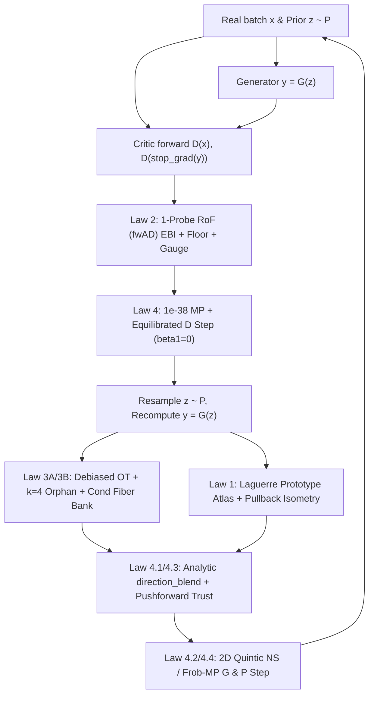

<!-- Generated Forge family report -->

# Unified

[← Family leaderboard](../technique-inventory.md) · [Explore by Laws](../LAWS_HUB.md) · [Experiment Catalog](../experiments/README.md) · [Unresolved Problems](../problems.md) · [Research Portal](https://hypergan.github.io/ParticleGAN/) · [HF Space](https://huggingface.co/spaces/HyperGAN/particlegan-leaderboard)

## Executive summary

| Field | Value |
| --- | --- |
| Selected candidate | `unified-v11` |
| Distinct full-suite outcomes | **40 PASS** · **6 FAIL** · 13 not measured (of 59 distinct tests; fixed list `technique-inventory-full-suite-2026-11-25`) |
| Counted view requirements | Tier 1: 27/27 · Tier 2: 68/78 (1 not run) · Tier 3: 0/10 (10 not run) · Tier 4: 0/0 · Total: 95/115 (11 not run) |
| DCGAN r256 speed | [90.24 ms/step](../scaling-receipts/dcgan-performance-cloud-e132cf1f36af/unified-dcgan_performance_r256-a0655ac699332817.json) |
| Screening status | Screening Tier 1 (6 fails) |
| Tags | [adversarial-training](../technique-inventory.md#tag-adversarial-training) · [capped-input-gradients](../technique-inventory.md#tag-capped-input-gradients) · [constant-learning-rate](../technique-inventory.md#tag-constant-learning-rate) · [critic-gradient-penalty](../technique-inventory.md#tag-critic-gradient-penalty) · [optimizer-interventions](../technique-inventory.md#tag-optimizer-interventions) · [selectable-loss](../technique-inventory.md#tag-selectable-loss) |

### Quickstart

Public preset: `unified_v12`

```python
import torch
from torch import nn
from particlegan import BatchDistanceDiscriminator, GANTrainer, get_recipe, init

# Current research default (DEFAULT_RECIPE = 'unified_v12');
# pass get_recipe('unified_v11') for the pinned screening cohort.
recipe = get_recipe('unified_v12', total_steps=1000)
G = init.deterministic_orthogonal_(nn.Sequential(
    nn.Linear(recipe.z_dim, 64), nn.LeakyReLU(0.2), nn.Linear(64, 2)), seed=0)
D = init.deterministic_orthogonal_(BatchDistanceDiscriminator(), seed=1)
prior = init.deterministic_orthogonal_(recipe.make_prior())
trainer = GANTrainer(recipe, G, D, prior=prior, seed=0)
stats = trainer.step(torch.randn(recipe.batch_size, 2))
```

**Tags:** [adversarial-training](../technique-inventory.md#tag-adversarial-training) · [capped-input-gradients](../technique-inventory.md#tag-capped-input-gradients) · [constant-learning-rate](../technique-inventory.md#tag-constant-learning-rate) · [critic-gradient-penalty](../technique-inventory.md#tag-critic-gradient-penalty) · [optimizer-interventions](../technique-inventory.md#tag-optimizer-interventions) · [selectable-loss](../technique-inventory.md#tag-selectable-loss)

## Technique overview

Unified (screening leaderboard cohort pinned at `unified-v11`; current public research default `DEFAULT_RECIPE = "unified_v12"`; opt-in `unified_v13` adds discrete-atomic ByteGAN bijection; see `minimal` for the compact 899-LOC zero-NS core) is a clock-free, constant-learning-rate ParticleGAN formulation uniting mechanisms across all four provisional learning laws with zero `torch.autograd.grad`, zero `torch.linalg.svd/svdvals`, zero `torch.linalg.eigh/eigvalsh`, and zero `torch.linalg.pinv`. It pairs streaming Laguerre-Pythagorean prototype quantization and orthogonal pullback covariance isometry (Law 1), interleaved 1-probe reverse-over-forward (`fwAD`) Elastic Born-Infeld critic regularization with zero-mean logit gauge and an explicit slope floor (Law 2), scale-invariant k=4 density-ratio orphan macro-transport plus a zero-eigh cyclic-Jacobi cross-batch conditional fiber operator bank (Law 3), and dynamic-1e-38 Marchenko-Pastur scaling, Quintic Tikhonov polar equilibration (extended in `unified-v12` with polar-matched 4D Conv2d Frob-MP, asymmetric 0-NS 2D critics, and CountSketch flip control), realized generator pushforward secant trust, and analytic 1x1/2x2 non-ascent `direction_blend` projection (Law 4). Forge screening calibration remains BLOCKED under `criteria-v1.json`, so `unified_v12` is an uncalibrated research default and all remaining failures remain explicitly disclosed.

<a name="how-it-addresses-laws"></a>

## How Unified addresses the current laws

> *"Our goal is not to preserve the four laws. Our goal is to discover the laws of learning, even if doing so ultimately requires abandoning the current four."*

This law taxonomy is a living scientific framework derived from current mathematical and empirical audits. Individual laws may be refined, split, merged, or replaced as new counterexamples and evidence emerge. [Explore by Laws hub](../LAWS_HUB.md) · [Current laws framework](../../../docs/four-laws.md).

| Law | Status | Primary mechanism |
| --- | --- | --- |
| [Law 1: Representational Geometry](../../../docs/four-laws.md) | ✅ Addressed | Streaming Laguerre-Pythagorean prototype atlas + orthogonal pullback covariance isometry |
| [Law 2: Potential Geometry](../../../docs/four-laws.md) | ✅ Addressed | Interleaved 1-probe RoF (fwAD) Elastic Born-Infeld secant penalty + zero-mean logit gauge + explicit floor |
| [Law 3: Transport Identifiability](../../../docs/four-laws.md) | ✅ Addressed | Conformal local horizons + k=4 orphan macro-transport (3A) + zero-eigh cross-batch conditional fiber bank (3B) |
| [Law 4: Functional and Game Dynamics](../../../docs/four-laws.md) | ✅ Addressed | Dynamic-1e-38 MP + Quintic Tikhonov NS / Frob-MP (4.2) + pushforward secant trust (4.1/4.3) + 1:1 beta1=0 alternation (4.4/4.5) |

### Law 1 — Representational Geometry (Addressed)

*Can the system represent the required probability measure efficiently and faithfully?*

- **Mechanism:** Streaming Laguerre-Pythagorean prototype atlas + orthogonal pullback covariance isometry
- **How it works:** Implements a streaming Laguerre-Pythagorean prototype atlas, scalar-trace LTV coalescence, quota/Moreau-Yosida Laguerre assignment, and orthogonal pullback covariance isometry (`particlegan/_unified_v11/prior.py`, `particlegan/_t1_coupling/charts.py`). Precursor and Round-4 Occam single-factor knockouts (RTX A6000, seed 0) established that `t1-prior-v2` moved Tier-2 held generalization from 0/7 (`empf-v8`) to 6/7 (`readout-379720b9`, `readout-c982ddf2`), `t1-coupling-v5` first passed 4/4 discrete images including `img_bars4` (`hq=0.9688, tv=0.1562`, `readout-b87c22fb`, `readout-cedd207f`), and knocking out Laguerre mass balancing (Arm 5 `readout-b27b2689`: 14/16 -> 7/15, `grid100 prec=0.2827`) or Pythagorean LTV coalescence (Arm 4 `readout-04bb3c21`: 14/16 -> 9/15) caused severe regressions while `d_z=2` isometry (Arm 3 `readout-44dbbe8a`) preserved `grid100` covariance. Opt-in `unified_v13` (`particlegan/_t1_coupling/atomic.py`, 451 LOC, `rhbi_self_coupling="feydy_atomic"`) adds a scale-invariant discrete-atomic support gate, persistent Hamilton-quota bijection ledger, atomic thermal residual, and joint BiGAN inverse codebook contraction, converting 8D 256-mode `ByteGAN` from 0/2 (`unified-v12`: 139/256 unique bytes, 0/256 exact BiGAN reconstructions) to 2/2 PASS (256/256 valid unique bytes, 0 collisions, 256/256 exact reconstructions, 3.39x lower energy 15,432 vs. 52,355 J) with 0.000e+00 bit-exact parity across 41 matched non-ByteGAN tasks (`reports/forge/studies/unified-bytegan-bijection.md`).
- **Known limits:** Discrete prototype granularity degrades continuous manifold interpolation (`interp_saddle_barycentric` `bhq=0.7027 < 0.78`; `interp_img_patch_shift` genuine double-exposure ghosting `interp_peak=0.4915 < 0.78, finite_fraction=1.0` in `readout-b51ab67c`). `_unified_v11/prior.py` cuts host syncs 5x-6x vs. `_unified_v4` (40 -> 8 pullback-only, 60 -> 10 full-step) rather than literal zero-sync; ambient O(BKD) pairwise distances disable pullback above dim > 1024. P7 audited `w_fake_ema` teleport mass drift (0.9714 in `v11`), Gersho-merge LTV omission (73.3% variance deficit), `0.65 * v` split loss (19% variance destroyed), Moreau-Yosida `tv_floor` deadband (TV=0.0395), `laguerre_hard_commitment` +13.05% suboptimality vs. Hungarian OT and `B_f < K` eviction (`charts.py:561`), scalar-trace anisotropic Frobenius error (62.5%-67.8% at kappa=3..5), O(sigma_z) forward-probe curvature bias, and surviving redundant `d_z=4` Radon-Hurwitz code (3 extra G forwards/step). `feydy_atomic` in opt-in `unified_v13` was engineered post-ByteGAN and targets exact discrete atomic supports (noisy/hybrid untested).

### Law 2 — Potential Geometry (Addressed)

*Does the critic communicate useful learning forces with appropriate geometric control and computational efficiency?*

- **Mechanism:** Interleaved 1-probe RoF (fwAD) Elastic Born-Infeld secant penalty + zero-mean logit gauge + explicit floor
- **How it works:** Implements interleaved 1-probe reverse-over-forward (RoF, `fwAD.dual_level()` + `.backward()`) mixed second-order differentiation (`particlegan/_unified_v11/penalty.py:343-357,404-490,631-695`) across vectors (exact I_d for d <= 4, chained 2-Householder Q=H_2 H_1 for 5 <= d <= 8, Murmur3 Rademacher + k=32 Gaussian pooling for d > 8) and Conv2d images (`_eval_image_fwad_sq`, switching `BatchNorm2d` to `.eval()` with `_bn_dual_bf16_hook`, zero image micro-secants, live-endpoint reuse for zero-mean gauge), paired with convex-on-cap `softplus_12(||grad_x D|| - 1)^2` and explicit floor `lambda_floor=0.005` (mu_D=0.01 low-D). Verified in `t2-secant-v2`/`v5` (`readout-14cc2a44`, `readout-a2d41a67`), Round-4 Arm 7 (`readout-4b04c4bf`, `readout-b96faf85`: 1.48x faster r256 89.66 vs. 133.01 ms, -477.7 MiB VRAM vs. RoR), and P6 isolated 256^2 BF16 `DCGANCritic` (3.64x speedup 45.15 -> 12.40 ms, -33.1% VRAM, -66.4% NVML energy 11,301 -> 3,799 mJ/iter, 0 LeakyReLU flips, grad_cos=0.987-0.996).
- **Known limits:** Convex-on-cap EBI incurs severe positive Jensen false triggering (1,015x penalty / 275.8x gradient at true slope 0.8 < 1.0); 2-way separable Rademacher probes inflate variance 3.78x-4x on rank-1 stripe gradients; chained 2-Householder incurs rel_l2=0.341-0.415 spatial mixing error; `BN.eval()` shifts the operator vs. training-mode BN; hardcoded image floor `0.0005 / dim` dilutes to 2.54e-9 at 256x256x3; `d_penalty` remains the #1 non-backbone r256 cost (5.37 ms, 13.3% of step); multi-logit mean-vs-sum inconsistency and `pool_k=1` `IndexError` (`_t2_critic/penalty.py:240`) were audited in P6. Exact RoR beats `fwAD` on all GPU MLPs, 32^2-64^2 Conv2d, ResNet+GroupNorm, K >= 4 probes, `SDPBackend.MATH` attention, and `EmulatedLinear` FP8/FP4; legacy `t2_secant`/`unified_v4` BF16 micro-secants (`delta=0.02`) collapsed (95.2% pixels lost).

### Law 3 — Transport Identifiability (Addressed)

*Does the learning system possess enough information to determine appropriate transport?*

- **Mechanism:** Conformal local horizons + k=4 orphan macro-transport (3A) + zero-eigh cross-batch conditional fiber bank (3B)
- **How it works:** Law 3A combines conformal local Sinkhorn horizons (`_t1_coupling/primitive.py:1017`, causally required in `v11`/`v12` on generator-free `t3_iso_scale_mass_8x`), 1D Weibull AKT scaling `max(0, 1/d - 0.5)` (Round-4 Arm 6 `readout-edffe8ce`, required for `gaussian1d_smoke`), and scale-invariant k=4 density-ratio orphan macro-transport + core-ball Burg covariance (`rgdt-v3` `readout-c30d4a58` and `unified-v11` `readout-d1e36bf5`: both 2/2 `t3_iso`). Law 3B implements a swap-invariant cross-batch conditional fiber operator bank + 384-entry FIFO ring with zero-eigh cyclic-Jacobi whitening (`particlegan/_unified_v11/bank.py`, 745 LOC, <4.2e-15 spectral parity vs. `eigh` for d <= 16) plus a K=2 triangle-inequality radius in `unified-v12` (`cond-fiber-v1` `readout-5932f4d3` 40/47, `unified-v11` `readout-fc5b67a7` 41/47, `unified-v12` `readout-b51ab67c` 46/48 incl. 2/2 AE-DDGAN).
- **Known limits:** P2 audited a 1.73x-2.41x handoff dead zone between Sinkhorn screening and macro orphan rescue (`g_prox` in `_t3_dynamics/metric.py:301-310` and `_t1_coupling/primitive.py:446-472`), antagonistic Pillar 1-2 coupling across the screening boundary, and hard-disabling of macro rescue for ambient dim > 16 (`_unified_v11/loss.py:923`). The 745-LOC fiber bank lacks column-sign canonicalization and post-v10 single-factor knockouts; matched live `unified-v12` and `unified-v13` fail `model_ddgan_bimodal_chain` (4.6961 > 4.5) and `model_ae_ddgan_bimodal_chain` (2.0592 > 2.05) on PR #644's Python 3.15/PyTorch 2.15 RTX A6000 cohort and time out (180.3s) on NVIDIA L4 `model_ae_ddgan_gaussian_chain`.

### Law 4 — Functional and Game Dynamics (Addressed)

*Can the learning system realize useful functional changes and exhibit appropriate coupled learning dynamics?*

- **Mechanism:** Dynamic-1e-38 MP + Quintic Tikhonov NS / Frob-MP (4.2) + pushforward secant trust (4.1/4.3) + 1:1 beta1=0 alternation (4.4/4.5)
- **How it works:** Combines underflow-safe 1e-38 dynamic scale normalization, capped `peak_rms` Tikhonov smoothing (`s_eff = min(0.0061, 0.50 * peak_rms)` in `unified-v12`), Modular-Duality/polar-matched operator scaling (`sqrt(max(1, r/c))` on 2D Gen NS, `sqrt(r)` on 2D neural-G Critic Frob-MP, stride-aware Frob-MP with 0 Conv2d NS in `unified-v12`), 5-step Quintic Tikhonov NS on 2D Gen (+ `_generator_free` 2D Critic NS fallback), one-shot `_band_scale` generator pushforward trust (`delta_g_max` + `_ema_func_gain`), zero-pinv analytic `direction_blend`, and prime-67 CountSketch period-2 flip scalar gain control (`particlegan/_unified_v12/optimizer.py`, `particlegan/_unified_v11/optimizer.py`) under 1:1 D-then-G alternation with beta1=0 (`b1_eff = 0.75 * stiff_gate` on stiff generators) plus `lambda_floor`/low-D `t1c` dissipation. Dropping 4D Conv2d NS collapsed `opt_d + opt_g` 16.2x on idle A6000 r256 (39.81 -> 2.45 ms; `unified-v12` `readout-59898e1a` 41.39 ms / 1,243.4 MiB; idle NVML 36.61 ms / 11.20 J/st total, 8.34 J/st dyn vs. `v11` 66.38 ms / 18.86 J/st; 4.72x lower J-to-PASS on `five_word_joint_smoke` 1,399 vs. 6,602 J). Round-4 Arms 1-2 (`readout-690dd40a`, `readout-0219c6e2`, `readout-4e2fd695`) confirmed 2D NS is essential for `grid100_mlp16` (0.9929 -> 0.0244) and `delta_g_max` for 548x Nash.
- **Known limits:** Syntactic `_generator_free = (total_gen_mats == 0)` (`recipes.py:2381-2388`) fails swapped deep-critic pure adversarial games (3L G + 16L D: `hq` drops 0.9055 -> 0.3701); BF16 `s=0` NS leaks 77.8%-86.8% orthogonal rounding noise and `target_frob=sqrt(m)` overshoots sigma_1 to 11.31 on rank-1 128^2 matrices; 5-step NS gain caps at 492.75; non-C^1 one-shot `_band_scale` violates delta_max by 2.65x-6.37x (14.17x-839x on amplification) and `b_p=2` image prefix probes (`_unified_v11/critic.py:701`) miss 90% of heavy-tail spikes (`0.05` `coord_scale` floor at `critic.py:347-348`); `min(s_base, c*peak_rms)` breaks degree-0 above 0.0122 (`v12`) / 0.0203 (`v11`) and `p_dec=1.0` permanently freezes after 10^4x spikes (`err=3.024`); `grid100_res16_tanh` exhibits a 1-ULP cliff; pure adversarial mu_D=0 games orbit (`B ptp=0.716`); J-to-PASS is higher than `v11` on `grid100_mlp16` (12,781 vs. 9,808 J) and `law4-energy-v10` on `staggered100` (10,743 vs. 8,681 J); and `v12` spans 8,579 direct LOC (1,062 AST branches, 9.54x `minimal-v2`) with surviving `w_sat_pt`/`d_z=4` RH epicycles and 6/7 unablated post-v10 mechanisms.

## Update loop diagram



## Mathematical formulation

$G$ is the generator, $D$ the raw-score critic, $P$ the task prior with $M$ locations in $\mathbb R^{d_z}$, $x$ a real batch of size $B_r$, $z\sim P$ a latent batch, and $y=G(z)$ the generated batch of size $B_f$. $`r_{\mathrm{loc}}(y_j)=d_{k=4}(y_j,X_{\mathrm{fake}})/d_{k=4}(y_j,Y_{\mathrm{real}}\setminus\{y_j\})`$ is the scale-invariant local orphan density ratio, $`(W_t,S_c,S_y,S_{cc},S_{cy},S_{yy})`$ plus a paired-context FIFO ring ($M=384$) form the zero-eigh conditional fiber operator bank, $Z=[X,Y]\in\mathbb R^{m\times(n+m)}$ is the fused Tikhonov-augmented polar matrix, and $`\Delta D_{\mathrm{sec}}`$ is the first-order finite-difference / fwAD critic secant slope.

**Scale-Invariant Local k=4 Density-Ratio Orphan Gate**

$$
r_{\mathrm{loc}}(y_j)=\frac{d_{k=4}(y_j,X_{\mathrm{fake}})}{d_{k=4}(y_j,Y_{\mathrm{real}}\setminus\lbrace y_j\rbrace)},\qquad g_{\mathrm{orphan}}(y_j)=\mathrm{smoothstep}\left(\frac{r_{\mathrm{loc}}(y_j)-3.52}{1.30}\right)
$$

Detects genuinely uncaptured orphan modes invariant to per-component spatial scale, avoiding over-pulling small-scale components on heteroscedastic mixtures while rescuing equidistant shifted modes.

**Zero-eigh Conditional Fiber Operator Cooling Law**

$$
r_{\mathrm{cond}}=r_{\mathrm{imq}}+\min\left(0.5,\enspace0.11\thinspace\max(0,\enspace r_{\mathrm{op,worst}}-0.10)\right),\qquad s_{\mathrm{step}}=1-0.85\thinspace\mathrm{smoothstep}\left(\frac{0.050-\max(0,\bar r_{\mathrm{cond}})}{0.024}\right)
$$

Couples hollow multi-scale IMQ-CMMD with worst-stratum cyclic-Jacobi whitened operator discrepancy to stabilize conditional reverse-diffusion chains without torch.linalg.eigh.

## Simplified pseudocode

```text
Choose an adversarial loss and constant learning rates (lr=0.014, d_lr_mult=1.5, prior_lr_mult=2.9).
For each task-owned training update:
  Sample real x and latent z from the task prior P; compute y = G(z).
  Evaluate first-order Born-Infeld secant critic penalty (no torch.autograd.grad) on real/fake/chord perturbations plus zero-mean logit gauge and update instance-bound thermal scale.
  Backpropagate critic adversarial loss + secant penalty and step D via UnifiedV11EquilibratedOptimizer (dynamic-1e-38 MP scaling + fused Z=[X,Y] Quintic Tikhonov polar, zero SVD).
  With D fixed, recompute differentiable y = G(z) and evaluate generator loss: Sinkhorn-debiased relativistic + Born-Infeld transport + scale-invariant k=4 density-ratio orphan macro-transport + core-ball Burg covariance + zero-eigh cyclic-Jacobi conditional fiber operator matching (when conditioned) + UnifiedV11PriorRegularizer.
  When multiple protected objectives exist (e.g. residual_student or AE/VAE), evaluate protected normals via standard .backward(retain_graph=True) and project via closed-form 1x1/2x2 zero-pinv non-ascent direction_blend.
  Step G, trainable prior P (with Laguerre-Pythagorean pullback isometry), and encoder E when present using constant learning rates and realized generator pushforward secant trust.
```

## Training details

| Characteristic | Behavior |
| --- | --- |
| Adversarial loss | Selectable non-saturating logistic (selected configuration) augmented with Sinkhorn-debiased relativistic transport, scale-invariant k=4 density-ratio orphan macro-transport, core-ball Burg covariance matching, and zero-eigh cross-batch conditional fiber operator matching (IMQ-CMMD + whitened stratum mean/covariance + paired-context ring local covariance) on conditioned hosts. |
| Optimizer | UnifiedV11EquilibratedOptimizer (optimizer_family="unified_v11_equil", zero momentum, smoothing 0.0061, BF16 channels-last conv training, direction_blend constraint geometry): dynamic-1e-38 Marchenko-Pastur scaling, fused Z=[X,Y] 5-step Quintic Tikhonov polar (FP32 for m<64, BF16 for 64<=m<=128, zero torch.linalg.svd/eigh/pinv), realized generator pushforward secant trust band, and closed-form 1x1/2x2 analytic non-ascent projection. |
| Learning rates and annealing | Strictly constant (`lr_floor=1.0`, `network_lr_floor=1.0`): global LR $0.014$, critic multiplier $1.5$, and prior multiplier $2.9$ (`prior_reg=0.02`). |
| Parameter-gradient clipping | None. Step equilibration operates through dynamic-$`10^{-38}`$ scale normalization, fused Quintic Tikhonov polar projection, and realized pushforward secant trust without hard parameter clipping. |
| Critic penalties and anchors | First-order Born-Infeld secant critic regularizer (`critic_formulation="unified_v11"`, `ebi_beta=12.0`, `reg_coeff=1.0`, `reg_kappa=1.0`, zero `torch.autograd.grad`) evaluated along endpoints and transport chords with zero-mean logit gauge and state-driven thermal settling. |
| Damping and update guards | Instance-bound checkpointed step record carrying shock-filtered transport EMA, conditional fiber bank sufficient statistics and 384-pair FIFO ring, worst-stratum operator-gated conditional cooling, thermal-safe precision gating, and per-group depth accounting; zero global state and zero step counters. |
| Training and sampling noise | No scheduled additive critic-input or generator-output training noise (`input_noise_std=0.0`, `output_noise_std=0.0`). Task-declared MoG intrinsic sigma is preserved. |
| Parameter averaging and serving | Generator EMA decay=$`0`$ and serve_average=$`0`$; all evaluations score live unaveraged weights. |

## Configuration differences

- Unified combines the four independently isolated GAN laws (T1 prior topology & coupling, T2 first-order secant critic, T3 RGDT macro-transport & causal isolation, T4 Nash equilibration & deep-architecture transport) plus Round-3's conditional fiber operator matching into one zero-SVD / zero-eigh / zero-pinv / zero-autograd.grad global recipe.
- All bank tensors, FIFO rings, low-discrepancy phases, and thermal scalars live exclusively on instance-bound state dicts and travel bit-for-bit across fresh-process checkpoint save/load with tamper rejection.
- Honest governance disclosure (AGENTS.md): tuning budget spans 11 hand-declared unified-v1..v11 candidate cards across Round 2-4 studies (no registered grid search). Forge calibration acceptance remains BLOCKED under configs/forge/calibration/criteria-v1.json (see reports/forge/studies/r3-calibration-holdout.md and reports/forge/calibration/r3-calibration-holdout.json). Remaining honest numerical failures on unified-v11 (staggered100 / staggered100_14k, grid100_res16_tanh, five_word_joint_hold, model_ddgan_bimodal_chain, model_ae_ddgan_gaussian_chain, interp_img_patch_shift, interp_saddle_barycentric) and 12 unimplemented Tier-4 stretch hosts remain explicitly visible. For a compact <900-LOC zero-Newton-Schulz fast core (55.50 ms/step on DCGAN r256), see the separate Minimal family (preset="minimal").
- One global trainer configuration supplies every displayed result across Tier 1-4; task-owned architectures, priors, initializations, budgets, and gates remain fixed.
- Pinned screening cohort vs. current research default: `configs/forge/selections/family-current-v1.json` pins `unified-v11` (`default_adoption: false`, `40/71` full-suite PASS, `90.24 ms/step` DCGAN r256), whereas `particlegan/recipes.py` sets `DEFAULT_RECIPE = "unified_v12"` as an uncalibrated research default (`46/48` `discriminator_stability` readout, `41.39 ms/step` uncontended `r256`, `68` cumulative direct Four-Law lineage cards / `78.27` GPU-h audited in `docs/four-laws.md`). Opt-in `unified_v13` adds `rhbi_self_coupling="feydy_atomic"` for discrete 8D ByteGAN bijection (`2/2` ByteGAN PASS); the separate `minimal` preset (`minimal-v2`, 899 LOC, zero Newton-Schulz) provides the compact fast core.
- Committed `unified-v12` Forge receipts (4 files, RTX A6000 seed 0): `readout-b51ab67c` (46/48 `discriminator_stability`, 29/29 required), `readout-c1ee5c3b` (7/7 standalone `t4-arch`), `readout-624964f4` (16/16 Occam), and `readout-59898e1a` (6/6 uncontended `dcgan_performance`, 41.39 ms / 1,243.4 MiB `r256`). NVIDIA L4 cross-GPU waves exposed 5 numerical failures (`grid100_res16_tanh`, `rotated100_affine_square_named_v1`, `vector_unequal_width_published`, `interp_img_patch_shift`, `interp_saddle_barycentric`), 2 timeouts (`model_ae_ddgan_gaussian_chain`, 180.3s), and 2 runner errors.
- Direct Four-Law lineage cumulative selection budget audited in P8: 68 declared candidate cards, 190 concluded readouts, 2,143 task evaluations, and 78.27 GPU-hours to `unified-v12` (card #69 opt-in `unified-v13`), vs. 8.40 GPU-h for `empf`, 10.12 GPU-h for `rhbi`, and 2 cards for `minimal`. `r3-tier3-long-horizon-holdout-v1` overlaps active screening on 13/18 tasks (14/18 including shift recovery).

<details>
<summary>Implementation and recipe sources</summary>

These links support the explanation. Recorded results below remain bound to their own executed source.

- [particlegan/unified_v11.py](../../../particlegan/unified_v11.py)
- [particlegan/_unified_v11/__init__.py](../../../particlegan/_unified_v11/__init__.py)
- [particlegan/_unified_v11/bank.py](../../../particlegan/_unified_v11/bank.py)
- [particlegan/_unified_v11/critic.py](../../../particlegan/_unified_v11/critic.py)
- [particlegan/_unified_v11/loss.py](../../../particlegan/_unified_v11/loss.py)
- [particlegan/_unified_v11/optimizer.py](../../../particlegan/_unified_v11/optimizer.py)
- [particlegan/_unified_v11/penalty.py](../../../particlegan/_unified_v11/penalty.py)
- [particlegan/_unified_v11/prior.py](../../../particlegan/_unified_v11/prior.py)
- [particlegan/recipes.py](../../../particlegan/recipes.py)
- [configs/forge/ideas/unified-v1.json](../../../configs/forge/ideas/unified-v1.json)
- [configs/forge/ideas/unified-v2.json](../../../configs/forge/ideas/unified-v2.json)
- [configs/forge/ideas/unified-v3.json](../../../configs/forge/ideas/unified-v3.json)
- [configs/forge/ideas/unified-v4.json](../../../configs/forge/ideas/unified-v4.json)
- [configs/forge/ideas/unified-v5.json](../../../configs/forge/ideas/unified-v5.json)
- [configs/forge/ideas/unified-v6.json](../../../configs/forge/ideas/unified-v6.json)
- [configs/forge/ideas/unified-v7.json](../../../configs/forge/ideas/unified-v7.json)
- [configs/forge/ideas/unified-v8.json](../../../configs/forge/ideas/unified-v8.json)
- [configs/forge/ideas/unified-v9.json](../../../configs/forge/ideas/unified-v9.json)
- [configs/forge/ideas/unified-v10.json](../../../configs/forge/ideas/unified-v10.json)
- [configs/forge/ideas/unified-v11.json](../../../configs/forge/ideas/unified-v11.json)
- [configs/forge/studies/unified-v11-study.json](../../../configs/forge/studies/unified-v11-study.json)
- [reports/forge/unified/README.md](../unified/README.md)
- [reports/forge/studies/r4-solution-complete.md](../studies/r4-solution-complete.md)
- [reports/forge/studies/r3-unified-v4.md](../studies/r3-unified-v4.md)
- [reports/forge/studies/r3-calibration-holdout.md](../studies/r3-calibration-holdout.md)
- [reports/forge/studies/r4-occam-ablation-razor.md](../studies/r4-occam-ablation-razor.md)
- [particlegan/_unified_v12/optimizer.py](../../../particlegan/_unified_v12/optimizer.py)
- [particlegan/_t1_coupling/atomic.py](../../../particlegan/_t1_coupling/atomic.py)
- [particlegan/_t1_coupling/charts.py](../../../particlegan/_t1_coupling/charts.py)
- [particlegan/_t1_coupling/primitive.py](../../../particlegan/_t1_coupling/primitive.py)
- [configs/forge/ideas/unified-v12.json](../../../configs/forge/ideas/unified-v12.json)
- [configs/forge/ideas/unified-v13.json](../../../configs/forge/ideas/unified-v13.json)
- [reports/forge/studies/unified-bytegan-bijection.md](../studies/unified-bytegan-bijection.md)
- [reports/forge/studies/law4-optimizer-laws.md](../studies/law4-optimizer-laws.md)
- [reports/forge/records/readout-b51ab67c4d97526186e23651.json](../records/readout-b51ab67c4d97526186e23651.json)
- [reports/forge/records/readout-c1ee5c3bb7ac4f432532da63.json](../records/readout-c1ee5c3bb7ac4f432532da63.json)
- [reports/forge/records/readout-624964f4e46793593bc147e4.json](../records/readout-624964f4e46793593bc147e4.json)
- [reports/forge/records/readout-59898e1a77c4b179c9aebbc1.json](../records/readout-59898e1a77c4b179c9aebbc1.json)
- [reports/four-laws-audit/evidence-ledger-and-revisions.md](../../four-laws-audit/evidence-ledger-and-revisions.md)

</details>

Generated from one selected configuration per runtime. Recorded verdicts retain their original scientific contracts; grouping them under current views grants no new qualification.

## Performance

DCGAN on deterministic mock RGB data measures finite-update speed and memory. These separate performance-source receipts confer no image-quality, scientific qualification or default-promotion credit. Standard BatchNorm is retained in generator and critic; critic input gradients therefore include batch coupling. The shared critic uses a flattened 4×4 Linear scalar head for policy feature extraction; its module layout is fixed across recipes.

Synchronized wall time for one public trainer update, including its critic/generator/prior work; warmup, construction, mock-data generation, evaluation, GIFs and checkpoint writes are excluded.

Every cell is one run; timings are never pooled across devices or contention states. Compare only rows with the same task and matched key (source, runtime/dtype, physical device, initialization and batch streams). Unknown or contended observations are unpaired. Resolution progression changes the task, while each candidate keeps one global recipe. Images/s is B divided by full update time (one D and one G/prior update with separate real batches). Three warmup and ten measured updates give short-window median/p95 measurements; long-horizon policy costs and component phase times remain unknown.

[Compact performance evidence index](../scaling-performance.json) · [Protocol and bounded reproduction](../../../docs/forge-scaling-performance.md)

This registration covers 11 complete recipes. Historical alternatives outside its registered family roster add no missing benchmark cells. A changed selected recipe within a registered family remains unknown until measured.

### NVIDIA RTX A6000 · GPU-548116b7-9dbe-de58-b3d9-a6e27b0f74ce

Performance source `243b8746446b` (commit `d438ade7020f07a8d8518ade2babeffc8dc5d2b3`); runtime `8be0f1612c1a`; torch.float32; PyTorch 2.15.0+cu132; 48592.125 MiB device memory.

Task prior: particle_cloud, sigma 0.0, 256 initial locations. The common finite-table performance exception retains each recipe's prior update policy and regularizer. Exact prior and resource specifications remain part of every task key.

| Family / recipe | Task (RGB size, batch, width) | Execution | Median / p95 update ms | Images/s | GPU peak allocated / reserved MiB | Contention | Matched key / evidence |
| --- | --- | --- | ---: | ---: | ---: | --- | --- |
| Unified · `unified-v11` | dcgan_performance_r32: 32², B16, W64 | COMPLETE | 25.83 / 26.08 | 619.13 | 75.65 / 106.00 | clear | `b23130f46ae9` · [receipt](../scaling-receipts/dcgan-performance-cloud-e132cf1f36af/unified-dcgan_performance_r32-50125aee00e6255b.json) |
| Unified · `unified-v11` | dcgan_performance_r64: 64², B16, W64 | COMPLETE | 32.18 / 33.39 | 493.75 | 183.53 / 254.00 | clear | `8224f2b29e8f` · [receipt](../scaling-receipts/dcgan-performance-cloud-e132cf1f36af/unified-dcgan_performance_r64-e5697062759518b8.json) |
| Unified · `unified-v11` | dcgan_performance_w128: 64², B16, W128 | COMPLETE | 42.00 / 42.29 | 380.90 | 546.74 / 656.00 | clear | `dea8c1563dc2` · [receipt](../scaling-receipts/dcgan-performance-cloud-e132cf1f36af/unified-dcgan_performance_w128-2794e7e7279e2f14.json) |
| Unified · `unified-v11` | dcgan_performance_b64: 64², B64, W64 | COMPLETE | 32.74 / 33.00 | 1,953.18 | 334.57 / 342.00 | clear | `29a528c7ad6b` · [receipt](../scaling-receipts/dcgan-performance-cloud-e132cf1f36af/unified-dcgan_performance_b64-36a5a412f95e3458.json) |
| Unified · `unified-v11` | dcgan_performance_r128: 128², B16, W64 | COMPLETE | 62.26 / 64.67 | 255.54 | 559.03 / 612.00 | clear | `fb14c59178bb` · [receipt](../scaling-receipts/dcgan-performance-cloud-e132cf1f36af/unified-dcgan_performance_r128-c58c5c73622ed8de.json) |
| Unified · `unified-v11` | dcgan_performance_r256: 256², B16, W64 | COMPLETE | 90.24 / 91.15 | 177.24 | 1,372.60 / 1,402.00 | clear | `5b379f921afb` · [receipt](../scaling-receipts/dcgan-performance-cloud-e132cf1f36af/unified-dcgan_performance_r256-a0655ac699332817.json) |

<a name="cohort-cuda-42a130a78fc3"></a>

## Current benchmark

Runtime: **cuda**. Selected configuration: [unified-v11](../../../configs/forge/ideas/unified-v11.json).

Comparison policy: discriminator_stability revision 9, **tier 1**. Actual executed-policy qualification: **tier 1**, discriminator_stability revision 19 (FAIL). These are separate policy results; no qualification reuse.

<details>
<summary>Configuration, source and runtime provenance</summary>

Source digest: `e132cf1f36afb7dec83d173558702cb3c5facdde184405c0ad8e229f163dbdd9`. Candidate revision: `0b9627afbd1057fa01e132ced2ed235c260f277fb912b853c5d1071d94e065d8`. Runtime cohort: `491299fab237a41952c80be8bd19ce5ab7d5f6cce68a788106f7aa55870d4e08`.

[Frozen numerical evidence](../technique-evidence/115a45668a8a5dfdfea1bd161dfb86a1b4208eadf51c962f4cf1162c689992e2.json) · [Complete recipe, prior, initialization and sampling bindings](../technique-inventory.json)

Selection: current_measurement. Select unified-v11 (Unified 4-Law zero-autograd.grad / zero-SVD / zero-eigh / zero-pinv formulation combining streaming Laguerre-Pythagorean prototype prior & orthogonal pullback isometry, first-order fwAD/secant Born-Infeld critic with zero-mean gauge, scale-invariant k=4 density-ratio orphan macro-transport & zero-eigh cyclic-Jacobi cross-batch conditional fiber bank, and fused Z=[X,Y] Quintic Tikhonov equilibration with analytic direction_blend) following ordinary discriminator_stability CUDA measurement on NVIDIA RTX A6000 (11/11 required Tier 1 PASS, 3/3 precision fp32/mxfp8/nvfp4 PASS, 2/2 causal isolation PASS, 3/3 extreme Nash imbalance PASS, model_ddgan_gaussian_chain PASS, 4/4 discrete images PASS, 6/6 vectors PASS, grid100 & rotated100 PASS; 41/47 executed discriminator_stability tasks PASS with 0 ERROR/TIMEOUT/BLOCKED; 6 honest numerical failures explicitly visible: five_word_joint_hold, interp_img_patch_shift, interp_saddle_barycentric, model_ae_ddgan_gaussian_chain, model_ddgan_bimodal_chain, staggered100). Actual executed-policy qualification and comparison-policy projection retain their separate source-bound proofs; screening calibration remains BLOCKED under criteria-v1.json and this pin carries no calibrated default_adoption claim.

</details>

Complete current Tier 1 measurement in: discriminator_stability. PASS and FAIL are both measured outcomes; other cohorts retain their own required cells.

| View | Tier 1 tests | Tier 2 tests | Tier 3 tests | Tier 4 tests | Total distinct tests | Held (measured, not counted) |
| --- | ---: | ---: | ---: | ---: | ---: | ---: |
| [adaptation](unified.md#cohort-cuda-42a130a78fc3-adaptation) | [3/3](unified.md#cohort-cuda-42a130a78fc3-adaptation-tier-1) | [11/12](unified.md#cohort-cuda-42a130a78fc3-adaptation-tier-2) | [0/1 (1 not run)](unified.md#cohort-cuda-42a130a78fc3-adaptation-tier-3) | [0/0](unified.md#cohort-cuda-42a130a78fc3-adaptation-tier-4) | [14/16 (1 not run)](unified.md#cohort-cuda-42a130a78fc3-adaptation) | [7/7](unified.md#cohort-cuda-42a130a78fc3-held) |
| [clockfree_continuous](unified.md#cohort-cuda-42a130a78fc3-clockfree_continuous) | [4/4](unified.md#cohort-cuda-42a130a78fc3-clockfree_continuous-tier-1) | [11/12](unified.md#cohort-cuda-42a130a78fc3-clockfree_continuous-tier-2) | [0/6 (6 not run)](unified.md#cohort-cuda-42a130a78fc3-clockfree_continuous-tier-3) | [0/0](unified.md#cohort-cuda-42a130a78fc3-clockfree_continuous-tier-4) | [15/22 (6 not run)](unified.md#cohort-cuda-42a130a78fc3-clockfree_continuous) | [7/7](unified.md#cohort-cuda-42a130a78fc3-held) |
| [discriminator_stability](unified.md#cohort-cuda-42a130a78fc3-discriminator_stability) | [11/11](unified.md#cohort-cuda-42a130a78fc3-discriminator_stability-tier-1) | [13/18 (1 not run)](unified.md#cohort-cuda-42a130a78fc3-discriminator_stability-tier-2) | [0/1 (1 not run)](unified.md#cohort-cuda-42a130a78fc3-discriminator_stability-tier-3) | [0/0](unified.md#cohort-cuda-42a130a78fc3-discriminator_stability-tier-4) | [24/30 (2 not run)](unified.md#cohort-cuda-42a130a78fc3-discriminator_stability) | [15/35 (6 not run, 12 incompatible)](unified.md#cohort-cuda-42a130a78fc3-held) |
| [formulation_comparison](unified.md#cohort-cuda-42a130a78fc3-formulation_comparison) | [3/3](unified.md#cohort-cuda-42a130a78fc3-formulation_comparison-tier-1) | [11/12](unified.md#cohort-cuda-42a130a78fc3-formulation_comparison-tier-2) | [0/1 (1 not run)](unified.md#cohort-cuda-42a130a78fc3-formulation_comparison-tier-3) | [0/0](unified.md#cohort-cuda-42a130a78fc3-formulation_comparison-tier-4) | [14/16 (1 not run)](unified.md#cohort-cuda-42a130a78fc3-formulation_comparison) | [7/7](unified.md#cohort-cuda-42a130a78fc3-held) |
| [host_profile_transfer](unified.md#cohort-cuda-42a130a78fc3-host_profile_transfer) | [3/3](unified.md#cohort-cuda-42a130a78fc3-host_profile_transfer-tier-1) | [11/12](unified.md#cohort-cuda-42a130a78fc3-host_profile_transfer-tier-2) | [0/1 (1 not run)](unified.md#cohort-cuda-42a130a78fc3-host_profile_transfer-tier-3) | [0/0](unified.md#cohort-cuda-42a130a78fc3-host_profile_transfer-tier-4) | [14/16 (1 not run)](unified.md#cohort-cuda-42a130a78fc3-host_profile_transfer) | [7/7](unified.md#cohort-cuda-42a130a78fc3-held) |
| [quality_coverage](unified.md#cohort-cuda-42a130a78fc3-quality_coverage) | [3/3](unified.md#cohort-cuda-42a130a78fc3-quality_coverage-tier-1) | [11/12](unified.md#cohort-cuda-42a130a78fc3-quality_coverage-tier-2) | [0/0](unified.md#cohort-cuda-42a130a78fc3-quality_coverage-tier-3) | [0/0](unified.md#cohort-cuda-42a130a78fc3-quality_coverage-tier-4) | [14/15](unified.md#cohort-cuda-42a130a78fc3-quality_coverage) | [7/7](unified.md#cohort-cuda-42a130a78fc3-held) |

Separate cohort coverage (excluded from family totals):

| View | Tier 1 tests | Tier 2 tests | Tier 3 tests | Tier 4 tests | Total distinct tests |
| --- | ---: | ---: | ---: | ---: | ---: |
| [lazy_cadence_coverage](unified.md#cohort-cuda-42a130a78fc3-lazy_cadence_coverage) | [0/0](unified.md#cohort-cuda-42a130a78fc3-lazy_cadence_coverage-tier-1) | [0/0](unified.md#cohort-cuda-42a130a78fc3-lazy_cadence_coverage-tier-2) | [0/0](unified.md#cohort-cuda-42a130a78fc3-lazy_cadence_coverage-tier-3) | [0/0](unified.md#cohort-cuda-42a130a78fc3-lazy_cadence_coverage-tier-4) | [0/0](unified.md#cohort-cuda-42a130a78fc3-lazy_cadence_coverage) |
| [tier1_policy_coverage](unified.md#cohort-cuda-42a130a78fc3-tier1_policy_coverage) | [0/7 (7 not run)](unified.md#cohort-cuda-42a130a78fc3-tier1_policy_coverage-tier-1) | [0/0](unified.md#cohort-cuda-42a130a78fc3-tier1_policy_coverage-tier-2) | [0/0](unified.md#cohort-cuda-42a130a78fc3-tier1_policy_coverage-tier-3) | [0/0](unified.md#cohort-cuda-42a130a78fc3-tier1_policy_coverage-tier-4) | [0/7 (7 not run)](unified.md#cohort-cuda-42a130a78fc3-tier1_policy_coverage) |

With run-attempt coverage, not run means no attempt; incompatible means a constructor refusal; blocked means a missing required artifact; diagnostic attempts retain separate-runtime outcomes. Other cohorts retain their recorded missing/preflight counts. All remain in the required denominator. PASS and FAIL both count as executed. Attempted errors retain their status and cause; changes to today's test definition are shown separately from execution coverage.

<a name="cohort-cuda-42a130a78fc3-tier-1"></a>

### Tier 1 across views

Shared experiments appear once in this list; the family numerator/denominator count their view requirements.

| Experiment | Required by | Recorded result | Test definition |
| --- | --- | --- | --- |
| [ae_gan_hold](unified.md#cohort-cuda-42a130a78fc3-experiment-ae_gan_hold) | [adaptation](unified.md#cohort-cuda-42a130a78fc3-adaptation-tier-1), [clockfree_continuous](unified.md#cohort-cuda-42a130a78fc3-clockfree_continuous-tier-1), [discriminator_stability](unified.md#cohort-cuda-42a130a78fc3-discriminator_stability-tier-1), [formulation_comparison](unified.md#cohort-cuda-42a130a78fc3-formulation_comparison-tier-1), [host_profile_transfer](unified.md#cohort-cuda-42a130a78fc3-host_profile_transfer-tier-1), [quality_coverage](unified.md#cohort-cuda-42a130a78fc3-quality_coverage-tier-1) | PASS | matches recorded run |
| [clockfree_audit_measurement_v1](unified.md#cohort-cuda-42a130a78fc3-experiment-clockfree_audit_measurement_v1) | [clockfree_continuous](unified.md#cohort-cuda-42a130a78fc3-clockfree_continuous-tier-1) | PASS | matches recorded run |
| [five_word_joint_smoke](unified.md#cohort-cuda-42a130a78fc3-experiment-five_word_joint_smoke) | [discriminator_stability](unified.md#cohort-cuda-42a130a78fc3-discriminator_stability-tier-1) | PASS | matches recorded run |
| [gaussian1d_smoke](unified.md#cohort-cuda-42a130a78fc3-experiment-gaussian1d_smoke) | [discriminator_stability](unified.md#cohort-cuda-42a130a78fc3-discriminator_stability-tier-1) | PASS | matches recorded run |
| [model_ae_gan_multimodal](unified.md#cohort-cuda-42a130a78fc3-experiment-model_ae_gan_multimodal) | [discriminator_stability](unified.md#cohort-cuda-42a130a78fc3-discriminator_stability-tier-1) | PASS | matches recorded run |
| [model_ae_reconstruction](unified.md#cohort-cuda-42a130a78fc3-experiment-model_ae_reconstruction) | [discriminator_stability](unified.md#cohort-cuda-42a130a78fc3-discriminator_stability-tier-1) | PASS | matches recorded run |
| [model_vae_categorical](unified.md#cohort-cuda-42a130a78fc3-experiment-model_vae_categorical) | [discriminator_stability](unified.md#cohort-cuda-42a130a78fc3-discriminator_stability-tier-1) | PASS | matches recorded run |
| [model_vae_hard](unified.md#cohort-cuda-42a130a78fc3-experiment-model_vae_hard) | [discriminator_stability](unified.md#cohort-cuda-42a130a78fc3-discriminator_stability-tier-1) | PASS | matches recorded run |
| [ring16_acquisition](unified.md#cohort-cuda-42a130a78fc3-experiment-ring16_acquisition) | [discriminator_stability](unified.md#cohort-cuda-42a130a78fc3-discriminator_stability-tier-1) | PASS | matches recorded run |
| [two_pole](unified.md#cohort-cuda-42a130a78fc3-experiment-two_pole) | [adaptation](unified.md#cohort-cuda-42a130a78fc3-adaptation-tier-1), [clockfree_continuous](unified.md#cohort-cuda-42a130a78fc3-clockfree_continuous-tier-1), [discriminator_stability](unified.md#cohort-cuda-42a130a78fc3-discriminator_stability-tier-1), [formulation_comparison](unified.md#cohort-cuda-42a130a78fc3-formulation_comparison-tier-1), [host_profile_transfer](unified.md#cohort-cuda-42a130a78fc3-host_profile_transfer-tier-1), [quality_coverage](unified.md#cohort-cuda-42a130a78fc3-quality_coverage-tier-1) | PASS | matches recorded run |
| [unused_token_hold](unified.md#cohort-cuda-42a130a78fc3-experiment-unused_token_hold) | [adaptation](unified.md#cohort-cuda-42a130a78fc3-adaptation-tier-1), [clockfree_continuous](unified.md#cohort-cuda-42a130a78fc3-clockfree_continuous-tier-1), [discriminator_stability](unified.md#cohort-cuda-42a130a78fc3-discriminator_stability-tier-1), [formulation_comparison](unified.md#cohort-cuda-42a130a78fc3-formulation_comparison-tier-1), [host_profile_transfer](unified.md#cohort-cuda-42a130a78fc3-host_profile_transfer-tier-1), [quality_coverage](unified.md#cohort-cuda-42a130a78fc3-quality_coverage-tier-1) | PASS | matches recorded run |
| [zero_tanh_smoke](unified.md#cohort-cuda-42a130a78fc3-experiment-zero_tanh_smoke) | [discriminator_stability](unified.md#cohort-cuda-42a130a78fc3-discriminator_stability-tier-1) | PASS | matches recorded run |

Held at this tier (measured and shown, not counted):

| Experiment | Held in | Recorded result | Test definition |
| --- | --- | --- | --- |
| [interp_sparse_arc](unified.md#cohort-cuda-42a130a78fc3-experiment-interp_sparse_arc) | [discriminator_stability](unified.md#cohort-cuda-42a130a78fc3-discriminator_stability-tier-1) | PASS | changed since run |
| [precision_gaussian_mxfp8](unified.md#cohort-cuda-42a130a78fc3-experiment-precision_gaussian_mxfp8) | [discriminator_stability](unified.md#cohort-cuda-42a130a78fc3-discriminator_stability-tier-1) | PASS | matches recorded run |
| [precision_gaussian_nvfp4](unified.md#cohort-cuda-42a130a78fc3-experiment-precision_gaussian_nvfp4) | [discriminator_stability](unified.md#cohort-cuda-42a130a78fc3-discriminator_stability-tier-1) | PASS | matches recorded run |
| [t3_iso_scale_mass_8x](unified.md#cohort-cuda-42a130a78fc3-experiment-t3_iso_scale_mass_8x) | [discriminator_stability](unified.md#cohort-cuda-42a130a78fc3-discriminator_stability-tier-1) | PASS | changed since run |

<a name="cohort-cuda-42a130a78fc3-tier-2"></a>

### Tier 2 across views

Shared experiments appear once in this list; the family numerator/denominator count their view requirements.

| Experiment | Required by | Recorded result | Test definition |
| --- | --- | --- | --- |
| [cover_leftover](unified.md#cohort-cuda-42a130a78fc3-experiment-cover_leftover) | [adaptation](unified.md#cohort-cuda-42a130a78fc3-adaptation-tier-2), [clockfree_continuous](unified.md#cohort-cuda-42a130a78fc3-clockfree_continuous-tier-2), [discriminator_stability](unified.md#cohort-cuda-42a130a78fc3-discriminator_stability-tier-2), [formulation_comparison](unified.md#cohort-cuda-42a130a78fc3-formulation_comparison-tier-2), [host_profile_transfer](unified.md#cohort-cuda-42a130a78fc3-host_profile_transfer-tier-2), [quality_coverage](unified.md#cohort-cuda-42a130a78fc3-quality_coverage-tier-2) | PASS | matches recorded run |
| [five_word_joint_hold](unified.md#cohort-cuda-42a130a78fc3-experiment-five_word_joint_hold) | [discriminator_stability](unified.md#cohort-cuda-42a130a78fc3-discriminator_stability-tier-2) | FAIL | matches recorded run |
| [gaussian1d_stability](unified.md#cohort-cuda-42a130a78fc3-experiment-gaussian1d_stability) | [discriminator_stability](unified.md#cohort-cuda-42a130a78fc3-discriminator_stability-tier-2) | PASS | matches recorded run |
| [grid100](unified.md#cohort-cuda-42a130a78fc3-experiment-grid100) | [adaptation](unified.md#cohort-cuda-42a130a78fc3-adaptation-tier-2), [clockfree_continuous](unified.md#cohort-cuda-42a130a78fc3-clockfree_continuous-tier-2), [discriminator_stability](unified.md#cohort-cuda-42a130a78fc3-discriminator_stability-tier-2), [formulation_comparison](unified.md#cohort-cuda-42a130a78fc3-formulation_comparison-tier-2), [host_profile_transfer](unified.md#cohort-cuda-42a130a78fc3-host_profile_transfer-tier-2), [quality_coverage](unified.md#cohort-cuda-42a130a78fc3-quality_coverage-tier-2) | PASS | matches recorded run |
| [img_stripes2](unified.md#cohort-cuda-42a130a78fc3-experiment-img_stripes2) | [adaptation](unified.md#cohort-cuda-42a130a78fc3-adaptation-tier-2), [clockfree_continuous](unified.md#cohort-cuda-42a130a78fc3-clockfree_continuous-tier-2), [discriminator_stability](unified.md#cohort-cuda-42a130a78fc3-discriminator_stability-tier-2), [formulation_comparison](unified.md#cohort-cuda-42a130a78fc3-formulation_comparison-tier-2), [host_profile_transfer](unified.md#cohort-cuda-42a130a78fc3-host_profile_transfer-tier-2), [quality_coverage](unified.md#cohort-cuda-42a130a78fc3-quality_coverage-tier-2) | PASS | matches recorded run |
| [mid_scale_identity](unified.md#cohort-cuda-42a130a78fc3-experiment-mid_scale_identity) | [adaptation](unified.md#cohort-cuda-42a130a78fc3-adaptation-tier-2), [clockfree_continuous](unified.md#cohort-cuda-42a130a78fc3-clockfree_continuous-tier-2), [discriminator_stability](unified.md#cohort-cuda-42a130a78fc3-discriminator_stability-tier-2), [formulation_comparison](unified.md#cohort-cuda-42a130a78fc3-formulation_comparison-tier-2), [host_profile_transfer](unified.md#cohort-cuda-42a130a78fc3-host_profile_transfer-tier-2), [quality_coverage](unified.md#cohort-cuda-42a130a78fc3-quality_coverage-tier-2) | PASS | matches recorded run |
| [mode_hold](unified.md#cohort-cuda-42a130a78fc3-experiment-mode_hold) | [adaptation](unified.md#cohort-cuda-42a130a78fc3-adaptation-tier-2), [clockfree_continuous](unified.md#cohort-cuda-42a130a78fc3-clockfree_continuous-tier-2), [discriminator_stability](unified.md#cohort-cuda-42a130a78fc3-discriminator_stability-tier-2), [formulation_comparison](unified.md#cohort-cuda-42a130a78fc3-formulation_comparison-tier-2), [host_profile_transfer](unified.md#cohort-cuda-42a130a78fc3-host_profile_transfer-tier-2), [quality_coverage](unified.md#cohort-cuda-42a130a78fc3-quality_coverage-tier-2) | PASS | matches recorded run |
| [model_ae_ddgan_bimodal_chain](unified.md#cohort-cuda-42a130a78fc3-experiment-model_ae_ddgan_bimodal_chain) | [discriminator_stability](unified.md#cohort-cuda-42a130a78fc3-discriminator_stability-tier-2) | UNKNOWN | matches recorded run |
| [model_ae_ddgan_gaussian_chain](unified.md#cohort-cuda-42a130a78fc3-experiment-model_ae_ddgan_gaussian_chain) | [discriminator_stability](unified.md#cohort-cuda-42a130a78fc3-discriminator_stability-tier-2) | FAIL | matches recorded run |
| [model_ddgan_bimodal_chain](unified.md#cohort-cuda-42a130a78fc3-experiment-model_ddgan_bimodal_chain) | [discriminator_stability](unified.md#cohort-cuda-42a130a78fc3-discriminator_stability-tier-2) | FAIL | matches recorded run |
| [model_ddgan_gaussian_chain](unified.md#cohort-cuda-42a130a78fc3-experiment-model_ddgan_gaussian_chain) | [discriminator_stability](unified.md#cohort-cuda-42a130a78fc3-discriminator_stability-tier-2) | PASS | matches recorded run |
| [residual_student](unified.md#cohort-cuda-42a130a78fc3-experiment-residual_student) | [adaptation](unified.md#cohort-cuda-42a130a78fc3-adaptation-tier-2), [clockfree_continuous](unified.md#cohort-cuda-42a130a78fc3-clockfree_continuous-tier-2), [discriminator_stability](unified.md#cohort-cuda-42a130a78fc3-discriminator_stability-tier-2), [formulation_comparison](unified.md#cohort-cuda-42a130a78fc3-formulation_comparison-tier-2), [host_profile_transfer](unified.md#cohort-cuda-42a130a78fc3-host_profile_transfer-tier-2), [quality_coverage](unified.md#cohort-cuda-42a130a78fc3-quality_coverage-tier-2) | PASS | matches recorded run |
| [rotated100](unified.md#cohort-cuda-42a130a78fc3-experiment-rotated100) | [adaptation](unified.md#cohort-cuda-42a130a78fc3-adaptation-tier-2), [clockfree_continuous](unified.md#cohort-cuda-42a130a78fc3-clockfree_continuous-tier-2), [discriminator_stability](unified.md#cohort-cuda-42a130a78fc3-discriminator_stability-tier-2), [formulation_comparison](unified.md#cohort-cuda-42a130a78fc3-formulation_comparison-tier-2), [host_profile_transfer](unified.md#cohort-cuda-42a130a78fc3-host_profile_transfer-tier-2), [quality_coverage](unified.md#cohort-cuda-42a130a78fc3-quality_coverage-tier-2) | PASS | matches recorded run |
| [staggered100](unified.md#cohort-cuda-42a130a78fc3-experiment-staggered100) | [adaptation](unified.md#cohort-cuda-42a130a78fc3-adaptation-tier-2), [clockfree_continuous](unified.md#cohort-cuda-42a130a78fc3-clockfree_continuous-tier-2), [discriminator_stability](unified.md#cohort-cuda-42a130a78fc3-discriminator_stability-tier-2), [formulation_comparison](unified.md#cohort-cuda-42a130a78fc3-formulation_comparison-tier-2), [host_profile_transfer](unified.md#cohort-cuda-42a130a78fc3-host_profile_transfer-tier-2), [quality_coverage](unified.md#cohort-cuda-42a130a78fc3-quality_coverage-tier-2) | FAIL | matches recorded run |
| [trajectory](unified.md#cohort-cuda-42a130a78fc3-experiment-trajectory) | [adaptation](unified.md#cohort-cuda-42a130a78fc3-adaptation-tier-2), [clockfree_continuous](unified.md#cohort-cuda-42a130a78fc3-clockfree_continuous-tier-2), [discriminator_stability](unified.md#cohort-cuda-42a130a78fc3-discriminator_stability-tier-2), [formulation_comparison](unified.md#cohort-cuda-42a130a78fc3-formulation_comparison-tier-2), [host_profile_transfer](unified.md#cohort-cuda-42a130a78fc3-host_profile_transfer-tier-2), [quality_coverage](unified.md#cohort-cuda-42a130a78fc3-quality_coverage-tier-2) | PASS | matches recorded run |
| [unipolar](unified.md#cohort-cuda-42a130a78fc3-experiment-unipolar) | [adaptation](unified.md#cohort-cuda-42a130a78fc3-adaptation-tier-2), [clockfree_continuous](unified.md#cohort-cuda-42a130a78fc3-clockfree_continuous-tier-2), [discriminator_stability](unified.md#cohort-cuda-42a130a78fc3-discriminator_stability-tier-2), [formulation_comparison](unified.md#cohort-cuda-42a130a78fc3-formulation_comparison-tier-2), [host_profile_transfer](unified.md#cohort-cuda-42a130a78fc3-host_profile_transfer-tier-2), [quality_coverage](unified.md#cohort-cuda-42a130a78fc3-quality_coverage-tier-2) | PASS | matches recorded run |
| [vector_spiral](unified.md#cohort-cuda-42a130a78fc3-experiment-vector_spiral) | [adaptation](unified.md#cohort-cuda-42a130a78fc3-adaptation-tier-2), [clockfree_continuous](unified.md#cohort-cuda-42a130a78fc3-clockfree_continuous-tier-2), [discriminator_stability](unified.md#cohort-cuda-42a130a78fc3-discriminator_stability-tier-2), [formulation_comparison](unified.md#cohort-cuda-42a130a78fc3-formulation_comparison-tier-2), [host_profile_transfer](unified.md#cohort-cuda-42a130a78fc3-host_profile_transfer-tier-2), [quality_coverage](unified.md#cohort-cuda-42a130a78fc3-quality_coverage-tier-2) | PASS | matches recorded run |
| [vector_two_broad](unified.md#cohort-cuda-42a130a78fc3-experiment-vector_two_broad) | [adaptation](unified.md#cohort-cuda-42a130a78fc3-adaptation-tier-2), [clockfree_continuous](unified.md#cohort-cuda-42a130a78fc3-clockfree_continuous-tier-2), [discriminator_stability](unified.md#cohort-cuda-42a130a78fc3-discriminator_stability-tier-2), [formulation_comparison](unified.md#cohort-cuda-42a130a78fc3-formulation_comparison-tier-2), [host_profile_transfer](unified.md#cohort-cuda-42a130a78fc3-host_profile_transfer-tier-2), [quality_coverage](unified.md#cohort-cuda-42a130a78fc3-quality_coverage-tier-2) | PASS | matches recorded run |

Held at this tier (measured and shown, not counted):

| Experiment | Held in | Recorded result | Test definition |
| --- | --- | --- | --- |
| [bytegan_hypercube8](unified.md#cohort-cuda-42a130a78fc3-experiment-bytegan_hypercube8) | [discriminator_stability](unified.md#cohort-cuda-42a130a78fc3-discriminator_stability-tier-2) | UNKNOWN | recorded definition unavailable |
| [img_bars4](unified.md#cohort-cuda-42a130a78fc3-experiment-img_bars4) | [adaptation](unified.md#cohort-cuda-42a130a78fc3-adaptation-tier-2), [clockfree_continuous](unified.md#cohort-cuda-42a130a78fc3-clockfree_continuous-tier-2), [discriminator_stability](unified.md#cohort-cuda-42a130a78fc3-discriminator_stability-tier-2), [formulation_comparison](unified.md#cohort-cuda-42a130a78fc3-formulation_comparison-tier-2), [host_profile_transfer](unified.md#cohort-cuda-42a130a78fc3-host_profile_transfer-tier-2), [quality_coverage](unified.md#cohort-cuda-42a130a78fc3-quality_coverage-tier-2) | PASS | matches recorded run |
| [img_blobs4](unified.md#cohort-cuda-42a130a78fc3-experiment-img_blobs4) | [adaptation](unified.md#cohort-cuda-42a130a78fc3-adaptation-tier-2), [clockfree_continuous](unified.md#cohort-cuda-42a130a78fc3-clockfree_continuous-tier-2), [discriminator_stability](unified.md#cohort-cuda-42a130a78fc3-discriminator_stability-tier-2), [formulation_comparison](unified.md#cohort-cuda-42a130a78fc3-formulation_comparison-tier-2), [host_profile_transfer](unified.md#cohort-cuda-42a130a78fc3-host_profile_transfer-tier-2), [quality_coverage](unified.md#cohort-cuda-42a130a78fc3-quality_coverage-tier-2) | PASS | matches recorded run |
| [img_intensity2](unified.md#cohort-cuda-42a130a78fc3-experiment-img_intensity2) | [adaptation](unified.md#cohort-cuda-42a130a78fc3-adaptation-tier-2), [clockfree_continuous](unified.md#cohort-cuda-42a130a78fc3-clockfree_continuous-tier-2), [discriminator_stability](unified.md#cohort-cuda-42a130a78fc3-discriminator_stability-tier-2), [formulation_comparison](unified.md#cohort-cuda-42a130a78fc3-formulation_comparison-tier-2), [host_profile_transfer](unified.md#cohort-cuda-42a130a78fc3-host_profile_transfer-tier-2), [quality_coverage](unified.md#cohort-cuda-42a130a78fc3-quality_coverage-tier-2) | PASS | matches recorded run |
| [interp_img_patch_shift](unified.md#cohort-cuda-42a130a78fc3-experiment-interp_img_patch_shift) | [discriminator_stability](unified.md#cohort-cuda-42a130a78fc3-discriminator_stability-tier-2) | FAIL | changed since run |
| [interp_saddle_barycentric](unified.md#cohort-cuda-42a130a78fc3-experiment-interp_saddle_barycentric) | [discriminator_stability](unified.md#cohort-cuda-42a130a78fc3-discriminator_stability-tier-2) | FAIL | changed since run |
| [nash_overpowered_critic_ring16](unified.md#cohort-cuda-42a130a78fc3-experiment-nash_overpowered_critic_ring16) | [discriminator_stability](unified.md#cohort-cuda-42a130a78fc3-discriminator_stability-tier-2) | PASS | matches recorded run |
| [nash_overpowered_generator_ring16](unified.md#cohort-cuda-42a130a78fc3-experiment-nash_overpowered_generator_ring16) | [discriminator_stability](unified.md#cohort-cuda-42a130a78fc3-discriminator_stability-tier-2) | PASS | matches recorded run |
| [nash_unequal_width_hostile_imbalance](unified.md#cohort-cuda-42a130a78fc3-experiment-nash_unequal_width_hostile_imbalance) | [discriminator_stability](unified.md#cohort-cuda-42a130a78fc3-discriminator_stability-tier-2) | PASS | matches recorded run |
| [t3_iso_horizon_saddle_shift](unified.md#cohort-cuda-42a130a78fc3-experiment-t3_iso_horizon_saddle_shift) | [discriminator_stability](unified.md#cohort-cuda-42a130a78fc3-discriminator_stability-tier-2) | PASS | changed since run |
| [vector_anisotropic](unified.md#cohort-cuda-42a130a78fc3-experiment-vector_anisotropic) | [adaptation](unified.md#cohort-cuda-42a130a78fc3-adaptation-tier-2), [clockfree_continuous](unified.md#cohort-cuda-42a130a78fc3-clockfree_continuous-tier-2), [discriminator_stability](unified.md#cohort-cuda-42a130a78fc3-discriminator_stability-tier-2), [formulation_comparison](unified.md#cohort-cuda-42a130a78fc3-formulation_comparison-tier-2), [host_profile_transfer](unified.md#cohort-cuda-42a130a78fc3-host_profile_transfer-tier-2), [quality_coverage](unified.md#cohort-cuda-42a130a78fc3-quality_coverage-tier-2) | PASS | matches recorded run |
| [vector_overlap](unified.md#cohort-cuda-42a130a78fc3-experiment-vector_overlap) | [adaptation](unified.md#cohort-cuda-42a130a78fc3-adaptation-tier-2), [clockfree_continuous](unified.md#cohort-cuda-42a130a78fc3-clockfree_continuous-tier-2), [discriminator_stability](unified.md#cohort-cuda-42a130a78fc3-discriminator_stability-tier-2), [formulation_comparison](unified.md#cohort-cuda-42a130a78fc3-formulation_comparison-tier-2), [host_profile_transfer](unified.md#cohort-cuda-42a130a78fc3-host_profile_transfer-tier-2), [quality_coverage](unified.md#cohort-cuda-42a130a78fc3-quality_coverage-tier-2) | PASS | matches recorded run |
| [vector_unequal_mass](unified.md#cohort-cuda-42a130a78fc3-experiment-vector_unequal_mass) | [adaptation](unified.md#cohort-cuda-42a130a78fc3-adaptation-tier-2), [clockfree_continuous](unified.md#cohort-cuda-42a130a78fc3-clockfree_continuous-tier-2), [discriminator_stability](unified.md#cohort-cuda-42a130a78fc3-discriminator_stability-tier-2), [formulation_comparison](unified.md#cohort-cuda-42a130a78fc3-formulation_comparison-tier-2), [host_profile_transfer](unified.md#cohort-cuda-42a130a78fc3-host_profile_transfer-tier-2), [quality_coverage](unified.md#cohort-cuda-42a130a78fc3-quality_coverage-tier-2) | PASS | matches recorded run |
| [vector_unequal_width](unified.md#cohort-cuda-42a130a78fc3-experiment-vector_unequal_width) | [adaptation](unified.md#cohort-cuda-42a130a78fc3-adaptation-tier-2), [clockfree_continuous](unified.md#cohort-cuda-42a130a78fc3-clockfree_continuous-tier-2), [discriminator_stability](unified.md#cohort-cuda-42a130a78fc3-discriminator_stability-tier-2), [formulation_comparison](unified.md#cohort-cuda-42a130a78fc3-formulation_comparison-tier-2), [host_profile_transfer](unified.md#cohort-cuda-42a130a78fc3-host_profile_transfer-tier-2), [quality_coverage](unified.md#cohort-cuda-42a130a78fc3-quality_coverage-tier-2) | PASS | matches recorded run |

<a name="cohort-cuda-42a130a78fc3-tier-3"></a>

### Tier 3 across views

Shared experiments appear once in this list; the family numerator/denominator count their view requirements.

| Experiment | Required by | Recorded result | Test definition |
| --- | --- | --- | --- |
| [clockfree_audit](unified.md#cohort-cuda-42a130a78fc3-experiment-clockfree_audit) | [clockfree_continuous](unified.md#cohort-cuda-42a130a78fc3-clockfree_continuous-tier-3) | DIAG_PASS | recorded definition unavailable |
| [grid100_14k](unified.md#cohort-cuda-42a130a78fc3-experiment-grid100_14k) | [clockfree_continuous](unified.md#cohort-cuda-42a130a78fc3-clockfree_continuous-tier-3) | DIAG_PASS | recorded definition unavailable |
| [ring_extension](unified.md#cohort-cuda-42a130a78fc3-experiment-ring_extension) | [clockfree_continuous](unified.md#cohort-cuda-42a130a78fc3-clockfree_continuous-tier-3), [discriminator_stability](unified.md#cohort-cuda-42a130a78fc3-discriminator_stability-tier-3), [formulation_comparison](unified.md#cohort-cuda-42a130a78fc3-formulation_comparison-tier-3), [host_profile_transfer](unified.md#cohort-cuda-42a130a78fc3-host_profile_transfer-tier-3) | DIAG_PASS | matches recorded run |
| [rotated100_14k](unified.md#cohort-cuda-42a130a78fc3-experiment-rotated100_14k) | [clockfree_continuous](unified.md#cohort-cuda-42a130a78fc3-clockfree_continuous-tier-3) | DIAG_PASS | recorded definition unavailable |
| [staggered100_14k](unified.md#cohort-cuda-42a130a78fc3-experiment-staggered100_14k) | [clockfree_continuous](unified.md#cohort-cuda-42a130a78fc3-clockfree_continuous-tier-3) | UNKNOWN | recorded definition unavailable |
| [target_shift_recovery](unified.md#cohort-cuda-42a130a78fc3-experiment-target_shift_recovery) | [adaptation](unified.md#cohort-cuda-42a130a78fc3-adaptation-tier-3), [clockfree_continuous](unified.md#cohort-cuda-42a130a78fc3-clockfree_continuous-tier-3) | DIAG_PASS | recorded definition unavailable |

Held at this tier (measured and shown, not counted):

| Experiment | Held in | Recorded result | Test definition |
| --- | --- | --- | --- |
| [zero_tanh_rail_escape](unified.md#cohort-cuda-42a130a78fc3-experiment-zero_tanh_rail_escape) | [discriminator_stability](unified.md#cohort-cuda-42a130a78fc3-discriminator_stability-tier-3) | DIAG_PASS | matches recorded run |

Removed from the count at this tier (still measured):

| Experiment | Removed in | Reason | Recorded result |
| --- | --- | --- | --- |
| [ring_hold](unified.md#cohort-cuda-42a130a78fc3-experiment-ring_hold) | [clockfree_continuous](unified.md#cohort-cuda-42a130a78fc3-clockfree_continuous-tier-3), [discriminator_stability](unified.md#cohort-cuda-42a130a78fc3-discriminator_stability-tier-3), [formulation_comparison](unified.md#cohort-cuda-42a130a78fc3-formulation_comparison-tier-3), [host_profile_transfer](unified.md#cohort-cuda-42a130a78fc3-host_profile_transfer-tier-3) | [removed: phase of ring_extension (counted there)](../test-dispositions-20261015/README.md#ring_hold) | UNKNOWN |

<a name="cohort-cuda-42a130a78fc3-tier-4"></a>

### Tier 4 across views

Shared experiments appear once in this list; the family numerator/denominator count their view requirements.

| Experiment | Required by | Recorded result | Test definition |
| --- | --- | --- | --- |

Held at this tier (measured and shown, not counted):

| Experiment | Held in | Recorded result | Test definition |
| --- | --- | --- | --- |
| [alice_spiral_bigan](unified.md#cohort-cuda-42a130a78fc3-experiment-alice_spiral_bigan) | [discriminator_stability](unified.md#cohort-cuda-42a130a78fc3-discriminator_stability-tier-4) | BLOCKED | matches recorded run |
| [bytegan_bigan_dictionary](unified.md#cohort-cuda-42a130a78fc3-experiment-bytegan_bigan_dictionary) | [discriminator_stability](unified.md#cohort-cuda-42a130a78fc3-discriminator_stability-tier-4) | UNKNOWN | recorded definition unavailable |
| [cgan_overlapping_classes](unified.md#cohort-cuda-42a130a78fc3-experiment-cgan_overlapping_classes) | [discriminator_stability](unified.md#cohort-cuda-42a130a78fc3-discriminator_stability-tier-4) | BLOCKED | matches recorded run |
| [cramer_energy_overlap](unified.md#cohort-cuda-42a130a78fc3-experiment-cramer_energy_overlap) | [discriminator_stability](unified.md#cohort-cuda-42a130a78fc3-discriminator_stability-tier-4) | BLOCKED | matches recorded run |
| [cyclegan_unpaired_constellation](unified.md#cohort-cuda-42a130a78fc3-experiment-cyclegan_unpaired_constellation) | [discriminator_stability](unified.md#cohort-cuda-42a130a78fc3-discriminator_stability-tier-4) | BLOCKED | matches recorded run |
| [grid100_mlp16](unified.md#cohort-cuda-42a130a78fc3-experiment-grid100_mlp16) | [discriminator_stability](unified.md#cohort-cuda-42a130a78fc3-discriminator_stability-tier-4) | DIAG_PASS | matches recorded run |
| [grid100_res16_scaled_tanh](unified.md#cohort-cuda-42a130a78fc3-experiment-grid100_res16_scaled_tanh) | [discriminator_stability](unified.md#cohort-cuda-42a130a78fc3-discriminator_stability-tier-4) | DIAG_PASS | matches recorded run |
| [grid100_res16_tanh](unified.md#cohort-cuda-42a130a78fc3-experiment-grid100_res16_tanh) | [discriminator_stability](unified.md#cohort-cuda-42a130a78fc3-discriminator_stability-tier-4) | UNKNOWN | matches recorded run |
| [infogan_anisotropic_modes](unified.md#cohort-cuda-42a130a78fc3-experiment-infogan_anisotropic_modes) | [discriminator_stability](unified.md#cohort-cuda-42a130a78fc3-discriminator_stability-tier-4) | BLOCKED | matches recorded run |
| [misgan_block_neural_imputer](unified.md#cohort-cuda-42a130a78fc3-experiment-misgan_block_neural_imputer) | [discriminator_stability](unified.md#cohort-cuda-42a130a78fc3-discriminator_stability-tier-4) | BLOCKED | matches recorded run |
| [misgan_block_recovery](unified.md#cohort-cuda-42a130a78fc3-experiment-misgan_block_recovery) | [discriminator_stability](unified.md#cohort-cuda-42a130a78fc3-discriminator_stability-tier-4) | BLOCKED | matches recorded run |
| [misgan_mcar_p50_recovery](unified.md#cohort-cuda-42a130a78fc3-experiment-misgan_mcar_p50_recovery) | [discriminator_stability](unified.md#cohort-cuda-42a130a78fc3-discriminator_stability-tier-4) | BLOCKED | matches recorded run |
| [misgan_mcar_p80_anchored](unified.md#cohort-cuda-42a130a78fc3-experiment-misgan_mcar_p80_anchored) | [discriminator_stability](unified.md#cohort-cuda-42a130a78fc3-discriminator_stability-tier-4) | BLOCKED | matches recorded run |
| [pacgan8_grid100](unified.md#cohort-cuda-42a130a78fc3-experiment-pacgan8_grid100) | [discriminator_stability](unified.md#cohort-cuda-42a130a78fc3-discriminator_stability-tier-4) | BLOCKED | matches recorded run |
| [pacgan_unequal_mass](unified.md#cohort-cuda-42a130a78fc3-experiment-pacgan_unequal_mass) | [discriminator_stability](unified.md#cohort-cuda-42a130a78fc3-discriminator_stability-tier-4) | BLOCKED | matches recorded run |
| [ring16_bigan_continuous](unified.md#cohort-cuda-42a130a78fc3-experiment-ring16_bigan_continuous) | [discriminator_stability](unified.md#cohort-cuda-42a130a78fc3-discriminator_stability-tier-4) | BLOCKED | matches recorded run |

<a name="cohort-cuda-42a130a78fc3-held"></a>

### Held tests (still measured)

These tests keep running and keep this recipe's recorded result, but they do not count toward its totals or qualification. Each counts again once its re-entry rule is met.

| Experiment | Held in | Recorded result | Reason | Summary | Re-entry rule |
| --- | --- | --- | --- | --- | --- |
| [interp_sparse_arc](unified.md#cohort-cuda-42a130a78fc3-experiment-interp_sparse_arc) | [discriminator_stability / Tier 1](unified.md#cohort-cuda-42a130a78fc3-discriminator_stability-tier-1) | PASS | [stretch: frontier stretch benchmark beyond the required suite](../particle-interpolation-stretch/README.md#interp_sparse_arc) | Can 12 zero-sigma ParticlePrior locations learn a 270-degree circular arc without MoG so unseen latent k-NN chords stay on the arc without snapping? | Consider counted status only after independent calibration and one global recipe that passes chord interpolation while retaining every counted pass. |
| [precision_gaussian_mxfp8](unified.md#cohort-cuda-42a130a78fc3-experiment-precision_gaussian_mxfp8) | [discriminator_stability / Tier 1](unified.md#cohort-cuda-42a130a78fc3-discriminator_stability-tier-1) | PASS | [stretch: frontier stretch benchmark beyond the required suite](../precision-stretch/README.md#precision-stretch) | Can one unchanged family recipe learn the scalar Gaussian with Blackwell-format MXFP8 software-reference training arithmetic? | Consider counted status only after native parity, independent calibration and a global recipe that retains every counted pass. |
| [precision_gaussian_nvfp4](unified.md#cohort-cuda-42a130a78fc3-experiment-precision_gaussian_nvfp4) | [discriminator_stability / Tier 1](unified.md#cohort-cuda-42a130a78fc3-discriminator_stability-tier-1) | PASS | [stretch: frontier stretch benchmark beyond the required suite](../precision-stretch/README.md#precision-stretch) | Can one unchanged family recipe learn the scalar Gaussian with Blackwell-format NVFP4 software-reference training arithmetic? | Consider counted status only after native parity, independent calibration and a global recipe that retains every counted pass. |
| [t3_iso_scale_mass_8x](unified.md#cohort-cuda-42a130a78fc3-experiment-t3_iso_scale_mass_8x) | [discriminator_stability / Tier 1](unified.md#cohort-cuda-42a130a78fc3-discriminator_stability-tier-1) | PASS | [stretch: frontier stretch benchmark beyond the required suite](../studies/t3-third-piece-proof.md#t3_iso_scale_mass_8x) | Can a generator-free (G=nn.Identity) zero-sigma ParticlePrior with a smooth critic (grad_med<=1.0) resolve 8x mode-width and 6x mode-mass disparity without collapsing broad-mode eigenvalues? | Consider counted status only after independent calibration and one global recipe that passes heteroscedastic scale-mass isolation while retaining every counted pass. |
| [bytegan_hypercube8](unified.md#cohort-cuda-42a130a78fc3-experiment-bytegan_hypercube8) | [discriminator_stability / Tier 2](unified.md#cohort-cuda-42a130a78fc3-discriminator_stability-tier-2) | UNKNOWN | [stretch: frontier stretch benchmark beyond the required suite](../bytegan-stretch/README.md#bytegan_hypercube8) | Can 256 zero-sigma ParticlePrior codes learn all 256 uint8 bytes on {-1, +1}^8 in an exact 1-to-1 bijection without collisions or barycentric ghosts? | Consider counted status only after independent calibration and one global recipe that passes 256-byte bijection while retaining every counted pass. |
| [img_bars4](unified.md#cohort-cuda-42a130a78fc3-experiment-img_bars4) | [adaptation / Tier 2](unified.md#cohort-cuda-42a130a78fc3-adaptation-tier-2), [clockfree_continuous / Tier 2](unified.md#cohort-cuda-42a130a78fc3-clockfree_continuous-tier-2), [discriminator_stability / Tier 2](unified.md#cohort-cuda-42a130a78fc3-discriminator_stability-tier-2), [formulation_comparison / Tier 2](unified.md#cohort-cuda-42a130a78fc3-formulation_comparison-tier-2), [host_profile_transfer / Tier 2](unified.md#cohort-cuda-42a130a78fc3-host_profile_transfer-tier-2), [quality_coverage / Tier 2](unified.md#cohort-cuda-42a130a78fc3-quality_coverage-tier-2) | PASS | [held: no one recipe passes it together with the counted tests](../test-dispositions-20261015/README.md#img_bars4) | Four bar pictures: BCAP and BISPF draw clean bars but only 2 of the 4. R1/R2 and GAN v3 pass it but fail Tier 1 tests and img_stripes2; under the current declarations no recipe passes both bars4 and stripes2. | Count again when one global recipe has an ordinary PASS on this unchanged declaration and, with the same configuration, still passes img_stripes2 and every other counted Tier 1 and Tier 2 test. |
| [img_blobs4](unified.md#cohort-cuda-42a130a78fc3-experiment-img_blobs4) | [adaptation / Tier 2](unified.md#cohort-cuda-42a130a78fc3-adaptation-tier-2), [clockfree_continuous / Tier 2](unified.md#cohort-cuda-42a130a78fc3-clockfree_continuous-tier-2), [discriminator_stability / Tier 2](unified.md#cohort-cuda-42a130a78fc3-discriminator_stability-tier-2), [formulation_comparison / Tier 2](unified.md#cohort-cuda-42a130a78fc3-formulation_comparison-tier-2), [host_profile_transfer / Tier 2](unified.md#cohort-cuda-42a130a78fc3-host_profile_transfer-tier-2), [quality_coverage / Tier 2](unified.md#cohort-cuda-42a130a78fc3-quality_coverage-tier-2) | PASS | [held: no one recipe passes it together with the counted tests](../test-dispositions-20261015/README.md#img_blobs4) | Four corner-blob pictures: BCAP covers 2 corners (24/32 clean), BISPF 3 (28/32); the test needs all 4 corners and 29/32 clean. Every recipe passing its current declaration fails or cannot run Tier 1 tests. | Count again when one global recipe has an ordinary PASS on this unchanged declaration and, with the same configuration, still passes img_stripes2 and every other counted Tier 1 and Tier 2 test. |
| [img_intensity2](unified.md#cohort-cuda-42a130a78fc3-experiment-img_intensity2) | [adaptation / Tier 2](unified.md#cohort-cuda-42a130a78fc3-adaptation-tier-2), [clockfree_continuous / Tier 2](unified.md#cohort-cuda-42a130a78fc3-clockfree_continuous-tier-2), [discriminator_stability / Tier 2](unified.md#cohort-cuda-42a130a78fc3-discriminator_stability-tier-2), [formulation_comparison / Tier 2](unified.md#cohort-cuda-42a130a78fc3-formulation_comparison-tier-2), [host_profile_transfer / Tier 2](unified.md#cohort-cuda-42a130a78fc3-host_profile_transfer-tier-2), [quality_coverage / Tier 2](unified.md#cohort-cuda-42a130a78fc3-quality_coverage-tier-2) | PASS | [held: no one recipe passes it together with the counted tests](../test-dispositions-20261015/README.md#img_intensity2) | Two brightness levels: BCAP draws both but 10 of 32 pictures are off in brightness; BISPF collapses to one level. The three recipes passing its current declaration fail Tier 1 tests that BCAP and BISPF pass. | Count again when one global recipe has an ordinary PASS on this unchanged declaration and, with the same configuration, still passes img_stripes2 and every other counted Tier 1 and Tier 2 test. |
| [interp_img_patch_shift](unified.md#cohort-cuda-42a130a78fc3-experiment-interp_img_patch_shift) | [discriminator_stability / Tier 2](unified.md#cohort-cuda-42a130a78fc3-discriminator_stability-tier-2) | FAIL | [stretch: frontier stretch benchmark beyond the required suite](../particle-interpolation-stretch/README.md#interp_img_patch_shift) | Can 16 zero-sigma ParticlePrior codes learn continuous 8x8 single-patch images without MoG so unseen latent chords shift one bright patch instead of 0.5 ghosts? | Consider counted status only after independent calibration and one global recipe that passes image latent interpolation while retaining every counted pass. |
| [interp_saddle_barycentric](unified.md#cohort-cuda-42a130a78fc3-experiment-interp_saddle_barycentric) | [discriminator_stability / Tier 2](unified.md#cohort-cuda-42a130a78fc3-discriminator_stability-tier-2) | FAIL | [stretch: frontier stretch benchmark beyond the required suite](../particle-interpolation-stretch/README.md#interp_saddle_barycentric) | Can 24 zero-sigma ParticlePrior locations learn a curved 3D saddle sheet without MoG so unseen 2D latent triangle barycenters stay on the curved surface? | Consider counted status only after independent calibration and one global recipe that passes 2D simplex interpolation while retaining every counted pass. |
| [nash_overpowered_critic_ring16](unified.md#cohort-cuda-42a130a78fc3-experiment-nash_overpowered_critic_ring16) | [discriminator_stability / Tier 2](unified.md#cohort-cuda-42a130a78fc3-discriminator_stability-tier-2) | PASS | [stretch: frontier stretch benchmark beyond the required suite](../studies/t4-imbalance-nash.md#nash_overpowered_critic_ring16) | Can one global recipe recover all 16 equal-mass Gaussian ring modes under >600x critic overcapacity (512x4 Fourier-3 critic vs 32x2 0.08x-compressed generator) and -30-logit hostile initialization? | Consider counted status only after independent calibration and one global recipe that passes severe D>>G hostile-init ring recovery while retaining every counted pass. |
| [nash_overpowered_generator_ring16](unified.md#cohort-cuda-42a130a78fc3-experiment-nash_overpowered_generator_ring16) | [discriminator_stability / Tier 2](unified.md#cohort-cuda-42a130a78fc3-discriminator_stability-tier-2) | PASS | [stretch: frontier stretch benchmark beyond the required suite](../studies/t4-imbalance-nash.md#nash_overpowered_generator_ring16) | Can one global recipe recover all 16 equal-mass Gaussian ring modes under >540x generator overcapacity (512x4 2.2x-amplified generator vs tiny 32x2 Fourier-2 0.25x-gain critic) and hostile initialization? | Consider counted status only after independent calibration and one global recipe that passes severe G>>D hostile-init ring recovery while retaining every counted pass. |
| [nash_unequal_width_hostile_imbalance](unified.md#cohort-cuda-42a130a78fc3-experiment-nash_unequal_width_hostile_imbalance) | [discriminator_stability / Tier 2](unified.md#cohort-cuda-42a130a78fc3-discriminator_stability-tier-2) | PASS | [stretch: frontier stretch benchmark beyond the required suite](../studies/t4-imbalance-nash.md#nash_unequal_width_hostile_imbalance) | Can one global recipe recover all 4 heteroscedastic unequal-width Gaussian modes (sigma in {0.07, 0.12, 0.20, 0.30}) and core covariances under >600x critic overcapacity and hostile initialization? | Consider counted status only after independent calibration and one global recipe that passes unequal-width hostile-imbalance recovery while retaining every counted pass. |
| [t3_iso_horizon_saddle_shift](unified.md#cohort-cuda-42a130a78fc3-experiment-t3_iso_horizon_saddle_shift) | [discriminator_stability / Tier 2](unified.md#cohort-cuda-42a130a78fc3-discriminator_stability-tier-2) | PASS | [stretch: frontier stretch benchmark beyond the required suite](../studies/t3-third-piece-proof.md#t3_iso_horizon_saddle_shift) | Can a generator-free (G=nn.Identity) zero-sigma ParticlePrior with a smooth critic (grad_med<=1.0) split cleanly across a step-300 42.4-sigma equidistant orthogonal mode shift in R^4? | Consider counted status only after independent calibration and one global recipe that passes beyond-horizon orthogonal saddle shift while retaining every counted pass. |
| [vector_anisotropic](unified.md#cohort-cuda-42a130a78fc3-experiment-vector_anisotropic) | [adaptation / Tier 2](unified.md#cohort-cuda-42a130a78fc3-adaptation-tier-2), [clockfree_continuous / Tier 2](unified.md#cohort-cuda-42a130a78fc3-clockfree_continuous-tier-2), [discriminator_stability / Tier 2](unified.md#cohort-cuda-42a130a78fc3-discriminator_stability-tier-2), [formulation_comparison / Tier 2](unified.md#cohort-cuda-42a130a78fc3-formulation_comparison-tier-2), [host_profile_transfer / Tier 2](unified.md#cohort-cuda-42a130a78fc3-host_profile_transfer-tier-2), [quality_coverage / Tier 2](unified.md#cohort-cuda-42a130a78fc3-quality_coverage-tier-2) | PASS | [held: no one recipe passes it together with the counted tests](../test-dispositions-20261015/README.md#vector_anisotropic) | Three stretched, tilted blobs: BCAP and BISPF draw the shapes but the wrong amounts (mass TV 0.196 and 0.191; limit 0.15). Of the 16 recipes passing its current declaration, 12 fail Tier 1 ring16_acquisition, 1 timed out on it and 3 fail mode_hold. | Count again when one global recipe (one recipe hash and source, seed 0, the public initializer and one runtime) passes this test under its unchanged declaration and also passes every counted Tier 1 and Tier 2 test, including ring16_acquisition and mode_hold. |
| [vector_overlap](unified.md#cohort-cuda-42a130a78fc3-experiment-vector_overlap) | [adaptation / Tier 2](unified.md#cohort-cuda-42a130a78fc3-adaptation-tier-2), [clockfree_continuous / Tier 2](unified.md#cohort-cuda-42a130a78fc3-clockfree_continuous-tier-2), [discriminator_stability / Tier 2](unified.md#cohort-cuda-42a130a78fc3-discriminator_stability-tier-2), [formulation_comparison / Tier 2](unified.md#cohort-cuda-42a130a78fc3-formulation_comparison-tier-2), [host_profile_transfer / Tier 2](unified.md#cohort-cuda-42a130a78fc3-host_profile_transfer-tier-2), [quality_coverage / Tier 2](unified.md#cohort-cuda-42a130a78fc3-quality_coverage-tier-2) | PASS | [held: no one recipe passes it together with the counted tests](../test-dispositions-20261015/README.md#vector_overlap) | One broad cloud made of two overlapping blobs: BCAP and BISPF reach it early, then drift (centre error 0.39 and 0.28; limit 0.15). All 15 recipes passing its current declaration fail Tier 1 ring16_acquisition or mode_hold. | Count again when one global recipe (one recipe hash and source, seed 0, the public initializer and one runtime) passes this test under its unchanged declaration and also passes every counted Tier 1 and Tier 2 test, including ring16_acquisition and mode_hold. |
| [vector_unequal_mass](unified.md#cohort-cuda-42a130a78fc3-experiment-vector_unequal_mass) | [adaptation / Tier 2](unified.md#cohort-cuda-42a130a78fc3-adaptation-tier-2), [clockfree_continuous / Tier 2](unified.md#cohort-cuda-42a130a78fc3-clockfree_continuous-tier-2), [discriminator_stability / Tier 2](unified.md#cohort-cuda-42a130a78fc3-discriminator_stability-tier-2), [formulation_comparison / Tier 2](unified.md#cohort-cuda-42a130a78fc3-formulation_comparison-tier-2), [host_profile_transfer / Tier 2](unified.md#cohort-cuda-42a130a78fc3-host_profile_transfer-tier-2), [quality_coverage / Tier 2](unified.md#cohort-cuda-42a130a78fc3-quality_coverage-tier-2) | PASS | [held: no one recipe passes it together with the counted tests](../test-dispositions-20261015/README.md#vector_unequal_mass) | The rare 2% blob loses its share or collapses (BCAP eigen ratio 0.009, BISPF 0.004; need 0.15). Perfect samples pass 200/200 runs. Its passers fail counted tests, except some round-5 research recipes that fail only held tests and never ran most of the counted suite. | Count again when one global recipe (one recipe hash and source, seed 0, the public initializer and one runtime) passes this test under its unchanged declaration and also passes every counted Tier 1 and Tier 2 test, including ring16_acquisition and mode_hold. Round 5 shows it trades off against vector_unequal_width, so the two will likely return together. |
| [vector_unequal_width](unified.md#cohort-cuda-42a130a78fc3-experiment-vector_unequal_width) | [adaptation / Tier 2](unified.md#cohort-cuda-42a130a78fc3-adaptation-tier-2), [clockfree_continuous / Tier 2](unified.md#cohort-cuda-42a130a78fc3-clockfree_continuous-tier-2), [discriminator_stability / Tier 2](unified.md#cohort-cuda-42a130a78fc3-discriminator_stability-tier-2), [formulation_comparison / Tier 2](unified.md#cohort-cuda-42a130a78fc3-formulation_comparison-tier-2), [host_profile_transfer / Tier 2](unified.md#cohort-cuda-42a130a78fc3-host_profile_transfer-tier-2), [quality_coverage / Tier 2](unified.md#cohort-cuda-42a130a78fc3-quality_coverage-tier-2) | PASS | [held: no one recipe passes it together with the counted tests](../test-dispositions-20261015/README.md#vector_unequal_width) | Equal shares, very different widths: BCAP and BISPF get the shares wrong (mass TV 0.29 and 0.25; limit 0.15). Perfect samples pass 200/200 runs. Cell-moment passers fail counted tests; round-5 balanced assignment fails only held tests but never ran most of the counted suite. | Count again when one global recipe (one recipe hash and source, seed 0, the public initializer and one runtime) passes this test under its unchanged declaration and also passes every counted Tier 1 and Tier 2 test, including ring16_acquisition and mode_hold. Round 5 shows it trades off against vector_unequal_mass, so the two will likely return together. |
| [zero_tanh_rail_escape](unified.md#cohort-cuda-42a130a78fc3-experiment-zero_tanh_rail_escape) | [discriminator_stability / Tier 3](unified.md#cohort-cuda-42a130a78fc3-discriminator_stability-tier-3) | UNKNOWN | [held: no recipe has passed its current declaration](../test-dispositions-20261015/README.md#unresolved) | Dynamic target shift (+0.90, -0.90) -> (0.0, 0.0) rail escape with 400-update deadline held pending passing recipe. | Count again when one global recipe passes zero_tanh_rail_escape under its unchanged declaration and satisfies all Tier 1-3 requirements. |
| [alice_spiral_bigan](unified.md#cohort-cuda-42a130a78fc3-experiment-alice_spiral_bigan) | [discriminator_stability / Tier 4](unified.md#cohort-cuda-42a130a78fc3-discriminator_stability-tier-4) | BLOCKED | [stretch: frontier stretch benchmark beyond the required suite](../test-dispositions-20261015/README.md#unresolved) | ALICE cycle-consistent BiGAN (G, E, D_xz) on a 1D curved spiral manifold in 2D testing cycle reconstruction. | — |
| [bytegan_bigan_dictionary](unified.md#cohort-cuda-42a130a78fc3-experiment-bytegan_bigan_dictionary) | [discriminator_stability / Tier 4](unified.md#cohort-cuda-42a130a78fc3-discriminator_stability-tier-4) | UNKNOWN | [stretch: frontier stretch benchmark beyond the required suite](../bytegan-stretch/README.md#bytegan_bigan_dictionary) | Can a joint BiGAN (G, E, D) with 256 zero-sigma ParticlePrior codes learn a bidirectional 1-to-1 byte dictionary over {-1, +1}^8 with exact generation, byte reconstruction, and particle indexing? | Consider counted status only after independent calibration and one global recipe that passes bidirectional 256-byte dictionary lookup while retaining every counted pass. |
| [cgan_overlapping_classes](unified.md#cohort-cuda-42a130a78fc3-experiment-cgan_overlapping_classes) | [discriminator_stability / Tier 4](unified.md#cohort-cuda-42a130a78fc3-discriminator_stability-tier-4) | BLOCKED | [stretch: frontier stretch benchmark beyond the required suite](../test-dispositions-20261015/README.md#unresolved) | Mirza-Osindero concat vs Miyato-Koyama projection cGAN on 4 overlapping annular rings testing class separability. | — |
| [cramer_energy_overlap](unified.md#cohort-cuda-42a130a78fc3-experiment-cramer_energy_overlap) | [discriminator_stability / Tier 4](unified.md#cohort-cuda-42a130a78fc3-discriminator_stability-tier-4) | BLOCKED | [stretch: frontier stretch benchmark beyond the required suite](../test-dispositions-20261015/README.md#unresolved) | Bellemare CramerGAN 16D critic embedding with surrogate energy potential on a tight 25-mode 5x5 Gaussian grid. | — |
| [cyclegan_unpaired_constellation](unified.md#cohort-cuda-42a130a78fc3-experiment-cyclegan_unpaired_constellation) | [discriminator_stability / Tier 4](unified.md#cohort-cuda-42a130a78fc3-discriminator_stability-tier-4) | BLOCKED | [stretch: frontier stretch benchmark beyond the required suite](../test-dispositions-20261015/README.md#unresolved) | Unpaired CycleGAN/DiscoGAN dual generators and cycle-consistency on rotated and scaled 8-mode constellations. | — |
| [grid100_mlp16](unified.md#cohort-cuda-42a130a78fc3-experiment-grid100_mlp16) | [discriminator_stability / Tier 4](unified.md#cohort-cuda-42a130a78fc3-discriminator_stability-tier-4) | UNKNOWN | [held: no recipe has passed its current declaration](../test-dispositions-20261015/README.md#unresolved) | 16-hidden-layer 128-wide LeakyReLU MLP generator on grid100 target held pending passing recipe across all 100 modes. | Count again when one global recipe passes grid100_mlp16 under its unchanged declaration and satisfies all counted requirements. |
| [grid100_res16_scaled_tanh](unified.md#cohort-cuda-42a130a78fc3-experiment-grid100_res16_scaled_tanh) | [discriminator_stability / Tier 4](unified.md#cohort-cuda-42a130a78fc3-discriminator_stability-tier-4) | UNKNOWN | [stretch: frontier stretch benchmark beyond the required suite](../test-dispositions-20261015/README.md#unresolved) | Paired 16-layer ScaledResidualMLPGenerator + TanhRailGuard on the 10x10 100-mode Gaussian grid isolating residual depth transport from unscaled initialization explosion. | — |
| [grid100_res16_tanh](unified.md#cohort-cuda-42a130a78fc3-experiment-grid100_res16_tanh) | [discriminator_stability / Tier 4](unified.md#cohort-cuda-42a130a78fc3-discriminator_stability-tier-4) | UNKNOWN | [held: no recipe has passed its current declaration](../test-dispositions-20261015/README.md#unresolved) | 16-layer residual MLP with S=5.25 bounded tanh head on grid100 target held pending non-saturating passing recipe. | Count again when one global recipe passes grid100_res16_tanh under its unchanged declaration without saturation. |
| [infogan_anisotropic_modes](unified.md#cohort-cuda-42a130a78fc3-experiment-infogan_anisotropic_modes) | [discriminator_stability / Tier 4](unified.md#cohort-cuda-42a130a78fc3-discriminator_stability-tier-4) | BLOCKED | [stretch: frontier stretch benchmark beyond the required suite](../test-dispositions-20261015/README.md#unresolved) | InfoGAN mutual-information auxiliary head Q(c\|x) on 8 anisotropic rotated Gaussian modes testing factor disentanglement. | — |
| [misgan_block_neural_imputer](unified.md#cohort-cuda-42a130a78fc3-experiment-misgan_block_neural_imputer) | [discriminator_stability / Tier 4](unified.md#cohort-cuda-42a130a78fc3-discriminator_stability-tier-4) | BLOCKED | [held: no recipe has passed its current declaration](../test-dispositions-20261015/README.md#unresolved) | 3-pair MisGAN neural imputer on ambiguous single-sensor queries held pending passing recipe without ppost fallback. | Count again when one global recipe passes misgan_block_neural_imputer under its unchanged declaration. |
| [misgan_block_recovery](unified.md#cohort-cuda-42a130a78fc3-experiment-misgan_block_recovery) | [discriminator_stability / Tier 4](unified.md#cohort-cuda-42a130a78fc3-discriminator_stability-tier-4) | BLOCKED | [held: no recipe has passed its current declaration](../test-dispositions-20261015/README.md#unresolved) | 2-pair incomplete-data MisGAN on 8D block problem held pending passing recipe for manifold recovery and ppost imputation. | Count again when one global recipe passes misgan_block_recovery under its unchanged declaration. |
| [misgan_mcar_p50_recovery](unified.md#cohort-cuda-42a130a78fc3-experiment-misgan_mcar_p50_recovery) | [discriminator_stability / Tier 4](unified.md#cohort-cuda-42a130a78fc3-discriminator_stability-tier-4) | BLOCKED | [stretch: frontier stretch benchmark beyond the required suite](../test-dispositions-20261015/README.md#unresolved) | Independent coordinatewise MCAR p=0.50 MisGAN on the 8-mode 8D block manifold with data/mask generator pair. | — |
| [misgan_mcar_p80_anchored](unified.md#cohort-cuda-42a130a78fc3-experiment-misgan_mcar_p80_anchored) | [discriminator_stability / Tier 4](unified.md#cohort-cuda-42a130a78fc3-discriminator_stability-tier-4) | BLOCKED | [stretch: frontier stretch benchmark beyond the required suite](../test-dispositions-20261015/README.md#unresolved) | Extreme MCAR p=0.80 MisGAN on the 8-mode 8D block manifold with a 10% fully observed anchor subset. | — |
| [pacgan8_grid100](unified.md#cohort-cuda-42a130a78fc3-experiment-pacgan8_grid100) | [discriminator_stability / Tier 4](unified.md#cohort-cuda-42a130a78fc3-discriminator_stability-tier-4) | BLOCKED | [stretch: frontier stretch benchmark beyond the required suite](../test-dispositions-20261015/README.md#unresolved) | PacGAN-8 packed critic on the 10x10 100-mode 2D Gaussian grid testing 100/100 mode coverage. | — |
| [pacgan_unequal_mass](unified.md#cohort-cuda-42a130a78fc3-experiment-pacgan_unequal_mass) | [discriminator_stability / Tier 4](unified.md#cohort-cuda-42a130a78fc3-discriminator_stability-tier-4) | BLOCKED | [stretch: frontier stretch benchmark beyond the required suite](../test-dispositions-20261015/README.md#unresolved) | PacGAN-4 packed critic on an unequal-mass 8-mode ring with 20:1 weight ratio between heavy and light modes. | — |
| [ring16_bigan_continuous](unified.md#cohort-cuda-42a130a78fc3-experiment-ring16_bigan_continuous) | [discriminator_stability / Tier 4](unified.md#cohort-cuda-42a130a78fc3-discriminator_stability-tier-4) | BLOCKED | [held: no recipe has passed its current declaration](../test-dispositions-20261015/README.md#unresolved) | Continuous 2D multimodal joint BiGAN (G, E, D) on 16-Gaussian ring held pending passing generation and reconstruction recipe. | Count again when one global recipe passes ring16_bigan_continuous under its unchanged declaration. |

<a name="cohort-cuda-42a130a78fc3-adaptation"></a>

## adaptation

**adaptation — revision 4**. [View declaration](../../../configs/forge/views/adaptation.json).

Qualification requires every required experiment to pass, with all lower tiers and task dependencies passed first. Required counts (Tier 1 / 2 / 3 / 4): **3 / 12 / 1 / 0**. Held counts (measured and shown, not counted): **0 / 7 / 0 / 0**.

Calibration: **provisional**. Phase D historical calibration remains required

<a name="cohort-cuda-42a130a78fc3-adaptation-tier-1"></a>

### Tier 1

<details>
<summary>Tier 1 assignments (3 tests)</summary>

| Experiment | Role | Recorded result | Test definition |
| --- | --- | --- | --- |
| [two_pole](unified.md#cohort-cuda-42a130a78fc3-experiment-two_pole) | required | PASS | matches recorded run |
| [unused_token_hold](unified.md#cohort-cuda-42a130a78fc3-experiment-unused_token_hold) | required | PASS | matches recorded run |
| [ae_gan_hold](unified.md#cohort-cuda-42a130a78fc3-experiment-ae_gan_hold) | required | PASS | matches recorded run |

</details>

<a name="cohort-cuda-42a130a78fc3-adaptation-tier-2"></a>

### Tier 2

<details>
<summary>Tier 2 assignments (19 tests)</summary>

| Experiment | Role | Recorded result | Test definition |
| --- | --- | --- | --- |
| [trajectory](unified.md#cohort-cuda-42a130a78fc3-experiment-trajectory) | required | PASS | matches recorded run |
| [residual_student](unified.md#cohort-cuda-42a130a78fc3-experiment-residual_student) | required | PASS | matches recorded run |
| [unipolar](unified.md#cohort-cuda-42a130a78fc3-experiment-unipolar) | required | PASS | matches recorded run |
| [cover_leftover](unified.md#cohort-cuda-42a130a78fc3-experiment-cover_leftover) | required | PASS | matches recorded run |
| [mid_scale_identity](unified.md#cohort-cuda-42a130a78fc3-experiment-mid_scale_identity) | required | PASS | matches recorded run |
| [mode_hold](unified.md#cohort-cuda-42a130a78fc3-experiment-mode_hold) | required | PASS | matches recorded run |
| [vector_two_broad](unified.md#cohort-cuda-42a130a78fc3-experiment-vector_two_broad) | required | PASS | matches recorded run |
| [vector_unequal_mass](unified.md#cohort-cuda-42a130a78fc3-experiment-vector_unequal_mass) | [held: no one recipe passes it together with the counted tests](../test-dispositions-20261015/README.md#vector_unequal_mass) | PASS | matches recorded run |
| [vector_unequal_width](unified.md#cohort-cuda-42a130a78fc3-experiment-vector_unequal_width) | [held: no one recipe passes it together with the counted tests](../test-dispositions-20261015/README.md#vector_unequal_width) | PASS | matches recorded run |
| [vector_anisotropic](unified.md#cohort-cuda-42a130a78fc3-experiment-vector_anisotropic) | [held: no one recipe passes it together with the counted tests](../test-dispositions-20261015/README.md#vector_anisotropic) | PASS | matches recorded run |
| [vector_overlap](unified.md#cohort-cuda-42a130a78fc3-experiment-vector_overlap) | [held: no one recipe passes it together with the counted tests](../test-dispositions-20261015/README.md#vector_overlap) | PASS | matches recorded run |
| [vector_spiral](unified.md#cohort-cuda-42a130a78fc3-experiment-vector_spiral) | required | PASS | matches recorded run |
| [img_stripes2](unified.md#cohort-cuda-42a130a78fc3-experiment-img_stripes2) | required | PASS | matches recorded run |
| [img_bars4](unified.md#cohort-cuda-42a130a78fc3-experiment-img_bars4) | [held: no one recipe passes it together with the counted tests](../test-dispositions-20261015/README.md#img_bars4) | PASS | matches recorded run |
| [img_blobs4](unified.md#cohort-cuda-42a130a78fc3-experiment-img_blobs4) | [held: no one recipe passes it together with the counted tests](../test-dispositions-20261015/README.md#img_blobs4) | PASS | matches recorded run |
| [img_intensity2](unified.md#cohort-cuda-42a130a78fc3-experiment-img_intensity2) | [held: no one recipe passes it together with the counted tests](../test-dispositions-20261015/README.md#img_intensity2) | PASS | matches recorded run |
| [grid100](unified.md#cohort-cuda-42a130a78fc3-experiment-grid100) | required | PASS | matches recorded run |
| [rotated100](unified.md#cohort-cuda-42a130a78fc3-experiment-rotated100) | required | PASS | matches recorded run |
| [staggered100](unified.md#cohort-cuda-42a130a78fc3-experiment-staggered100) | required | FAIL | matches recorded run |

</details>

<a name="cohort-cuda-42a130a78fc3-adaptation-tier-3"></a>

### Tier 3

<details>
<summary>Tier 3 assignments (1 test)</summary>

| Experiment | Role | Recorded result | Test definition |
| --- | --- | --- | --- |
| [target_shift_recovery](unified.md#cohort-cuda-42a130a78fc3-experiment-target_shift_recovery) | required | DIAG_PASS | recorded definition unavailable |

</details>

<a name="cohort-cuda-42a130a78fc3-adaptation-tier-4"></a>

### Tier 4

No experiments assigned.

<a name="cohort-cuda-42a130a78fc3-bcap-develop-integration-deeper-diagnostic-v1"></a>

## bcap-develop-integration-deeper-diagnostic-v1

**bcap-develop-integration-deeper-diagnostic-v1 — revision 1**. [View declaration](../../../configs/forge/views/bcap-develop-integration-deeper-diagnostic-v1.json).

Diagnostic-only view; its outcomes are excluded from the family totals and grant no qualification.

Calibration: **provisional**. Revision8 acquisition/hold separation is provisional and requires bounded calibration before default adoption. Historical task declarations and gates retain their original identities.

<a name="cohort-cuda-42a130a78fc3-bcap-develop-integration-deeper-diagnostic-v1-tier-1"></a>

### Tier 1

<details>
<summary>Tier 1 assignments (21 tests)</summary>

| Experiment | Role | Recorded result | Test definition |
| --- | --- | --- | --- |
| [gaussian1d_smoke](unified.md#cohort-cuda-42a130a78fc3-experiment-gaussian1d_smoke) | diagnostic | PASS | matches recorded run |
| [gaussian1d_stability](unified.md#cohort-cuda-42a130a78fc3-experiment-gaussian1d_stability) | diagnostic | PASS | matches recorded run |
| [trajectory](unified.md#cohort-cuda-42a130a78fc3-experiment-trajectory) | diagnostic | PASS | matches recorded run |
| [residual_student](unified.md#cohort-cuda-42a130a78fc3-experiment-residual_student) | diagnostic | PASS | matches recorded run |
| [unipolar](unified.md#cohort-cuda-42a130a78fc3-experiment-unipolar) | diagnostic | PASS | matches recorded run |
| [cover_leftover](unified.md#cohort-cuda-42a130a78fc3-experiment-cover_leftover) | diagnostic | PASS | matches recorded run |
| [mid_scale_identity](unified.md#cohort-cuda-42a130a78fc3-experiment-mid_scale_identity) | diagnostic | PASS | matches recorded run |
| [mode_hold](unified.md#cohort-cuda-42a130a78fc3-experiment-mode_hold) | diagnostic | PASS | matches recorded run |
| [vector_two_broad](unified.md#cohort-cuda-42a130a78fc3-experiment-vector_two_broad) | diagnostic | PASS | matches recorded run |
| [vector_unequal_mass](unified.md#cohort-cuda-42a130a78fc3-experiment-vector_unequal_mass) | diagnostic | PASS | matches recorded run |
| [vector_unequal_width](unified.md#cohort-cuda-42a130a78fc3-experiment-vector_unequal_width) | diagnostic | PASS | matches recorded run |
| [vector_anisotropic](unified.md#cohort-cuda-42a130a78fc3-experiment-vector_anisotropic) | diagnostic | PASS | matches recorded run |
| [vector_overlap](unified.md#cohort-cuda-42a130a78fc3-experiment-vector_overlap) | diagnostic | PASS | matches recorded run |
| [vector_spiral](unified.md#cohort-cuda-42a130a78fc3-experiment-vector_spiral) | diagnostic | PASS | matches recorded run |
| [img_stripes2](unified.md#cohort-cuda-42a130a78fc3-experiment-img_stripes2) | diagnostic | PASS | matches recorded run |
| [img_bars4](unified.md#cohort-cuda-42a130a78fc3-experiment-img_bars4) | diagnostic | PASS | matches recorded run |
| [img_blobs4](unified.md#cohort-cuda-42a130a78fc3-experiment-img_blobs4) | diagnostic | PASS | matches recorded run |
| [img_intensity2](unified.md#cohort-cuda-42a130a78fc3-experiment-img_intensity2) | diagnostic | PASS | matches recorded run |
| [grid100](unified.md#cohort-cuda-42a130a78fc3-experiment-grid100) | diagnostic | PASS | matches recorded run |
| [rotated100](unified.md#cohort-cuda-42a130a78fc3-experiment-rotated100) | diagnostic | PASS | matches recorded run |
| [staggered100](unified.md#cohort-cuda-42a130a78fc3-experiment-staggered100) | diagnostic | FAIL | matches recorded run |

</details>

<a name="cohort-cuda-42a130a78fc3-bcap-develop-integration-deeper-diagnostic-v1-tier-2"></a>

### Tier 2

No experiments assigned.

<a name="cohort-cuda-42a130a78fc3-bcap-develop-integration-deeper-diagnostic-v1-tier-3"></a>

### Tier 3

No experiments assigned.

<a name="cohort-cuda-42a130a78fc3-bcap-develop-integration-deeper-diagnostic-v1-tier-4"></a>

### Tier 4

No experiments assigned.

<a name="cohort-cuda-42a130a78fc3-bcap-projection-baseline-repair-diagnostic-v1"></a>

## bcap-projection-baseline-repair-diagnostic-v1

**bcap-projection-baseline-repair-diagnostic-v1 — revision 1**. [View declaration](../../../configs/forge/views/bcap-projection-baseline-repair-diagnostic-v1.json).

Diagnostic-only view; its outcomes are excluded from the family totals and grant no qualification.

Calibration: **provisional**. Revision8 acquisition/hold separation is provisional and requires bounded calibration before default adoption. Historical task declarations and gates retain their original identities.

<a name="cohort-cuda-42a130a78fc3-bcap-projection-baseline-repair-diagnostic-v1-tier-1"></a>

### Tier 1

<details>
<summary>Tier 1 assignments (16 tests)</summary>

| Experiment | Role | Recorded result | Test definition |
| --- | --- | --- | --- |
| [gaussian1d_smoke](unified.md#cohort-cuda-42a130a78fc3-experiment-gaussian1d_smoke) | diagnostic | PASS | matches recorded run |
| [two_pole](unified.md#cohort-cuda-42a130a78fc3-experiment-two_pole) | diagnostic | PASS | matches recorded run |
| [unused_token_hold](unified.md#cohort-cuda-42a130a78fc3-experiment-unused_token_hold) | diagnostic | PASS | matches recorded run |
| [ae_gan_hold](unified.md#cohort-cuda-42a130a78fc3-experiment-ae_gan_hold) | diagnostic | PASS | matches recorded run |
| [ring16_acquisition](unified.md#cohort-cuda-42a130a78fc3-experiment-ring16_acquisition) | diagnostic | PASS | matches recorded run |
| [five_word_joint_smoke](unified.md#cohort-cuda-42a130a78fc3-experiment-five_word_joint_smoke) | diagnostic | PASS | matches recorded run |
| [gaussian1d_stability](unified.md#cohort-cuda-42a130a78fc3-experiment-gaussian1d_stability) | diagnostic | PASS | matches recorded run |
| [five_word_joint_hold](unified.md#cohort-cuda-42a130a78fc3-experiment-five_word_joint_hold) | diagnostic | FAIL | matches recorded run |
| [trajectory](unified.md#cohort-cuda-42a130a78fc3-experiment-trajectory) | diagnostic | PASS | matches recorded run |
| [residual_student](unified.md#cohort-cuda-42a130a78fc3-experiment-residual_student) | diagnostic | PASS | matches recorded run |
| [vector_unequal_mass](unified.md#cohort-cuda-42a130a78fc3-experiment-vector_unequal_mass) | diagnostic | PASS | matches recorded run |
| [vector_unequal_width](unified.md#cohort-cuda-42a130a78fc3-experiment-vector_unequal_width) | diagnostic | PASS | matches recorded run |
| [vector_anisotropic](unified.md#cohort-cuda-42a130a78fc3-experiment-vector_anisotropic) | diagnostic | PASS | matches recorded run |
| [grid100](unified.md#cohort-cuda-42a130a78fc3-experiment-grid100) | diagnostic | PASS | matches recorded run |
| [rotated100](unified.md#cohort-cuda-42a130a78fc3-experiment-rotated100) | diagnostic | PASS | matches recorded run |
| [staggered100](unified.md#cohort-cuda-42a130a78fc3-experiment-staggered100) | diagnostic | FAIL | matches recorded run |

</details>

<a name="cohort-cuda-42a130a78fc3-bcap-projection-baseline-repair-diagnostic-v1-tier-2"></a>

### Tier 2

No experiments assigned.

<a name="cohort-cuda-42a130a78fc3-bcap-projection-baseline-repair-diagnostic-v1-tier-3"></a>

### Tier 3

No experiments assigned.

<a name="cohort-cuda-42a130a78fc3-bcap-projection-baseline-repair-diagnostic-v1-tier-4"></a>

### Tier 4

No experiments assigned.

<a name="cohort-cuda-42a130a78fc3-bcap-tier1-stability-diagnostic-v1"></a>

## bcap-tier1-stability-diagnostic-v1

**bcap-tier1-stability-diagnostic-v1 — revision 1**. [View declaration](../../../configs/forge/views/bcap-tier1-stability-diagnostic-v1.json).

Diagnostic-only view; its outcomes are excluded from the family totals and grant no qualification.

Calibration: **provisional**. Revision8 acquisition/hold separation is provisional and requires bounded calibration before default adoption. Historical task declarations and gates retain their original identities.

<a name="cohort-cuda-42a130a78fc3-bcap-tier1-stability-diagnostic-v1-tier-1"></a>

### Tier 1

<details>
<summary>Tier 1 assignments (1 test)</summary>

| Experiment | Role | Recorded result | Test definition |
| --- | --- | --- | --- |
| [two_pole](unified.md#cohort-cuda-42a130a78fc3-experiment-two_pole) | diagnostic | PASS | matches recorded run |

</details>

<a name="cohort-cuda-42a130a78fc3-bcap-tier1-stability-diagnostic-v1-tier-2"></a>

### Tier 2

No experiments assigned.

<a name="cohort-cuda-42a130a78fc3-bcap-tier1-stability-diagnostic-v1-tier-3"></a>

### Tier 3

No experiments assigned.

<a name="cohort-cuda-42a130a78fc3-bcap-tier1-stability-diagnostic-v1-tier-4"></a>

### Tier 4

No experiments assigned.

<a name="cohort-cuda-42a130a78fc3-bcap-tier1-stability-repairs-diagnostic-v1"></a>

## bcap-tier1-stability-repairs-diagnostic-v1

**bcap-tier1-stability-repairs-diagnostic-v1 — revision 1**. [View declaration](../../../configs/forge/views/bcap-tier1-stability-repairs-diagnostic-v1.json).

Diagnostic-only view; its outcomes are excluded from the family totals and grant no qualification.

Calibration: **provisional**. Revision8 acquisition/hold separation is provisional and requires bounded calibration before default adoption. Historical task declarations and gates retain their original identities.

<a name="cohort-cuda-42a130a78fc3-bcap-tier1-stability-repairs-diagnostic-v1-tier-1"></a>

### Tier 1

<details>
<summary>Tier 1 assignments (1 test)</summary>

| Experiment | Role | Recorded result | Test definition |
| --- | --- | --- | --- |
| [two_pole](unified.md#cohort-cuda-42a130a78fc3-experiment-two_pole) | diagnostic | PASS | matches recorded run |

</details>

<a name="cohort-cuda-42a130a78fc3-bcap-tier1-stability-repairs-diagnostic-v1-tier-2"></a>

### Tier 2

No experiments assigned.

<a name="cohort-cuda-42a130a78fc3-bcap-tier1-stability-repairs-diagnostic-v1-tier-3"></a>

### Tier 3

No experiments assigned.

<a name="cohort-cuda-42a130a78fc3-bcap-tier1-stability-repairs-diagnostic-v1-tier-4"></a>

### Tier 4

No experiments assigned.

<a name="cohort-cuda-42a130a78fc3-bcap_convolution_images"></a>

## bcap_convolution_images

**bcap_convolution_images — revision 1**. [View declaration](../../../configs/forge/views/bcap_convolution_images.json).

Diagnostic-only view; its outcomes are excluded from the family totals and grant no qualification.

Calibration: **provisional**. Four source-bound image diagnostics do not qualify a new source or adopt public defaults.

<a name="cohort-cuda-42a130a78fc3-bcap_convolution_images-tier-1"></a>

### Tier 1

<details>
<summary>Tier 1 assignments (4 tests)</summary>

| Experiment | Role | Recorded result | Test definition |
| --- | --- | --- | --- |
| [img_stripes2](unified.md#cohort-cuda-42a130a78fc3-experiment-img_stripes2) | diagnostic | PASS | matches recorded run |
| [img_bars4](unified.md#cohort-cuda-42a130a78fc3-experiment-img_bars4) | diagnostic | PASS | matches recorded run |
| [img_blobs4](unified.md#cohort-cuda-42a130a78fc3-experiment-img_blobs4) | diagnostic | PASS | matches recorded run |
| [img_intensity2](unified.md#cohort-cuda-42a130a78fc3-experiment-img_intensity2) | diagnostic | PASS | matches recorded run |

</details>

<a name="cohort-cuda-42a130a78fc3-bcap_convolution_images-tier-2"></a>

### Tier 2

No experiments assigned.

<a name="cohort-cuda-42a130a78fc3-bcap_convolution_images-tier-3"></a>

### Tier 3

No experiments assigned.

<a name="cohort-cuda-42a130a78fc3-bcap_convolution_images-tier-4"></a>

### Tier 4

No experiments assigned.

<a name="cohort-cuda-42a130a78fc3-bispf_fastpath_quality"></a>

## bispf_fastpath_quality

**bispf_fastpath_quality — revision 1**. [View declaration](../../../configs/forge/views/bispf_fastpath_quality.json).

Diagnostic-only view; its outcomes are excluded from the family totals and grant no qualification.

Calibration: **undeclared**. Calibration and robustness are separate from recorded task passes.

<a name="cohort-cuda-42a130a78fc3-bispf_fastpath_quality-tier-1"></a>

### Tier 1

<details>
<summary>Tier 1 assignments (2 tests)</summary>

| Experiment | Role | Recorded result | Test definition |
| --- | --- | --- | --- |
| [img_stripes2_w64_optimizer_diagnostic](unified.md#cohort-cuda-42a130a78fc3-experiment-img_stripes2_w64_optimizer_diagnostic) | diagnostic | UNKNOWN | recorded definition unavailable |
| [img_bars4_w64_optimizer_diagnostic](unified.md#cohort-cuda-42a130a78fc3-experiment-img_bars4_w64_optimizer_diagnostic) | diagnostic | UNKNOWN | recorded definition unavailable |

</details>

<a name="cohort-cuda-42a130a78fc3-bispf_fastpath_quality-tier-2"></a>

### Tier 2

No experiments assigned.

<a name="cohort-cuda-42a130a78fc3-bispf_fastpath_quality-tier-3"></a>

### Tier 3

No experiments assigned.

<a name="cohort-cuda-42a130a78fc3-bispf_fastpath_quality-tier-4"></a>

### Tier 4

No experiments assigned.

<a name="cohort-cuda-42a130a78fc3-bytegan_stretch"></a>

## bytegan_stretch

**bytegan_stretch — revision 1**. [View declaration](../../../configs/forge/views/bytegan_stretch.json).

Diagnostic-only view; its outcomes are excluded from the family totals and grant no qualification.

Calibration: **provisional**. Two zero-sigma 256-byte codebook stretch toys do not establish whole-suite screen calibration or default adoption.

<a name="cohort-cuda-42a130a78fc3-bytegan_stretch-tier-1"></a>

### Tier 1

<details>
<summary>Tier 1 assignments (2 tests)</summary>

| Experiment | Role | Recorded result | Test definition |
| --- | --- | --- | --- |
| [bytegan_hypercube8](unified.md#cohort-cuda-42a130a78fc3-experiment-bytegan_hypercube8) | diagnostic | UNKNOWN | recorded definition unavailable |
| [bytegan_bigan_dictionary](unified.md#cohort-cuda-42a130a78fc3-experiment-bytegan_bigan_dictionary) | diagnostic | UNKNOWN | recorded definition unavailable |

</details>

<a name="cohort-cuda-42a130a78fc3-bytegan_stretch-tier-2"></a>

### Tier 2

No experiments assigned.

<a name="cohort-cuda-42a130a78fc3-bytegan_stretch-tier-3"></a>

### Tier 3

No experiments assigned.

<a name="cohort-cuda-42a130a78fc3-bytegan_stretch-tier-4"></a>

### Tier 4

No experiments assigned.

<a name="cohort-cuda-42a130a78fc3-clockfree_continuous"></a>

## clockfree_continuous

**clockfree_continuous — revision 5**. [View declaration](../../../configs/forge/views/clockfree_continuous.json).

Qualification requires every required experiment to pass, with all lower tiers and task dependencies passed first. Required counts (Tier 1 / 2 / 3 / 4): **4 / 12 / 6 / 0**. Held counts (measured and shown, not counted): **0 / 7 / 0 / 0**.

Calibration: **provisional**. Phase D historical calibration remains required

Additional eligibility requirements:

- Capability: named_rng
- Capability: checkpoint
- Claim learning: clockfree
- Claim shared_settings: True

<a name="cohort-cuda-42a130a78fc3-clockfree_continuous-tier-1"></a>

### Tier 1

<details>
<summary>Tier 1 assignments (4 tests)</summary>

| Experiment | Role | Recorded result | Test definition |
| --- | --- | --- | --- |
| [two_pole](unified.md#cohort-cuda-42a130a78fc3-experiment-two_pole) | required | PASS | matches recorded run |
| [unused_token_hold](unified.md#cohort-cuda-42a130a78fc3-experiment-unused_token_hold) | required | PASS | matches recorded run |
| [ae_gan_hold](unified.md#cohort-cuda-42a130a78fc3-experiment-ae_gan_hold) | required | PASS | matches recorded run |
| [clockfree_audit_measurement_v1](unified.md#cohort-cuda-42a130a78fc3-experiment-clockfree_audit_measurement_v1) | required | PASS | matches recorded run |

</details>

<a name="cohort-cuda-42a130a78fc3-clockfree_continuous-tier-2"></a>

### Tier 2

<details>
<summary>Tier 2 assignments (19 tests)</summary>

| Experiment | Role | Recorded result | Test definition |
| --- | --- | --- | --- |
| [trajectory](unified.md#cohort-cuda-42a130a78fc3-experiment-trajectory) | required | PASS | matches recorded run |
| [residual_student](unified.md#cohort-cuda-42a130a78fc3-experiment-residual_student) | required | PASS | matches recorded run |
| [unipolar](unified.md#cohort-cuda-42a130a78fc3-experiment-unipolar) | required | PASS | matches recorded run |
| [cover_leftover](unified.md#cohort-cuda-42a130a78fc3-experiment-cover_leftover) | required | PASS | matches recorded run |
| [mid_scale_identity](unified.md#cohort-cuda-42a130a78fc3-experiment-mid_scale_identity) | required | PASS | matches recorded run |
| [mode_hold](unified.md#cohort-cuda-42a130a78fc3-experiment-mode_hold) | required | PASS | matches recorded run |
| [vector_two_broad](unified.md#cohort-cuda-42a130a78fc3-experiment-vector_two_broad) | required | PASS | matches recorded run |
| [vector_unequal_mass](unified.md#cohort-cuda-42a130a78fc3-experiment-vector_unequal_mass) | [held: no one recipe passes it together with the counted tests](../test-dispositions-20261015/README.md#vector_unequal_mass) | PASS | matches recorded run |
| [vector_unequal_width](unified.md#cohort-cuda-42a130a78fc3-experiment-vector_unequal_width) | [held: no one recipe passes it together with the counted tests](../test-dispositions-20261015/README.md#vector_unequal_width) | PASS | matches recorded run |
| [vector_anisotropic](unified.md#cohort-cuda-42a130a78fc3-experiment-vector_anisotropic) | [held: no one recipe passes it together with the counted tests](../test-dispositions-20261015/README.md#vector_anisotropic) | PASS | matches recorded run |
| [vector_overlap](unified.md#cohort-cuda-42a130a78fc3-experiment-vector_overlap) | [held: no one recipe passes it together with the counted tests](../test-dispositions-20261015/README.md#vector_overlap) | PASS | matches recorded run |
| [vector_spiral](unified.md#cohort-cuda-42a130a78fc3-experiment-vector_spiral) | required | PASS | matches recorded run |
| [img_stripes2](unified.md#cohort-cuda-42a130a78fc3-experiment-img_stripes2) | required | PASS | matches recorded run |
| [img_bars4](unified.md#cohort-cuda-42a130a78fc3-experiment-img_bars4) | [held: no one recipe passes it together with the counted tests](../test-dispositions-20261015/README.md#img_bars4) | PASS | matches recorded run |
| [img_blobs4](unified.md#cohort-cuda-42a130a78fc3-experiment-img_blobs4) | [held: no one recipe passes it together with the counted tests](../test-dispositions-20261015/README.md#img_blobs4) | PASS | matches recorded run |
| [img_intensity2](unified.md#cohort-cuda-42a130a78fc3-experiment-img_intensity2) | [held: no one recipe passes it together with the counted tests](../test-dispositions-20261015/README.md#img_intensity2) | PASS | matches recorded run |
| [grid100](unified.md#cohort-cuda-42a130a78fc3-experiment-grid100) | required | PASS | matches recorded run |
| [rotated100](unified.md#cohort-cuda-42a130a78fc3-experiment-rotated100) | required | PASS | matches recorded run |
| [staggered100](unified.md#cohort-cuda-42a130a78fc3-experiment-staggered100) | required | FAIL | matches recorded run |

</details>

<a name="cohort-cuda-42a130a78fc3-clockfree_continuous-tier-3"></a>

### Tier 3

<details>
<summary>Tier 3 assignments (7 tests)</summary>

| Experiment | Role | Recorded result | Test definition |
| --- | --- | --- | --- |
| [clockfree_audit](unified.md#cohort-cuda-42a130a78fc3-experiment-clockfree_audit) | required | DIAG_PASS | recorded definition unavailable |
| [ring_hold](unified.md#cohort-cuda-42a130a78fc3-experiment-ring_hold) | [removed: phase of ring_extension (counted there)](../test-dispositions-20261015/README.md#ring_hold) | DIAG_PASS | matches recorded run |
| [ring_extension](unified.md#cohort-cuda-42a130a78fc3-experiment-ring_extension) | required | DIAG_PASS | matches recorded run |
| [grid100_14k](unified.md#cohort-cuda-42a130a78fc3-experiment-grid100_14k) | required | DIAG_PASS | recorded definition unavailable |
| [rotated100_14k](unified.md#cohort-cuda-42a130a78fc3-experiment-rotated100_14k) | required | DIAG_PASS | recorded definition unavailable |
| [staggered100_14k](unified.md#cohort-cuda-42a130a78fc3-experiment-staggered100_14k) | required | UNKNOWN | recorded definition unavailable |
| [target_shift_recovery](unified.md#cohort-cuda-42a130a78fc3-experiment-target_shift_recovery) | required | DIAG_PASS | recorded definition unavailable |

</details>

<a name="cohort-cuda-42a130a78fc3-clockfree_continuous-tier-4"></a>

### Tier 4

No experiments assigned.

<a name="cohort-cuda-42a130a78fc3-dcgan_performance"></a>

## dcgan_performance

**dcgan_performance — revision 1**. [View declaration](../../../configs/forge/views/dcgan_performance.json).

Diagnostic-only view; its outcomes are excluded from the family totals and grant no qualification.

Calibration: **undeclared**. Calibration and robustness are separate from recorded task passes.

<a name="cohort-cuda-42a130a78fc3-dcgan_performance-tier-1"></a>

### Tier 1

<details>
<summary>Tier 1 assignments (6 tests)</summary>

| Experiment | Role | Recorded result | Test definition |
| --- | --- | --- | --- |
| [dcgan_performance_r32](unified.md#cohort-cuda-42a130a78fc3-experiment-dcgan_performance_r32) | diagnostic | DIAG_PASS | recorded definition unavailable |
| [dcgan_performance_r64](unified.md#cohort-cuda-42a130a78fc3-experiment-dcgan_performance_r64) | diagnostic | DIAG_PASS | recorded definition unavailable |
| [dcgan_performance_r128](unified.md#cohort-cuda-42a130a78fc3-experiment-dcgan_performance_r128) | diagnostic | DIAG_PASS | recorded definition unavailable |
| [dcgan_performance_r256](unified.md#cohort-cuda-42a130a78fc3-experiment-dcgan_performance_r256) | diagnostic | DIAG_PASS | recorded definition unavailable |
| [dcgan_performance_b64](unified.md#cohort-cuda-42a130a78fc3-experiment-dcgan_performance_b64) | diagnostic | DIAG_PASS | recorded definition unavailable |
| [dcgan_performance_w128](unified.md#cohort-cuda-42a130a78fc3-experiment-dcgan_performance_w128) | diagnostic | DIAG_PASS | recorded definition unavailable |

</details>

<a name="cohort-cuda-42a130a78fc3-dcgan_performance-tier-2"></a>

### Tier 2

No experiments assigned.

<a name="cohort-cuda-42a130a78fc3-dcgan_performance-tier-3"></a>

### Tier 3

No experiments assigned.

<a name="cohort-cuda-42a130a78fc3-dcgan_performance-tier-4"></a>

### Tier 4

No experiments assigned.

<a name="cohort-cuda-42a130a78fc3-dcgan_performance_cpu_smoke"></a>

## dcgan_performance_cpu_smoke

**dcgan_performance_cpu_smoke — revision 1**. [View declaration](../../../configs/forge/views/dcgan_performance_cpu_smoke.json).

Diagnostic-only view; its outcomes are excluded from the family totals and grant no qualification.

Calibration: **undeclared**. Calibration and robustness are separate from recorded task passes.

<a name="cohort-cuda-42a130a78fc3-dcgan_performance_cpu_smoke-tier-1"></a>

### Tier 1

<details>
<summary>Tier 1 assignments (1 test)</summary>

| Experiment | Role | Recorded result | Test definition |
| --- | --- | --- | --- |
| [dcgan_performance_cpu_smoke](unified.md#cohort-cuda-42a130a78fc3-experiment-dcgan_performance_cpu_smoke) | diagnostic | UNKNOWN | recorded definition unavailable |

</details>

<a name="cohort-cuda-42a130a78fc3-dcgan_performance_cpu_smoke-tier-2"></a>

### Tier 2

No experiments assigned.

<a name="cohort-cuda-42a130a78fc3-dcgan_performance_cpu_smoke-tier-3"></a>

### Tier 3

No experiments assigned.

<a name="cohort-cuda-42a130a78fc3-dcgan_performance_cpu_smoke-tier-4"></a>

### Tier 4

No experiments assigned.

<a name="cohort-cuda-42a130a78fc3-ddgan-conditional-repair-v1"></a>

## ddgan-conditional-repair-v1

**ddgan-conditional-repair-v1 — revision 2**. [View declaration](../../../configs/forge/views/ddgan-conditional-repair-v1.json).

Diagnostic-only view; its outcomes are excluded from the family totals and grant no qualification.

Calibration: **undeclared**. Calibration and robustness are separate from recorded task passes.

<a name="cohort-cuda-42a130a78fc3-ddgan-conditional-repair-v1-tier-1"></a>

### Tier 1

<details>
<summary>Tier 1 assignments (2 tests)</summary>

| Experiment | Role | Recorded result | Test definition |
| --- | --- | --- | --- |
| [ddgan_repair_gaussian_chain_v1](unified.md#cohort-cuda-42a130a78fc3-experiment-ddgan_repair_gaussian_chain_v1) | diagnostic | UNKNOWN | recorded definition unavailable |
| [ddgan_repair_bimodal_chain_wall_v2](unified.md#cohort-cuda-42a130a78fc3-experiment-ddgan_repair_bimodal_chain_wall_v2) | diagnostic | UNKNOWN | recorded definition unavailable |

</details>

<a name="cohort-cuda-42a130a78fc3-ddgan-conditional-repair-v1-tier-2"></a>

### Tier 2

No experiments assigned.

<a name="cohort-cuda-42a130a78fc3-ddgan-conditional-repair-v1-tier-3"></a>

### Tier 3

No experiments assigned.

<a name="cohort-cuda-42a130a78fc3-ddgan-conditional-repair-v1-tier-4"></a>

### Tier 4

No experiments assigned.

<a name="cohort-cuda-42a130a78fc3-discriminator_stability"></a>

## discriminator_stability

**discriminator_stability — revision 20**. [View declaration](../../../configs/forge/views/discriminator_stability.json).

Qualification requires every required experiment to pass, with all lower tiers and task dependencies passed first. Required counts (Tier 1 / 2 / 3 / 4): **11 / 18 / 1 / 0**. Held counts (measured and shown, not counted): **4 / 14 / 1 / 16**. Its highest tier, Tier 4, has only held tests, so while they are held the view never shows PASS: a recipe that passes every counted tier gets HELD.

Calibration: **provisional**. Revision9 recipe-owned prior comparisons are provisional and require bounded calibration before scientific default adoption. Archived task declarations and gates retain their original identities.

<a name="cohort-cuda-42a130a78fc3-discriminator_stability-tier-1"></a>

### Tier 1

<details>
<summary>Tier 1 assignments (17 tests)</summary>

| Experiment | Role | Recorded result | Test definition |
| --- | --- | --- | --- |
| [gaussian1d_smoke](unified.md#cohort-cuda-42a130a78fc3-experiment-gaussian1d_smoke) | required | PASS | matches recorded run |
| [two_pole](unified.md#cohort-cuda-42a130a78fc3-experiment-two_pole) | required | PASS | matches recorded run |
| [unused_token_hold](unified.md#cohort-cuda-42a130a78fc3-experiment-unused_token_hold) | required | PASS | matches recorded run |
| [ae_gan_hold](unified.md#cohort-cuda-42a130a78fc3-experiment-ae_gan_hold) | required | PASS | matches recorded run |
| [ring16_acquisition](unified.md#cohort-cuda-42a130a78fc3-experiment-ring16_acquisition) | required | PASS | matches recorded run |
| [five_word_joint_smoke](unified.md#cohort-cuda-42a130a78fc3-experiment-five_word_joint_smoke) | required | PASS | matches recorded run |
| [zero_tanh_smoke](unified.md#cohort-cuda-42a130a78fc3-experiment-zero_tanh_smoke) | required | PASS | matches recorded run |
| [model_ae_gan_multimodal](unified.md#cohort-cuda-42a130a78fc3-experiment-model_ae_gan_multimodal) | required | PASS | matches recorded run |
| [model_ae_reconstruction](unified.md#cohort-cuda-42a130a78fc3-experiment-model_ae_reconstruction) | required | PASS | matches recorded run |
| [model_vae_categorical](unified.md#cohort-cuda-42a130a78fc3-experiment-model_vae_categorical) | required | PASS | matches recorded run |
| [model_vae_hard](unified.md#cohort-cuda-42a130a78fc3-experiment-model_vae_hard) | required | PASS | matches recorded run |
| [clockfree_audit_measurement_v1](unified.md#cohort-cuda-42a130a78fc3-experiment-clockfree_audit_measurement_v1) | diagnostic | PASS | matches recorded run |
| [precision_gaussian_fp32](unified.md#cohort-cuda-42a130a78fc3-experiment-precision_gaussian_fp32) | diagnostic | PASS | matches recorded run |
| [precision_gaussian_mxfp8](unified.md#cohort-cuda-42a130a78fc3-experiment-precision_gaussian_mxfp8) | [stretch: frontier stretch benchmark beyond the required suite](../precision-stretch/README.md#precision-stretch) | PASS | matches recorded run |
| [precision_gaussian_nvfp4](unified.md#cohort-cuda-42a130a78fc3-experiment-precision_gaussian_nvfp4) | [stretch: frontier stretch benchmark beyond the required suite](../precision-stretch/README.md#precision-stretch) | PASS | matches recorded run |
| [interp_sparse_arc](unified.md#cohort-cuda-42a130a78fc3-experiment-interp_sparse_arc) | [stretch: frontier stretch benchmark beyond the required suite](../particle-interpolation-stretch/README.md#interp_sparse_arc) | PASS | changed since run |
| [t3_iso_scale_mass_8x](unified.md#cohort-cuda-42a130a78fc3-experiment-t3_iso_scale_mass_8x) | [stretch: frontier stretch benchmark beyond the required suite](../studies/t3-third-piece-proof.md#t3_iso_scale_mass_8x) | PASS | changed since run |

</details>

<a name="cohort-cuda-42a130a78fc3-discriminator_stability-tier-2"></a>

### Tier 2

<details>
<summary>Tier 2 assignments (32 tests)</summary>

| Experiment | Role | Recorded result | Test definition |
| --- | --- | --- | --- |
| [gaussian1d_stability](unified.md#cohort-cuda-42a130a78fc3-experiment-gaussian1d_stability) | required | PASS | matches recorded run |
| [five_word_joint_hold](unified.md#cohort-cuda-42a130a78fc3-experiment-five_word_joint_hold) | required | FAIL | matches recorded run |
| [trajectory](unified.md#cohort-cuda-42a130a78fc3-experiment-trajectory) | required | PASS | matches recorded run |
| [residual_student](unified.md#cohort-cuda-42a130a78fc3-experiment-residual_student) | required | PASS | matches recorded run |
| [unipolar](unified.md#cohort-cuda-42a130a78fc3-experiment-unipolar) | required | PASS | matches recorded run |
| [cover_leftover](unified.md#cohort-cuda-42a130a78fc3-experiment-cover_leftover) | required | PASS | matches recorded run |
| [mid_scale_identity](unified.md#cohort-cuda-42a130a78fc3-experiment-mid_scale_identity) | required | PASS | matches recorded run |
| [mode_hold](unified.md#cohort-cuda-42a130a78fc3-experiment-mode_hold) | required | PASS | matches recorded run |
| [model_ae_ddgan_gaussian_chain](unified.md#cohort-cuda-42a130a78fc3-experiment-model_ae_ddgan_gaussian_chain) | required | FAIL | matches recorded run |
| [vector_two_broad](unified.md#cohort-cuda-42a130a78fc3-experiment-vector_two_broad) | required | PASS | matches recorded run |
| [vector_unequal_mass](unified.md#cohort-cuda-42a130a78fc3-experiment-vector_unequal_mass) | [held: no one recipe passes it together with the counted tests](../test-dispositions-20261015/README.md#vector_unequal_mass) | PASS | matches recorded run |
| [model_ddgan_gaussian_chain](unified.md#cohort-cuda-42a130a78fc3-experiment-model_ddgan_gaussian_chain) | required | PASS | matches recorded run |
| [vector_unequal_width](unified.md#cohort-cuda-42a130a78fc3-experiment-vector_unequal_width) | [held: no one recipe passes it together with the counted tests](../test-dispositions-20261015/README.md#vector_unequal_width) | PASS | matches recorded run |
| [vector_anisotropic](unified.md#cohort-cuda-42a130a78fc3-experiment-vector_anisotropic) | [held: no one recipe passes it together with the counted tests](../test-dispositions-20261015/README.md#vector_anisotropic) | PASS | matches recorded run |
| [vector_overlap](unified.md#cohort-cuda-42a130a78fc3-experiment-vector_overlap) | [held: no one recipe passes it together with the counted tests](../test-dispositions-20261015/README.md#vector_overlap) | PASS | matches recorded run |
| [vector_spiral](unified.md#cohort-cuda-42a130a78fc3-experiment-vector_spiral) | required | PASS | matches recorded run |
| [img_stripes2](unified.md#cohort-cuda-42a130a78fc3-experiment-img_stripes2) | required | PASS | matches recorded run |
| [img_bars4](unified.md#cohort-cuda-42a130a78fc3-experiment-img_bars4) | [held: no one recipe passes it together with the counted tests](../test-dispositions-20261015/README.md#img_bars4) | PASS | matches recorded run |
| [img_blobs4](unified.md#cohort-cuda-42a130a78fc3-experiment-img_blobs4) | [held: no one recipe passes it together with the counted tests](../test-dispositions-20261015/README.md#img_blobs4) | PASS | matches recorded run |
| [img_intensity2](unified.md#cohort-cuda-42a130a78fc3-experiment-img_intensity2) | [held: no one recipe passes it together with the counted tests](../test-dispositions-20261015/README.md#img_intensity2) | PASS | matches recorded run |
| [grid100](unified.md#cohort-cuda-42a130a78fc3-experiment-grid100) | required | PASS | matches recorded run |
| [rotated100](unified.md#cohort-cuda-42a130a78fc3-experiment-rotated100) | required | PASS | matches recorded run |
| [staggered100](unified.md#cohort-cuda-42a130a78fc3-experiment-staggered100) | required | FAIL | matches recorded run |
| [model_ae_ddgan_bimodal_chain](unified.md#cohort-cuda-42a130a78fc3-experiment-model_ae_ddgan_bimodal_chain) | required | UNKNOWN | matches recorded run |
| [model_ddgan_bimodal_chain](unified.md#cohort-cuda-42a130a78fc3-experiment-model_ddgan_bimodal_chain) | required | FAIL | matches recorded run |
| [interp_img_patch_shift](unified.md#cohort-cuda-42a130a78fc3-experiment-interp_img_patch_shift) | [stretch: frontier stretch benchmark beyond the required suite](../particle-interpolation-stretch/README.md#interp_img_patch_shift) | FAIL | changed since run |
| [interp_saddle_barycentric](unified.md#cohort-cuda-42a130a78fc3-experiment-interp_saddle_barycentric) | [stretch: frontier stretch benchmark beyond the required suite](../particle-interpolation-stretch/README.md#interp_saddle_barycentric) | FAIL | changed since run |
| [t3_iso_horizon_saddle_shift](unified.md#cohort-cuda-42a130a78fc3-experiment-t3_iso_horizon_saddle_shift) | [stretch: frontier stretch benchmark beyond the required suite](../studies/t3-third-piece-proof.md#t3_iso_horizon_saddle_shift) | PASS | changed since run |
| [nash_overpowered_critic_ring16](unified.md#cohort-cuda-42a130a78fc3-experiment-nash_overpowered_critic_ring16) | [stretch: frontier stretch benchmark beyond the required suite](../studies/t4-imbalance-nash.md#nash_overpowered_critic_ring16) | PASS | matches recorded run |
| [nash_overpowered_generator_ring16](unified.md#cohort-cuda-42a130a78fc3-experiment-nash_overpowered_generator_ring16) | [stretch: frontier stretch benchmark beyond the required suite](../studies/t4-imbalance-nash.md#nash_overpowered_generator_ring16) | PASS | matches recorded run |
| [nash_unequal_width_hostile_imbalance](unified.md#cohort-cuda-42a130a78fc3-experiment-nash_unequal_width_hostile_imbalance) | [stretch: frontier stretch benchmark beyond the required suite](../studies/t4-imbalance-nash.md#nash_unequal_width_hostile_imbalance) | PASS | matches recorded run |
| [bytegan_hypercube8](unified.md#cohort-cuda-42a130a78fc3-experiment-bytegan_hypercube8) | [stretch: frontier stretch benchmark beyond the required suite](../bytegan-stretch/README.md#bytegan_hypercube8) | UNKNOWN | recorded definition unavailable |

</details>

<a name="cohort-cuda-42a130a78fc3-discriminator_stability-tier-3"></a>

### Tier 3

<details>
<summary>Tier 3 assignments (3 tests)</summary>

| Experiment | Role | Recorded result | Test definition |
| --- | --- | --- | --- |
| [ring_hold](unified.md#cohort-cuda-42a130a78fc3-experiment-ring_hold) | [removed: phase of ring_extension (counted there)](../test-dispositions-20261015/README.md#ring_hold) | DIAG_PASS | matches recorded run |
| [ring_extension](unified.md#cohort-cuda-42a130a78fc3-experiment-ring_extension) | required | DIAG_PASS | matches recorded run |
| [zero_tanh_rail_escape](unified.md#cohort-cuda-42a130a78fc3-experiment-zero_tanh_rail_escape) | [held: no recipe has passed its current declaration](../test-dispositions-20261015/README.md#unresolved) | DIAG_PASS | matches recorded run |

</details>

<a name="cohort-cuda-42a130a78fc3-discriminator_stability-tier-4"></a>

### Tier 4

<details>
<summary>Tier 4 assignments (16 tests)</summary>

| Experiment | Role | Recorded result | Test definition |
| --- | --- | --- | --- |
| [grid100_mlp16](unified.md#cohort-cuda-42a130a78fc3-experiment-grid100_mlp16) | [held: no recipe has passed its current declaration](../test-dispositions-20261015/README.md#unresolved) | DIAG_PASS | matches recorded run |
| [grid100_res16_tanh](unified.md#cohort-cuda-42a130a78fc3-experiment-grid100_res16_tanh) | [held: no recipe has passed its current declaration](../test-dispositions-20261015/README.md#unresolved) | UNKNOWN | matches recorded run |
| [misgan_block_recovery](unified.md#cohort-cuda-42a130a78fc3-experiment-misgan_block_recovery) | [held: no recipe has passed its current declaration](../test-dispositions-20261015/README.md#unresolved) | BLOCKED | matches recorded run |
| [misgan_block_neural_imputer](unified.md#cohort-cuda-42a130a78fc3-experiment-misgan_block_neural_imputer) | [held: no recipe has passed its current declaration](../test-dispositions-20261015/README.md#unresolved) | BLOCKED | matches recorded run |
| [ring16_bigan_continuous](unified.md#cohort-cuda-42a130a78fc3-experiment-ring16_bigan_continuous) | [held: no recipe has passed its current declaration](../test-dispositions-20261015/README.md#unresolved) | BLOCKED | matches recorded run |
| [misgan_mcar_p50_recovery](unified.md#cohort-cuda-42a130a78fc3-experiment-misgan_mcar_p50_recovery) | [stretch: frontier stretch benchmark beyond the required suite](../test-dispositions-20261015/README.md#unresolved) | BLOCKED | matches recorded run |
| [misgan_mcar_p80_anchored](unified.md#cohort-cuda-42a130a78fc3-experiment-misgan_mcar_p80_anchored) | [stretch: frontier stretch benchmark beyond the required suite](../test-dispositions-20261015/README.md#unresolved) | BLOCKED | matches recorded run |
| [pacgan_unequal_mass](unified.md#cohort-cuda-42a130a78fc3-experiment-pacgan_unequal_mass) | [stretch: frontier stretch benchmark beyond the required suite](../test-dispositions-20261015/README.md#unresolved) | BLOCKED | matches recorded run |
| [pacgan8_grid100](unified.md#cohort-cuda-42a130a78fc3-experiment-pacgan8_grid100) | [stretch: frontier stretch benchmark beyond the required suite](../test-dispositions-20261015/README.md#unresolved) | BLOCKED | matches recorded run |
| [alice_spiral_bigan](unified.md#cohort-cuda-42a130a78fc3-experiment-alice_spiral_bigan) | [stretch: frontier stretch benchmark beyond the required suite](../test-dispositions-20261015/README.md#unresolved) | BLOCKED | matches recorded run |
| [infogan_anisotropic_modes](unified.md#cohort-cuda-42a130a78fc3-experiment-infogan_anisotropic_modes) | [stretch: frontier stretch benchmark beyond the required suite](../test-dispositions-20261015/README.md#unresolved) | BLOCKED | matches recorded run |
| [cgan_overlapping_classes](unified.md#cohort-cuda-42a130a78fc3-experiment-cgan_overlapping_classes) | [stretch: frontier stretch benchmark beyond the required suite](../test-dispositions-20261015/README.md#unresolved) | BLOCKED | matches recorded run |
| [cramer_energy_overlap](unified.md#cohort-cuda-42a130a78fc3-experiment-cramer_energy_overlap) | [stretch: frontier stretch benchmark beyond the required suite](../test-dispositions-20261015/README.md#unresolved) | BLOCKED | matches recorded run |
| [cyclegan_unpaired_constellation](unified.md#cohort-cuda-42a130a78fc3-experiment-cyclegan_unpaired_constellation) | [stretch: frontier stretch benchmark beyond the required suite](../test-dispositions-20261015/README.md#unresolved) | BLOCKED | matches recorded run |
| [grid100_res16_scaled_tanh](unified.md#cohort-cuda-42a130a78fc3-experiment-grid100_res16_scaled_tanh) | [stretch: frontier stretch benchmark beyond the required suite](../test-dispositions-20261015/README.md#unresolved) | DIAG_PASS | matches recorded run |
| [bytegan_bigan_dictionary](unified.md#cohort-cuda-42a130a78fc3-experiment-bytegan_bigan_dictionary) | [stretch: frontier stretch benchmark beyond the required suite](../bytegan-stretch/README.md#bytegan_bigan_dictionary) | UNKNOWN | recorded definition unavailable |

</details>

<a name="cohort-cuda-42a130a78fc3-formulation_comparison"></a>

## formulation_comparison

**formulation_comparison — revision 3**. [View declaration](../../../configs/forge/views/formulation_comparison.json).

Qualification requires every required experiment to pass, with all lower tiers and task dependencies passed first. Required counts (Tier 1 / 2 / 3 / 4): **3 / 12 / 1 / 0**. Held counts (measured and shown, not counted): **0 / 7 / 0 / 0**.

Calibration: **provisional**. Host-profile transfer and full current-cohort positive/negative reference calibration remain required; no archived pass is imported.

<a name="cohort-cuda-42a130a78fc3-formulation_comparison-tier-1"></a>

### Tier 1

<details>
<summary>Tier 1 assignments (3 tests)</summary>

| Experiment | Role | Recorded result | Test definition |
| --- | --- | --- | --- |
| [two_pole](unified.md#cohort-cuda-42a130a78fc3-experiment-two_pole) | required | PASS | matches recorded run |
| [unused_token_hold](unified.md#cohort-cuda-42a130a78fc3-experiment-unused_token_hold) | required | PASS | matches recorded run |
| [ae_gan_hold](unified.md#cohort-cuda-42a130a78fc3-experiment-ae_gan_hold) | required | PASS | matches recorded run |

</details>

<a name="cohort-cuda-42a130a78fc3-formulation_comparison-tier-2"></a>

### Tier 2

<details>
<summary>Tier 2 assignments (34 tests)</summary>

| Experiment | Role | Recorded result | Test definition |
| --- | --- | --- | --- |
| [trajectory](unified.md#cohort-cuda-42a130a78fc3-experiment-trajectory) | required | PASS | matches recorded run |
| [residual_student](unified.md#cohort-cuda-42a130a78fc3-experiment-residual_student) | required | PASS | matches recorded run |
| [unipolar](unified.md#cohort-cuda-42a130a78fc3-experiment-unipolar) | required | PASS | matches recorded run |
| [cover_leftover](unified.md#cohort-cuda-42a130a78fc3-experiment-cover_leftover) | required | PASS | matches recorded run |
| [mid_scale_identity](unified.md#cohort-cuda-42a130a78fc3-experiment-mid_scale_identity) | required | PASS | matches recorded run |
| [mode_hold](unified.md#cohort-cuda-42a130a78fc3-experiment-mode_hold) | required | PASS | matches recorded run |
| [vector_two_broad](unified.md#cohort-cuda-42a130a78fc3-experiment-vector_two_broad) | required | PASS | matches recorded run |
| [vector_unequal_mass](unified.md#cohort-cuda-42a130a78fc3-experiment-vector_unequal_mass) | [held: no one recipe passes it together with the counted tests](../test-dispositions-20261015/README.md#vector_unequal_mass) | PASS | matches recorded run |
| [vector_unequal_width](unified.md#cohort-cuda-42a130a78fc3-experiment-vector_unequal_width) | [held: no one recipe passes it together with the counted tests](../test-dispositions-20261015/README.md#vector_unequal_width) | PASS | matches recorded run |
| [vector_anisotropic](unified.md#cohort-cuda-42a130a78fc3-experiment-vector_anisotropic) | [held: no one recipe passes it together with the counted tests](../test-dispositions-20261015/README.md#vector_anisotropic) | PASS | matches recorded run |
| [vector_overlap](unified.md#cohort-cuda-42a130a78fc3-experiment-vector_overlap) | [held: no one recipe passes it together with the counted tests](../test-dispositions-20261015/README.md#vector_overlap) | PASS | matches recorded run |
| [vector_spiral](unified.md#cohort-cuda-42a130a78fc3-experiment-vector_spiral) | required | PASS | matches recorded run |
| [img_stripes2](unified.md#cohort-cuda-42a130a78fc3-experiment-img_stripes2) | required | PASS | matches recorded run |
| [img_bars4](unified.md#cohort-cuda-42a130a78fc3-experiment-img_bars4) | [held: no one recipe passes it together with the counted tests](../test-dispositions-20261015/README.md#img_bars4) | PASS | matches recorded run |
| [img_blobs4](unified.md#cohort-cuda-42a130a78fc3-experiment-img_blobs4) | [held: no one recipe passes it together with the counted tests](../test-dispositions-20261015/README.md#img_blobs4) | PASS | matches recorded run |
| [img_intensity2](unified.md#cohort-cuda-42a130a78fc3-experiment-img_intensity2) | [held: no one recipe passes it together with the counted tests](../test-dispositions-20261015/README.md#img_intensity2) | PASS | matches recorded run |
| [grid100](unified.md#cohort-cuda-42a130a78fc3-experiment-grid100) | required | PASS | matches recorded run |
| [rotated100](unified.md#cohort-cuda-42a130a78fc3-experiment-rotated100) | required | PASS | matches recorded run |
| [staggered100](unified.md#cohort-cuda-42a130a78fc3-experiment-staggered100) | required | FAIL | matches recorded run |
| [img_intensity2_residual16](unified.md#cohort-cuda-42a130a78fc3-experiment-img_intensity2_residual16) | diagnostic | UNKNOWN | recorded definition unavailable |
| [vector_two_broad_published](unified.md#cohort-cuda-42a130a78fc3-experiment-vector_two_broad_published) | diagnostic | UNKNOWN | recorded definition unavailable |
| [vector_unequal_mass_published](unified.md#cohort-cuda-42a130a78fc3-experiment-vector_unequal_mass_published) | diagnostic | UNKNOWN | recorded definition unavailable |
| [vector_unequal_width_published](unified.md#cohort-cuda-42a130a78fc3-experiment-vector_unequal_width_published) | diagnostic | UNKNOWN | recorded definition unavailable |
| [vector_anisotropic_published](unified.md#cohort-cuda-42a130a78fc3-experiment-vector_anisotropic_published) | diagnostic | UNKNOWN | recorded definition unavailable |
| [vector_overlap_published](unified.md#cohort-cuda-42a130a78fc3-experiment-vector_overlap_published) | diagnostic | UNKNOWN | recorded definition unavailable |
| [vector_spiral_published](unified.md#cohort-cuda-42a130a78fc3-experiment-vector_spiral_published) | diagnostic | UNKNOWN | recorded definition unavailable |
| [img_stripes2_residual16](unified.md#cohort-cuda-42a130a78fc3-experiment-img_stripes2_residual16) | diagnostic | UNKNOWN | recorded definition unavailable |
| [img_bars4_residual16](unified.md#cohort-cuda-42a130a78fc3-experiment-img_bars4_residual16) | diagnostic | UNKNOWN | recorded definition unavailable |
| [img_blobs4_residual16](unified.md#cohort-cuda-42a130a78fc3-experiment-img_blobs4_residual16) | diagnostic | UNKNOWN | recorded definition unavailable |
| [grid100_affine_square_named_v1](unified.md#cohort-cuda-42a130a78fc3-experiment-grid100_affine_square_named_v1) | diagnostic | UNKNOWN | recorded definition unavailable |
| [rotated100_affine_square_named_v1](unified.md#cohort-cuda-42a130a78fc3-experiment-rotated100_affine_square_named_v1) | diagnostic | UNKNOWN | recorded definition unavailable |
| [staggered100_affine_square_named_v1](unified.md#cohort-cuda-42a130a78fc3-experiment-staggered100_affine_square_named_v1) | diagnostic | UNKNOWN | recorded definition unavailable |
| [grid100_affine_paired_laws_v1](unified.md#cohort-cuda-42a130a78fc3-experiment-grid100_affine_paired_laws_v1) | diagnostic | UNKNOWN | recorded definition unavailable |
| [grid100_release07_cloud_named_v1](unified.md#cohort-cuda-42a130a78fc3-experiment-grid100_release07_cloud_named_v1) | diagnostic | UNKNOWN | recorded definition unavailable |

</details>

<a name="cohort-cuda-42a130a78fc3-formulation_comparison-tier-3"></a>

### Tier 3

<details>
<summary>Tier 3 assignments (2 tests)</summary>

| Experiment | Role | Recorded result | Test definition |
| --- | --- | --- | --- |
| [ring_hold](unified.md#cohort-cuda-42a130a78fc3-experiment-ring_hold) | [removed: phase of ring_extension (counted there)](../test-dispositions-20261015/README.md#ring_hold) | DIAG_PASS | matches recorded run |
| [ring_extension](unified.md#cohort-cuda-42a130a78fc3-experiment-ring_extension) | required | DIAG_PASS | matches recorded run |

</details>

<a name="cohort-cuda-42a130a78fc3-formulation_comparison-tier-4"></a>

### Tier 4

No experiments assigned.

<a name="cohort-cuda-42a130a78fc3-four-laws-adherence-v1"></a>

## four-laws-adherence-v1

**four-laws-adherence-v1 — revision 1**. [View declaration](../../../configs/forge/views/four-laws-adherence-v1.json).

Diagnostic-only view; its outcomes are excluded from the family totals and grant no qualification.

Calibration: **provisional**. Four Laws Adherence diagnostic suite combines 20 curated Forge anchors (+ 4 required prerequisite smoke/hold dependencies) with 9 new public-API dynamical falsification probes targeting Laws 1-4; supplies research diagnostic telemetry only and no ordinary qualification or default-adoption credit.

<a name="cohort-cuda-42a130a78fc3-four-laws-adherence-v1-tier-1"></a>

### Tier 1

<details>
<summary>Tier 1 assignments (33 tests)</summary>

| Experiment | Role | Recorded result | Test definition |
| --- | --- | --- | --- |
| [mode_hold](unified.md#cohort-cuda-42a130a78fc3-experiment-mode_hold) | diagnostic | PASS | matches recorded run |
| [ring_hold](unified.md#cohort-cuda-42a130a78fc3-experiment-ring_hold) | diagnostic | DIAG_PASS | matches recorded run |
| [zero_tanh_smoke](unified.md#cohort-cuda-42a130a78fc3-experiment-zero_tanh_smoke) | diagnostic | PASS | matches recorded run |
| [gaussian1d_smoke](unified.md#cohort-cuda-42a130a78fc3-experiment-gaussian1d_smoke) | diagnostic | PASS | matches recorded run |
| [grid100](unified.md#cohort-cuda-42a130a78fc3-experiment-grid100) | diagnostic | PASS | matches recorded run |
| [staggered100](unified.md#cohort-cuda-42a130a78fc3-experiment-staggered100) | diagnostic | FAIL | matches recorded run |
| [bytegan_hypercube8](unified.md#cohort-cuda-42a130a78fc3-experiment-bytegan_hypercube8) | diagnostic | UNKNOWN | recorded definition unavailable |
| [bytegan_bigan_dictionary](unified.md#cohort-cuda-42a130a78fc3-experiment-bytegan_bigan_dictionary) | diagnostic | UNKNOWN | recorded definition unavailable |
| [interp_sparse_arc](unified.md#cohort-cuda-42a130a78fc3-experiment-interp_sparse_arc) | diagnostic | PASS | changed since run |
| [interp_saddle_barycentric](unified.md#cohort-cuda-42a130a78fc3-experiment-interp_saddle_barycentric) | diagnostic | FAIL | changed since run |
| [fl_law1_aniso_unequal_modes](unified.md#cohort-cuda-42a130a78fc3-experiment-fl_law1_aniso_unequal_modes) | diagnostic | UNKNOWN | recorded definition unavailable |
| [fl_law1_noisy_atomic_codebook](unified.md#cohort-cuda-42a130a78fc3-experiment-fl_law1_noisy_atomic_codebook) | diagnostic | UNKNOWN | recorded definition unavailable |
| [img_bars4](unified.md#cohort-cuda-42a130a78fc3-experiment-img_bars4) | diagnostic | PASS | matches recorded run |
| [img_stripes2](unified.md#cohort-cuda-42a130a78fc3-experiment-img_stripes2) | diagnostic | PASS | matches recorded run |
| [nash_overpowered_critic_ring16](unified.md#cohort-cuda-42a130a78fc3-experiment-nash_overpowered_critic_ring16) | diagnostic | PASS | matches recorded run |
| [dcgan_performance_r256](unified.md#cohort-cuda-42a130a78fc3-experiment-dcgan_performance_r256) | diagnostic | DIAG_PASS | recorded definition unavailable |
| [fl_law2_pure_adversarial_codim1](unified.md#cohort-cuda-42a130a78fc3-experiment-fl_law2_pure_adversarial_codim1) | diagnostic | UNKNOWN | recorded definition unavailable |
| [fl_law2_groupnorm_and_vit_sprites](unified.md#cohort-cuda-42a130a78fc3-experiment-fl_law2_groupnorm_and_vit_sprites) | diagnostic | UNKNOWN | recorded definition unavailable |
| [t3_iso_scale_mass_8x](unified.md#cohort-cuda-42a130a78fc3-experiment-t3_iso_scale_mass_8x) | diagnostic | PASS | changed since run |
| [t3_iso_horizon_saddle_shift](unified.md#cohort-cuda-42a130a78fc3-experiment-t3_iso_horizon_saddle_shift) | diagnostic | PASS | changed since run |
| [ring_extension](unified.md#cohort-cuda-42a130a78fc3-experiment-ring_extension) | diagnostic | DIAG_PASS | matches recorded run |
| [target_shift_recovery](unified.md#cohort-cuda-42a130a78fc3-experiment-target_shift_recovery) | diagnostic | DIAG_PASS | recorded definition unavailable |
| [model_ae_ddgan_gaussian_chain](unified.md#cohort-cuda-42a130a78fc3-experiment-model_ae_ddgan_gaussian_chain) | diagnostic | FAIL | matches recorded run |
| [fl_law3_highd_orphan_d32](unified.md#cohort-cuda-42a130a78fc3-experiment-fl_law3_highd_orphan_d32) | diagnostic | UNKNOWN | recorded definition unavailable |
| [grid100_mlp16](unified.md#cohort-cuda-42a130a78fc3-experiment-grid100_mlp16) | diagnostic | DIAG_PASS | matches recorded run |
| [grid100_res16_tanh](unified.md#cohort-cuda-42a130a78fc3-experiment-grid100_res16_tanh) | diagnostic | UNKNOWN | matches recorded run |
| [zero_tanh_rail_escape](unified.md#cohort-cuda-42a130a78fc3-experiment-zero_tanh_rail_escape) | diagnostic | DIAG_PASS | matches recorded run |
| [clockfree_audit_measurement_v1](unified.md#cohort-cuda-42a130a78fc3-experiment-clockfree_audit_measurement_v1) | diagnostic | PASS | matches recorded run |
| [gaussian1d_stability](unified.md#cohort-cuda-42a130a78fc3-experiment-gaussian1d_stability) | diagnostic | PASS | matches recorded run |
| [fl_law41_trust_rare1pct_tanh](unified.md#cohort-cuda-42a130a78fc3-experiment-fl_law41_trust_rare1pct_tanh) | diagnostic | UNKNOWN | recorded definition unavailable |
| [fl_law42_swap_deep_critic_16l](unified.md#cohort-cuda-42a130a78fc3-experiment-fl_law42_swap_deep_critic_16l) | diagnostic | UNKNOWN | recorded definition unavailable |
| [fl_law42_deep_resbn_and_conv1x1](unified.md#cohort-cuda-42a130a78fc3-experiment-fl_law42_deep_resbn_and_conv1x1) | diagnostic | UNKNOWN | recorded definition unavailable |
| [fl_law44_highd_sparse_prior_and_shock](unified.md#cohort-cuda-42a130a78fc3-experiment-fl_law44_highd_sparse_prior_and_shock) | diagnostic | UNKNOWN | recorded definition unavailable |

</details>

<a name="cohort-cuda-42a130a78fc3-four-laws-adherence-v1-tier-2"></a>

### Tier 2

No experiments assigned.

<a name="cohort-cuda-42a130a78fc3-four-laws-adherence-v1-tier-3"></a>

### Tier 3

No experiments assigned.

<a name="cohort-cuda-42a130a78fc3-four-laws-adherence-v1-tier-4"></a>

### Tier 4

No experiments assigned.

<a name="cohort-cuda-42a130a78fc3-four-laws-adherence-v2"></a>

## four-laws-adherence-v2

**four-laws-adherence-v2 — revision 1**. [View declaration](../../../configs/forge/views/four-laws-adherence-v2.json).

Diagnostic-only view; its outcomes are excluded from the family totals and grant no qualification.

Calibration: **provisional**. Four Laws Adherence v2 diagnostic suite combines 20 curated Forge anchors (upgrading ae_ddgan_gaussian_chain_v2 and grid100_mlp16_10k, plus 4 required prerequisite smoke/hold dependencies) with 10 clean public-API dynamical falsification probes targeting Laws 1-4 (retiring the broken compound R^512 10%-masked probe in favor of standalone 1000-step fl_law44_scale_shock, splitting Law 3A orphan transport from Law 1 full-32D rank, replacing the pathological Conv1x1 inverse-quality ratio with absolute parity <=0.015, matching noisy codebook prior sigma <= target_sigma with P=160, and raising the RGB ViT sprite budget to 1600 steps). Supplies research diagnostic telemetry only; preserves four-laws-adherence-v1 and all historical v1 receipts untouched.

<a name="cohort-cuda-42a130a78fc3-four-laws-adherence-v2-tier-1"></a>

### Tier 1

<details>
<summary>Tier 1 assignments (34 tests)</summary>

| Experiment | Role | Recorded result | Test definition |
| --- | --- | --- | --- |
| [mode_hold](unified.md#cohort-cuda-42a130a78fc3-experiment-mode_hold) | diagnostic | PASS | matches recorded run |
| [ring_hold](unified.md#cohort-cuda-42a130a78fc3-experiment-ring_hold) | diagnostic | DIAG_PASS | matches recorded run |
| [zero_tanh_smoke](unified.md#cohort-cuda-42a130a78fc3-experiment-zero_tanh_smoke) | diagnostic | PASS | matches recorded run |
| [gaussian1d_smoke](unified.md#cohort-cuda-42a130a78fc3-experiment-gaussian1d_smoke) | diagnostic | PASS | matches recorded run |
| [grid100](unified.md#cohort-cuda-42a130a78fc3-experiment-grid100) | diagnostic | PASS | matches recorded run |
| [staggered100](unified.md#cohort-cuda-42a130a78fc3-experiment-staggered100) | diagnostic | FAIL | matches recorded run |
| [bytegan_hypercube8](unified.md#cohort-cuda-42a130a78fc3-experiment-bytegan_hypercube8) | diagnostic | UNKNOWN | recorded definition unavailable |
| [bytegan_bigan_dictionary](unified.md#cohort-cuda-42a130a78fc3-experiment-bytegan_bigan_dictionary) | diagnostic | UNKNOWN | recorded definition unavailable |
| [interp_sparse_arc](unified.md#cohort-cuda-42a130a78fc3-experiment-interp_sparse_arc) | diagnostic | PASS | changed since run |
| [interp_saddle_barycentric](unified.md#cohort-cuda-42a130a78fc3-experiment-interp_saddle_barycentric) | diagnostic | FAIL | changed since run |
| [fl_law1_aniso_unequal_modes](unified.md#cohort-cuda-42a130a78fc3-experiment-fl_law1_aniso_unequal_modes) | diagnostic | UNKNOWN | recorded definition unavailable |
| [fl_law1_noisy_atomic_codebook_v2](unified.md#cohort-cuda-42a130a78fc3-experiment-fl_law1_noisy_atomic_codebook_v2) | diagnostic | UNKNOWN | recorded definition unavailable |
| [fl_law1_highd_rank_d32_v2](unified.md#cohort-cuda-42a130a78fc3-experiment-fl_law1_highd_rank_d32_v2) | diagnostic | UNKNOWN | recorded definition unavailable |
| [img_bars4](unified.md#cohort-cuda-42a130a78fc3-experiment-img_bars4) | diagnostic | PASS | matches recorded run |
| [img_stripes2](unified.md#cohort-cuda-42a130a78fc3-experiment-img_stripes2) | diagnostic | PASS | matches recorded run |
| [nash_overpowered_critic_ring16](unified.md#cohort-cuda-42a130a78fc3-experiment-nash_overpowered_critic_ring16) | diagnostic | PASS | matches recorded run |
| [dcgan_performance_r256](unified.md#cohort-cuda-42a130a78fc3-experiment-dcgan_performance_r256) | diagnostic | DIAG_PASS | recorded definition unavailable |
| [fl_law2_pure_adversarial_codim1](unified.md#cohort-cuda-42a130a78fc3-experiment-fl_law2_pure_adversarial_codim1) | diagnostic | UNKNOWN | recorded definition unavailable |
| [fl_law2_groupnorm_and_vit_sprites_v2](unified.md#cohort-cuda-42a130a78fc3-experiment-fl_law2_groupnorm_and_vit_sprites_v2) | diagnostic | UNKNOWN | recorded definition unavailable |
| [t3_iso_scale_mass_8x](unified.md#cohort-cuda-42a130a78fc3-experiment-t3_iso_scale_mass_8x) | diagnostic | PASS | changed since run |
| [t3_iso_horizon_saddle_shift](unified.md#cohort-cuda-42a130a78fc3-experiment-t3_iso_horizon_saddle_shift) | diagnostic | PASS | changed since run |
| [ring_extension](unified.md#cohort-cuda-42a130a78fc3-experiment-ring_extension) | diagnostic | DIAG_PASS | matches recorded run |
| [target_shift_recovery](unified.md#cohort-cuda-42a130a78fc3-experiment-target_shift_recovery) | diagnostic | DIAG_PASS | recorded definition unavailable |
| [ae_ddgan_gaussian_chain_v2](unified.md#cohort-cuda-42a130a78fc3-experiment-ae_ddgan_gaussian_chain_v2) | diagnostic | UNKNOWN | recorded definition unavailable |
| [fl_law3_highd_orphan_d32_v2](unified.md#cohort-cuda-42a130a78fc3-experiment-fl_law3_highd_orphan_d32_v2) | diagnostic | UNKNOWN | recorded definition unavailable |
| [grid100_mlp16_10k](unified.md#cohort-cuda-42a130a78fc3-experiment-grid100_mlp16_10k) | diagnostic | UNKNOWN | recorded definition unavailable |
| [grid100_res16_tanh](unified.md#cohort-cuda-42a130a78fc3-experiment-grid100_res16_tanh) | diagnostic | UNKNOWN | matches recorded run |
| [zero_tanh_rail_escape](unified.md#cohort-cuda-42a130a78fc3-experiment-zero_tanh_rail_escape) | diagnostic | DIAG_PASS | matches recorded run |
| [clockfree_audit_measurement_v1](unified.md#cohort-cuda-42a130a78fc3-experiment-clockfree_audit_measurement_v1) | diagnostic | PASS | matches recorded run |
| [gaussian1d_stability](unified.md#cohort-cuda-42a130a78fc3-experiment-gaussian1d_stability) | diagnostic | PASS | matches recorded run |
| [fl_law41_trust_rare1pct_tanh](unified.md#cohort-cuda-42a130a78fc3-experiment-fl_law41_trust_rare1pct_tanh) | diagnostic | UNKNOWN | recorded definition unavailable |
| [fl_law42_swap_deep_critic_16l](unified.md#cohort-cuda-42a130a78fc3-experiment-fl_law42_swap_deep_critic_16l) | diagnostic | UNKNOWN | recorded definition unavailable |
| [fl_law42_deep_resbn_and_conv1x1_v2](unified.md#cohort-cuda-42a130a78fc3-experiment-fl_law42_deep_resbn_and_conv1x1_v2) | diagnostic | UNKNOWN | recorded definition unavailable |
| [fl_law44_scale_shock](unified.md#cohort-cuda-42a130a78fc3-experiment-fl_law44_scale_shock) | diagnostic | UNKNOWN | recorded definition unavailable |

</details>

<a name="cohort-cuda-42a130a78fc3-four-laws-adherence-v2-tier-2"></a>

### Tier 2

No experiments assigned.

<a name="cohort-cuda-42a130a78fc3-four-laws-adherence-v2-tier-3"></a>

### Tier 3

No experiments assigned.

<a name="cohort-cuda-42a130a78fc3-four-laws-adherence-v2-tier-4"></a>

### Tier 4

No experiments assigned.

<a name="cohort-cuda-42a130a78fc3-host_profile_transfer"></a>

## host_profile_transfer

**host_profile_transfer — revision 6**. [View declaration](../../../configs/forge/views/host_profile_transfer.json).

Qualification requires every required experiment to pass, with all lower tiers and task dependencies passed first. Required counts (Tier 1 / 2 / 3 / 4): **3 / 12 / 1 / 0**. Held counts (measured and shown, not counted): **0 / 7 / 0 / 0**.

Calibration: **provisional**. Host-profile transfer and full current-cohort positive/negative reference calibration remain required; no archived pass is imported.

<a name="cohort-cuda-42a130a78fc3-host_profile_transfer-tier-1"></a>

### Tier 1

<details>
<summary>Tier 1 assignments (3 tests)</summary>

| Experiment | Role | Recorded result | Test definition |
| --- | --- | --- | --- |
| [two_pole](unified.md#cohort-cuda-42a130a78fc3-experiment-two_pole) | required | PASS | matches recorded run |
| [unused_token_hold](unified.md#cohort-cuda-42a130a78fc3-experiment-unused_token_hold) | required | PASS | matches recorded run |
| [ae_gan_hold](unified.md#cohort-cuda-42a130a78fc3-experiment-ae_gan_hold) | required | PASS | matches recorded run |

</details>

<a name="cohort-cuda-42a130a78fc3-host_profile_transfer-tier-2"></a>

### Tier 2

<details>
<summary>Tier 2 assignments (32 tests)</summary>

| Experiment | Role | Recorded result | Test definition |
| --- | --- | --- | --- |
| [trajectory](unified.md#cohort-cuda-42a130a78fc3-experiment-trajectory) | required | PASS | matches recorded run |
| [residual_student](unified.md#cohort-cuda-42a130a78fc3-experiment-residual_student) | required | PASS | matches recorded run |
| [unipolar](unified.md#cohort-cuda-42a130a78fc3-experiment-unipolar) | required | PASS | matches recorded run |
| [cover_leftover](unified.md#cohort-cuda-42a130a78fc3-experiment-cover_leftover) | required | PASS | matches recorded run |
| [mid_scale_identity](unified.md#cohort-cuda-42a130a78fc3-experiment-mid_scale_identity) | required | PASS | matches recorded run |
| [mode_hold](unified.md#cohort-cuda-42a130a78fc3-experiment-mode_hold) | required | PASS | matches recorded run |
| [vector_two_broad](unified.md#cohort-cuda-42a130a78fc3-experiment-vector_two_broad) | required | PASS | matches recorded run |
| [vector_unequal_mass](unified.md#cohort-cuda-42a130a78fc3-experiment-vector_unequal_mass) | [held: no one recipe passes it together with the counted tests](../test-dispositions-20261015/README.md#vector_unequal_mass) | PASS | matches recorded run |
| [vector_unequal_width](unified.md#cohort-cuda-42a130a78fc3-experiment-vector_unequal_width) | [held: no one recipe passes it together with the counted tests](../test-dispositions-20261015/README.md#vector_unequal_width) | PASS | matches recorded run |
| [vector_anisotropic](unified.md#cohort-cuda-42a130a78fc3-experiment-vector_anisotropic) | [held: no one recipe passes it together with the counted tests](../test-dispositions-20261015/README.md#vector_anisotropic) | PASS | matches recorded run |
| [vector_overlap](unified.md#cohort-cuda-42a130a78fc3-experiment-vector_overlap) | [held: no one recipe passes it together with the counted tests](../test-dispositions-20261015/README.md#vector_overlap) | PASS | matches recorded run |
| [vector_spiral](unified.md#cohort-cuda-42a130a78fc3-experiment-vector_spiral) | required | PASS | matches recorded run |
| [img_stripes2](unified.md#cohort-cuda-42a130a78fc3-experiment-img_stripes2) | required | PASS | matches recorded run |
| [img_bars4](unified.md#cohort-cuda-42a130a78fc3-experiment-img_bars4) | [held: no one recipe passes it together with the counted tests](../test-dispositions-20261015/README.md#img_bars4) | PASS | matches recorded run |
| [img_blobs4](unified.md#cohort-cuda-42a130a78fc3-experiment-img_blobs4) | [held: no one recipe passes it together with the counted tests](../test-dispositions-20261015/README.md#img_blobs4) | PASS | matches recorded run |
| [img_intensity2](unified.md#cohort-cuda-42a130a78fc3-experiment-img_intensity2) | [held: no one recipe passes it together with the counted tests](../test-dispositions-20261015/README.md#img_intensity2) | PASS | matches recorded run |
| [grid100](unified.md#cohort-cuda-42a130a78fc3-experiment-grid100) | required | PASS | matches recorded run |
| [rotated100](unified.md#cohort-cuda-42a130a78fc3-experiment-rotated100) | required | PASS | matches recorded run |
| [staggered100](unified.md#cohort-cuda-42a130a78fc3-experiment-staggered100) | required | FAIL | matches recorded run |
| [img_intensity2_residual16](unified.md#cohort-cuda-42a130a78fc3-experiment-img_intensity2_residual16) | diagnostic | UNKNOWN | recorded definition unavailable |
| [vector_two_broad_published](unified.md#cohort-cuda-42a130a78fc3-experiment-vector_two_broad_published) | diagnostic | UNKNOWN | recorded definition unavailable |
| [vector_unequal_mass_published](unified.md#cohort-cuda-42a130a78fc3-experiment-vector_unequal_mass_published) | diagnostic | UNKNOWN | recorded definition unavailable |
| [vector_unequal_width_published](unified.md#cohort-cuda-42a130a78fc3-experiment-vector_unequal_width_published) | diagnostic | UNKNOWN | recorded definition unavailable |
| [vector_anisotropic_published](unified.md#cohort-cuda-42a130a78fc3-experiment-vector_anisotropic_published) | diagnostic | UNKNOWN | recorded definition unavailable |
| [vector_overlap_published](unified.md#cohort-cuda-42a130a78fc3-experiment-vector_overlap_published) | diagnostic | UNKNOWN | recorded definition unavailable |
| [vector_spiral_published](unified.md#cohort-cuda-42a130a78fc3-experiment-vector_spiral_published) | diagnostic | UNKNOWN | recorded definition unavailable |
| [img_stripes2_residual16](unified.md#cohort-cuda-42a130a78fc3-experiment-img_stripes2_residual16) | diagnostic | UNKNOWN | recorded definition unavailable |
| [img_bars4_residual16](unified.md#cohort-cuda-42a130a78fc3-experiment-img_bars4_residual16) | diagnostic | UNKNOWN | recorded definition unavailable |
| [img_blobs4_residual16](unified.md#cohort-cuda-42a130a78fc3-experiment-img_blobs4_residual16) | diagnostic | UNKNOWN | recorded definition unavailable |
| [grid100_affine_square_named_v1](unified.md#cohort-cuda-42a130a78fc3-experiment-grid100_affine_square_named_v1) | diagnostic | UNKNOWN | recorded definition unavailable |
| [rotated100_affine_square_named_v1](unified.md#cohort-cuda-42a130a78fc3-experiment-rotated100_affine_square_named_v1) | diagnostic | UNKNOWN | recorded definition unavailable |
| [staggered100_affine_square_named_v1](unified.md#cohort-cuda-42a130a78fc3-experiment-staggered100_affine_square_named_v1) | diagnostic | UNKNOWN | recorded definition unavailable |

</details>

<a name="cohort-cuda-42a130a78fc3-host_profile_transfer-tier-3"></a>

### Tier 3

<details>
<summary>Tier 3 assignments (2 tests)</summary>

| Experiment | Role | Recorded result | Test definition |
| --- | --- | --- | --- |
| [ring_hold](unified.md#cohort-cuda-42a130a78fc3-experiment-ring_hold) | [removed: phase of ring_extension (counted there)](../test-dispositions-20261015/README.md#ring_hold) | DIAG_PASS | matches recorded run |
| [ring_extension](unified.md#cohort-cuda-42a130a78fc3-experiment-ring_extension) | required | DIAG_PASS | matches recorded run |

</details>

<a name="cohort-cuda-42a130a78fc3-host_profile_transfer-tier-4"></a>

### Tier 4

No experiments assigned.

<a name="cohort-cuda-42a130a78fc3-k3p_two_pole_horizon"></a>

## k3p_two_pole_horizon

**k3p_two_pole_horizon — revision 1**. [View declaration](../../../configs/forge/views/k3p_two_pole_horizon.json).

Diagnostic-only view; its outcomes are excluded from the family totals and grant no qualification.

Calibration: **provisional**. Bounded budget/schedule diagnostic supplies no ordinary qualification, screen calibration or default adoption.

<a name="cohort-cuda-42a130a78fc3-k3p_two_pole_horizon-tier-1"></a>

### Tier 1

<details>
<summary>Tier 1 assignments (2 tests)</summary>

| Experiment | Role | Recorded result | Test definition |
| --- | --- | --- | --- |
| [two_pole_800_schedule80_diagnostic_v1](unified.md#cohort-cuda-42a130a78fc3-experiment-two_pole_800_schedule80_diagnostic_v1) | diagnostic | UNKNOWN | recorded definition unavailable |
| [two_pole_800_schedule800_diagnostic_v1](unified.md#cohort-cuda-42a130a78fc3-experiment-two_pole_800_schedule800_diagnostic_v1) | diagnostic | UNKNOWN | recorded definition unavailable |

</details>

<a name="cohort-cuda-42a130a78fc3-k3p_two_pole_horizon-tier-2"></a>

### Tier 2

No experiments assigned.

<a name="cohort-cuda-42a130a78fc3-k3p_two_pole_horizon-tier-3"></a>

### Tier 3

No experiments assigned.

<a name="cohort-cuda-42a130a78fc3-k3p_two_pole_horizon-tier-4"></a>

### Tier 4

No experiments assigned.

<a name="cohort-cuda-42a130a78fc3-lazy_cadence_coverage"></a>

## lazy_cadence_coverage

**lazy_cadence_coverage — revision 1**. [View declaration](../../../configs/forge/views/lazy_cadence_coverage.json).

Separately scoped cohort. This ordinary lane retains its own required gates and execution policy; its measurements are excluded from family totals and give no parent-cohort credit.

Qualification requires every required experiment to pass, with all lower tiers and task dependencies passed first. Required counts (Tier 1 / 2 / 3 / 4): **0 / 0 / 0 / 0**.

Calibration: **undeclared**. Calibration and robustness are separate from recorded task passes.

<a name="cohort-cuda-42a130a78fc3-lazy_cadence_coverage-tier-1"></a>

### Tier 1

<details>
<summary>Tier 1 assignments (30 tests)</summary>

| Experiment | Role | Recorded result | Test definition |
| --- | --- | --- | --- |
| [gaussian1d_smoke](unified.md#cohort-cuda-42a130a78fc3-experiment-gaussian1d_smoke) | diagnostic | PASS | matches recorded run |
| [two_pole](unified.md#cohort-cuda-42a130a78fc3-experiment-two_pole) | diagnostic | PASS | matches recorded run |
| [unused_token_hold](unified.md#cohort-cuda-42a130a78fc3-experiment-unused_token_hold) | diagnostic | PASS | matches recorded run |
| [ae_gan_hold](unified.md#cohort-cuda-42a130a78fc3-experiment-ae_gan_hold) | diagnostic | PASS | matches recorded run |
| [ring16_acquisition](unified.md#cohort-cuda-42a130a78fc3-experiment-ring16_acquisition) | diagnostic | PASS | matches recorded run |
| [five_word_joint_smoke](unified.md#cohort-cuda-42a130a78fc3-experiment-five_word_joint_smoke) | diagnostic | PASS | matches recorded run |
| [gaussian1d_stability](unified.md#cohort-cuda-42a130a78fc3-experiment-gaussian1d_stability) | diagnostic | PASS | matches recorded run |
| [five_word_joint_hold](unified.md#cohort-cuda-42a130a78fc3-experiment-five_word_joint_hold) | diagnostic | FAIL | matches recorded run |
| [trajectory](unified.md#cohort-cuda-42a130a78fc3-experiment-trajectory) | diagnostic | PASS | matches recorded run |
| [residual_student](unified.md#cohort-cuda-42a130a78fc3-experiment-residual_student) | diagnostic | PASS | matches recorded run |
| [unipolar](unified.md#cohort-cuda-42a130a78fc3-experiment-unipolar) | diagnostic | PASS | matches recorded run |
| [cover_leftover](unified.md#cohort-cuda-42a130a78fc3-experiment-cover_leftover) | diagnostic | PASS | matches recorded run |
| [mid_scale_identity](unified.md#cohort-cuda-42a130a78fc3-experiment-mid_scale_identity) | diagnostic | PASS | matches recorded run |
| [mode_hold](unified.md#cohort-cuda-42a130a78fc3-experiment-mode_hold) | diagnostic | PASS | matches recorded run |
| [vector_two_broad](unified.md#cohort-cuda-42a130a78fc3-experiment-vector_two_broad) | diagnostic | PASS | matches recorded run |
| [vector_unequal_mass](unified.md#cohort-cuda-42a130a78fc3-experiment-vector_unequal_mass) | diagnostic | PASS | matches recorded run |
| [vector_unequal_width](unified.md#cohort-cuda-42a130a78fc3-experiment-vector_unequal_width) | diagnostic | PASS | matches recorded run |
| [vector_anisotropic](unified.md#cohort-cuda-42a130a78fc3-experiment-vector_anisotropic) | diagnostic | PASS | matches recorded run |
| [vector_overlap](unified.md#cohort-cuda-42a130a78fc3-experiment-vector_overlap) | diagnostic | PASS | matches recorded run |
| [vector_spiral](unified.md#cohort-cuda-42a130a78fc3-experiment-vector_spiral) | diagnostic | PASS | matches recorded run |
| [img_stripes2](unified.md#cohort-cuda-42a130a78fc3-experiment-img_stripes2) | diagnostic | PASS | matches recorded run |
| [img_bars4](unified.md#cohort-cuda-42a130a78fc3-experiment-img_bars4) | diagnostic | PASS | matches recorded run |
| [img_blobs4](unified.md#cohort-cuda-42a130a78fc3-experiment-img_blobs4) | diagnostic | PASS | matches recorded run |
| [img_intensity2](unified.md#cohort-cuda-42a130a78fc3-experiment-img_intensity2) | diagnostic | PASS | matches recorded run |
| [grid100](unified.md#cohort-cuda-42a130a78fc3-experiment-grid100) | diagnostic | PASS | matches recorded run |
| [rotated100](unified.md#cohort-cuda-42a130a78fc3-experiment-rotated100) | diagnostic | PASS | matches recorded run |
| [staggered100](unified.md#cohort-cuda-42a130a78fc3-experiment-staggered100) | diagnostic | FAIL | matches recorded run |
| [ring_hold](unified.md#cohort-cuda-42a130a78fc3-experiment-ring_hold) | diagnostic | DIAG_PASS | matches recorded run |
| [ring_extension](unified.md#cohort-cuda-42a130a78fc3-experiment-ring_extension) | diagnostic | DIAG_PASS | matches recorded run |
| [clockfree_audit_measurement_v1](unified.md#cohort-cuda-42a130a78fc3-experiment-clockfree_audit_measurement_v1) | diagnostic | PASS | matches recorded run |

</details>

<a name="cohort-cuda-42a130a78fc3-lazy_cadence_coverage-tier-2"></a>

### Tier 2

No experiments assigned.

<a name="cohort-cuda-42a130a78fc3-lazy_cadence_coverage-tier-3"></a>

### Tier 3

No experiments assigned.

<a name="cohort-cuda-42a130a78fc3-lazy_cadence_coverage-tier-4"></a>

### Tier 4

No experiments assigned.

<a name="cohort-cuda-42a130a78fc3-misgan-bispf-research-v1"></a>

## misgan-bispf-research-v1

**misgan-bispf-research-v1 — revision 2**. [View declaration](../../../configs/forge/views/misgan-bispf-research-v1.json).

Diagnostic-only view; its outcomes are excluded from the family totals and grant no qualification.

Calibration: **provisional**. Scoped research diagnostic; no ordinary qualification or default adoption.

<a name="cohort-cuda-42a130a78fc3-misgan-bispf-research-v1-tier-1"></a>

### Tier 1

<details>
<summary>Tier 1 assignments (1 test)</summary>

| Experiment | Role | Recorded result | Test definition |
| --- | --- | --- | --- |
| [model_misgan_four_mode](unified.md#cohort-cuda-42a130a78fc3-experiment-model_misgan_four_mode) | diagnostic | UNKNOWN | recorded definition unavailable |

</details>

<a name="cohort-cuda-42a130a78fc3-misgan-bispf-research-v1-tier-2"></a>

### Tier 2

No experiments assigned.

<a name="cohort-cuda-42a130a78fc3-misgan-bispf-research-v1-tier-3"></a>

### Tier 3

No experiments assigned.

<a name="cohort-cuda-42a130a78fc3-misgan-bispf-research-v1-tier-4"></a>

### Tier 4

No experiments assigned.

<a name="cohort-cuda-42a130a78fc3-particle_interpolation_stretch"></a>

## particle_interpolation_stretch

**particle_interpolation_stretch — revision 1**. [View declaration](../../../configs/forge/views/particle_interpolation_stretch.json).

Diagnostic-only view; its outcomes are excluded from the family totals and grant no qualification.

Calibration: **provisional**. Three zero-sigma particle interpolation stretch toys do not establish whole-suite screen calibration or default adoption.

<a name="cohort-cuda-42a130a78fc3-particle_interpolation_stretch-tier-1"></a>

### Tier 1

<details>
<summary>Tier 1 assignments (3 tests)</summary>

| Experiment | Role | Recorded result | Test definition |
| --- | --- | --- | --- |
| [interp_sparse_arc](unified.md#cohort-cuda-42a130a78fc3-experiment-interp_sparse_arc) | diagnostic | PASS | changed since run |
| [interp_img_patch_shift](unified.md#cohort-cuda-42a130a78fc3-experiment-interp_img_patch_shift) | diagnostic | FAIL | changed since run |
| [interp_saddle_barycentric](unified.md#cohort-cuda-42a130a78fc3-experiment-interp_saddle_barycentric) | diagnostic | FAIL | changed since run |

</details>

<a name="cohort-cuda-42a130a78fc3-particle_interpolation_stretch-tier-2"></a>

### Tier 2

No experiments assigned.

<a name="cohort-cuda-42a130a78fc3-particle_interpolation_stretch-tier-3"></a>

### Tier 3

No experiments assigned.

<a name="cohort-cuda-42a130a78fc3-particle_interpolation_stretch-tier-4"></a>

### Tier 4

No experiments assigned.

<a name="cohort-cuda-42a130a78fc3-prior-ablation-full-suite-v1"></a>

## prior-ablation-full-suite-v1

**prior-ablation-full-suite-v1 — revision 1**. [View declaration](../../../configs/forge/views/prior-ablation-full-suite-v1.json).

Diagnostic-only view; its outcomes are excluded from the family totals and grant no qualification.

Calibration: **undeclared**. Calibration and robustness are separate from recorded task passes.

<a name="cohort-cuda-42a130a78fc3-prior-ablation-full-suite-v1-tier-1"></a>

### Tier 1

<details>
<summary>Tier 1 assignments (48 tests)</summary>

| Experiment | Role | Recorded result | Test definition |
| --- | --- | --- | --- |
| [gaussian1d_smoke](unified.md#cohort-cuda-42a130a78fc3-experiment-gaussian1d_smoke) | diagnostic | PASS | matches recorded run |
| [two_pole](unified.md#cohort-cuda-42a130a78fc3-experiment-two_pole) | diagnostic | PASS | matches recorded run |
| [unused_token_hold](unified.md#cohort-cuda-42a130a78fc3-experiment-unused_token_hold) | diagnostic | PASS | matches recorded run |
| [ae_gan_hold](unified.md#cohort-cuda-42a130a78fc3-experiment-ae_gan_hold) | diagnostic | PASS | matches recorded run |
| [ring16_acquisition](unified.md#cohort-cuda-42a130a78fc3-experiment-ring16_acquisition) | diagnostic | PASS | matches recorded run |
| [five_word_joint_smoke](unified.md#cohort-cuda-42a130a78fc3-experiment-five_word_joint_smoke) | diagnostic | PASS | matches recorded run |
| [zero_tanh_smoke](unified.md#cohort-cuda-42a130a78fc3-experiment-zero_tanh_smoke) | diagnostic | PASS | matches recorded run |
| [model_ae_ddgan_gaussian_chain](unified.md#cohort-cuda-42a130a78fc3-experiment-model_ae_ddgan_gaussian_chain) | diagnostic | FAIL | matches recorded run |
| [model_ae_gan_multimodal](unified.md#cohort-cuda-42a130a78fc3-experiment-model_ae_gan_multimodal) | diagnostic | PASS | matches recorded run |
| [model_ae_reconstruction](unified.md#cohort-cuda-42a130a78fc3-experiment-model_ae_reconstruction) | diagnostic | PASS | matches recorded run |
| [model_ddgan_gaussian_chain](unified.md#cohort-cuda-42a130a78fc3-experiment-model_ddgan_gaussian_chain) | diagnostic | PASS | matches recorded run |
| [model_vae_categorical](unified.md#cohort-cuda-42a130a78fc3-experiment-model_vae_categorical) | diagnostic | PASS | matches recorded run |
| [model_vae_hard](unified.md#cohort-cuda-42a130a78fc3-experiment-model_vae_hard) | diagnostic | PASS | matches recorded run |
| [clockfree_audit_measurement_v1](unified.md#cohort-cuda-42a130a78fc3-experiment-clockfree_audit_measurement_v1) | diagnostic | PASS | matches recorded run |
| [clockfree_audit](unified.md#cohort-cuda-42a130a78fc3-experiment-clockfree_audit) | diagnostic | DIAG_PASS | recorded definition unavailable |
| [gaussian1d_stability](unified.md#cohort-cuda-42a130a78fc3-experiment-gaussian1d_stability) | diagnostic | PASS | matches recorded run |
| [five_word_joint_hold](unified.md#cohort-cuda-42a130a78fc3-experiment-five_word_joint_hold) | diagnostic | FAIL | matches recorded run |
| [trajectory](unified.md#cohort-cuda-42a130a78fc3-experiment-trajectory) | diagnostic | PASS | matches recorded run |
| [residual_student](unified.md#cohort-cuda-42a130a78fc3-experiment-residual_student) | diagnostic | PASS | matches recorded run |
| [unipolar](unified.md#cohort-cuda-42a130a78fc3-experiment-unipolar) | diagnostic | PASS | matches recorded run |
| [cover_leftover](unified.md#cohort-cuda-42a130a78fc3-experiment-cover_leftover) | diagnostic | PASS | matches recorded run |
| [mid_scale_identity](unified.md#cohort-cuda-42a130a78fc3-experiment-mid_scale_identity) | diagnostic | PASS | matches recorded run |
| [mode_hold](unified.md#cohort-cuda-42a130a78fc3-experiment-mode_hold) | diagnostic | PASS | matches recorded run |
| [vector_two_broad](unified.md#cohort-cuda-42a130a78fc3-experiment-vector_two_broad) | diagnostic | PASS | matches recorded run |
| [vector_unequal_mass](unified.md#cohort-cuda-42a130a78fc3-experiment-vector_unequal_mass) | diagnostic | PASS | matches recorded run |
| [vector_unequal_width](unified.md#cohort-cuda-42a130a78fc3-experiment-vector_unequal_width) | diagnostic | PASS | matches recorded run |
| [vector_anisotropic](unified.md#cohort-cuda-42a130a78fc3-experiment-vector_anisotropic) | diagnostic | PASS | matches recorded run |
| [vector_overlap](unified.md#cohort-cuda-42a130a78fc3-experiment-vector_overlap) | diagnostic | PASS | matches recorded run |
| [vector_spiral](unified.md#cohort-cuda-42a130a78fc3-experiment-vector_spiral) | diagnostic | PASS | matches recorded run |
| [img_stripes2_residual16](unified.md#cohort-cuda-42a130a78fc3-experiment-img_stripes2_residual16) | diagnostic | UNKNOWN | recorded definition unavailable |
| [img_bars4_residual16](unified.md#cohort-cuda-42a130a78fc3-experiment-img_bars4_residual16) | diagnostic | UNKNOWN | recorded definition unavailable |
| [img_blobs4_residual16](unified.md#cohort-cuda-42a130a78fc3-experiment-img_blobs4_residual16) | diagnostic | UNKNOWN | recorded definition unavailable |
| [img_intensity2](unified.md#cohort-cuda-42a130a78fc3-experiment-img_intensity2) | diagnostic | PASS | matches recorded run |
| [grid100](unified.md#cohort-cuda-42a130a78fc3-experiment-grid100) | diagnostic | PASS | matches recorded run |
| [rotated100](unified.md#cohort-cuda-42a130a78fc3-experiment-rotated100) | diagnostic | PASS | matches recorded run |
| [staggered100](unified.md#cohort-cuda-42a130a78fc3-experiment-staggered100) | diagnostic | FAIL | matches recorded run |
| [model_ae_ddgan_bimodal_chain](unified.md#cohort-cuda-42a130a78fc3-experiment-model_ae_ddgan_bimodal_chain) | diagnostic | UNKNOWN | matches recorded run |
| [model_ddgan_bimodal_chain](unified.md#cohort-cuda-42a130a78fc3-experiment-model_ddgan_bimodal_chain) | diagnostic | FAIL | matches recorded run |
| [ring_hold](unified.md#cohort-cuda-42a130a78fc3-experiment-ring_hold) | diagnostic | DIAG_PASS | matches recorded run |
| [ring_extension](unified.md#cohort-cuda-42a130a78fc3-experiment-ring_extension) | diagnostic | DIAG_PASS | matches recorded run |
| [zero_tanh_rail_escape](unified.md#cohort-cuda-42a130a78fc3-experiment-zero_tanh_rail_escape) | diagnostic | DIAG_PASS | matches recorded run |
| [grid100_14k](unified.md#cohort-cuda-42a130a78fc3-experiment-grid100_14k) | diagnostic | DIAG_PASS | recorded definition unavailable |
| [rotated100_14k](unified.md#cohort-cuda-42a130a78fc3-experiment-rotated100_14k) | diagnostic | DIAG_PASS | recorded definition unavailable |
| [staggered100_14k](unified.md#cohort-cuda-42a130a78fc3-experiment-staggered100_14k) | diagnostic | UNKNOWN | recorded definition unavailable |
| [target_shift_recovery](unified.md#cohort-cuda-42a130a78fc3-experiment-target_shift_recovery) | diagnostic | DIAG_PASS | recorded definition unavailable |
| [misgan_block_recovery](unified.md#cohort-cuda-42a130a78fc3-experiment-misgan_block_recovery) | diagnostic | BLOCKED | matches recorded run |
| [misgan_block_neural_imputer](unified.md#cohort-cuda-42a130a78fc3-experiment-misgan_block_neural_imputer) | diagnostic | BLOCKED | matches recorded run |
| [ring16_bigan_continuous](unified.md#cohort-cuda-42a130a78fc3-experiment-ring16_bigan_continuous) | diagnostic | BLOCKED | matches recorded run |

</details>

<a name="cohort-cuda-42a130a78fc3-prior-ablation-full-suite-v1-tier-2"></a>

### Tier 2

No experiments assigned.

<a name="cohort-cuda-42a130a78fc3-prior-ablation-full-suite-v1-tier-3"></a>

### Tier 3

No experiments assigned.

<a name="cohort-cuda-42a130a78fc3-prior-ablation-full-suite-v1-tier-4"></a>

### Tier 4

No experiments assigned.

<a name="cohort-cuda-42a130a78fc3-quality_coverage"></a>

## quality_coverage

**quality_coverage — revision 4**. [View declaration](../../../configs/forge/views/quality_coverage.json).

Qualification requires every required experiment to pass, with all lower tiers and task dependencies passed first. Required counts (Tier 1 / 2 / 3 / 4): **3 / 12 / 0 / 0**. Held counts (measured and shown, not counted): **0 / 7 / 0 / 0**.

Calibration: **provisional**. Phase D historical calibration remains required

<a name="cohort-cuda-42a130a78fc3-quality_coverage-tier-1"></a>

### Tier 1

<details>
<summary>Tier 1 assignments (3 tests)</summary>

| Experiment | Role | Recorded result | Test definition |
| --- | --- | --- | --- |
| [two_pole](unified.md#cohort-cuda-42a130a78fc3-experiment-two_pole) | required | PASS | matches recorded run |
| [unused_token_hold](unified.md#cohort-cuda-42a130a78fc3-experiment-unused_token_hold) | required | PASS | matches recorded run |
| [ae_gan_hold](unified.md#cohort-cuda-42a130a78fc3-experiment-ae_gan_hold) | required | PASS | matches recorded run |

</details>

<a name="cohort-cuda-42a130a78fc3-quality_coverage-tier-2"></a>

### Tier 2

<details>
<summary>Tier 2 assignments (19 tests)</summary>

| Experiment | Role | Recorded result | Test definition |
| --- | --- | --- | --- |
| [trajectory](unified.md#cohort-cuda-42a130a78fc3-experiment-trajectory) | required | PASS | matches recorded run |
| [residual_student](unified.md#cohort-cuda-42a130a78fc3-experiment-residual_student) | required | PASS | matches recorded run |
| [unipolar](unified.md#cohort-cuda-42a130a78fc3-experiment-unipolar) | required | PASS | matches recorded run |
| [cover_leftover](unified.md#cohort-cuda-42a130a78fc3-experiment-cover_leftover) | required | PASS | matches recorded run |
| [mid_scale_identity](unified.md#cohort-cuda-42a130a78fc3-experiment-mid_scale_identity) | required | PASS | matches recorded run |
| [mode_hold](unified.md#cohort-cuda-42a130a78fc3-experiment-mode_hold) | required | PASS | matches recorded run |
| [vector_two_broad](unified.md#cohort-cuda-42a130a78fc3-experiment-vector_two_broad) | required | PASS | matches recorded run |
| [vector_unequal_mass](unified.md#cohort-cuda-42a130a78fc3-experiment-vector_unequal_mass) | [held: no one recipe passes it together with the counted tests](../test-dispositions-20261015/README.md#vector_unequal_mass) | PASS | matches recorded run |
| [vector_unequal_width](unified.md#cohort-cuda-42a130a78fc3-experiment-vector_unequal_width) | [held: no one recipe passes it together with the counted tests](../test-dispositions-20261015/README.md#vector_unequal_width) | PASS | matches recorded run |
| [vector_anisotropic](unified.md#cohort-cuda-42a130a78fc3-experiment-vector_anisotropic) | [held: no one recipe passes it together with the counted tests](../test-dispositions-20261015/README.md#vector_anisotropic) | PASS | matches recorded run |
| [vector_overlap](unified.md#cohort-cuda-42a130a78fc3-experiment-vector_overlap) | [held: no one recipe passes it together with the counted tests](../test-dispositions-20261015/README.md#vector_overlap) | PASS | matches recorded run |
| [vector_spiral](unified.md#cohort-cuda-42a130a78fc3-experiment-vector_spiral) | required | PASS | matches recorded run |
| [img_stripes2](unified.md#cohort-cuda-42a130a78fc3-experiment-img_stripes2) | required | PASS | matches recorded run |
| [img_bars4](unified.md#cohort-cuda-42a130a78fc3-experiment-img_bars4) | [held: no one recipe passes it together with the counted tests](../test-dispositions-20261015/README.md#img_bars4) | PASS | matches recorded run |
| [img_blobs4](unified.md#cohort-cuda-42a130a78fc3-experiment-img_blobs4) | [held: no one recipe passes it together with the counted tests](../test-dispositions-20261015/README.md#img_blobs4) | PASS | matches recorded run |
| [img_intensity2](unified.md#cohort-cuda-42a130a78fc3-experiment-img_intensity2) | [held: no one recipe passes it together with the counted tests](../test-dispositions-20261015/README.md#img_intensity2) | PASS | matches recorded run |
| [grid100](unified.md#cohort-cuda-42a130a78fc3-experiment-grid100) | required | PASS | matches recorded run |
| [rotated100](unified.md#cohort-cuda-42a130a78fc3-experiment-rotated100) | required | PASS | matches recorded run |
| [staggered100](unified.md#cohort-cuda-42a130a78fc3-experiment-staggered100) | required | FAIL | matches recorded run |

</details>

<a name="cohort-cuda-42a130a78fc3-quality_coverage-tier-3"></a>

### Tier 3

No experiments assigned.

<a name="cohort-cuda-42a130a78fc3-quality_coverage-tier-4"></a>

### Tier 4

No experiments assigned.

<a name="cohort-cuda-42a130a78fc3-r1r2-repair-word-retention-20261022"></a>

## r1r2-repair-word-retention-20261022

**r1r2-repair-word-retention-20261022 — revision 1**. [View declaration](../../../configs/forge/views/r1r2-repair-word-retention-20261022.json).

Diagnostic-only view; its outcomes are excluded from the family totals and grant no qualification.

Calibration: **provisional**. Own-checkpoint word retention only; no ordinary tier qualification, source promotion or global recipe adoption.

<a name="cohort-cuda-42a130a78fc3-r1r2-repair-word-retention-20261022-tier-1"></a>

### Tier 1

<details>
<summary>Tier 1 assignments (2 tests)</summary>

| Experiment | Role | Recorded result | Test definition |
| --- | --- | --- | --- |
| [five_word_joint_smoke](unified.md#cohort-cuda-42a130a78fc3-experiment-five_word_joint_smoke) | diagnostic | PASS | matches recorded run |
| [five_word_joint_hold](unified.md#cohort-cuda-42a130a78fc3-experiment-five_word_joint_hold) | diagnostic | FAIL | matches recorded run |

</details>

<a name="cohort-cuda-42a130a78fc3-r1r2-repair-word-retention-20261022-tier-2"></a>

### Tier 2

No experiments assigned.

<a name="cohort-cuda-42a130a78fc3-r1r2-repair-word-retention-20261022-tier-3"></a>

### Tier 3

No experiments assigned.

<a name="cohort-cuda-42a130a78fc3-r1r2-repair-word-retention-20261022-tier-4"></a>

### Tier 4

No experiments assigned.

<a name="cohort-cuda-42a130a78fc3-r3-tier3-long-horizon-holdout-v1"></a>

## r3-tier3-long-horizon-holdout-v1

**r3-tier3-long-horizon-holdout-v1 — revision 1**. [View declaration](../../../configs/forge/views/r3-tier3-long-horizon-holdout-v1.json).

Diagnostic-only view; its outcomes are excluded from the family totals and grant no qualification.

Calibration: **undeclared**. Calibration and robustness are separate from recorded task passes.

<a name="cohort-cuda-42a130a78fc3-r3-tier3-long-horizon-holdout-v1-tier-1"></a>

### Tier 1

<details>
<summary>Tier 1 assignments (18 tests)</summary>

| Experiment | Role | Recorded result | Test definition |
| --- | --- | --- | --- |
| [two_pole](unified.md#cohort-cuda-42a130a78fc3-experiment-two_pole) | diagnostic | PASS | matches recorded run |
| [unused_token_hold](unified.md#cohort-cuda-42a130a78fc3-experiment-unused_token_hold) | diagnostic | PASS | matches recorded run |
| [ae_gan_hold](unified.md#cohort-cuda-42a130a78fc3-experiment-ae_gan_hold) | diagnostic | PASS | matches recorded run |
| [clockfree_audit](unified.md#cohort-cuda-42a130a78fc3-experiment-clockfree_audit) | diagnostic | DIAG_PASS | recorded definition unavailable |
| [zero_tanh_smoke](unified.md#cohort-cuda-42a130a78fc3-experiment-zero_tanh_smoke) | diagnostic | PASS | matches recorded run |
| [zero_tanh_rail_escape](unified.md#cohort-cuda-42a130a78fc3-experiment-zero_tanh_rail_escape) | diagnostic | DIAG_PASS | matches recorded run |
| [five_word_joint_smoke](unified.md#cohort-cuda-42a130a78fc3-experiment-five_word_joint_smoke) | diagnostic | PASS | matches recorded run |
| [five_word_joint_hold](unified.md#cohort-cuda-42a130a78fc3-experiment-five_word_joint_hold) | diagnostic | FAIL | matches recorded run |
| [mode_hold](unified.md#cohort-cuda-42a130a78fc3-experiment-mode_hold) | diagnostic | PASS | matches recorded run |
| [ring_hold](unified.md#cohort-cuda-42a130a78fc3-experiment-ring_hold) | diagnostic | DIAG_PASS | matches recorded run |
| [ring_extension](unified.md#cohort-cuda-42a130a78fc3-experiment-ring_extension) | diagnostic | DIAG_PASS | matches recorded run |
| [target_shift_recovery](unified.md#cohort-cuda-42a130a78fc3-experiment-target_shift_recovery) | diagnostic | DIAG_PASS | recorded definition unavailable |
| [grid100](unified.md#cohort-cuda-42a130a78fc3-experiment-grid100) | diagnostic | PASS | matches recorded run |
| [rotated100](unified.md#cohort-cuda-42a130a78fc3-experiment-rotated100) | diagnostic | PASS | matches recorded run |
| [staggered100](unified.md#cohort-cuda-42a130a78fc3-experiment-staggered100) | diagnostic | FAIL | matches recorded run |
| [grid100_14k](unified.md#cohort-cuda-42a130a78fc3-experiment-grid100_14k) | diagnostic | DIAG_PASS | recorded definition unavailable |
| [rotated100_14k](unified.md#cohort-cuda-42a130a78fc3-experiment-rotated100_14k) | diagnostic | DIAG_PASS | recorded definition unavailable |
| [staggered100_14k](unified.md#cohort-cuda-42a130a78fc3-experiment-staggered100_14k) | diagnostic | UNKNOWN | recorded definition unavailable |

</details>

<a name="cohort-cuda-42a130a78fc3-r3-tier3-long-horizon-holdout-v1-tier-2"></a>

### Tier 2

No experiments assigned.

<a name="cohort-cuda-42a130a78fc3-r3-tier3-long-horizon-holdout-v1-tier-3"></a>

### Tier 3

No experiments assigned.

<a name="cohort-cuda-42a130a78fc3-r3-tier3-long-horizon-holdout-v1-tier-4"></a>

### Tier 4

No experiments assigned.

<a name="cohort-cuda-42a130a78fc3-r3-tier4-frontier-holdout-v1"></a>

## r3-tier4-frontier-holdout-v1

**r3-tier4-frontier-holdout-v1 — revision 1**. [View declaration](../../../configs/forge/views/r3-tier4-frontier-holdout-v1.json).

Diagnostic-only view; its outcomes are excluded from the family totals and grant no qualification.

Calibration: **undeclared**. Calibration and robustness are separate from recorded task passes.

<a name="cohort-cuda-42a130a78fc3-r3-tier4-frontier-holdout-v1-tier-1"></a>

### Tier 1

<details>
<summary>Tier 1 assignments (16 tests)</summary>

| Experiment | Role | Recorded result | Test definition |
| --- | --- | --- | --- |
| [grid100](unified.md#cohort-cuda-42a130a78fc3-experiment-grid100) | diagnostic | PASS | matches recorded run |
| [grid100_mlp16](unified.md#cohort-cuda-42a130a78fc3-experiment-grid100_mlp16) | diagnostic | DIAG_PASS | matches recorded run |
| [grid100_res16_tanh](unified.md#cohort-cuda-42a130a78fc3-experiment-grid100_res16_tanh) | diagnostic | UNKNOWN | matches recorded run |
| [grid100_res16_scaled_tanh](unified.md#cohort-cuda-42a130a78fc3-experiment-grid100_res16_scaled_tanh) | diagnostic | DIAG_PASS | matches recorded run |
| [misgan_block_recovery](unified.md#cohort-cuda-42a130a78fc3-experiment-misgan_block_recovery) | diagnostic | BLOCKED | matches recorded run |
| [misgan_block_neural_imputer](unified.md#cohort-cuda-42a130a78fc3-experiment-misgan_block_neural_imputer) | diagnostic | BLOCKED | matches recorded run |
| [ring16_bigan_continuous](unified.md#cohort-cuda-42a130a78fc3-experiment-ring16_bigan_continuous) | diagnostic | BLOCKED | matches recorded run |
| [misgan_mcar_p50_recovery](unified.md#cohort-cuda-42a130a78fc3-experiment-misgan_mcar_p50_recovery) | diagnostic | BLOCKED | matches recorded run |
| [misgan_mcar_p80_anchored](unified.md#cohort-cuda-42a130a78fc3-experiment-misgan_mcar_p80_anchored) | diagnostic | BLOCKED | matches recorded run |
| [pacgan_unequal_mass](unified.md#cohort-cuda-42a130a78fc3-experiment-pacgan_unequal_mass) | diagnostic | BLOCKED | matches recorded run |
| [pacgan8_grid100](unified.md#cohort-cuda-42a130a78fc3-experiment-pacgan8_grid100) | diagnostic | BLOCKED | matches recorded run |
| [alice_spiral_bigan](unified.md#cohort-cuda-42a130a78fc3-experiment-alice_spiral_bigan) | diagnostic | BLOCKED | matches recorded run |
| [infogan_anisotropic_modes](unified.md#cohort-cuda-42a130a78fc3-experiment-infogan_anisotropic_modes) | diagnostic | BLOCKED | matches recorded run |
| [cgan_overlapping_classes](unified.md#cohort-cuda-42a130a78fc3-experiment-cgan_overlapping_classes) | diagnostic | BLOCKED | matches recorded run |
| [cramer_energy_overlap](unified.md#cohort-cuda-42a130a78fc3-experiment-cramer_energy_overlap) | diagnostic | BLOCKED | matches recorded run |
| [cyclegan_unpaired_constellation](unified.md#cohort-cuda-42a130a78fc3-experiment-cyclegan_unpaired_constellation) | diagnostic | BLOCKED | matches recorded run |

</details>

<a name="cohort-cuda-42a130a78fc3-r3-tier4-frontier-holdout-v1-tier-2"></a>

### Tier 2

No experiments assigned.

<a name="cohort-cuda-42a130a78fc3-r3-tier4-frontier-holdout-v1-tier-3"></a>

### Tier 3

No experiments assigned.

<a name="cohort-cuda-42a130a78fc3-r3-tier4-frontier-holdout-v1-tier-4"></a>

### Tier 4

No experiments assigned.

<a name="cohort-cuda-42a130a78fc3-r4-occam-ablation-v1"></a>

## r4-occam-ablation-v1

**r4-occam-ablation-v1 — revision 1**. [View declaration](../../../configs/forge/views/r4-occam-ablation-v1.json).

Diagnostic-only view; its outcomes are excluded from the family totals and grant no qualification.

Calibration: **provisional**. Fourteen surgical probes plus two prerequisite smoke tasks form a bounded single-factor knockout diagnostic view isolating irreducible Laws 1-4 mechanisms vs redundant epicycles; supplies no ordinary qualification or default-adoption credit.

<a name="cohort-cuda-42a130a78fc3-r4-occam-ablation-v1-tier-1"></a>

### Tier 1

<details>
<summary>Tier 1 assignments (16 tests)</summary>

| Experiment | Role | Recorded result | Test definition |
| --- | --- | --- | --- |
| [gaussian1d_smoke](unified.md#cohort-cuda-42a130a78fc3-experiment-gaussian1d_smoke) | diagnostic | PASS | matches recorded run |
| [zero_tanh_smoke](unified.md#cohort-cuda-42a130a78fc3-experiment-zero_tanh_smoke) | diagnostic | PASS | matches recorded run |
| [ring16_acquisition](unified.md#cohort-cuda-42a130a78fc3-experiment-ring16_acquisition) | diagnostic | PASS | matches recorded run |
| [gaussian1d_stability](unified.md#cohort-cuda-42a130a78fc3-experiment-gaussian1d_stability) | diagnostic | PASS | matches recorded run |
| [vector_unequal_width](unified.md#cohort-cuda-42a130a78fc3-experiment-vector_unequal_width) | diagnostic | PASS | matches recorded run |
| [vector_unequal_mass](unified.md#cohort-cuda-42a130a78fc3-experiment-vector_unequal_mass) | diagnostic | PASS | matches recorded run |
| [img_bars4](unified.md#cohort-cuda-42a130a78fc3-experiment-img_bars4) | diagnostic | PASS | matches recorded run |
| [grid100](unified.md#cohort-cuda-42a130a78fc3-experiment-grid100) | diagnostic | PASS | matches recorded run |
| [model_ddgan_gaussian_chain](unified.md#cohort-cuda-42a130a78fc3-experiment-model_ddgan_gaussian_chain) | diagnostic | PASS | matches recorded run |
| [five_word_joint_smoke](unified.md#cohort-cuda-42a130a78fc3-experiment-five_word_joint_smoke) | diagnostic | PASS | matches recorded run |
| [zero_tanh_rail_escape](unified.md#cohort-cuda-42a130a78fc3-experiment-zero_tanh_rail_escape) | diagnostic | DIAG_PASS | matches recorded run |
| [grid100_mlp16](unified.md#cohort-cuda-42a130a78fc3-experiment-grid100_mlp16) | diagnostic | DIAG_PASS | matches recorded run |
| [nash_overpowered_critic_ring16](unified.md#cohort-cuda-42a130a78fc3-experiment-nash_overpowered_critic_ring16) | diagnostic | PASS | matches recorded run |
| [nash_overpowered_generator_ring16](unified.md#cohort-cuda-42a130a78fc3-experiment-nash_overpowered_generator_ring16) | diagnostic | PASS | matches recorded run |
| [t3_iso_scale_mass_8x](unified.md#cohort-cuda-42a130a78fc3-experiment-t3_iso_scale_mass_8x) | diagnostic | PASS | changed since run |
| [t3_iso_horizon_saddle_shift](unified.md#cohort-cuda-42a130a78fc3-experiment-t3_iso_horizon_saddle_shift) | diagnostic | PASS | changed since run |

</details>

<a name="cohort-cuda-42a130a78fc3-r4-occam-ablation-v1-tier-2"></a>

### Tier 2

No experiments assigned.

<a name="cohort-cuda-42a130a78fc3-r4-occam-ablation-v1-tier-3"></a>

### Tier 3

No experiments assigned.

<a name="cohort-cuda-42a130a78fc3-r4-occam-ablation-v1-tier-4"></a>

### Tier 4

No experiments assigned.

<a name="cohort-cuda-42a130a78fc3-recipe-prior-refactor-k3p-diagnostic-v1"></a>

## recipe-prior-refactor-k3p-diagnostic-v1

**recipe-prior-refactor-k3p-diagnostic-v1 — revision 1**. [View declaration](../../../configs/forge/views/recipe-prior-refactor-k3p-diagnostic-v1.json).

Diagnostic-only view; its outcomes are excluded from the family totals and grant no qualification.

Calibration: **provisional**. Revision9 recipe-owned prior comparisons are provisional and require bounded calibration before scientific default adoption. Archived task declarations and gates retain their original identities.

<a name="cohort-cuda-42a130a78fc3-recipe-prior-refactor-k3p-diagnostic-v1-tier-1"></a>

### Tier 1

<details>
<summary>Tier 1 assignments (23 tests)</summary>

| Experiment | Role | Recorded result | Test definition |
| --- | --- | --- | --- |
| [five_word_joint_smoke](unified.md#cohort-cuda-42a130a78fc3-experiment-five_word_joint_smoke) | diagnostic | PASS | matches recorded run |
| [gaussian1d_smoke](unified.md#cohort-cuda-42a130a78fc3-experiment-gaussian1d_smoke) | diagnostic | PASS | matches recorded run |
| [gaussian1d_stability](unified.md#cohort-cuda-42a130a78fc3-experiment-gaussian1d_stability) | diagnostic | PASS | matches recorded run |
| [five_word_joint_hold](unified.md#cohort-cuda-42a130a78fc3-experiment-five_word_joint_hold) | diagnostic | FAIL | matches recorded run |
| [trajectory](unified.md#cohort-cuda-42a130a78fc3-experiment-trajectory) | diagnostic | PASS | matches recorded run |
| [residual_student](unified.md#cohort-cuda-42a130a78fc3-experiment-residual_student) | diagnostic | PASS | matches recorded run |
| [unipolar](unified.md#cohort-cuda-42a130a78fc3-experiment-unipolar) | diagnostic | PASS | matches recorded run |
| [cover_leftover](unified.md#cohort-cuda-42a130a78fc3-experiment-cover_leftover) | diagnostic | PASS | matches recorded run |
| [mid_scale_identity](unified.md#cohort-cuda-42a130a78fc3-experiment-mid_scale_identity) | diagnostic | PASS | matches recorded run |
| [mode_hold](unified.md#cohort-cuda-42a130a78fc3-experiment-mode_hold) | diagnostic | PASS | matches recorded run |
| [vector_two_broad](unified.md#cohort-cuda-42a130a78fc3-experiment-vector_two_broad) | diagnostic | PASS | matches recorded run |
| [vector_unequal_mass](unified.md#cohort-cuda-42a130a78fc3-experiment-vector_unequal_mass) | diagnostic | PASS | matches recorded run |
| [vector_unequal_width](unified.md#cohort-cuda-42a130a78fc3-experiment-vector_unequal_width) | diagnostic | PASS | matches recorded run |
| [vector_anisotropic](unified.md#cohort-cuda-42a130a78fc3-experiment-vector_anisotropic) | diagnostic | PASS | matches recorded run |
| [vector_overlap](unified.md#cohort-cuda-42a130a78fc3-experiment-vector_overlap) | diagnostic | PASS | matches recorded run |
| [vector_spiral](unified.md#cohort-cuda-42a130a78fc3-experiment-vector_spiral) | diagnostic | PASS | matches recorded run |
| [img_stripes2](unified.md#cohort-cuda-42a130a78fc3-experiment-img_stripes2) | diagnostic | PASS | matches recorded run |
| [img_bars4](unified.md#cohort-cuda-42a130a78fc3-experiment-img_bars4) | diagnostic | PASS | matches recorded run |
| [img_blobs4](unified.md#cohort-cuda-42a130a78fc3-experiment-img_blobs4) | diagnostic | PASS | matches recorded run |
| [img_intensity2](unified.md#cohort-cuda-42a130a78fc3-experiment-img_intensity2) | diagnostic | PASS | matches recorded run |
| [grid100](unified.md#cohort-cuda-42a130a78fc3-experiment-grid100) | diagnostic | PASS | matches recorded run |
| [rotated100](unified.md#cohort-cuda-42a130a78fc3-experiment-rotated100) | diagnostic | PASS | matches recorded run |
| [staggered100](unified.md#cohort-cuda-42a130a78fc3-experiment-staggered100) | diagnostic | FAIL | matches recorded run |

</details>

<a name="cohort-cuda-42a130a78fc3-recipe-prior-refactor-k3p-diagnostic-v1-tier-2"></a>

### Tier 2

No experiments assigned.

<a name="cohort-cuda-42a130a78fc3-recipe-prior-refactor-k3p-diagnostic-v1-tier-3"></a>

### Tier 3

No experiments assigned.

<a name="cohort-cuda-42a130a78fc3-recipe-prior-refactor-k3p-diagnostic-v1-tier-4"></a>

### Tier 4

No experiments assigned.

<a name="cohort-cuda-42a130a78fc3-recipe-prior-refactor-ka2-diagnostic-v1"></a>

## recipe-prior-refactor-ka2-diagnostic-v1

**recipe-prior-refactor-ka2-diagnostic-v1 — revision 1**. [View declaration](../../../configs/forge/views/recipe-prior-refactor-ka2-diagnostic-v1.json).

Diagnostic-only view; its outcomes are excluded from the family totals and grant no qualification.

Calibration: **provisional**. Revision9 recipe-owned prior comparisons are provisional and require bounded calibration before scientific default adoption. Archived task declarations and gates retain their original identities.

<a name="cohort-cuda-42a130a78fc3-recipe-prior-refactor-ka2-diagnostic-v1-tier-1"></a>

### Tier 1

<details>
<summary>Tier 1 assignments (23 tests)</summary>

| Experiment | Role | Recorded result | Test definition |
| --- | --- | --- | --- |
| [five_word_joint_smoke](unified.md#cohort-cuda-42a130a78fc3-experiment-five_word_joint_smoke) | diagnostic | PASS | matches recorded run |
| [gaussian1d_smoke](unified.md#cohort-cuda-42a130a78fc3-experiment-gaussian1d_smoke) | diagnostic | PASS | matches recorded run |
| [gaussian1d_stability](unified.md#cohort-cuda-42a130a78fc3-experiment-gaussian1d_stability) | diagnostic | PASS | matches recorded run |
| [five_word_joint_hold](unified.md#cohort-cuda-42a130a78fc3-experiment-five_word_joint_hold) | diagnostic | FAIL | matches recorded run |
| [trajectory](unified.md#cohort-cuda-42a130a78fc3-experiment-trajectory) | diagnostic | PASS | matches recorded run |
| [residual_student](unified.md#cohort-cuda-42a130a78fc3-experiment-residual_student) | diagnostic | PASS | matches recorded run |
| [unipolar](unified.md#cohort-cuda-42a130a78fc3-experiment-unipolar) | diagnostic | PASS | matches recorded run |
| [cover_leftover](unified.md#cohort-cuda-42a130a78fc3-experiment-cover_leftover) | diagnostic | PASS | matches recorded run |
| [mid_scale_identity](unified.md#cohort-cuda-42a130a78fc3-experiment-mid_scale_identity) | diagnostic | PASS | matches recorded run |
| [mode_hold](unified.md#cohort-cuda-42a130a78fc3-experiment-mode_hold) | diagnostic | PASS | matches recorded run |
| [vector_two_broad](unified.md#cohort-cuda-42a130a78fc3-experiment-vector_two_broad) | diagnostic | PASS | matches recorded run |
| [vector_unequal_mass](unified.md#cohort-cuda-42a130a78fc3-experiment-vector_unequal_mass) | diagnostic | PASS | matches recorded run |
| [vector_unequal_width](unified.md#cohort-cuda-42a130a78fc3-experiment-vector_unequal_width) | diagnostic | PASS | matches recorded run |
| [vector_anisotropic](unified.md#cohort-cuda-42a130a78fc3-experiment-vector_anisotropic) | diagnostic | PASS | matches recorded run |
| [vector_overlap](unified.md#cohort-cuda-42a130a78fc3-experiment-vector_overlap) | diagnostic | PASS | matches recorded run |
| [vector_spiral](unified.md#cohort-cuda-42a130a78fc3-experiment-vector_spiral) | diagnostic | PASS | matches recorded run |
| [img_stripes2](unified.md#cohort-cuda-42a130a78fc3-experiment-img_stripes2) | diagnostic | PASS | matches recorded run |
| [img_bars4](unified.md#cohort-cuda-42a130a78fc3-experiment-img_bars4) | diagnostic | PASS | matches recorded run |
| [img_blobs4](unified.md#cohort-cuda-42a130a78fc3-experiment-img_blobs4) | diagnostic | PASS | matches recorded run |
| [img_intensity2](unified.md#cohort-cuda-42a130a78fc3-experiment-img_intensity2) | diagnostic | PASS | matches recorded run |
| [grid100](unified.md#cohort-cuda-42a130a78fc3-experiment-grid100) | diagnostic | PASS | matches recorded run |
| [rotated100](unified.md#cohort-cuda-42a130a78fc3-experiment-rotated100) | diagnostic | PASS | matches recorded run |
| [staggered100](unified.md#cohort-cuda-42a130a78fc3-experiment-staggered100) | diagnostic | FAIL | matches recorded run |

</details>

<a name="cohort-cuda-42a130a78fc3-recipe-prior-refactor-ka2-diagnostic-v1-tier-2"></a>

### Tier 2

No experiments assigned.

<a name="cohort-cuda-42a130a78fc3-recipe-prior-refactor-ka2-diagnostic-v1-tier-3"></a>

### Tier 3

No experiments assigned.

<a name="cohort-cuda-42a130a78fc3-recipe-prior-refactor-ka2-diagnostic-v1-tier-4"></a>

### Tier 4

No experiments assigned.

<a name="cohort-cuda-42a130a78fc3-recipe-prior-refactor-r1r2-diagnostic-v1"></a>

## recipe-prior-refactor-r1r2-diagnostic-v1

**recipe-prior-refactor-r1r2-diagnostic-v1 — revision 1**. [View declaration](../../../configs/forge/views/recipe-prior-refactor-r1r2-diagnostic-v1.json).

Diagnostic-only view; its outcomes are excluded from the family totals and grant no qualification.

Calibration: **provisional**. Revision9 recipe-owned prior comparisons are provisional and require bounded calibration before scientific default adoption. Archived task declarations and gates retain their original identities.

<a name="cohort-cuda-42a130a78fc3-recipe-prior-refactor-r1r2-diagnostic-v1-tier-1"></a>

### Tier 1

<details>
<summary>Tier 1 assignments (23 tests)</summary>

| Experiment | Role | Recorded result | Test definition |
| --- | --- | --- | --- |
| [five_word_joint_smoke](unified.md#cohort-cuda-42a130a78fc3-experiment-five_word_joint_smoke) | diagnostic | PASS | matches recorded run |
| [gaussian1d_smoke](unified.md#cohort-cuda-42a130a78fc3-experiment-gaussian1d_smoke) | diagnostic | PASS | matches recorded run |
| [gaussian1d_stability](unified.md#cohort-cuda-42a130a78fc3-experiment-gaussian1d_stability) | diagnostic | PASS | matches recorded run |
| [five_word_joint_hold](unified.md#cohort-cuda-42a130a78fc3-experiment-five_word_joint_hold) | diagnostic | FAIL | matches recorded run |
| [trajectory](unified.md#cohort-cuda-42a130a78fc3-experiment-trajectory) | diagnostic | PASS | matches recorded run |
| [residual_student](unified.md#cohort-cuda-42a130a78fc3-experiment-residual_student) | diagnostic | PASS | matches recorded run |
| [unipolar](unified.md#cohort-cuda-42a130a78fc3-experiment-unipolar) | diagnostic | PASS | matches recorded run |
| [cover_leftover](unified.md#cohort-cuda-42a130a78fc3-experiment-cover_leftover) | diagnostic | PASS | matches recorded run |
| [mid_scale_identity](unified.md#cohort-cuda-42a130a78fc3-experiment-mid_scale_identity) | diagnostic | PASS | matches recorded run |
| [mode_hold](unified.md#cohort-cuda-42a130a78fc3-experiment-mode_hold) | diagnostic | PASS | matches recorded run |
| [vector_two_broad](unified.md#cohort-cuda-42a130a78fc3-experiment-vector_two_broad) | diagnostic | PASS | matches recorded run |
| [vector_unequal_mass](unified.md#cohort-cuda-42a130a78fc3-experiment-vector_unequal_mass) | diagnostic | PASS | matches recorded run |
| [vector_unequal_width](unified.md#cohort-cuda-42a130a78fc3-experiment-vector_unequal_width) | diagnostic | PASS | matches recorded run |
| [vector_anisotropic](unified.md#cohort-cuda-42a130a78fc3-experiment-vector_anisotropic) | diagnostic | PASS | matches recorded run |
| [vector_overlap](unified.md#cohort-cuda-42a130a78fc3-experiment-vector_overlap) | diagnostic | PASS | matches recorded run |
| [vector_spiral](unified.md#cohort-cuda-42a130a78fc3-experiment-vector_spiral) | diagnostic | PASS | matches recorded run |
| [img_stripes2](unified.md#cohort-cuda-42a130a78fc3-experiment-img_stripes2) | diagnostic | PASS | matches recorded run |
| [img_bars4](unified.md#cohort-cuda-42a130a78fc3-experiment-img_bars4) | diagnostic | PASS | matches recorded run |
| [img_blobs4](unified.md#cohort-cuda-42a130a78fc3-experiment-img_blobs4) | diagnostic | PASS | matches recorded run |
| [img_intensity2](unified.md#cohort-cuda-42a130a78fc3-experiment-img_intensity2) | diagnostic | PASS | matches recorded run |
| [grid100](unified.md#cohort-cuda-42a130a78fc3-experiment-grid100) | diagnostic | PASS | matches recorded run |
| [rotated100](unified.md#cohort-cuda-42a130a78fc3-experiment-rotated100) | diagnostic | PASS | matches recorded run |
| [staggered100](unified.md#cohort-cuda-42a130a78fc3-experiment-staggered100) | diagnostic | FAIL | matches recorded run |

</details>

<a name="cohort-cuda-42a130a78fc3-recipe-prior-refactor-r1r2-diagnostic-v1-tier-2"></a>

### Tier 2

No experiments assigned.

<a name="cohort-cuda-42a130a78fc3-recipe-prior-refactor-r1r2-diagnostic-v1-tier-3"></a>

### Tier 3

No experiments assigned.

<a name="cohort-cuda-42a130a78fc3-recipe-prior-refactor-r1r2-diagnostic-v1-tier-4"></a>

### Tier 4

No experiments assigned.

<a name="cohort-cuda-42a130a78fc3-recipe-prior-refactor-release07-gan-v3-diagnostic-v1"></a>

## recipe-prior-refactor-release07-gan-v3-diagnostic-v1

**recipe-prior-refactor-release07-gan-v3-diagnostic-v1 — revision 1**. [View declaration](../../../configs/forge/views/recipe-prior-refactor-release07-gan-v3-diagnostic-v1.json).

Diagnostic-only view; its outcomes are excluded from the family totals and grant no qualification.

Calibration: **provisional**. Revision9 recipe-owned prior comparisons are provisional and require bounded calibration before scientific default adoption. Archived task declarations and gates retain their original identities.

<a name="cohort-cuda-42a130a78fc3-recipe-prior-refactor-release07-gan-v3-diagnostic-v1-tier-1"></a>

### Tier 1

<details>
<summary>Tier 1 assignments (23 tests)</summary>

| Experiment | Role | Recorded result | Test definition |
| --- | --- | --- | --- |
| [five_word_joint_smoke](unified.md#cohort-cuda-42a130a78fc3-experiment-five_word_joint_smoke) | diagnostic | PASS | matches recorded run |
| [gaussian1d_smoke](unified.md#cohort-cuda-42a130a78fc3-experiment-gaussian1d_smoke) | diagnostic | PASS | matches recorded run |
| [gaussian1d_stability](unified.md#cohort-cuda-42a130a78fc3-experiment-gaussian1d_stability) | diagnostic | PASS | matches recorded run |
| [five_word_joint_hold](unified.md#cohort-cuda-42a130a78fc3-experiment-five_word_joint_hold) | diagnostic | FAIL | matches recorded run |
| [trajectory](unified.md#cohort-cuda-42a130a78fc3-experiment-trajectory) | diagnostic | PASS | matches recorded run |
| [residual_student](unified.md#cohort-cuda-42a130a78fc3-experiment-residual_student) | diagnostic | PASS | matches recorded run |
| [unipolar](unified.md#cohort-cuda-42a130a78fc3-experiment-unipolar) | diagnostic | PASS | matches recorded run |
| [cover_leftover](unified.md#cohort-cuda-42a130a78fc3-experiment-cover_leftover) | diagnostic | PASS | matches recorded run |
| [mid_scale_identity](unified.md#cohort-cuda-42a130a78fc3-experiment-mid_scale_identity) | diagnostic | PASS | matches recorded run |
| [mode_hold](unified.md#cohort-cuda-42a130a78fc3-experiment-mode_hold) | diagnostic | PASS | matches recorded run |
| [vector_two_broad](unified.md#cohort-cuda-42a130a78fc3-experiment-vector_two_broad) | diagnostic | PASS | matches recorded run |
| [vector_unequal_mass](unified.md#cohort-cuda-42a130a78fc3-experiment-vector_unequal_mass) | diagnostic | PASS | matches recorded run |
| [vector_unequal_width](unified.md#cohort-cuda-42a130a78fc3-experiment-vector_unequal_width) | diagnostic | PASS | matches recorded run |
| [vector_anisotropic](unified.md#cohort-cuda-42a130a78fc3-experiment-vector_anisotropic) | diagnostic | PASS | matches recorded run |
| [vector_overlap](unified.md#cohort-cuda-42a130a78fc3-experiment-vector_overlap) | diagnostic | PASS | matches recorded run |
| [vector_spiral](unified.md#cohort-cuda-42a130a78fc3-experiment-vector_spiral) | diagnostic | PASS | matches recorded run |
| [img_stripes2](unified.md#cohort-cuda-42a130a78fc3-experiment-img_stripes2) | diagnostic | PASS | matches recorded run |
| [img_bars4](unified.md#cohort-cuda-42a130a78fc3-experiment-img_bars4) | diagnostic | PASS | matches recorded run |
| [img_blobs4](unified.md#cohort-cuda-42a130a78fc3-experiment-img_blobs4) | diagnostic | PASS | matches recorded run |
| [img_intensity2](unified.md#cohort-cuda-42a130a78fc3-experiment-img_intensity2) | diagnostic | PASS | matches recorded run |
| [grid100](unified.md#cohort-cuda-42a130a78fc3-experiment-grid100) | diagnostic | PASS | matches recorded run |
| [rotated100](unified.md#cohort-cuda-42a130a78fc3-experiment-rotated100) | diagnostic | PASS | matches recorded run |
| [staggered100](unified.md#cohort-cuda-42a130a78fc3-experiment-staggered100) | diagnostic | FAIL | matches recorded run |

</details>

<a name="cohort-cuda-42a130a78fc3-recipe-prior-refactor-release07-gan-v3-diagnostic-v1-tier-2"></a>

### Tier 2

No experiments assigned.

<a name="cohort-cuda-42a130a78fc3-recipe-prior-refactor-release07-gan-v3-diagnostic-v1-tier-3"></a>

### Tier 3

No experiments assigned.

<a name="cohort-cuda-42a130a78fc3-recipe-prior-refactor-release07-gan-v3-diagnostic-v1-tier-4"></a>

### Tier 4

No experiments assigned.

<a name="cohort-cuda-42a130a78fc3-selected-family-coverage-diagnostic-v1"></a>

## selected-family-coverage-diagnostic-v1

**selected-family-coverage-diagnostic-v1 — revision 1**. [View declaration](../../../configs/forge/views/selected-family-coverage-diagnostic-v1.json).

Diagnostic-only view; its outcomes are excluded from the family totals and grant no qualification.

Calibration: **undeclared**. Calibration and robustness are separate from recorded task passes.

<a name="cohort-cuda-42a130a78fc3-selected-family-coverage-diagnostic-v1-tier-1"></a>

### Tier 1

<details>
<summary>Tier 1 assignments (1 test)</summary>

| Experiment | Role | Recorded result | Test definition |
| --- | --- | --- | --- |
| [clockfree_audit](unified.md#cohort-cuda-42a130a78fc3-experiment-clockfree_audit) | diagnostic | DIAG_PASS | recorded definition unavailable |

</details>

<a name="cohort-cuda-42a130a78fc3-selected-family-coverage-diagnostic-v1-tier-2"></a>

### Tier 2

No experiments assigned.

<a name="cohort-cuda-42a130a78fc3-selected-family-coverage-diagnostic-v1-tier-3"></a>

### Tier 3

No experiments assigned.

<a name="cohort-cuda-42a130a78fc3-selected-family-coverage-diagnostic-v1-tier-4"></a>

### Tier 4

No experiments assigned.

<a name="cohort-cuda-42a130a78fc3-t3-shift-recovery-diagnostic-v1"></a>

## t3-shift-recovery-diagnostic-v1

**t3-shift-recovery-diagnostic-v1 — revision 1**. [View declaration](../../../configs/forge/views/t3-shift-recovery-diagnostic-v1.json).

Diagnostic-only view; its outcomes are excluded from the family totals and grant no qualification.

Calibration: **undeclared**. Calibration and robustness are separate from recorded task passes.

<a name="cohort-cuda-42a130a78fc3-t3-shift-recovery-diagnostic-v1-tier-1"></a>

### Tier 1

<details>
<summary>Tier 1 assignments (5 tests)</summary>

| Experiment | Role | Recorded result | Test definition |
| --- | --- | --- | --- |
| [ae_gan_hold](unified.md#cohort-cuda-42a130a78fc3-experiment-ae_gan_hold) | diagnostic | PASS | matches recorded run |
| [mode_hold](unified.md#cohort-cuda-42a130a78fc3-experiment-mode_hold) | diagnostic | PASS | matches recorded run |
| [target_shift_recovery](unified.md#cohort-cuda-42a130a78fc3-experiment-target_shift_recovery) | diagnostic | DIAG_PASS | recorded definition unavailable |
| [zero_tanh_smoke](unified.md#cohort-cuda-42a130a78fc3-experiment-zero_tanh_smoke) | diagnostic | PASS | matches recorded run |
| [zero_tanh_rail_escape](unified.md#cohort-cuda-42a130a78fc3-experiment-zero_tanh_rail_escape) | diagnostic | DIAG_PASS | matches recorded run |

</details>

<a name="cohort-cuda-42a130a78fc3-t3-shift-recovery-diagnostic-v1-tier-2"></a>

### Tier 2

No experiments assigned.

<a name="cohort-cuda-42a130a78fc3-t3-shift-recovery-diagnostic-v1-tier-3"></a>

### Tier 3

No experiments assigned.

<a name="cohort-cuda-42a130a78fc3-t3-shift-recovery-diagnostic-v1-tier-4"></a>

### Tier 4

No experiments assigned.

<a name="cohort-cuda-42a130a78fc3-t3_causal_isolation_stretch"></a>

## t3_causal_isolation_stretch

**t3_causal_isolation_stretch — revision 1**. [View declaration](../../../configs/forge/views/t3_causal_isolation_stretch.json).

Diagnostic-only view; its outcomes are excluded from the family totals and grant no qualification.

Calibration: **provisional**. Two Theory-1-free, Theory-2-verified causal isolation stretch probes do not establish whole-suite screen calibration or default adoption.

<a name="cohort-cuda-42a130a78fc3-t3_causal_isolation_stretch-tier-1"></a>

### Tier 1

<details>
<summary>Tier 1 assignments (2 tests)</summary>

| Experiment | Role | Recorded result | Test definition |
| --- | --- | --- | --- |
| [t3_iso_scale_mass_8x](unified.md#cohort-cuda-42a130a78fc3-experiment-t3_iso_scale_mass_8x) | diagnostic | PASS | changed since run |
| [t3_iso_horizon_saddle_shift](unified.md#cohort-cuda-42a130a78fc3-experiment-t3_iso_horizon_saddle_shift) | diagnostic | PASS | changed since run |

</details>

<a name="cohort-cuda-42a130a78fc3-t3_causal_isolation_stretch-tier-2"></a>

### Tier 2

No experiments assigned.

<a name="cohort-cuda-42a130a78fc3-t3_causal_isolation_stretch-tier-3"></a>

### Tier 3

No experiments assigned.

<a name="cohort-cuda-42a130a78fc3-t3_causal_isolation_stretch-tier-4"></a>

### Tier 4

No experiments assigned.

<a name="cohort-cuda-42a130a78fc3-t3_factorial_ablation"></a>

## t3_factorial_ablation

**t3_factorial_ablation — revision 1**. [View declaration](../../../configs/forge/views/t3_factorial_ablation.json).

Diagnostic-only view; its outcomes are excluded from the family totals and grant no qualification.

Calibration: **provisional**. Bounded 8-task factorial ablation isolating RGDT Pillars 1-3 does not establish whole-suite qualification or default adoption.

<a name="cohort-cuda-42a130a78fc3-t3_factorial_ablation-tier-1"></a>

### Tier 1

<details>
<summary>Tier 1 assignments (8 tests)</summary>

| Experiment | Role | Recorded result | Test definition |
| --- | --- | --- | --- |
| [t3_iso_scale_mass_8x](unified.md#cohort-cuda-42a130a78fc3-experiment-t3_iso_scale_mass_8x) | diagnostic | PASS | changed since run |
| [t3_iso_horizon_saddle_shift](unified.md#cohort-cuda-42a130a78fc3-experiment-t3_iso_horizon_saddle_shift) | diagnostic | PASS | changed since run |
| [vector_unequal_width](unified.md#cohort-cuda-42a130a78fc3-experiment-vector_unequal_width) | diagnostic | PASS | matches recorded run |
| [vector_unequal_mass](unified.md#cohort-cuda-42a130a78fc3-experiment-vector_unequal_mass) | diagnostic | PASS | matches recorded run |
| [vector_anisotropic](unified.md#cohort-cuda-42a130a78fc3-experiment-vector_anisotropic) | diagnostic | PASS | matches recorded run |
| [img_bars4](unified.md#cohort-cuda-42a130a78fc3-experiment-img_bars4) | diagnostic | PASS | matches recorded run |
| [model_ddgan_gaussian_chain](unified.md#cohort-cuda-42a130a78fc3-experiment-model_ddgan_gaussian_chain) | diagnostic | PASS | matches recorded run |
| [model_ae_ddgan_gaussian_chain](unified.md#cohort-cuda-42a130a78fc3-experiment-model_ae_ddgan_gaussian_chain) | diagnostic | FAIL | matches recorded run |

</details>

<a name="cohort-cuda-42a130a78fc3-t3_factorial_ablation-tier-2"></a>

### Tier 2

No experiments assigned.

<a name="cohort-cuda-42a130a78fc3-t3_factorial_ablation-tier-3"></a>

### Tier 3

No experiments assigned.

<a name="cohort-cuda-42a130a78fc3-t3_factorial_ablation-tier-4"></a>

### Tier 4

No experiments assigned.

<a name="cohort-cuda-42a130a78fc3-t4-strange-architectures-v1"></a>

## t4-strange-architectures-v1

**t4-strange-architectures-v1 — revision 1**. [View declaration](../../../configs/forge/views/t4-strange-architectures-v1.json).

Diagnostic-only view; its outcomes are excluded from the family totals and grant no qualification.

Calibration: **undeclared**. Calibration and robustness are separate from recorded task passes.

<a name="cohort-cuda-42a130a78fc3-t4-strange-architectures-v1-tier-1"></a>

### Tier 1

<details>
<summary>Tier 1 assignments (7 tests)</summary>

| Experiment | Role | Recorded result | Test definition |
| --- | --- | --- | --- |
| [clockfree_audit_measurement_v1](unified.md#cohort-cuda-42a130a78fc3-experiment-clockfree_audit_measurement_v1) | diagnostic | PASS | matches recorded run |
| [zero_tanh_smoke](unified.md#cohort-cuda-42a130a78fc3-experiment-zero_tanh_smoke) | diagnostic | PASS | matches recorded run |
| [zero_tanh_rail_escape](unified.md#cohort-cuda-42a130a78fc3-experiment-zero_tanh_rail_escape) | diagnostic | DIAG_PASS | matches recorded run |
| [grid100](unified.md#cohort-cuda-42a130a78fc3-experiment-grid100) | diagnostic | PASS | matches recorded run |
| [grid100_mlp16](unified.md#cohort-cuda-42a130a78fc3-experiment-grid100_mlp16) | diagnostic | DIAG_PASS | matches recorded run |
| [grid100_res16_tanh](unified.md#cohort-cuda-42a130a78fc3-experiment-grid100_res16_tanh) | diagnostic | UNKNOWN | matches recorded run |
| [grid100_res16_scaled_tanh](unified.md#cohort-cuda-42a130a78fc3-experiment-grid100_res16_scaled_tanh) | diagnostic | DIAG_PASS | matches recorded run |

</details>

<a name="cohort-cuda-42a130a78fc3-t4-strange-architectures-v1-tier-2"></a>

### Tier 2

No experiments assigned.

<a name="cohort-cuda-42a130a78fc3-t4-strange-architectures-v1-tier-3"></a>

### Tier 3

No experiments assigned.

<a name="cohort-cuda-42a130a78fc3-t4-strange-architectures-v1-tier-4"></a>

### Tier 4

No experiments assigned.

<a name="cohort-cuda-42a130a78fc3-t4_imbalance_nash_stretch"></a>

## t4_imbalance_nash_stretch

**t4_imbalance_nash_stretch — revision 1**. [View declaration](../../../configs/forge/views/t4_imbalance_nash_stretch.json).

Diagnostic-only view; its outcomes are excluded from the family totals and grant no qualification.

Calibration: **provisional**. Three severe G/D capacity-imbalance and hostile non-complementary initialization stretch tasks do not establish whole-suite screen calibration or default adoption.

<a name="cohort-cuda-42a130a78fc3-t4_imbalance_nash_stretch-tier-1"></a>

### Tier 1

<details>
<summary>Tier 1 assignments (3 tests)</summary>

| Experiment | Role | Recorded result | Test definition |
| --- | --- | --- | --- |
| [nash_overpowered_critic_ring16](unified.md#cohort-cuda-42a130a78fc3-experiment-nash_overpowered_critic_ring16) | diagnostic | PASS | matches recorded run |
| [nash_overpowered_generator_ring16](unified.md#cohort-cuda-42a130a78fc3-experiment-nash_overpowered_generator_ring16) | diagnostic | PASS | matches recorded run |
| [nash_unequal_width_hostile_imbalance](unified.md#cohort-cuda-42a130a78fc3-experiment-nash_unequal_width_hostile_imbalance) | diagnostic | PASS | matches recorded run |

</details>

<a name="cohort-cuda-42a130a78fc3-t4_imbalance_nash_stretch-tier-2"></a>

### Tier 2

No experiments assigned.

<a name="cohort-cuda-42a130a78fc3-t4_imbalance_nash_stretch-tier-3"></a>

### Tier 3

No experiments assigned.

<a name="cohort-cuda-42a130a78fc3-t4_imbalance_nash_stretch-tier-4"></a>

### Tier 4

No experiments assigned.

<a name="cohort-cuda-42a130a78fc3-tier1_policy_coverage"></a>

## tier1_policy_coverage

**tier1_policy_coverage — revision 1**. [View declaration](../../../configs/forge/views/tier1_policy_coverage.json).

Separately scoped cohort. This ordinary lane retains its own required gates and execution policy; its measurements are excluded from family totals and give no parent-cohort credit.

Qualification requires every required experiment to pass, with all lower tiers and task dependencies passed first. Required counts (Tier 1 / 2 / 3 / 4): **7 / 0 / 0 / 0**.

Calibration: **undeclared**. Calibration and robustness are separate from recorded task passes.

<a name="cohort-cuda-42a130a78fc3-tier1_policy_coverage-tier-1"></a>

### Tier 1

<details>
<summary>Tier 1 assignments (7 tests)</summary>

| Experiment | Role | Recorded result | Test definition |
| --- | --- | --- | --- |
| [gaussian1d_acquisition_tier1_policy_selected_cloud_v1](unified.md#cohort-cuda-42a130a78fc3-experiment-gaussian1d_acquisition_tier1_policy_selected_cloud_v1) | required | UNKNOWN | recorded definition unavailable |
| [two_pole_tier1_policy_selected_cloud_v1](unified.md#cohort-cuda-42a130a78fc3-experiment-two_pole_tier1_policy_selected_cloud_v1) | required | UNKNOWN | recorded definition unavailable |
| [unused_token_hold_tier1_policy_selected_cloud_v1](unified.md#cohort-cuda-42a130a78fc3-experiment-unused_token_hold_tier1_policy_selected_cloud_v1) | required | UNKNOWN | recorded definition unavailable |
| [ae_gan_hold_tier1_policy_selected_cloud_v1](unified.md#cohort-cuda-42a130a78fc3-experiment-ae_gan_hold_tier1_policy_selected_cloud_v1) | required | UNKNOWN | recorded definition unavailable |
| [ring16_acquisition_tier1_policy_selected_cloud_v1](unified.md#cohort-cuda-42a130a78fc3-experiment-ring16_acquisition_tier1_policy_selected_cloud_v1) | required | UNKNOWN | recorded definition unavailable |
| [five_word_joint_acquisition_tier1_policy_selected_cloud_v1](unified.md#cohort-cuda-42a130a78fc3-experiment-five_word_joint_acquisition_tier1_policy_selected_cloud_v1) | required | UNKNOWN | recorded definition unavailable |
| [clockfree_audit_tier1_policy_selected_cloud_v1](unified.md#cohort-cuda-42a130a78fc3-experiment-clockfree_audit_tier1_policy_selected_cloud_v1) | required | UNKNOWN | recorded definition unavailable |

</details>

<a name="cohort-cuda-42a130a78fc3-tier1_policy_coverage-tier-2"></a>

### Tier 2

No experiments assigned.

<a name="cohort-cuda-42a130a78fc3-tier1_policy_coverage-tier-3"></a>

### Tier 3

No experiments assigned.

<a name="cohort-cuda-42a130a78fc3-tier1_policy_coverage-tier-4"></a>

### Tier 4

No experiments assigned.

<a name="cohort-cuda-42a130a78fc3-vaegan_coverage"></a>

## vaegan_coverage

**vaegan_coverage — revision 1**. [View declaration](../../../configs/forge/views/vaegan_coverage.json).

Diagnostic-only view; its outcomes are excluded from the family totals and grant no qualification.

Calibration: **provisional**. Two toy gates do not establish screen calibration or whole-suite adoption.

<a name="cohort-cuda-42a130a78fc3-vaegan_coverage-tier-1"></a>

### Tier 1

<details>
<summary>Tier 1 assignments (2 tests)</summary>

| Experiment | Role | Recorded result | Test definition |
| --- | --- | --- | --- |
| [model_vae_hard](unified.md#cohort-cuda-42a130a78fc3-experiment-model_vae_hard) | diagnostic | PASS | matches recorded run |
| [model_vae_categorical](unified.md#cohort-cuda-42a130a78fc3-experiment-model_vae_categorical) | diagnostic | PASS | matches recorded run |

</details>

<a name="cohort-cuda-42a130a78fc3-vaegan_coverage-tier-2"></a>

### Tier 2

No experiments assigned.

<a name="cohort-cuda-42a130a78fc3-vaegan_coverage-tier-3"></a>

### Tier 3

No experiments assigned.

<a name="cohort-cuda-42a130a78fc3-vaegan_coverage-tier-4"></a>

### Tier 4

No experiments assigned.

<a name="cohort-cuda-42a130a78fc3-experiments"></a>

## Experiment metrics and pass criteria

One evidence entry per experiment is shared by its view rows. Test-definition changes describe differences from the recorded run, independently of whether it was executed. Earlier verdicts are preserved.

<a name="cohort-cuda-42a130a78fc3-experiment-ae_ddgan_gaussian_chain_v2"></a>

### ae_ddgan_gaussian_chain_v2

**ae_ddgan_gaussian_chain_v2: UNKNOWN**. [Current experiment declaration](../../../configs/forge/tasks/ae_ddgan_gaussian_chain_v2.json).

<details>
<summary>Metrics, pass criteria &amp; provenance (UNKNOWN)</summary>

Test definition: **recorded definition unavailable**. Recorded test definition unavailable; compatibility with today's declaration cannot be checked. No recorded result for this selected configuration and source.

Execution: **not run**.

Used by: [four-laws-adherence-v2 / Tier 1](unified.md#cohort-cuda-42a130a78fc3-four-laws-adherence-v2-tier-1).

Current pass criteria:

| Metric | Required bound |
| --- | --- |
| final_projection_cdf | <= 0.2 |
| final_normalized_mean | <= 0.45 |
| final_covariance_eigen_min | >= 0.65 |
| final_covariance_eigen_max | <= 1.4 |
| t1_q0_projection_cdf | <= 0.26 |
| t1_q0_normalized_mean | <= 0.65 |
| t1_q0_covariance_eigen_min | >= 0.4 |
| t1_q0_covariance_eigen_max | <= 1.8 |
| t1_q1_projection_cdf | <= 0.26 |
| t1_q1_normalized_mean | <= 0.65 |
| t1_q1_covariance_eigen_min | >= 0.4 |
| t1_q1_covariance_eigen_max | <= 1.8 |
| t2_q0_projection_cdf | <= 0.2 |
| t2_q0_normalized_mean | <= 0.35 |
| t2_q0_covariance_eigen_min | >= 0.6 |
| t2_q0_covariance_eigen_max | <= 1.4 |
| t2_q1_projection_cdf | <= 0.2 |
| t2_q1_normalized_mean | <= 0.35 |
| t2_q1_covariance_eigen_min | >= 0.6 |
| t2_q1_covariance_eigen_max | <= 1.4 |
| t3_q0_projection_cdf | <= 0.12 |
| t3_q0_normalized_mean | <= 0.25 |
| t3_q0_covariance_eigen_min | >= 0.65 |
| t3_q0_covariance_eigen_max | <= 1.4 |
| t3_q1_projection_cdf | <= 0.12 |
| t3_q1_normalized_mean | <= 0.25 |
| t3_q1_covariance_eigen_min | >= 0.65 |
| t3_q1_covariance_eigen_max | <= 1.4 |
| t4_q0_projection_cdf | <= 0.12 |
| t4_q0_normalized_mean | <= 0.25 |
| t4_q0_covariance_eigen_min | >= 0.65 |
| t4_q0_covariance_eigen_max | <= 1.4 |
| t4_q1_projection_cdf | <= 0.12 |
| t4_q1_normalized_mean | <= 0.25 |
| t4_q1_covariance_eigen_min | >= 0.65 |
| t4_q1_covariance_eigen_max | <= 1.4 |
| panel_count | == 8 |
| samples_per_panel | >= 2048 |
| paired_nmse | <= 0.1 |
| paired_worst_axis_nrmse | <= 0.25 |
| paired_shuffled_gain | >= 3 |
| paired_reverse_steps | == 4 |

At least 1 consecutive passing terminal observations.
All 24 declared observations and final live metrics are required.
Execution guards: finite state = True; rng isolation = True; optimizer roles = generator, encoder, prior, discriminator; exact optimizer updates = True; mechanism exercised = True.

Declared budget: 2500 updates; timeout 600 seconds.

Current measurement: mog prior (sigma 0.25); task_model_kernel_and_posterior_without_serving_noise; weights live; output noise clean.

[Explanation and existing training artifacts](../../axiom/axiom-v4-failure-analysis.md)

</details>

<a name="cohort-cuda-42a130a78fc3-experiment-ae_gan_hold"></a>

### ae_gan_hold

**ae_gan_hold: PASS**. [Current experiment declaration](../../../configs/forge/tasks/ae_gan_hold.json) · [Experiment page](../experiments/ae_gan_hold.md).

<details>
<summary>Metrics, pass criteria &amp; provenance (PASS)</summary>

Test definition: **matches recorded run**. Test definition matches the recorded conditions. recomputed complete live curve and terminal suffix

Actual task device: `cuda:0` (recorded execution receipt).

Used by: [adaptation / Tier 1](unified.md#cohort-cuda-42a130a78fc3-adaptation-tier-1) · [bcap-projection-baseline-repair-diagnostic-v1 / Tier 1](unified.md#cohort-cuda-42a130a78fc3-bcap-projection-baseline-repair-diagnostic-v1-tier-1) · [clockfree_continuous / Tier 1](unified.md#cohort-cuda-42a130a78fc3-clockfree_continuous-tier-1) · [discriminator_stability / Tier 1](unified.md#cohort-cuda-42a130a78fc3-discriminator_stability-tier-1) · [formulation_comparison / Tier 1](unified.md#cohort-cuda-42a130a78fc3-formulation_comparison-tier-1) · [host_profile_transfer / Tier 1](unified.md#cohort-cuda-42a130a78fc3-host_profile_transfer-tier-1) · [lazy_cadence_coverage / Tier 1](unified.md#cohort-cuda-42a130a78fc3-lazy_cadence_coverage-tier-1) · [prior-ablation-full-suite-v1 / Tier 1](unified.md#cohort-cuda-42a130a78fc3-prior-ablation-full-suite-v1-tier-1) · [quality_coverage / Tier 1](unified.md#cohort-cuda-42a130a78fc3-quality_coverage-tier-1) · [r3-tier3-long-horizon-holdout-v1 / Tier 1](unified.md#cohort-cuda-42a130a78fc3-r3-tier3-long-horizon-holdout-v1-tier-1) · [t3-shift-recovery-diagnostic-v1 / Tier 1](unified.md#cohort-cuda-42a130a78fc3-t3-shift-recovery-diagnostic-v1-tier-1).

Recorded final metric checks:

| Metric | Measured | Recorded bound | Recorded check |
| --- | ---: | --- | --- |
| hold | 0.0199969 | <= 0.35 | PASS |
| recon_mse | 0.004337 | <= 0.05 | PASS |

Recorded terminal passing observations: **17**; required: 5.

[Compact metrics and receipt provenance](../technique-receipts/5285b73962dc4a98b5a0779a7412ca14.json)

Recorded conditions: mog prior (sigma 0.025); generated_and_reconstructed_prior_with_scheduled_output_noise; weights live; output noise public_recipe_schedule.

Current pass criteria:

| Metric | Required bound |
| --- | --- |
| recon_mse | <= 0.05 |
| hold | <= 0.35 |

At least 5 consecutive passing terminal observations.
All 24 declared observations and final live metrics are required.
Execution guards: finite state = True; optimizer roles = encoder, generator, prior, discriminator; mechanism exercised = True; rng isolation = True.

Declared budget: 250 updates; timeout 300 seconds.

Current measurement: mog prior (sigma 0.025); generated_and_reconstructed_prior_with_scheduled_output_noise; weights live; output noise public_recipe_schedule.

</details>

<a name="cohort-cuda-42a130a78fc3-experiment-ae_gan_hold_tier1_policy_selected_cloud_v1"></a>

### ae_gan_hold_tier1_policy_selected_cloud_v1

**ae_gan_hold_tier1_policy_selected_cloud_v1: UNKNOWN**. [Current experiment declaration](../../../configs/forge/task-variants/tier1_policy_selected_cloud_v1/ae_gan_hold_tier1_policy_selected_cloud_v1.json).

<details>
<summary>Metrics, pass criteria &amp; provenance (UNKNOWN)</summary>

Test definition: **recorded definition unavailable**. Recorded test definition unavailable; compatibility with today's declaration cannot be checked. No recorded result for this selected configuration and source.

Execution: **not run**.

Policy-cohort variant of [ae_gan_hold](../../../configs/forge/tasks/ae_gan_hold.json); parent task SHA256 `607689de7b76e774f30f3d0cc26f5c5524b40d36ed86e353f29c29134a5a8c8b`. This measurement supplies no cells to the parent clean cohort.

Used by: [tier1_policy_coverage / Tier 1](unified.md#cohort-cuda-42a130a78fc3-tier1_policy_coverage-tier-1).

Current pass criteria:

| Metric | Required bound |
| --- | --- |
| recon_mse | <= 0.05 |
| hold | <= 0.35 |

At least 5 consecutive passing terminal observations.
All 24 declared observations and final live metrics are required.
Execution guards: finite state = True; mechanism exercised = True; optimizer roles = encoder, generator, prior, discriminator; rng isolation = True.

Declared budget: 250 updates; timeout 300 seconds.

Current measurement: particle_cloud prior (sigma 0); tier1_selected_generated_and_reconstructed_prior_with_scheduled_output_noise; weights state_selected; output noise public_recipe_schedule.

</details>

<a name="cohort-cuda-42a130a78fc3-experiment-alice_spiral_bigan"></a>

### alice_spiral_bigan

**alice_spiral_bigan: BLOCKED**. [Current experiment declaration](../../../configs/forge/tasks/alice_spiral_bigan.json) · [Experiment page](../experiments/alice_spiral_bigan.md).

<details>
<summary>Metrics, pass criteria &amp; provenance (BLOCKED)</summary>

Test definition: **matches recorded run**. Test definition matches the recorded conditions. alice_spiral_bigan: no registered public Forge adapter for this stretch host; declare and implement its complete recipe, sampling and checkpoint contracts before training

Execution: **incompatible; skipped**.

Used by: [discriminator_stability / Tier 4](unified.md#cohort-cuda-42a130a78fc3-discriminator_stability-tier-4) · [r3-tier4-frontier-holdout-v1 / Tier 1](unified.md#cohort-cuda-42a130a78fc3-r3-tier4-frontier-holdout-v1-tier-1).

Recorded conditions: mog prior (sigma 0.06); public_prior_without_output_noise; weights unavailable; output noise clean.

Current pass criteria:

| Metric | Required bound |
| --- | --- |
| arc_bins | >= 15 |
| hq | >= 0.85 |
| mass_tv | <= 0.16 |
| recon_rmse | <= 0.14 |
| latent_recon_rmse | <= 0.25 |
| arc_consistency | >= 0.9 |


Declared budget: 4000 updates; timeout 600 seconds.

Current measurement: mog prior (sigma 0.06); public_prior_without_output_noise; weights unbound; output noise clean.

</details>

<a name="cohort-cuda-42a130a78fc3-experiment-bytegan_bigan_dictionary"></a>

### bytegan_bigan_dictionary

**bytegan_bigan_dictionary: UNKNOWN**. [Current experiment declaration](../../../configs/forge/tasks/bytegan_bigan_dictionary.json) · [Experiment page](../experiments/bytegan_bigan_dictionary.md).

<details>
<summary>Metrics, pass criteria &amp; provenance (UNKNOWN)</summary>

Test definition: **recorded definition unavailable**. Recorded test definition unavailable; compatibility with today's declaration cannot be checked. No recorded result for this selected configuration and source.

Execution: **not run**.

Used by: [bytegan_stretch / Tier 1](unified.md#cohort-cuda-42a130a78fc3-bytegan_stretch-tier-1) · [discriminator_stability / Tier 4](unified.md#cohort-cuda-42a130a78fc3-discriminator_stability-tier-4) · [four-laws-adherence-v1 / Tier 1](unified.md#cohort-cuda-42a130a78fc3-four-laws-adherence-v1-tier-1) · [four-laws-adherence-v2 / Tier 1](unified.md#cohort-cuda-42a130a78fc3-four-laws-adherence-v2-tier-1).

Current pass criteria:

| Metric | Required bound |
| --- | --- |
| finite_fraction | == 1 |
| valid_particle_fraction | == 1 |
| valid_unique_bytes | == 256 |
| rms_bit_error | <= 0.12 |
| recon_valid_exact_bytes | == 256 |
| recon_rms_bit_error | <= 0.12 |
| encoder_particle_bijection_bytes | == 256 |

At least 5 consecutive passing terminal observations.
Execution guards: finite state = True; optimizer roles = generator, encoder, prior, discriminator; exact optimizer updates = True; mechanism exercised = True; rng isolation = True.

Declared budget: 6000 updates; timeout 900 seconds.

Current measurement: particle_cloud prior (sigma 0); generated_and_paired_reconstructed_prior_without_output_noise; weights live; output noise clean.

[Explanation and existing training artifacts](../bytegan-stretch/README.md)

</details>

<a name="cohort-cuda-42a130a78fc3-experiment-bytegan_hypercube8"></a>

### bytegan_hypercube8

**bytegan_hypercube8: UNKNOWN**. [Current experiment declaration](../../../configs/forge/tasks/bytegan_hypercube8.json) · [Experiment page](../experiments/bytegan_hypercube8.md).

<details>
<summary>Metrics, pass criteria &amp; provenance (UNKNOWN)</summary>

Test definition: **recorded definition unavailable**. Recorded test definition unavailable; compatibility with today's declaration cannot be checked. No recorded result for this selected configuration and source.

Execution: **not run**.

Used by: [bytegan_stretch / Tier 1](unified.md#cohort-cuda-42a130a78fc3-bytegan_stretch-tier-1) · [discriminator_stability / Tier 2](unified.md#cohort-cuda-42a130a78fc3-discriminator_stability-tier-2) · [four-laws-adherence-v1 / Tier 1](unified.md#cohort-cuda-42a130a78fc3-four-laws-adherence-v1-tier-1) · [four-laws-adherence-v2 / Tier 1](unified.md#cohort-cuda-42a130a78fc3-four-laws-adherence-v2-tier-1).

Current pass criteria:

| Metric | Required bound |
| --- | --- |
| finite_fraction | == 1 |
| valid_particle_fraction | == 1 |
| valid_unique_bytes | == 256 |
| rms_bit_error | <= 0.12 |

At least 5 consecutive passing terminal observations.
Execution guards: finite state = True; optimizer roles = generator, discriminator, prior; exact optimizer updates = True; mechanism exercised = True; rng isolation = True.

Declared budget: 4000 updates; timeout 600 seconds.

Current measurement: particle_cloud prior (sigma 0); enumerated_prior_without_output_noise; weights live; output noise clean.

[Explanation and existing training artifacts](../bytegan-stretch/README.md)

</details>

<a name="cohort-cuda-42a130a78fc3-experiment-cgan_overlapping_classes"></a>

### cgan_overlapping_classes

**cgan_overlapping_classes: BLOCKED**. [Current experiment declaration](../../../configs/forge/tasks/cgan_overlapping_classes.json) · [Experiment page](../experiments/cgan_overlapping_classes.md).

<details>
<summary>Metrics, pass criteria &amp; provenance (BLOCKED)</summary>

Test definition: **matches recorded run**. Test definition matches the recorded conditions. cgan_overlapping_classes: no registered public Forge adapter for this stretch host; declare and implement its complete recipe, sampling and checkpoint contracts before training

Execution: **incompatible; skipped**.

Used by: [discriminator_stability / Tier 4](unified.md#cohort-cuda-42a130a78fc3-discriminator_stability-tier-4) · [r3-tier4-frontier-holdout-v1 / Tier 1](unified.md#cohort-cuda-42a130a78fc3-r3-tier4-frontier-holdout-v1-tier-1).

Recorded conditions: mog prior (sigma 0.025); public_prior_without_output_noise; weights unavailable; output noise clean.

Current pass criteria:

| Metric | Required bound |
| --- | --- |
| classes_covered | == 4 |
| class_mass_tv | <= 0.08 |
| mean_center_err | <= 0.12 |
| min_cov_eig_ratio | >= 0.6 |
| max_cov_eig_ratio | <= 1.5 |
| overlap_density_ratio | >= 0.55 |


Declared budget: 3000 updates; timeout 600 seconds.

Current measurement: mog prior (sigma 0.025); public_prior_without_output_noise; weights unbound; output noise clean.

</details>

<a name="cohort-cuda-42a130a78fc3-experiment-clockfree_audit"></a>

### clockfree_audit

**clockfree_audit: DIAG_PASS** *(recorded selected-cohort status: `UNKNOWN`; separate diagnostic pass does not alter qualification)*. [Current experiment declaration](../../../configs/forge/tasks/clockfree_audit.json) · [Experiment page](../experiments/clockfree_audit.md).

<details>
<summary>Metrics, pass criteria &amp; provenance (DIAG_PASS)</summary>

Test definition: **recorded definition unavailable**. Recorded test definition unavailable; compatibility with today's declaration cannot be checked. No recorded result for this selected configuration and source.

Separate diagnostic evidence: **DIAG_PASS** (`research_diagnostic`, cohort match `separate_diagnostic_revision`, [readout-43bffb4ee1739e9c86931f95](../records/readout-43bffb4ee1739e9c86931f95.json); excluded from ordinary qualification and selected-cohort pass counts).

Execution: **not run**.

Used by: [clockfree_continuous / Tier 3](unified.md#cohort-cuda-42a130a78fc3-clockfree_continuous-tier-3) · [prior-ablation-full-suite-v1 / Tier 1](unified.md#cohort-cuda-42a130a78fc3-prior-ablation-full-suite-v1-tier-1) · [r3-tier3-long-horizon-holdout-v1 / Tier 1](unified.md#cohort-cuda-42a130a78fc3-r3-tier3-long-horizon-holdout-v1-tier-1) · [selected-family-coverage-diagnostic-v1 / Tier 1](unified.md#cohort-cuda-42a130a78fc3-selected-family-coverage-diagnostic-v1-tier-1).

Current pass criteria:

Exact state/output parity for: step_label, horizon, evaluation_cadence, restart; bound source audit required.

Declared budget: 24 updates; timeout 300 seconds.

Current measurement: mog prior (sigma 0.025); public_prior_without_output_noise; weights live; output noise clean.

</details>

<a name="cohort-cuda-42a130a78fc3-experiment-clockfree_audit_measurement_v1"></a>

### clockfree_audit_measurement_v1

**clockfree_audit_measurement_v1: PASS**. [Current experiment declaration](../../../configs/forge/tasks/clockfree_audit_measurement_v1.json) · [Experiment page](../experiments/clockfree_audit_measurement_v1.md).

<details>
<summary>Metrics, pass criteria &amp; provenance (PASS)</summary>

Test definition: **matches recorded run**. Test definition matches the recorded conditions. declared state/horizon/cadence/restart comparisons agree; source audit bound

Actual task device: `0` (recorded execution receipt).

Used by: [clockfree_continuous / Tier 1](unified.md#cohort-cuda-42a130a78fc3-clockfree_continuous-tier-1) · [discriminator_stability / Tier 1](unified.md#cohort-cuda-42a130a78fc3-discriminator_stability-tier-1) · [four-laws-adherence-v1 / Tier 1](unified.md#cohort-cuda-42a130a78fc3-four-laws-adherence-v1-tier-1) · [four-laws-adherence-v2 / Tier 1](unified.md#cohort-cuda-42a130a78fc3-four-laws-adherence-v2-tier-1) · [lazy_cadence_coverage / Tier 1](unified.md#cohort-cuda-42a130a78fc3-lazy_cadence_coverage-tier-1) · [prior-ablation-full-suite-v1 / Tier 1](unified.md#cohort-cuda-42a130a78fc3-prior-ablation-full-suite-v1-tier-1) · [t4-strange-architectures-v1 / Tier 1](unified.md#cohort-cuda-42a130a78fc3-t4-strange-architectures-v1-tier-1).

Recorded final metrics:

| Metric | Measured |
| --- | ---: |
| parity_comparisons | 4 |

[Compact metrics and receipt provenance](../technique-receipts/a87340400adb41c0a764e716c48600ce.json)

Recorded conditions: mog prior (sigma 0.025); public_prior_without_output_noise; weights live; output noise clean.

Current pass criteria:

Exact state/output parity for: step_label, horizon, evaluation_cadence, restart; bound source audit required.

Declared budget: 24 updates; timeout 300 seconds.

Current measurement: mog prior (sigma 0.025); public_prior_without_output_noise; weights live; output noise clean.

</details>

<a name="cohort-cuda-42a130a78fc3-experiment-clockfree_audit_tier1_policy_selected_cloud_v1"></a>

### clockfree_audit_tier1_policy_selected_cloud_v1

**clockfree_audit_tier1_policy_selected_cloud_v1: UNKNOWN**. [Current experiment declaration](../../../configs/forge/task-variants/tier1_policy_selected_cloud_v1/clockfree_audit_tier1_policy_selected_cloud_v1.json).

<details>
<summary>Metrics, pass criteria &amp; provenance (UNKNOWN)</summary>

Test definition: **recorded definition unavailable**. Recorded test definition unavailable; compatibility with today's declaration cannot be checked. No recorded result for this selected configuration and source.

Execution: **not run**.

Policy-cohort variant of [clockfree_audit](../../../configs/forge/tasks/clockfree_audit.json); parent task SHA256 `d7748d04db85633e5c678622486b94b2a44f0e462ffb9c4b0179216db7840258`. This measurement supplies no cells to the parent clean cohort.

Used by: [tier1_policy_coverage / Tier 1](unified.md#cohort-cuda-42a130a78fc3-tier1_policy_coverage-tier-1).

Current pass criteria:

Exact state/output parity for: step_label, horizon, evaluation_cadence, restart; bound source audit required.

Declared budget: 24 updates; timeout 300 seconds.

Current measurement: particle_cloud prior (sigma 0); tier1_selected_public_prior_without_output_noise; weights state_selected; output noise clean.

</details>

<a name="cohort-cuda-42a130a78fc3-experiment-cover_leftover"></a>

### cover_leftover

**cover_leftover: PASS**. [Current experiment declaration](../../../configs/forge/tasks/cover_leftover.json) · [Experiment page](../experiments/cover_leftover.md).

<details>
<summary>Metrics, pass criteria &amp; provenance (PASS)</summary>

Test definition: **matches recorded run**. Test definition matches the recorded conditions. recomputed complete live curve and terminal suffix

Actual task device: `cuda:0` (recorded execution receipt).

Used by: [adaptation / Tier 2](unified.md#cohort-cuda-42a130a78fc3-adaptation-tier-2) · [bcap-develop-integration-deeper-diagnostic-v1 / Tier 1](unified.md#cohort-cuda-42a130a78fc3-bcap-develop-integration-deeper-diagnostic-v1-tier-1) · [clockfree_continuous / Tier 2](unified.md#cohort-cuda-42a130a78fc3-clockfree_continuous-tier-2) · [discriminator_stability / Tier 2](unified.md#cohort-cuda-42a130a78fc3-discriminator_stability-tier-2) · [formulation_comparison / Tier 2](unified.md#cohort-cuda-42a130a78fc3-formulation_comparison-tier-2) · [host_profile_transfer / Tier 2](unified.md#cohort-cuda-42a130a78fc3-host_profile_transfer-tier-2) · [lazy_cadence_coverage / Tier 1](unified.md#cohort-cuda-42a130a78fc3-lazy_cadence_coverage-tier-1) · [prior-ablation-full-suite-v1 / Tier 1](unified.md#cohort-cuda-42a130a78fc3-prior-ablation-full-suite-v1-tier-1) · [quality_coverage / Tier 2](unified.md#cohort-cuda-42a130a78fc3-quality_coverage-tier-2) · [recipe-prior-refactor-k3p-diagnostic-v1 / Tier 1](unified.md#cohort-cuda-42a130a78fc3-recipe-prior-refactor-k3p-diagnostic-v1-tier-1) · [recipe-prior-refactor-ka2-diagnostic-v1 / Tier 1](unified.md#cohort-cuda-42a130a78fc3-recipe-prior-refactor-ka2-diagnostic-v1-tier-1) · [recipe-prior-refactor-r1r2-diagnostic-v1 / Tier 1](unified.md#cohort-cuda-42a130a78fc3-recipe-prior-refactor-r1r2-diagnostic-v1-tier-1) · [recipe-prior-refactor-release07-gan-v3-diagnostic-v1 / Tier 1](unified.md#cohort-cuda-42a130a78fc3-recipe-prior-refactor-release07-gan-v3-diagnostic-v1-tier-1).

Recorded final metric checks:

| Metric | Measured | Recorded bound | Recorded check |
| --- | ---: | --- | --- |
| content_kept | 0.951759 | >= 0.75 | PASS |
| leak_ratio | 0.0153668 | <= 0.2 | PASS |
| pole_rel_err_minus | 0.0256376 | <= 0.2 | PASS |
| pole_rel_err_plus | 0.0226031 | <= 0.2 | PASS |
| same_dir | 0.0105949 | <= 0.25 | PASS |
| u_kept | 0.985248 | >= 0.85 | PASS |

Recorded terminal passing observations: **23**; required: 5.

[Compact metrics and receipt provenance](../technique-receipts/c088ad51b8854675acea98ad54e0b647.json)

Recorded conditions: particle_cloud prior (sigma 0); learned_parameter_measurement; weights live; output noise not_applied_to_measurement.

Current pass criteria:

| Metric | Required bound |
| --- | --- |
| u_kept | >= 0.85 |
| content_kept | >= 0.75 |
| leak_ratio | <= 0.2 |
| pole_rel_err_plus | <= 0.2 |
| pole_rel_err_minus | <= 0.2 |
| same_dir | <= 0.25 |

At least 5 consecutive passing terminal observations.
All 24 declared observations and final live metrics are required.

Declared budget: 800 updates; timeout 1800 seconds.

Current measurement: particle_cloud prior (sigma 0); learned_parameter_measurement; weights live; output noise not_applied_to_measurement.

</details>

<a name="cohort-cuda-42a130a78fc3-experiment-cramer_energy_overlap"></a>

### cramer_energy_overlap

**cramer_energy_overlap: BLOCKED**. [Current experiment declaration](../../../configs/forge/tasks/cramer_energy_overlap.json) · [Experiment page](../experiments/cramer_energy_overlap.md).

<details>
<summary>Metrics, pass criteria &amp; provenance (BLOCKED)</summary>

Test definition: **matches recorded run**. Test definition matches the recorded conditions. cramer_energy_overlap: no registered public Forge adapter for this stretch host; declare and implement its complete recipe, sampling and checkpoint contracts before training

Execution: **incompatible; skipped**.

Used by: [discriminator_stability / Tier 4](unified.md#cohort-cuda-42a130a78fc3-discriminator_stability-tier-4) · [r3-tier4-frontier-holdout-v1 / Tier 1](unified.md#cohort-cuda-42a130a78fc3-r3-tier4-frontier-holdout-v1-tier-1).

Recorded conditions: mog prior (sigma 0.1); public_prior_without_output_noise; weights unavailable; output noise clean.

Current pass criteria:

| Metric | Required bound |
| --- | --- |
| modes | == 9 |
| hq | >= 0.88 |
| mass_tv | <= 0.1 |
| energy_distance | <= 0.06 |
| min_cov_eig_ratio | >= 0.35 |


Declared budget: 3000 updates; timeout 600 seconds.

Current measurement: mog prior (sigma 0.1); public_prior_without_output_noise; weights unbound; output noise clean.

</details>

<a name="cohort-cuda-42a130a78fc3-experiment-cyclegan_unpaired_constellation"></a>

### cyclegan_unpaired_constellation

**cyclegan_unpaired_constellation: BLOCKED**. [Current experiment declaration](../../../configs/forge/tasks/cyclegan_unpaired_constellation.json) · [Experiment page](../experiments/cyclegan_unpaired_constellation.md).

<details>
<summary>Metrics, pass criteria &amp; provenance (BLOCKED)</summary>

Test definition: **matches recorded run**. Test definition matches the recorded conditions. cyclegan_unpaired_constellation: no registered public Forge adapter for this stretch host; declare and implement its complete recipe, sampling and checkpoint contracts before training

Execution: **incompatible; skipped**.

Used by: [discriminator_stability / Tier 4](unified.md#cohort-cuda-42a130a78fc3-discriminator_stability-tier-4) · [r3-tier4-frontier-holdout-v1 / Tier 1](unified.md#cohort-cuda-42a130a78fc3-r3-tier4-frontier-holdout-v1-tier-1).

Recorded conditions: mog prior (sigma 0.08); public_prior_without_output_noise; weights unavailable; output noise clean.

Current pass criteria:

| Metric | Required bound |
| --- | --- |
| modes_y | >= 7 |
| modes_x | >= 7 |
| hq_y | >= 0.85 |
| hq_x | >= 0.85 |
| mass_tv_y | <= 0.15 |
| cycle_rmse | <= 0.12 |
| bijection_ber | <= 0.15 |


Declared budget: 3500 updates; timeout 600 seconds.

Current measurement: mog prior (sigma 0.08); public_prior_without_output_noise; weights unbound; output noise clean.

</details>

<a name="cohort-cuda-42a130a78fc3-experiment-dcgan_performance_b64"></a>

### dcgan_performance_b64

**dcgan_performance_b64: DIAG_PASS** *(recorded selected-cohort status: `UNKNOWN`; separate diagnostic pass does not alter qualification)*. [Current experiment declaration](../../../configs/forge/tasks/dcgan_performance_b64.json) · [Experiment page](../experiments/dcgan_performance_b64.md).

<details>
<summary>Metrics, pass criteria &amp; provenance (DIAG_PASS)</summary>

Test definition: **recorded definition unavailable**. Recorded test definition unavailable; compatibility with today's declaration cannot be checked. No recorded result for this selected configuration and source.

Separate diagnostic evidence: **DIAG_PASS** (`research_diagnostic`, cohort match `exact`, [readout-cada274cc7826df60593a681](../records/readout-cada274cc7826df60593a681.json); excluded from ordinary qualification and selected-cohort pass counts).

Execution: **not run**.

Used by: [dcgan_performance / Tier 1](unified.md#cohort-cuda-42a130a78fc3-dcgan_performance-tier-1).

Current pass criteria:


Declared budget: 13 updates; timeout 180 seconds.

Current measurement: particle_cloud prior (sigma 0); training_update_measurement; weights live; output noise not_applied_to_measurement.

</details>

<a name="cohort-cuda-42a130a78fc3-experiment-dcgan_performance_cpu_smoke"></a>

### dcgan_performance_cpu_smoke

**dcgan_performance_cpu_smoke: UNKNOWN**. [Current experiment declaration](../../../configs/forge/tasks/dcgan_performance_cpu_smoke.json) · [Experiment page](../experiments/dcgan_performance_cpu_smoke.md).

<details>
<summary>Metrics, pass criteria &amp; provenance (UNKNOWN)</summary>

Test definition: **recorded definition unavailable**. Recorded test definition unavailable; compatibility with today's declaration cannot be checked. No recorded result for this selected configuration and source.

Execution: **not run**.

Used by: [dcgan_performance_cpu_smoke / Tier 1](unified.md#cohort-cuda-42a130a78fc3-dcgan_performance_cpu_smoke-tier-1).

Current pass criteria:


Declared budget: 3 updates; timeout 120 seconds.

Current measurement: mog prior (sigma 0.1); training_update_measurement; weights live; output noise not_applied_to_measurement.

</details>

<a name="cohort-cuda-42a130a78fc3-experiment-dcgan_performance_r128"></a>

### dcgan_performance_r128

**dcgan_performance_r128: DIAG_PASS** *(recorded selected-cohort status: `UNKNOWN`; separate diagnostic pass does not alter qualification)*. [Current experiment declaration](../../../configs/forge/tasks/dcgan_performance_r128.json) · [Experiment page](../experiments/dcgan_performance_r128.md).

<details>
<summary>Metrics, pass criteria &amp; provenance (DIAG_PASS)</summary>

Test definition: **recorded definition unavailable**. Recorded test definition unavailable; compatibility with today's declaration cannot be checked. No recorded result for this selected configuration and source.

Separate diagnostic evidence: **DIAG_PASS** (`research_diagnostic`, cohort match `exact`, [readout-cada274cc7826df60593a681](../records/readout-cada274cc7826df60593a681.json); excluded from ordinary qualification and selected-cohort pass counts).

Execution: **not run**.

Used by: [dcgan_performance / Tier 1](unified.md#cohort-cuda-42a130a78fc3-dcgan_performance-tier-1).

Current pass criteria:


Declared budget: 13 updates; timeout 180 seconds.

Current measurement: particle_cloud prior (sigma 0); training_update_measurement; weights live; output noise not_applied_to_measurement.

</details>

<a name="cohort-cuda-42a130a78fc3-experiment-dcgan_performance_r256"></a>

### dcgan_performance_r256

**dcgan_performance_r256: DIAG_PASS** *(recorded selected-cohort status: `UNKNOWN`; separate diagnostic pass does not alter qualification)*. [Current experiment declaration](../../../configs/forge/tasks/dcgan_performance_r256.json) · [Experiment page](../experiments/dcgan_performance_r256.md).

<details>
<summary>Metrics, pass criteria &amp; provenance (DIAG_PASS)</summary>

Test definition: **recorded definition unavailable**. Recorded test definition unavailable; compatibility with today's declaration cannot be checked. No recorded result for this selected configuration and source.

Separate diagnostic evidence: **DIAG_PASS** (`research_diagnostic`, cohort match `exact`, [readout-cada274cc7826df60593a681](../records/readout-cada274cc7826df60593a681.json); excluded from ordinary qualification and selected-cohort pass counts).

Execution: **not run**.

Used by: [dcgan_performance / Tier 1](unified.md#cohort-cuda-42a130a78fc3-dcgan_performance-tier-1) · [four-laws-adherence-v1 / Tier 1](unified.md#cohort-cuda-42a130a78fc3-four-laws-adherence-v1-tier-1) · [four-laws-adherence-v2 / Tier 1](unified.md#cohort-cuda-42a130a78fc3-four-laws-adherence-v2-tier-1).

Current pass criteria:


Declared budget: 13 updates; timeout 300 seconds.

Current measurement: particle_cloud prior (sigma 0); training_update_measurement; weights live; output noise not_applied_to_measurement.

</details>

<a name="cohort-cuda-42a130a78fc3-experiment-dcgan_performance_r32"></a>

### dcgan_performance_r32

**dcgan_performance_r32: DIAG_PASS** *(recorded selected-cohort status: `UNKNOWN`; separate diagnostic pass does not alter qualification)*. [Current experiment declaration](../../../configs/forge/tasks/dcgan_performance_r32.json) · [Experiment page](../experiments/dcgan_performance_r32.md).

<details>
<summary>Metrics, pass criteria &amp; provenance (DIAG_PASS)</summary>

Test definition: **recorded definition unavailable**. Recorded test definition unavailable; compatibility with today's declaration cannot be checked. No recorded result for this selected configuration and source.

Separate diagnostic evidence: **DIAG_PASS** (`research_diagnostic`, cohort match `exact`, [readout-cada274cc7826df60593a681](../records/readout-cada274cc7826df60593a681.json); excluded from ordinary qualification and selected-cohort pass counts).

Execution: **not run**.

Used by: [dcgan_performance / Tier 1](unified.md#cohort-cuda-42a130a78fc3-dcgan_performance-tier-1).

Current pass criteria:


Declared budget: 13 updates; timeout 180 seconds.

Current measurement: particle_cloud prior (sigma 0); training_update_measurement; weights live; output noise not_applied_to_measurement.

</details>

<a name="cohort-cuda-42a130a78fc3-experiment-dcgan_performance_r64"></a>

### dcgan_performance_r64

**dcgan_performance_r64: DIAG_PASS** *(recorded selected-cohort status: `UNKNOWN`; separate diagnostic pass does not alter qualification)*. [Current experiment declaration](../../../configs/forge/tasks/dcgan_performance_r64.json) · [Experiment page](../experiments/dcgan_performance_r64.md).

<details>
<summary>Metrics, pass criteria &amp; provenance (DIAG_PASS)</summary>

Test definition: **recorded definition unavailable**. Recorded test definition unavailable; compatibility with today's declaration cannot be checked. No recorded result for this selected configuration and source.

Separate diagnostic evidence: **DIAG_PASS** (`research_diagnostic`, cohort match `exact`, [readout-cada274cc7826df60593a681](../records/readout-cada274cc7826df60593a681.json); excluded from ordinary qualification and selected-cohort pass counts).

Execution: **not run**.

Used by: [dcgan_performance / Tier 1](unified.md#cohort-cuda-42a130a78fc3-dcgan_performance-tier-1).

Current pass criteria:


Declared budget: 13 updates; timeout 180 seconds.

Current measurement: particle_cloud prior (sigma 0); training_update_measurement; weights live; output noise not_applied_to_measurement.

</details>

<a name="cohort-cuda-42a130a78fc3-experiment-dcgan_performance_w128"></a>

### dcgan_performance_w128

**dcgan_performance_w128: DIAG_PASS** *(recorded selected-cohort status: `UNKNOWN`; separate diagnostic pass does not alter qualification)*. [Current experiment declaration](../../../configs/forge/tasks/dcgan_performance_w128.json) · [Experiment page](../experiments/dcgan_performance_w128.md).

<details>
<summary>Metrics, pass criteria &amp; provenance (DIAG_PASS)</summary>

Test definition: **recorded definition unavailable**. Recorded test definition unavailable; compatibility with today's declaration cannot be checked. No recorded result for this selected configuration and source.

Separate diagnostic evidence: **DIAG_PASS** (`research_diagnostic`, cohort match `exact`, [readout-cada274cc7826df60593a681](../records/readout-cada274cc7826df60593a681.json); excluded from ordinary qualification and selected-cohort pass counts).

Execution: **not run**.

Used by: [dcgan_performance / Tier 1](unified.md#cohort-cuda-42a130a78fc3-dcgan_performance-tier-1).

Current pass criteria:


Declared budget: 13 updates; timeout 180 seconds.

Current measurement: particle_cloud prior (sigma 0); training_update_measurement; weights live; output noise not_applied_to_measurement.

</details>

<a name="cohort-cuda-42a130a78fc3-experiment-ddgan_repair_bimodal_chain_wall_v2"></a>

### ddgan_repair_bimodal_chain_wall_v2

**ddgan_repair_bimodal_chain_wall_v2: UNKNOWN**. [Current experiment declaration](../../../configs/forge/tasks/ddgan_repair_bimodal_chain_wall_v2.json) · [Experiment page](../experiments/ddgan_repair_bimodal_chain_wall_v2.md).

<details>
<summary>Metrics, pass criteria &amp; provenance (UNKNOWN)</summary>

Test definition: **recorded definition unavailable**. Recorded test definition unavailable; compatibility with today's declaration cannot be checked. No recorded result for this selected configuration and source.

Execution: **not run**.

Used by: [ddgan-conditional-repair-v1 / Tier 1](unified.md#cohort-cuda-42a130a78fc3-ddgan-conditional-repair-v1-tier-1).

Current pass criteria:

| Metric | Required bound |
| --- | --- |
| final_projection_cdf | <= 0.12 |
| final_normalized_mean | <= 0.25 |
| final_covariance_eigen_min | >= 0.65 |
| final_covariance_eigen_max | <= 1.4 |
| t1_q0_projection_cdf | <= 0.12 |
| t1_q0_normalized_mean | <= 0.25 |
| t1_q0_covariance_eigen_min | >= 0.65 |
| t1_q0_covariance_eigen_max | <= 1.4 |
| t1_q1_projection_cdf | <= 0.12 |
| t1_q1_normalized_mean | <= 0.25 |
| t1_q1_covariance_eigen_min | >= 0.65 |
| t1_q1_covariance_eigen_max | <= 1.4 |
| t2_q0_projection_cdf | <= 0.12 |
| t2_q0_normalized_mean | <= 0.25 |
| t2_q0_covariance_eigen_min | >= 0.65 |
| t2_q0_covariance_eigen_max | <= 1.4 |
| t2_q1_projection_cdf | <= 0.12 |
| t2_q1_normalized_mean | <= 0.25 |
| t2_q1_covariance_eigen_min | >= 0.65 |
| t2_q1_covariance_eigen_max | <= 1.4 |
| t3_q0_projection_cdf | <= 0.12 |
| t3_q0_normalized_mean | <= 0.25 |
| t3_q0_covariance_eigen_min | >= 0.65 |
| t3_q0_covariance_eigen_max | <= 1.4 |
| t3_q1_projection_cdf | <= 0.12 |
| t3_q1_normalized_mean | <= 0.25 |
| t3_q1_covariance_eigen_min | >= 0.65 |
| t3_q1_covariance_eigen_max | <= 1.4 |
| t4_q0_projection_cdf | <= 0.12 |
| t4_q0_normalized_mean | <= 0.25 |
| t4_q0_covariance_eigen_min | >= 0.65 |
| t4_q0_covariance_eigen_max | <= 1.4 |
| t4_q1_projection_cdf | <= 0.12 |
| t4_q1_normalized_mean | <= 0.25 |
| t4_q1_covariance_eigen_min | >= 0.65 |
| t4_q1_covariance_eigen_max | <= 1.4 |
| panel_count | == 8 |
| samples_per_panel | >= 2048 |
| final_hq | >= 0.95 |
| final_mode_mass_tv | <= 0.1 |
| final_local_mean_sigma | <= 0.5 |
| final_local_covariance_min | >= 0.5 |
| final_local_covariance_max | <= 1.5 |

At least 5 consecutive passing terminal observations.
All 24 declared observations and final live metrics are required.
Execution guards: finite state = True; rng isolation = True; optimizer roles = generator, prior, discriminator; exact optimizer updates = True; mechanism exercised = True.

Declared budget: 5000 updates; timeout 1200 seconds.

Current measurement: mog prior (sigma 0.25); task_model_kernel_and_posterior_without_serving_noise; weights live; output noise clean.

[Explanation and existing training artifacts](../ddgan-conditional-repair/README.md)

</details>

<a name="cohort-cuda-42a130a78fc3-experiment-ddgan_repair_gaussian_chain_v1"></a>

### ddgan_repair_gaussian_chain_v1

**ddgan_repair_gaussian_chain_v1: UNKNOWN**. [Current experiment declaration](../../../configs/forge/tasks/ddgan_repair_gaussian_chain_v1.json) · [Experiment page](../experiments/ddgan_repair_gaussian_chain_v1.md).

<details>
<summary>Metrics, pass criteria &amp; provenance (UNKNOWN)</summary>

Test definition: **recorded definition unavailable**. Recorded test definition unavailable; compatibility with today's declaration cannot be checked. No recorded result for this selected configuration and source.

Execution: **not run**.

Used by: [ddgan-conditional-repair-v1 / Tier 1](unified.md#cohort-cuda-42a130a78fc3-ddgan-conditional-repair-v1-tier-1).

Current pass criteria:

| Metric | Required bound |
| --- | --- |
| final_projection_cdf | <= 0.12 |
| final_normalized_mean | <= 0.25 |
| final_covariance_eigen_min | >= 0.65 |
| final_covariance_eigen_max | <= 1.4 |
| t1_q0_projection_cdf | <= 0.12 |
| t1_q0_normalized_mean | <= 0.25 |
| t1_q0_covariance_eigen_min | >= 0.65 |
| t1_q0_covariance_eigen_max | <= 1.4 |
| t1_q1_projection_cdf | <= 0.12 |
| t1_q1_normalized_mean | <= 0.25 |
| t1_q1_covariance_eigen_min | >= 0.65 |
| t1_q1_covariance_eigen_max | <= 1.4 |
| t2_q0_projection_cdf | <= 0.12 |
| t2_q0_normalized_mean | <= 0.25 |
| t2_q0_covariance_eigen_min | >= 0.65 |
| t2_q0_covariance_eigen_max | <= 1.4 |
| t2_q1_projection_cdf | <= 0.12 |
| t2_q1_normalized_mean | <= 0.25 |
| t2_q1_covariance_eigen_min | >= 0.65 |
| t2_q1_covariance_eigen_max | <= 1.4 |
| t3_q0_projection_cdf | <= 0.12 |
| t3_q0_normalized_mean | <= 0.25 |
| t3_q0_covariance_eigen_min | >= 0.65 |
| t3_q0_covariance_eigen_max | <= 1.4 |
| t3_q1_projection_cdf | <= 0.12 |
| t3_q1_normalized_mean | <= 0.25 |
| t3_q1_covariance_eigen_min | >= 0.65 |
| t3_q1_covariance_eigen_max | <= 1.4 |
| t4_q0_projection_cdf | <= 0.12 |
| t4_q0_normalized_mean | <= 0.25 |
| t4_q0_covariance_eigen_min | >= 0.65 |
| t4_q0_covariance_eigen_max | <= 1.4 |
| t4_q1_projection_cdf | <= 0.12 |
| t4_q1_normalized_mean | <= 0.25 |
| t4_q1_covariance_eigen_min | >= 0.65 |
| t4_q1_covariance_eigen_max | <= 1.4 |
| panel_count | == 8 |
| samples_per_panel | >= 2048 |

At least 5 consecutive passing terminal observations.
All 24 declared observations and final live metrics are required.
Execution guards: finite state = True; rng isolation = True; optimizer roles = generator, prior, discriminator; exact optimizer updates = True; mechanism exercised = True.

Declared budget: 2500 updates; timeout 600 seconds.

Current measurement: mog prior (sigma 0.25); task_model_kernel_and_posterior_without_serving_noise; weights live; output noise clean.

[Explanation and existing training artifacts](../ddgan-conditional-repair/README.md)

</details>

<a name="cohort-cuda-42a130a78fc3-experiment-five_word_joint_acquisition_tier1_policy_selected_cloud_v1"></a>

### five_word_joint_acquisition_tier1_policy_selected_cloud_v1

**five_word_joint_acquisition_tier1_policy_selected_cloud_v1: UNKNOWN**. [Current experiment declaration](../../../configs/forge/task-variants/tier1_policy_selected_cloud_v1/five_word_joint_acquisition_tier1_policy_selected_cloud_v1.json).

<details>
<summary>Metrics, pass criteria &amp; provenance (UNKNOWN)</summary>

Test definition: **recorded definition unavailable**. Recorded test definition unavailable; compatibility with today's declaration cannot be checked. No recorded result for this selected configuration and source.

Execution: **not run**.

Policy-cohort variant of [five_word_joint_acquisition](../../../configs/forge/tasks/five_word_joint_acquisition.json); parent task SHA256 `26875d18d2d8572a479fe8170894bb8cde0798de38e639514fb077c88344d1f8`. This measurement supplies no cells to the parent clean cohort.

Used by: [tier1_policy_coverage / Tier 1](unified.md#cohort-cuda-42a130a78fc3-tier1_policy_coverage-tier-1).

Current pass criteria:

| Metric | Required bound |
| --- | --- |
| sample_count | >= 1024 |
| quality_fraction | >= 0.95 |
| modes | == 5 |
| mass_tv | <= 0.1 |
| reconstruction_exact | == 1 |
| minimum_reconstruction_token_probability | >= 0.9 |

At least 5 consecutive passing terminal observations.
All 24 declared observations and final live metrics are required.
Execution guards: exact optimizer updates = True; finite state = True; mechanism exercised = True; optimizer roles = generator, encoder, prior, discriminator; rng isolation = True.

Declared budget: 20001 updates; timeout 900 seconds.

Current measurement: particle_cloud prior (sigma 0); tier1_selected_generated_and_paired_reconstructed_prior_without_output_noise; weights state_selected; output noise clean.

[Explanation and existing training artifacts](../five-word-joint/README.md)

</details>

<a name="cohort-cuda-42a130a78fc3-experiment-five_word_joint_hold"></a>

### five_word_joint_hold

**five_word_joint_hold: FAIL**. [Current experiment declaration](../../../configs/forge/tasks/five_word_joint_hold.json) · [Experiment page](../experiments/five_word_joint_hold.md).

<details>
<summary>Metrics, pass criteria &amp; provenance (FAIL)</summary>

Test definition: **matches recorded run**. Test definition matches the recorded conditions. every joint generation/inverse check throughout the fixed continuation window

Actual task device: `1` (recorded execution receipt).

Used by: [bcap-projection-baseline-repair-diagnostic-v1 / Tier 1](unified.md#cohort-cuda-42a130a78fc3-bcap-projection-baseline-repair-diagnostic-v1-tier-1) · [discriminator_stability / Tier 2](unified.md#cohort-cuda-42a130a78fc3-discriminator_stability-tier-2) · [lazy_cadence_coverage / Tier 1](unified.md#cohort-cuda-42a130a78fc3-lazy_cadence_coverage-tier-1) · [prior-ablation-full-suite-v1 / Tier 1](unified.md#cohort-cuda-42a130a78fc3-prior-ablation-full-suite-v1-tier-1) · [r1r2-repair-word-retention-20261022 / Tier 1](unified.md#cohort-cuda-42a130a78fc3-r1r2-repair-word-retention-20261022-tier-1) · [r3-tier3-long-horizon-holdout-v1 / Tier 1](unified.md#cohort-cuda-42a130a78fc3-r3-tier3-long-horizon-holdout-v1-tier-1) · [recipe-prior-refactor-k3p-diagnostic-v1 / Tier 1](unified.md#cohort-cuda-42a130a78fc3-recipe-prior-refactor-k3p-diagnostic-v1-tier-1) · [recipe-prior-refactor-ka2-diagnostic-v1 / Tier 1](unified.md#cohort-cuda-42a130a78fc3-recipe-prior-refactor-ka2-diagnostic-v1-tier-1) · [recipe-prior-refactor-r1r2-diagnostic-v1 / Tier 1](unified.md#cohort-cuda-42a130a78fc3-recipe-prior-refactor-r1r2-diagnostic-v1-tier-1) · [recipe-prior-refactor-release07-gan-v3-diagnostic-v1 / Tier 1](unified.md#cohort-cuda-42a130a78fc3-recipe-prior-refactor-release07-gan-v3-diagnostic-v1-tier-1).

Recorded final metrics:

| Metric | Measured |
| --- | ---: |
| completed_steps | 5667 |
| mass_apple | 0.188477 |
| mass_berry | 0.223633 |
| mass_grape | 0.182617 |
| mass_lemon | 0.194336 |
| mass_melon | 0.210938 |
| mass_tv | 0.0345703 |
| minimum_reconstruction_token_probability | 0.997307 |
| modes | 5 |
| output_noise_added | 0 |
| policy_latent_perturbation | 0 |
| quality_fraction | 1 |
| reconstruction_exact | 1 |
| reconstruction_nll | 0.000414527 |
| sample_count | 1024 |
| served_averaged | 0 |
| step | 5667 |

[Compact metrics and receipt provenance](../technique-receipts/66557b4c6fa14174b0a565c23a63b0f9.json)

Recorded conditions: particle_cloud prior (sigma 0); generated_and_paired_reconstructed_prior_without_output_noise; weights live; output noise clean.

Current pass criteria:

| Metric | Required bound |
| --- | --- |
| sample_count | >= 1024 |
| quality_fraction | >= 0.95 |
| modes | == 5 |
| mass_tv | <= 0.1 |
| reconstruction_exact | == 1 |
| minimum_reconstruction_token_probability | >= 0.9 |

Execution guards: finite state = True; optimizer roles = generator, encoder, prior, discriminator; mechanism exercised = True; rng isolation = True; exact optimizer updates = False.

Declared budget: 4000 updates; timeout 300 seconds.

Current measurement: particle_cloud prior (sigma 0); generated_and_paired_reconstructed_prior_without_output_noise; weights live; output noise clean.

Dependencies: five_word_joint_smoke (checkpoint).

[Explanation and existing training artifacts](../five-word-tier-split/README.md)

</details>

<a name="cohort-cuda-42a130a78fc3-experiment-five_word_joint_smoke"></a>

### five_word_joint_smoke

**five_word_joint_smoke: PASS**. [Current experiment declaration](../../../configs/forge/tasks/five_word_joint_smoke.json) · [Experiment page](../experiments/five_word_joint_smoke.md).

<details>
<summary>Metrics, pass criteria &amp; provenance (PASS)</summary>

Test definition: **matches recorded run**. Test definition matches the recorded conditions. any scheduled full joint pass plus independent same-state confirmation

Actual task device: `1` (recorded execution receipt).

Used by: [bcap-projection-baseline-repair-diagnostic-v1 / Tier 1](unified.md#cohort-cuda-42a130a78fc3-bcap-projection-baseline-repair-diagnostic-v1-tier-1) · [discriminator_stability / Tier 1](unified.md#cohort-cuda-42a130a78fc3-discriminator_stability-tier-1) · [lazy_cadence_coverage / Tier 1](unified.md#cohort-cuda-42a130a78fc3-lazy_cadence_coverage-tier-1) · [prior-ablation-full-suite-v1 / Tier 1](unified.md#cohort-cuda-42a130a78fc3-prior-ablation-full-suite-v1-tier-1) · [r1r2-repair-word-retention-20261022 / Tier 1](unified.md#cohort-cuda-42a130a78fc3-r1r2-repair-word-retention-20261022-tier-1) · [r3-tier3-long-horizon-holdout-v1 / Tier 1](unified.md#cohort-cuda-42a130a78fc3-r3-tier3-long-horizon-holdout-v1-tier-1) · [r4-occam-ablation-v1 / Tier 1](unified.md#cohort-cuda-42a130a78fc3-r4-occam-ablation-v1-tier-1) · [recipe-prior-refactor-k3p-diagnostic-v1 / Tier 1](unified.md#cohort-cuda-42a130a78fc3-recipe-prior-refactor-k3p-diagnostic-v1-tier-1) · [recipe-prior-refactor-ka2-diagnostic-v1 / Tier 1](unified.md#cohort-cuda-42a130a78fc3-recipe-prior-refactor-ka2-diagnostic-v1-tier-1) · [recipe-prior-refactor-r1r2-diagnostic-v1 / Tier 1](unified.md#cohort-cuda-42a130a78fc3-recipe-prior-refactor-r1r2-diagnostic-v1-tier-1) · [recipe-prior-refactor-release07-gan-v3-diagnostic-v1 / Tier 1](unified.md#cohort-cuda-42a130a78fc3-recipe-prior-refactor-release07-gan-v3-diagnostic-v1-tier-1).

Recorded final metrics:

| Metric | Measured |
| --- | ---: |
| completed_steps | 20001 |
| mass_apple | 0.195312 |
| mass_berry | 0.198242 |
| mass_grape | 0.208008 |
| mass_lemon | 0.210938 |
| mass_melon | 0.1875 |
| mass_tv | 0.0189453 |
| minimum_reconstruction_token_probability | 0.99959 |
| modes | 5 |
| output_noise_added | 0 |
| policy_latent_perturbation | 0 |
| quality_fraction | 1 |
| reconstruction_exact | 1 |
| reconstruction_nll | 8.41156e-05 |
| sample_count | 1024 |
| served_averaged | 0 |
| step | 20001 |

[Compact metrics and receipt provenance](../technique-receipts/ce6fcd64f7124f77b71e483b83ae047f.json)

Recorded conditions: particle_cloud prior (sigma 0); generated_and_paired_reconstructed_prior_without_output_noise; weights live; output noise clean.

Current pass criteria:

| Metric | Required bound |
| --- | --- |
| sample_count | >= 1024 |
| quality_fraction | >= 0.95 |
| modes | == 5 |
| mass_tv | <= 0.1 |
| reconstruction_exact | == 1 |
| minimum_reconstruction_token_probability | >= 0.9 |

Execution guards: finite state = True; optimizer roles = generator, encoder, prior, discriminator; mechanism exercised = True; rng isolation = True; exact optimizer updates = True.

Declared budget: 20001 updates; timeout 900 seconds.

Current measurement: particle_cloud prior (sigma 0); generated_and_paired_reconstructed_prior_without_output_noise; weights live; output noise clean.

[Explanation and existing training artifacts](../five-word-tier-split/README.md)

</details>

<a name="cohort-cuda-42a130a78fc3-experiment-fl_law1_aniso_unequal_modes"></a>

### fl_law1_aniso_unequal_modes

**fl_law1_aniso_unequal_modes: UNKNOWN**. [Current experiment declaration](../../../configs/forge/tasks/fl_law1_aniso_unequal_modes.json) · [Experiment page](../experiments/fl_law1_aniso_unequal_modes.md).

<details>
<summary>Metrics, pass criteria &amp; provenance (UNKNOWN)</summary>

Test definition: **recorded definition unavailable**. Recorded test definition unavailable; compatibility with today's declaration cannot be checked. No recorded result for this selected configuration and source.

Execution: **not run**.

Used by: [four-laws-adherence-v1 / Tier 1](unified.md#cohort-cuda-42a130a78fc3-four-laws-adherence-v1-tier-1) · [four-laws-adherence-v2 / Tier 1](unified.md#cohort-cuda-42a130a78fc3-four-laws-adherence-v2-tier-1).

Current pass criteria:

| Metric | Required bound |
| --- | --- |
| finite_fraction | == 1 |
| mode_recall | >= 1 |
| precision | >= 0.85 |
| mass_tv | <= 0.14 |
| min_cov_eig_ratio | >= 0.35 |
| max_cov_eig_ratio | <= 2.2 |

At least 5 consecutive passing terminal observations.
Execution guards: finite state = True; optimizer roles = generator, discriminator, prior; exact optimizer updates = True; mechanism exercised = True; rng isolation = True.

Declared budget: 1500 updates; timeout 600 seconds.

Current measurement: mog prior (sigma 0.05); public_prior_without_output_noise; weights live; output noise clean.

</details>

<a name="cohort-cuda-42a130a78fc3-experiment-fl_law1_highd_rank_d32_v2"></a>

### fl_law1_highd_rank_d32_v2

**fl_law1_highd_rank_d32_v2: UNKNOWN**. [Current experiment declaration](../../../configs/forge/tasks/fl_law1_highd_rank_d32_v2.json).

<details>
<summary>Metrics, pass criteria &amp; provenance (UNKNOWN)</summary>

Test definition: **recorded definition unavailable**. Recorded test definition unavailable; compatibility with today's declaration cannot be checked. No recorded result for this selected configuration and source.

Execution: **not run**.

Used by: [four-laws-adherence-v2 / Tier 1](unified.md#cohort-cuda-42a130a78fc3-four-laws-adherence-v2-tier-1).

Current pass criteria:

| Metric | Required bound |
| --- | --- |
| finite_fraction | == 1 |
| modes | == 5 |
| core_eig_min | >= 0.25 |
| precision | >= 0.85 |
| mass_tv | <= 0.14 |

At least 5 consecutive passing terminal observations.
Execution guards: finite state = True; optimizer roles = generator, discriminator, prior; exact optimizer updates = True; mechanism exercised = True; rng isolation = True.

Declared budget: 1400 updates; timeout 900 seconds.

Current measurement: mog prior (sigma 0.05); public_prior_without_output_noise; weights live; output noise clean.

</details>

<a name="cohort-cuda-42a130a78fc3-experiment-fl_law1_noisy_atomic_codebook"></a>

### fl_law1_noisy_atomic_codebook

**fl_law1_noisy_atomic_codebook: UNKNOWN**. [Current experiment declaration](../../../configs/forge/tasks/fl_law1_noisy_atomic_codebook.json) · [Experiment page](../experiments/fl_law1_noisy_atomic_codebook.md).

<details>
<summary>Metrics, pass criteria &amp; provenance (UNKNOWN)</summary>

Test definition: **recorded definition unavailable**. Recorded test definition unavailable; compatibility with today's declaration cannot be checked. No recorded result for this selected configuration and source.

Execution: **not run**.

Used by: [four-laws-adherence-v1 / Tier 1](unified.md#cohort-cuda-42a130a78fc3-four-laws-adherence-v1-tier-1).

Current pass criteria:

| Metric | Required bound |
| --- | --- |
| finite_fraction | == 1 |
| atom_recall | >= 0.96 |
| mass_tv | <= 0.12 |
| rms_nearest_dist | <= 0.08 |
| outlier_rate | <= 0.05 |

At least 5 consecutive passing terminal observations.
Execution guards: finite state = True; optimizer roles = generator, discriminator, prior; exact optimizer updates = True; mechanism exercised = True; rng isolation = True.

Declared budget: 1600 updates; timeout 600 seconds.

Current measurement: mog prior (sigma 0.015); public_prior_without_output_noise; weights live; output noise clean.

</details>

<a name="cohort-cuda-42a130a78fc3-experiment-fl_law1_noisy_atomic_codebook_v2"></a>

### fl_law1_noisy_atomic_codebook_v2

**fl_law1_noisy_atomic_codebook_v2: UNKNOWN**. [Current experiment declaration](../../../configs/forge/tasks/fl_law1_noisy_atomic_codebook_v2.json).

<details>
<summary>Metrics, pass criteria &amp; provenance (UNKNOWN)</summary>

Test definition: **recorded definition unavailable**. Recorded test definition unavailable; compatibility with today's declaration cannot be checked. No recorded result for this selected configuration and source.

Execution: **not run**.

Used by: [four-laws-adherence-v2 / Tier 1](unified.md#cohort-cuda-42a130a78fc3-four-laws-adherence-v2-tier-1).

Current pass criteria:

| Metric | Required bound |
| --- | --- |
| finite_fraction | == 1 |
| atom_recall | >= 0.96 |
| mass_tv | <= 0.15 |
| rms_nearest_dist | <= 0.08 |
| outlier_rate | <= 0.1 |

At least 5 consecutive passing terminal observations.
Execution guards: finite state = True; optimizer roles = generator, discriminator, prior; exact optimizer updates = True; mechanism exercised = True; rng isolation = True.

Declared budget: 1600 updates; timeout 600 seconds.

Current measurement: mog prior (sigma 0.01); public_prior_without_output_noise; weights live; output noise clean.

</details>

<a name="cohort-cuda-42a130a78fc3-experiment-fl_law2_groupnorm_and_vit_sprites"></a>

### fl_law2_groupnorm_and_vit_sprites

**fl_law2_groupnorm_and_vit_sprites: UNKNOWN**. [Current experiment declaration](../../../configs/forge/tasks/fl_law2_groupnorm_and_vit_sprites.json) · [Experiment page](../experiments/fl_law2_groupnorm_and_vit_sprites.md).

<details>
<summary>Metrics, pass criteria &amp; provenance (UNKNOWN)</summary>

Test definition: **recorded definition unavailable**. Recorded test definition unavailable; compatibility with today's declaration cannot be checked. No recorded result for this selected configuration and source.

Execution: **not run**.

Used by: [four-laws-adherence-v1 / Tier 1](unified.md#cohort-cuda-42a130a78fc3-four-laws-adherence-v1-tier-1).

Current pass criteria:

| Metric | Required bound |
| --- | --- |
| finite_fraction | == 1 |
| mode_coverage | >= 1 |
| sprite_hq | >= 0.85 |
| template_rmse | <= 0.12 |
| mass_tv | <= 0.14 |

At least 5 consecutive passing terminal observations.
Execution guards: finite state = True; optimizer roles = generator, discriminator, prior; exact optimizer updates = True; mechanism exercised = True; rng isolation = True.

Declared budget: 600 updates; timeout 600 seconds.

Current measurement: mog prior (sigma 0.05); public_prior_without_output_noise; weights live; output noise clean.

</details>

<a name="cohort-cuda-42a130a78fc3-experiment-fl_law2_groupnorm_and_vit_sprites_v2"></a>

### fl_law2_groupnorm_and_vit_sprites_v2

**fl_law2_groupnorm_and_vit_sprites_v2: UNKNOWN**. [Current experiment declaration](../../../configs/forge/tasks/fl_law2_groupnorm_and_vit_sprites_v2.json).

<details>
<summary>Metrics, pass criteria &amp; provenance (UNKNOWN)</summary>

Test definition: **recorded definition unavailable**. Recorded test definition unavailable; compatibility with today's declaration cannot be checked. No recorded result for this selected configuration and source.

Execution: **not run**.

Used by: [four-laws-adherence-v2 / Tier 1](unified.md#cohort-cuda-42a130a78fc3-four-laws-adherence-v2-tier-1).

Current pass criteria:

| Metric | Required bound |
| --- | --- |
| finite_fraction | == 1 |
| mode_coverage | >= 1 |
| sprite_hq | >= 0.85 |
| template_rmse | <= 0.12 |
| mass_tv | <= 0.14 |

At least 5 consecutive passing terminal observations.
Execution guards: finite state = True; optimizer roles = generator, discriminator, prior; exact optimizer updates = True; mechanism exercised = True; rng isolation = True.

Declared budget: 1600 updates; timeout 1500 seconds.

Current measurement: mog prior (sigma 0.05); public_prior_without_output_noise; weights live; output noise clean.

</details>

<a name="cohort-cuda-42a130a78fc3-experiment-fl_law2_pure_adversarial_codim1"></a>

### fl_law2_pure_adversarial_codim1

**fl_law2_pure_adversarial_codim1: UNKNOWN**. [Current experiment declaration](../../../configs/forge/tasks/fl_law2_pure_adversarial_codim1.json) · [Experiment page](../experiments/fl_law2_pure_adversarial_codim1.md).

<details>
<summary>Metrics, pass criteria &amp; provenance (UNKNOWN)</summary>

Test definition: **recorded definition unavailable**. Recorded test definition unavailable; compatibility with today's declaration cannot be checked. No recorded result for this selected configuration and source.

Execution: **not run**.

Used by: [four-laws-adherence-v1 / Tier 1](unified.md#cohort-cuda-42a130a78fc3-four-laws-adherence-v1-tier-1) · [four-laws-adherence-v2 / Tier 1](unified.md#cohort-cuda-42a130a78fc3-four-laws-adherence-v2-tier-1).

Current pass criteria:

| Metric | Required bound |
| --- | --- |
| finite_fraction | == 1 |
| normal_orbit_r_tail | <= 0.06 |
| normal_orbit_ptp | <= 0.12 |
| manifold_mae | <= 0.06 |
| manifold_coverage | >= 0.9375 |
| angular_tv | <= 0.15 |

At least 5 consecutive passing terminal observations.
Execution guards: finite state = True; optimizer roles = generator, discriminator, prior; exact optimizer updates = True; mechanism exercised = True; rng isolation = True.

Declared budget: 1200 updates; timeout 600 seconds.

Current measurement: mog prior (sigma 0.05); public_prior_without_output_noise; weights live; output noise clean.

</details>

<a name="cohort-cuda-42a130a78fc3-experiment-fl_law3_highd_orphan_d32"></a>

### fl_law3_highd_orphan_d32

**fl_law3_highd_orphan_d32: UNKNOWN**. [Current experiment declaration](../../../configs/forge/tasks/fl_law3_highd_orphan_d32.json) · [Experiment page](../experiments/fl_law3_highd_orphan_d32.md).

<details>
<summary>Metrics, pass criteria &amp; provenance (UNKNOWN)</summary>

Test definition: **recorded definition unavailable**. Recorded test definition unavailable; compatibility with today's declaration cannot be checked. No recorded result for this selected configuration and source.

Execution: **not run**.

Used by: [four-laws-adherence-v1 / Tier 1](unified.md#cohort-cuda-42a130a78fc3-four-laws-adherence-v1-tier-1).

Current pass criteria:

| Metric | Required bound |
| --- | --- |
| finite_fraction | == 1 |
| modes | == 5 |
| core_eig_min | >= 0.25 |
| orphan_recall | >= 0.5 |
| precision | >= 0.85 |
| mass_tv | <= 0.14 |

At least 5 consecutive passing terminal observations.
Execution guards: finite state = True; optimizer roles = generator, discriminator, prior; exact optimizer updates = True; mechanism exercised = True; rng isolation = True.

Declared budget: 1200 updates; timeout 600 seconds.

Current measurement: mog prior (sigma 0.05); public_prior_without_output_noise; weights live; output noise clean.

</details>

<a name="cohort-cuda-42a130a78fc3-experiment-fl_law3_highd_orphan_d32_v2"></a>

### fl_law3_highd_orphan_d32_v2

**fl_law3_highd_orphan_d32_v2: UNKNOWN**. [Current experiment declaration](../../../configs/forge/tasks/fl_law3_highd_orphan_d32_v2.json).

<details>
<summary>Metrics, pass criteria &amp; provenance (UNKNOWN)</summary>

Test definition: **recorded definition unavailable**. Recorded test definition unavailable; compatibility with today's declaration cannot be checked. No recorded result for this selected configuration and source.

Execution: **not run**.

Used by: [four-laws-adherence-v2 / Tier 1](unified.md#cohort-cuda-42a130a78fc3-four-laws-adherence-v2-tier-1).

Current pass criteria:

| Metric | Required bound |
| --- | --- |
| finite_fraction | == 1 |
| modes | == 5 |
| orphan_recall | >= 0.5 |
| precision | >= 0.85 |
| mass_tv | <= 0.14 |
| canon_plane_eig_min | >= 0.25 |

At least 5 consecutive passing terminal observations.
Execution guards: finite state = True; optimizer roles = generator, discriminator, prior; exact optimizer updates = True; mechanism exercised = True; rng isolation = True.

Declared budget: 1200 updates; timeout 600 seconds.

Current measurement: mog prior (sigma 0.05); public_prior_without_output_noise; weights live; output noise clean.

</details>

<a name="cohort-cuda-42a130a78fc3-experiment-fl_law41_trust_rare1pct_tanh"></a>

### fl_law41_trust_rare1pct_tanh

**fl_law41_trust_rare1pct_tanh: UNKNOWN**. [Current experiment declaration](../../../configs/forge/tasks/fl_law41_trust_rare1pct_tanh.json) · [Experiment page](../experiments/fl_law41_trust_rare1pct_tanh.md).

<details>
<summary>Metrics, pass criteria &amp; provenance (UNKNOWN)</summary>

Test definition: **recorded definition unavailable**. Recorded test definition unavailable; compatibility with today's declaration cannot be checked. No recorded result for this selected configuration and source.

Execution: **not run**.

Used by: [four-laws-adherence-v1 / Tier 1](unified.md#cohort-cuda-42a130a78fc3-four-laws-adherence-v1-tier-1) · [four-laws-adherence-v2 / Tier 1](unified.md#cohort-cuda-42a130a78fc3-four-laws-adherence-v2-tier-1).

Current pass criteria:

| Metric | Required bound |
| --- | --- |
| finite_fraction | == 1 |
| modes | == 5 |
| rare_mode_recall | >= 0.45 |
| precision | >= 0.85 |
| mass_tv | <= 0.1 |

At least 5 consecutive passing terminal observations.
Execution guards: finite state = True; optimizer roles = generator, discriminator, prior; exact optimizer updates = True; mechanism exercised = True; rng isolation = True.

Declared budget: 800 updates; timeout 600 seconds.

Current measurement: mog prior (sigma 0.08); public_prior_without_output_noise; weights live; output noise clean.

</details>

<a name="cohort-cuda-42a130a78fc3-experiment-fl_law42_deep_resbn_and_conv1x1"></a>

### fl_law42_deep_resbn_and_conv1x1

**fl_law42_deep_resbn_and_conv1x1: UNKNOWN**. [Current experiment declaration](../../../configs/forge/tasks/fl_law42_deep_resbn_and_conv1x1.json) · [Experiment page](../experiments/fl_law42_deep_resbn_and_conv1x1.md).

<details>
<summary>Metrics, pass criteria &amp; provenance (UNKNOWN)</summary>

Test definition: **recorded definition unavailable**. Recorded test definition unavailable; compatibility with today's declaration cannot be checked. No recorded result for this selected configuration and source.

Execution: **not run**.

Used by: [four-laws-adherence-v1 / Tier 1](unified.md#cohort-cuda-42a130a78fc3-four-laws-adherence-v1-tier-1).

Current pass criteria:

| Metric | Required bound |
| --- | --- |
| finite_fraction | == 1 |
| sw1 | <= 0.1 |
| var_ratio_err | <= 0.25 |
| conv1x1_sw1 | <= 0.1 |
| conv1x1_sw1_ratio | <= 1.05 |

At least 5 consecutive passing terminal observations.
Execution guards: finite state = True; optimizer roles = generator, discriminator, prior; exact optimizer updates = True; mechanism exercised = True; rng isolation = True.

Declared budget: 500 updates; timeout 600 seconds.

Current measurement: mog prior (sigma 0.1); public_prior_without_output_noise; weights live; output noise clean.

</details>

<a name="cohort-cuda-42a130a78fc3-experiment-fl_law42_deep_resbn_and_conv1x1_v2"></a>

### fl_law42_deep_resbn_and_conv1x1_v2

**fl_law42_deep_resbn_and_conv1x1_v2: UNKNOWN**. [Current experiment declaration](../../../configs/forge/tasks/fl_law42_deep_resbn_and_conv1x1_v2.json).

<details>
<summary>Metrics, pass criteria &amp; provenance (UNKNOWN)</summary>

Test definition: **recorded definition unavailable**. Recorded test definition unavailable; compatibility with today's declaration cannot be checked. No recorded result for this selected configuration and source.

Execution: **not run**.

Used by: [four-laws-adherence-v2 / Tier 1](unified.md#cohort-cuda-42a130a78fc3-four-laws-adherence-v2-tier-1).

Current pass criteria:

| Metric | Required bound |
| --- | --- |
| finite_fraction | == 1 |
| sw1 | <= 0.1 |
| var_ratio_err | <= 0.25 |
| conv1x1_sw1 | <= 0.1 |
| conv1x1_sw1_abs_diff | <= 0.015 |

At least 5 consecutive passing terminal observations.
Execution guards: finite state = True; optimizer roles = generator, discriminator, prior; exact optimizer updates = True; mechanism exercised = True; rng isolation = True.

Declared budget: 500 updates; timeout 600 seconds.

Current measurement: mog prior (sigma 0.1); public_prior_without_output_noise; weights live; output noise clean.

</details>

<a name="cohort-cuda-42a130a78fc3-experiment-fl_law42_swap_deep_critic_16l"></a>

### fl_law42_swap_deep_critic_16l

**fl_law42_swap_deep_critic_16l: UNKNOWN**. [Current experiment declaration](../../../configs/forge/tasks/fl_law42_swap_deep_critic_16l.json) · [Experiment page](../experiments/fl_law42_swap_deep_critic_16l.md).

<details>
<summary>Metrics, pass criteria &amp; provenance (UNKNOWN)</summary>

Test definition: **recorded definition unavailable**. Recorded test definition unavailable; compatibility with today's declaration cannot be checked. No recorded result for this selected configuration and source.

Execution: **not run**.

Used by: [four-laws-adherence-v1 / Tier 1](unified.md#cohort-cuda-42a130a78fc3-four-laws-adherence-v1-tier-1) · [four-laws-adherence-v2 / Tier 1](unified.md#cohort-cuda-42a130a78fc3-four-laws-adherence-v2-tier-1).

Current pass criteria:

| Metric | Required bound |
| --- | --- |
| finite_fraction | == 1 |
| modes | == 8 |
| hq | >= 0.85 |
| mass_tv | <= 0.12 |
| valley_fraction | <= 0.05 |

At least 5 consecutive passing terminal observations.
Execution guards: finite state = True; optimizer roles = generator, discriminator, prior; exact optimizer updates = True; mechanism exercised = True; rng isolation = True.

Declared budget: 800 updates; timeout 600 seconds.

Current measurement: mog prior (sigma 0.08); public_prior_without_output_noise; weights live; output noise clean.

</details>

<a name="cohort-cuda-42a130a78fc3-experiment-fl_law44_highd_sparse_prior_and_shock"></a>

### fl_law44_highd_sparse_prior_and_shock

**fl_law44_highd_sparse_prior_and_shock: UNKNOWN**. [Current experiment declaration](../../../configs/forge/tasks/fl_law44_highd_sparse_prior_and_shock.json) · [Experiment page](../experiments/fl_law44_highd_sparse_prior_and_shock.md).

<details>
<summary>Metrics, pass criteria &amp; provenance (UNKNOWN)</summary>

Test definition: **recorded definition unavailable**. Recorded test definition unavailable; compatibility with today's declaration cannot be checked. No recorded result for this selected configuration and source.

Execution: **not run**.

Used by: [four-laws-adherence-v1 / Tier 1](unified.md#cohort-cuda-42a130a78fc3-four-laws-adherence-v1-tier-1).

Current pass criteria:

| Metric | Required bound |
| --- | --- |
| finite_fraction | == 1 |
| sw1 | <= 0.14 |
| mode_recall | >= 0.75 |
| var_ratio_err | <= 0.25 |
| shock_modes | == 4 |
| shock_hq | >= 0.65 |
| shock_sw1 | <= 0.35 |

At least 5 consecutive passing terminal observations.
Execution guards: finite state = True; optimizer roles = generator, discriminator, prior; exact optimizer updates = True; mechanism exercised = True; rng isolation = True.

Declared budget: 400 updates; timeout 600 seconds.

Current measurement: mog prior (sigma 0.1); public_prior_without_output_noise; weights live; output noise clean.

</details>

<a name="cohort-cuda-42a130a78fc3-experiment-fl_law44_scale_shock"></a>

### fl_law44_scale_shock

**fl_law44_scale_shock: UNKNOWN**. [Current experiment declaration](../../../configs/forge/tasks/fl_law44_scale_shock.json).

<details>
<summary>Metrics, pass criteria &amp; provenance (UNKNOWN)</summary>

Test definition: **recorded definition unavailable**. Recorded test definition unavailable; compatibility with today's declaration cannot be checked. No recorded result for this selected configuration and source.

Execution: **not run**.

Used by: [four-laws-adherence-v2 / Tier 1](unified.md#cohort-cuda-42a130a78fc3-four-laws-adherence-v2-tier-1).

Current pass criteria:

| Metric | Required bound |
| --- | --- |
| finite_fraction | == 1 |
| shock_modes | == 4 |
| shock_hq | >= 0.65 |
| shock_sw1 | <= 0.35 |
| shock_mass_tv | <= 0.15 |

At least 5 consecutive passing terminal observations.
Execution guards: finite state = True; optimizer roles = generator, discriminator, prior; exact optimizer updates = True; mechanism exercised = True; rng isolation = True.

Declared budget: 1000 updates; timeout 600 seconds.

Current measurement: mog prior (sigma 0.08); public_prior_without_output_noise; weights live; output noise clean.

</details>

<a name="cohort-cuda-42a130a78fc3-experiment-gaussian1d_acquisition_tier1_policy_selected_cloud_v1"></a>

### gaussian1d_acquisition_tier1_policy_selected_cloud_v1

**gaussian1d_acquisition_tier1_policy_selected_cloud_v1: UNKNOWN**. [Current experiment declaration](../../../configs/forge/task-variants/tier1_policy_selected_cloud_v1/gaussian1d_acquisition_tier1_policy_selected_cloud_v1.json).

<details>
<summary>Metrics, pass criteria &amp; provenance (UNKNOWN)</summary>

Test definition: **recorded definition unavailable**. Recorded test definition unavailable; compatibility with today's declaration cannot be checked. No recorded result for this selected configuration and source.

Execution: **not run**.

Policy-cohort variant of [gaussian1d_acquisition](../../../configs/forge/tasks/gaussian1d_acquisition.json); parent task SHA256 `b31df784dbe09357810a191247bbb0b17d3bb67918595334d16ff728fd5c2d13`. This measurement supplies no cells to the parent clean cohort.

Used by: [tier1_policy_coverage / Tier 1](unified.md#cohort-cuda-42a130a78fc3-tier1_policy_coverage-tier-1).

Current pass criteria:

| Metric | Required bound |
| --- | --- |
| sample_count | >= 4096 |
| finite_fraction | == 1 |
| mean_error_sigma | <= 0.2 |
| std_ratio | >= 0.8 |
| std_ratio | <= 1.2 |
| cdf_ks | <= 0.05 |

At least 5 consecutive passing terminal observations.
All 24 declared observations and final live metrics are required.

Declared budget: 1000 updates; timeout 120 seconds.

Current measurement: particle_cloud prior (sigma 0); tier1_selected_public_prior_without_output_noise; weights state_selected; output noise clean.

[Explanation and existing training artifacts](../../toy_audit/api_contract/gaussian1d/README.md)

</details>

<a name="cohort-cuda-42a130a78fc3-experiment-gaussian1d_smoke"></a>

### gaussian1d_smoke

**gaussian1d_smoke: PASS**. [Current experiment declaration](../../../configs/forge/tasks/gaussian1d_smoke.json) · [Experiment page](../experiments/gaussian1d_smoke.md).

<details>
<summary>Metrics, pass criteria &amp; provenance (PASS)</summary>

Test definition: **matches recorded run**. Test definition matches the recorded conditions. any scheduled full pass with independent same-state confirmation

Actual task device: `0` (recorded execution receipt).

Used by: [bcap-develop-integration-deeper-diagnostic-v1 / Tier 1](unified.md#cohort-cuda-42a130a78fc3-bcap-develop-integration-deeper-diagnostic-v1-tier-1) · [bcap-projection-baseline-repair-diagnostic-v1 / Tier 1](unified.md#cohort-cuda-42a130a78fc3-bcap-projection-baseline-repair-diagnostic-v1-tier-1) · [discriminator_stability / Tier 1](unified.md#cohort-cuda-42a130a78fc3-discriminator_stability-tier-1) · [four-laws-adherence-v1 / Tier 1](unified.md#cohort-cuda-42a130a78fc3-four-laws-adherence-v1-tier-1) · [four-laws-adherence-v2 / Tier 1](unified.md#cohort-cuda-42a130a78fc3-four-laws-adherence-v2-tier-1) · [lazy_cadence_coverage / Tier 1](unified.md#cohort-cuda-42a130a78fc3-lazy_cadence_coverage-tier-1) · [prior-ablation-full-suite-v1 / Tier 1](unified.md#cohort-cuda-42a130a78fc3-prior-ablation-full-suite-v1-tier-1) · [r4-occam-ablation-v1 / Tier 1](unified.md#cohort-cuda-42a130a78fc3-r4-occam-ablation-v1-tier-1) · [recipe-prior-refactor-k3p-diagnostic-v1 / Tier 1](unified.md#cohort-cuda-42a130a78fc3-recipe-prior-refactor-k3p-diagnostic-v1-tier-1) · [recipe-prior-refactor-ka2-diagnostic-v1 / Tier 1](unified.md#cohort-cuda-42a130a78fc3-recipe-prior-refactor-ka2-diagnostic-v1-tier-1) · [recipe-prior-refactor-r1r2-diagnostic-v1 / Tier 1](unified.md#cohort-cuda-42a130a78fc3-recipe-prior-refactor-r1r2-diagnostic-v1-tier-1) · [recipe-prior-refactor-release07-gan-v3-diagnostic-v1 / Tier 1](unified.md#cohort-cuda-42a130a78fc3-recipe-prior-refactor-release07-gan-v3-diagnostic-v1-tier-1).

Recorded final metrics:

| Metric | Measured |
| --- | ---: |
| cdf_ks | 0.0221262 |
| finite_fraction | 1 |
| mean | 2.02022 |
| mean_error_sigma | 0.0404332 |
| sample_count | 4096 |
| std | 0.501057 |
| std_ratio | 1.00211 |
| step | 1000 |

[Compact metrics and receipt provenance](../technique-receipts/e8c65f593f3045efaf38e7cd332da623.json)

Recorded conditions: mog prior (sigma 0.1); public_prior_without_output_noise; weights live; output noise clean.

Current pass criteria:

| Metric | Required bound |
| --- | --- |
| sample_count | >= 4096 |
| finite_fraction | == 1 |
| mean_error_sigma | <= 0.2 |
| std_ratio | >= 0.8 |
| std_ratio | <= 1.2 |
| cdf_ks | <= 0.05 |

Execution guards: finite state = True; rng isolation = True; mechanism exercised = True; optimizer roles = generator, discriminator, prior.

Declared budget: 1000 updates; timeout 120 seconds.

Current measurement: mog prior (sigma 0.1); public_prior_without_output_noise; weights live; output noise clean.

[Explanation and existing training artifacts](../gaussian-smoke-tier-split/README.md)

</details>

<a name="cohort-cuda-42a130a78fc3-experiment-gaussian1d_stability"></a>

### gaussian1d_stability

**gaussian1d_stability: PASS**. [Current experiment declaration](../../../configs/forge/tasks/gaussian1d_stability.json) · [Experiment page](../experiments/gaussian1d_stability.md).

<details>
<summary>Metrics, pass criteria &amp; provenance (PASS)</summary>

Test definition: **matches recorded run**. Test definition matches the recorded conditions. stationary hold, deadline reacquisition and shifted hold

Actual task device: `0` (recorded execution receipt).

Used by: [bcap-develop-integration-deeper-diagnostic-v1 / Tier 1](unified.md#cohort-cuda-42a130a78fc3-bcap-develop-integration-deeper-diagnostic-v1-tier-1) · [bcap-projection-baseline-repair-diagnostic-v1 / Tier 1](unified.md#cohort-cuda-42a130a78fc3-bcap-projection-baseline-repair-diagnostic-v1-tier-1) · [discriminator_stability / Tier 2](unified.md#cohort-cuda-42a130a78fc3-discriminator_stability-tier-2) · [four-laws-adherence-v1 / Tier 1](unified.md#cohort-cuda-42a130a78fc3-four-laws-adherence-v1-tier-1) · [four-laws-adherence-v2 / Tier 1](unified.md#cohort-cuda-42a130a78fc3-four-laws-adherence-v2-tier-1) · [lazy_cadence_coverage / Tier 1](unified.md#cohort-cuda-42a130a78fc3-lazy_cadence_coverage-tier-1) · [prior-ablation-full-suite-v1 / Tier 1](unified.md#cohort-cuda-42a130a78fc3-prior-ablation-full-suite-v1-tier-1) · [r4-occam-ablation-v1 / Tier 1](unified.md#cohort-cuda-42a130a78fc3-r4-occam-ablation-v1-tier-1) · [recipe-prior-refactor-k3p-diagnostic-v1 / Tier 1](unified.md#cohort-cuda-42a130a78fc3-recipe-prior-refactor-k3p-diagnostic-v1-tier-1) · [recipe-prior-refactor-ka2-diagnostic-v1 / Tier 1](unified.md#cohort-cuda-42a130a78fc3-recipe-prior-refactor-ka2-diagnostic-v1-tier-1) · [recipe-prior-refactor-r1r2-diagnostic-v1 / Tier 1](unified.md#cohort-cuda-42a130a78fc3-recipe-prior-refactor-r1r2-diagnostic-v1-tier-1) · [recipe-prior-refactor-release07-gan-v3-diagnostic-v1 / Tier 1](unified.md#cohort-cuda-42a130a78fc3-recipe-prior-refactor-release07-gan-v3-diagnostic-v1-tier-1).

Recorded final metrics:

| Metric | Measured |
| --- | ---: |
| cdf_ks | 0.0152046 |
| finite_fraction | 1 |
| mean | 3.00531 |
| mean_error_sigma | 0.0106128 |
| sample_count | 4096 |
| std | 0.494958 |
| std_ratio | 0.989917 |
| step | 6000 |

[Compact metrics and receipt provenance](../technique-receipts/93357788f8184c0f9a90c1790b092fb0.json)

Recorded conditions: mog prior (sigma 0.1); public_prior_without_output_noise; weights live; output noise clean.

Current pass criteria:

| Metric | Required bound |
| --- | --- |
| sample_count | >= 4096 |
| finite_fraction | == 1 |
| mean_error_sigma | <= 0.2 |
| std_ratio | >= 0.8 |
| std_ratio | <= 1.2 |
| cdf_ks | <= 0.05 |

At least 5 consecutive passing terminal observations.
Execution guards: finite state = True; rng isolation = True; mechanism exercised = True; optimizer roles = generator, discriminator, prior.

Declared budget: 6000 updates; timeout 600 seconds.

Current measurement: mog prior (sigma 0.1); public_prior_without_output_noise; weights live; output noise clean.

Dependencies: gaussian1d_smoke (checkpoint).

[Explanation and existing training artifacts](../gaussian-smoke-tier-split/README.md)

</details>

<a name="cohort-cuda-42a130a78fc3-experiment-grid100"></a>

### grid100

**grid100: PASS**. [Current experiment declaration](../../../configs/forge/tasks/grid100.json) · [Experiment page](../experiments/grid100.md).

<details>
<summary>Metrics, pass criteria &amp; provenance (PASS)</summary>

Test definition: **matches recorded run**. Test definition matches the recorded conditions. sustained live accuracy and independent holdout pass

Actual task device: `1` (recorded execution receipt).

Used by: [adaptation / Tier 2](unified.md#cohort-cuda-42a130a78fc3-adaptation-tier-2) · [bcap-develop-integration-deeper-diagnostic-v1 / Tier 1](unified.md#cohort-cuda-42a130a78fc3-bcap-develop-integration-deeper-diagnostic-v1-tier-1) · [bcap-projection-baseline-repair-diagnostic-v1 / Tier 1](unified.md#cohort-cuda-42a130a78fc3-bcap-projection-baseline-repair-diagnostic-v1-tier-1) · [clockfree_continuous / Tier 2](unified.md#cohort-cuda-42a130a78fc3-clockfree_continuous-tier-2) · [discriminator_stability / Tier 2](unified.md#cohort-cuda-42a130a78fc3-discriminator_stability-tier-2) · [formulation_comparison / Tier 2](unified.md#cohort-cuda-42a130a78fc3-formulation_comparison-tier-2) · [four-laws-adherence-v1 / Tier 1](unified.md#cohort-cuda-42a130a78fc3-four-laws-adherence-v1-tier-1) · [four-laws-adherence-v2 / Tier 1](unified.md#cohort-cuda-42a130a78fc3-four-laws-adherence-v2-tier-1) · [host_profile_transfer / Tier 2](unified.md#cohort-cuda-42a130a78fc3-host_profile_transfer-tier-2) · [lazy_cadence_coverage / Tier 1](unified.md#cohort-cuda-42a130a78fc3-lazy_cadence_coverage-tier-1) · [prior-ablation-full-suite-v1 / Tier 1](unified.md#cohort-cuda-42a130a78fc3-prior-ablation-full-suite-v1-tier-1) · [quality_coverage / Tier 2](unified.md#cohort-cuda-42a130a78fc3-quality_coverage-tier-2) · [r3-tier3-long-horizon-holdout-v1 / Tier 1](unified.md#cohort-cuda-42a130a78fc3-r3-tier3-long-horizon-holdout-v1-tier-1) · [r3-tier4-frontier-holdout-v1 / Tier 1](unified.md#cohort-cuda-42a130a78fc3-r3-tier4-frontier-holdout-v1-tier-1) · [r4-occam-ablation-v1 / Tier 1](unified.md#cohort-cuda-42a130a78fc3-r4-occam-ablation-v1-tier-1) · [recipe-prior-refactor-k3p-diagnostic-v1 / Tier 1](unified.md#cohort-cuda-42a130a78fc3-recipe-prior-refactor-k3p-diagnostic-v1-tier-1) · [recipe-prior-refactor-ka2-diagnostic-v1 / Tier 1](unified.md#cohort-cuda-42a130a78fc3-recipe-prior-refactor-ka2-diagnostic-v1-tier-1) · [recipe-prior-refactor-r1r2-diagnostic-v1 / Tier 1](unified.md#cohort-cuda-42a130a78fc3-recipe-prior-refactor-r1r2-diagnostic-v1-tier-1) · [recipe-prior-refactor-release07-gan-v3-diagnostic-v1 / Tier 1](unified.md#cohort-cuda-42a130a78fc3-recipe-prior-refactor-release07-gan-v3-diagnostic-v1-tier-1) · [t4-strange-architectures-v1 / Tier 1](unified.md#cohort-cuda-42a130a78fc3-t4-strange-architectures-v1-tier-1).

Recorded final metrics:

| Metric | Measured |
| --- | ---: |
| abs_cov_trace_bias | 0.0837553 |
| accuracy_pass | True |
| accuracy_score | 0.653591 |
| all_finite | True |
| center_max_sigma | 0.139171 |
| center_rms_sigma | 0.0653591 |
| cov_frob_rms | 0.118561 |
| cov_trace_bias | -0.0837553 |
| frozen_pass | True |
| mass_tv | 0.03652 |
| n | 100000 |
| passed | True |
| precision | 0.99291 |
| precision_gap | 0.004019 |
| problem | grid100 |
| protocol | toy100-accuracy-v1 |
| radial_ks | 0.0336539 |
| valid_n | 100000 |
| within_radius_n | 99291 |

[Compact metrics and receipt provenance](../technique-receipts/a2bcaa1c195a4dca915a3c897a46ca93.json)

Recorded conditions: mog prior (sigma 0.025); public_prior_without_output_noise; weights live; output noise clean.

Current pass criteria:

| Metric | Required bound |
| --- | --- |
| coverage.min_samples | >= 20000 |
| coverage.min_modes | >= 100 |
| coverage.min_hq_mode_mass | >= 0.005 |
| coverage.min_precision | >= 0.75 |
| coverage.max_mass_tv | <= 0.1 |
| coverage.max_mode_mass | <= 0.02 |
| coverage.min_cov_eig_ratio | >= 0.4 |
| coverage.max_cov_eig_ratio | <= 1.7 |
| coverage.min_radial_median_ratio | >= 0.65 |
| coverage.max_radial_median_ratio | <= 1.4 |
| coverage.all_finite | == True |
| accuracy.mass_tv | <= 0.06 |
| accuracy.center_rms_sigma | <= 0.2 |
| accuracy.abs_cov_trace_bias | <= 0.1 |
| accuracy.radial_ks | <= 0.04 |

At least 5 consecutive passing terminal observations.
Both sustained coverage and independent holdout accuracy must pass.

Declared budget: 7000 updates; timeout 3600 seconds.

Current measurement: mog prior (sigma 0.025); public_prior_without_output_noise; weights live; output noise clean.

</details>

<a name="cohort-cuda-42a130a78fc3-experiment-grid100_14k"></a>

### grid100_14k

**grid100_14k: DIAG_PASS** *(recorded selected-cohort status: `UNKNOWN`; separate diagnostic pass does not alter qualification)*. [Current experiment declaration](../../../configs/forge/tasks/grid100_14k.json) · [Experiment page](../experiments/grid100_14k.md).

<details>
<summary>Metrics, pass criteria &amp; provenance (DIAG_PASS)</summary>

Test definition: **recorded definition unavailable**. Recorded test definition unavailable; compatibility with today's declaration cannot be checked. No recorded result for this selected configuration and source.

Separate diagnostic evidence: **DIAG_PASS** (`research_diagnostic`, cohort match `separate_diagnostic_revision`, [readout-43bffb4ee1739e9c86931f95](../records/readout-43bffb4ee1739e9c86931f95.json); excluded from ordinary qualification and selected-cohort pass counts).

Execution: **not run**.

Used by: [clockfree_continuous / Tier 3](unified.md#cohort-cuda-42a130a78fc3-clockfree_continuous-tier-3) · [prior-ablation-full-suite-v1 / Tier 1](unified.md#cohort-cuda-42a130a78fc3-prior-ablation-full-suite-v1-tier-1) · [r3-tier3-long-horizon-holdout-v1 / Tier 1](unified.md#cohort-cuda-42a130a78fc3-r3-tier3-long-horizon-holdout-v1-tier-1).

Current pass criteria:

| Metric | Required bound |
| --- | --- |
| coverage.min_samples | >= 20000 |
| coverage.min_modes | >= 100 |
| coverage.min_hq_mode_mass | >= 0.005 |
| coverage.min_precision | >= 0.75 |
| coverage.max_mass_tv | <= 0.1 |
| coverage.max_mode_mass | <= 0.02 |
| coverage.min_cov_eig_ratio | >= 0.4 |
| coverage.max_cov_eig_ratio | <= 1.7 |
| coverage.min_radial_median_ratio | >= 0.65 |
| coverage.max_radial_median_ratio | <= 1.4 |
| coverage.all_finite | == True |
| accuracy.mass_tv | <= 0.06 |
| accuracy.center_rms_sigma | <= 0.2 |
| accuracy.abs_cov_trace_bias | <= 0.1 |
| accuracy.radial_ks | <= 0.04 |

At least 5 consecutive passing terminal observations.
Both sustained coverage and independent holdout accuracy must pass.

Declared budget: 14000 updates; timeout 7200 seconds.

Current measurement: mog prior (sigma 0.025); public_prior_without_output_noise; weights live; output noise clean.

Dependencies: grid100 (checkpoint), clockfree_audit (gate).

</details>

<a name="cohort-cuda-42a130a78fc3-experiment-grid100_affine_paired_laws_v1"></a>

### grid100_affine_paired_laws_v1

**grid100_affine_paired_laws_v1: UNKNOWN**. [Current experiment declaration](../../../configs/forge/tasks/grid100_affine_paired_laws_v1.json) · [Experiment page](../experiments/grid100_affine_paired_laws_v1.md).

<details>
<summary>Metrics, pass criteria &amp; provenance (UNKNOWN)</summary>

Test definition: **recorded definition unavailable**. Recorded test definition unavailable; compatibility with today's declaration cannot be checked. No recorded result for this selected configuration and source.

Execution: **not run**.

Used by: [formulation_comparison / Tier 2](unified.md#cohort-cuda-42a130a78fc3-formulation_comparison-tier-2).

Current pass criteria:

| Metric | Required bound |
| --- | --- |
| coverage.min_samples | >= 20000 |
| coverage.min_modes | >= 100 |
| coverage.min_hq_mode_mass | >= 0.005 |
| coverage.min_precision | >= 0.75 |
| coverage.max_mass_tv | <= 0.1 |
| coverage.max_mode_mass | <= 0.02 |
| coverage.min_cov_eig_ratio | >= 0.4 |
| coverage.max_cov_eig_ratio | <= 1.7 |
| coverage.min_radial_median_ratio | >= 0.65 |
| coverage.max_radial_median_ratio | <= 1.4 |
| coverage.all_finite | == True |
| accuracy.mass_tv | <= 0.06 |
| accuracy.center_rms_sigma | <= 0.2 |
| accuracy.abs_cov_trace_bias | <= 0.1 |
| accuracy.radial_ks | <= 0.04 |

At least 5 consecutive passing terminal observations.
Both sustained coverage and independent holdout accuracy must pass.

Declared budget: 7000 updates; timeout 3600 seconds.

Current measurement: mog prior (sigma 0.025); public_prior_without_output_noise; weights live; output noise clean.

</details>

<a name="cohort-cuda-42a130a78fc3-experiment-grid100_affine_square_named_v1"></a>

### grid100_affine_square_named_v1

**grid100_affine_square_named_v1: UNKNOWN**. [Current experiment declaration](../../../configs/forge/tasks/grid100_affine_square_named_v1.json) · [Experiment page](../experiments/grid100_affine_square_named_v1.md).

<details>
<summary>Metrics, pass criteria &amp; provenance (UNKNOWN)</summary>

Test definition: **recorded definition unavailable**. Recorded test definition unavailable; compatibility with today's declaration cannot be checked. No recorded result for this selected configuration and source.

Execution: **not run**.

Used by: [formulation_comparison / Tier 2](unified.md#cohort-cuda-42a130a78fc3-formulation_comparison-tier-2) · [host_profile_transfer / Tier 2](unified.md#cohort-cuda-42a130a78fc3-host_profile_transfer-tier-2).

Current pass criteria:

| Metric | Required bound |
| --- | --- |
| coverage.min_samples | >= 20000 |
| coverage.min_modes | >= 100 |
| coverage.min_hq_mode_mass | >= 0.005 |
| coverage.min_precision | >= 0.75 |
| coverage.max_mass_tv | <= 0.1 |
| coverage.max_mode_mass | <= 0.02 |
| coverage.min_cov_eig_ratio | >= 0.4 |
| coverage.max_cov_eig_ratio | <= 1.7 |
| coverage.min_radial_median_ratio | >= 0.65 |
| coverage.max_radial_median_ratio | <= 1.4 |
| coverage.all_finite | == True |
| accuracy.mass_tv | <= 0.06 |
| accuracy.center_rms_sigma | <= 0.2 |
| accuracy.abs_cov_trace_bias | <= 0.1 |
| accuracy.radial_ks | <= 0.04 |

At least 5 consecutive passing terminal observations.
Both sustained coverage and independent holdout accuracy must pass.

Declared budget: 7000 updates; timeout 3600 seconds.

Current measurement: mog prior (sigma 0.025); public_prior_without_output_noise; weights live; output noise clean.

</details>

<a name="cohort-cuda-42a130a78fc3-experiment-grid100_mlp16"></a>

### grid100_mlp16

**grid100_mlp16: DIAG_PASS** *(recorded selected-cohort status: `UNKNOWN`; separate diagnostic pass does not alter qualification)*. [Current experiment declaration](../../../configs/forge/tasks/grid100_mlp16.json) · [Experiment page](../experiments/grid100_mlp16.md).

<details>
<summary>Metrics, pass criteria &amp; provenance (DIAG_PASS)</summary>

Test definition: **matches recorded run**. Test definition matches the recorded conditions. no compatible result

Separate diagnostic evidence: **DIAG_PASS** (`research_diagnostic`, cohort match `separate_diagnostic_revision`, [readout-b96d9de47bb52cc91fbb4a4f](../records/readout-b96d9de47bb52cc91fbb4a4f.json); excluded from ordinary qualification and selected-cohort pass counts).

Execution: **not run**.

Used by: [discriminator_stability / Tier 4](unified.md#cohort-cuda-42a130a78fc3-discriminator_stability-tier-4) · [four-laws-adherence-v1 / Tier 1](unified.md#cohort-cuda-42a130a78fc3-four-laws-adherence-v1-tier-1) · [r3-tier4-frontier-holdout-v1 / Tier 1](unified.md#cohort-cuda-42a130a78fc3-r3-tier4-frontier-holdout-v1-tier-1) · [r4-occam-ablation-v1 / Tier 1](unified.md#cohort-cuda-42a130a78fc3-r4-occam-ablation-v1-tier-1) · [t4-strange-architectures-v1 / Tier 1](unified.md#cohort-cuda-42a130a78fc3-t4-strange-architectures-v1-tier-1).

Recorded conditions: mog prior (sigma 0.025); public_prior_without_output_noise; weights live; output noise clean.

Current pass criteria:

| Metric | Required bound |
| --- | --- |
| coverage.min_samples | >= 20000 |
| coverage.min_modes | >= 100 |
| coverage.min_hq_mode_mass | >= 0.005 |
| coverage.min_precision | >= 0.75 |
| coverage.max_mass_tv | <= 0.1 |
| coverage.max_mode_mass | <= 0.02 |
| coverage.min_cov_eig_ratio | >= 0.4 |
| coverage.max_cov_eig_ratio | <= 1.7 |
| coverage.min_radial_median_ratio | >= 0.65 |
| coverage.max_radial_median_ratio | <= 1.4 |
| coverage.all_finite | == True |
| accuracy.mass_tv | <= 0.06 |
| accuracy.center_rms_sigma | <= 0.2 |
| accuracy.abs_cov_trace_bias | <= 0.1 |
| accuracy.radial_ks | <= 0.04 |

At least 5 consecutive passing terminal observations.
Both sustained coverage and independent holdout accuracy must pass.

Declared budget: 7000 updates; timeout 3600 seconds.

Current measurement: mog prior (sigma 0.025); public_prior_without_output_noise; weights live; output noise clean.

Dependencies: grid100 (gate).

</details>

<a name="cohort-cuda-42a130a78fc3-experiment-grid100_mlp16_10k"></a>

### grid100_mlp16_10k

**grid100_mlp16_10k: UNKNOWN**. [Current experiment declaration](../../../configs/forge/tasks/grid100_mlp16_10k.json).

<details>
<summary>Metrics, pass criteria &amp; provenance (UNKNOWN)</summary>

Test definition: **recorded definition unavailable**. Recorded test definition unavailable; compatibility with today's declaration cannot be checked. No recorded result for this selected configuration and source.

Execution: **not run**.

Used by: [four-laws-adherence-v2 / Tier 1](unified.md#cohort-cuda-42a130a78fc3-four-laws-adherence-v2-tier-1).

Current pass criteria:

| Metric | Required bound |
| --- | --- |
| coverage.min_samples | >= 20000 |
| coverage.min_modes | >= 100 |
| coverage.min_hq_mode_mass | >= 0.005 |
| coverage.min_precision | >= 0.75 |
| coverage.max_mass_tv | <= 0.1 |
| coverage.max_mode_mass | <= 0.02 |
| coverage.min_cov_eig_ratio | >= 0.4 |
| coverage.max_cov_eig_ratio | <= 1.7 |
| coverage.min_radial_median_ratio | >= 0.65 |
| coverage.max_radial_median_ratio | <= 1.4 |
| coverage.all_finite | == True |
| accuracy.mass_tv | <= 0.06 |
| accuracy.center_rms_sigma | <= 0.2 |
| accuracy.abs_cov_trace_bias | <= 0.1 |
| accuracy.radial_ks | <= 0.04 |

At least 5 consecutive passing terminal observations.
Both sustained coverage and independent holdout accuracy must pass.

Declared budget: 10000 updates; timeout 5400 seconds.

Current measurement: mog prior (sigma 0.025); public_prior_without_output_noise; weights live; output noise clean.

Dependencies: grid100 (gate).

</details>

<a name="cohort-cuda-42a130a78fc3-experiment-grid100_release07_cloud_named_v1"></a>

### grid100_release07_cloud_named_v1

**grid100_release07_cloud_named_v1: UNKNOWN**. [Current experiment declaration](../../../configs/forge/tasks/grid100_release07_cloud_named_v1.json) · [Experiment page](../experiments/grid100_release07_cloud_named_v1.md).

<details>
<summary>Metrics, pass criteria &amp; provenance (UNKNOWN)</summary>

Test definition: **recorded definition unavailable**. Recorded test definition unavailable; compatibility with today's declaration cannot be checked. No recorded result for this selected configuration and source.

Execution: **not run**.

Used by: [formulation_comparison / Tier 2](unified.md#cohort-cuda-42a130a78fc3-formulation_comparison-tier-2).

Current pass criteria:

| Metric | Required bound |
| --- | --- |
| coverage.min_samples | >= 20000 |
| coverage.min_modes | >= 100 |
| coverage.min_hq_mode_mass | >= 0.005 |
| coverage.min_precision | >= 0.75 |
| coverage.max_mass_tv | <= 0.1 |
| coverage.max_mode_mass | <= 0.02 |
| coverage.min_cov_eig_ratio | >= 0.4 |
| coverage.max_cov_eig_ratio | <= 1.7 |
| coverage.min_radial_median_ratio | >= 0.65 |
| coverage.max_radial_median_ratio | <= 1.4 |
| coverage.all_finite | == True |
| accuracy.mass_tv | <= 0.06 |
| accuracy.center_rms_sigma | <= 0.2 |
| accuracy.abs_cov_trace_bias | <= 0.1 |
| accuracy.radial_ks | <= 0.04 |

At least 5 consecutive passing terminal observations.
Both sustained coverage and independent holdout accuracy must pass.

Declared budget: 7000 updates; timeout 3600 seconds.

Current measurement: particle_cloud prior (sigma 0); public_prior_without_output_noise; weights live; output noise clean.

</details>

<a name="cohort-cuda-42a130a78fc3-experiment-grid100_res16_scaled_tanh"></a>

### grid100_res16_scaled_tanh

**grid100_res16_scaled_tanh: DIAG_PASS** *(recorded selected-cohort status: `UNKNOWN`; separate diagnostic pass does not alter qualification)*. [Current experiment declaration](../../../configs/forge/tasks/grid100_res16_scaled_tanh.json) · [Experiment page](../experiments/grid100_res16_scaled_tanh.md).

<details>
<summary>Metrics, pass criteria &amp; provenance (DIAG_PASS)</summary>

Test definition: **matches recorded run**. Test definition matches the recorded conditions. no compatible result

Separate diagnostic evidence: **DIAG_PASS** (`research_diagnostic`, cohort match `separate_diagnostic_revision`, [readout-b96d9de47bb52cc91fbb4a4f](../records/readout-b96d9de47bb52cc91fbb4a4f.json); excluded from ordinary qualification and selected-cohort pass counts).

Execution: **not run**.

Used by: [discriminator_stability / Tier 4](unified.md#cohort-cuda-42a130a78fc3-discriminator_stability-tier-4) · [r3-tier4-frontier-holdout-v1 / Tier 1](unified.md#cohort-cuda-42a130a78fc3-r3-tier4-frontier-holdout-v1-tier-1) · [t4-strange-architectures-v1 / Tier 1](unified.md#cohort-cuda-42a130a78fc3-t4-strange-architectures-v1-tier-1).

Recorded conditions: mog prior (sigma 0.025); public_prior_without_output_noise; weights live; output noise clean.

Current pass criteria:

| Metric | Required bound |
| --- | --- |
| coverage.min_samples | >= 20000 |
| coverage.min_modes | >= 100 |
| coverage.min_hq_mode_mass | >= 0.005 |
| coverage.min_precision | >= 0.75 |
| coverage.max_mass_tv | <= 0.1 |
| coverage.max_mode_mass | <= 0.02 |
| coverage.min_cov_eig_ratio | >= 0.4 |
| coverage.max_cov_eig_ratio | <= 1.7 |
| coverage.min_radial_median_ratio | >= 0.65 |
| coverage.max_radial_median_ratio | <= 1.4 |
| coverage.all_finite | == True |
| accuracy.mass_tv | <= 0.06 |
| accuracy.center_rms_sigma | <= 0.2 |
| accuracy.abs_cov_trace_bias | <= 0.1 |
| accuracy.radial_ks | <= 0.04 |

At least 5 consecutive passing terminal observations.
Both sustained coverage and independent holdout accuracy must pass.

Declared budget: 7000 updates; timeout 3600 seconds.

Current measurement: mog prior (sigma 0.025); public_prior_without_output_noise; weights live; output noise clean.

Dependencies: grid100 (gate).

</details>

<a name="cohort-cuda-42a130a78fc3-experiment-grid100_res16_tanh"></a>

### grid100_res16_tanh

**grid100_res16_tanh: UNKNOWN**. [Current experiment declaration](../../../configs/forge/tasks/grid100_res16_tanh.json) · [Experiment page](../experiments/grid100_res16_tanh.md).

<details>
<summary>Metrics, pass criteria &amp; provenance (UNKNOWN)</summary>

Test definition: **matches recorded run**. Test definition matches the recorded conditions. no compatible result

Execution: **not run**.

Used by: [discriminator_stability / Tier 4](unified.md#cohort-cuda-42a130a78fc3-discriminator_stability-tier-4) · [four-laws-adherence-v1 / Tier 1](unified.md#cohort-cuda-42a130a78fc3-four-laws-adherence-v1-tier-1) · [four-laws-adherence-v2 / Tier 1](unified.md#cohort-cuda-42a130a78fc3-four-laws-adherence-v2-tier-1) · [r3-tier4-frontier-holdout-v1 / Tier 1](unified.md#cohort-cuda-42a130a78fc3-r3-tier4-frontier-holdout-v1-tier-1) · [t4-strange-architectures-v1 / Tier 1](unified.md#cohort-cuda-42a130a78fc3-t4-strange-architectures-v1-tier-1).

Recorded conditions: mog prior (sigma 0.025); public_prior_without_output_noise; weights live; output noise clean.

Current pass criteria:

| Metric | Required bound |
| --- | --- |
| coverage.min_samples | >= 20000 |
| coverage.min_modes | >= 100 |
| coverage.min_hq_mode_mass | >= 0.005 |
| coverage.min_precision | >= 0.75 |
| coverage.max_mass_tv | <= 0.1 |
| coverage.max_mode_mass | <= 0.02 |
| coverage.min_cov_eig_ratio | >= 0.4 |
| coverage.max_cov_eig_ratio | <= 1.7 |
| coverage.min_radial_median_ratio | >= 0.65 |
| coverage.max_radial_median_ratio | <= 1.4 |
| coverage.all_finite | == True |
| accuracy.mass_tv | <= 0.06 |
| accuracy.center_rms_sigma | <= 0.2 |
| accuracy.abs_cov_trace_bias | <= 0.1 |
| accuracy.radial_ks | <= 0.04 |

At least 5 consecutive passing terminal observations.
Both sustained coverage and independent holdout accuracy must pass.

Declared budget: 7000 updates; timeout 3600 seconds.

Current measurement: mog prior (sigma 0.025); public_prior_without_output_noise; weights live; output noise clean.

Dependencies: grid100 (gate).

</details>

<a name="cohort-cuda-42a130a78fc3-experiment-img_bars4"></a>

### img_bars4

**img_bars4: PASS**. [Current experiment declaration](../../../configs/forge/tasks/img_bars4.json) · [Experiment page](../experiments/img_bars4.md).

<details>
<summary>Metrics, pass criteria &amp; provenance (PASS)</summary>

Test definition: **matches recorded run**. Test definition matches the recorded conditions. recomputed complete live curve and terminal suffix

Actual task device: `0` (recorded execution receipt).

Used by: [adaptation / Tier 2](unified.md#cohort-cuda-42a130a78fc3-adaptation-tier-2) · [bcap-develop-integration-deeper-diagnostic-v1 / Tier 1](unified.md#cohort-cuda-42a130a78fc3-bcap-develop-integration-deeper-diagnostic-v1-tier-1) · [bcap_convolution_images / Tier 1](unified.md#cohort-cuda-42a130a78fc3-bcap_convolution_images-tier-1) · [clockfree_continuous / Tier 2](unified.md#cohort-cuda-42a130a78fc3-clockfree_continuous-tier-2) · [discriminator_stability / Tier 2](unified.md#cohort-cuda-42a130a78fc3-discriminator_stability-tier-2) · [formulation_comparison / Tier 2](unified.md#cohort-cuda-42a130a78fc3-formulation_comparison-tier-2) · [four-laws-adherence-v1 / Tier 1](unified.md#cohort-cuda-42a130a78fc3-four-laws-adherence-v1-tier-1) · [four-laws-adherence-v2 / Tier 1](unified.md#cohort-cuda-42a130a78fc3-four-laws-adherence-v2-tier-1) · [host_profile_transfer / Tier 2](unified.md#cohort-cuda-42a130a78fc3-host_profile_transfer-tier-2) · [lazy_cadence_coverage / Tier 1](unified.md#cohort-cuda-42a130a78fc3-lazy_cadence_coverage-tier-1) · [quality_coverage / Tier 2](unified.md#cohort-cuda-42a130a78fc3-quality_coverage-tier-2) · [r4-occam-ablation-v1 / Tier 1](unified.md#cohort-cuda-42a130a78fc3-r4-occam-ablation-v1-tier-1) · [recipe-prior-refactor-k3p-diagnostic-v1 / Tier 1](unified.md#cohort-cuda-42a130a78fc3-recipe-prior-refactor-k3p-diagnostic-v1-tier-1) · [recipe-prior-refactor-ka2-diagnostic-v1 / Tier 1](unified.md#cohort-cuda-42a130a78fc3-recipe-prior-refactor-ka2-diagnostic-v1-tier-1) · [recipe-prior-refactor-r1r2-diagnostic-v1 / Tier 1](unified.md#cohort-cuda-42a130a78fc3-recipe-prior-refactor-r1r2-diagnostic-v1-tier-1) · [recipe-prior-refactor-release07-gan-v3-diagnostic-v1 / Tier 1](unified.md#cohort-cuda-42a130a78fc3-recipe-prior-refactor-release07-gan-v3-diagnostic-v1-tier-1) · [t3_factorial_ablation / Tier 1](unified.md#cohort-cuda-42a130a78fc3-t3_factorial_ablation-tier-1).

Recorded final metric checks:

| Metric | Measured | Recorded bound | Recorded check |
| --- | ---: | --- | --- |
| hq | 0.96875 | >= 0.9 | PASS |
| modes | 4 | >= 4 | PASS |

Recorded terminal passing observations: **8**; required: 5.

[Compact metrics and receipt provenance](../technique-receipts/cf3ee2ca76904fcd8d1715f62186d8ef.json)

Recorded conditions: particle_cloud prior (sigma 0); enumerated_prior_without_output_noise; weights live; output noise clean.

Current pass criteria:

| Metric | Required bound |
| --- | --- |
| modes | >= 4 |
| hq | >= 0.9 |

At least 5 consecutive passing terminal observations.
All 24 declared observations and final live metrics are required.

Declared budget: 600 updates; timeout 1800 seconds.

Current measurement: particle_cloud prior (sigma 0); enumerated_prior_without_output_noise; weights live; output noise clean.

</details>

<a name="cohort-cuda-42a130a78fc3-experiment-img_bars4_residual16"></a>

### img_bars4_residual16

**img_bars4_residual16: UNKNOWN**. [Current experiment declaration](../../../configs/forge/tasks/img_bars4_residual16.json) · [Experiment page](../experiments/img_bars4_residual16.md).

<details>
<summary>Metrics, pass criteria &amp; provenance (UNKNOWN)</summary>

Test definition: **recorded definition unavailable**. Recorded test definition unavailable; compatibility with today's declaration cannot be checked. No recorded result for this selected configuration and source.

Execution: **not run**.

Used by: [formulation_comparison / Tier 2](unified.md#cohort-cuda-42a130a78fc3-formulation_comparison-tier-2) · [host_profile_transfer / Tier 2](unified.md#cohort-cuda-42a130a78fc3-host_profile_transfer-tier-2) · [prior-ablation-full-suite-v1 / Tier 1](unified.md#cohort-cuda-42a130a78fc3-prior-ablation-full-suite-v1-tier-1).

Current pass criteria:

| Metric | Required bound |
| --- | --- |
| modes | >= 4 |
| hq | >= 0.9 |

At least 5 consecutive passing terminal observations.
All 24 declared observations and final live metrics are required.

Declared budget: 600 updates; timeout 1800 seconds.

Current measurement: particle_cloud prior (sigma 0); enumerated_prior_without_output_noise; weights live; output noise clean.

</details>

<a name="cohort-cuda-42a130a78fc3-experiment-img_bars4_w64_optimizer_diagnostic"></a>

### img_bars4_w64_optimizer_diagnostic

**img_bars4_w64_optimizer_diagnostic: UNKNOWN**. [Current experiment declaration](../../../configs/forge/tasks/img_bars4_w64_optimizer_diagnostic.json) · [Experiment page](../experiments/img_bars4_w64_optimizer_diagnostic.md).

<details>
<summary>Metrics, pass criteria &amp; provenance (UNKNOWN)</summary>

Test definition: **recorded definition unavailable**. Recorded test definition unavailable; compatibility with today's declaration cannot be checked. No recorded result for this selected configuration and source.

Execution: **not run**.

Used by: [bispf_fastpath_quality / Tier 1](unified.md#cohort-cuda-42a130a78fc3-bispf_fastpath_quality-tier-1).

Current pass criteria:

| Metric | Required bound |
| --- | --- |
| modes | >= 4 |
| hq | >= 0.9 |

At least 5 consecutive passing terminal observations.
All 24 declared observations and final live metrics are required.

Declared budget: 600 updates; timeout 300 seconds.

Current measurement: particle_cloud prior (sigma 0); enumerated_prior_without_output_noise; weights live; output noise clean.

</details>

<a name="cohort-cuda-42a130a78fc3-experiment-img_blobs4"></a>

### img_blobs4

**img_blobs4: PASS**. [Current experiment declaration](../../../configs/forge/tasks/img_blobs4.json) · [Experiment page](../experiments/img_blobs4.md).

<details>
<summary>Metrics, pass criteria &amp; provenance (PASS)</summary>

Test definition: **matches recorded run**. Test definition matches the recorded conditions. recomputed complete live curve and terminal suffix

Actual task device: `1` (recorded execution receipt).

Used by: [adaptation / Tier 2](unified.md#cohort-cuda-42a130a78fc3-adaptation-tier-2) · [bcap-develop-integration-deeper-diagnostic-v1 / Tier 1](unified.md#cohort-cuda-42a130a78fc3-bcap-develop-integration-deeper-diagnostic-v1-tier-1) · [bcap_convolution_images / Tier 1](unified.md#cohort-cuda-42a130a78fc3-bcap_convolution_images-tier-1) · [clockfree_continuous / Tier 2](unified.md#cohort-cuda-42a130a78fc3-clockfree_continuous-tier-2) · [discriminator_stability / Tier 2](unified.md#cohort-cuda-42a130a78fc3-discriminator_stability-tier-2) · [formulation_comparison / Tier 2](unified.md#cohort-cuda-42a130a78fc3-formulation_comparison-tier-2) · [host_profile_transfer / Tier 2](unified.md#cohort-cuda-42a130a78fc3-host_profile_transfer-tier-2) · [lazy_cadence_coverage / Tier 1](unified.md#cohort-cuda-42a130a78fc3-lazy_cadence_coverage-tier-1) · [quality_coverage / Tier 2](unified.md#cohort-cuda-42a130a78fc3-quality_coverage-tier-2) · [recipe-prior-refactor-k3p-diagnostic-v1 / Tier 1](unified.md#cohort-cuda-42a130a78fc3-recipe-prior-refactor-k3p-diagnostic-v1-tier-1) · [recipe-prior-refactor-ka2-diagnostic-v1 / Tier 1](unified.md#cohort-cuda-42a130a78fc3-recipe-prior-refactor-ka2-diagnostic-v1-tier-1) · [recipe-prior-refactor-r1r2-diagnostic-v1 / Tier 1](unified.md#cohort-cuda-42a130a78fc3-recipe-prior-refactor-r1r2-diagnostic-v1-tier-1) · [recipe-prior-refactor-release07-gan-v3-diagnostic-v1 / Tier 1](unified.md#cohort-cuda-42a130a78fc3-recipe-prior-refactor-release07-gan-v3-diagnostic-v1-tier-1).

Recorded final metric checks:

| Metric | Measured | Recorded bound | Recorded check |
| --- | ---: | --- | --- |
| hq | 1 | >= 0.9 | PASS |
| modes | 4 | >= 4 | PASS |

Recorded terminal passing observations: **9**; required: 5.

[Compact metrics and receipt provenance](../technique-receipts/0000da2707494cd0b52441446fd56224.json)

Recorded conditions: particle_cloud prior (sigma 0); enumerated_prior_without_output_noise; weights live; output noise clean.

Current pass criteria:

| Metric | Required bound |
| --- | --- |
| modes | >= 4 |
| hq | >= 0.9 |

At least 5 consecutive passing terminal observations.
All 24 declared observations and final live metrics are required.

Declared budget: 600 updates; timeout 1800 seconds.

Current measurement: particle_cloud prior (sigma 0); enumerated_prior_without_output_noise; weights live; output noise clean.

</details>

<a name="cohort-cuda-42a130a78fc3-experiment-img_blobs4_residual16"></a>

### img_blobs4_residual16

**img_blobs4_residual16: UNKNOWN**. [Current experiment declaration](../../../configs/forge/tasks/img_blobs4_residual16.json) · [Experiment page](../experiments/img_blobs4_residual16.md).

<details>
<summary>Metrics, pass criteria &amp; provenance (UNKNOWN)</summary>

Test definition: **recorded definition unavailable**. Recorded test definition unavailable; compatibility with today's declaration cannot be checked. No recorded result for this selected configuration and source.

Execution: **not run**.

Used by: [formulation_comparison / Tier 2](unified.md#cohort-cuda-42a130a78fc3-formulation_comparison-tier-2) · [host_profile_transfer / Tier 2](unified.md#cohort-cuda-42a130a78fc3-host_profile_transfer-tier-2) · [prior-ablation-full-suite-v1 / Tier 1](unified.md#cohort-cuda-42a130a78fc3-prior-ablation-full-suite-v1-tier-1).

Current pass criteria:

| Metric | Required bound |
| --- | --- |
| modes | >= 4 |
| hq | >= 0.9 |

At least 5 consecutive passing terminal observations.
All 24 declared observations and final live metrics are required.

Declared budget: 600 updates; timeout 1800 seconds.

Current measurement: particle_cloud prior (sigma 0); enumerated_prior_without_output_noise; weights live; output noise clean.

</details>

<a name="cohort-cuda-42a130a78fc3-experiment-img_intensity2"></a>

### img_intensity2

**img_intensity2: PASS**. [Current experiment declaration](../../../configs/forge/tasks/img_intensity2.json) · [Experiment page](../experiments/img_intensity2.md).

<details>
<summary>Metrics, pass criteria &amp; provenance (PASS)</summary>

Test definition: **matches recorded run**. Test definition matches the recorded conditions. recomputed complete live curve and terminal suffix

Actual task device: `0` (recorded execution receipt).

Used by: [adaptation / Tier 2](unified.md#cohort-cuda-42a130a78fc3-adaptation-tier-2) · [bcap-develop-integration-deeper-diagnostic-v1 / Tier 1](unified.md#cohort-cuda-42a130a78fc3-bcap-develop-integration-deeper-diagnostic-v1-tier-1) · [bcap_convolution_images / Tier 1](unified.md#cohort-cuda-42a130a78fc3-bcap_convolution_images-tier-1) · [clockfree_continuous / Tier 2](unified.md#cohort-cuda-42a130a78fc3-clockfree_continuous-tier-2) · [discriminator_stability / Tier 2](unified.md#cohort-cuda-42a130a78fc3-discriminator_stability-tier-2) · [formulation_comparison / Tier 2](unified.md#cohort-cuda-42a130a78fc3-formulation_comparison-tier-2) · [host_profile_transfer / Tier 2](unified.md#cohort-cuda-42a130a78fc3-host_profile_transfer-tier-2) · [lazy_cadence_coverage / Tier 1](unified.md#cohort-cuda-42a130a78fc3-lazy_cadence_coverage-tier-1) · [prior-ablation-full-suite-v1 / Tier 1](unified.md#cohort-cuda-42a130a78fc3-prior-ablation-full-suite-v1-tier-1) · [quality_coverage / Tier 2](unified.md#cohort-cuda-42a130a78fc3-quality_coverage-tier-2) · [recipe-prior-refactor-k3p-diagnostic-v1 / Tier 1](unified.md#cohort-cuda-42a130a78fc3-recipe-prior-refactor-k3p-diagnostic-v1-tier-1) · [recipe-prior-refactor-ka2-diagnostic-v1 / Tier 1](unified.md#cohort-cuda-42a130a78fc3-recipe-prior-refactor-ka2-diagnostic-v1-tier-1) · [recipe-prior-refactor-r1r2-diagnostic-v1 / Tier 1](unified.md#cohort-cuda-42a130a78fc3-recipe-prior-refactor-r1r2-diagnostic-v1-tier-1) · [recipe-prior-refactor-release07-gan-v3-diagnostic-v1 / Tier 1](unified.md#cohort-cuda-42a130a78fc3-recipe-prior-refactor-release07-gan-v3-diagnostic-v1-tier-1).

Recorded final metric checks:

| Metric | Measured | Recorded bound | Recorded check |
| --- | ---: | --- | --- |
| hq | 1 | >= 0.9 | PASS |
| modes | 2 | >= 2 | PASS |

Recorded terminal passing observations: **15**; required: 5.

[Compact metrics and receipt provenance](../technique-receipts/a78c8f6097bf4bac991ce1f852d15a7d.json)

Recorded conditions: particle_cloud prior (sigma 0); enumerated_prior_without_output_noise; weights live; output noise clean.

Current pass criteria:

| Metric | Required bound |
| --- | --- |
| modes | >= 2 |
| hq | >= 0.9 |

At least 5 consecutive passing terminal observations.
All 24 declared observations and final live metrics are required.

Declared budget: 600 updates; timeout 1800 seconds.

Current measurement: particle_cloud prior (sigma 0); enumerated_prior_without_output_noise; weights live; output noise clean.

</details>

<a name="cohort-cuda-42a130a78fc3-experiment-img_intensity2_residual16"></a>

### img_intensity2_residual16

**img_intensity2_residual16: UNKNOWN**. [Current experiment declaration](../../../configs/forge/tasks/img_intensity2_residual16.json) · [Experiment page](../experiments/img_intensity2_residual16.md).

<details>
<summary>Metrics, pass criteria &amp; provenance (UNKNOWN)</summary>

Test definition: **recorded definition unavailable**. Recorded test definition unavailable; compatibility with today's declaration cannot be checked. No recorded result for this selected configuration and source.

Execution: **not run**.

Used by: [formulation_comparison / Tier 2](unified.md#cohort-cuda-42a130a78fc3-formulation_comparison-tier-2) · [host_profile_transfer / Tier 2](unified.md#cohort-cuda-42a130a78fc3-host_profile_transfer-tier-2).

Current pass criteria:

| Metric | Required bound |
| --- | --- |
| modes | >= 2 |
| hq | >= 0.9 |

At least 5 consecutive passing terminal observations.
All 24 declared observations and final live metrics are required.

Declared budget: 600 updates; timeout 1800 seconds.

Current measurement: particle_cloud prior (sigma 0); enumerated_prior_without_output_noise; weights live; output noise clean.

</details>

<a name="cohort-cuda-42a130a78fc3-experiment-img_stripes2"></a>

### img_stripes2

**img_stripes2: PASS**. [Current experiment declaration](../../../configs/forge/tasks/img_stripes2.json) · [Experiment page](../experiments/img_stripes2.md).

<details>
<summary>Metrics, pass criteria &amp; provenance (PASS)</summary>

Test definition: **matches recorded run**. Test definition matches the recorded conditions. recomputed complete live curve and terminal suffix

Actual task device: `1` (recorded execution receipt).

Used by: [adaptation / Tier 2](unified.md#cohort-cuda-42a130a78fc3-adaptation-tier-2) · [bcap-develop-integration-deeper-diagnostic-v1 / Tier 1](unified.md#cohort-cuda-42a130a78fc3-bcap-develop-integration-deeper-diagnostic-v1-tier-1) · [bcap_convolution_images / Tier 1](unified.md#cohort-cuda-42a130a78fc3-bcap_convolution_images-tier-1) · [clockfree_continuous / Tier 2](unified.md#cohort-cuda-42a130a78fc3-clockfree_continuous-tier-2) · [discriminator_stability / Tier 2](unified.md#cohort-cuda-42a130a78fc3-discriminator_stability-tier-2) · [formulation_comparison / Tier 2](unified.md#cohort-cuda-42a130a78fc3-formulation_comparison-tier-2) · [four-laws-adherence-v1 / Tier 1](unified.md#cohort-cuda-42a130a78fc3-four-laws-adherence-v1-tier-1) · [four-laws-adherence-v2 / Tier 1](unified.md#cohort-cuda-42a130a78fc3-four-laws-adherence-v2-tier-1) · [host_profile_transfer / Tier 2](unified.md#cohort-cuda-42a130a78fc3-host_profile_transfer-tier-2) · [lazy_cadence_coverage / Tier 1](unified.md#cohort-cuda-42a130a78fc3-lazy_cadence_coverage-tier-1) · [quality_coverage / Tier 2](unified.md#cohort-cuda-42a130a78fc3-quality_coverage-tier-2) · [recipe-prior-refactor-k3p-diagnostic-v1 / Tier 1](unified.md#cohort-cuda-42a130a78fc3-recipe-prior-refactor-k3p-diagnostic-v1-tier-1) · [recipe-prior-refactor-ka2-diagnostic-v1 / Tier 1](unified.md#cohort-cuda-42a130a78fc3-recipe-prior-refactor-ka2-diagnostic-v1-tier-1) · [recipe-prior-refactor-r1r2-diagnostic-v1 / Tier 1](unified.md#cohort-cuda-42a130a78fc3-recipe-prior-refactor-r1r2-diagnostic-v1-tier-1) · [recipe-prior-refactor-release07-gan-v3-diagnostic-v1 / Tier 1](unified.md#cohort-cuda-42a130a78fc3-recipe-prior-refactor-release07-gan-v3-diagnostic-v1-tier-1).

Recorded final metric checks:

| Metric | Measured | Recorded bound | Recorded check |
| --- | ---: | --- | --- |
| hq | 1 | >= 0.9 | PASS |
| modes | 2 | >= 2 | PASS |

Recorded terminal passing observations: **14**; required: 5.

[Compact metrics and receipt provenance](../technique-receipts/a5b20483d56c426ab7d92281418753c7.json)

Recorded conditions: particle_cloud prior (sigma 0); enumerated_prior_without_output_noise; weights live; output noise clean.

Current pass criteria:

| Metric | Required bound |
| --- | --- |
| modes | >= 2 |
| hq | >= 0.9 |

At least 5 consecutive passing terminal observations.
All 24 declared observations and final live metrics are required.

Declared budget: 600 updates; timeout 1800 seconds.

Current measurement: particle_cloud prior (sigma 0); enumerated_prior_without_output_noise; weights live; output noise clean.

</details>

<a name="cohort-cuda-42a130a78fc3-experiment-img_stripes2_residual16"></a>

### img_stripes2_residual16

**img_stripes2_residual16: UNKNOWN**. [Current experiment declaration](../../../configs/forge/tasks/img_stripes2_residual16.json) · [Experiment page](../experiments/img_stripes2_residual16.md).

<details>
<summary>Metrics, pass criteria &amp; provenance (UNKNOWN)</summary>

Test definition: **recorded definition unavailable**. Recorded test definition unavailable; compatibility with today's declaration cannot be checked. No recorded result for this selected configuration and source.

Execution: **not run**.

Used by: [formulation_comparison / Tier 2](unified.md#cohort-cuda-42a130a78fc3-formulation_comparison-tier-2) · [host_profile_transfer / Tier 2](unified.md#cohort-cuda-42a130a78fc3-host_profile_transfer-tier-2) · [prior-ablation-full-suite-v1 / Tier 1](unified.md#cohort-cuda-42a130a78fc3-prior-ablation-full-suite-v1-tier-1).

Current pass criteria:

| Metric | Required bound |
| --- | --- |
| modes | >= 2 |
| hq | >= 0.9 |

At least 5 consecutive passing terminal observations.
All 24 declared observations and final live metrics are required.

Declared budget: 600 updates; timeout 1800 seconds.

Current measurement: particle_cloud prior (sigma 0); enumerated_prior_without_output_noise; weights live; output noise clean.

</details>

<a name="cohort-cuda-42a130a78fc3-experiment-img_stripes2_w64_optimizer_diagnostic"></a>

### img_stripes2_w64_optimizer_diagnostic

**img_stripes2_w64_optimizer_diagnostic: UNKNOWN**. [Current experiment declaration](../../../configs/forge/tasks/img_stripes2_w64_optimizer_diagnostic.json) · [Experiment page](../experiments/img_stripes2_w64_optimizer_diagnostic.md).

<details>
<summary>Metrics, pass criteria &amp; provenance (UNKNOWN)</summary>

Test definition: **recorded definition unavailable**. Recorded test definition unavailable; compatibility with today's declaration cannot be checked. No recorded result for this selected configuration and source.

Execution: **not run**.

Used by: [bispf_fastpath_quality / Tier 1](unified.md#cohort-cuda-42a130a78fc3-bispf_fastpath_quality-tier-1).

Current pass criteria:

| Metric | Required bound |
| --- | --- |
| modes | >= 2 |
| hq | >= 0.9 |

At least 5 consecutive passing terminal observations.
All 24 declared observations and final live metrics are required.

Declared budget: 600 updates; timeout 300 seconds.

Current measurement: particle_cloud prior (sigma 0); enumerated_prior_without_output_noise; weights live; output noise clean.

</details>

<a name="cohort-cuda-42a130a78fc3-experiment-infogan_anisotropic_modes"></a>

### infogan_anisotropic_modes

**infogan_anisotropic_modes: BLOCKED**. [Current experiment declaration](../../../configs/forge/tasks/infogan_anisotropic_modes.json) · [Experiment page](../experiments/infogan_anisotropic_modes.md).

<details>
<summary>Metrics, pass criteria &amp; provenance (BLOCKED)</summary>

Test definition: **matches recorded run**. Test definition matches the recorded conditions. infogan_anisotropic_modes: no registered public Forge adapter for this stretch host; declare and implement its complete recipe, sampling and checkpoint contracts before training

Execution: **incompatible; skipped**.

Used by: [discriminator_stability / Tier 4](unified.md#cohort-cuda-42a130a78fc3-discriminator_stability-tier-4) · [r3-tier4-frontier-holdout-v1 / Tier 1](unified.md#cohort-cuda-42a130a78fc3-r3-tier4-frontier-holdout-v1-tier-1).

Recorded conditions: mog prior (sigma 0.05); public_prior_without_output_noise; weights unavailable; output noise clean.

Current pass criteria:

| Metric | Required bound |
| --- | --- |
| modes | >= 8 |
| hq | >= 0.85 |
| mass_tv | <= 0.12 |
| discrete_nmi | >= 0.85 |
| q_acc | >= 0.9 |
| continuous_r2 | >= 0.65 |

At least 5 consecutive passing terminal observations.

Declared budget: 3500 updates; timeout 600 seconds.

Current measurement: mog prior (sigma 0.05); public_prior_without_output_noise; weights unbound; output noise clean.

</details>

<a name="cohort-cuda-42a130a78fc3-experiment-interp_img_patch_shift"></a>

### interp_img_patch_shift

**interp_img_patch_shift: FAIL**. [Current experiment declaration](../../../configs/forge/tasks/interp_img_patch_shift.json) · [Experiment page](../experiments/interp_img_patch_shift.md).

<details>
<summary>Metrics, pass criteria &amp; provenance (FAIL)</summary>

Test definition: **changed since run**. Test definition changed since this run: evaluation (gates or sampling law). Earlier verdict preserved. failed interp_img_patch_shift thresholds: finite_fraction == 1.0, endpoint_rmse <= 0.09, interp_rmse <= 0.1, interp_peak >= 0.78, quadrant_coverage == 4, midpoint_novelty >= 0.18

Actual task device: `0` (recorded execution receipt).

Used by: [discriminator_stability / Tier 2](unified.md#cohort-cuda-42a130a78fc3-discriminator_stability-tier-2) · [particle_interpolation_stretch / Tier 1](unified.md#cohort-cuda-42a130a78fc3-particle_interpolation_stretch-tier-1).

Recorded final metrics:

| Metric | Measured |
| --- | ---: |
| all_pairs_interp_rmse | 1 |
| edge_count | 22 |
| endpoint_hq | 0 |
| endpoint_rmse | 1 |
| finite_fraction | 1 |
| interp_hq | 0 |
| interp_peak | 0 |
| interp_rmse | 1 |
| midpoint_novelty | 0 |
| output_knn_interp_peak | 0 |
| output_knn_interp_rmse | 1 |
| quadrant_coverage | 0 |
| step | 800 |

[Compact metrics and receipt provenance](../technique-receipts/2e97e89ce8fc4bc994394572a96f390d.json)

Recorded conditions: particle_cloud prior (sigma 0); enumerated_prior_without_output_noise; weights live; output noise clean.

Current pass criteria:

| Metric | Required bound |
| --- | --- |
| finite_fraction | == 1 |
| endpoint_rmse | <= 0.09 |
| interp_rmse | <= 0.1 |
| interp_peak | >= 0.78 |
| quadrant_coverage | == 4 |
| midpoint_novelty | >= 0.18 |

At least 5 consecutive passing terminal observations.
Execution guards: finite state = True; optimizer roles = generator, discriminator, prior; exact optimizer updates = True; mechanism exercised = True; rng isolation = True.

Declared budget: 800 updates; timeout 300 seconds.

Current measurement: particle_cloud prior (sigma 0); enumerated_prior_without_output_noise; weights live; output noise clean.

[Explanation and existing training artifacts](../particle-interpolation-stretch/README.md)

</details>

<a name="cohort-cuda-42a130a78fc3-experiment-interp_saddle_barycentric"></a>

### interp_saddle_barycentric

**interp_saddle_barycentric: FAIL**. [Current experiment declaration](../../../configs/forge/tasks/interp_saddle_barycentric.json) · [Experiment page](../experiments/interp_saddle_barycentric.md).

<details>
<summary>Metrics, pass criteria &amp; provenance (FAIL)</summary>

Test definition: **changed since run**. Test definition changed since this run: execution (host, recipe binding, prior, initialization or budget); evaluation (gates or sampling law). Earlier verdict preserved. failed interp_saddle_barycentric thresholds: barycenter_hq >= 0.78

Actual task device: `0` (recorded execution receipt).

Used by: [discriminator_stability / Tier 2](unified.md#cohort-cuda-42a130a78fc3-discriminator_stability-tier-2) · [four-laws-adherence-v1 / Tier 1](unified.md#cohort-cuda-42a130a78fc3-four-laws-adherence-v1-tier-1) · [four-laws-adherence-v2 / Tier 1](unified.md#cohort-cuda-42a130a78fc3-four-laws-adherence-v2-tier-1) · [particle_interpolation_stretch / Tier 1](unified.md#cohort-cuda-42a130a78fc3-particle_interpolation_stretch-tier-1).

Recorded final metrics:

| Metric | Measured |
| --- | ---: |
| barycenter_hq | 0.679487 |
| barycenter_novelty | 0.621273 |
| barycenter_surface_mae | 0.0741256 |
| edge_midpoint_surface_mae | 0.061848 |
| endpoint_hq | 0.833333 |
| endpoint_surface_mae | 0.0618571 |
| finite_fraction | 1 |
| output_knn_barycenter_mae | 0.0701377 |
| step | 800 |
| triangle_count | 78 |
| xy_bins_covered | 16 |

[Compact metrics and receipt provenance](../technique-receipts/5ccea0baa692427fa2d301e0a42327af.json)

Recorded conditions: particle_cloud prior (sigma 0); enumerated_prior_without_output_noise; weights live; output noise clean.

Current pass criteria:

| Metric | Required bound |
| --- | --- |
| finite_fraction | == 1 |
| endpoint_surface_mae | <= 0.08 |
| barycenter_surface_mae | <= 0.09 |
| barycenter_hq | >= 0.72 |
| xy_bins_covered | >= 12 |
| barycenter_novelty | >= 0.18 |

At least 5 consecutive passing terminal observations.
Execution guards: finite state = True; optimizer roles = generator, discriminator, prior; exact optimizer updates = True; mechanism exercised = True; rng isolation = True.

Declared budget: 1000 updates; timeout 300 seconds.

Current measurement: particle_cloud prior (sigma 0); enumerated_prior_without_output_noise; weights live; output noise clean.

[Explanation and existing training artifacts](../particle-interpolation-stretch/README.md)

</details>

<a name="cohort-cuda-42a130a78fc3-experiment-interp_sparse_arc"></a>

### interp_sparse_arc

**interp_sparse_arc: PASS**. [Current experiment declaration](../../../configs/forge/tasks/interp_sparse_arc.json) · [Experiment page](../experiments/interp_sparse_arc.md).

<details>
<summary>Metrics, pass criteria &amp; provenance (PASS)</summary>

Test definition: **changed since run**. Test definition changed since this run: execution (host, recipe binding, prior, initialization or budget); evaluation (gates or sampling law). Earlier verdict preserved. recomputed interp_sparse_arc gates (5/5 terminal checks passed)

Actual task device: `0` (recorded execution receipt).

Used by: [discriminator_stability / Tier 1](unified.md#cohort-cuda-42a130a78fc3-discriminator_stability-tier-1) · [four-laws-adherence-v1 / Tier 1](unified.md#cohort-cuda-42a130a78fc3-four-laws-adherence-v1-tier-1) · [four-laws-adherence-v2 / Tier 1](unified.md#cohort-cuda-42a130a78fc3-four-laws-adherence-v2-tier-1) · [particle_interpolation_stretch / Tier 1](unified.md#cohort-cuda-42a130a78fc3-particle_interpolation_stretch-tier-1).

Recorded final metrics:

| Metric | Measured |
| --- | ---: |
| all_pairs_interp_hq | 0.272727 |
| edge_count | 23 |
| endpoint_arc_bins | 12 |
| endpoint_hq | 1 |
| finite_fraction | 1 |
| interp_arc_bins | 30 |
| interp_hq | 0.811594 |
| interp_mean_dist | 0.0544401 |
| midpoint_novelty | 0.367211 |
| output_knn_interp_hq | 0.727273 |
| step | 600 |

[Compact metrics and receipt provenance](../technique-receipts/725230cca004439f921f18fed3026781.json)

Recorded conditions: particle_cloud prior (sigma 0); enumerated_prior_without_output_noise; weights live; output noise clean.

Current pass criteria:

| Metric | Required bound |
| --- | --- |
| finite_fraction | == 1 |
| endpoint_hq | >= 0.85 |
| interp_hq | >= 0.8 |
| interp_arc_bins | >= 22 |
| midpoint_novelty | >= 0.2 |

At least 5 consecutive passing terminal observations.
Execution guards: finite state = True; optimizer roles = generator, discriminator, prior; exact optimizer updates = True; mechanism exercised = True; rng isolation = True.

Declared budget: 900 updates; timeout 300 seconds.

Current measurement: particle_cloud prior (sigma 0); enumerated_prior_without_output_noise; weights live; output noise clean.

[Explanation and existing training artifacts](../particle-interpolation-stretch/README.md)

</details>

<a name="cohort-cuda-42a130a78fc3-experiment-mid_scale_identity"></a>

### mid_scale_identity

**mid_scale_identity: PASS**. [Current experiment declaration](../../../configs/forge/tasks/mid_scale_identity.json) · [Experiment page](../experiments/mid_scale_identity.md).

<details>
<summary>Metrics, pass criteria &amp; provenance (PASS)</summary>

Test definition: **matches recorded run**. Test definition matches the recorded conditions. recomputed complete live curve and terminal suffix

Actual task device: `cuda:0` (recorded execution receipt).

Used by: [adaptation / Tier 2](unified.md#cohort-cuda-42a130a78fc3-adaptation-tier-2) · [bcap-develop-integration-deeper-diagnostic-v1 / Tier 1](unified.md#cohort-cuda-42a130a78fc3-bcap-develop-integration-deeper-diagnostic-v1-tier-1) · [clockfree_continuous / Tier 2](unified.md#cohort-cuda-42a130a78fc3-clockfree_continuous-tier-2) · [discriminator_stability / Tier 2](unified.md#cohort-cuda-42a130a78fc3-discriminator_stability-tier-2) · [formulation_comparison / Tier 2](unified.md#cohort-cuda-42a130a78fc3-formulation_comparison-tier-2) · [host_profile_transfer / Tier 2](unified.md#cohort-cuda-42a130a78fc3-host_profile_transfer-tier-2) · [lazy_cadence_coverage / Tier 1](unified.md#cohort-cuda-42a130a78fc3-lazy_cadence_coverage-tier-1) · [prior-ablation-full-suite-v1 / Tier 1](unified.md#cohort-cuda-42a130a78fc3-prior-ablation-full-suite-v1-tier-1) · [quality_coverage / Tier 2](unified.md#cohort-cuda-42a130a78fc3-quality_coverage-tier-2) · [recipe-prior-refactor-k3p-diagnostic-v1 / Tier 1](unified.md#cohort-cuda-42a130a78fc3-recipe-prior-refactor-k3p-diagnostic-v1-tier-1) · [recipe-prior-refactor-ka2-diagnostic-v1 / Tier 1](unified.md#cohort-cuda-42a130a78fc3-recipe-prior-refactor-ka2-diagnostic-v1-tier-1) · [recipe-prior-refactor-r1r2-diagnostic-v1 / Tier 1](unified.md#cohort-cuda-42a130a78fc3-recipe-prior-refactor-r1r2-diagnostic-v1-tier-1) · [recipe-prior-refactor-release07-gan-v3-diagnostic-v1 / Tier 1](unified.md#cohort-cuda-42a130a78fc3-recipe-prior-refactor-release07-gan-v3-diagnostic-v1-tier-1).

Recorded final metric checks:

| Metric | Measured | Recorded bound | Recorded check |
| --- | ---: | --- | --- |
| concept_cos_minus | 1 | >= 0.85 | PASS |
| concept_cos_plus | 0.999914 | >= 0.85 | PASS |
| concept_mag_minus | 0.999922 | <= 1.25 | PASS |
| concept_mag_plus | 0.998814 | <= 1.25 | PASS |
| identity_at_0 | 0.999531 | >= 0.85 | PASS |
| identity_at_mid | 0.998725 | >= 0.85 | PASS |

Recorded terminal passing observations: **23**; required: 5.

[Compact metrics and receipt provenance](../technique-receipts/e214043a7b454101be824d1a3e50c2bd.json)

Recorded conditions: particle_cloud prior (sigma 0); learned_parameter_measurement; weights live; output noise not_applied_to_measurement.

Current pass criteria:

| Metric | Required bound |
| --- | --- |
| concept_cos_plus | >= 0.85 |
| concept_cos_minus | >= 0.85 |
| concept_mag_plus | >= 0.75 |
| concept_mag_plus | <= 1.25 |
| concept_mag_minus | >= 0.75 |
| concept_mag_minus | <= 1.25 |
| identity_at_0 | >= 0.85 |
| identity_at_mid | >= 0.85 |

At least 5 consecutive passing terminal observations.
All 24 declared observations and final live metrics are required.

Declared budget: 800 updates; timeout 1800 seconds.

Current measurement: particle_cloud prior (sigma 0); learned_parameter_measurement; weights live; output noise not_applied_to_measurement.

</details>

<a name="cohort-cuda-42a130a78fc3-experiment-misgan_block_neural_imputer"></a>

### misgan_block_neural_imputer

**misgan_block_neural_imputer: BLOCKED**. [Current experiment declaration](../../../configs/forge/tasks/misgan_block_neural_imputer.json) · [Experiment page](../experiments/misgan_block_neural_imputer.md).

<details>
<summary>Metrics, pass criteria &amp; provenance (BLOCKED)</summary>

Test definition: **matches recorded run**. Test definition matches the recorded conditions. misgan_block_neural_imputer: no registered public Forge adapter for this stretch host; declare and implement its complete recipe, sampling and checkpoint contracts before training

Execution: **incompatible; skipped**.

Used by: [discriminator_stability / Tier 4](unified.md#cohort-cuda-42a130a78fc3-discriminator_stability-tier-4) · [prior-ablation-full-suite-v1 / Tier 1](unified.md#cohort-cuda-42a130a78fc3-prior-ablation-full-suite-v1-tier-1) · [r3-tier4-frontier-holdout-v1 / Tier 1](unified.md#cohort-cuda-42a130a78fc3-r3-tier4-frontier-holdout-v1-tier-1).

Recorded conditions: mog prior (sigma 0.025); public_prior_without_output_noise; weights unavailable; output noise clean.

Current pass criteria:

| Metric | Required bound |
| --- | --- |
| observed_max_error | <= 1e-06 |
| acc | >= 0.95 |
| acc_lo | >= 0.65 |
| missing_std_ratio | >= 0.7 |
| missing_std_ratio | <= 1.3 |


Declared budget: 7000 updates; timeout 1800 seconds.

Current measurement: mog prior (sigma 0.025); public_prior_without_output_noise; weights unbound; output noise clean.

</details>

<a name="cohort-cuda-42a130a78fc3-experiment-misgan_block_recovery"></a>

### misgan_block_recovery

**misgan_block_recovery: BLOCKED**. [Current experiment declaration](../../../configs/forge/tasks/misgan_block_recovery.json) · [Experiment page](../experiments/misgan_block_recovery.md).

<details>
<summary>Metrics, pass criteria &amp; provenance (BLOCKED)</summary>

Test definition: **matches recorded run**. Test definition matches the recorded conditions. misgan_block_recovery: no registered public Forge adapter for this stretch host; declare and implement its complete recipe, sampling and checkpoint contracts before training

Execution: **incompatible; skipped**.

Used by: [discriminator_stability / Tier 4](unified.md#cohort-cuda-42a130a78fc3-discriminator_stability-tier-4) · [prior-ablation-full-suite-v1 / Tier 1](unified.md#cohort-cuda-42a130a78fc3-prior-ablation-full-suite-v1-tier-1) · [r3-tier4-frontier-holdout-v1 / Tier 1](unified.md#cohort-cuda-42a130a78fc3-r3-tier4-frontier-holdout-v1-tier-1).

Recorded conditions: mog prior (sigma 0.025); public_prior_without_output_noise; weights unavailable; output noise clean.

Current pass criteria:

| Metric | Required bound |
| --- | --- |
| modes | == 100 |
| hq | >= 0.9 |
| mass_tv | <= 0.1 |
| off_plane | <= 0.04 |
| mask_tv | <= 0.05 |
| acc | >= 0.96 |
| acc_lo | >= 0.7 |


Declared budget: 7000 updates; timeout 1800 seconds.

Current measurement: mog prior (sigma 0.025); public_prior_without_output_noise; weights unbound; output noise clean.

</details>

<a name="cohort-cuda-42a130a78fc3-experiment-misgan_mcar_p50_recovery"></a>

### misgan_mcar_p50_recovery

**misgan_mcar_p50_recovery: BLOCKED**. [Current experiment declaration](../../../configs/forge/tasks/misgan_mcar_p50_recovery.json) · [Experiment page](../experiments/misgan_mcar_p50_recovery.md).

<details>
<summary>Metrics, pass criteria &amp; provenance (BLOCKED)</summary>

Test definition: **matches recorded run**. Test definition matches the recorded conditions. misgan_mcar_p50_recovery: no registered public Forge adapter for this stretch host; declare and implement its complete recipe, sampling and checkpoint contracts before training

Execution: **incompatible; skipped**.

Used by: [discriminator_stability / Tier 4](unified.md#cohort-cuda-42a130a78fc3-discriminator_stability-tier-4) · [r3-tier4-frontier-holdout-v1 / Tier 1](unified.md#cohort-cuda-42a130a78fc3-r3-tier4-frontier-holdout-v1-tier-1).

Recorded conditions: mog prior (sigma 0.025); public_prior_without_output_noise; weights unavailable; output noise clean.

Current pass criteria:

| Metric | Required bound |
| --- | --- |
| modes | >= 90 |
| hq | >= 0.85 |
| mass_tv | <= 0.12 |
| off_plane | <= 0.05 |
| mask_tv | <= 0.05 |
| acc | >= 0.9 |
| impute_rmse | <= 0.12 |


Declared budget: 4000 updates; timeout 1800 seconds.

Current measurement: mog prior (sigma 0.025); public_prior_without_output_noise; weights unbound; output noise clean.

</details>

<a name="cohort-cuda-42a130a78fc3-experiment-misgan_mcar_p80_anchored"></a>

### misgan_mcar_p80_anchored

**misgan_mcar_p80_anchored: BLOCKED**. [Current experiment declaration](../../../configs/forge/tasks/misgan_mcar_p80_anchored.json) · [Experiment page](../experiments/misgan_mcar_p80_anchored.md).

<details>
<summary>Metrics, pass criteria &amp; provenance (BLOCKED)</summary>

Test definition: **matches recorded run**. Test definition matches the recorded conditions. misgan_mcar_p80_anchored: no registered public Forge adapter for this stretch host; declare and implement its complete recipe, sampling and checkpoint contracts before training

Execution: **incompatible; skipped**.

Used by: [discriminator_stability / Tier 4](unified.md#cohort-cuda-42a130a78fc3-discriminator_stability-tier-4) · [r3-tier4-frontier-holdout-v1 / Tier 1](unified.md#cohort-cuda-42a130a78fc3-r3-tier4-frontier-holdout-v1-tier-1).

Recorded conditions: mog prior (sigma 0.025); public_prior_without_output_noise; weights unavailable; output noise clean.

Current pass criteria:

| Metric | Required bound |
| --- | --- |
| modes | >= 80 |
| hq | >= 0.8 |
| mass_tv | <= 0.15 |
| off_plane | <= 0.06 |
| imp_acc | >= 0.65 |
| imp_off_plane | <= 0.06 |
| impute_rmse | <= 0.18 |


Declared budget: 4000 updates; timeout 1800 seconds.

Current measurement: mog prior (sigma 0.025); public_prior_without_output_noise; weights unbound; output noise clean.

</details>

<a name="cohort-cuda-42a130a78fc3-experiment-mode_hold"></a>

### mode_hold

**mode_hold: PASS**. [Current experiment declaration](../../../configs/forge/tasks/mode_hold.json) · [Experiment page](../experiments/mode_hold.md).

<details>
<summary>Metrics, pass criteria &amp; provenance (PASS)</summary>

Test definition: **matches recorded run**. Test definition matches the recorded conditions. recomputed complete live curve and terminal suffix

Actual task device: `1` (recorded execution receipt).

Used by: [adaptation / Tier 2](unified.md#cohort-cuda-42a130a78fc3-adaptation-tier-2) · [bcap-develop-integration-deeper-diagnostic-v1 / Tier 1](unified.md#cohort-cuda-42a130a78fc3-bcap-develop-integration-deeper-diagnostic-v1-tier-1) · [clockfree_continuous / Tier 2](unified.md#cohort-cuda-42a130a78fc3-clockfree_continuous-tier-2) · [discriminator_stability / Tier 2](unified.md#cohort-cuda-42a130a78fc3-discriminator_stability-tier-2) · [formulation_comparison / Tier 2](unified.md#cohort-cuda-42a130a78fc3-formulation_comparison-tier-2) · [four-laws-adherence-v1 / Tier 1](unified.md#cohort-cuda-42a130a78fc3-four-laws-adherence-v1-tier-1) · [four-laws-adherence-v2 / Tier 1](unified.md#cohort-cuda-42a130a78fc3-four-laws-adherence-v2-tier-1) · [host_profile_transfer / Tier 2](unified.md#cohort-cuda-42a130a78fc3-host_profile_transfer-tier-2) · [lazy_cadence_coverage / Tier 1](unified.md#cohort-cuda-42a130a78fc3-lazy_cadence_coverage-tier-1) · [prior-ablation-full-suite-v1 / Tier 1](unified.md#cohort-cuda-42a130a78fc3-prior-ablation-full-suite-v1-tier-1) · [quality_coverage / Tier 2](unified.md#cohort-cuda-42a130a78fc3-quality_coverage-tier-2) · [r3-tier3-long-horizon-holdout-v1 / Tier 1](unified.md#cohort-cuda-42a130a78fc3-r3-tier3-long-horizon-holdout-v1-tier-1) · [recipe-prior-refactor-k3p-diagnostic-v1 / Tier 1](unified.md#cohort-cuda-42a130a78fc3-recipe-prior-refactor-k3p-diagnostic-v1-tier-1) · [recipe-prior-refactor-ka2-diagnostic-v1 / Tier 1](unified.md#cohort-cuda-42a130a78fc3-recipe-prior-refactor-ka2-diagnostic-v1-tier-1) · [recipe-prior-refactor-r1r2-diagnostic-v1 / Tier 1](unified.md#cohort-cuda-42a130a78fc3-recipe-prior-refactor-r1r2-diagnostic-v1-tier-1) · [recipe-prior-refactor-release07-gan-v3-diagnostic-v1 / Tier 1](unified.md#cohort-cuda-42a130a78fc3-recipe-prior-refactor-release07-gan-v3-diagnostic-v1-tier-1) · [t3-shift-recovery-diagnostic-v1 / Tier 1](unified.md#cohort-cuda-42a130a78fc3-t3-shift-recovery-diagnostic-v1-tier-1).

Recorded final metric checks:

| Metric | Measured | Recorded bound | Recorded check |
| --- | ---: | --- | --- |
| hq | 1 | >= 0.9 | PASS |
| modes | 8 | >= 8 | PASS |

Recorded terminal passing observations: **23**; required: 5.

[Compact metrics and receipt provenance](../technique-receipts/5f37dfe756e646ee97684f2ebf5614e2.json)

Recorded conditions: mog prior (sigma 0.025); public_prior_without_output_noise; weights live; output noise clean.

Current pass criteria:

| Metric | Required bound |
| --- | --- |
| modes | >= 8 |
| hq | >= 0.9 |

At least 5 consecutive passing terminal observations.
All 24 declared observations and final live metrics are required.

Declared budget: 1200 updates; timeout 1800 seconds.

Current measurement: mog prior (sigma 0.025); public_prior_without_output_noise; weights live; output noise clean.

</details>

<a name="cohort-cuda-42a130a78fc3-experiment-model_ae_ddgan_bimodal_chain"></a>

### model_ae_ddgan_bimodal_chain

**model_ae_ddgan_bimodal_chain: UNKNOWN**. [Current experiment declaration](../../../configs/forge/tasks/model_ae_ddgan_bimodal_chain.json) · [Experiment page](../experiments/model_ae_ddgan_bimodal_chain.md).

<details>
<summary>Metrics, pass criteria &amp; provenance (UNKNOWN)</summary>

Test definition: **matches recorded run**. Test definition matches the recorded conditions. no compatible result

Execution: **not run**.

Used by: [discriminator_stability / Tier 2](unified.md#cohort-cuda-42a130a78fc3-discriminator_stability-tier-2) · [prior-ablation-full-suite-v1 / Tier 1](unified.md#cohort-cuda-42a130a78fc3-prior-ablation-full-suite-v1-tier-1).

Recorded conditions: mog prior (sigma 0.25); task_model_kernel_and_posterior_without_serving_noise; weights live; output noise clean.

Current pass criteria:

| Metric | Required bound |
| --- | --- |
| final_projection_cdf | <= 0.32 |
| final_normalized_mean | <= 0.25 |
| final_covariance_eigen_min | >= 0.3 |
| final_covariance_eigen_max | <= 2.6 |
| t1_q0_projection_cdf | <= 0.75 |
| t1_q0_normalized_mean | <= 1.5 |
| t1_q0_covariance_eigen_min | >= 0.4 |
| t1_q0_covariance_eigen_max | <= 4.5 |
| t1_q1_projection_cdf | <= 0.75 |
| t1_q1_normalized_mean | <= 1.5 |
| t1_q1_covariance_eigen_min | >= 0.4 |
| t1_q1_covariance_eigen_max | <= 4.5 |
| t2_q0_projection_cdf | <= 0.28 |
| t2_q0_normalized_mean | <= 0.7 |
| t2_q0_covariance_eigen_min | >= 0.6 |
| t2_q0_covariance_eigen_max | <= 1.4 |
| t2_q1_projection_cdf | <= 0.28 |
| t2_q1_normalized_mean | <= 0.7 |
| t2_q1_covariance_eigen_min | >= 0.6 |
| t2_q1_covariance_eigen_max | <= 1.4 |
| t3_q0_projection_cdf | <= 0.22 |
| t3_q0_normalized_mean | <= 0.5 |
| t3_q0_covariance_eigen_min | >= 0.65 |
| t3_q0_covariance_eigen_max | <= 1.4 |
| t3_q1_projection_cdf | <= 0.22 |
| t3_q1_normalized_mean | <= 0.5 |
| t3_q1_covariance_eigen_min | >= 0.65 |
| t3_q1_covariance_eigen_max | <= 1.4 |
| t4_q0_projection_cdf | <= 0.12 |
| t4_q0_normalized_mean | <= 0.25 |
| t4_q0_covariance_eigen_min | >= 0.65 |
| t4_q0_covariance_eigen_max | <= 1.4 |
| t4_q1_projection_cdf | <= 0.12 |
| t4_q1_normalized_mean | <= 0.25 |
| t4_q1_covariance_eigen_min | >= 0.65 |
| t4_q1_covariance_eigen_max | <= 1.4 |
| panel_count | == 8 |
| samples_per_panel | >= 2048 |
| final_hq | >= 0.9 |
| final_mode_mass_tv | <= 0.1 |
| final_local_mean_sigma | <= 1.5 |
| final_local_covariance_min | >= 0.3 |
| final_local_covariance_max | <= 2.05 |
| paired_nmse | <= 0.1 |
| paired_worst_axis_nrmse | <= 0.25 |
| paired_shuffled_gain | >= 3 |
| paired_reverse_steps | == 4 |

At least 5 consecutive passing terminal observations.
All 24 declared observations and final live metrics are required.
Execution guards: finite state = True; rng isolation = True; optimizer roles = generator, encoder, prior, discriminator; exact optimizer updates = True; mechanism exercised = True.

Declared budget: 5000 updates; timeout 300 seconds.

Current measurement: mog prior (sigma 0.25); task_model_kernel_and_posterior_without_serving_noise; weights live; output noise clean.

Dependencies: model_ae_ddgan_gaussian_chain (gate).

[Explanation and existing training artifacts](../api-model-toys/ae-ddgan.md)

</details>

<a name="cohort-cuda-42a130a78fc3-experiment-model_ae_ddgan_gaussian_chain"></a>

### model_ae_ddgan_gaussian_chain

**model_ae_ddgan_gaussian_chain: FAIL**. [Current experiment declaration](../../../configs/forge/tasks/model_ae_ddgan_gaussian_chain.json) · [Experiment page](../experiments/model_ae_ddgan_gaussian_chain.md).

<details>
<summary>Metrics, pass criteria &amp; provenance (FAIL)</summary>

Test definition: **matches recorded run**. Test definition matches the recorded conditions. recomputed complete live curve and terminal suffix

Actual task device: `1` (recorded execution receipt).

Used by: [discriminator_stability / Tier 2](unified.md#cohort-cuda-42a130a78fc3-discriminator_stability-tier-2) · [four-laws-adherence-v1 / Tier 1](unified.md#cohort-cuda-42a130a78fc3-four-laws-adherence-v1-tier-1) · [prior-ablation-full-suite-v1 / Tier 1](unified.md#cohort-cuda-42a130a78fc3-prior-ablation-full-suite-v1-tier-1) · [t3_factorial_ablation / Tier 1](unified.md#cohort-cuda-42a130a78fc3-t3_factorial_ablation-tier-1).

Recorded final metric checks:

| Metric | Measured | Recorded bound | Recorded check |
| --- | ---: | --- | --- |
| final_covariance_eigen_max | 0.886957 | <= 1.4 | PASS |
| final_covariance_eigen_min | 0.875788 | >= 0.65 | PASS |
| final_normalized_mean | 0.014296 | <= 0.45 | PASS |
| final_projection_cdf | 0.0338819 | <= 0.2 | PASS |
| paired_nmse | 0.0529566 | <= 0.1 | PASS |
| paired_reverse_steps | 4 | == 4 | PASS |
| paired_shuffled_gain | 36.9141 | >= 3 | PASS |
| paired_worst_axis_nrmse | 0.232731 | <= 0.25 | PASS |
| panel_count | 8 | == 8 | PASS |
| samples_per_panel | 2048 | >= 2048 | PASS |
| t1_q0_covariance_eigen_max | 1.53802 | <= 1.8 | PASS |
| t1_q0_covariance_eigen_min | 0.92546 | >= 0.4 | PASS |
| t1_q0_normalized_mean | 0.753587 | <= 0.65 | FAIL |
| t1_q0_projection_cdf | 0.291724 | <= 0.26 | FAIL |
| t1_q1_covariance_eigen_max | 0.956159 | <= 1.8 | PASS |
| t1_q1_covariance_eigen_min | 0.813518 | >= 0.4 | PASS |
| t1_q1_normalized_mean | 0.087977 | <= 0.65 | PASS |
| t1_q1_projection_cdf | 0.0870529 | <= 0.26 | PASS |
| t2_q0_covariance_eigen_max | 0.913511 | <= 1.4 | PASS |
| t2_q0_covariance_eigen_min | 0.825514 | >= 0.6 | PASS |
| t2_q0_normalized_mean | 0.113159 | <= 0.35 | PASS |
| t2_q0_projection_cdf | 0.0542898 | <= 0.2 | PASS |
| t2_q1_covariance_eigen_max | 0.914619 | <= 1.4 | PASS |
| t2_q1_covariance_eigen_min | 0.796987 | >= 0.6 | PASS |
| t2_q1_normalized_mean | 0.0637011 | <= 0.35 | PASS |
| t2_q1_projection_cdf | 0.0495785 | <= 0.2 | PASS |
| t3_q0_covariance_eigen_max | 1.00739 | <= 1.4 | PASS |
| t3_q0_covariance_eigen_min | 0.922273 | >= 0.65 | PASS |
| t3_q0_normalized_mean | 0.093358 | <= 0.25 | PASS |
| t3_q0_projection_cdf | 0.0453363 | <= 0.12 | PASS |
| t3_q1_covariance_eigen_max | 1.00259 | <= 1.4 | PASS |
| t3_q1_covariance_eigen_min | 0.956902 | >= 0.65 | PASS |
| t3_q1_normalized_mean | 0.00653759 | <= 0.25 | PASS |
| t3_q1_projection_cdf | 0.0200824 | <= 0.12 | PASS |
| t4_q0_covariance_eigen_max | 1.03688 | <= 1.4 | PASS |
| t4_q0_covariance_eigen_min | 0.992908 | >= 0.65 | PASS |
| t4_q0_normalized_mean | 0.0363398 | <= 0.25 | PASS |
| t4_q0_projection_cdf | 0.0249157 | <= 0.12 | PASS |
| t4_q1_covariance_eigen_max | 1.01733 | <= 1.4 | PASS |
| t4_q1_covariance_eigen_min | 0.954754 | >= 0.65 | PASS |
| t4_q1_normalized_mean | 0.0198711 | <= 0.25 | PASS |
| t4_q1_projection_cdf | 0.0230239 | <= 0.12 | PASS |

Recorded terminal passing observations: **0**; required: 5.

[Compact metrics and receipt provenance](../technique-receipts/7d0a8dd4119b4a0483de2784b3fe27ae.json)

Recorded conditions: mog prior (sigma 0.25); task_model_kernel_and_posterior_without_serving_noise; weights live; output noise clean.

Current pass criteria:

| Metric | Required bound |
| --- | --- |
| final_projection_cdf | <= 0.2 |
| final_normalized_mean | <= 0.45 |
| final_covariance_eigen_min | >= 0.65 |
| final_covariance_eigen_max | <= 1.4 |
| t1_q0_projection_cdf | <= 0.26 |
| t1_q0_normalized_mean | <= 0.65 |
| t1_q0_covariance_eigen_min | >= 0.4 |
| t1_q0_covariance_eigen_max | <= 1.8 |
| t1_q1_projection_cdf | <= 0.26 |
| t1_q1_normalized_mean | <= 0.65 |
| t1_q1_covariance_eigen_min | >= 0.4 |
| t1_q1_covariance_eigen_max | <= 1.8 |
| t2_q0_projection_cdf | <= 0.2 |
| t2_q0_normalized_mean | <= 0.35 |
| t2_q0_covariance_eigen_min | >= 0.6 |
| t2_q0_covariance_eigen_max | <= 1.4 |
| t2_q1_projection_cdf | <= 0.2 |
| t2_q1_normalized_mean | <= 0.35 |
| t2_q1_covariance_eigen_min | >= 0.6 |
| t2_q1_covariance_eigen_max | <= 1.4 |
| t3_q0_projection_cdf | <= 0.12 |
| t3_q0_normalized_mean | <= 0.25 |
| t3_q0_covariance_eigen_min | >= 0.65 |
| t3_q0_covariance_eigen_max | <= 1.4 |
| t3_q1_projection_cdf | <= 0.12 |
| t3_q1_normalized_mean | <= 0.25 |
| t3_q1_covariance_eigen_min | >= 0.65 |
| t3_q1_covariance_eigen_max | <= 1.4 |
| t4_q0_projection_cdf | <= 0.12 |
| t4_q0_normalized_mean | <= 0.25 |
| t4_q0_covariance_eigen_min | >= 0.65 |
| t4_q0_covariance_eigen_max | <= 1.4 |
| t4_q1_projection_cdf | <= 0.12 |
| t4_q1_normalized_mean | <= 0.25 |
| t4_q1_covariance_eigen_min | >= 0.65 |
| t4_q1_covariance_eigen_max | <= 1.4 |
| panel_count | == 8 |
| samples_per_panel | >= 2048 |
| paired_nmse | <= 0.1 |
| paired_worst_axis_nrmse | <= 0.25 |
| paired_shuffled_gain | >= 3 |
| paired_reverse_steps | == 4 |

At least 5 consecutive passing terminal observations.
All 24 declared observations and final live metrics are required.
Execution guards: finite state = True; rng isolation = True; optimizer roles = generator, encoder, prior, discriminator; exact optimizer updates = True; mechanism exercised = True.

Declared budget: 2500 updates; timeout 180 seconds.

Current measurement: mog prior (sigma 0.25); task_model_kernel_and_posterior_without_serving_noise; weights live; output noise clean.

[Explanation and existing training artifacts](../api-model-toys/ae-ddgan.md)

</details>

<a name="cohort-cuda-42a130a78fc3-experiment-model_ae_gan_multimodal"></a>

### model_ae_gan_multimodal

**model_ae_gan_multimodal: PASS**. [Current experiment declaration](../../../configs/forge/tasks/model_ae_gan_multimodal.json) · [Experiment page](../experiments/model_ae_gan_multimodal.md).

<details>
<summary>Metrics, pass criteria &amp; provenance (PASS)</summary>

Test definition: **matches recorded run**. Test definition matches the recorded conditions. recomputed complete live curve and terminal suffix

Actual task device: `0` (recorded execution receipt).

Used by: [discriminator_stability / Tier 1](unified.md#cohort-cuda-42a130a78fc3-discriminator_stability-tier-1) · [prior-ablation-full-suite-v1 / Tier 1](unified.md#cohort-cuda-42a130a78fc3-prior-ablation-full-suite-v1-tier-1).

Recorded final metric checks:

| Metric | Measured | Recorded bound | Recorded check |
| --- | ---: | --- | --- |
| component_center_rms_sigma | 0.952607 | <= 1 | PASS |
| component_max_eigen_ratio | 1.73056 | <= 4 | PASS |
| component_min_eigen_ratio | 0.497959 | >= 0.1 | PASS |
| mass_tv | 0.0310059 | <= 0.15 | PASS |
| modes | 4 | >= 4 | PASS |
| precision | 0.925537 | >= 0.9 | PASS |
| reconstruction_mode_agreement | 1 | >= 0.98 | PASS |
| reconstruction_mse | 0.00790564 | <= 0.025 | PASS |

Recorded terminal passing observations: **6**; required: 5.

[Compact metrics and receipt provenance](../technique-receipts/0f2fc0596d324024b399f7f19745b20b.json)

Recorded conditions: mog prior (sigma 0.025); task_model_kernel_and_posterior_without_serving_noise; weights live; output noise clean.

Current pass criteria:

| Metric | Required bound |
| --- | --- |
| reconstruction_mse | <= 0.025 |
| reconstruction_mode_agreement | >= 0.98 |
| modes | >= 4 |
| precision | >= 0.9 |
| mass_tv | <= 0.15 |
| component_min_eigen_ratio | >= 0.1 |
| component_max_eigen_ratio | <= 4 |
| component_center_rms_sigma | <= 1 |

At least 5 consecutive passing terminal observations.
All 24 declared observations and final live metrics are required.
Execution guards: finite state = True; rng isolation = True; optimizer roles = generator, encoder, prior, discriminator; exact optimizer updates = True; mechanism exercised = True.

Declared budget: 1200 updates; timeout 600 seconds.

Current measurement: mog prior (sigma 0.025); task_model_kernel_and_posterior_without_serving_noise; weights live; output noise clean.

[Explanation and existing training artifacts](../api-model-toys/ae.md)

</details>

<a name="cohort-cuda-42a130a78fc3-experiment-model_ae_reconstruction"></a>

### model_ae_reconstruction

**model_ae_reconstruction: PASS**. [Current experiment declaration](../../../configs/forge/tasks/model_ae_reconstruction.json) · [Experiment page](../experiments/model_ae_reconstruction.md).

<details>
<summary>Metrics, pass criteria &amp; provenance (PASS)</summary>

Test definition: **matches recorded run**. Test definition matches the recorded conditions. recomputed complete live curve and terminal suffix

Actual task device: `0` (recorded execution receipt).

Used by: [discriminator_stability / Tier 1](unified.md#cohort-cuda-42a130a78fc3-discriminator_stability-tier-1) · [prior-ablation-full-suite-v1 / Tier 1](unified.md#cohort-cuda-42a130a78fc3-prior-ablation-full-suite-v1-tier-1).

Recorded final metric checks:

| Metric | Measured | Recorded bound | Recorded check |
| --- | ---: | --- | --- |
| reconstruction_mode_agreement | 1 | >= 0.98 | PASS |
| reconstruction_mse | 0.00684178 | <= 0.025 | PASS |

Recorded terminal passing observations: **21**; required: 5.

[Compact metrics and receipt provenance](../technique-receipts/5aa52090d4524615b7c8d80239bc4a2b.json)

Recorded conditions: mog prior (sigma 0.025); task_model_kernel_and_posterior_without_serving_noise; weights live; output noise clean.

Current pass criteria:

| Metric | Required bound |
| --- | --- |
| reconstruction_mse | <= 0.025 |
| reconstruction_mode_agreement | >= 0.98 |

At least 5 consecutive passing terminal observations.
All 24 declared observations and final live metrics are required.
Execution guards: finite state = True; rng isolation = True; optimizer roles = generator, encoder, prior; exact optimizer updates = True; mechanism exercised = False.

Declared budget: 1200 updates; timeout 600 seconds.

Current measurement: mog prior (sigma 0.025); task_model_kernel_and_posterior_without_serving_noise; weights live; output noise clean.

[Explanation and existing training artifacts](../api-model-toys/ae.md)

</details>

<a name="cohort-cuda-42a130a78fc3-experiment-model_ddgan_bimodal_chain"></a>

### model_ddgan_bimodal_chain

**model_ddgan_bimodal_chain: FAIL**. [Current experiment declaration](../../../configs/forge/tasks/model_ddgan_bimodal_chain.json) · [Experiment page](../experiments/model_ddgan_bimodal_chain.md).

<details>
<summary>Metrics, pass criteria &amp; provenance (FAIL)</summary>

Test definition: **matches recorded run**. Test definition matches the recorded conditions. recomputed complete live curve and terminal suffix

Actual task device: `0` (recorded execution receipt).

Used by: [discriminator_stability / Tier 2](unified.md#cohort-cuda-42a130a78fc3-discriminator_stability-tier-2) · [prior-ablation-full-suite-v1 / Tier 1](unified.md#cohort-cuda-42a130a78fc3-prior-ablation-full-suite-v1-tier-1).

Recorded final metric checks:

| Metric | Measured | Recorded bound | Recorded check |
| --- | ---: | --- | --- |
| final_covariance_eigen_max | 0.978333 | <= 2.6 | PASS |
| final_covariance_eigen_min | 0.885285 | >= 0.3 | PASS |
| final_hq | 0.947754 | >= 0.9 | PASS |
| final_local_covariance_max | 1.43836 | <= 2.05 | PASS |
| final_local_covariance_min | 0.901581 | >= 0.3 | PASS |
| final_local_mean_sigma | 0.348418 | <= 1.5 | PASS |
| final_mode_mass_tv | 0.0375977 | <= 0.1 | PASS |
| final_normalized_mean | 0.17827 | <= 0.25 | PASS |
| final_projection_cdf | 0.084961 | <= 0.32 | PASS |
| panel_count | 8 | == 8 | PASS |
| samples_per_panel | 2048 | >= 2048 | PASS |
| t1_q0_covariance_eigen_max | 3.10851 | <= 4.5 | PASS |
| t1_q0_covariance_eigen_min | 0.910422 | >= 0.4 | PASS |
| t1_q0_normalized_mean | 0.718866 | <= 1.5 | PASS |
| t1_q0_projection_cdf | 0.231041 | <= 0.75 | PASS |
| t1_q1_covariance_eigen_max | 2.77746 | <= 4.5 | PASS |
| t1_q1_covariance_eigen_min | 0.819685 | >= 0.4 | PASS |
| t1_q1_normalized_mean | 0.593824 | <= 1.5 | PASS |
| t1_q1_projection_cdf | 0.183095 | <= 0.75 | PASS |
| t2_q0_covariance_eigen_max | 0.938808 | <= 1.4 | PASS |
| t2_q0_covariance_eigen_min | 0.702376 | >= 0.6 | PASS |
| t2_q0_normalized_mean | 0.099768 | <= 0.7 | PASS |
| t2_q0_projection_cdf | 0.101212 | <= 0.28 | PASS |
| t2_q1_covariance_eigen_max | 0.919143 | <= 1.4 | PASS |
| t2_q1_covariance_eigen_min | 0.696519 | >= 0.6 | PASS |
| t2_q1_normalized_mean | 0.145399 | <= 0.7 | PASS |
| t2_q1_projection_cdf | 0.101398 | <= 0.28 | PASS |
| t3_q0_covariance_eigen_max | 1.02468 | <= 1.4 | PASS |
| t3_q0_covariance_eigen_min | 0.957067 | >= 0.65 | PASS |
| t3_q0_normalized_mean | 0.0518755 | <= 0.5 | PASS |
| t3_q0_projection_cdf | 0.0341841 | <= 0.22 | PASS |
| t3_q1_covariance_eigen_max | 1.02514 | <= 1.4 | PASS |
| t3_q1_covariance_eigen_min | 0.932418 | >= 0.65 | PASS |
| t3_q1_normalized_mean | 0.103445 | <= 0.5 | PASS |
| t3_q1_projection_cdf | 0.0497273 | <= 0.22 | PASS |
| t4_q0_covariance_eigen_max | 1.04376 | <= 1.4 | PASS |
| t4_q0_covariance_eigen_min | 0.998929 | >= 0.65 | PASS |
| t4_q0_normalized_mean | 0.0418822 | <= 0.25 | PASS |
| t4_q0_projection_cdf | 0.0289221 | <= 0.12 | PASS |
| t4_q1_covariance_eigen_max | 1.01197 | <= 1.4 | PASS |
| t4_q1_covariance_eigen_min | 0.959212 | >= 0.65 | PASS |
| t4_q1_normalized_mean | 0.044051 | <= 0.25 | PASS |
| t4_q1_projection_cdf | 0.0346323 | <= 0.12 | PASS |

Recorded terminal passing observations: **2**; required: 5.

[Compact metrics and receipt provenance](../technique-receipts/b44824e908a0471ba27fa129ca6d1574.json)

Recorded conditions: mog prior (sigma 0.25); task_model_kernel_and_posterior_without_serving_noise; weights live; output noise clean.

Current pass criteria:

| Metric | Required bound |
| --- | --- |
| final_projection_cdf | <= 0.32 |
| final_normalized_mean | <= 0.25 |
| final_covariance_eigen_min | >= 0.3 |
| final_covariance_eigen_max | <= 2.6 |
| t1_q0_projection_cdf | <= 0.75 |
| t1_q0_normalized_mean | <= 1.5 |
| t1_q0_covariance_eigen_min | >= 0.4 |
| t1_q0_covariance_eigen_max | <= 4.5 |
| t1_q1_projection_cdf | <= 0.75 |
| t1_q1_normalized_mean | <= 1.5 |
| t1_q1_covariance_eigen_min | >= 0.4 |
| t1_q1_covariance_eigen_max | <= 4.5 |
| t2_q0_projection_cdf | <= 0.28 |
| t2_q0_normalized_mean | <= 0.7 |
| t2_q0_covariance_eigen_min | >= 0.6 |
| t2_q0_covariance_eigen_max | <= 1.4 |
| t2_q1_projection_cdf | <= 0.28 |
| t2_q1_normalized_mean | <= 0.7 |
| t2_q1_covariance_eigen_min | >= 0.6 |
| t2_q1_covariance_eigen_max | <= 1.4 |
| t3_q0_projection_cdf | <= 0.22 |
| t3_q0_normalized_mean | <= 0.5 |
| t3_q0_covariance_eigen_min | >= 0.65 |
| t3_q0_covariance_eigen_max | <= 1.4 |
| t3_q1_projection_cdf | <= 0.22 |
| t3_q1_normalized_mean | <= 0.5 |
| t3_q1_covariance_eigen_min | >= 0.65 |
| t3_q1_covariance_eigen_max | <= 1.4 |
| t4_q0_projection_cdf | <= 0.12 |
| t4_q0_normalized_mean | <= 0.25 |
| t4_q0_covariance_eigen_min | >= 0.65 |
| t4_q0_covariance_eigen_max | <= 1.4 |
| t4_q1_projection_cdf | <= 0.12 |
| t4_q1_normalized_mean | <= 0.25 |
| t4_q1_covariance_eigen_min | >= 0.65 |
| t4_q1_covariance_eigen_max | <= 1.4 |
| panel_count | == 8 |
| samples_per_panel | >= 2048 |
| final_hq | >= 0.9 |
| final_mode_mass_tv | <= 0.1 |
| final_local_mean_sigma | <= 1.5 |
| final_local_covariance_min | >= 0.3 |
| final_local_covariance_max | <= 2.05 |

At least 5 consecutive passing terminal observations.
All 24 declared observations and final live metrics are required.
Execution guards: finite state = True; rng isolation = True; optimizer roles = generator, prior, discriminator; exact optimizer updates = True; mechanism exercised = True.

Declared budget: 5000 updates; timeout 600 seconds.

Current measurement: mog prior (sigma 0.25); task_model_kernel_and_posterior_without_serving_noise; weights live; output noise clean.

Dependencies: model_ddgan_gaussian_chain (gate).

[Explanation and existing training artifacts](../api-model-toys/ddgan.md)

</details>

<a name="cohort-cuda-42a130a78fc3-experiment-model_ddgan_gaussian_chain"></a>

### model_ddgan_gaussian_chain

**model_ddgan_gaussian_chain: PASS**. [Current experiment declaration](../../../configs/forge/tasks/model_ddgan_gaussian_chain.json) · [Experiment page](../experiments/model_ddgan_gaussian_chain.md).

<details>
<summary>Metrics, pass criteria &amp; provenance (PASS)</summary>

Test definition: **matches recorded run**. Test definition matches the recorded conditions. recomputed complete live curve and terminal suffix

Actual task device: `1` (recorded execution receipt).

Used by: [discriminator_stability / Tier 2](unified.md#cohort-cuda-42a130a78fc3-discriminator_stability-tier-2) · [prior-ablation-full-suite-v1 / Tier 1](unified.md#cohort-cuda-42a130a78fc3-prior-ablation-full-suite-v1-tier-1) · [r4-occam-ablation-v1 / Tier 1](unified.md#cohort-cuda-42a130a78fc3-r4-occam-ablation-v1-tier-1) · [t3_factorial_ablation / Tier 1](unified.md#cohort-cuda-42a130a78fc3-t3_factorial_ablation-tier-1).

Recorded final metric checks:

| Metric | Measured | Recorded bound | Recorded check |
| --- | ---: | --- | --- |
| final_covariance_eigen_max | 1.10857 | <= 1.4 | PASS |
| final_covariance_eigen_min | 0.977439 | >= 0.65 | PASS |
| final_normalized_mean | 0.10397 | <= 0.25 | PASS |
| final_projection_cdf | 0.0459988 | <= 0.12 | PASS |
| panel_count | 8 | == 8 | PASS |
| samples_per_panel | 2048 | >= 2048 | PASS |
| t1_q0_covariance_eigen_max | 1.30853 | <= 1.4 | PASS |
| t1_q0_covariance_eigen_min | 1.03489 | >= 0.4 | PASS |
| t1_q0_normalized_mean | 0.17896 | <= 0.45 | PASS |
| t1_q0_projection_cdf | 0.0821125 | <= 0.26 | PASS |
| t1_q1_covariance_eigen_max | 1.01596 | <= 1.4 | PASS |
| t1_q1_covariance_eigen_min | 0.776913 | >= 0.4 | PASS |
| t1_q1_normalized_mean | 0.167084 | <= 0.45 | PASS |
| t1_q1_projection_cdf | 0.079296 | <= 0.26 | PASS |
| t2_q0_covariance_eigen_max | 0.976334 | <= 1.4 | PASS |
| t2_q0_covariance_eigen_min | 0.72013 | >= 0.6 | PASS |
| t2_q0_normalized_mean | 0.188529 | <= 0.35 | PASS |
| t2_q0_projection_cdf | 0.0952442 | <= 0.2 | PASS |
| t2_q1_covariance_eigen_max | 0.961057 | <= 1.4 | PASS |
| t2_q1_covariance_eigen_min | 0.870696 | >= 0.6 | PASS |
| t2_q1_normalized_mean | 0.0329066 | <= 0.35 | PASS |
| t2_q1_projection_cdf | 0.0310773 | <= 0.2 | PASS |
| t3_q0_covariance_eigen_max | 1.02728 | <= 1.4 | PASS |
| t3_q0_covariance_eigen_min | 0.943334 | >= 0.65 | PASS |
| t3_q0_normalized_mean | 0.0606945 | <= 0.25 | PASS |
| t3_q0_projection_cdf | 0.0419066 | <= 0.12 | PASS |
| t3_q1_covariance_eigen_max | 1.06967 | <= 1.4 | PASS |
| t3_q1_covariance_eigen_min | 0.960779 | >= 0.65 | PASS |
| t3_q1_normalized_mean | 0.0207081 | <= 0.25 | PASS |
| t3_q1_projection_cdf | 0.0218193 | <= 0.12 | PASS |
| t4_q0_covariance_eigen_max | 1.03594 | <= 1.4 | PASS |
| t4_q0_covariance_eigen_min | 0.997427 | >= 0.65 | PASS |
| t4_q0_normalized_mean | 0.0124324 | <= 0.25 | PASS |
| t4_q0_projection_cdf | 0.0195298 | <= 0.12 | PASS |
| t4_q1_covariance_eigen_max | 1.02076 | <= 1.4 | PASS |
| t4_q1_covariance_eigen_min | 0.957128 | >= 0.65 | PASS |
| t4_q1_normalized_mean | 0.0164097 | <= 0.25 | PASS |
| t4_q1_projection_cdf | 0.0248173 | <= 0.12 | PASS |

Recorded terminal passing observations: **5**; required: 5.

[Compact metrics and receipt provenance](../technique-receipts/ab828da130d14b92a13b44e96d7a272f.json)

Recorded conditions: mog prior (sigma 0.25); task_model_kernel_and_posterior_without_serving_noise; weights live; output noise clean.

Current pass criteria:

| Metric | Required bound |
| --- | --- |
| final_projection_cdf | <= 0.12 |
| final_normalized_mean | <= 0.25 |
| final_covariance_eigen_min | >= 0.65 |
| final_covariance_eigen_max | <= 1.4 |
| t1_q0_projection_cdf | <= 0.26 |
| t1_q0_normalized_mean | <= 0.45 |
| t1_q0_covariance_eigen_min | >= 0.4 |
| t1_q0_covariance_eigen_max | <= 1.4 |
| t1_q1_projection_cdf | <= 0.26 |
| t1_q1_normalized_mean | <= 0.45 |
| t1_q1_covariance_eigen_min | >= 0.4 |
| t1_q1_covariance_eigen_max | <= 1.4 |
| t2_q0_projection_cdf | <= 0.2 |
| t2_q0_normalized_mean | <= 0.35 |
| t2_q0_covariance_eigen_min | >= 0.6 |
| t2_q0_covariance_eigen_max | <= 1.4 |
| t2_q1_projection_cdf | <= 0.2 |
| t2_q1_normalized_mean | <= 0.35 |
| t2_q1_covariance_eigen_min | >= 0.6 |
| t2_q1_covariance_eigen_max | <= 1.4 |
| t3_q0_projection_cdf | <= 0.12 |
| t3_q0_normalized_mean | <= 0.25 |
| t3_q0_covariance_eigen_min | >= 0.65 |
| t3_q0_covariance_eigen_max | <= 1.4 |
| t3_q1_projection_cdf | <= 0.12 |
| t3_q1_normalized_mean | <= 0.25 |
| t3_q1_covariance_eigen_min | >= 0.65 |
| t3_q1_covariance_eigen_max | <= 1.4 |
| t4_q0_projection_cdf | <= 0.12 |
| t4_q0_normalized_mean | <= 0.25 |
| t4_q0_covariance_eigen_min | >= 0.65 |
| t4_q0_covariance_eigen_max | <= 1.4 |
| t4_q1_projection_cdf | <= 0.12 |
| t4_q1_normalized_mean | <= 0.25 |
| t4_q1_covariance_eigen_min | >= 0.65 |
| t4_q1_covariance_eigen_max | <= 1.4 |
| panel_count | == 8 |
| samples_per_panel | >= 2048 |

At least 5 consecutive passing terminal observations.
All 24 declared observations and final live metrics are required.
Execution guards: finite state = True; rng isolation = True; optimizer roles = generator, prior, discriminator; exact optimizer updates = True; mechanism exercised = True.

Declared budget: 2500 updates; timeout 600 seconds.

Current measurement: mog prior (sigma 0.25); task_model_kernel_and_posterior_without_serving_noise; weights live; output noise clean.

[Explanation and existing training artifacts](../api-model-toys/ddgan.md)

</details>

<a name="cohort-cuda-42a130a78fc3-experiment-model_misgan_four_mode"></a>

### model_misgan_four_mode

**model_misgan_four_mode: UNKNOWN**. [Current experiment declaration](../../../configs/forge/tasks/model_misgan_four_mode.json) · [Experiment page](../experiments/model_misgan_four_mode.md).

<details>
<summary>Metrics, pass criteria &amp; provenance (UNKNOWN)</summary>

Test definition: **recorded definition unavailable**. Recorded test definition unavailable; compatibility with today's declaration cannot be checked. No recorded result for this selected configuration and source.

Execution: **not run**.

Used by: [misgan-bispf-research-v1 / Tier 1](unified.md#cohort-cuda-42a130a78fc3-misgan-bispf-research-v1-tier-1).

Current pass criteria:

| Metric | Required bound |
| --- | --- |
| modes | >= 4 |
| hq | >= 0.9 |
| mass_tv | <= 0.1 |
| off_plane | <= 0.04 |
| mask_tv | <= 0.05 |
| imputer_observed_error | <= 1e-06 |
| imputer_accuracy | >= 0.94 |
| ambiguous_hq | >= 0.9 |
| ambiguous_mass_tv | <= 0.12 |
| ambiguous_query_coverage | >= 0.9 |
| ambiguous_std_ratio | >= 0.7 |
| ambiguous_std_ratio | <= 1.3 |

At least 5 consecutive passing terminal observations.
All 24 declared observations and final live metrics are required.
Execution guards: finite state = True; rng isolation = True; optimizer roles = generator, prior, discriminator; exact optimizer updates = True; mechanism exercised = True.

Declared budget: 1200 updates; timeout 1800 seconds.

Current measurement: mog prior (sigma 0.025); task_model_kernel_and_posterior_without_serving_noise; weights live; output noise clean.

[Explanation and existing training artifacts](../misgan-bispf/README.md)

</details>

<a name="cohort-cuda-42a130a78fc3-experiment-model_vae_categorical"></a>

### model_vae_categorical

**model_vae_categorical: PASS**. [Current experiment declaration](../../../configs/forge/tasks/model_vae_categorical.json) · [Experiment page](../experiments/model_vae_categorical.md).

<details>
<summary>Metrics, pass criteria &amp; provenance (PASS)</summary>

Test definition: **matches recorded run**. Test definition matches the recorded conditions. recomputed complete live curve and terminal suffix

Actual task device: `0` (recorded execution receipt).

Used by: [discriminator_stability / Tier 1](unified.md#cohort-cuda-42a130a78fc3-discriminator_stability-tier-1) · [prior-ablation-full-suite-v1 / Tier 1](unified.md#cohort-cuda-42a130a78fc3-prior-ablation-full-suite-v1-tier-1) · [vaegan_coverage / Tier 1](unified.md#cohort-cuda-42a130a78fc3-vaegan_coverage-tier-1).

Recorded final metric checks:

| Metric | Measured | Recorded bound | Recorded check |
| --- | ---: | --- | --- |
| decoder_mean_hq | 1 | >= 0.85 | PASS |
| decoder_mean_mass_tv | 0.00610352 | <= 0.15 | PASS |
| decoder_mean_modes | 2 | >= 2 | PASS |
| elbo_identity_error | 8.88178e-16 | <= 0.0001 | PASS |
| kl_identity_error | 6.93295e-07 | <= 1e-05 | PASS |
| likelihood_hq | 0.981201 | >= 0.85 | PASS |
| likelihood_mass_tv | 0.0187988 | <= 0.15 | PASS |
| likelihood_modes | 2 | >= 2 | PASS |
| posterior_mutual_information | 0.6941 | >= 0.3 | PASS |
| posterior_noise_variance_ratio | 1.0033 | <= 1.2 | PASS |
| reconstruction_mse | 0.00670488 | <= 0.05 | PASS |
| shuffle_reconstruction_ratio | 345.635 | >= 5 | PASS |

Recorded terminal passing observations: **12**; required: 5.

[Compact metrics and receipt provenance](../technique-receipts/c1d3bc51a04641ff880adf504b3067de.json)

Recorded conditions: mog prior (sigma 0.025); task_model_kernel_and_posterior_without_serving_noise; weights live; output noise clean.

Current pass criteria:

| Metric | Required bound |
| --- | --- |
| reconstruction_mse | <= 0.05 |
| shuffle_reconstruction_ratio | >= 5 |
| posterior_mutual_information | >= 0.3 |
| posterior_noise_variance_ratio | >= 0.8 |
| posterior_noise_variance_ratio | <= 1.2 |
| kl_identity_error | <= 1e-05 |
| elbo_identity_error | <= 0.0001 |
| decoder_mean_hq | >= 0.85 |
| decoder_mean_mass_tv | <= 0.15 |
| decoder_mean_modes | >= 2 |
| likelihood_hq | >= 0.85 |
| likelihood_mass_tv | <= 0.15 |
| likelihood_modes | >= 2 |

At least 5 consecutive passing terminal observations.
All 24 declared observations and final live metrics are required.
Execution guards: finite state = True; rng isolation = True; optimizer roles = encoder, generator, prior, discriminator; exact optimizer updates = True; mechanism exercised = True.

Declared budget: 1200 updates; timeout 300 seconds.

Current measurement: mog prior (sigma 0.025); task_model_kernel_and_posterior_without_serving_noise; weights live; output noise clean.

[Explanation and existing training artifacts](../api-model-toys/vae.md)

</details>

<a name="cohort-cuda-42a130a78fc3-experiment-model_vae_hard"></a>

### model_vae_hard

**model_vae_hard: PASS**. [Current experiment declaration](../../../configs/forge/tasks/model_vae_hard.json) · [Experiment page](../experiments/model_vae_hard.md).

<details>
<summary>Metrics, pass criteria &amp; provenance (PASS)</summary>

Test definition: **matches recorded run**. Test definition matches the recorded conditions. recomputed complete live curve and terminal suffix

Actual task device: `0` (recorded execution receipt).

Used by: [discriminator_stability / Tier 1](unified.md#cohort-cuda-42a130a78fc3-discriminator_stability-tier-1) · [prior-ablation-full-suite-v1 / Tier 1](unified.md#cohort-cuda-42a130a78fc3-prior-ablation-full-suite-v1-tier-1) · [vaegan_coverage / Tier 1](unified.md#cohort-cuda-42a130a78fc3-vaegan_coverage-tier-1).

Recorded final metric checks:

| Metric | Measured | Recorded bound | Recorded check |
| --- | ---: | --- | --- |
| decoder_mean_hq | 0.999512 | >= 0.85 | PASS |
| decoder_mean_mass_tv | 0.00415039 | <= 0.15 | PASS |
| decoder_mean_modes | 2 | >= 2 | PASS |
| elbo_identity_error | 4.44089e-16 | <= 0.0001 | PASS |
| kl_identity_error | 7.61862e-09 | <= 1e-05 | PASS |
| likelihood_hq | 0.992188 | >= 0.85 | PASS |
| likelihood_mass_tv | 0.0114746 | <= 0.15 | PASS |
| likelihood_modes | 2 | >= 2 | PASS |
| posterior_mutual_information | 0.785138 | >= 0.3 | PASS |
| posterior_noise_variance_ratio | 1.0009 | <= 1.2 | PASS |
| reconstruction_mse | 0.00387017 | <= 0.05 | PASS |
| shuffle_reconstruction_ratio | 565.022 | >= 5 | PASS |

Recorded terminal passing observations: **14**; required: 5.

[Compact metrics and receipt provenance](../technique-receipts/9d42b948859d48faba35aefb0554e6c1.json)

Recorded conditions: mog prior (sigma 0.025); task_model_kernel_and_posterior_without_serving_noise; weights live; output noise clean.

Current pass criteria:

| Metric | Required bound |
| --- | --- |
| reconstruction_mse | <= 0.05 |
| shuffle_reconstruction_ratio | >= 5 |
| posterior_mutual_information | >= 0.3 |
| posterior_noise_variance_ratio | >= 0.8 |
| posterior_noise_variance_ratio | <= 1.2 |
| kl_identity_error | <= 1e-05 |
| elbo_identity_error | <= 0.0001 |
| decoder_mean_hq | >= 0.85 |
| decoder_mean_mass_tv | <= 0.15 |
| decoder_mean_modes | >= 2 |
| likelihood_hq | >= 0.85 |
| likelihood_mass_tv | <= 0.15 |
| likelihood_modes | >= 2 |

At least 5 consecutive passing terminal observations.
All 24 declared observations and final live metrics are required.
Execution guards: finite state = True; rng isolation = True; optimizer roles = encoder, generator, prior, discriminator; exact optimizer updates = True; mechanism exercised = True.

Declared budget: 1200 updates; timeout 300 seconds.

Current measurement: mog prior (sigma 0.025); task_model_kernel_and_posterior_without_serving_noise; weights live; output noise clean.

[Explanation and existing training artifacts](../api-model-toys/vae.md)

</details>

<a name="cohort-cuda-42a130a78fc3-experiment-nash_overpowered_critic_ring16"></a>

### nash_overpowered_critic_ring16

**nash_overpowered_critic_ring16: PASS**. [Current experiment declaration](../../../configs/forge/tasks/nash_overpowered_critic_ring16.json) · [Experiment page](../experiments/nash_overpowered_critic_ring16.md).

<details>
<summary>Metrics, pass criteria &amp; provenance (PASS)</summary>

Test definition: **matches recorded run**. Test definition matches the recorded conditions. recomputed nash_overpowered_critic_ring16 gates (5/5 terminal checks passed)

Actual task device: `0` (recorded execution receipt).

Used by: [discriminator_stability / Tier 2](unified.md#cohort-cuda-42a130a78fc3-discriminator_stability-tier-2) · [four-laws-adherence-v1 / Tier 1](unified.md#cohort-cuda-42a130a78fc3-four-laws-adherence-v1-tier-1) · [four-laws-adherence-v2 / Tier 1](unified.md#cohort-cuda-42a130a78fc3-four-laws-adherence-v2-tier-1) · [r4-occam-ablation-v1 / Tier 1](unified.md#cohort-cuda-42a130a78fc3-r4-occam-ablation-v1-tier-1) · [t4_imbalance_nash_stretch / Tier 1](unified.md#cohort-cuda-42a130a78fc3-t4_imbalance_nash_stretch-tier-1).

Recorded final metrics:

| Metric | Measured |
| --- | ---: |
| component_core_covariance_error | 0.301912 |
| component_core_min_eigen_ratio | 0.370325 |
| component_covariance_error | 0.71504 |
| component_min_eigen_ratio | 0.370325 |
| covariance_error | 0.0798246 |
| finite_fraction | 1 |
| hq | 0.942871 |
| mass_tv | 0.078125 |
| max_component_spill | 0.251163 |
| mean_error | 0.0338553 |
| min_hq_mass_ratio | 0.628906 |
| min_mass_ratio | 0.765625 |
| modes | 16 |
| resolved_core_covariance_error | 0 |
| resolved_core_min_eigen_ratio | 1 |
| resolved_max_component_spill | 0 |
| sample_count | 4096 |
| step | 1600 |
| sw1_normalized | 0.0324199 |
| target_scale | 3.00292 |

[Compact metrics and receipt provenance](../technique-receipts/b53bec481a5546adabf1eae40d6bb071.json)

Recorded conditions: mog prior (sigma 0.1); public_prior_without_output_noise; weights live; output noise clean.

Current pass criteria:

| Metric | Required bound |
| --- | --- |
| finite_fraction | == 1 |
| modes | == 16 |
| hq | >= 0.8 |
| mass_tv | <= 0.18 |
| sw1_normalized | <= 0.12 |
| component_core_covariance_error | <= 0.98 |
| component_core_min_eigen_ratio | >= 0.15 |

At least 5 consecutive passing terminal observations.
Execution guards: finite state = True; optimizer roles = generator, discriminator, prior; exact optimizer updates = True; mechanism exercised = True; rng isolation = True.

Declared budget: 1600 updates; timeout 300 seconds.

Current measurement: mog prior (sigma 0.1); public_prior_without_output_noise; weights live; output noise clean.

[Explanation and existing training artifacts](../studies/t4-imbalance-nash.md)

</details>

<a name="cohort-cuda-42a130a78fc3-experiment-nash_overpowered_generator_ring16"></a>

### nash_overpowered_generator_ring16

**nash_overpowered_generator_ring16: PASS**. [Current experiment declaration](../../../configs/forge/tasks/nash_overpowered_generator_ring16.json) · [Experiment page](../experiments/nash_overpowered_generator_ring16.md).

<details>
<summary>Metrics, pass criteria &amp; provenance (PASS)</summary>

Test definition: **matches recorded run**. Test definition matches the recorded conditions. recomputed nash_overpowered_generator_ring16 gates (5/5 terminal checks passed)

Actual task device: `1` (recorded execution receipt).

Used by: [discriminator_stability / Tier 2](unified.md#cohort-cuda-42a130a78fc3-discriminator_stability-tier-2) · [r4-occam-ablation-v1 / Tier 1](unified.md#cohort-cuda-42a130a78fc3-r4-occam-ablation-v1-tier-1) · [t4_imbalance_nash_stretch / Tier 1](unified.md#cohort-cuda-42a130a78fc3-t4_imbalance_nash_stretch-tier-1).

Recorded final metrics:

| Metric | Measured |
| --- | ---: |
| component_core_covariance_error | 0.427263 |
| component_core_min_eigen_ratio | 0.291676 |
| component_covariance_error | 0.660205 |
| component_min_eigen_ratio | 0.291676 |
| covariance_error | 0.0277569 |
| finite_fraction | 1 |
| hq | 0.87793 |
| mass_tv | 0.0576172 |
| max_component_spill | 0.348921 |
| mean_error | 0.0342488 |
| min_hq_mass_ratio | 0.605469 |
| min_mass_ratio | 0.609375 |
| modes | 16 |
| resolved_core_covariance_error | 0 |
| resolved_core_min_eigen_ratio | 1 |
| resolved_max_component_spill | 0 |
| sample_count | 4096 |
| step | 1600 |
| sw1_normalized | 0.0431583 |
| target_scale | 3.00292 |

[Compact metrics and receipt provenance](../technique-receipts/db886c622939461bad8f86d9ae50a44a.json)

Recorded conditions: mog prior (sigma 0.1); public_prior_without_output_noise; weights live; output noise clean.

Current pass criteria:

| Metric | Required bound |
| --- | --- |
| finite_fraction | == 1 |
| modes | == 16 |
| hq | >= 0.72 |
| mass_tv | <= 0.18 |
| sw1_normalized | <= 0.12 |
| component_core_covariance_error | <= 1.28 |
| component_core_min_eigen_ratio | >= 0.15 |

At least 5 consecutive passing terminal observations.
Execution guards: finite state = True; optimizer roles = generator, discriminator, prior; exact optimizer updates = True; mechanism exercised = True; rng isolation = True.

Declared budget: 1600 updates; timeout 300 seconds.

Current measurement: mog prior (sigma 0.1); public_prior_without_output_noise; weights live; output noise clean.

[Explanation and existing training artifacts](../studies/t4-imbalance-nash.md)

</details>

<a name="cohort-cuda-42a130a78fc3-experiment-nash_unequal_width_hostile_imbalance"></a>

### nash_unequal_width_hostile_imbalance

**nash_unequal_width_hostile_imbalance: PASS**. [Current experiment declaration](../../../configs/forge/tasks/nash_unequal_width_hostile_imbalance.json) · [Experiment page](../experiments/nash_unequal_width_hostile_imbalance.md).

<details>
<summary>Metrics, pass criteria &amp; provenance (PASS)</summary>

Test definition: **matches recorded run**. Test definition matches the recorded conditions. recomputed nash_unequal_width_hostile_imbalance gates (5/5 terminal checks passed)

Actual task device: `0` (recorded execution receipt).

Used by: [discriminator_stability / Tier 2](unified.md#cohort-cuda-42a130a78fc3-discriminator_stability-tier-2) · [t4_imbalance_nash_stretch / Tier 1](unified.md#cohort-cuda-42a130a78fc3-t4_imbalance_nash_stretch-tier-1).

Recorded final metrics:

| Metric | Measured |
| --- | ---: |
| component_core_covariance_error | 0.213643 |
| component_core_min_eigen_ratio | 0.70069 |
| component_covariance_error | 0.332578 |
| component_min_eigen_ratio | 0.70069 |
| covariance_error | 0.0900479 |
| finite_fraction | 1 |
| hq | 0.983643 |
| mass_tv | 0.102539 |
| max_component_spill | 0.0758123 |
| mean_error | 0.140624 |
| min_mass_ratio | 0.811523 |
| resolved_core_covariance_error | 0.213643 |
| resolved_core_min_eigen_ratio | 0.70069 |
| resolved_max_component_spill | 0.0758123 |
| sample_count | 4096 |
| step | 1100 |
| sw1_normalized | 0.0985659 |
| target_scale | 2.1344 |

[Compact metrics and receipt provenance](../technique-receipts/fadcd4ac9810491e8cd067f88432df75.json)

Recorded conditions: mog prior (sigma 0.025); public_prior_without_output_noise; weights live; output noise clean.

Current pass criteria:

| Metric | Required bound |
| --- | --- |
| finite_fraction | == 1 |
| min_mass_ratio | >= 0.6 |
| hq | >= 0.82 |
| mass_tv | <= 0.18 |
| sw1_normalized | <= 0.16 |
| resolved_core_covariance_error | <= 0.65 |
| resolved_core_min_eigen_ratio | >= 0.15 |

At least 5 consecutive passing terminal observations.
Execution guards: finite state = True; optimizer roles = generator, discriminator, prior; exact optimizer updates = True; mechanism exercised = True; rng isolation = True.

Declared budget: 1100 updates; timeout 300 seconds.

Current measurement: mog prior (sigma 0.025); public_prior_without_output_noise; weights live; output noise clean.

[Explanation and existing training artifacts](../studies/t4-imbalance-nash.md)

</details>

<a name="cohort-cuda-42a130a78fc3-experiment-pacgan8_grid100"></a>

### pacgan8_grid100

**pacgan8_grid100: BLOCKED**. [Current experiment declaration](../../../configs/forge/tasks/pacgan8_grid100.json) · [Experiment page](../experiments/pacgan8_grid100.md).

<details>
<summary>Metrics, pass criteria &amp; provenance (BLOCKED)</summary>

Test definition: **matches recorded run**. Test definition matches the recorded conditions. pacgan8_grid100: no registered public Forge adapter for this stretch host; declare and implement its complete recipe, sampling and checkpoint contracts before training

Execution: **incompatible; skipped**.

Used by: [discriminator_stability / Tier 4](unified.md#cohort-cuda-42a130a78fc3-discriminator_stability-tier-4) · [r3-tier4-frontier-holdout-v1 / Tier 1](unified.md#cohort-cuda-42a130a78fc3-r3-tier4-frontier-holdout-v1-tier-1).

Recorded conditions: mog prior (sigma 0.05); public_prior_without_output_noise; weights unavailable; output noise clean.

Current pass criteria:

| Metric | Required bound |
| --- | --- |
| modes | >= 95 |
| hq | >= 0.85 |
| mass_tv | <= 0.15 |
| min_cov_eig_ratio | >= 0.15 |


Declared budget: 4000 updates; timeout 600 seconds.

Current measurement: mog prior (sigma 0.05); public_prior_without_output_noise; weights unbound; output noise clean.

</details>

<a name="cohort-cuda-42a130a78fc3-experiment-pacgan_unequal_mass"></a>

### pacgan_unequal_mass

**pacgan_unequal_mass: BLOCKED**. [Current experiment declaration](../../../configs/forge/tasks/pacgan_unequal_mass.json) · [Experiment page](../experiments/pacgan_unequal_mass.md).

<details>
<summary>Metrics, pass criteria &amp; provenance (BLOCKED)</summary>

Test definition: **matches recorded run**. Test definition matches the recorded conditions. pacgan_unequal_mass: no registered public Forge adapter for this stretch host; declare and implement its complete recipe, sampling and checkpoint contracts before training

Execution: **incompatible; skipped**.

Used by: [discriminator_stability / Tier 4](unified.md#cohort-cuda-42a130a78fc3-discriminator_stability-tier-4) · [r3-tier4-frontier-holdout-v1 / Tier 1](unified.md#cohort-cuda-42a130a78fc3-r3-tier4-frontier-holdout-v1-tier-1).

Recorded conditions: mog prior (sigma 0.05); public_prior_without_output_noise; weights unavailable; output noise clean.

Current pass criteria:

| Metric | Required bound |
| --- | --- |
| modes | == 5 |
| min_mode_mass | >= 0.01 |
| mass_tv | <= 0.1 |
| hq | >= 0.88 |
| min_cov_eig_ratio | >= 0.2 |


Declared budget: 3000 updates; timeout 600 seconds.

Current measurement: mog prior (sigma 0.05); public_prior_without_output_noise; weights unbound; output noise clean.

</details>

<a name="cohort-cuda-42a130a78fc3-experiment-precision_gaussian_fp32"></a>

### precision_gaussian_fp32

**precision_gaussian_fp32: PASS**. [Current experiment declaration](../../../configs/forge/tasks/precision_gaussian_fp32.json) · [Experiment page](../experiments/precision_gaussian_fp32.md).

<details>
<summary>Metrics, pass criteria &amp; provenance (PASS)</summary>

Test definition: **matches recorded run**. Test definition matches the recorded conditions. recomputed complete live curve and terminal suffix

Actual task device: `0` (recorded execution receipt).

Used by: [discriminator_stability / Tier 1](unified.md#cohort-cuda-42a130a78fc3-discriminator_stability-tier-1).

Recorded final metric checks:

| Metric | Measured | Recorded bound | Recorded check |
| --- | ---: | --- | --- |
| cdf_ks | 0.0269398 | <= 0.05 | PASS |
| finite_fraction | 1 | == 1 | PASS |
| mean_error_sigma | 0.0396548 | <= 0.2 | PASS |
| sample_count | 4096 | >= 4096 | PASS |
| std_ratio | 1.01258 | <= 1.2 | PASS |

Recorded terminal passing observations: **22**; required: 5.

[Compact metrics and receipt provenance](../technique-receipts/46db7ae7901943ba865e71799b55d03b.json)

Recorded conditions: mog prior (sigma 0.025); public_prior_without_output_noise; weights live; output noise clean.

Current pass criteria:

| Metric | Required bound |
| --- | --- |
| sample_count | >= 4096 |
| finite_fraction | == 1 |
| mean_error_sigma | <= 0.2 |
| std_ratio | >= 0.8 |
| std_ratio | <= 1.2 |
| cdf_ks | <= 0.05 |

At least 5 consecutive passing terminal observations.
All 24 declared observations and final live metrics are required.
Execution guards: finite state = True; rng isolation = True; optimizer roles = generator, discriminator, prior; exact optimizer updates = True; mechanism exercised = True.

Declared budget: 1000 updates; timeout 300 seconds.

Current measurement: mog prior (sigma 0.025); public_prior_without_output_noise; weights live; output noise clean.

</details>

<a name="cohort-cuda-42a130a78fc3-experiment-precision_gaussian_mxfp8"></a>

### precision_gaussian_mxfp8

**precision_gaussian_mxfp8: PASS**. [Current experiment declaration](../../../configs/forge/tasks/precision_gaussian_mxfp8.json) · [Experiment page](../experiments/precision_gaussian_mxfp8.md).

<details>
<summary>Metrics, pass criteria &amp; provenance (PASS)</summary>

Test definition: **matches recorded run**. Test definition matches the recorded conditions. recomputed complete live curve and terminal suffix

Actual task device: `0` (recorded execution receipt).

Used by: [discriminator_stability / Tier 1](unified.md#cohort-cuda-42a130a78fc3-discriminator_stability-tier-1).

Recorded final metric checks:

| Metric | Measured | Recorded bound | Recorded check |
| --- | ---: | --- | --- |
| cdf_ks | 0.0339282 | <= 0.05 | PASS |
| finite_fraction | 1 | == 1 | PASS |
| mean_error_sigma | 0.0315533 | <= 0.2 | PASS |
| sample_count | 4096 | >= 4096 | PASS |
| std_ratio | 1.0015 | <= 1.2 | PASS |

Recorded terminal passing observations: **22**; required: 5.

[Compact metrics and receipt provenance](../technique-receipts/9bfad3f9c0ac4362a72ac9134b15c26e.json)

Recorded conditions: mog prior (sigma 0.025); public_prior_without_output_noise; weights live; output noise clean.

Current pass criteria:

| Metric | Required bound |
| --- | --- |
| sample_count | >= 4096 |
| finite_fraction | == 1 |
| mean_error_sigma | <= 0.2 |
| std_ratio | >= 0.8 |
| std_ratio | <= 1.2 |
| cdf_ks | <= 0.05 |

At least 5 consecutive passing terminal observations.
All 24 declared observations and final live metrics are required.
Execution guards: finite state = True; rng isolation = True; optimizer roles = generator, discriminator, prior; exact optimizer updates = True; mechanism exercised = True.

Declared budget: 1000 updates; timeout 300 seconds.

Current measurement: mog prior (sigma 0.025); public_prior_without_output_noise; weights live; output noise clean.

</details>

<a name="cohort-cuda-42a130a78fc3-experiment-precision_gaussian_nvfp4"></a>

### precision_gaussian_nvfp4

**precision_gaussian_nvfp4: PASS**. [Current experiment declaration](../../../configs/forge/tasks/precision_gaussian_nvfp4.json) · [Experiment page](../experiments/precision_gaussian_nvfp4.md).

<details>
<summary>Metrics, pass criteria &amp; provenance (PASS)</summary>

Test definition: **matches recorded run**. Test definition matches the recorded conditions. recomputed complete live curve and terminal suffix

Actual task device: `0` (recorded execution receipt).

Used by: [discriminator_stability / Tier 1](unified.md#cohort-cuda-42a130a78fc3-discriminator_stability-tier-1).

Recorded final metric checks:

| Metric | Measured | Recorded bound | Recorded check |
| --- | ---: | --- | --- |
| cdf_ks | 0.0253271 | <= 0.05 | PASS |
| finite_fraction | 1 | == 1 | PASS |
| mean_error_sigma | 0.0119591 | <= 0.2 | PASS |
| sample_count | 4096 | >= 4096 | PASS |
| std_ratio | 1.02388 | <= 1.2 | PASS |

Recorded terminal passing observations: **6**; required: 5.

[Compact metrics and receipt provenance](../technique-receipts/d2377fe2c6914ca38353cbe830dc64ee.json)

Recorded conditions: mog prior (sigma 0.025); public_prior_without_output_noise; weights live; output noise clean.

Current pass criteria:

| Metric | Required bound |
| --- | --- |
| sample_count | >= 4096 |
| finite_fraction | == 1 |
| mean_error_sigma | <= 0.2 |
| std_ratio | >= 0.8 |
| std_ratio | <= 1.2 |
| cdf_ks | <= 0.05 |

At least 5 consecutive passing terminal observations.
All 24 declared observations and final live metrics are required.
Execution guards: finite state = True; rng isolation = True; optimizer roles = generator, discriminator, prior; exact optimizer updates = True; mechanism exercised = True.

Declared budget: 1000 updates; timeout 300 seconds.

Current measurement: mog prior (sigma 0.025); public_prior_without_output_noise; weights live; output noise clean.

</details>

<a name="cohort-cuda-42a130a78fc3-experiment-residual_student"></a>

### residual_student

**residual_student: PASS**. [Current experiment declaration](../../../configs/forge/tasks/residual_student.json) · [Experiment page](../experiments/residual_student.md).

<details>
<summary>Metrics, pass criteria &amp; provenance (PASS)</summary>

Test definition: **matches recorded run**. Test definition matches the recorded conditions. recomputed complete live curve and terminal suffix

Actual task device: `cuda:0` (recorded execution receipt).

Used by: [adaptation / Tier 2](unified.md#cohort-cuda-42a130a78fc3-adaptation-tier-2) · [bcap-develop-integration-deeper-diagnostic-v1 / Tier 1](unified.md#cohort-cuda-42a130a78fc3-bcap-develop-integration-deeper-diagnostic-v1-tier-1) · [bcap-projection-baseline-repair-diagnostic-v1 / Tier 1](unified.md#cohort-cuda-42a130a78fc3-bcap-projection-baseline-repair-diagnostic-v1-tier-1) · [clockfree_continuous / Tier 2](unified.md#cohort-cuda-42a130a78fc3-clockfree_continuous-tier-2) · [discriminator_stability / Tier 2](unified.md#cohort-cuda-42a130a78fc3-discriminator_stability-tier-2) · [formulation_comparison / Tier 2](unified.md#cohort-cuda-42a130a78fc3-formulation_comparison-tier-2) · [host_profile_transfer / Tier 2](unified.md#cohort-cuda-42a130a78fc3-host_profile_transfer-tier-2) · [lazy_cadence_coverage / Tier 1](unified.md#cohort-cuda-42a130a78fc3-lazy_cadence_coverage-tier-1) · [prior-ablation-full-suite-v1 / Tier 1](unified.md#cohort-cuda-42a130a78fc3-prior-ablation-full-suite-v1-tier-1) · [quality_coverage / Tier 2](unified.md#cohort-cuda-42a130a78fc3-quality_coverage-tier-2) · [recipe-prior-refactor-k3p-diagnostic-v1 / Tier 1](unified.md#cohort-cuda-42a130a78fc3-recipe-prior-refactor-k3p-diagnostic-v1-tier-1) · [recipe-prior-refactor-ka2-diagnostic-v1 / Tier 1](unified.md#cohort-cuda-42a130a78fc3-recipe-prior-refactor-ka2-diagnostic-v1-tier-1) · [recipe-prior-refactor-r1r2-diagnostic-v1 / Tier 1](unified.md#cohort-cuda-42a130a78fc3-recipe-prior-refactor-r1r2-diagnostic-v1-tier-1) · [recipe-prior-refactor-release07-gan-v3-diagnostic-v1 / Tier 1](unified.md#cohort-cuda-42a130a78fc3-recipe-prior-refactor-release07-gan-v3-diagnostic-v1-tier-1).

Recorded final metric checks:

| Metric | Measured | Recorded bound | Recorded check |
| --- | ---: | --- | --- |
| identity_mse | 0.000905783 | <= 0.02 | PASS |
| success_rate | 1 | >= 1 | PASS |
| wrong_pad_rate | 0 | <= 0 | PASS |

Recorded terminal passing observations: **18**; required: 5.

[Compact metrics and receipt provenance](../technique-receipts/e4dbfccd8f81400eb212e776ee97df02.json)

Recorded conditions: particle_cloud prior (sigma 0); conditional_prior_centers_with_scheduled_output_noise; weights live; output noise public_recipe_schedule.

Current pass criteria:

| Metric | Required bound |
| --- | --- |
| identity_mse | <= 0.02 |
| success_rate | >= 1 |
| wrong_pad_rate | <= 0 |

At least 5 consecutive passing terminal observations.
All 24 declared observations and final live metrics are required.

Declared budget: 400 updates; timeout 1800 seconds.

Current measurement: particle_cloud prior (sigma 0); conditional_prior_centers_with_scheduled_output_noise; weights live; output noise public_recipe_schedule.

</details>

<a name="cohort-cuda-42a130a78fc3-experiment-ring16_acquisition"></a>

### ring16_acquisition

**ring16_acquisition: PASS**. [Current experiment declaration](../../../configs/forge/tasks/ring16_acquisition.json) · [Experiment page](../experiments/ring16_acquisition.md).

<details>
<summary>Metrics, pass criteria &amp; provenance (PASS)</summary>

Test definition: **matches recorded run**. Test definition matches the recorded conditions. recomputed complete live curve and terminal suffix

Actual task device: `0` (recorded execution receipt).

Used by: [bcap-projection-baseline-repair-diagnostic-v1 / Tier 1](unified.md#cohort-cuda-42a130a78fc3-bcap-projection-baseline-repair-diagnostic-v1-tier-1) · [discriminator_stability / Tier 1](unified.md#cohort-cuda-42a130a78fc3-discriminator_stability-tier-1) · [lazy_cadence_coverage / Tier 1](unified.md#cohort-cuda-42a130a78fc3-lazy_cadence_coverage-tier-1) · [prior-ablation-full-suite-v1 / Tier 1](unified.md#cohort-cuda-42a130a78fc3-prior-ablation-full-suite-v1-tier-1) · [r4-occam-ablation-v1 / Tier 1](unified.md#cohort-cuda-42a130a78fc3-r4-occam-ablation-v1-tier-1).

Recorded final metric checks:

| Metric | Measured | Recorded bound | Recorded check |
| --- | ---: | --- | --- |
| component_covariance_error | 0.419205 | <= 0.85 | PASS |
| component_min_eigen_ratio | 0.471926 | >= 0.15 | PASS |
| hq | 0.977295 | >= 0.85 | PASS |
| mass_tv | 0.0788574 | <= 0.15 | PASS |
| modes | 16 | >= 16 | PASS |
| sample_count | 4096 | >= 4096 | PASS |

Recorded terminal passing observations: **84**; required: 5.

[Compact metrics and receipt provenance](../technique-receipts/8a19a34efffe4a389488eddfc80a7728.json)

Recorded conditions: mog prior (sigma 0.1); public_prior_without_output_noise; weights live; output noise clean.

Current pass criteria:

| Metric | Required bound |
| --- | --- |
| sample_count | >= 4096 |
| modes | >= 16 |
| mass_tv | <= 0.15 |
| hq | >= 0.85 |
| component_covariance_error | <= 0.85 |
| component_min_eigen_ratio | >= 0.15 |

At least 5 consecutive passing terminal observations.
All 96 declared observations and final live metrics are required.

Declared budget: 1600 updates; timeout 300 seconds.

Current measurement: mog prior (sigma 0.1); public_prior_without_output_noise; weights live; output noise clean.

</details>

<a name="cohort-cuda-42a130a78fc3-experiment-ring16_acquisition_tier1_policy_selected_cloud_v1"></a>

### ring16_acquisition_tier1_policy_selected_cloud_v1

**ring16_acquisition_tier1_policy_selected_cloud_v1: UNKNOWN**. [Current experiment declaration](../../../configs/forge/task-variants/tier1_policy_selected_cloud_v1/ring16_acquisition_tier1_policy_selected_cloud_v1.json).

<details>
<summary>Metrics, pass criteria &amp; provenance (UNKNOWN)</summary>

Test definition: **recorded definition unavailable**. Recorded test definition unavailable; compatibility with today's declaration cannot be checked. No recorded result for this selected configuration and source.

Execution: **not run**.

Policy-cohort variant of [ring16_acquisition](../../../configs/forge/tasks/ring16_acquisition.json); parent task SHA256 `e6b53ba29fbe9ead47e842cfa01e40ba57821bd1b4e6aa5b297631fa0f6525c1`. This measurement supplies no cells to the parent clean cohort.

Used by: [tier1_policy_coverage / Tier 1](unified.md#cohort-cuda-42a130a78fc3-tier1_policy_coverage-tier-1).

Current pass criteria:

| Metric | Required bound |
| --- | --- |
| sample_count | >= 4096 |
| modes | >= 16 |
| mass_tv | <= 0.15 |
| hq | >= 0.85 |
| component_covariance_error | <= 0.85 |
| component_min_eigen_ratio | >= 0.15 |

At least 5 consecutive passing terminal observations.
All 24 declared observations and final live metrics are required.

Declared budget: 400 updates; timeout 300 seconds.

Current measurement: particle_cloud prior (sigma 0); tier1_selected_public_prior_without_output_noise; weights state_selected; output noise clean.

</details>

<a name="cohort-cuda-42a130a78fc3-experiment-ring16_bigan_continuous"></a>

### ring16_bigan_continuous

**ring16_bigan_continuous: BLOCKED**. [Current experiment declaration](../../../configs/forge/tasks/ring16_bigan_continuous.json) · [Experiment page](../experiments/ring16_bigan_continuous.md).

<details>
<summary>Metrics, pass criteria &amp; provenance (BLOCKED)</summary>

Test definition: **matches recorded run**. Test definition matches the recorded conditions. ring16_bigan_continuous: no registered public Forge adapter for this stretch host; declare and implement its complete recipe, sampling and checkpoint contracts before training

Execution: **incompatible; skipped**.

Used by: [discriminator_stability / Tier 4](unified.md#cohort-cuda-42a130a78fc3-discriminator_stability-tier-4) · [prior-ablation-full-suite-v1 / Tier 1](unified.md#cohort-cuda-42a130a78fc3-prior-ablation-full-suite-v1-tier-1) · [r3-tier4-frontier-holdout-v1 / Tier 1](unified.md#cohort-cuda-42a130a78fc3-r3-tier4-frontier-holdout-v1-tier-1).

Recorded conditions: mog prior (sigma 0.1); public_prior_without_output_noise; weights unavailable; output noise clean.

Current pass criteria:

| Metric | Required bound |
| --- | --- |
| modes | >= 16 |
| hq | >= 0.85 |
| mass_tv | <= 0.15 |
| recon_rmse | <= 0.12 |
| mode_consistency | >= 0.98 |


Declared budget: 4000 updates; timeout 600 seconds.

Current measurement: mog prior (sigma 0.1); public_prior_without_output_noise; weights unbound; output noise clean.

</details>

<a name="cohort-cuda-42a130a78fc3-experiment-ring_extension"></a>

### ring_extension

**ring_extension: DIAG_PASS** *(recorded selected-cohort status: `UNKNOWN`; separate diagnostic pass does not alter qualification)*. [Current experiment declaration](../../../configs/forge/tasks/ring_extension.json) · [Experiment page](../experiments/ring_extension.md).

<details>
<summary>Metrics, pass criteria &amp; provenance (DIAG_PASS)</summary>

Test definition: **matches recorded run**. Test definition matches the recorded conditions. no compatible result

Separate diagnostic evidence: **DIAG_PASS** (`research_diagnostic`, cohort match `separate_diagnostic_revision`, [readout-43bffb4ee1739e9c86931f95](../records/readout-43bffb4ee1739e9c86931f95.json); excluded from ordinary qualification and selected-cohort pass counts).

Execution: **not run**.

Used by: [clockfree_continuous / Tier 3](unified.md#cohort-cuda-42a130a78fc3-clockfree_continuous-tier-3) · [discriminator_stability / Tier 3](unified.md#cohort-cuda-42a130a78fc3-discriminator_stability-tier-3) · [formulation_comparison / Tier 3](unified.md#cohort-cuda-42a130a78fc3-formulation_comparison-tier-3) · [four-laws-adherence-v1 / Tier 1](unified.md#cohort-cuda-42a130a78fc3-four-laws-adherence-v1-tier-1) · [four-laws-adherence-v2 / Tier 1](unified.md#cohort-cuda-42a130a78fc3-four-laws-adherence-v2-tier-1) · [host_profile_transfer / Tier 3](unified.md#cohort-cuda-42a130a78fc3-host_profile_transfer-tier-3) · [lazy_cadence_coverage / Tier 1](unified.md#cohort-cuda-42a130a78fc3-lazy_cadence_coverage-tier-1) · [prior-ablation-full-suite-v1 / Tier 1](unified.md#cohort-cuda-42a130a78fc3-prior-ablation-full-suite-v1-tier-1) · [r3-tier3-long-horizon-holdout-v1 / Tier 1](unified.md#cohort-cuda-42a130a78fc3-r3-tier3-long-horizon-holdout-v1-tier-1).

Recorded conditions: mog prior (sigma 0.025); public_prior_without_output_noise; weights live; output noise clean.

Current pass criteria:

| Metric | Required bound |
| --- | --- |
| modes | == 8 |
| hq | >= 0.9 |
| hq | <= 1 |

Confirmation checks: 200.
Hold updates: 1200.
Extension updates: 300.

Declared budget: 7500 updates; timeout 3600 seconds.

Current measurement: mog prior (sigma 0.025); public_prior_without_output_noise; weights live; output noise clean.

Dependencies: ring_hold (checkpoint).

</details>

<a name="cohort-cuda-42a130a78fc3-experiment-ring_hold"></a>

### ring_hold

**ring_hold: DIAG_PASS** *(recorded selected-cohort status: `UNKNOWN`; separate diagnostic pass does not alter qualification)*. [Current experiment declaration](../../../configs/forge/tasks/ring_hold.json) · [Experiment page](../experiments/ring_hold.md).

<details>
<summary>Metrics, pass criteria &amp; provenance (DIAG_PASS)</summary>

Test definition: **matches recorded run**. Test definition matches the recorded conditions. no compatible result

Separate diagnostic evidence: **DIAG_PASS** (`research_diagnostic`, cohort match `separate_diagnostic_revision`, [readout-43bffb4ee1739e9c86931f95](../records/readout-43bffb4ee1739e9c86931f95.json); excluded from ordinary qualification and selected-cohort pass counts).

Execution: **not run**.

Used by: [clockfree_continuous / Tier 3](unified.md#cohort-cuda-42a130a78fc3-clockfree_continuous-tier-3) · [discriminator_stability / Tier 3](unified.md#cohort-cuda-42a130a78fc3-discriminator_stability-tier-3) · [formulation_comparison / Tier 3](unified.md#cohort-cuda-42a130a78fc3-formulation_comparison-tier-3) · [four-laws-adherence-v1 / Tier 1](unified.md#cohort-cuda-42a130a78fc3-four-laws-adherence-v1-tier-1) · [four-laws-adherence-v2 / Tier 1](unified.md#cohort-cuda-42a130a78fc3-four-laws-adherence-v2-tier-1) · [host_profile_transfer / Tier 3](unified.md#cohort-cuda-42a130a78fc3-host_profile_transfer-tier-3) · [lazy_cadence_coverage / Tier 1](unified.md#cohort-cuda-42a130a78fc3-lazy_cadence_coverage-tier-1) · [prior-ablation-full-suite-v1 / Tier 1](unified.md#cohort-cuda-42a130a78fc3-prior-ablation-full-suite-v1-tier-1) · [r3-tier3-long-horizon-holdout-v1 / Tier 1](unified.md#cohort-cuda-42a130a78fc3-r3-tier3-long-horizon-holdout-v1-tier-1).

Recorded conditions: mog prior (sigma 0.025); public_prior_without_output_noise; weights live; output noise clean.

Current pass criteria:

| Metric | Required bound |
| --- | --- |
| modes | == 8 |
| hq | >= 0.9 |
| hq | <= 1 |

Confirmation checks: 200.
Hold updates: 1200.
Extension updates: 300.

Declared budget: 7500 updates; timeout 3600 seconds.

Current measurement: mog prior (sigma 0.025); public_prior_without_output_noise; weights live; output noise clean.

Dependencies: mode_hold (gate).

</details>

<a name="cohort-cuda-42a130a78fc3-experiment-rotated100"></a>

### rotated100

**rotated100: PASS**. [Current experiment declaration](../../../configs/forge/tasks/rotated100.json) · [Experiment page](../experiments/rotated100.md).

<details>
<summary>Metrics, pass criteria &amp; provenance (PASS)</summary>

Test definition: **matches recorded run**. Test definition matches the recorded conditions. sustained live accuracy and independent holdout pass

Actual task device: `0` (recorded execution receipt).

Used by: [adaptation / Tier 2](unified.md#cohort-cuda-42a130a78fc3-adaptation-tier-2) · [bcap-develop-integration-deeper-diagnostic-v1 / Tier 1](unified.md#cohort-cuda-42a130a78fc3-bcap-develop-integration-deeper-diagnostic-v1-tier-1) · [bcap-projection-baseline-repair-diagnostic-v1 / Tier 1](unified.md#cohort-cuda-42a130a78fc3-bcap-projection-baseline-repair-diagnostic-v1-tier-1) · [clockfree_continuous / Tier 2](unified.md#cohort-cuda-42a130a78fc3-clockfree_continuous-tier-2) · [discriminator_stability / Tier 2](unified.md#cohort-cuda-42a130a78fc3-discriminator_stability-tier-2) · [formulation_comparison / Tier 2](unified.md#cohort-cuda-42a130a78fc3-formulation_comparison-tier-2) · [host_profile_transfer / Tier 2](unified.md#cohort-cuda-42a130a78fc3-host_profile_transfer-tier-2) · [lazy_cadence_coverage / Tier 1](unified.md#cohort-cuda-42a130a78fc3-lazy_cadence_coverage-tier-1) · [prior-ablation-full-suite-v1 / Tier 1](unified.md#cohort-cuda-42a130a78fc3-prior-ablation-full-suite-v1-tier-1) · [quality_coverage / Tier 2](unified.md#cohort-cuda-42a130a78fc3-quality_coverage-tier-2) · [r3-tier3-long-horizon-holdout-v1 / Tier 1](unified.md#cohort-cuda-42a130a78fc3-r3-tier3-long-horizon-holdout-v1-tier-1) · [recipe-prior-refactor-k3p-diagnostic-v1 / Tier 1](unified.md#cohort-cuda-42a130a78fc3-recipe-prior-refactor-k3p-diagnostic-v1-tier-1) · [recipe-prior-refactor-ka2-diagnostic-v1 / Tier 1](unified.md#cohort-cuda-42a130a78fc3-recipe-prior-refactor-ka2-diagnostic-v1-tier-1) · [recipe-prior-refactor-r1r2-diagnostic-v1 / Tier 1](unified.md#cohort-cuda-42a130a78fc3-recipe-prior-refactor-r1r2-diagnostic-v1-tier-1) · [recipe-prior-refactor-release07-gan-v3-diagnostic-v1 / Tier 1](unified.md#cohort-cuda-42a130a78fc3-recipe-prior-refactor-release07-gan-v3-diagnostic-v1-tier-1).

Recorded final metrics:

| Metric | Measured |
| --- | ---: |
| abs_cov_trace_bias | 0.0618041 |
| accuracy_pass | True |
| accuracy_score | 0.61276 |
| all_finite | True |
| center_max_sigma | 0.354499 |
| center_rms_sigma | 0.147112 |
| cov_frob_rms | 0.110493 |
| cov_trace_bias | -0.0618041 |
| frozen_pass | True |
| mass_tv | 0.0353 |
| n | 100000 |
| passed | True |
| precision | 0.99104 |
| precision_gap | 0.002149 |
| problem | rotated100 |
| protocol | toy100-accuracy-v1 |
| radial_ks | 0.0203643 |
| valid_n | 100000 |
| within_radius_n | 99104 |

[Compact metrics and receipt provenance](../technique-receipts/6af8de38ae704a5393f16555ed3aae7b.json)

Recorded conditions: mog prior (sigma 0.025); public_prior_without_output_noise; weights live; output noise clean.

Current pass criteria:

| Metric | Required bound |
| --- | --- |
| coverage.min_samples | >= 20000 |
| coverage.min_modes | >= 100 |
| coverage.min_hq_mode_mass | >= 0.005 |
| coverage.min_precision | >= 0.75 |
| coverage.max_mass_tv | <= 0.1 |
| coverage.max_mode_mass | <= 0.02 |
| coverage.min_cov_eig_ratio | >= 0.4 |
| coverage.max_cov_eig_ratio | <= 1.7 |
| coverage.min_radial_median_ratio | >= 0.65 |
| coverage.max_radial_median_ratio | <= 1.4 |
| coverage.all_finite | == True |
| accuracy.mass_tv | <= 0.06 |
| accuracy.center_rms_sigma | <= 0.2 |
| accuracy.abs_cov_trace_bias | <= 0.1 |
| accuracy.radial_ks | <= 0.04 |

At least 5 consecutive passing terminal observations.
Both sustained coverage and independent holdout accuracy must pass.

Declared budget: 7000 updates; timeout 3600 seconds.

Current measurement: mog prior (sigma 0.025); public_prior_without_output_noise; weights live; output noise clean.

</details>

<a name="cohort-cuda-42a130a78fc3-experiment-rotated100_14k"></a>

### rotated100_14k

**rotated100_14k: DIAG_PASS** *(recorded selected-cohort status: `UNKNOWN`; separate diagnostic pass does not alter qualification)*. [Current experiment declaration](../../../configs/forge/tasks/rotated100_14k.json) · [Experiment page](../experiments/rotated100_14k.md).

<details>
<summary>Metrics, pass criteria &amp; provenance (DIAG_PASS)</summary>

Test definition: **recorded definition unavailable**. Recorded test definition unavailable; compatibility with today's declaration cannot be checked. No recorded result for this selected configuration and source.

Separate diagnostic evidence: **DIAG_PASS** (`research_diagnostic`, cohort match `separate_diagnostic_revision`, [readout-43bffb4ee1739e9c86931f95](../records/readout-43bffb4ee1739e9c86931f95.json); excluded from ordinary qualification and selected-cohort pass counts).

Execution: **not run**.

Used by: [clockfree_continuous / Tier 3](unified.md#cohort-cuda-42a130a78fc3-clockfree_continuous-tier-3) · [prior-ablation-full-suite-v1 / Tier 1](unified.md#cohort-cuda-42a130a78fc3-prior-ablation-full-suite-v1-tier-1) · [r3-tier3-long-horizon-holdout-v1 / Tier 1](unified.md#cohort-cuda-42a130a78fc3-r3-tier3-long-horizon-holdout-v1-tier-1).

Current pass criteria:

| Metric | Required bound |
| --- | --- |
| coverage.min_samples | >= 20000 |
| coverage.min_modes | >= 100 |
| coverage.min_hq_mode_mass | >= 0.005 |
| coverage.min_precision | >= 0.75 |
| coverage.max_mass_tv | <= 0.1 |
| coverage.max_mode_mass | <= 0.02 |
| coverage.min_cov_eig_ratio | >= 0.4 |
| coverage.max_cov_eig_ratio | <= 1.7 |
| coverage.min_radial_median_ratio | >= 0.65 |
| coverage.max_radial_median_ratio | <= 1.4 |
| coverage.all_finite | == True |
| accuracy.mass_tv | <= 0.06 |
| accuracy.center_rms_sigma | <= 0.2 |
| accuracy.abs_cov_trace_bias | <= 0.1 |
| accuracy.radial_ks | <= 0.04 |

At least 5 consecutive passing terminal observations.
Both sustained coverage and independent holdout accuracy must pass.

Declared budget: 14000 updates; timeout 7200 seconds.

Current measurement: mog prior (sigma 0.025); public_prior_without_output_noise; weights live; output noise clean.

Dependencies: rotated100 (checkpoint), clockfree_audit (gate).

</details>

<a name="cohort-cuda-42a130a78fc3-experiment-rotated100_affine_square_named_v1"></a>

### rotated100_affine_square_named_v1

**rotated100_affine_square_named_v1: UNKNOWN**. [Current experiment declaration](../../../configs/forge/tasks/rotated100_affine_square_named_v1.json) · [Experiment page](../experiments/rotated100_affine_square_named_v1.md).

<details>
<summary>Metrics, pass criteria &amp; provenance (UNKNOWN)</summary>

Test definition: **recorded definition unavailable**. Recorded test definition unavailable; compatibility with today's declaration cannot be checked. No recorded result for this selected configuration and source.

Execution: **not run**.

Used by: [formulation_comparison / Tier 2](unified.md#cohort-cuda-42a130a78fc3-formulation_comparison-tier-2) · [host_profile_transfer / Tier 2](unified.md#cohort-cuda-42a130a78fc3-host_profile_transfer-tier-2).

Current pass criteria:

| Metric | Required bound |
| --- | --- |
| coverage.min_samples | >= 20000 |
| coverage.min_modes | >= 100 |
| coverage.min_hq_mode_mass | >= 0.005 |
| coverage.min_precision | >= 0.75 |
| coverage.max_mass_tv | <= 0.1 |
| coverage.max_mode_mass | <= 0.02 |
| coverage.min_cov_eig_ratio | >= 0.4 |
| coverage.max_cov_eig_ratio | <= 1.7 |
| coverage.min_radial_median_ratio | >= 0.65 |
| coverage.max_radial_median_ratio | <= 1.4 |
| coverage.all_finite | == True |
| accuracy.mass_tv | <= 0.06 |
| accuracy.center_rms_sigma | <= 0.2 |
| accuracy.abs_cov_trace_bias | <= 0.1 |
| accuracy.radial_ks | <= 0.04 |

At least 5 consecutive passing terminal observations.
Both sustained coverage and independent holdout accuracy must pass.

Declared budget: 7000 updates; timeout 3600 seconds.

Current measurement: mog prior (sigma 0.025); public_prior_without_output_noise; weights live; output noise clean.

</details>

<a name="cohort-cuda-42a130a78fc3-experiment-staggered100"></a>

### staggered100

**staggered100: FAIL**. [Current experiment declaration](../../../configs/forge/tasks/staggered100.json) · [Experiment page](../experiments/staggered100.md).

<details>
<summary>Metrics, pass criteria &amp; provenance (FAIL)</summary>

Test definition: **matches recorded run**. Test definition matches the recorded conditions. coverage, sustained live accuracy, or independent holdout failed

Actual task device: `1` (recorded execution receipt).

Used by: [adaptation / Tier 2](unified.md#cohort-cuda-42a130a78fc3-adaptation-tier-2) · [bcap-develop-integration-deeper-diagnostic-v1 / Tier 1](unified.md#cohort-cuda-42a130a78fc3-bcap-develop-integration-deeper-diagnostic-v1-tier-1) · [bcap-projection-baseline-repair-diagnostic-v1 / Tier 1](unified.md#cohort-cuda-42a130a78fc3-bcap-projection-baseline-repair-diagnostic-v1-tier-1) · [clockfree_continuous / Tier 2](unified.md#cohort-cuda-42a130a78fc3-clockfree_continuous-tier-2) · [discriminator_stability / Tier 2](unified.md#cohort-cuda-42a130a78fc3-discriminator_stability-tier-2) · [formulation_comparison / Tier 2](unified.md#cohort-cuda-42a130a78fc3-formulation_comparison-tier-2) · [four-laws-adherence-v1 / Tier 1](unified.md#cohort-cuda-42a130a78fc3-four-laws-adherence-v1-tier-1) · [four-laws-adherence-v2 / Tier 1](unified.md#cohort-cuda-42a130a78fc3-four-laws-adherence-v2-tier-1) · [host_profile_transfer / Tier 2](unified.md#cohort-cuda-42a130a78fc3-host_profile_transfer-tier-2) · [lazy_cadence_coverage / Tier 1](unified.md#cohort-cuda-42a130a78fc3-lazy_cadence_coverage-tier-1) · [prior-ablation-full-suite-v1 / Tier 1](unified.md#cohort-cuda-42a130a78fc3-prior-ablation-full-suite-v1-tier-1) · [quality_coverage / Tier 2](unified.md#cohort-cuda-42a130a78fc3-quality_coverage-tier-2) · [r3-tier3-long-horizon-holdout-v1 / Tier 1](unified.md#cohort-cuda-42a130a78fc3-r3-tier3-long-horizon-holdout-v1-tier-1) · [recipe-prior-refactor-k3p-diagnostic-v1 / Tier 1](unified.md#cohort-cuda-42a130a78fc3-recipe-prior-refactor-k3p-diagnostic-v1-tier-1) · [recipe-prior-refactor-ka2-diagnostic-v1 / Tier 1](unified.md#cohort-cuda-42a130a78fc3-recipe-prior-refactor-ka2-diagnostic-v1-tier-1) · [recipe-prior-refactor-r1r2-diagnostic-v1 / Tier 1](unified.md#cohort-cuda-42a130a78fc3-recipe-prior-refactor-r1r2-diagnostic-v1-tier-1) · [recipe-prior-refactor-release07-gan-v3-diagnostic-v1 / Tier 1](unified.md#cohort-cuda-42a130a78fc3-recipe-prior-refactor-release07-gan-v3-diagnostic-v1-tier-1).

Recorded final metrics:

| Metric | Measured |
| --- | ---: |
| abs_cov_trace_bias | 0.0948097 |
| accuracy_pass | True |
| accuracy_score | 0.80192 |
| all_finite | True |
| center_max_sigma | 0.30925 |
| center_rms_sigma | 0.148383 |
| cov_frob_rms | 0.125642 |
| cov_trace_bias | -0.0948097 |
| frozen_pass | True |
| mass_tv | 0.03685 |
| n | 100000 |
| passed | True |
| precision | 0.99273 |
| precision_gap | 0.003839 |
| problem | staggered100 |
| protocol | toy100-accuracy-v1 |
| radial_ks | 0.0361401 |
| valid_n | 100000 |
| within_radius_n | 99273 |

[Compact metrics and receipt provenance](../technique-receipts/659d584611ab4e03994594d90442b85d.json)

Recorded conditions: mog prior (sigma 0.025); public_prior_without_output_noise; weights live; output noise clean.

Current pass criteria:

| Metric | Required bound |
| --- | --- |
| coverage.min_samples | >= 20000 |
| coverage.min_modes | >= 100 |
| coverage.min_hq_mode_mass | >= 0.005 |
| coverage.min_precision | >= 0.75 |
| coverage.max_mass_tv | <= 0.1 |
| coverage.max_mode_mass | <= 0.02 |
| coverage.min_cov_eig_ratio | >= 0.4 |
| coverage.max_cov_eig_ratio | <= 1.7 |
| coverage.min_radial_median_ratio | >= 0.65 |
| coverage.max_radial_median_ratio | <= 1.4 |
| coverage.all_finite | == True |
| accuracy.mass_tv | <= 0.06 |
| accuracy.center_rms_sigma | <= 0.2 |
| accuracy.abs_cov_trace_bias | <= 0.1 |
| accuracy.radial_ks | <= 0.04 |

At least 5 consecutive passing terminal observations.
Both sustained coverage and independent holdout accuracy must pass.

Declared budget: 7000 updates; timeout 3600 seconds.

Current measurement: mog prior (sigma 0.025); public_prior_without_output_noise; weights live; output noise clean.

</details>

<a name="cohort-cuda-42a130a78fc3-experiment-staggered100_14k"></a>

### staggered100_14k

**staggered100_14k: UNKNOWN**. [Current experiment declaration](../../../configs/forge/tasks/staggered100_14k.json) · [Experiment page](../experiments/staggered100_14k.md).

<details>
<summary>Metrics, pass criteria &amp; provenance (UNKNOWN)</summary>

Test definition: **recorded definition unavailable**. Recorded test definition unavailable; compatibility with today's declaration cannot be checked. No recorded result for this selected configuration and source.

Execution: **not run**.

Used by: [clockfree_continuous / Tier 3](unified.md#cohort-cuda-42a130a78fc3-clockfree_continuous-tier-3) · [prior-ablation-full-suite-v1 / Tier 1](unified.md#cohort-cuda-42a130a78fc3-prior-ablation-full-suite-v1-tier-1) · [r3-tier3-long-horizon-holdout-v1 / Tier 1](unified.md#cohort-cuda-42a130a78fc3-r3-tier3-long-horizon-holdout-v1-tier-1).

Current pass criteria:

| Metric | Required bound |
| --- | --- |
| coverage.min_samples | >= 20000 |
| coverage.min_modes | >= 100 |
| coverage.min_hq_mode_mass | >= 0.005 |
| coverage.min_precision | >= 0.75 |
| coverage.max_mass_tv | <= 0.1 |
| coverage.max_mode_mass | <= 0.02 |
| coverage.min_cov_eig_ratio | >= 0.4 |
| coverage.max_cov_eig_ratio | <= 1.7 |
| coverage.min_radial_median_ratio | >= 0.65 |
| coverage.max_radial_median_ratio | <= 1.4 |
| coverage.all_finite | == True |
| accuracy.mass_tv | <= 0.06 |
| accuracy.center_rms_sigma | <= 0.2 |
| accuracy.abs_cov_trace_bias | <= 0.1 |
| accuracy.radial_ks | <= 0.04 |

At least 5 consecutive passing terminal observations.
Both sustained coverage and independent holdout accuracy must pass.

Declared budget: 14000 updates; timeout 7200 seconds.

Current measurement: mog prior (sigma 0.025); public_prior_without_output_noise; weights live; output noise clean.

Dependencies: staggered100 (checkpoint), clockfree_audit (gate).

</details>

<a name="cohort-cuda-42a130a78fc3-experiment-staggered100_affine_square_named_v1"></a>

### staggered100_affine_square_named_v1

**staggered100_affine_square_named_v1: UNKNOWN**. [Current experiment declaration](../../../configs/forge/tasks/staggered100_affine_square_named_v1.json) · [Experiment page](../experiments/staggered100_affine_square_named_v1.md).

<details>
<summary>Metrics, pass criteria &amp; provenance (UNKNOWN)</summary>

Test definition: **recorded definition unavailable**. Recorded test definition unavailable; compatibility with today's declaration cannot be checked. No recorded result for this selected configuration and source.

Execution: **not run**.

Used by: [formulation_comparison / Tier 2](unified.md#cohort-cuda-42a130a78fc3-formulation_comparison-tier-2) · [host_profile_transfer / Tier 2](unified.md#cohort-cuda-42a130a78fc3-host_profile_transfer-tier-2).

Current pass criteria:

| Metric | Required bound |
| --- | --- |
| coverage.min_samples | >= 20000 |
| coverage.min_modes | >= 100 |
| coverage.min_hq_mode_mass | >= 0.005 |
| coverage.min_precision | >= 0.75 |
| coverage.max_mass_tv | <= 0.1 |
| coverage.max_mode_mass | <= 0.02 |
| coverage.min_cov_eig_ratio | >= 0.4 |
| coverage.max_cov_eig_ratio | <= 1.7 |
| coverage.min_radial_median_ratio | >= 0.65 |
| coverage.max_radial_median_ratio | <= 1.4 |
| coverage.all_finite | == True |
| accuracy.mass_tv | <= 0.06 |
| accuracy.center_rms_sigma | <= 0.2 |
| accuracy.abs_cov_trace_bias | <= 0.1 |
| accuracy.radial_ks | <= 0.04 |

At least 5 consecutive passing terminal observations.
Both sustained coverage and independent holdout accuracy must pass.

Declared budget: 7000 updates; timeout 3600 seconds.

Current measurement: mog prior (sigma 0.025); public_prior_without_output_noise; weights live; output noise clean.

</details>

<a name="cohort-cuda-42a130a78fc3-experiment-t3_iso_horizon_saddle_shift"></a>

### t3_iso_horizon_saddle_shift

**t3_iso_horizon_saddle_shift: PASS**. [Current experiment declaration](../../../configs/forge/tasks/t3_iso_horizon_saddle_shift.json) · [Experiment page](../experiments/t3_iso_horizon_saddle_shift.md).

<details>
<summary>Metrics, pass criteria &amp; provenance (PASS)</summary>

Test definition: **changed since run**. Test definition changed since this run: evaluation (gates or sampling law). Earlier verdict preserved. recomputed t3_iso_horizon_saddle_shift gates (5/5 terminal checks passed)

Actual task device: `1` (recorded execution receipt).

Used by: [discriminator_stability / Tier 2](unified.md#cohort-cuda-42a130a78fc3-discriminator_stability-tier-2) · [four-laws-adherence-v1 / Tier 1](unified.md#cohort-cuda-42a130a78fc3-four-laws-adherence-v1-tier-1) · [four-laws-adherence-v2 / Tier 1](unified.md#cohort-cuda-42a130a78fc3-four-laws-adherence-v2-tier-1) · [r4-occam-ablation-v1 / Tier 1](unified.md#cohort-cuda-42a130a78fc3-r4-occam-ablation-v1-tier-1) · [t3_causal_isolation_stretch / Tier 1](unified.md#cohort-cuda-42a130a78fc3-t3_causal_isolation_stretch-tier-1) · [t3_factorial_ablation / Tier 1](unified.md#cohort-cuda-42a130a78fc3-t3_factorial_ablation-tier-1).

Recorded final metrics:

| Metric | Measured |
| --- | ---: |
| core_component_covariance_error | 0.65862 |
| critic_grad_med | 7.1989e-07 |
| finite_fraction | 1 |
| frozen_control_modes | 2 |
| hq | 0.921875 |
| mass_tv | 0.078125 |
| modes | 4 |
| pre_shift_hq | 0.929688 |
| step | 1000 |

[Compact metrics and receipt provenance](../technique-receipts/ba3fd1240c42428abbd367ab94298145.json)

Recorded conditions: particle_cloud prior (sigma 0); learned_particles_and_critic_gradient; weights live; output noise not_applied_to_measurement.

Current pass criteria:

| Metric | Required bound |
| --- | --- |
| finite_fraction | == 1 |
| critic_grad_med | <= 1 |
| pre_shift_hq | >= 0.92 |
| modes | == 4 |
| mass_tv | <= 0.12 |
| hq | >= 0.92 |
| frozen_control_modes | == 2 |

At least 5 consecutive passing terminal observations.
Execution guards: finite state = True; optimizer roles = discriminator; exact optimizer updates = True; mechanism exercised = True; rng isolation = True.

Declared budget: 1000 updates; timeout 300 seconds.

Current measurement: particle_cloud prior (sigma 0); learned_particles_and_critic_gradient; weights live; output noise not_applied_to_measurement.

[Explanation and existing training artifacts](../studies/t3-third-piece-proof.md)

</details>

<a name="cohort-cuda-42a130a78fc3-experiment-t3_iso_scale_mass_8x"></a>

### t3_iso_scale_mass_8x

**t3_iso_scale_mass_8x: PASS**. [Current experiment declaration](../../../configs/forge/tasks/t3_iso_scale_mass_8x.json) · [Experiment page](../experiments/t3_iso_scale_mass_8x.md).

<details>
<summary>Metrics, pass criteria &amp; provenance (PASS)</summary>

Test definition: **changed since run**. Test definition changed since this run: evaluation (gates or sampling law). Earlier verdict preserved. recomputed t3_iso_scale_mass_8x gates (5/5 terminal checks passed)

Actual task device: `1` (recorded execution receipt).

Used by: [discriminator_stability / Tier 1](unified.md#cohort-cuda-42a130a78fc3-discriminator_stability-tier-1) · [four-laws-adherence-v1 / Tier 1](unified.md#cohort-cuda-42a130a78fc3-four-laws-adherence-v1-tier-1) · [four-laws-adherence-v2 / Tier 1](unified.md#cohort-cuda-42a130a78fc3-four-laws-adherence-v2-tier-1) · [r4-occam-ablation-v1 / Tier 1](unified.md#cohort-cuda-42a130a78fc3-r4-occam-ablation-v1-tier-1) · [t3_causal_isolation_stretch / Tier 1](unified.md#cohort-cuda-42a130a78fc3-t3_causal_isolation_stretch-tier-1) · [t3_factorial_ablation / Tier 1](unified.md#cohort-cuda-42a130a78fc3-t3_factorial_ablation-tier-1).

Recorded final metrics:

| Metric | Measured |
| --- | ---: |
| core_component_covariance_error | 0.298586 |
| core_min_eigen_ratio | 0.492527 |
| critic_grad_med | 5.70732e-07 |
| finite_fraction | 1 |
| full_component_covariance_error | 1.29307 |
| hq | 0.958984 |
| mass_tv | 0.0178125 |
| modes | 4 |
| step | 800 |

[Compact metrics and receipt provenance](../technique-receipts/6f9d77a7228a4c08a42659f9335e2518.json)

Recorded conditions: particle_cloud prior (sigma 0); learned_particles_and_critic_gradient; weights live; output noise not_applied_to_measurement.

Current pass criteria:

| Metric | Required bound |
| --- | --- |
| finite_fraction | == 1 |
| critic_grad_med | <= 1 |
| modes | == 4 |
| mass_tv | <= 0.1 |
| hq | >= 0.94 |
| core_component_covariance_error | <= 0.45 |
| core_min_eigen_ratio | >= 0.45 |

At least 5 consecutive passing terminal observations.
Execution guards: finite state = True; optimizer roles = discriminator; exact optimizer updates = True; mechanism exercised = True; rng isolation = True.

Declared budget: 800 updates; timeout 300 seconds.

Current measurement: particle_cloud prior (sigma 0); learned_particles_and_critic_gradient; weights live; output noise not_applied_to_measurement.

[Explanation and existing training artifacts](../studies/t3-third-piece-proof.md)

</details>

<a name="cohort-cuda-42a130a78fc3-experiment-target_shift_recovery"></a>

### target_shift_recovery

**target_shift_recovery: DIAG_PASS** *(recorded selected-cohort status: `UNKNOWN`; separate diagnostic pass does not alter qualification)*. [Current experiment declaration](../../../configs/forge/tasks/target_shift_recovery.json) · [Experiment page](../experiments/target_shift_recovery.md).

<details>
<summary>Metrics, pass criteria &amp; provenance (DIAG_PASS)</summary>

Test definition: **recorded definition unavailable**. Recorded test definition unavailable; compatibility with today's declaration cannot be checked. No recorded result for this selected configuration and source.

Separate diagnostic evidence: **DIAG_PASS** (`research_diagnostic`, cohort match `separate_diagnostic_revision`, [readout-43bffb4ee1739e9c86931f95](../records/readout-43bffb4ee1739e9c86931f95.json); excluded from ordinary qualification and selected-cohort pass counts).

Execution: **not run**.

Used by: [adaptation / Tier 3](unified.md#cohort-cuda-42a130a78fc3-adaptation-tier-3) · [clockfree_continuous / Tier 3](unified.md#cohort-cuda-42a130a78fc3-clockfree_continuous-tier-3) · [four-laws-adherence-v1 / Tier 1](unified.md#cohort-cuda-42a130a78fc3-four-laws-adherence-v1-tier-1) · [four-laws-adherence-v2 / Tier 1](unified.md#cohort-cuda-42a130a78fc3-four-laws-adherence-v2-tier-1) · [prior-ablation-full-suite-v1 / Tier 1](unified.md#cohort-cuda-42a130a78fc3-prior-ablation-full-suite-v1-tier-1) · [r3-tier3-long-horizon-holdout-v1 / Tier 1](unified.md#cohort-cuda-42a130a78fc3-r3-tier3-long-horizon-holdout-v1-tier-1) · [t3-shift-recovery-diagnostic-v1 / Tier 1](unified.md#cohort-cuda-42a130a78fc3-t3-shift-recovery-diagnostic-v1-tier-1).

Current pass criteria:

Recovery deadline in updates: 400.
Active quality must hold before the shift and throughout the post-deadline window; the matched frozen control must have zero passing post-deadline checks.

Declared budget: 3600 updates; timeout 3600 seconds.

Current measurement: mog prior (sigma 0.025); public_prior_without_output_noise; weights live; output noise clean.

Dependencies: mode_hold (gate).

</details>

<a name="cohort-cuda-42a130a78fc3-experiment-trajectory"></a>

### trajectory

**trajectory: PASS**. [Current experiment declaration](../../../configs/forge/tasks/trajectory.json) · [Experiment page](../experiments/trajectory.md).

<details>
<summary>Metrics, pass criteria &amp; provenance (PASS)</summary>

Test definition: **matches recorded run**. Test definition matches the recorded conditions. recomputed complete live curve and terminal suffix

Actual task device: `cuda:0` (recorded execution receipt).

Used by: [adaptation / Tier 2](unified.md#cohort-cuda-42a130a78fc3-adaptation-tier-2) · [bcap-develop-integration-deeper-diagnostic-v1 / Tier 1](unified.md#cohort-cuda-42a130a78fc3-bcap-develop-integration-deeper-diagnostic-v1-tier-1) · [bcap-projection-baseline-repair-diagnostic-v1 / Tier 1](unified.md#cohort-cuda-42a130a78fc3-bcap-projection-baseline-repair-diagnostic-v1-tier-1) · [clockfree_continuous / Tier 2](unified.md#cohort-cuda-42a130a78fc3-clockfree_continuous-tier-2) · [discriminator_stability / Tier 2](unified.md#cohort-cuda-42a130a78fc3-discriminator_stability-tier-2) · [formulation_comparison / Tier 2](unified.md#cohort-cuda-42a130a78fc3-formulation_comparison-tier-2) · [host_profile_transfer / Tier 2](unified.md#cohort-cuda-42a130a78fc3-host_profile_transfer-tier-2) · [lazy_cadence_coverage / Tier 1](unified.md#cohort-cuda-42a130a78fc3-lazy_cadence_coverage-tier-1) · [prior-ablation-full-suite-v1 / Tier 1](unified.md#cohort-cuda-42a130a78fc3-prior-ablation-full-suite-v1-tier-1) · [quality_coverage / Tier 2](unified.md#cohort-cuda-42a130a78fc3-quality_coverage-tier-2) · [recipe-prior-refactor-k3p-diagnostic-v1 / Tier 1](unified.md#cohort-cuda-42a130a78fc3-recipe-prior-refactor-k3p-diagnostic-v1-tier-1) · [recipe-prior-refactor-ka2-diagnostic-v1 / Tier 1](unified.md#cohort-cuda-42a130a78fc3-recipe-prior-refactor-ka2-diagnostic-v1-tier-1) · [recipe-prior-refactor-r1r2-diagnostic-v1 / Tier 1](unified.md#cohort-cuda-42a130a78fc3-recipe-prior-refactor-r1r2-diagnostic-v1-tier-1) · [recipe-prior-refactor-release07-gan-v3-diagnostic-v1 / Tier 1](unified.md#cohort-cuda-42a130a78fc3-recipe-prior-refactor-release07-gan-v3-diagnostic-v1-tier-1).

Recorded final metric checks:

| Metric | Measured | Recorded bound | Recorded check |
| --- | ---: | --- | --- |
| identity_mse | 0.000855945 | <= 0.02 | PASS |

Recorded terminal passing observations: **22**; required: 5.

[Compact metrics and receipt provenance](../technique-receipts/05ca1b915b994b9eb9d05f7cd8f8b64a.json)

Recorded conditions: particle_cloud prior (sigma 0); conditional_prior_centers_with_scheduled_output_noise; weights live; output noise public_recipe_schedule.

Current pass criteria:

| Metric | Required bound |
| --- | --- |
| identity_mse | <= 0.02 |

At least 5 consecutive passing terminal observations.
All 24 declared observations and final live metrics are required.

Declared budget: 400 updates; timeout 1800 seconds.

Current measurement: particle_cloud prior (sigma 0); conditional_prior_centers_with_scheduled_output_noise; weights live; output noise public_recipe_schedule.

</details>

<a name="cohort-cuda-42a130a78fc3-experiment-two_pole"></a>

### two_pole

**two_pole: PASS**. [Current experiment declaration](../../../configs/forge/tasks/two_pole.json) · [Experiment page](../experiments/two_pole.md).

<details>
<summary>Metrics, pass criteria &amp; provenance (PASS)</summary>

Test definition: **matches recorded run**. Test definition matches the recorded conditions. recomputed complete live curve and terminal suffix

Actual task device: `cuda:0` (recorded execution receipt).

Used by: [adaptation / Tier 1](unified.md#cohort-cuda-42a130a78fc3-adaptation-tier-1) · [bcap-projection-baseline-repair-diagnostic-v1 / Tier 1](unified.md#cohort-cuda-42a130a78fc3-bcap-projection-baseline-repair-diagnostic-v1-tier-1) · [bcap-tier1-stability-diagnostic-v1 / Tier 1](unified.md#cohort-cuda-42a130a78fc3-bcap-tier1-stability-diagnostic-v1-tier-1) · [bcap-tier1-stability-repairs-diagnostic-v1 / Tier 1](unified.md#cohort-cuda-42a130a78fc3-bcap-tier1-stability-repairs-diagnostic-v1-tier-1) · [clockfree_continuous / Tier 1](unified.md#cohort-cuda-42a130a78fc3-clockfree_continuous-tier-1) · [discriminator_stability / Tier 1](unified.md#cohort-cuda-42a130a78fc3-discriminator_stability-tier-1) · [formulation_comparison / Tier 1](unified.md#cohort-cuda-42a130a78fc3-formulation_comparison-tier-1) · [host_profile_transfer / Tier 1](unified.md#cohort-cuda-42a130a78fc3-host_profile_transfer-tier-1) · [lazy_cadence_coverage / Tier 1](unified.md#cohort-cuda-42a130a78fc3-lazy_cadence_coverage-tier-1) · [prior-ablation-full-suite-v1 / Tier 1](unified.md#cohort-cuda-42a130a78fc3-prior-ablation-full-suite-v1-tier-1) · [quality_coverage / Tier 1](unified.md#cohort-cuda-42a130a78fc3-quality_coverage-tier-1) · [r3-tier3-long-horizon-holdout-v1 / Tier 1](unified.md#cohort-cuda-42a130a78fc3-r3-tier3-long-horizon-holdout-v1-tier-1).

Recorded final metric checks:

| Metric | Measured | Recorded bound | Recorded check |
| --- | ---: | --- | --- |
| grad_med | 0.277501 | <= 1 | PASS |
| mean_abs | 0.984628 | >= 0.3 | PASS |

Recorded terminal passing observations: **18**; required: 5.

[Compact metrics and receipt provenance](../technique-receipts/b13d52bf4d9242d99e5080fa316a0240.json)

Recorded conditions: particle_cloud prior (sigma 0); learned_particles_and_critic_gradient; weights live; output noise not_applied_to_measurement.

Current pass criteria:

| Metric | Required bound |
| --- | --- |
| mean_abs | >= 0.3 |
| grad_med | <= 1 |

At least 5 consecutive passing terminal observations.
All 24 declared observations and final live metrics are required.
Execution guards: finite state = True; optimizer roles = prior, discriminator; mechanism exercised = True; rng isolation = True.

Declared budget: 80 updates; timeout 300 seconds.

Current measurement: particle_cloud prior (sigma 0); learned_particles_and_critic_gradient; weights live; output noise not_applied_to_measurement.

</details>

<a name="cohort-cuda-42a130a78fc3-experiment-two_pole_800_schedule800_diagnostic_v1"></a>

### two_pole_800_schedule800_diagnostic_v1

**two_pole_800_schedule800_diagnostic_v1: UNKNOWN**. [Current experiment declaration](../../../configs/forge/tasks/two_pole_800_schedule800_diagnostic_v1.json) · [Experiment page](../experiments/two_pole_800_schedule800_diagnostic_v1.md).

<details>
<summary>Metrics, pass criteria &amp; provenance (UNKNOWN)</summary>

Test definition: **recorded definition unavailable**. Recorded test definition unavailable; compatibility with today's declaration cannot be checked. No recorded result for this selected configuration and source.

Execution: **not run**.

Used by: [k3p_two_pole_horizon / Tier 1](unified.md#cohort-cuda-42a130a78fc3-k3p_two_pole_horizon-tier-1).

Current pass criteria:

| Metric | Required bound |
| --- | --- |
| mean_abs | >= 0.3 |
| grad_med | <= 1 |

At least 5 consecutive passing terminal observations.
All 24 declared observations and final live metrics are required.
Execution guards: finite state = True; mechanism exercised = True; optimizer roles = prior, discriminator; rng isolation = True.

Declared budget: 800 updates; timeout 300 seconds.

Current measurement: particle_cloud prior (sigma 0); learned_particles_and_critic_gradient; weights live; output noise not_applied_to_measurement.

[Explanation and existing training artifacts](../k3p-two-pole-horizon-v1/README.md)

</details>

<a name="cohort-cuda-42a130a78fc3-experiment-two_pole_800_schedule80_diagnostic_v1"></a>

### two_pole_800_schedule80_diagnostic_v1

**two_pole_800_schedule80_diagnostic_v1: UNKNOWN**. [Current experiment declaration](../../../configs/forge/tasks/two_pole_800_schedule80_diagnostic_v1.json) · [Experiment page](../experiments/two_pole_800_schedule80_diagnostic_v1.md).

<details>
<summary>Metrics, pass criteria &amp; provenance (UNKNOWN)</summary>

Test definition: **recorded definition unavailable**. Recorded test definition unavailable; compatibility with today's declaration cannot be checked. No recorded result for this selected configuration and source.

Execution: **not run**.

Used by: [k3p_two_pole_horizon / Tier 1](unified.md#cohort-cuda-42a130a78fc3-k3p_two_pole_horizon-tier-1).

Current pass criteria:

| Metric | Required bound |
| --- | --- |
| mean_abs | >= 0.3 |
| grad_med | <= 1 |

At least 5 consecutive passing terminal observations.
All 24 declared observations and final live metrics are required.
Execution guards: finite state = True; mechanism exercised = True; optimizer roles = prior, discriminator; rng isolation = True.

Declared budget: 800 updates; timeout 300 seconds.

Current measurement: particle_cloud prior (sigma 0); learned_particles_and_critic_gradient; weights live; output noise not_applied_to_measurement.

[Explanation and existing training artifacts](../k3p-two-pole-horizon-v1/README.md)

</details>

<a name="cohort-cuda-42a130a78fc3-experiment-two_pole_tier1_policy_selected_cloud_v1"></a>

### two_pole_tier1_policy_selected_cloud_v1

**two_pole_tier1_policy_selected_cloud_v1: UNKNOWN**. [Current experiment declaration](../../../configs/forge/task-variants/tier1_policy_selected_cloud_v1/two_pole_tier1_policy_selected_cloud_v1.json).

<details>
<summary>Metrics, pass criteria &amp; provenance (UNKNOWN)</summary>

Test definition: **recorded definition unavailable**. Recorded test definition unavailable; compatibility with today's declaration cannot be checked. No recorded result for this selected configuration and source.

Execution: **not run**.

Policy-cohort variant of [two_pole](../../../configs/forge/tasks/two_pole.json); parent task SHA256 `55ac2d3883ba6c173da304fa7f10648a0b559c202fc35b451b1d0c8870f61cf5`. This measurement supplies no cells to the parent clean cohort.

Used by: [tier1_policy_coverage / Tier 1](unified.md#cohort-cuda-42a130a78fc3-tier1_policy_coverage-tier-1).

Current pass criteria:

| Metric | Required bound |
| --- | --- |
| mean_abs | >= 0.3 |
| grad_med | <= 1 |

At least 5 consecutive passing terminal observations.
All 24 declared observations and final live metrics are required.
Execution guards: finite state = True; mechanism exercised = True; optimizer roles = prior, discriminator; rng isolation = True.

Declared budget: 80 updates; timeout 300 seconds.

Current measurement: particle_cloud prior (sigma 0); tier1_selected_learned_particles_and_critic_gradient; weights state_selected; output noise not_applied_to_measurement.

</details>

<a name="cohort-cuda-42a130a78fc3-experiment-unipolar"></a>

### unipolar

**unipolar: PASS**. [Current experiment declaration](../../../configs/forge/tasks/unipolar.json) · [Experiment page](../experiments/unipolar.md).

<details>
<summary>Metrics, pass criteria &amp; provenance (PASS)</summary>

Test definition: **matches recorded run**. Test definition matches the recorded conditions. recomputed complete live curve and terminal suffix

Actual task device: `cuda:0` (recorded execution receipt).

Used by: [adaptation / Tier 2](unified.md#cohort-cuda-42a130a78fc3-adaptation-tier-2) · [bcap-develop-integration-deeper-diagnostic-v1 / Tier 1](unified.md#cohort-cuda-42a130a78fc3-bcap-develop-integration-deeper-diagnostic-v1-tier-1) · [clockfree_continuous / Tier 2](unified.md#cohort-cuda-42a130a78fc3-clockfree_continuous-tier-2) · [discriminator_stability / Tier 2](unified.md#cohort-cuda-42a130a78fc3-discriminator_stability-tier-2) · [formulation_comparison / Tier 2](unified.md#cohort-cuda-42a130a78fc3-formulation_comparison-tier-2) · [host_profile_transfer / Tier 2](unified.md#cohort-cuda-42a130a78fc3-host_profile_transfer-tier-2) · [lazy_cadence_coverage / Tier 1](unified.md#cohort-cuda-42a130a78fc3-lazy_cadence_coverage-tier-1) · [prior-ablation-full-suite-v1 / Tier 1](unified.md#cohort-cuda-42a130a78fc3-prior-ablation-full-suite-v1-tier-1) · [quality_coverage / Tier 2](unified.md#cohort-cuda-42a130a78fc3-quality_coverage-tier-2) · [recipe-prior-refactor-k3p-diagnostic-v1 / Tier 1](unified.md#cohort-cuda-42a130a78fc3-recipe-prior-refactor-k3p-diagnostic-v1-tier-1) · [recipe-prior-refactor-ka2-diagnostic-v1 / Tier 1](unified.md#cohort-cuda-42a130a78fc3-recipe-prior-refactor-ka2-diagnostic-v1-tier-1) · [recipe-prior-refactor-r1r2-diagnostic-v1 / Tier 1](unified.md#cohort-cuda-42a130a78fc3-recipe-prior-refactor-r1r2-diagnostic-v1-tier-1) · [recipe-prior-refactor-release07-gan-v3-diagnostic-v1 / Tier 1](unified.md#cohort-cuda-42a130a78fc3-recipe-prior-refactor-release07-gan-v3-diagnostic-v1-tier-1).

Recorded final metric checks:

| Metric | Measured | Recorded bound | Recorded check |
| --- | ---: | --- | --- |
| cover | 0.992104 | >= 0.85 | PASS |
| neu_hold | 0.993044 | >= 0.85 | PASS |
| off_caption | 0.000293431 | <= 0.05 | PASS |

Recorded terminal passing observations: **22**; required: 5.

[Compact metrics and receipt provenance](../technique-receipts/588c225e81304e29ab47489549b48ea1.json)

Recorded conditions: particle_cloud prior (sigma 0); learned_parameter_measurement; weights live; output noise not_applied_to_measurement.

Current pass criteria:

| Metric | Required bound |
| --- | --- |
| cover | >= 0.85 |
| off_caption | <= 0.05 |
| neu_hold | >= 0.85 |

At least 5 consecutive passing terminal observations.
All 24 declared observations and final live metrics are required.

Declared budget: 400 updates; timeout 1800 seconds.

Current measurement: particle_cloud prior (sigma 0); learned_parameter_measurement; weights live; output noise not_applied_to_measurement.

</details>

<a name="cohort-cuda-42a130a78fc3-experiment-unused_token_hold"></a>

### unused_token_hold

**unused_token_hold: PASS**. [Current experiment declaration](../../../configs/forge/tasks/unused_token_hold.json) · [Experiment page](../experiments/unused_token_hold.md).

<details>
<summary>Metrics, pass criteria &amp; provenance (PASS)</summary>

Test definition: **matches recorded run**. Test definition matches the recorded conditions. recomputed complete live curve and terminal suffix

Actual task device: `cuda:0` (recorded execution receipt).

Used by: [adaptation / Tier 1](unified.md#cohort-cuda-42a130a78fc3-adaptation-tier-1) · [bcap-projection-baseline-repair-diagnostic-v1 / Tier 1](unified.md#cohort-cuda-42a130a78fc3-bcap-projection-baseline-repair-diagnostic-v1-tier-1) · [clockfree_continuous / Tier 1](unified.md#cohort-cuda-42a130a78fc3-clockfree_continuous-tier-1) · [discriminator_stability / Tier 1](unified.md#cohort-cuda-42a130a78fc3-discriminator_stability-tier-1) · [formulation_comparison / Tier 1](unified.md#cohort-cuda-42a130a78fc3-formulation_comparison-tier-1) · [host_profile_transfer / Tier 1](unified.md#cohort-cuda-42a130a78fc3-host_profile_transfer-tier-1) · [lazy_cadence_coverage / Tier 1](unified.md#cohort-cuda-42a130a78fc3-lazy_cadence_coverage-tier-1) · [prior-ablation-full-suite-v1 / Tier 1](unified.md#cohort-cuda-42a130a78fc3-prior-ablation-full-suite-v1-tier-1) · [quality_coverage / Tier 1](unified.md#cohort-cuda-42a130a78fc3-quality_coverage-tier-1) · [r3-tier3-long-horizon-holdout-v1 / Tier 1](unified.md#cohort-cuda-42a130a78fc3-r3-tier3-long-horizon-holdout-v1-tier-1).

Recorded final metric checks:

| Metric | Measured | Recorded bound | Recorded check |
| --- | ---: | --- | --- |
| concept_move | 0.997597 | >= 0.85 | PASS |
| unused_hold | 0.996061 | >= 0.85 | PASS |

Recorded terminal passing observations: **20**; required: 5.

[Compact metrics and receipt provenance](../technique-receipts/3dc2e3769aba4695a81ad95b2ab0ed4d.json)

Recorded conditions: particle_cloud prior (sigma 0); learned_parameter_measurement; weights live; output noise not_applied_to_measurement.

Current pass criteria:

| Metric | Required bound |
| --- | --- |
| unused_hold | >= 0.85 |
| concept_move | >= 0.85 |

At least 5 consecutive passing terminal observations.
All 24 declared observations and final live metrics are required.
Execution guards: finite state = True; optimizer roles = generator, discriminator; mechanism exercised = True; rng isolation = True.

Declared budget: 200 updates; timeout 300 seconds.

Current measurement: particle_cloud prior (sigma 0); learned_parameter_measurement; weights live; output noise not_applied_to_measurement.

</details>

<a name="cohort-cuda-42a130a78fc3-experiment-unused_token_hold_tier1_policy_selected_cloud_v1"></a>

### unused_token_hold_tier1_policy_selected_cloud_v1

**unused_token_hold_tier1_policy_selected_cloud_v1: UNKNOWN**. [Current experiment declaration](../../../configs/forge/task-variants/tier1_policy_selected_cloud_v1/unused_token_hold_tier1_policy_selected_cloud_v1.json).

<details>
<summary>Metrics, pass criteria &amp; provenance (UNKNOWN)</summary>

Test definition: **recorded definition unavailable**. Recorded test definition unavailable; compatibility with today's declaration cannot be checked. No recorded result for this selected configuration and source.

Execution: **not run**.

Policy-cohort variant of [unused_token_hold](../../../configs/forge/tasks/unused_token_hold.json); parent task SHA256 `d12cabad3799d268a92325ee128599c171ea5515d474971be4f6d4cb7850c65a`. This measurement supplies no cells to the parent clean cohort.

Used by: [tier1_policy_coverage / Tier 1](unified.md#cohort-cuda-42a130a78fc3-tier1_policy_coverage-tier-1).

Current pass criteria:

| Metric | Required bound |
| --- | --- |
| unused_hold | >= 0.85 |
| concept_move | >= 0.85 |

At least 5 consecutive passing terminal observations.
All 24 declared observations and final live metrics are required.
Execution guards: finite state = True; mechanism exercised = True; optimizer roles = generator, discriminator; rng isolation = True.

Declared budget: 200 updates; timeout 300 seconds.

Current measurement: particle_cloud prior (sigma 0); tier1_selected_learned_parameter_measurement; weights state_selected; output noise not_applied_to_measurement.

</details>

<a name="cohort-cuda-42a130a78fc3-experiment-vector_anisotropic"></a>

### vector_anisotropic

**vector_anisotropic: PASS**. [Current experiment declaration](../../../configs/forge/tasks/vector_anisotropic.json) · [Experiment page](../experiments/vector_anisotropic.md).

<details>
<summary>Metrics, pass criteria &amp; provenance (PASS)</summary>

Test definition: **matches recorded run**. Test definition matches the recorded conditions. recomputed complete live curve and terminal suffix

Actual task device: `0` (recorded execution receipt).

Used by: [adaptation / Tier 2](unified.md#cohort-cuda-42a130a78fc3-adaptation-tier-2) · [bcap-develop-integration-deeper-diagnostic-v1 / Tier 1](unified.md#cohort-cuda-42a130a78fc3-bcap-develop-integration-deeper-diagnostic-v1-tier-1) · [bcap-projection-baseline-repair-diagnostic-v1 / Tier 1](unified.md#cohort-cuda-42a130a78fc3-bcap-projection-baseline-repair-diagnostic-v1-tier-1) · [clockfree_continuous / Tier 2](unified.md#cohort-cuda-42a130a78fc3-clockfree_continuous-tier-2) · [discriminator_stability / Tier 2](unified.md#cohort-cuda-42a130a78fc3-discriminator_stability-tier-2) · [formulation_comparison / Tier 2](unified.md#cohort-cuda-42a130a78fc3-formulation_comparison-tier-2) · [host_profile_transfer / Tier 2](unified.md#cohort-cuda-42a130a78fc3-host_profile_transfer-tier-2) · [lazy_cadence_coverage / Tier 1](unified.md#cohort-cuda-42a130a78fc3-lazy_cadence_coverage-tier-1) · [prior-ablation-full-suite-v1 / Tier 1](unified.md#cohort-cuda-42a130a78fc3-prior-ablation-full-suite-v1-tier-1) · [quality_coverage / Tier 2](unified.md#cohort-cuda-42a130a78fc3-quality_coverage-tier-2) · [recipe-prior-refactor-k3p-diagnostic-v1 / Tier 1](unified.md#cohort-cuda-42a130a78fc3-recipe-prior-refactor-k3p-diagnostic-v1-tier-1) · [recipe-prior-refactor-ka2-diagnostic-v1 / Tier 1](unified.md#cohort-cuda-42a130a78fc3-recipe-prior-refactor-ka2-diagnostic-v1-tier-1) · [recipe-prior-refactor-r1r2-diagnostic-v1 / Tier 1](unified.md#cohort-cuda-42a130a78fc3-recipe-prior-refactor-r1r2-diagnostic-v1-tier-1) · [recipe-prior-refactor-release07-gan-v3-diagnostic-v1 / Tier 1](unified.md#cohort-cuda-42a130a78fc3-recipe-prior-refactor-release07-gan-v3-diagnostic-v1-tier-1) · [t3_factorial_ablation / Tier 1](unified.md#cohort-cuda-42a130a78fc3-t3_factorial_ablation-tier-1).

Recorded final metric checks:

| Metric | Measured | Recorded bound | Recorded check |
| --- | ---: | --- | --- |
| component_covariance_error | 0.143584 | <= 0.85 | PASS |
| component_min_eigen_ratio | 0.742286 | >= 0.15 | PASS |
| hq | 0.998047 | >= 0.85 | PASS |
| mass_tv | 0.126139 | <= 0.15 | PASS |
| sw1_normalized | 0.127799 | <= 0.18 | PASS |

Recorded terminal passing observations: **22**; required: 5.

[Compact metrics and receipt provenance](../technique-receipts/83be78ff6bc543bf9bb20ebbdb7a14b7.json)

Recorded conditions: mog prior (sigma 0.025); public_prior_without_output_noise; weights live; output noise clean.

Current pass criteria:

| Metric | Required bound |
| --- | --- |
| sw1_normalized | <= 0.18 |
| mass_tv | <= 0.15 |
| hq | >= 0.85 |
| component_covariance_error | <= 0.85 |
| component_min_eigen_ratio | >= 0.15 |

At least 5 consecutive passing terminal observations.
All 24 declared observations and final live metrics are required.

Declared budget: 1200 updates; timeout 1800 seconds.

Current measurement: mog prior (sigma 0.025); public_prior_without_output_noise; weights live; output noise clean.

</details>

<a name="cohort-cuda-42a130a78fc3-experiment-vector_anisotropic_published"></a>

### vector_anisotropic_published

**vector_anisotropic_published: UNKNOWN**. [Current experiment declaration](../../../configs/forge/tasks/vector_anisotropic_published.json) · [Experiment page](../experiments/vector_anisotropic_published.md).

<details>
<summary>Metrics, pass criteria &amp; provenance (UNKNOWN)</summary>

Test definition: **recorded definition unavailable**. Recorded test definition unavailable; compatibility with today's declaration cannot be checked. No recorded result for this selected configuration and source.

Execution: **not run**.

Used by: [formulation_comparison / Tier 2](unified.md#cohort-cuda-42a130a78fc3-formulation_comparison-tier-2) · [host_profile_transfer / Tier 2](unified.md#cohort-cuda-42a130a78fc3-host_profile_transfer-tier-2).

Current pass criteria:

| Metric | Required bound |
| --- | --- |
| sw1_normalized | <= 0.18 |
| mass_tv | <= 0.15 |
| hq | >= 0.85 |
| component_covariance_error | <= 0.85 |
| component_min_eigen_ratio | >= 0.15 |

At least 5 consecutive passing terminal observations.
All 24 declared observations and final live metrics are required.

Declared budget: 1200 updates; timeout 1800 seconds.

Current measurement: mog prior (sigma 0.025); public_prior_without_output_noise; weights live; output noise clean.

</details>

<a name="cohort-cuda-42a130a78fc3-experiment-vector_overlap"></a>

### vector_overlap

**vector_overlap: PASS**. [Current experiment declaration](../../../configs/forge/tasks/vector_overlap.json) · [Experiment page](../experiments/vector_overlap.md).

<details>
<summary>Metrics, pass criteria &amp; provenance (PASS)</summary>

Test definition: **matches recorded run**. Test definition matches the recorded conditions. recomputed complete live curve and terminal suffix

Actual task device: `1` (recorded execution receipt).

Used by: [adaptation / Tier 2](unified.md#cohort-cuda-42a130a78fc3-adaptation-tier-2) · [bcap-develop-integration-deeper-diagnostic-v1 / Tier 1](unified.md#cohort-cuda-42a130a78fc3-bcap-develop-integration-deeper-diagnostic-v1-tier-1) · [clockfree_continuous / Tier 2](unified.md#cohort-cuda-42a130a78fc3-clockfree_continuous-tier-2) · [discriminator_stability / Tier 2](unified.md#cohort-cuda-42a130a78fc3-discriminator_stability-tier-2) · [formulation_comparison / Tier 2](unified.md#cohort-cuda-42a130a78fc3-formulation_comparison-tier-2) · [host_profile_transfer / Tier 2](unified.md#cohort-cuda-42a130a78fc3-host_profile_transfer-tier-2) · [lazy_cadence_coverage / Tier 1](unified.md#cohort-cuda-42a130a78fc3-lazy_cadence_coverage-tier-1) · [prior-ablation-full-suite-v1 / Tier 1](unified.md#cohort-cuda-42a130a78fc3-prior-ablation-full-suite-v1-tier-1) · [quality_coverage / Tier 2](unified.md#cohort-cuda-42a130a78fc3-quality_coverage-tier-2) · [recipe-prior-refactor-k3p-diagnostic-v1 / Tier 1](unified.md#cohort-cuda-42a130a78fc3-recipe-prior-refactor-k3p-diagnostic-v1-tier-1) · [recipe-prior-refactor-ka2-diagnostic-v1 / Tier 1](unified.md#cohort-cuda-42a130a78fc3-recipe-prior-refactor-ka2-diagnostic-v1-tier-1) · [recipe-prior-refactor-r1r2-diagnostic-v1 / Tier 1](unified.md#cohort-cuda-42a130a78fc3-recipe-prior-refactor-r1r2-diagnostic-v1-tier-1) · [recipe-prior-refactor-release07-gan-v3-diagnostic-v1 / Tier 1](unified.md#cohort-cuda-42a130a78fc3-recipe-prior-refactor-release07-gan-v3-diagnostic-v1-tier-1).

Recorded final metric checks:

| Metric | Measured | Recorded bound | Recorded check |
| --- | ---: | --- | --- |
| covariance_error | 0.056798 | <= 0.45 | PASS |
| mean_error | 0.023353 | <= 0.15 | PASS |
| sw1_normalized | 0.0332961 | <= 0.18 | PASS |

Recorded terminal passing observations: **18**; required: 5.

[Compact metrics and receipt provenance](../technique-receipts/5338b1e31c80486980cd5eed01fc8db4.json)

Recorded conditions: mog prior (sigma 0.025); public_prior_without_output_noise; weights live; output noise clean.

Current pass criteria:

| Metric | Required bound |
| --- | --- |
| sw1_normalized | <= 0.18 |
| mean_error | <= 0.15 |
| covariance_error | <= 0.45 |

At least 5 consecutive passing terminal observations.
All 24 declared observations and final live metrics are required.

Declared budget: 1200 updates; timeout 1800 seconds.

Current measurement: mog prior (sigma 0.025); public_prior_without_output_noise; weights live; output noise clean.

</details>

<a name="cohort-cuda-42a130a78fc3-experiment-vector_overlap_published"></a>

### vector_overlap_published

**vector_overlap_published: UNKNOWN**. [Current experiment declaration](../../../configs/forge/tasks/vector_overlap_published.json) · [Experiment page](../experiments/vector_overlap_published.md).

<details>
<summary>Metrics, pass criteria &amp; provenance (UNKNOWN)</summary>

Test definition: **recorded definition unavailable**. Recorded test definition unavailable; compatibility with today's declaration cannot be checked. No recorded result for this selected configuration and source.

Execution: **not run**.

Used by: [formulation_comparison / Tier 2](unified.md#cohort-cuda-42a130a78fc3-formulation_comparison-tier-2) · [host_profile_transfer / Tier 2](unified.md#cohort-cuda-42a130a78fc3-host_profile_transfer-tier-2).

Current pass criteria:

| Metric | Required bound |
| --- | --- |
| sw1_normalized | <= 0.18 |
| mean_error | <= 0.15 |
| covariance_error | <= 0.45 |

At least 5 consecutive passing terminal observations.
All 24 declared observations and final live metrics are required.

Declared budget: 1200 updates; timeout 1800 seconds.

Current measurement: mog prior (sigma 0.025); public_prior_without_output_noise; weights live; output noise clean.

</details>

<a name="cohort-cuda-42a130a78fc3-experiment-vector_spiral"></a>

### vector_spiral

**vector_spiral: PASS**. [Current experiment declaration](../../../configs/forge/tasks/vector_spiral.json) · [Experiment page](../experiments/vector_spiral.md).

<details>
<summary>Metrics, pass criteria &amp; provenance (PASS)</summary>

Test definition: **matches recorded run**. Test definition matches the recorded conditions. recomputed complete live curve and terminal suffix

Actual task device: `0` (recorded execution receipt).

Used by: [adaptation / Tier 2](unified.md#cohort-cuda-42a130a78fc3-adaptation-tier-2) · [bcap-develop-integration-deeper-diagnostic-v1 / Tier 1](unified.md#cohort-cuda-42a130a78fc3-bcap-develop-integration-deeper-diagnostic-v1-tier-1) · [clockfree_continuous / Tier 2](unified.md#cohort-cuda-42a130a78fc3-clockfree_continuous-tier-2) · [discriminator_stability / Tier 2](unified.md#cohort-cuda-42a130a78fc3-discriminator_stability-tier-2) · [formulation_comparison / Tier 2](unified.md#cohort-cuda-42a130a78fc3-formulation_comparison-tier-2) · [host_profile_transfer / Tier 2](unified.md#cohort-cuda-42a130a78fc3-host_profile_transfer-tier-2) · [lazy_cadence_coverage / Tier 1](unified.md#cohort-cuda-42a130a78fc3-lazy_cadence_coverage-tier-1) · [prior-ablation-full-suite-v1 / Tier 1](unified.md#cohort-cuda-42a130a78fc3-prior-ablation-full-suite-v1-tier-1) · [quality_coverage / Tier 2](unified.md#cohort-cuda-42a130a78fc3-quality_coverage-tier-2) · [recipe-prior-refactor-k3p-diagnostic-v1 / Tier 1](unified.md#cohort-cuda-42a130a78fc3-recipe-prior-refactor-k3p-diagnostic-v1-tier-1) · [recipe-prior-refactor-ka2-diagnostic-v1 / Tier 1](unified.md#cohort-cuda-42a130a78fc3-recipe-prior-refactor-ka2-diagnostic-v1-tier-1) · [recipe-prior-refactor-r1r2-diagnostic-v1 / Tier 1](unified.md#cohort-cuda-42a130a78fc3-recipe-prior-refactor-r1r2-diagnostic-v1-tier-1) · [recipe-prior-refactor-release07-gan-v3-diagnostic-v1 / Tier 1](unified.md#cohort-cuda-42a130a78fc3-recipe-prior-refactor-release07-gan-v3-diagnostic-v1-tier-1).

Recorded final metric checks:

| Metric | Measured | Recorded bound | Recorded check |
| --- | ---: | --- | --- |
| covariance_error | 0.0511902 | <= 0.45 | PASS |
| mean_error | 0.0399835 | <= 0.15 | PASS |
| sw1_normalized | 0.0339604 | <= 0.18 | PASS |

Recorded terminal passing observations: **24**; required: 5.

[Compact metrics and receipt provenance](../technique-receipts/6767aab5e14240c5b19ea57dda050803.json)

Recorded conditions: mog prior (sigma 0.025); public_prior_without_output_noise; weights live; output noise clean.

Current pass criteria:

| Metric | Required bound |
| --- | --- |
| sw1_normalized | <= 0.18 |
| mean_error | <= 0.15 |
| covariance_error | <= 0.45 |

At least 5 consecutive passing terminal observations.
All 24 declared observations and final live metrics are required.

Declared budget: 1600 updates; timeout 1800 seconds.

Current measurement: mog prior (sigma 0.025); public_prior_without_output_noise; weights live; output noise clean.

</details>

<a name="cohort-cuda-42a130a78fc3-experiment-vector_spiral_published"></a>

### vector_spiral_published

**vector_spiral_published: UNKNOWN**. [Current experiment declaration](../../../configs/forge/tasks/vector_spiral_published.json) · [Experiment page](../experiments/vector_spiral_published.md).

<details>
<summary>Metrics, pass criteria &amp; provenance (UNKNOWN)</summary>

Test definition: **recorded definition unavailable**. Recorded test definition unavailable; compatibility with today's declaration cannot be checked. No recorded result for this selected configuration and source.

Execution: **not run**.

Used by: [formulation_comparison / Tier 2](unified.md#cohort-cuda-42a130a78fc3-formulation_comparison-tier-2) · [host_profile_transfer / Tier 2](unified.md#cohort-cuda-42a130a78fc3-host_profile_transfer-tier-2).

Current pass criteria:

| Metric | Required bound |
| --- | --- |
| sw1_normalized | <= 0.18 |
| mean_error | <= 0.15 |
| covariance_error | <= 0.45 |

At least 5 consecutive passing terminal observations.
All 24 declared observations and final live metrics are required.

Declared budget: 1600 updates; timeout 1800 seconds.

Current measurement: mog prior (sigma 0.025); public_prior_without_output_noise; weights live; output noise clean.

</details>

<a name="cohort-cuda-42a130a78fc3-experiment-vector_two_broad"></a>

### vector_two_broad

**vector_two_broad: PASS**. [Current experiment declaration](../../../configs/forge/tasks/vector_two_broad.json) · [Experiment page](../experiments/vector_two_broad.md).

<details>
<summary>Metrics, pass criteria &amp; provenance (PASS)</summary>

Test definition: **matches recorded run**. Test definition matches the recorded conditions. recomputed complete live curve and terminal suffix

Actual task device: `0` (recorded execution receipt).

Used by: [adaptation / Tier 2](unified.md#cohort-cuda-42a130a78fc3-adaptation-tier-2) · [bcap-develop-integration-deeper-diagnostic-v1 / Tier 1](unified.md#cohort-cuda-42a130a78fc3-bcap-develop-integration-deeper-diagnostic-v1-tier-1) · [clockfree_continuous / Tier 2](unified.md#cohort-cuda-42a130a78fc3-clockfree_continuous-tier-2) · [discriminator_stability / Tier 2](unified.md#cohort-cuda-42a130a78fc3-discriminator_stability-tier-2) · [formulation_comparison / Tier 2](unified.md#cohort-cuda-42a130a78fc3-formulation_comparison-tier-2) · [host_profile_transfer / Tier 2](unified.md#cohort-cuda-42a130a78fc3-host_profile_transfer-tier-2) · [lazy_cadence_coverage / Tier 1](unified.md#cohort-cuda-42a130a78fc3-lazy_cadence_coverage-tier-1) · [prior-ablation-full-suite-v1 / Tier 1](unified.md#cohort-cuda-42a130a78fc3-prior-ablation-full-suite-v1-tier-1) · [quality_coverage / Tier 2](unified.md#cohort-cuda-42a130a78fc3-quality_coverage-tier-2) · [recipe-prior-refactor-k3p-diagnostic-v1 / Tier 1](unified.md#cohort-cuda-42a130a78fc3-recipe-prior-refactor-k3p-diagnostic-v1-tier-1) · [recipe-prior-refactor-ka2-diagnostic-v1 / Tier 1](unified.md#cohort-cuda-42a130a78fc3-recipe-prior-refactor-ka2-diagnostic-v1-tier-1) · [recipe-prior-refactor-r1r2-diagnostic-v1 / Tier 1](unified.md#cohort-cuda-42a130a78fc3-recipe-prior-refactor-r1r2-diagnostic-v1-tier-1) · [recipe-prior-refactor-release07-gan-v3-diagnostic-v1 / Tier 1](unified.md#cohort-cuda-42a130a78fc3-recipe-prior-refactor-release07-gan-v3-diagnostic-v1-tier-1).

Recorded final metric checks:

| Metric | Measured | Recorded bound | Recorded check |
| --- | ---: | --- | --- |
| component_covariance_error | 0.0911998 | <= 0.85 | PASS |
| component_min_eigen_ratio | 0.842384 | >= 0.15 | PASS |
| hq | 0.997314 | >= 0.85 | PASS |
| mass_tv | 0.0258789 | <= 0.15 | PASS |
| sw1_normalized | 0.0389627 | <= 0.18 | PASS |

Recorded terminal passing observations: **18**; required: 5.

[Compact metrics and receipt provenance](../technique-receipts/4143693448eb442682bc14f700d2d6a5.json)

Recorded conditions: mog prior (sigma 0.025); public_prior_without_output_noise; weights live; output noise clean.

Current pass criteria:

| Metric | Required bound |
| --- | --- |
| sw1_normalized | <= 0.18 |
| mass_tv | <= 0.15 |
| hq | >= 0.85 |
| component_covariance_error | <= 0.85 |
| component_min_eigen_ratio | >= 0.15 |

At least 5 consecutive passing terminal observations.
All 24 declared observations and final live metrics are required.

Declared budget: 1200 updates; timeout 1800 seconds.

Current measurement: mog prior (sigma 0.025); public_prior_without_output_noise; weights live; output noise clean.

</details>

<a name="cohort-cuda-42a130a78fc3-experiment-vector_two_broad_published"></a>

### vector_two_broad_published

**vector_two_broad_published: UNKNOWN**. [Current experiment declaration](../../../configs/forge/tasks/vector_two_broad_published.json) · [Experiment page](../experiments/vector_two_broad_published.md).

<details>
<summary>Metrics, pass criteria &amp; provenance (UNKNOWN)</summary>

Test definition: **recorded definition unavailable**. Recorded test definition unavailable; compatibility with today's declaration cannot be checked. No recorded result for this selected configuration and source.

Execution: **not run**.

Used by: [formulation_comparison / Tier 2](unified.md#cohort-cuda-42a130a78fc3-formulation_comparison-tier-2) · [host_profile_transfer / Tier 2](unified.md#cohort-cuda-42a130a78fc3-host_profile_transfer-tier-2).

Current pass criteria:

| Metric | Required bound |
| --- | --- |
| sw1_normalized | <= 0.18 |
| mass_tv | <= 0.15 |
| hq | >= 0.85 |
| component_covariance_error | <= 0.85 |
| component_min_eigen_ratio | >= 0.15 |

At least 5 consecutive passing terminal observations.
All 24 declared observations and final live metrics are required.

Declared budget: 1200 updates; timeout 1800 seconds.

Current measurement: mog prior (sigma 0.025); public_prior_without_output_noise; weights live; output noise clean.

</details>

<a name="cohort-cuda-42a130a78fc3-experiment-vector_unequal_mass"></a>

### vector_unequal_mass

**vector_unequal_mass: PASS**. [Current experiment declaration](../../../configs/forge/tasks/vector_unequal_mass.json) · [Experiment page](../experiments/vector_unequal_mass.md).

<details>
<summary>Metrics, pass criteria &amp; provenance (PASS)</summary>

Test definition: **matches recorded run**. Test definition matches the recorded conditions. recomputed complete live curve and terminal suffix

Actual task device: `0` (recorded execution receipt).

Used by: [adaptation / Tier 2](unified.md#cohort-cuda-42a130a78fc3-adaptation-tier-2) · [bcap-develop-integration-deeper-diagnostic-v1 / Tier 1](unified.md#cohort-cuda-42a130a78fc3-bcap-develop-integration-deeper-diagnostic-v1-tier-1) · [bcap-projection-baseline-repair-diagnostic-v1 / Tier 1](unified.md#cohort-cuda-42a130a78fc3-bcap-projection-baseline-repair-diagnostic-v1-tier-1) · [clockfree_continuous / Tier 2](unified.md#cohort-cuda-42a130a78fc3-clockfree_continuous-tier-2) · [discriminator_stability / Tier 2](unified.md#cohort-cuda-42a130a78fc3-discriminator_stability-tier-2) · [formulation_comparison / Tier 2](unified.md#cohort-cuda-42a130a78fc3-formulation_comparison-tier-2) · [host_profile_transfer / Tier 2](unified.md#cohort-cuda-42a130a78fc3-host_profile_transfer-tier-2) · [lazy_cadence_coverage / Tier 1](unified.md#cohort-cuda-42a130a78fc3-lazy_cadence_coverage-tier-1) · [prior-ablation-full-suite-v1 / Tier 1](unified.md#cohort-cuda-42a130a78fc3-prior-ablation-full-suite-v1-tier-1) · [quality_coverage / Tier 2](unified.md#cohort-cuda-42a130a78fc3-quality_coverage-tier-2) · [r4-occam-ablation-v1 / Tier 1](unified.md#cohort-cuda-42a130a78fc3-r4-occam-ablation-v1-tier-1) · [recipe-prior-refactor-k3p-diagnostic-v1 / Tier 1](unified.md#cohort-cuda-42a130a78fc3-recipe-prior-refactor-k3p-diagnostic-v1-tier-1) · [recipe-prior-refactor-ka2-diagnostic-v1 / Tier 1](unified.md#cohort-cuda-42a130a78fc3-recipe-prior-refactor-ka2-diagnostic-v1-tier-1) · [recipe-prior-refactor-r1r2-diagnostic-v1 / Tier 1](unified.md#cohort-cuda-42a130a78fc3-recipe-prior-refactor-r1r2-diagnostic-v1-tier-1) · [recipe-prior-refactor-release07-gan-v3-diagnostic-v1 / Tier 1](unified.md#cohort-cuda-42a130a78fc3-recipe-prior-refactor-release07-gan-v3-diagnostic-v1-tier-1) · [t3_factorial_ablation / Tier 1](unified.md#cohort-cuda-42a130a78fc3-t3_factorial_ablation-tier-1).

Recorded final metric checks:

| Metric | Measured | Recorded bound | Recorded check |
| --- | ---: | --- | --- |
| component_covariance_error | 0.111272 | <= 0.85 | PASS |
| component_min_eigen_ratio | 0.815642 | >= 0.15 | PASS |
| hq | 0.998047 | >= 0.85 | PASS |
| mass_tv | 0.0962598 | <= 0.15 | PASS |
| min_mass_ratio | 0.674204 | >= 0.25 | PASS |
| sw1_normalized | 0.10764 | <= 0.18 | PASS |

Recorded terminal passing observations: **22**; required: 5.

[Compact metrics and receipt provenance](../technique-receipts/93e850f50a4a4673ad76108740252d1e.json)

Recorded conditions: mog prior (sigma 0.025); public_prior_without_output_noise; weights live; output noise clean.

Current pass criteria:

| Metric | Required bound |
| --- | --- |
| sw1_normalized | <= 0.18 |
| mass_tv | <= 0.15 |
| hq | >= 0.85 |
| component_covariance_error | <= 0.85 |
| component_min_eigen_ratio | >= 0.15 |
| min_mass_ratio | >= 0.25 |

At least 5 consecutive passing terminal observations.
All 24 declared observations and final live metrics are required.

Declared budget: 1200 updates; timeout 1800 seconds.

Current measurement: mog prior (sigma 0.025); public_prior_without_output_noise; weights live; output noise clean.

</details>

<a name="cohort-cuda-42a130a78fc3-experiment-vector_unequal_mass_published"></a>

### vector_unequal_mass_published

**vector_unequal_mass_published: UNKNOWN**. [Current experiment declaration](../../../configs/forge/tasks/vector_unequal_mass_published.json) · [Experiment page](../experiments/vector_unequal_mass_published.md).

<details>
<summary>Metrics, pass criteria &amp; provenance (UNKNOWN)</summary>

Test definition: **recorded definition unavailable**. Recorded test definition unavailable; compatibility with today's declaration cannot be checked. No recorded result for this selected configuration and source.

Execution: **not run**.

Used by: [formulation_comparison / Tier 2](unified.md#cohort-cuda-42a130a78fc3-formulation_comparison-tier-2) · [host_profile_transfer / Tier 2](unified.md#cohort-cuda-42a130a78fc3-host_profile_transfer-tier-2).

Current pass criteria:

| Metric | Required bound |
| --- | --- |
| sw1_normalized | <= 0.18 |
| mass_tv | <= 0.15 |
| hq | >= 0.85 |
| component_covariance_error | <= 0.85 |
| component_min_eigen_ratio | >= 0.15 |
| min_mass_ratio | >= 0.25 |

At least 5 consecutive passing terminal observations.
All 24 declared observations and final live metrics are required.

Declared budget: 1200 updates; timeout 1800 seconds.

Current measurement: mog prior (sigma 0.025); public_prior_without_output_noise; weights live; output noise clean.

</details>

<a name="cohort-cuda-42a130a78fc3-experiment-vector_unequal_width"></a>

### vector_unequal_width

**vector_unequal_width: PASS**. [Current experiment declaration](../../../configs/forge/tasks/vector_unequal_width.json) · [Experiment page](../experiments/vector_unequal_width.md).

<details>
<summary>Metrics, pass criteria &amp; provenance (PASS)</summary>

Test definition: **matches recorded run**. Test definition matches the recorded conditions. recomputed complete live curve and terminal suffix

Actual task device: `0` (recorded execution receipt).

Used by: [adaptation / Tier 2](unified.md#cohort-cuda-42a130a78fc3-adaptation-tier-2) · [bcap-develop-integration-deeper-diagnostic-v1 / Tier 1](unified.md#cohort-cuda-42a130a78fc3-bcap-develop-integration-deeper-diagnostic-v1-tier-1) · [bcap-projection-baseline-repair-diagnostic-v1 / Tier 1](unified.md#cohort-cuda-42a130a78fc3-bcap-projection-baseline-repair-diagnostic-v1-tier-1) · [clockfree_continuous / Tier 2](unified.md#cohort-cuda-42a130a78fc3-clockfree_continuous-tier-2) · [discriminator_stability / Tier 2](unified.md#cohort-cuda-42a130a78fc3-discriminator_stability-tier-2) · [formulation_comparison / Tier 2](unified.md#cohort-cuda-42a130a78fc3-formulation_comparison-tier-2) · [host_profile_transfer / Tier 2](unified.md#cohort-cuda-42a130a78fc3-host_profile_transfer-tier-2) · [lazy_cadence_coverage / Tier 1](unified.md#cohort-cuda-42a130a78fc3-lazy_cadence_coverage-tier-1) · [prior-ablation-full-suite-v1 / Tier 1](unified.md#cohort-cuda-42a130a78fc3-prior-ablation-full-suite-v1-tier-1) · [quality_coverage / Tier 2](unified.md#cohort-cuda-42a130a78fc3-quality_coverage-tier-2) · [r4-occam-ablation-v1 / Tier 1](unified.md#cohort-cuda-42a130a78fc3-r4-occam-ablation-v1-tier-1) · [recipe-prior-refactor-k3p-diagnostic-v1 / Tier 1](unified.md#cohort-cuda-42a130a78fc3-recipe-prior-refactor-k3p-diagnostic-v1-tier-1) · [recipe-prior-refactor-ka2-diagnostic-v1 / Tier 1](unified.md#cohort-cuda-42a130a78fc3-recipe-prior-refactor-ka2-diagnostic-v1-tier-1) · [recipe-prior-refactor-r1r2-diagnostic-v1 / Tier 1](unified.md#cohort-cuda-42a130a78fc3-recipe-prior-refactor-r1r2-diagnostic-v1-tier-1) · [recipe-prior-refactor-release07-gan-v3-diagnostic-v1 / Tier 1](unified.md#cohort-cuda-42a130a78fc3-recipe-prior-refactor-release07-gan-v3-diagnostic-v1-tier-1) · [t3_factorial_ablation / Tier 1](unified.md#cohort-cuda-42a130a78fc3-t3_factorial_ablation-tier-1).

Recorded final metric checks:

| Metric | Measured | Recorded bound | Recorded check |
| --- | ---: | --- | --- |
| component_covariance_error | 0.188382 | <= 0.85 | PASS |
| component_min_eigen_ratio | 0.580142 | >= 0.15 | PASS |
| hq | 0.999023 | >= 0.85 | PASS |
| mass_tv | 0.121582 | <= 0.15 | PASS |
| sw1_normalized | 0.117004 | <= 0.18 | PASS |

Recorded terminal passing observations: **18**; required: 5.

[Compact metrics and receipt provenance](../technique-receipts/2ed67c29d06e44ee8e6dda79f1a69e3e.json)

Recorded conditions: mog prior (sigma 0.025); public_prior_without_output_noise; weights live; output noise clean.

Current pass criteria:

| Metric | Required bound |
| --- | --- |
| sw1_normalized | <= 0.18 |
| mass_tv | <= 0.15 |
| hq | >= 0.85 |
| component_covariance_error | <= 0.85 |
| component_min_eigen_ratio | >= 0.15 |

At least 5 consecutive passing terminal observations.
All 24 declared observations and final live metrics are required.

Declared budget: 1200 updates; timeout 1800 seconds.

Current measurement: mog prior (sigma 0.025); public_prior_without_output_noise; weights live; output noise clean.

</details>

<a name="cohort-cuda-42a130a78fc3-experiment-vector_unequal_width_published"></a>

### vector_unequal_width_published

**vector_unequal_width_published: UNKNOWN**. [Current experiment declaration](../../../configs/forge/tasks/vector_unequal_width_published.json) · [Experiment page](../experiments/vector_unequal_width_published.md).

<details>
<summary>Metrics, pass criteria &amp; provenance (UNKNOWN)</summary>

Test definition: **recorded definition unavailable**. Recorded test definition unavailable; compatibility with today's declaration cannot be checked. No recorded result for this selected configuration and source.

Execution: **not run**.

Used by: [formulation_comparison / Tier 2](unified.md#cohort-cuda-42a130a78fc3-formulation_comparison-tier-2) · [host_profile_transfer / Tier 2](unified.md#cohort-cuda-42a130a78fc3-host_profile_transfer-tier-2).

Current pass criteria:

| Metric | Required bound |
| --- | --- |
| sw1_normalized | <= 0.18 |
| mass_tv | <= 0.15 |
| hq | >= 0.85 |
| component_covariance_error | <= 0.85 |
| component_min_eigen_ratio | >= 0.15 |

At least 5 consecutive passing terminal observations.
All 24 declared observations and final live metrics are required.

Declared budget: 1200 updates; timeout 1800 seconds.

Current measurement: mog prior (sigma 0.025); public_prior_without_output_noise; weights live; output noise clean.

</details>

<a name="cohort-cuda-42a130a78fc3-experiment-zero_tanh_rail_escape"></a>

### zero_tanh_rail_escape

**zero_tanh_rail_escape: DIAG_PASS** *(recorded selected-cohort status: `UNKNOWN`; separate diagnostic pass does not alter qualification)*. [Current experiment declaration](../../../configs/forge/tasks/zero_tanh_rail_escape.json) · [Experiment page](../experiments/zero_tanh_rail_escape.md).

<details>
<summary>Metrics, pass criteria &amp; provenance (DIAG_PASS)</summary>

Test definition: **matches recorded run**. Test definition matches the recorded conditions. no compatible result

Separate diagnostic evidence: **DIAG_PASS** (`research_diagnostic`, cohort match `separate_diagnostic_revision`, [readout-b96d9de47bb52cc91fbb4a4f](../records/readout-b96d9de47bb52cc91fbb4a4f.json); excluded from ordinary qualification and selected-cohort pass counts).

Execution: **not run**.

Used by: [discriminator_stability / Tier 3](unified.md#cohort-cuda-42a130a78fc3-discriminator_stability-tier-3) · [four-laws-adherence-v1 / Tier 1](unified.md#cohort-cuda-42a130a78fc3-four-laws-adherence-v1-tier-1) · [four-laws-adherence-v2 / Tier 1](unified.md#cohort-cuda-42a130a78fc3-four-laws-adherence-v2-tier-1) · [prior-ablation-full-suite-v1 / Tier 1](unified.md#cohort-cuda-42a130a78fc3-prior-ablation-full-suite-v1-tier-1) · [r3-tier3-long-horizon-holdout-v1 / Tier 1](unified.md#cohort-cuda-42a130a78fc3-r3-tier3-long-horizon-holdout-v1-tier-1) · [r4-occam-ablation-v1 / Tier 1](unified.md#cohort-cuda-42a130a78fc3-r4-occam-ablation-v1-tier-1) · [t3-shift-recovery-diagnostic-v1 / Tier 1](unified.md#cohort-cuda-42a130a78fc3-t3-shift-recovery-diagnostic-v1-tier-1) · [t4-strange-architectures-v1 / Tier 1](unified.md#cohort-cuda-42a130a78fc3-t4-strange-architectures-v1-tier-1).

Recorded conditions: mog prior (sigma 0.1); public_prior_without_output_noise; weights unavailable; output noise clean.

Current pass criteria:

| Metric | Required bound |
| --- | --- |
| mean_abs_error | <= 0.005 |
| rms_error | <= 0.01 |
| p99_abs_error | <= 0.025 |
| saturated_fraction | == 0 |

Recovery deadline in updates: 400.

Declared budget: 2000 updates; timeout 300 seconds.

Current measurement: mog prior (sigma 0.1); public_prior_without_output_noise; weights unbound; output noise clean.

Dependencies: zero_tanh_smoke (gate).

</details>

<a name="cohort-cuda-42a130a78fc3-experiment-zero_tanh_smoke"></a>

### zero_tanh_smoke

**zero_tanh_smoke: PASS**. [Current experiment declaration](../../../configs/forge/tasks/zero_tanh_smoke.json) · [Experiment page](../experiments/zero_tanh_smoke.md).

<details>
<summary>Metrics, pass criteria &amp; provenance (PASS)</summary>

Test definition: **matches recorded run**. Test definition matches the recorded conditions. recomputed the declared final zero-tanh bounds

Actual task device: `0` (recorded execution receipt).

Used by: [discriminator_stability / Tier 1](unified.md#cohort-cuda-42a130a78fc3-discriminator_stability-tier-1) · [four-laws-adherence-v1 / Tier 1](unified.md#cohort-cuda-42a130a78fc3-four-laws-adherence-v1-tier-1) · [four-laws-adherence-v2 / Tier 1](unified.md#cohort-cuda-42a130a78fc3-four-laws-adherence-v2-tier-1) · [prior-ablation-full-suite-v1 / Tier 1](unified.md#cohort-cuda-42a130a78fc3-prior-ablation-full-suite-v1-tier-1) · [r3-tier3-long-horizon-holdout-v1 / Tier 1](unified.md#cohort-cuda-42a130a78fc3-r3-tier3-long-horizon-holdout-v1-tier-1) · [r4-occam-ablation-v1 / Tier 1](unified.md#cohort-cuda-42a130a78fc3-r4-occam-ablation-v1-tier-1) · [t3-shift-recovery-diagnostic-v1 / Tier 1](unified.md#cohort-cuda-42a130a78fc3-t3-shift-recovery-diagnostic-v1-tier-1) · [t4-strange-architectures-v1 / Tier 1](unified.md#cohort-cuda-42a130a78fc3-t4-strange-architectures-v1-tier-1).

Recorded final metric checks:

| Metric | Measured | Recorded bound | Recorded check |
| --- | ---: | --- | --- |
| mean_abs_error | 0.00322948 | <= 0.005 | PASS |
| p99_abs_error | 0.0126333 | <= 0.025 | PASS |
| rms_error | 0.00402022 | <= 0.01 | PASS |
| saturated_fraction | 0 | == 0 | PASS |

[Compact metrics and receipt provenance](../technique-receipts/4a992248546d4c2cac08df1add361284.json)

Recorded conditions: mog prior (sigma 0.1); public_prior_without_output_noise; weights unavailable; output noise clean.

Current pass criteria:

| Metric | Required bound |
| --- | --- |
| mean_abs_error | <= 0.005 |
| rms_error | <= 0.01 |
| p99_abs_error | <= 0.025 |
| saturated_fraction | == 0 |


Declared budget: 1000 updates; timeout 120 seconds.

Current measurement: mog prior (sigma 0.1); public_prior_without_output_noise; weights unbound; output noise clean.

</details>

## Historical and diagnostic evidence

Separate configurations, API variants and serving laws retain their own scopes and supply no cells above.

- [Other configurations and original evidence bindings](../technique-inventory.json)
- [Compiled experiment memory](../EXPERIMENT_MEMORY.md)

## Refresh

```sh
python reports/forge/regenerate_technique_inventory.py
```

This page is generated alongside the leaderboard. Register new source evidence before refreshing; editing a page cannot change a verdict or earn qualification.

## References

- [Sinkhorn Distances: Lightspeed Computation of Optimal Transport](https://arxiv.org/abs/1306.0895). Entropic Optimal Transport Sinkhorn-Knopp coupling underlying the debiased transport and macro-transport terms.
- [Muon: An optimizer for hidden layers in neural networks](https://kellerjordan.github.io/posts/muon/). Polynomial Newton-Schulz polar orthogonalization generalized here to fused Tikhonov-augmented Quintic polar equilibration without SVD.
- [e-means: outperforming k-means (in one-tenth the epochs)](https://arxiv.org/abs/2611.09501). Online sufficient-statistics prototype updating adapted into the streaming Laguerre-Pythagorean prototype prior.
