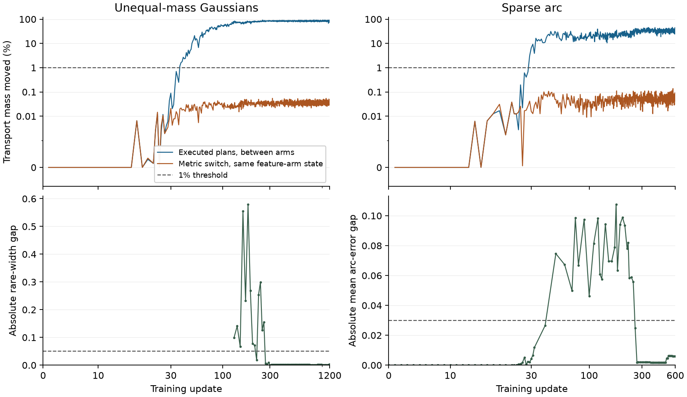

# When RHBI's training paths diverge

**The parent retained sparse-arc interpolation. The feature arm lost it. Both failed the rare-width gate.** On both tasks, changing the distance on the very same generator update moved less than 0.14% of total transport mass. Letting the two arms train produced much larger differences. On the arc, those differences appeared before a measurable quality gap on common edges. [Frozen protocol](protocol.md) · [Measurements and artifact hashes](results.json)

| Clean live gate | RHBI-v12 | RHBI-v12 with features | Decision |
| --- | --- | --- | --- |
| Unequal mass, 1,200 updates | FAIL, passing suffix 1/5 | FAIL, passing suffix 1/5 | Both missed the 0.15 narrow-axis floor in the terminal window. At update 1,150 their ratios were 0.1416 and 0.1417. |
| Sparse arc, 600 updates | PASS, terminal 5/5 | FAIL, terminal 0/5 | On the official learned-neighbor graph, final chord quality was 80.30% and 73.91% against an 80% floor. Both had 12/12 high-quality endpoints. |

The texture result from the earlier matched study still stands. This follow-up used the two retention tasks and acquired no new image or CIFAR measurements. [Texture comparison](../README.md#results-and-decision)

## What changed during training

For each generator update, compare how its transport plan distributes mass over the real batch and slack. The blue curve compares the plans actually used by the two evolving models. The orange curve switches just the feature arm's cross-cost to raw coordinates while holding its generator outputs, real inputs, critic logits, local horizons and solver options fixed. Total variation measures the fraction of transport mass moved. The dashed lines show the thresholds frozen before training. Rare widths require ten generated samples in each arm's rare-component core. Missing widths leave gaps. [Analysis code](analyze.py)



| Observation | Unequal mass | Sparse arc |
| --- | ---: | ---: |
| First difference in generator and prior parameters, exploratory | Update 17 | Update 14 |
| First difference in critic parameters, exploratory | Update 18 | Update 15 |
| First three consecutive updates with ≥1% difference in the two executed plans | 37–39 | 29–31 |
| Largest change from switching the cross-cost on the same update | 0.0546% | 0.1372% |
| First observed quality gap above its threshold | Update 130, first measurable width pair | Between observations 40 and 50 |

**Sparse arc.** At update 40, the gap in mean distance to the arc on the common initial edges was 0.0265, below the 0.03 threshold. At 50 it reached 0.0746. At 230 both arms had 11/12 good endpoints and a 0.0584 gap in interior error. At the end, the two learned graphs shared all 22 parent edges. An exploratory cross-check scored both generators on each graph. On the parent's graph, 53/66 interiors passed for the parent and 49/66 for the feature arm. On the feature arm's graph the counts were 56/69 and 51/69. The feature model missed the bound under either edge choice.

**Unequal mass.** The actual plans first separated at update 37. At the first measurable paired width, update 130, the parent had 57 rare core samples and a width ratio of 0.118. The feature arm had 11 and a ratio of 0.019. At 140 the parent cleared the floor at 0.221 and the feature arm measured 0.080. The earlier missing widths leave the order of plan and width divergence unresolved. Both arms passed the endpoint width bound and failed sustained retention.

The older selected parent passed unequal mass for 12 consecutive observations. Its task execution and evaluation fingerprints, declared recipe, initial prior and initialization matched this parent. Its code and runtime differed, including PyTorch 2.14.1+cu130 versus 2.15.0+cu132. The source and runtime differences were not individually varied. That historical PASS remains attached to its original run. [Archived parent receipt](../../technique-receipts/dd9f1d14371a431ca185ecc7e515f7cd.json)

## Research decision

Keep RHBI-v12 as the interpolation reference. Large immediate changes in the marginal cross-plan did not account for either retention trajectory under the frozen 1% criterion. The feature coordinates also enter the generator's derivative and fake–fake self cost. This study identifies when the arms separated and leaves the contributions of those two terms open.

The next bounded candidate I would test uses critic features to assign real pairs and slack, then uses the original raw-coordinate costs for generator movement and self-repulsion. Make that split an explicit recipe objective. First require the complete texture gate against both existing arms. A texture PASS would justify the same-source arc and rare-width comparisons. The shared rare-width failure needs its own baseline explanation before it can count as a regression from feature transport.

## Evidence and reproduction

The only recipe difference within each pair was rhbi_feature_transport. Each pair shared the task, deterministic initializer, starting public model and prior tensors, named RNG initialization, target batch sequence, exact generator prior-row IDs and actual critic target tensors at every update. The parent's same-state raw replay reproduced every executed cross-plan bit for bit. Forge observed zero unintended RNG deviations. Four paid attempts consumed 3,600 updates and 157.55 worker-seconds.

Forge originally blocked the two arc cells before training because the added observation call changed the file pinned by that evaluator. Restoring the pinned file byte for byte and attaching the same observer at dispatch admitted the arc pair. Unequal mass used execution commit `32255fa7e`. The arc pair used `28b534dfc`. Each parent–feature comparison shares one frozen source. The original admission decision and both corrected arc receipts remain available. [Unequal-mass parent](../../records/readout-eb79d4492cd8b70c2a8aa2d5.json) · [Unequal-mass feature](../../records/readout-1942d27fe6d2bb51cf94dd07.json) · [Arc parent](../../records/readout-99dfee25c9646a5673c97bab.json) · [Arc feature](../../records/readout-5e4c5c6abb5f177f32cf3316.json)

The feature arm reproduced all 24 official observations from its prior study on each task. Its final models, optimizer state and all named RNG streams matched. The two ambient process RNG snapshots differed. The reducer verifies the stored checkpoint and plan manifests, restores every measured state exactly, and writes the full traces locally. Two fresh reductions produced identical compact results and local curves. The experiment provides diagnostic evidence on two previously selected tasks.

Run the reducer from the repository root. Point it at the Forge run directory containing both trajectory campaigns and the original feature-retention campaign.

```sh
PYTHONPATH=. python reports/forge/rhbi-texture-feature/trajectory/analyze.py /path/to/runs/forge runs/trajectory-analysis
python reports/forge/rhbi-texture-feature/trajectory/plot.py runs/trajectory-analysis runs/trajectory-analysis/trajectories.png
```

Each attempt has a tail-able run.log. The per-campaign progress.jsonl contains the combined worker events. Bulk checkpoint files and per-update plans remain in each attempt's rhbi-trajectory directory.
