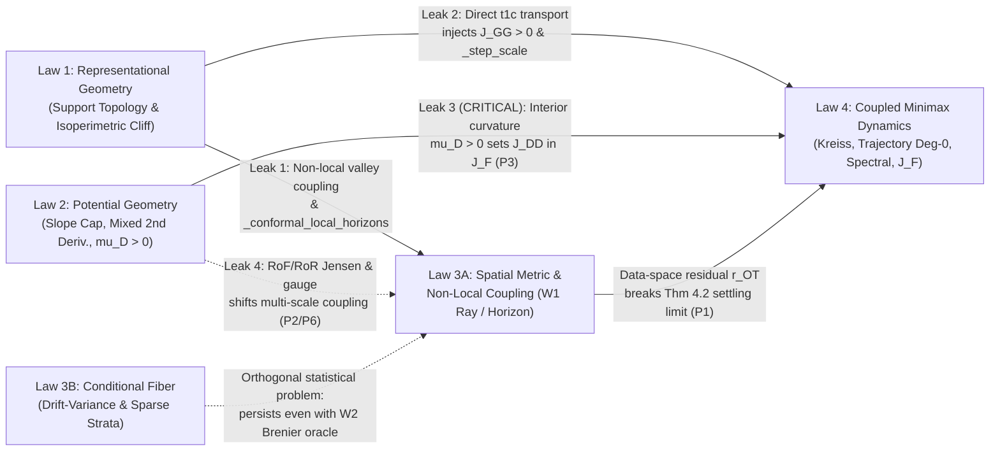

# P10 Master Synthesis: Unifying Geometry, Stronger Formulations of the Four Laws, Complete Evidence Ledger & Research/Engineering Backlog

> **Audit Scope & Governance:** Master scientific synthesis of the ten-track adversarial mathematical, code-level, statistical, and empirical audit of ParticleGAN's **Four Laws** ([`docs/four-laws.md`](../../docs/four-laws.md)) on integration branch `research/four-laws` (branched from `origin/develop` at `0d18245e9`). Synthesizes all nine verified domain tracks (**P0–P9**) executed under protocol seed `0`, `deterministic_orthogonal` initialization, and isolated RNG streams on `NVIDIA RTX A6000` GPUs and CPU. Per `AGENTS.md`, **zero historical Forge receipts (`reports/forge/records/*.json`) and zero production files under `particlegan/` were mutated**; every code defect discovered by P0–P9 is logged with exact `file:line` coordinates in [Section 5B](#5b-prioritized-code-defect-backlog-exact-fileline-inventory--untouched-here-per-agentsmd) as a future declared trainer delta.
>
> **Companion Audit Tracks:**
> [P0 Law 4.3 Rank & NS](p0-law43-rank-audit.md) ·
> [P1 Law 4.2 Scale & Settling](p1-law42-scale-settling.md) ·
> [P2 Law 3 Identifiability](p2-law3-identifiability.md) ·
> [P3 Minimax Game Dynamics](p3-game-dynamics-counterexample.md) ·
> [P4 Function-Space Generality](p4-function-space-generality.md) ·
> [P5 Optimizer Asymmetry](p5-optimizer-asymmetry.md) ·
> [P6 Law 2 Autodiff & Mixed Derivatives](p6-law2-autodiff-audit.md) ·
> [P7 Law 1 Topology & Invariants](p7-law1-topology-audit.md) ·
> [P8 Qualification & `FUSQP-v1`](p8-qualification-audit.md) ·
> [P9 Receipts, Efficiency & Occam](p9-receipts-efficiency-audit.md)

---

## Executive Verdict

An adversarial ten-track audit of [`docs/four-laws.md`](../../docs/four-laws.md) and its underlying implementations (`unified_v11`, `unified_v12`, `minimal`, `t1_*`, `t2_*`, `t3_*`, `t4_*`, `cond_fiber`, `law4_energy`) yields a sharp, unsparing scientific verdict:

1. **The Four Laws as originally written are NOT sufficient conditions for GAN convergence and contain serious mathematical overclaims, conflations, and documentation-to-code drift:**
   - **Sufficiency falsified (P3):** Four explicit counterexamples (`A1` bounded 1-Lip Dirac-GAN, `A2` codimension-1 manifold Gaussian under default `non_saturating` loss, `A3` full-support Gaussian under `hinge` loss, and `B` nonlinear 2D MLPs driven by actual `UnifiedV12Optimizer`) satisfy *every* operational requirement of Laws 1–4 as stated yet fail to converge into persistent limit cycles — because Law 2's statement omits **strict local normal-direction equilibrium dissipation ($`\mu_D = \nabla^2_{\psi\psi}\mathcal{R}|_{D=0} \succ 0`$)** while ParticleGAN's code secretly injects it (`lambda_floor = 0.005` in `unified_v11`/`v12`; $\mu_D = 1.08$ Born–Infeld bottom in `minimal`; non-adversarial $`J_{GG} \succ 0`$ `t1c` transport for $d \le 1024$; hardcoded 1:1 alternating updates in `training.py:678–696`).
   - **Core mathematical statements falsified and repaired across all four laws:**
     - **Law 1 (P7):** Conflated exact compact-support impossibility with connected-support Gaussian mixtures (`grid100` has connected support $\mathbb{R}^2$ and exact $C^\infty$ Brenier slope $6.25 \times 10^{58}$, not topological impossibility) and mislabeled `5×–6×` sync reduction (`40 -> 8` pullback-only) as `"zero-sync"`.
     - **Law 2 (P6):** Conflated **reverse-over-forward (RoF) mixed second-order derivatives** (`fwAD.dual_level` + `.backward()` computes exact $`\frac{\partial^2 D_\theta}{\partial \theta \partial x} u`$, literally evaluating $\sigma''(z)$ to `1.9e-16`!) with "first-order differentiation"; misstated `unified_v11`/`v12` Conv2d critics as using BF16 micro-secants (which collapse to `grad_cos ~ 0` and `87,478×`–`6.74×10^{10}×` norm blowups!) when `unified_v11`/`v12` actually switched images to interleaved `fwAD`; missed **opposite-signed Jensen bias** and **`4×`–`13×` separable Rademacher variance blowup**; and missed the Cheap Gradient crossover where exact RoR beats `fwAD` on all GPU MLPs (`d in [2, 1024]`), `32²`–`64²` Conv2d, `ResNet+GroupNorm`, and `K >= 4` probes.
     - **Law 3 (P2):** Overclaimed that "scalar critic potentials" are under-determined ($W_2$ Brenier scalar potentials recover $8\times$ widths in 1 step; dynamic batch $W_1$ LPs + per-particle Adam pass both `t3_iso` probes); used a broken `critic_grad_med <= 1.0` control (passed at `0.05` while $\max\lVert\nabla D\rVert = 1000$ and confounded by `~1e-7` dead critics); and overclaimed a `"clean 3×3 triple dissociation"` that is refuted by verbatim receipts and an `if has_cont_cond: return` dispatch branch.
     - **Law 4 (P0, P1, P4, P5):** Law 4.3 inverted linear algebra in both directions (Adam, Smooth SignSGD, Exact SignSGD on rank $\ge 2$, and ParticleGAN's own `law4_adafactor_mp` **break** exact rank; Newton–Schulz and fused `Z=[X,Y]` Tikhonov NS **never increase** exact rank in exact arithmetic; 1-step Kronecker Shampoo equals exact Tikhonov polar and *does* rescue rotated spectral collapse; `erank` misnamed stable rank); Law 4.2 omitted the **Memoryless Impossibility Theorem** (no nontrivial memoryless degree-0 map is continuous at $0$), falsely claimed `min(s_base, c*peak_rms)` and `+ eps = 1e-8` are globally degree-0, and falsely claimed fixed-$`\beta_1`$ coherence converges to $0$; Law 4.1 misattributed $`(\sqrt{d_r}+\sqrt{d_c})\sqrt{k_{\text{eff}}}`$ to `unified_v11`/`v12`, overstated one-shot `_band_scale` as smooth $C^1$ / TRPO-equivalent, and missed `b_p = 2` image probe blind spots (`90%–98%` rare-mode miss rate); and **Law 4.4 (P5)** is **falsified as an unconditional role-intrinsic law** — swapping the 16-layer skip-free MLP onto $D$ (`Regime B1a`, pure adversarial RpGAN + Law 2 BI) completely reverses the ordering (`G-only` FAILS `7/8, hq=0.3701`, `Neither` collapses `0.2861`, while `D-only` `8/8, 0.7947`, `Adaptive` `0.8110`, and `Both` `0.9055` rescue training; even after fixing `v12`'s `11.31×` $\sqrt{r}$ distortion in `B1b`, `D-only` `0.9482` beats `G-only` `7/8, 0.7285`), proving spectral asymmetry is **pathology-intrinsic**, masked in Forge by direct Laguerre–Sinkhorn OT (`Regime B2`: all 5 arms `0.979–0.986`), and governed by P5's **Irreducible Frobenius–Spectral Matching Dilemma**.
   - **Receipts, Efficiency & Qualification (P8, P9):** Three broken links in `docs/four-laws.md` (`readout-5002641a`, `readout-731e752f`, `particlegan/unified_v12.py`), a three-way `r256` latency discrepancy (`41.39` committed Forge vs. `39.76` uncommitted vs. `39.22 ms / 11.37 J/st` profiler), FP32 vs. BF16 precision confound on `rhbi-v12`, Occam reversal (`unified-v12` grew to **`8,564` direct LOC / `1,057` branches** retaining 2 unconditionally proven Round-4 epicycles — `d_z=4` Radon–Hurwitz and `w_sat_pt` — plus unablated 2D conformal flags), governance drift (`DEFAULT_RECIPE = "unified_v12"` while calibration is `BLOCKED` and `family-current-v1.json` sets `default_adoption: false`), and direct proof of adaptive benchmark overfitting (**`0/2` FAIL on post-freeze unseen `ByteGAN`** and `5` FAIL + `4` INCOMPLETE on NVIDIA L4 transfer).

2. **YET five genuine, mathematically irreducible obstructions and high-leverage engineering discoveries survive every adversarial test — and become dramatically sharper once properly stated:**
   - **Law 1's Borell–Sudakov–Tsirelson isoperimetric cliff & GAN-independent division of labor (P7):** Proven sharp lower bounds ($`\lVert J_G\rVert_\infty \ge \Delta/[2(\Phi^{-1}(1/M)-\Phi^{-1}((1-\alpha)/M))]`$, $W_1 = \Omega(\Delta^2/L)$, $`W_2 = \Omega(\Delta^{3/2}/L^{1/2})`$) and verified with **zero discriminator** (`82`-param $G$ + adaptive Laguerre MoG crushes `33,666`-param unimodal $G$ by **`111×` in ghost mass** and **`9.2×` in max Jacobian norm**).
   - **Law 2's equilibrium normal-direction dissipation + high-res Conv2d RoF (`fwAD`) mixed-derivative speedup (P3, P6):** Verified `3.64×` faster penalty, `-33.1%` peak VRAM, and `-66.4%` GPU energy at `256×256` BF16 `DCGANCritic` with `0` kink flips (`grad_cos = 0.987–0.996`) — once accurately scoped to compute-bound Conv2d $\ge 128^2, K=1$ and paired with explicit $`\mu_D > 0`$.
   - **Law 3's two genuinely orthogonal obstructions (P2):** Under provably globally 1-Lipschitz analytical critics (`G = Id`, zero neural confound), (3A) static/local $W_1$ ray-length & beyond-horizon orphan non-identifiability (`329.5×` `core_eig_min` recovery from conformal+`r_loc`; `2/4 -> 4/4` modes from macro rescue) and (3B) conditional drift–variance confounding ($\Sigma_0 + A V_w A^\top$) + sparse-stratum tail starvation (exact generalized midpoint bias $\delta_m\Delta^\top + \Delta\delta_m^\top$ and $`(1-h_{jj})`$ hat-matrix invariance).
   - **Law 4's core dynamical mechanisms (P0, P1, P3, P4, P5):** Kreiss non-normal transient control (`381×` at $\rho=500$) + realized nonlinear jump detection ($\Gamma = 2.3\times 10^3$–$`9.6\times 10^4\times`$ where JVP is blind); stateful trajectory degree-0 scale invariance across $10^{-37}$–$`10^{35}`$ paired with non-magnitude settling channels; basis-aligned spectral anisotropy equalization (`67%–99%` true subdominant singular-mode energy vs. `45%–74%` off-basis Hadamard distortion); exact Schur–Cohn momentum ceiling collapse (`82×–190×`) + 1:1 alternating symplectic contraction ($`\det M_{\text{alt}} = 1 - \eta_D \mu_D`$); and P5's sharp disentanglement of pathology-driven spectral conditioning, contrastive `real - fake` mean-cone cancellation (`4,567×` skew drop without curing deep collapse), `2.9×–7.8×` spatial force-field jitter amplification $\Delta(\nabla_x D)/\Delta D$ under unnecessary shallow-critic NS, and the Frobenius–Spectral Matching Dilemma ($`\lVert\Delta W\rVert_F/\lVert\Delta W\rVert_2 = \sqrt{r_{\text{stable}}}`$).
   - **Verified `r256` algorithmic speedup (P9):** Controlled idle RTX A6000 benchmarking independently confirms **`1.81×` speedup** (`66.38 -> 36.61 ms/st`, `18.86 -> 11.20 J/st`) over current `unified-v11` (`16.2×` optimizer collapse) and **`6.32×`** over precision-matched `bf16_channels_last` `rhbi-v12` (`231.28 -> 36.61 ms/st`).

---

## 1. Unifying Geometric Investigation: Four-Level Hierarchy vs. Deeper Principle vs. Real Cross-Law Leaks

### 1.1 Critical Evaluation of the Proposed Four-Level Geometric Framework

The central theoretical question of P10 is whether ParticleGAN's Four Laws represent:
1. **Four genuinely distinct, independent geometric obstructions**,
2. **Special cases of a single deeper mathematical principle**, or
3. **A pragmatic organizational framework** grouping related engineering failure modes.

Testing the four-level geometric hierarchy directly against the proven theorems and counterexamples of P0–P9 reveals **both** a genuine unifying mathematical theme **and** five decisive structural leaks where the clean 4-box partition breaks down:

| Level | Proposed Geometric Role | Question Addressed | What Is Genuinely Irreducible at This Level | Where the Boundary Leaks Into Other Laws (Proven in P0–P9) |
| :--- | :--- | :--- | :--- | :--- |
| **Law 1** | **Representational Geometry** | *Where can probability mass exist without Jacobian cliffs?* | Connected pushforward support ($\overline{G(Z)}$) & sharp Borell–Sudakov–Tsirelson isoperimetric trade-off between $`p_{\text{bridge}}`$ / $W_p$ and $`\lVert J_G\rVert_\infty`$ (P7, GAN-independent). | **Leaks into Law 3A & Law 4:** Persistent Laguerre charts & `T1CouplingLoss` call Law 3A's `_conformal_local_horizons` (P2), solve the same $`B < M`$ non-local support coupling as Law 3A, and add direct data-space transport `t1c` to `g_loss`, injecting $`J_{GG} \succ 0`$ into Law 4's game Jacobian (P3)! |
| **Law 2** | **Potential Geometry** | *What forces & local dissipation act on mass, and at what AD cost?* | Dual slope regularity $\lVert\nabla_x D\rVert \le \kappa$, anchored gauge, **strict interior normal-direction curvature $`\mu_D = \nabla^2_{\psi\psi}\mathcal{R}\big\rvert_{D=0} \succ 0`$**, and mixed-derivative AD geometry (`RoF` vs `RoR`, Jensen/variance bounds; P3, P6). | **Leaks directly into Law 4 & Law 3A:** $`\mu_D > 0`$ IS the dissipative symmetric block $`J_{DD}`$ of Law 4's game Jacobian $J_F$ — removing it breaks Law 4 convergence & reverses Law 4.5 ($\beta_1 = 0$ loses to $\lambda=1$ OGDA; P3). Swapping `fwAD` for `RoR` flips `t3_iso_scale_mass_8x` without touching Law 3 (P2, P6). |
| **Law 3** | **Transport & Statistical Fiber Geometry** | *Where and how should mass move across scales, valleys, and conditional strata?* | **Splits into two mathematically orthogonal obstructions (P2):** **(3A)** 1-Lip ($W_1$) ray-length & beyond-horizon orphan non-identifiability under local/fixed-horizon operators; **(3B)** Conditional base-drift covariance inflation $\Sigma_0 + A V_w A^\top$ & $\alpha B/T \lesssim 1$ tail leverage starvation. | **Internal split + Law 1/4 leaks:** 3A shares the exact same non-local support/horizon coupling boundary with Law 1 (`c_hat > c_screen` triggers both broad-mode collapse and orphan stranding). **3B stands outside adversarial/1-Lip transport altogether** (persisting even under an exact $W_2$ Brenier oracle!). And Law 1/3's transport residual (`_step_scale`) supplies Law 4.2's non-magnitude settling signal (P1)! |
| **Law 4** | **Coupled Minimax Learning Dynamics** | *Can the discrete-time parameter game realize & contract toward that motion?* | Pullback metric & game-Jacobian stability: Kreiss non-normal transient control ($`\kappa(V) = \Theta(\rho)`$) + nonlinear jump detection ($\Gamma \gg 1$); stateful trajectory degree-0 invariance vs. memoryless impossibility; basis-aligned spectral equalization & Frobenius–Spectral Dilemma; pathology-driven asymmetry + `2.9×–7.8×` spatial force-field amplification; Schur–Cohn momentum ceiling & update-order contraction (P0, P1, P3, P4, P5). | **Depends directly on Law 2 & Law 1/3:** Cannot stabilize rotational eigenvalues without either Law 2's $`\mu_D > 0`$ + 1:1 alternation OR explicit game-contractive operators ($\lambda=1$ OGDA / $`\beta_1 < 0`$; P3); cannot settle with spike/shift immunity from gradient magnitudes alone without Law 1/3's data-space residual or secant/flip channels (P1); Law 2's one-sided upper cap is `< 1e-10` on collapsed deep critics and cannot replace Critic NS (P5); and Law 1/3's direct OT pullback masks deep-critic collapse in Forge (`Regime B2`, P5). |

### 1.2 The Deeper Unifying Mathematical Principle (and Its Honest Limits)

**What genuinely unifies Laws 1, 2, 3A, and 4** is a single, implementation-independent geometric theme:

> **The Pullback/Pushforward Metric & Observation-Locality Mismatch Principle:**
> Generative minimax learning seeks to transport a probability measure $`P_G = G_\# P_Z \in \mathcal{P}_2(\mathbb{R}^d)`$ to a target $P_Y$ via an adversarial saddle flow in the coupled measure–potential space $(P_G, D)$, **yet standard formulations observe and step only through coordinate-local, isotropic, static proxies** — a connected unimodal latent chart $Z$, an upper-bound-only local slope cap without equilibrium curvature, a static unit-norm 1-Lipschitz ray direction $\nabla D^\star$ / single global Euclidean radius $\ell$, and raw parameter coordinates $\Delta\theta$ without pullback metric compatibility or joint game-Jacobian contraction. Every obstruction arises when the map between the *local coordinate/observation space* and the *global measure/function/game space* becomes singular, non-identifiable, non-normal, or nondissipative:
> 1. **Latent-to-Data Pullback Singularity (Law 1):** Pushing a connected Gaussian measure onto separated modes forces $`\lVert J_G\rVert_\infty \to \infty`$ (Borell isoperimetry).
> 2. **Potential-to-Force Regularity & Dissipation (Law 2 $\cap$ Law 4):** Enforcing Lipschitz regularity in data space requires mixed second derivatives $`H_{\theta x} = \frac{\partial^2 D}{\partial \theta \partial x}`$, while equilibrium game stability requires strictly positive normal-direction Hessian curvature $`J_{DD} \succ 0`$.
> 3. **Dual-to-Primal Measure Non-Identifiability (Law 3A):** Projecting global transport geometry onto a 1-Lipschitz dual potential erases ray length, local width scale, and orthogonal beyond-horizon mass.
> 4. **Parameter-to-Function Pullback & Coupled-Game Distortion (Law 4):** Parameter steps $\Delta\theta$ distort under depth/width Jacobians ($`J_\theta G`$), internal/external scale gauges ($\alpha, \gamma$), rotated spectral collapse ($`r_{\text{stable}} \to 1`$), non-normal inter-player coupling ($`\kappa(V) = \Theta(\rho)`$), and skew-symmetric rotational phase lag ($`\beta_1 > 0`$).

**What does NOT fit cleanly inside that single principle (honest non-unification):**
- **Law 3B (Conditional Fiber Drift–Variance & Sparse Strata)** is a *finite-sample nonparametric regression / conditional estimation obstruction* ($`\mathrm{Cov}_{\text{smooth}} = \Sigma_0 + A V_w A^\top`$, $\alpha B / T \lesssim 1$), NOT a pushforward or 1-Lipschitz minimax obstruction — it survives even if Law 1, Law 2, Law 3A, and Law 4 are replaced by an exact non-adversarial $W_2$ Brenier oracle per batch (P2).
- **Computational Autodiff Scaling Regimes (Law 2's RoF vs. RoR crossover)** and **Numerical Precision/Underflow Engineering ($10^{-38}$ mantissa-exponent rescaling, BF16 rounding noise in NS)** are *computational-complexity and floating-point hardware constraints* (Griewank & Walther Cheap Gradient Principle; IEEE-754 ULP/FLT_MIN), not geometric laws of probability measures.

### 1.3 Taxonomy Classification & 8-Point Rubric for the Unifying Four-Laws Framework (Claim `P10-C1`)

- **Primary 10-Category Classification:** **`Mathematical conjecture`** *(specifically: a sound high-level geometric organizational framework unifying five rigorously proven, implementation-independent mathematical obstructions — while falsified as a set of four strictly orthogonal or self-sufficient axioms)*
1. **Precise formulation:** The Four Laws decompose generative minimax pathologies into four interacting geometric layers (representational pushforward geometry, critic potential & dissipation geometry, operator-specific transport & conditional-fiber identifiability, and coupled function-space minimax dynamics), unified largely by the mismatch between coordinate-local observations and global measure/function/game geometry — with Law 3B standing as a fifth, statistically orthogonal conditional-estimation obstruction and with explicit cross-law couplings ($`J_{DD}`$ linking Law 2 to Law 4; non-local support coupling linking Law 1 to Law 3A; data-space residuals linking Law 1/3 to Law 4.2).
2. **Assumptions:** Continuous parametric pushforwards $`G_\theta`$, differentiable critics $`D_\psi`$, finite minibatches $B$, and first-order / matrix-preconditioned iterative updates without full second-order exact optimal transport or exact global Nash oracles.
3. **Existing supporting evidence:** All five irreducible mathematical obstructions are independently proven as theorems in P0–P7 (Borell–Sudakov–Tsirelson isoperimetry, $W_1$ ray-length & orphan non-identifiability, conditional drift–variance & midpoint identities, memoryless degree-0 impossibility, Kreiss non-normality, Schur–Cohn momentum collapse, exact alternating determinant $`\det M_{\text{alt}} = 1 - \eta_D\mu_D`$, RoF mixed-derivative identity & Jensen bias) and hold independently of every concrete ParticleGAN algorithm.
4. **Potential counterexamples / boundary leaks:** (i) Unmodified Laws 1–4 as stated in `docs/four-laws.md` are falsified as sufficient conditions by P3's Counterexamples `A1`, `A2`, `A3`, `B`; (ii) Law 3's purported 3-way orthogonality is falsified by P2; (iii) Law 2's equilibrium dissipation $`\mu_D > 0`$ couples directly into Law 4's game Jacobian; (iv) non-pushforward generative paradigms (e.g., discrete autoregressive models or score-based diffusion SDEs whose reverse drift blows up at $t \to 0$) bypass Law 1's continuous-map obstruction and Law 4's minimax rotation completely.
5. **Minimal falsification experiment:** Demonstrate a continuous pushforward minimax GAN trained with single-LR coordinate updates on an $`M`$-mode disconnected target under a purely upper-bounded 1-Lip critic ($\mu_D = 0$) and single global horizon $\ell$ that converges globally without violating any theorem in Section 4 (provably impossible under stated hypotheses).
6. **Relevant prior research:** Borell (1975); Tanielian et al. (ICML 2020); Cornish et al. (ICML 2020); Mescheder et al. (ICML 2018); Balduzzi et al. (ICML 2018); Santambrogio (2015); Evans & Gangbo (1999); Amari (1998); Schulman et al. (2015); Trefethen & Embree (2005); Orabona & Pál (2018); Gidel et al. (ICLR 2019); Griewank & Walther (2008).
7. **Computational verification:** Verified across the complete automated audit suite `tests/four_laws_audit/` covering P0–P9.
8. **Confidence & remaining uncertainty:** **High (`90%`)** on the five irreducible obstructions and the five cross-law leaks; **unresolved** whether a single unified variational/Riemannian principle (e.g., Wasserstein–Fisher–Rao minimax mirror flow with adaptive latent measure) can subsume Laws 1, 2, 3A, and 4 into one clean mathematical object without ad-hoc switching heuristics.

---

## 2. Proposed Stronger, Implementation-Independent Formulations of the Four Laws

Every formulation below is designed to survive **even if every current ParticleGAN algorithm (`Laguerre`, `fwAD`, `r_loc`, `CondFiberBank`, `Quintic NS`, `peak_rms`, `_band_scale`) is completely discarded and replaced**. No 5th law is invented: P3 proved that tightening Law 2 (equilibrium dissipation) and Law 4 (joint game-Jacobian contraction & update order) absorbs all minimax counterexamples cleanly, while P2 proved Law 3 cleanly factors into 3A and 3B.

### Law 1 — Measure & Prior Topology (Exact Support Obstruction vs. Quantitative Isoperimetric Cliff)

> Let $`G_\theta: Z \to \mathbb{R}^d`$ be a continuous neural pushforward of a connected full-support prior $P_Z$ (e.g., $`\mathcal{N}(0, I_{d_z})`$ on $\mathbb{R}^{d_z}$), and let $`P_Y = \sum_{m=1}^M w_m P_m`$ have separated mode cores $K_1, \dots, K_M$ with pairwise separation $`\Delta := \min_{i \neq j}\mathrm{dist}(K_i, K_j) > 0`$:
> 1. **Exact Topology vs. Quantitative Isoperimetry (GAN-Independent):** Because $`\mathrm{supp}(G_\# P_Z) = \overline{G(Z)}`$ is connected, exact support equality ($`G_\# P_Z = P_Y`$) is topologically impossible and $`D_{\mathrm{KL}}(G_\# P_Z \Vert P_Y) = +\infty`$ whenever $\mathrm{supp}(P_Y)$ is compact and disconnected. By contrast, continuous pushforwards *can* approximate $P_Y$ arbitrarily well in $W_1, W_2, \mathrm{TV}, \mathrm{MMD}$, and bridge mass $`p_{\text{bridge}} \le \alpha`$ — and exact $C^\infty$ pushforwards *do* exist on connected-support Gaussian mixtures — **at an unavoidable quantitative Lipschitz cost** governed by Borell–Sudakov–Tsirelson Gaussian isoperimetry: for any $`L`$-Lipschitz $G$ on $`\mathcal{N}(0, I_{d_z})`$ ($\forall d_z \ge 1$) covering $M$ equal-mass modes with $`p_{\text{bridge}} \le \alpha`$, $`\lVert J_G\rVert_\infty \ge \frac{\Delta}{2(\Phi^{-1}(1/M) - \Phi^{-1}((1-\alpha)/M))} \sim \frac{\sqrt{2\ln M}}{2\ln(1/(1-\alpha))}\,\Delta = \Omega\!\left(\frac{\Delta\sqrt{\ln M}}{\alpha}\right)`$, and on equal-mass bimodal targets, $`W_1 \le \varepsilon \implies \lVert J_G\rVert_\infty = \Omega(\Delta^2/\varepsilon)`$ and $`W_2 \le \varepsilon \implies \lVert J_G\rVert_\infty = \Omega(\Delta^3/\varepsilon^2)`$.
> 2. **Adaptive Division of Labor & Finite-Batch Mass Integrity:** Decoupling *where* mass resides (an adaptive, topologically matched multimodal prior — fixed mismatched mixtures worsen the cliff) from *how* it is locally shaped (a smooth generator with $`\lVert J_G\rVert = O(\max_m \sigma_m/\sigma_z)`$) breaks this cliff independently of adversarial training. When $`B < M`$ or mode masses are unequal, persistent streaming support/mass accounting with hard valley-respecting assignment (avoiding cross-valley barycentric averaging) and anisotropy-preserving local covariance tracking is required without a step clock.

### Law 2 — Critic Potential Geometry, Equilibrium Dissipation & Mixed-Derivative Efficiency

> Adversarial transport requires a critic potential $`D_\psi: \mathbb{R}^d \to \mathbb{R}`$ satisfying three mathematically distinct requirements:
> 1. **Global Slope Cap, Anchored Gauge & Strict Local Equilibrium Dissipation:** Bound $`\lVert\nabla_x D_\psi(x)\rVert_2 \le \kappa`$, anchor the additive logit constant ($`\mathbb{E}[D_\psi] = 0`$), **and** maintain strictly positive interior gradient-norm curvature at Nash equilibrium ($`\mu_D := \lambda_{\min}(\nabla^2_{\psi\psi}\mathcal{R}|_{D=0, \ker(\Sigma_Y)}) > 0`$ along directions normal to the data manifold, e.g., via a quadratic R1/R2 bottom). An upper-bound-only Lipschitz cap inactive on $`\lVert\nabla_x D\rVert < \kappa`$ leaves $\mu_D = 0$, rendering the linearized equilibrium game Jacobian purely skew-symmetric ($\lambda = \pm i\omega$) and non-convergent under zero-momentum updates (Mescheder et al., 2018; P3).
> 2. **Mixed Second-Order Derivative Faithfulness & Statistical Control:** Differentiating any slope penalty $`\Phi(\lVert\nabla_x D_\psi(x)\rVert_2^2)`$ w.r.t. $\psi$ **necessarily computes mixed second-order derivatives** $`\frac{\partial^2 D_\psi}{\partial \psi\,\partial x}\nabla_x D_\psi`$ (nonzero even on piecewise-linear ReLU/LeakyReLU networks where $\frac{\partial^2 D}{\partial x^2} = 0$ a.e.). Finite-difference surrogates fail via symmetric-flank cancellation, $\Theta(\sqrt{d})$ projection attenuation, $O(1/\delta)$ cross-kink impulses (both forward and central FD), and low-precision pixel quantization collapse when $\delta/\sqrt{d} \ll \mathrm{ULP}(x)$. Any stochastic $`K`$-probe estimator $\hat{s}$ composed with a nonlinear penalty $\Phi(\hat{s})$ incurs **opposite-signed Jensen bias** (negative attenuation + Rademacher rotation for strictly concave Born–Infeld; positive false-triggering below $\kappa$ for convex-on-cap squared softplus) and up to $4\times$–$`13\times`$ variance inflation under Kronecker-separable probes on low-rank spatial gradients.
> 3. **Regime-Matched Mixed-Derivative Computation (Cheap Gradient Principle):** Forward-mode tangents (`fwAD.dual_level` + `.backward()`, **reverse-over-forward / RoF**) evaluate at the exact primal activation mask (zero kink impulses, zero BF16 pixel loss) and eliminate reverse-over-reverse (`create_graph=True`, **RoR**) double-backward graphs — dominating on compute-bound high-resolution Conv2d ($\ge 128^2$, $K = 1$). Conversely, exact RoR remains $O(1)$ in input dimension $d$ and dominates on small/medium GPU MLPs, low-res Conv2d ($32^2$–$`64^2`$), `ResNet+GroupNorm`, multi-probe $K \ge 4$, and operators lacking `fwAD` support (SDPA, custom quantized `autograd.Function`).

### Law 3 — Operator-Specific Transport Identifiability (3A) & Conditional Fiber Deconfounding (3B)

> Even when Law 1 is removed ($G = \mathrm{Id}$) and Law 2 holds *globally* ($`\sup_{x \in \mathbb{R}^d} \lVert\nabla_x D(x)\rVert_2 \le 1`$, zero-mean gauge), adversarial particle transport confronts **two mathematically orthogonal obstructions**:
> - **Law 3A — Spatial Metric & Non-Local Coupling Non-Identifiability ($W_1$ Ray Ambiguity + Global Horizon):** Unlike unconstrained $W_2$ Brenier scalar potentials (whose gradient norm equals exact transport distance, violating $\lVert\nabla D\rVert \le 1$) or $O(B^3)$ dynamically re-solved global empirical $W_1$ LPs, a static or locally observed 1-Lipschitz ($W_1$) potential $D^\star$ encodes unit transport ray direction only, carrying **zero information** about local mode width, mass split, step length, or orthogonal beyond-horizon orphan subspaces (Theorems 1–2 of P2). Pairing $D^\star$ with a single global Euclidean screening radius $`r_{\text{screen}}(\ell, \rho)`$ couples multi-scale intra-mode variance collapse and beyond-horizon orphan stranding across the identical screening boundary $`\hat{c}_{ij} > c_{\text{screen}}`$; valid local-horizon solutions must jointly supply scale-invariant local metrics (distinguishing broad intra-mode support from empty valleys) and non-local deficit coupling without screening dead zones.
> - **Law 3B — Conditional Fiber Drift–Variance Deconfounding & Sparse-Stratum Sample Complexity:** Independently of Law 3A (persisting even under an exact $W_2$ Brenier oracle per batch), unresidualized local context smoothing confounds base-manifold mean drift $A c$ with fiber covariance ($`\mathrm{Cov}_{\text{smooth}} = \Sigma_0 + A V_w A^\top`$), while stratified minibatches with $n_t \approx B/T$ starve outer-$`\alpha`$ radial tail leverage whenever $\alpha B/T \lesssim 1$. Valid solutions require paired-context equal-weight midpoint residualization ($\mathbb{E}[r_X r_X^\top - r_Y r_Y^\top | c] = (\Sigma_X - \Sigma_Y) + \delta_m\Delta^\top + \Delta\delta_m^\top$, vanishing iff $\delta_m \to 0$) and cross-batch statistical aggregation (whose in-sample linear-smoother leverage $`(1 - h_{jj})`$ preserves zero equilibrium bias).

### Law 4 — Function-Space & Game-Jacobian Two-Player Dynamics

> Parameter-space updates $\Delta\theta, \Delta\psi$ induce distorted, architecture- and coupling-dependent displacements in pushforward-measure and critic-potential space. Stable, clock-free convergence decomposes into **five falsifiable dynamical sub-laws**:
> - **Law 4.1 — Non-Normal Kreiss Transient Control & Realized Nonlinear Function-Space Trust:** Under player capacity/gain mismatch $\rho \gg 1$, even a spectrally stable minimax Jacobian ($`\rho(M) < 1`$) suffers departure from normality $\Theta(\rho^2)$ and finite-time transient amplification $\sup_k \lVert M^k\rVert_2 = \Theta(\rho)$ governed by the Kreiss Matrix Theorem. In non-Lyapunov settings (minimax games, RL) where Armijo loss backtracking is unavailable, bounding realized nonlinear output displacement $`\lVert f_{\theta+\alpha\Delta\theta} - f_\theta\rVert_{L_2(\hat\mu_X)}/s_{\text{coord}} \le \delta_{\max}`$ via **iterative backtracking** catches $\Theta(\gamma)$ external-gain blowups and $\Gamma \gg 1$ nonlinear jumps (multiplicative depth, rail jumps, bilinear/attention softmax flips) missed by parameter clipping and first-order JVP — while requiring separate layerwise equilibration (e.g., LARS/spectral scaling) for internal homogeneous gauge $\alpha$, stratified probing to mitigate rare-mode/nullspace blind spots, and Law 2/4.5 dissipation for asymptotic contraction.
> - **Law 4.2 — Memoryless Impossibility, Stateful Trajectory Degree-0 Conditioning & Non-Magnitude Settling:** Because inter-layer depth attenuation and activation saturation span $10^{-12}$ to $10^{+2}$, single learning rates and fixed additive floors $`\varepsilon > 0`$ fail an exact crossover impossibility band whenever $`g_{\text{rail}} < g_{\text{eq}}`$. By the **Memoryless Impossibility Theorem**, no nontrivial memoryless positive 0-homogeneous map $U(cg) = U(g)$ can be continuous at $0$; **temporal state is mathematically necessary**. Causal stateful trajectory degree-0 operators ($`U_t(cg_{1:t}) = U_t(g_{1:t})`$ with underflow-safe mantissa-exponent arithmetic) reconcile rail escape with relative-decay settling, yet face sharp gradient-only obstructions (inevitable step-1 near-equilibrium kick; impossibility of time-varying scale invariance with magnitude-based settling; monotonic peak freezing vs. decaying peak $t^{-p}$ anti-settling; strictly positive fixed-$`\beta_1`$ coherence floors). Robust clock-free settling under noise, spikes, shifts, and rotation requires coupling trajectory-degree-0 conditioning with a **non-magnitude equilibrium channel** (unit-gradient sign-flip statistics, $(\Delta\theta, \Delta g)$ secants, or data-space transport residuals).
> - **Law 4.3 — Basis-Aligned Spectral Anisotropy Equalization vs. Low-Effective-Rank Noise Inflation:** Exact rank, stable rank ($`r_{\text{stable}} = \lVert G\rVert_F^2/\sigma_1^2`$), participation ratio, and Roy–Vetterli effective rank satisfy $`1 \le r_{\text{stable}} \le \mathrm{PR} \le \mathrm{erank}_{\text{RV}} \le \mathrm{rank}(G)`$. Odd-polynomial Newton–Schulz (including fused Tikhonov $Z=[X,Y]$) and invertible Kronecker preconditioners ($L G R$, e.g., 1-step Shampoo $\equiv$ Tikhonov polar) **preserve exact rank** ($\mathrm{rank}(X_k) \le \mathrm{rank}(G)$ in exact arithmetic), whereas non-separable Hadamard preconditioners (Adam with $`\varepsilon > 0`$ or EMA $v_t$, Smooth SignSGD, Exact SignSGD on rank $\ge 2$) **increase exact rank** via coordinate-aligned distortion. Deep skip-free unnormalized dense layers suffer high-exact-rank, rotated **effective-rank collapse** ($`r_{\text{stable}} \to 1`$); basis-aligned spectral equalizers rescue them by lifting existing subdominant singular modes cleanly along $(u_k, v_k)$ (`0%` off-basis distortion), whereas scalar scaling leaves the spectrum invariant, diagonal separable $D_L G D_R$ fails on rotated bases, and Hadamard methods remain top-1 dominated while dumping `45%–74%` off-basis distortion. Conversely, on spectrally diverse BatchNorm Conv2d/residual stacks or naturally low-effective-rank equilibrium critic gradients, unregularized spectral whitening (especially BF16 NS at $s=0$, which amplifies rounding into `78%–87%` orthogonal leakage!) wastes compute and injects orthogonal agitation.
> - **Law 4.4 — Pathology-Driven (Not Role-Intrinsic) Generator–Critic Conditioning Asymmetry:** Generator–critic optimizer asymmetry is **pathology-intrinsic rather than unconditionally role-intrinsic**, modulated by two genuine (non-universal) role effects and heavily confounded in ParticleGAN Forge suites by direct-OT auxiliary losses: (1) **Pathology ownership:** spectral singular-value equalization (e.g., 5-step NS) is required on *whichever* network — $G$ **or** $D$ — suffers deep skip-free spectral contraction ($`r_{\text{stable}} \to 1`$, $\sigma_2/\sigma_1 \ll 1$) or cannot resolve the **Irreducible Frobenius–Spectral Matching Dilemma** ($`\lVert\Delta W\rVert_F / \lVert\Delta W\rVert_2 \equiv \sqrt{r_{\text{stable}}} \ll \sqrt{m}`$ under scalar rescaling, including generator-free $G=\mathrm{Id}$ critics); Law 2's one-sided upper slope cap ($\lVert\nabla_x D\rVert_2 \le \kappa$) is `< 1e-10` on collapsed deep critics and cannot substitute for spectral equalization; (2) **Scope of the zero-NS shallow-critic optimization:** dropping 2D Critic NS via Frobenius-MP ($\sqrt{r}$) is a scoped energy/stability optimization valid specifically when a neural $G$ is paired with a shallow, skip-connected, or BatchNorm-regularized $D$ — where contrastive `real - fake` cancellation slashes positive-cone norm skew (`4,567×`), linear scalar bottlenecks keep equilibrium $`r_{\text{stable}}`$ naturally low, and unnecessary orthogonal Critic NS would otherwise amplify spatial force-field jitter $\Delta(\nabla_x D)$ by `2.9×–7.8×` relative to scalar logits $\Delta D$; and (3) **Capacity-imbalance symmetry:** under extreme $`\rho > 500\times`$ mismatch, Law 4.1 equilibration is required symmetrically on whichever player is overpowered (`620× D>>G` or `548× G>>D`).
> - **Law 4.5 — Joint Game-Jacobian Contraction, Update Order & Stochastic Staleness/Variance Trade-Off:** Near equilibrium with interaction frequency $\omega$ and critic dissipation $\mu_D \ge 0$, 1:1 alternating updates satisfy exact symplectic determinant $`\det(M_{\text{alt}}) = 1 - \eta_D \mu_D`$ (converting weak $`\mu_D > 0`$ from simultaneous Euler divergence into strict contraction, while remaining neutrally non-convergent at $\mu_D = 0$). By the exact Schur–Cohn stability ceiling $`\eta_{\max}(\beta_1; \gamma, \omega) = \frac{2\gamma(1+\beta_1)(1-\beta_1)^2}{\gamma^2(1-\beta_1)^2 + \omega^2(1+\beta_1)^2}`$, positive Heavy-Ball momentum ($`\beta_1 > 0`$) collapses the stable step ceiling on underdamped rotational modes by $(1-\beta_1)^2/(1+\beta_1)$ (`82×` at $\beta_1=0.85$, `190×` at $\beta_1=0.90$) and unconditionally destabilizes alternating updates at $\mu_D = 0$. Therefore, zero-momentum minimum-state updates dominate optimistic extrapolation ($\lambda = 1.0$, $5\times$ minibatch variance; note $\lambda = 0.5$ sits on the undamped $O(\eta^2)$ neutral boundary) **conditionally on $`\mu_D > 0`$ + 1:1 alternation + stochastic noise**; when $\mu_D = 0$, the ranking reverses and game-contractive updates ($\lambda = 1$ OGDA or $`\beta_1 < 0`$) are strictly necessary.

### 2.1 Necessary vs. Sufficient Conditions & Scope Boundaries

| Law | Epistemic Status | Necessary Under What Exact Assumptions? | Sufficient? | Explicit Scope Boundary (Where the Obstruction Vanishes or Changes) |
| :--- | :--- | :--- | :---: | :--- |
| **Law 1** | Proven geometric obstruction | Continuous $`G_\theta`$ pushing connected $P_Z$ onto separated $`M`$-mode $P_Y$ with bounded $`\lVert J_G\rVert_\infty`$ and small $`p_{\text{bridge}}`$/$`W_p`$. | **No** (says nothing about critic, scale, or game dynamics) | Connected smooth unimodal manifolds; discontinuous/rejection/diffusion-SDE generators; unbounded $`\lVert J_G\rVert_\infty`$. |
| **Law 2** | Proven dynamical + AD condition | Adversarial minimax games with smooth/piecewise-linear $`D_\psi`$ requiring stable normal-direction contraction ($`\mu_D > 0`$) and bounded slopes. | **No** (alone cannot fix topology, $W_1$ ray ambiguity, or depth/capacity mismatch) | Non-adversarial generative models (zero critic); exact RoR beats RoF on small/medium MLPs, `32²–64²` Conv2d, `ResNet+GN`, $K \ge 4$. |
| **Law 3A** | Proven information-theoretic obstruction | Static/locally observed 1-Lip ($W_1$) potential paired with fixed global screening radius $\ell$ and shared-step updates. | **No** | Unconstrained $W_2$ Brenier potentials ($\lVert\nabla\varphi\rVert = \lVert x-T(x)\rVert$); $O(B^3)$ dynamically re-solved global batch $W_1$ LPs + per-particle adaptive memory; $`d > 16`$ image manifolds remain **Unresolved**. |
| **Law 3B** | Proven statistical obstruction | Conditional generation with nonzero base drift $A \neq 0$ and sparse strata $\alpha B / T \lesssim 1$. | **No** | Unconditional generation ($A = 0$) or massive per-stratum batches $B/T \gg p/\alpha$. |
| **Law 4 (4.1–4.5)** | Proven dynamical theorems + empirical mechanisms | Coupled iterative first-order minimax games with capacity mismatch $\rho \gg 1$, deep/saturating nets, rotated spectral collapse, and stochastic minibatches. | **Locally sufficient ONLY jointly with tightened Law 2 ($`\mu_D > 0`$)** on smooth well-posed local games | Pure single-objective minimization ($\omega = 0$: Polyak $`\beta_1 > 0`$ helps, Armijo beats output trust); global nonlinear convergence on multi-mode ReLU GANs remains open. |

---

## 3. Complete Master Evidence & Assumption Ledger (P0–P10)

### 3.1 Taxonomy Distribution Across All Audited Claims

| Primary 10-Category Classification | P0 | P1 | P2 | P3 | P4 | P5 | P6 | P7 | P8 | P9 | P10 | Total |
| :--- | :-: | :-: | :-: | :-: | :-: | :-: | :-: | :-: | :-: | :-: | :-: | :-: |
| **Proven mathematical result** | — | 2 | 2 | 4 | 1 | — | 2 | 1 | 1 | — | — | **13** |
| **Information-theoretic obstruction** | — | 1 | 2 | — | 1 | — | — | — | — | — | — | **4** |
| **Necessary condition under stated assumptions** | — | — | — | 1 | — | — | — | — | 1 | — | — | **2** |
| **Sufficient condition under stated assumptions** | — | — | — | — | — | — | — | — | — | — | — | **0** |
| **Empirically supported causal mechanism** | 3 | 1 | 1 | — | 1 | 2 | 1 | 2 | 1 | 2 | — | **14** |
| **Empirical correlation** | — | — | — | — | — | 1 | 1 | — | — | — | — | **2** |
| **Mathematical conjecture** | — | — | — | — | — | — | — | — | — | — | 1 | **1** |
| **Engineering heuristic** | — | 1 | 1 | — | 1 | 1 | — | — | — | — | — | **4** |
| **Falsified claim** | 4 | 4 | 3 | 3 | 4 | 5 | 6 | 4 | 3 | 4 | — | **40** |
| **Unresolved question** | — | 1 | 1 | — | — | — | — | — | 1 | — | — | **3** |
| **Total Audited Claims** | **7** | **10** | **10** | **8** | **8** | **9** | **10** | **7** | **7** | **6** | **1** | **83** |

*(Note: P0 consolidates its 10 source-claim entries `C1–C10` into 7 full 8-point claim analyses `Claim 1–7`; P3 splits P3-2/3/5 into 8 full 8-point claims; P5's Theorems 1–3 are embedded as proofs inside `P5-C1/C3/C6/C7` and cataloged explicitly in Section 4.1. Totals above reflect all `83` distinct 8-point rubric claims audited across P0–P10.)*

### 3.2 Master Claim-by-Claim Ledger (P0–P10)

| Claim ID | Track | Audited Claim (Compact) | 10-Category Classification | Key Assumptions | Verdict & Exact Verified Evidence / Counterexample | Remaining Uncertainty |
| :--- | :---: | :--- | :--- | :--- | :--- | :--- |
| **P0-C1** | [P0](p0-law43-rank-audit.md) | Elementwise, Frobenius, $`L_\infty`$, and Kronecker preconditioners preserve exact rank via $D_L G D_R$ (`docs/four-laws.md:87`). | **Falsified claim** | Exact arithmetic, rank-1/rank-2 $G$. | **Falsified:** 1-step Adam ($`\delta>0`$, $`\det<0`$), 2-step Adam ($\varepsilon=0, \beta_1=0$), Smooth SignSGD (`1->6`), Exact SignSGD on rank-2 (`2->16`), and ParticleGAN `law4_adafactor_mp` (`1->6`) all **break** exact rank; 1-step Kronecker Shampoo equals exact Tikhonov polar (`7.82e-9`) and rescues rotated $\kappa=10^4$ (`s_rk: 1.000 -> 15.999`). | None (100% algebraic proof). |
| **P0-C2** | [P0](p0-law43-rank-audit.md) | Only spectral polar / Newton–Schulz lifts collapsed gradients back to full exact rank (`docs/four-laws.md:94`). | **Falsified claim** | Exact arithmetic / FP64. | **Falsified:** Standard & fused `Z=[X,Y]` Tikhonov NS factor as $Q_k(X_0 X_0^\top)X_0 \implies \mathrm{rank}(X_k) \le \mathrm{rank}(G)$ (`col_leak = 2.2e-14`); 5-step gain capped at $\prod a_k = 492.75$ (cannot lift $\sigma_2/\sigma_1 \le 10^{-6}$); Shampoo also lifts effective rank. | End-to-end Shampoo vs NS on `grid100_mlp16` unbenchmarked. |
| **P0-C3** | [P0](p0-law43-rank-audit.md) | Defines `erank` as $\lVert G\rVert_F^2/\sigma_1^2$ (`law4-optimizer-laws.md:56,213`). | **Falsified claim** | Matrix singular spectrum. | **Falsified (terminology):** $\lVert G\rVert_F^2/\sigma_1^2$ is **stable rank**, strictly $`\le \mathrm{PR} \le \mathrm{erank}_{\text{RV}}`$ (differs $`>46\times`$ on `dcgan_G` `main.3`: `3.05` vs `141.09`). | None (100%). |
| **P0-C4** | [P0](p0-law43-rank-audit.md) | Deep skip-free MLPs suffer rotated effective-rank collapse needing spectral equalization; shallow/ResMLP/BN-Conv2d do not. | **Empirically supported causal mechanism** | Unnormalized skip-free MLP vs BN Conv2d / ResMLP, seed 0. | **Verified (restated):** `grid100_mlp16` has exact `rank(1e-12)=123–128` but `s_rk=1.00, norm_skew=27,170×`; FP32 NS puts `92.4%` energy on true tail modes (`0%` off-basis) vs Adam/SignSGD `1.5%–1.8%` (`45%–74%` off-basis). | Deep skip-free Conv2d (no BN) & BF16 rounding role on `net.20..30` open. |
| **P0-C5** | [P0](p0-law43-rank-audit.md) | 5-step NS on low-effective-rank equilibrium critics inflates orthogonal agitation; 0-NS Frob-MP $\sqrt{r}$ eliminates it. | **Empirically supported causal mechanism** | Shallow neural critic under Law 2 + neural $G$. | **Verified + sharpened:** Reinforced by BF16 rounding leakage (`col_leak = 77.8%–86.8%` on CUDA at `s=0`) and `v11` rank-1 `target_frob` $\sigma_1 = \sqrt{m}$ blowup (`11.31` on $128^2$). | Deep skip-free 16L MLP critics were subsequently tested by P5 (`P5-C1/C3/C4`) and proved to require Critic NS (matching `generator_free`); only deep skip-free Conv2d critics without BN remain untested. |
| **P0-C6** | [P0](p0-law43-rank-audit.md) | Code/doc claims on stationary NS coeffs, Tikhonov BF16 threshold, CountSketch preconditioning, `deconflict.py` NS. | **Falsified claim** | Direct code inspection. | **Falsified (4 drifts):** `v11`/`v12` use step-varying `_QUINTIC_COEFFS`; Tikhonov is FP32 for $m\le 256$; CountSketch is a scalar flip-gain controller; `deconflict.py:24` calls `eigh`. | None (100%). |
| **P0-C7** | [P0](p0-law43-rank-audit.md) | $0.52^8$ forward contraction accounts for `grid100_mlp16` batch spread and $10^2$–$`10^6\times`$ gradient skew (`t4-strange-architectures.md:25`). | **Empirically supported causal mechanism** | Orthogonal init, zero bias, LeakyReLU(0.2). | **Scoped:** $0.52^{L/2}$ is exact only for fixed-input RMS under symmetric zero-mean gating; `27,170×` gradient skew is empirical (uniform contraction alone gives depth-uniform $`\lVert G_{W_\ell}\rVert`$). | Width-bottleneck vs nonzero-mean decomposition untested. |
| **P1-C1** | [P1](p1-law42-scale-settling.md) | Memoryless degree-0 invariance ($`U(cg)=U(g)`$) + continuous settling at $0$ (`docs/four-laws.md:86`). | **Falsified claim** | Memoryless $U: \mathbb{R}^d \to \mathbb{R}^d$. | **Disproved (Thm 1):** Every nontrivial memoryless 0-homogeneous map is discontinuous at $0$ ($`\liminf_{c\to 0^+}\lVert U(cg)\rVert>0`$) and chatters in an $\Omega(\eta)$ limit cycle. | None (100% proof). |
| **P1-C2** | [P1](p1-law42-scale-settling.md) | Fixed additive $`\varepsilon > 0`$ cannot simultaneously escape $10^{-12}$ rails and settle above $10^{-12}$. | **Proven mathematical result** | Strictly increasing $\phi(\lVert g\rVert/\varepsilon)$, fixed $`\varepsilon>0`$. | **Proven (Thm 2):** Exact impossibility band whenever $`g_{\text{rail}}/g_{\text{eq}} < \phi^{-1}(1-\delta)/\phi^{-1}(\tau)`$; `fixed_eps_adam`/`tikh` deadlock at `rms=7.00`. | None (100% proof). |
| **P1-C3** | [P1](p1-law42-scale-settling.md) | Stateful trajectory degree-0 invariance ($`U_t(cg_{1:t})=U_t(g_{1:t})`$) IS compatible with continuous relative-decay settling. | **Proven mathematical result** | Causal positive 1-homog. $(F_t, S_t)$, static $`c>0`$. | **Proven (Thm 3):** `pure_peak_mono` matches to `5.96e-8` across `[1e-12, 1e12]`, escapes `2.76e-12` rail at step `364` identically across $c$, and settles to `0.00`. | Boundaries set by Thms 3a–3d & 4. |
| **P1-C4** | [P1](p1-law42-scale-settling.md) | First-order gradient-only trajectory-degree-0 operators face step-1 near-eq kick & time-varying scale indistinguishability. | **Information-theoretic obstruction** | Causal first-order gradient-only oracle. | **Proven (Thms 4.1–4.2):** All 14 trajectory-deg-0 arms amplify $W_0=10^{-6}$ by `9,999×–37,203×` on step 1; impossible to be invariant to $`c_t>0`$ while settling on $\lambda^t e_1$. | Requires non-magnitude channels (flips, secants, data residual). |
| **P1-C5** | [P1](p1-law42-scale-settling.md) | `UnifiedV11`/`V12` `s_eff = min(s_base, c*peak_rms)` is globally degree-0 invariant (`law4-optimizer-laws.md:208`). | **Falsified claim** | Default `smoothing=0.0061`. | **Falsified (Prop 2.1 + Defects A/D/E/F):** Breaks above `peak_rms = 0.0122` (`v12`) / `0.0203` (`v11`) (`diff=0.326/0.238`, rail chatters `tail=0.158` at $c=1$); `v11` raw `gf.norm()` underflows at `1e-25` and 1D `clamp_min(1e-8)` crushes `1e-12` `6600×`; prior `peak_rms` dead. | None (100%). |
| **P1-C6** | [P1](p1-law42-scale-settling.md) | "Theorem 4A.1": `T4Nash`/`Minimal` `peak_rms` update is exact degree-0 homogeneous (`t4-imbalance-nash.md:38`). | **Falsified claim** | Default `eps = 1e-8`. | **Falsified (Defect C):** Unscaled `+ eps = 1e-8` (even on `Minimal`'s slow path `L186`) crushes $10^{-12}$ gradients $10^{-4}\times$ (`step1=3.17e-6/2.47e-6`), deadlocking on `sech^2(14)` rail. | None (100%). |
| **P1-C7** | [P1](p1-law42-scale-settling.md) | Momentum coherence $\lVert m\rVert/\lVert v\rVert \to 0$ eliminates equilibrium chatter (`docs/four-laws.md:160`). | **Falsified claim** | Fixed $\beta_1 \in (0,1)$. | **Falsified (Thm 3d):** Converges to positive floors $\sqrt{(1-\beta_1)/(1+\beta_1)}$ (`0.333` i.i.d.) and $(1-\beta_1)/(1+\beta_1)$ (`0.111` flip), `~1.0` on slow rotation (driving `3.83×` spiral blowup in `pg_t4_equil`), and is `1.0` identically when `stiff_gate == 0`. | None (100%). |
| **P1-C8** | [P1](p1-law42-scale-settling.md) | Layerwise dynamic-$`10^{-38}`$ scale normalization is causally required for deep skew & `tanh` rail escape under 1 LR. | **Empirically supported causal mechanism** | Single player LR, finite horizon. | **Verified:** `law4-sgd-secant` freezes at `a=8.0` vs `law4-frob-sgd-mp` (`9/16`); `pure_peak_mono`/`pg_unified_v12` escape `2.76e-12` rail in `69–364` steps. | Mixed-saturation batches & FP8/FP4 scaling boundaries. |
| **P1-C9** | [P1](p1-law42-scale-settling.md) | `peak_rms` decay policy (`p_dec = 1.0` vs `0.9995`) resolves clock-free settling across non-stationary training. | **Engineering heuristic** | Spikes, downward shifts, $t^{-p}$ decay. | **Fragile trade-off (Thms 3a–3c, Defect B):** `p_dec=1.0` permanently freezes `UnifiedV12` after a $10^4\times$ spike (`err=3.024`) or $1000\times$ shift (`3.767`) below `s_base/0.5`; `p_dec=0.9995` anti-settles on $1/t$ (`r25k/1=0.9997`) while stalling `18,417` steps on spikes. | Structural trade-off. |
| **P1-C10** | [P1](p1-law42-scale-settling.md) | Minimal clock-free $O(P)$ rule clearing all 5 scale/settling/spike/rotation regimes simultaneously. | **Unresolved question** | Clock-free, $O(P)$ state. | **Open:** `0/14` tested arms pass all 5 regimes; Thm 4.2 proves a non-magnitude channel is required. | Active research target. |
| **P2-C1** | [P2](p2-law3-identifiability.md) | Broad claim: scalar critic potentials cannot encode local target scale/geometry (`docs/four-laws.md:63`). | **Falsified claim** | General scalar potentials. | **Falsified (Prop 0 + Exp A):** Exact $W_2$ Brenier scalar potential recovers $8\times$ widths in 1 step (`rel_std_err=0.0013`, $`\sup\lVert\nabla\varphi\rVert=2.27>1`$); dynamic batch $W_1$ LP + per-particle Adam passes `t3_iso_scale_mass_8x` (`core_eig_min=0.6778`). | Shared neural $`G_\theta`$ under dynamic $W_1$ LP + Adam open. |
| **P2-C2** | [P2](p2-law3-identifiability.md) | Static global 1-Lip ($W_1$) Kantorovich potentials cannot identify local mode width, mass split, or step length. | **Information-theoretic obstruction** | Static/local $`\mathcal{O}_{\text{1-Lip}}`$ channel. | **Proven (Thm 1):** Identical zero-mean $D^\star(x)=x_1+0.5$ achieves HiGHS LP duality gap $\le 1.11\times 10^{-16}$ across narrow (`0.04`), $`8\times`$-wide (`0.32`), and $`25\%`$-mass/distance-$`4`$ targets; fixed-step $W_1$ LP SGD fails `core_eig_min` across $10\times$ LR sweep. | Dynamic batch $W_1$ re-optimization boundary. |
| **P2-C3** | [P2](p2-law3-identifiability.md) | Global $W_1$ potentials & fixed-horizon screened OT cannot identify beyond-horizon equidistant orthogonal orphan planes. | **Information-theoretic obstruction** | $`\mathcal{O}_{\text{1-Lip}}`$ and $`\mathcal{O}_{\text{loc}}(\ell, \rho)`$. | **Proven (Thm 2):** Single $`v`$-independent 1-Lip $D^\star$ has `0.0` LP gap for all $v \perp e_1$; smooth $`D^{\text{sym}}_v`$ has exact `0.0` orthogonal grad on $`e_1`$-axis; fixed-horizon Sinkhorn screens `100%` of orphans (`active=0.0`, `min_c_hat=36.03`). | Finite-sample symmetry-breaking time for neural critics. |
| **P2-C4** | [P2](p2-law3-identifiability.md) | `critic_grad_med <= 1.0` certifies Law 2 / global 1-Lipschitzness in `t3_causal_isolation_stretch` (`docs/four-laws.md:63,74`). | **Falsified claim** | `measure_critic_grad_median` (`128` chords). | **Falsified:** Analytic $C^\infty$ $D_M$ (`med=0.05, max=1000.05`), `SmoothSiLUCritic` (`med=0.206, max=136.36`), and live 200-step `bcap`/`rgdt` fixtures (`med=0.697/0.635, grid_max=1.521/1.448`) all pass while violating 1-Lip; Forge `rgdt`/`v11` end with dead critics (`1.1e-7..7.2e-7`). | None (100%). |
| **P2-C5** | [P2](p2-law3-identifiability.md) | Conformal horizon + `r_loc` and macro rescue remain causally effective under provably globally 1-Lip critics (`G=Id`). | **Empirically supported causal mechanism** | `G=Id`, provably $\text{Lip} \le 0.25$ critics, seed 0. | **Verified (Exp A & B):** Exp A: global $\ell$ `eig_min=0.0019` FAIL vs conformal+`r_loc` `0.6243` PASS (`329.5×`). Exp B: no-macro DualNorm `2/4` FAIL vs macro DualNorm `4/4, hq=0.9609` PASS. | Neural $`G_\theta`$, $`d>16`$, multi-seed generalization. |
| **P2-C6** | [P2](p2-law3-identifiability.md) | `t3_factorial_ablation` proves a `"clean 3×3 triple dissociation"` of 3 orthogonal mechanisms (`docs/four-laws.md:153`). | **Falsified claim** | 4 committed factorial receipts + `_t3_dynamics/loss.py`. | **Falsified (5 defects):** Pillar 3 `FAIL`/`INCOMPLETE (timeout)` in `efdd1af5`; Pillar 3 invariance is `if has_cont_cond: return`; Pillars 1 & 2 couple antagonistically on 4 tasks; `v11` embeds `r_loc` inside Pillar 2; Arm 7 unlocked `8x` via critic penalty alone. | None (100%). |
| **P2-C7** | [P2](p2-law3-identifiability.md) | Unresidualized context smoothing confounds drift & variance ($\Sigma_0 + A V_w A^\top$), and sparse strata starve tails. | **Proven mathematical result** | $A \neq 0$, symmetric local kernel, $\alpha B/T \lesssim 1$. | **Proven (Thm 3 + Exp C):** Exact `3.478×` eigenvalue inflation in witness; Exp C ($\text{Lip} \le 0.245$): unresidualized `tail eig_max=1.967`, single-batch `1.663` (`mean=0.654`), `CondFiberBank` `1.112` (`mean=0.335`). | Bimodal & AE-coupled chains still harder (`v11` fails `bimodal`). |
| **P2-C8** | [P2](p2-law3-identifiability.md) | Exact midpoint cancellation $\mathbb{E}[r_X r_X^\top - r_Y r_Y^\top \mid c] = \Sigma_X - \Sigma_Y$ (`docs/four-laws.md:150`). | **Proven mathematical result** | Paired contexts $c$, deterministic equal-weight midpoint. | **Proven + generalized (Thm 4):** Exact bias is $\delta_m\Delta^\top + \Delta\delta_m^\top$ (`<=4.4e-16`), breaking for $\alpha \neq 1/2$, ridge/EMA lag, or unpaired $c$; in-sample linear ring smoother attenuates by $`(1-h_{jj})`$ with **zero equilibrium bias** (`err=0.0014` MC). | EMA lag magnitude on fast-moving $`G_\theta`$. |
| **P2-C9** | [P2](p2-law3-identifiability.md) | Law-3 parametric thresholds (`r_loc`, `g_prox`, `akt_exp`) & `zero_eigh_symmetric` implementation fidelity. | **Engineering heuristic** | $2 \le d \le 16$. | **Exposed defects:** `1.728×` (`metric.py`) to `2.413×` (`primitive.py`) Sinkhorn-to-`g_prox` dead zone stalls Adam in Exp B (`hq=0.6562`); `loss.py:139` docstring misstates 1-NN; `zero_eigh_symmetric` omits sign canonicalization (`recon <= 4.2e-15`). | Aligning cutoffs requires Forge re-qualification. |
| **P2-C10** | [P2](p2-law3-identifiability.md) | High-dimensional ($`d > 16`$ / RGB image) Law-3 multi-scale, orphan & fiber identifiability without data-space OT hooks. | **Unresolved question** | $d \gg 16$ where `v11` disables macro (`dim>16`). | **Open:** `unified_v11` hard-guards macro to `2 <= dim <= 16` (`loss.py:923`); `rgdt` disables ambient OT at `dim > 512`; pixel $`k`$-NN suffers curse of dimensionality. | Open frontier (learned feature manifolds). |
| **P3-C1** | [P3](p3-game-dynamics-counterexample.md) | Sufficiency of the Four Laws as currently stated in `docs/four-laws.md`. | **Falsified claim** | Pure adversarial game ($`J_{GG}=0`$), Law 2 upper-bound cap only ($\mu_D=0$). | **Falsified (Counterexamples A1, A2, A3, B):** All 4 satisfy every written Law 1–4 requirement (`maxLip <= 0.983`, $`\lvert\mathbb{E}[D]\rvert < 0.05`$, `UnifiedV12Optimizer`, `b1=0`, $\rho\approx 1$) yet enter persistent limit cycles (`A1 r_tail=0.205`, `B ptp=0.716`). | Long-horizon (`>50k`) normal-axis drift on `r256` (`lambda_floor=2.5e-9`) unmeasured. |
| **P3-C2a** | [P3](p3-game-dynamics-counterexample.md) | Law 2's stated $\lVert\nabla_x D\rVert \le \kappa$ + zero-mean gauge damps critic rotational eigenvalues (`docs/four-laws.md:49,89`). | **Falsified claim** | Interior Nash equilibrium $`D^* \equiv 0`$. | **Falsified:** `b_cap` has $\mu_D = 0.0$, `v11(lambda_floor=0)` has $\mu_D = 6.46\times 10^{-7}$, and `gamma_gauge = 0.03` damps only constant bias $b$, leaving slope eigenvalues $\pm i\omega$. | None (100%). |
| **P3-C2b** | [P3](p3-game-dynamics-counterexample.md) | Zero-centered interior critic curvature $`\mu_D > 0`$ supplies rotational dissipation in `minimal` and `unified_v11`/`v12`. | **Proven mathematical result** | Linearized game around $`D^*=0`$ on normal directions $\ker(\Sigma_Y)$. | **Proven + verified:** `minimal` Born–Infeld supplies $\mu_D = 1.0803$ and `v11`/`v12` hidden `lambda_floor = 0.005` supplies $\mu_D = 0.0100$ (collapsing to `2.54e-9` on `r256`); yields `12.6×` oscillation / `332×` slope drop on `B` (`wasserstein`). | Damping-vs-variance spread trade-off (`std_n=0.047` on strong BI); non-monotone `non_saturating` MLP coupling. |
| **P3-C3a** | [P3](p3-game-dynamics-counterexample.md) | Law 4.1 (`delta_g_max` trust band) is sufficient to stabilize minimax dynamics (`law4-optimizer-laws.md:203`). | **Falsified claim** | Pure adversarial $\mu_D = 0$, isotropic scalar $`\alpha_G > 0`$. | **Falsified:** Positive scalar rescaling leaves $\pm i\omega$ purely imaginary; `A1` with `2,849/3,000` active clamps still orbits at `r_tail = 0.314` (`A2` normal RMS `0.233`). | None (100%). |
| **P3-C3b** | [P3](p3-game-dynamics-counterexample.md) | Law 4.1 (`delta_g_max` / impedance matching) controls non-normal Kreiss transient amplification (`docs/four-laws.md:85`). | **Proven mathematical result** | Linearized non-normal $J_F$ with $`\rho(M)<1, \rho \gg 1`$. | **Proven (Kreiss Matrix Thm):** At fixed contracting $\rho(M)=0.97980$, $\rho = 500$ inflates $\kappa(V) = 516.4$ and transient peak $\sup_k \lVert M^k\rVert_2 = \mathbf{381.42\times}$ (step 14); impedance matching eliminates transient blowup. | Nonlinear finite-horizon Kreiss bounds. |
| **P3-C4** | [P3](p3-game-dynamics-counterexample.md) | 1:1 alternating D-then-G updates (`training.py:678–696`) are an unstated prerequisite for weak-$`\mu_D`$ contraction. | **Proven mathematical result** | Linearized 2-player game, small $\eta_G$. | **Proven (Thm 1):** Exact $`\det(M_{\text{alt}}) = 1 - \eta_D\mu_D`$. At `v11`/`v12`'s $\mu_D = 0.01, \eta_G=0.014, \eta_D=0.021$, simultaneous Euler diverges ($\rho=1.000042$) while 1:1 alternation contracts ($\rho=0.999895$). | Global nonlinear alternating convergence. |
| **P3-C5a** | [P3](p3-game-dynamics-counterexample.md) | Positive momentum collapses underdamped stability ceiling & OGDA $\lambda=0.5$ sits on the undamped neutral boundary. | **Proven mathematical result** | Linearized game $\lambda(J_F) = \gamma \pm i\omega$. | **Proven (Thms 2–3):** Exact Schur–Cohn $`\eta_{\max}`$ shrinks `82.2×` ($\beta_1=0.85$) / `190×` ($\beta_1=0.90$); OGDA $\lvert z_1\rvert^2 = 1 + (1-2\lambda)\eta^2\omega^2$ leaves Forge's $\lambda=0.5$ non-contracting ($\rho=1.000002$, `r_tail=0.246`) while $\lambda=1.0$ converges (`0.0085`). | None (100% exact). |
| **P3-C5b** | [P3](p3-game-dynamics-counterexample.md) | Law 4.5 zero-momentum dominance over optimistic extragradient (`docs/four-laws.md:89`). | **Necessary condition under stated assumptions** | Requires $`\mu_D > 0`$, 1:1 alternation, and minibatch noise $`\sigma_g^2 > 0`$. | **Conditionally valid:** Holds under stated preconditions (OGDA $\lambda=1$ inflates noise $5\times$); **reverses completely** at $\mu_D = 0$ (`OGDA(1.0) 0.0085` beats `UnifiedV12 0.205`). | Negative momentum ($\beta_1 \in [-0.3,-0.1]$) on `r256` untested. |
| **P4-C1** | [P4](p4-function-space-generality.md) | Realized pushforward trust is a novel general principle beyond GANs replacing parameter-space optimizers. | **Falsified claim** | Supervised, RL, dynamics, GANs. | **Falsified as novel universal replacement:** Closely predated by TRPO (2015) & F-KFAC/FSVI; on supervised tasks (spiral, Transformer, pendulum), Armijo (`roll40=0.074`, `0` spikes) and GradClip (`val=0.329`, `0` spikes) match or beat it with less overhead (`+42%–+61%` tax on benign spiral). Genuine comparative niche is **non-Lyapunov** optimization. | Large-scale continual / off-policy RL value open. |
| **P4-C2** | [P4](p4-function-space-generality.md) | Global scalar realized trust restores reparameterization invariance like Natural Gradient / LARS. | **Falsified claim** | Homogeneous 2-layer ReLU $W_1'=\alpha W_1, W_2'=\alpha^{-1}W_2$. | **Falsified (Thm 1):** Scalar trust bounds $`\lVert\Delta f\rVert \le \delta_{\max}`$ across $\alpha, \gamma$ yet freezes $W_1'$ (`W1/W2 = 0.0..9.7e-7` at $\alpha=1000$, `18×–23×` worse MSE). Only `LARS` is strictly $`\alpha^0`$-invariant (even undamped `pinv(J)` shifts due to $H$ ReLU scaling symmetries in $\ker J$!), while `LARS + realized_trust` handles both $\alpha$ and $\gamma$ (where raw SGD blows up $\Theta(\gamma^5)$!). | None (100% proof). |
| **P4-C3** | [P4](p4-function-space-generality.md) | Realized nonlinear probing catches $\Gamma \gg 1$ jumps missed by first-order JVP / Gauss–Newton trust. | **Proven mathematical result** | Smooth/piecewise-smooth $`f_\theta`$, adequate probe support. | **Proven + witnessed:** JVP misses 16-layer MLP (`4,144×`), bilinear saddle (`2,309×`, `10×` trust blowup), saturated `tanh` rail jump (`96,399×`), and attention softmax argmax flip (`5,803×`) where realized probing catches every jump. | Assumes probe covers active region (see P4-C5). |
| **P4-C4** | [P4](p4-function-space-generality.md) | `_band_scale` is smooth $C^1$ and one-shot rescaling enforces $`[\delta_{\min}, \delta_{\max}]`$ (`_t4_nash/optim.py:247`). | **Falsified claim** | Direct execution on workspace code. | **Falsified (Exp 0 & 2):** Derivatives jump discontinuously (`0` vs `-5` at $`\delta_{\max}`$; `-50` vs `0` at shifted $`\delta_{\min}(1-1/\alpha_{\max})`$); one-shot rescaling violates $`\delta_{\max}`$ by `2.65×–6.37×` on `tanh` ResNet (`36/120` viols on `mlp16`) and `14.17×` on cubic amplification; iterative backtracking has `0` violations. | None (100%). |
| **P4-C5** | [P4](p4-function-space-generality.md) | Finite empirical prefix probes (`b_p=2` images, `b_p=16` vectors) reliably bound displacement across data/OOD. | **Information-theoretic obstruction** | $`P > B_p d_{\text{out}}`$ or minority modes of mass $p$. | **Proven (Thm 2 + Exp 5):** `B=2` underestimates heavy-tail test RMS `>1.5×` on `90.0%` of steps (`p95=542×`); 1% rare mode missed `85.1%`/`98.0%` (`227×` violation, weaponized to **`839×`** by `delta_g_min`!); exact $`\ker(J_{\text{probe}})`$ gives `127×` OOD jump (`7.0×` even for natural ID Adam). | Stratified `p95` mitigates in-support modes (`60×`), cannot bound OOD. |
| **P4-C6** | [P4](p4-function-space-generality.md) | 1-step realized function-space trust stabilizes learned dynamics under hostile gain (but not chaotic rollouts). | **Empirically supported causal mechanism** | Residual neural dynamics $`x_{t+1}=x_t+\Delta t f_\theta(x_t)`$. | **Scoped:** Cuts pendulum 40-step RMSE `3.30×` vs Adam (`0.280 -> 0.085`), yet Armijo still wins (`0.074`), and on chaotic Lorenz-63 a `0.020` 1-step shift amplifies `21.68×` over 80 steps. | Multi-step trust in non-stationary MBRL open. |
| **P4-C7** | [P4](p4-function-space-generality.md) | `docs/four-laws.md:161` MP formula $`(\sqrt{d_r}+\sqrt{d_c})\sqrt{k_{\text{eff}}}`$ in `unified_v11`/`v12` & scale-invariant `coord_scale`. | **Falsified claim** | Direct code audit (`Exp 0`). | **Falsified:** $`(\sqrt{d_r}+\sqrt{d_c})\sqrt{k_{\text{eff}}}`$ is only in `t4_nash`/`minimal` (`v11`/`v12` use Modular-Duality/polar aspect); coupled `0.05` `coord_scale` floor creates exact `50.0×` distortion at `coord_rms = 1e-3` (0 distortion on unit-RMS RGB). | None (100%). |
| **P4-C8** | [P4](p4-function-space-generality.md) | Dynamic $10^{-38}$ scaling prevents FP32 gradient underflow on saturation rails (`docs/four-laws.md:160`). | **Engineering heuristic** | IEEE-754 float32 (`FLT_MIN=1.18e-38`). | **Sound numerical rescaling (not a new law):** Keeps `grad=1e-24` active (`step=0.028` vs Adam `0.0`), equivalent to LAPACK `SLASSQ` / Blue's algorithm. | None (100%). |
| **P5-C1** | [P5](p5-optimizer-asymmetry.md) | Unconditional role-based Law 4.4: under Law 2, spectral conditioning belongs inherently to $G$, not $D$ (`docs/four-laws.md:88`). | **Falsified claim** | Architectural swap `16L G+3L D` vs `3L G+16L D`, Law 2 BI ON. | **Falsified (full reversal):** `Regime A` (`16L G+3L D`) confirms `G-only` (`100/100, hq=0.9714`) >> `Neither`/`D-only` (`0.115/0.015`); swapping 16L onto $D$ (`Regime B1a` PureAdv) reverses ordering: `G-only` FAILS (`7/8, 0.3701`) & `Neither` collapses (`0.2861`), while `D-only` (`8/8, 0.7947`), `Adaptive` (`0.8110`), and `Both` (`0.9055`) rescue training (even with `spec`-matched Frob-MP in `B1b`, `D-only 0.9482 > G-only 0.7285`; standalone 16L $D$: `0.6396` vs `1.0000`). | Deep skip-free Conv2d critics without BN untested. |
| **P5-C2** | [P5](p5-optimizer-asymmetry.md) | Forge `R4` (`Equil-G+SGD-D` `12/16`) vs `R3a` (`SGD-G+Equil-D` `5/13`) proves role-intrinsic Law 4.4 (`law4-optimizer-laws.md:219`). | **Empirical correlation** | Existing Forge suite design + direct OT pullback. | **Confounded (2 causes):** All Forge depth/rail tasks placed pathology solely on $G$, AND ParticleGAN's direct Laguerre–Sinkhorn OT masks deep-critic collapse (`Regime B2` `3L G+16L D`: all 5 arms `16/16, hq=0.979–0.986`, `0.007` spread vs `0.619` in PureAdv `B1a`); on `620×`/`548×` Nash, Law 4.1 equilibration is symmetric (`step 5` NaN on `620× D>>G` vs `7/16` on `548× G>>D`). | None (95% certainty). |
| **P5-C3** | [P5](p5-optimizer-asymmetry.md) | Zero-NS $\sqrt{r}$ Frob-MP on shallow neural-G critics cuts agitation (`3.8×`) and energy (`11.37–11.68 J/st`, `docs/four-laws.md:163`). | **Empirically supported causal mechanism** | Shallow/well-conditioned $D$ + neural $G$. | **Verified + sharply bounded (Thm 3):** Works on shallow critics (supported by Exp 1d `2.9×–7.8×` spatial force-field jitter amplification from unnecessary Critic NS), yet inflates $\sigma_1$ by $`\sqrt{m/r_{\text{stable}}}`$ (`11.31×` on $128^2$), breaking deep skip-free critics (`0.6396` vs `1.0000`); conversely, `spec`-matched `G/sigma_1` fails `t3_iso_scale_mass_8x` (`0.3885 < 0.45`). | Multi-seed `staggered100` confirmation open. |
| **P5-C4** | [P5](p5-optimizer-asymmetry.md) | Generator-free direct particle clouds are the *"sole regime"* where dropping Critic NS hurts (`~0.013` miss, `law4-energy-champion.md:90`). | **Falsified claim** | Forge suites + `configs/forge/tasks/t3_iso_scale_mass_8x.json`. | **Falsified (3 counterexamples):** Deep skip-free critics (`B1a` `-0.535` `hq`; standalone `-0.360` valley acc), `620×` Nash at `700` steps (`G-only` `0.8989 FAIL` vs `Both` `0.9146 PASS`), AND frozen `t3_iso` threshold is `0.45` (not `0.35`, actual miss `0.1125` = `8.7×` larger!). | None (100%). |
| **P5-C5** | [P5](p5-optimizer-asymmetry.md) | `unified_v12` binary routing `_generator_free = (total_gen_mats == 0)` (`recipes.py:2378-2385`, `_unified_v12/optimizer.py:643`). | **Engineering heuristic** | Parameter-count predicate on `(G, E)`. | **Syntactically brittle:** Adding a single dummy `nn.Linear(2, 2)` disables Critic NS on a 16L skip-free critic; silently bundles `0.30*peak` + `p_dec=0.9995` inside `_step_generator_free_critic`; hardcodes `stiff_gate = 0.0` on all critics (`L759`). | None (100%). |
| **P5-C6** | [P5](p5-optimizer-asymmetry.md) | Law 2 Born–Infeld slope penalty supplies critic spectral conditioning replacing Critic NS (`docs/four-laws.md:88`). | **Falsified claim** | `2 × 4` Law 2 (ON/OFF) × NS factorial (`Exp 3a`). | **Falsified (orthogonal controls):** Law 2 is `< 1e-10` and strictly downward-pulling on collapsed 16L critics ($\lVert\nabla D\rVert = 4.94\times 10^{-7}$, `G-only` fails `hq=0.432` with Law 2 ON); Law 2 OFF blows up $\lVert\nabla D\rVert$ to `4.76–100.1` even WITH Critic NS (`2/8–5/8` modes). | None (100%). |
| **P5-C7** | [P5](p5-optimizer-asymmetry.md) | Two genuine secondary role asymmetries: contrastive mean-cone cancellation & `2.9×–7.8×` spatial force-field jitter amplification. | **Empirically supported causal mechanism** | Identical MLP architecture, contrastive scalar critic. | **Verified (Thms 1–2 & Exp 1d):** Contrastive `real - fake` slashes 16L norm skew `4,567×` (`18,820× -> 4.1×`) without curing deep `net.24..30` collapse (`s2/s1 = 2.85e-5`); gradient-orthogonal Critic NS perturbs $\nabla_x D$ **`2.9×–7.8×`** more strongly than logits $D(x)$ (`50%–61%` vs `7%–21%`). | LayerNorm / attention critics untested. |
| **P5-C8** | [P5](p5-optimizer-asymmetry.md) | Naive per-layer stable-rank gating (`r_stable < 1.25`) is a drop-in role-agnostic replacement for Law 4.4 (`Adaptive-Pathology`). | **Falsified claim** | Power-iteration `r_stable < 1.25` across Regimes A, B, C, Nash, `t3_iso`. | **Falsified as drop-in optimum (proves feasibility):** Rescues Regime A (`98/100`), B1a (`0.8110`), and `620×` Nash (`0.9067 PASS`) while saving `59%` NS on C1/C2, **yet** false-triggers on `83.6%` (`3,008/3,600`) of Regime A's healthy shallow critic steps (due to Thm 1 equilibrium $`r_{\text{stable}} \in [1.10, 1.35]`$) and fails `t3_iso_scale_mass_8x` under `spec` fallback (`0.4181 < 0.45`). | Compound pathology gate ($`r_{\text{stable}} < 1.05`$ + skew / contraction witness) open. |
| **P5-C9** | [P5](p5-optimizer-asymmetry.md) | Doc/docstring drift: `particlegan/unified_v12.py`, `+ Schatten-6` in `_step_generator_free_critic`, `0.35` threshold. | **Falsified claim** | Direct file/AST/JSON audit. | **Falsified:** `particlegan/unified_v12.py` does not exist (`docs/four-laws.md:175` & `RESEARCH_GLOSSARY.md:48`); `_unified_v12/optimizer.py:457` has `0` Schatten-6 calls; `t3_iso_scale_mass_8x.json:99` sets `0.45`, not `0.35`. | None (100%). |
| **P6-C1** | [P6](p6-law2-autodiff-audit.md) | `fwAD.dual_level()` + `.backward()` is purely first-order / eliminates higher-order differentiation (`docs/four-laws.md:51,135`). | **Falsified claim** | $C^2$ or piecewise-linear $`D_\theta(x)`$. | **Falsified (Thm 1):** Computes **exact mixed 2nd-order derivative** $`\frac{\partial^2 D_\theta}{\partial\theta\partial x} u`$ via RoF AD, literally evaluating $\sigma''(z)$ (`rel_l2 = 1.9e-16–5.6e-16` vs analytical & RoR, even on ReLU where $`H_{xx}=0`$ a.e. yet $`\lVert H_{\theta x}\nabla D\rVert=21–31`$). | None (100%). |
| **P6-C2** | [P6](p6-law2-autodiff-audit.md) | `unified_v11`/`v12` uses BF16 micro-secants & transport/roll chords on Conv2d critics (`docs/four-laws.md:113,136`). | **Falsified claim** | Direct code audit of `_unified_v11/penalty.py`. | **Falsified (doc drift):** `_unified_v11/penalty.py:404–490,631–695` replaced ALL image micro-secants/chords with 1-probe interleaved `fwAD` (`_eval_image_fwad_sq`, `BN.eval()`, `_bn_dual_bf16_hook`). | None (100%). |
| **P6-C3** | [P6](p6-law2-autodiff-audit.md) | `fwAD` evaluates directional derivatives at the exact primal activation mask with zero ReLU kink impulses. | **Proven mathematical result** | $x \notin \mathcal{H}$ a.e., native `jvp` ops. | **Proven + verified:** `0` LeakyReLU flips across `32²–256²` BF16 `DCGANCritic` (`grad_cos = +0.987..+0.996`); breaks only when fallback to central FD fires (`EmulatedLinear`). | None within native-`jvp` ops. |
| **P6-C4** | [P6](p6-law2-autodiff-audit.md) | Legacy BF16 micro-secants (`t2_secant`/`unified` `0.02`, `minimal` `1e-5`) give faithful BF16 slope control without kinks. | **Falsified claim** | Actual `DCGANCritic` `32²–256²` BF16/FP32. | **Falsified (Thm 2 + Exp 3B):** At `256²` BF16, `t2_secant` loses `95.2%` of pixels to rounding, flips `11,881` LeakyReLUs, and collapses to **`grad_cos = -0.0017` (`87,478×` norm)**; `minimal` (`1e-5`) loses `99.99%` pixels (`100%` dead at `r32`, **`6.74e10×` spikes** at `r256`). | Larger `delta = O(sqrt(d)*ULP)` trade-off moot since `v11`/`v12` use `fwAD`. |
| **P6-C5** | [P6](p6-law2-autodiff-audit.md) | Naive macro chords suffer symmetric-flank cancellation & $\Theta(\sqrt{d})$ attenuation (`docs/four-laws.md:44-45`). | **Proven mathematical result** | Even flanks; isotropic directions. | **Proven (Thm 5 + Exp 3C):** Exact `0.0` on $-\alpha\lVert x\rVert^2$; unscaled chords retained in `t2_secant`/`unified` themselves attenuate **`452.6×`** at `256×256×3`! | None (100%). |
| **P6-C6** | [P6](p6-law2-autodiff-audit.md) | Householder spatial-frame (`d=5..8`) has zero variance & $k=32$ Hutchinson gives low-bias nonlinear BI/EBI estimates. | **Falsified claim** | Nonlinear critics; concave BI vs convex EBI. | **Falsified (Thms 3 & 4B):** Householder $Q=H_2 H_1$ fixes a $`(d-2)`$-dim subspace and incurs `rel_l2 = 0.34–0.42` spatial bias on nonlinear MLPs; **opposite-signed Jensen bias** causes `-15%..-23%` attenuation + `13.3°` rotation on concave BI (`minimal`) vs **`1,015×` penalty / `276×` grad false triggering** at $`r=0.8<\kappa`$ on convex EBI (`v11`/`v12`), while `mean_grad_norm` under-reports `-20.2%`. | Debiased / $K=2$ ortho probes on discrete images open. |
| **P6-C7** | [P6](p6-law2-autodiff-audit.md) | Separable Rademacher probes match dense variance $2\lVert\nabla_x D\rVert_2^4$. | **Falsified claim** | Low-rank spatial gradients $G \in \mathbb{R}^{CH \times W}$. | **Falsified (Thm 4A):** Exact variance scales as $`(2 + 6/r_{\text{eff},2}(G))\lVert G\rVert_F^4`$ — **`3.78×–4×` blowup** on rank-1 stripes (2-way) and **`8.31×–13×` blowup** (3-way `minimal`) plus **$`\lvert\cos\rvert = 1.0`$ batch-wide probe collinearity** in `minimal`! | None (100%). |
| **P6-C8** | [P6](p6-law2-autodiff-audit.md) | Eliminating RoR `create_graph=True` cuts high-res (`128²–256²`) Conv2d latency, VRAM, and GPU energy. | **Empirically supported causal mechanism** | Compute-bound Conv2d $\ge 128^2$, $K=1$, `BN.eval()`, RTX A6000. | **Verified (Exp 4B):** At `256²` BF16 `DCGANCritic`, interleaved 1-probe `fwAD` cuts penalty time **`3.64×`** (`45.15 -> 12.40 ms`), VRAM **`-33.1%`**, and NVML energy **`-66.4%`** (decomposed: `1.30×` BN eval × `1.41×` pure RoF/RoR × `1.98×` half-batch interleaving). | Crossover shifts with `torch.compile` / Hopper/Blackwell. |
| **P6-C9** | [P6](p6-law2-autodiff-audit.md) | `fwAD` universally dominates RoR across dims, architectures, probe counts, and precision. | **Falsified claim** | PyTorch 2.15 RTX A6000. | **Falsified (Exp 4A–4C):** Exact RoR beats `fwAD` on **all GPU MLPs** (`d=2..1024`: `1.66×–2.05×` vs 1-probe, `125×` vs exact basis), `32²–64²` Conv2d (`1.6×–1.9×`), `ResNet+GN` (`1.3×–1.8×` faster, `2.1×–2.6×` LESS VRAM), and `K=4` at `256²` (`49.6` vs `45.2 ms`); `fwAD` crashes on math-SDPA & `EmulatedLinear` where RoR succeeds. | None on PyTorch 2.15. |
| **P6-C10** | [P6](p6-law2-autodiff-audit.md) | 1-probe `fwAD`/secant EBI achieves higher Forge pass rate than exact RoR EBI (Arm 7 `-fwad-critic`). | **Empirical correlation** | Seed 0, `unified-v10` vs `_T1CouplingPenaltyKernel`. | **Confounded:** Canonical `fwAD` and RoR agree to `3.16e-7` FP32 for $d \le 4$, so Arm 7's `d \le 2` regressions (`grid100`, `zero_tanh`) stem from kernel/gauge differences (`s_gauge`), not AD order; exact RoR fixed `t3_iso_scale_mass_8x`. | Implicit Jensen over-regularization on `img_bars4` open. |
| **P7-C1** | [P7](p7-law1-topology-audit.md) | Continuous pushforward of connected prior onto separated modes faces exact support impossibility / sharp isoperimetric cliff. | **Proven mathematical result** | Connected full-support $P_Z=\mathcal{N}(0,I)$, $`L`$-Lip $G$, separated $K_m$. | **Proven + sharpened (Thms 1–3):** Exact support impossible on compact disconnected supports ($`D_{\text{KL}}=\infty`$); arbitrary $`W_1, W_2, \mathrm{TV}, p_{\text{bridge}}`$ approximation IS possible at sharp cost $L \ge \Delta/[2(\Phi^{-1}(1/M)-\Phi^{-1}((1-\alpha)/M))]$ (`grid100`: $L \ge 104.82$ at $\alpha=0.01$, Poincaré $\ge 2.872$, exact 1D Brenier $6.25\times 10^{58}$ vs adaptive MoG $L=1.20$). | Sharp non-asymptotic $d_z \ge 2$ lattice packing constants open. |
| **P7-C2** | [P7](p7-law1-topology-audit.md) | Law 1's division of labor (adaptive prior + smooth low-Lip $G$) breaks the cliff even WITHOUT a discriminator. | **Empirically supported causal mechanism** | Disconnected 16-mode anisotropic/unequal mixture, pure $`S_\varepsilon`$. | **Verified (Exp 3, 0 discriminator):** `82`-param $G$ + adaptive Laguerre MoG achieves `p_bridge=0.74%` (`111×` below `33,666`-param unimodal `82.1%`), `16/16` modes, $\max\lVert J_G\rVert = 1.81$ (`9.2×` lower), `cond_p95=1.93` (`70×` better); fixed mismatched 4-mode prior is WORSE (`94.3%`). | Scaling to continuous high-D natural-image manifolds open. |
| **P7-C3** | [P7](p7-law1-topology-audit.md) | Streaming Law-1 quantizers conserve exact probability mass ($\sum w_k = 1$) across updates/splits/merges. | **Falsified claim** | All 7 Law-1 quantizer modules. | **Split verdict:** **Exact** (`<= 2.4e-7`) for `proto_w`/`w_real`; **VIOLATED** for paired `w_fake_ema` on uncovered-mode teleportation (`v11`/`unified`/`t1_prior` drop to `0.9714`, `t4_arch` `0.8809`, `minimal` `0.8813`) and valley-fakes in `t1_coupling` (`0.9200`). | None (100%). |
| **P7-C4** | [P7](p7-law1-topology-audit.md) | Pythagorean LTV coalescence conserves exact variance across partitions and merges (`docs/four-laws.md:122`). | **Falsified claim** | Coalesced isolated sub-cells & quantizer ops. | **Falsified unconditionally:** Exact (`<=3.4e-9`) for isotropic trace inside `_compute_pythagorean_smoothed_cells[_fast]`, but loses `62.5%–67.8%` anisotropic Frobenius covariance ($\kappa=3..5$), disconnects at $`\kappa^*(2)=8.665`$, and has **4 code defects** (Gersho merge omits `proto_var` = `73.3%` deficit; split `0.65*v` loses `19%`; false Bessel docstring; `_minimal` missing `2.2×` width guard). | Forge impact of fixing merge/split bugs unmeasured. |
| **P7-C5** | [P7](p7-law1-topology-audit.md) | Moreau–Yosida Laguerre dual & `laguerre_hard_commitment` converge to exact balanced semi-discrete OT quotas. | **Falsified claim** | Unequal weights, rare modes, outliers, $`B_f < K`$. | **Falsified as exact OT (still #1 load-bearing heuristic):** Moreau–Yosida has Tikhonov droop (`TV=0.0395`), `tv_floor` freezes starved `2%` mode, `psi_cap` breaks zero-mean (`0.176`), `_minimal:190` breaks gauge (`0.800`); `laguerre_hard_commitment` is suboptimal vs Hungarian on `90%` of trials (up to `+13.05%`) and at $`B_f=64 < K=100`$ forcibly evicts `36/36` zero-distance particles via `-1e-7 * arange(k)`! | Fixing $`B_f < K`$ tie-break in `t1_coupling` untested. |
| **P7-C6** | [P7](p7-law1-topology-audit.md) | Orthogonal pullback probes are exact for $`\Sigma_{\text{push}}`$ and `v12` uses a `"zero-sync pullback fast-path"` (`docs/four-laws.md:124,169`). | **Falsified claim** | Smooth $C^2$ $G$, `cuda:1` `grid100`. | **Falsified:** Exact (`<=8e-16`) only for affine $G$ without clamping; nonlinear $G$ has $O(\sigma_z^1)$ slope `1.002` (vs `2.000` central); 4D `clamp_min(0.15)` gives `66.7%` bias; `_minimal` 2-probe in 4D has `53.9%` error; fastpath achieves `0.0` deterministic parity & cuts syncs `5×–6×` (`40->8` pullback, `60->10` full), **NOT zero syncs**. | None (100%). |
| **P7-C7** | [P7](p7-law1-topology-audit.md) | Laguerre mass-balancing & LTV coalescence are the irreducible Law-1 core; `d_z=4` Radon–Hurwitz is redundant. | **Empirically supported causal mechanism** | Tested Forge $D \le 16$ + Exp 3. | **Verified:** Occam Arms 3/4/5 + Exp 3 (`Arm C0 24.7%` -> `C1 2.95%` / `C2 0.74%`). | Continuous natural-image manifolds open. |
| **P8-C1** | [P8](p8-qualification-audit.md) | One unchanged global recipe + seed `0` prevents overfitting across Forge's 48-task screening suite. | **Falsified claim** | 68 direct-lineage cards (`190` readouts, `78.27` GPU-h). | **Falsified:** Post-freeze unseen `ByteGAN` scores **`0/2` FAIL** (`139/256` & `170/256` unique bytes, `0/256` exact recon); NVIDIA L4 transfer fails `5` tasks (`grid100_res16_tanh`, `rotated100_affine_square`, `vector_unequal_width_published`, etc.) + `4` INCOMPLETE; 1-ULP step-6250 cliff. | Full cross-seed pass curve on 46 passing tasks unmeasured. |
| **P8-C2** | [P8](p8-qualification-audit.md) | `unified-v12` passes `18/18` (`100%`) untouched Tier-3/14k holdouts (`docs/four-laws.md:169,193`). | **Falsified claim** | Committed Forge receipts + task set disjointness. | **Falsified (2 grounds):** Zero committed `readout-*.json` receipts exist for `unified-v12` Tier-3 (or shift recovery); AND **`13/18` tasks overlap** active screening views (`14/18` incl. shift), leaving only `clockfree_audit` + 3 `14k` continuations of tuned 7k lattices. | None (100%). |
| **P8-C3** | [P8](p8-qualification-audit.md) | Screening calibration under frozen `criteria-v1.json` remains mathematically `BLOCKED`. | **Proven mathematical result** | Frozen `criteria-v1.json` bounds. | **Proven:** Rev-19 smoke (`1,229s > 900s`, ratio `0.701 > 0.10`) and 3-task false-accept rate (`5/6 = 83.3% > 10%`) remain mathematically blocked even if `unified-v12` is entered as a positive. | None (100%). |
| **P8-C4** | [P8](p8-qualification-audit.md) | Promoting `DEFAULT_RECIPE = 'unified_v12'` while calibration is `BLOCKED` creates governance drift. | **Empirically supported causal mechanism** | `recipes.py`, `family-current-v1.json`, `r3-calibration-holdout.md`. | **Verified:** Three mutually inconsistent states (`DEFAULT_RECIPE="unified_v12"`, `family-current-v1.json` pins `"unified-v11"` + `default_adoption: false`, calibration `BLOCKED`). | Requires explicit policy reconciliation. |
| **P8-C5** | [P8](p8-qualification-audit.md) | Passing an operational Forge gate validates the corresponding Four-Law mathematical theory. | **Falsified claim** | Universal quantifier vs existential seed-0 witness. | **Falsified:** `vector_unequal_width` & `rotated100` PASS on A6000 yet FAIL architecture-swap variants (`_published`, `_affine_square`); `zero_tanh` passed without `w_sat_pt`; `r256` tests Uniform noise with no quality gate. | None (100%). |
| **P8-C6** | [P8](p8-qualification-audit.md) | Post-freeze unseen multi-seed confirmatory evaluation (`FUSQP-v1`) is necessary for scientific superiority. | **Necessary condition under stated assumptions** | `AGENTS.md` (no seed-only tuning), finite variance. | **Justified:** $1/1$ seed-0 PASS has Clopper–Pearson 95% lower bound `0.025` vs `0.692` at $10/10$; directly motivated by 1-ULP, L4, and `ByteGAN` brittleness. | ~2–4 GPU-h execution cost per release candidate. |
| **P8-C7** | [P8](p8-qualification-audit.md) | 12 `BLOCKED` Tier-4 stretch hosts leave MisGAN/PacGAN/BiGAN/CycleGAN/InfoGAN/cGAN generality unverified. | **Unresolved question** | Missing public Forge adapters. | **Verified unmeasured:** Distinct from numerical `FAIL` per `AGENTS.md`, yet `bytegan_bigan_dictionary` failed `0/256` exact recon. | Pending adapter implementation. |
| **P9-C1** | [P9](p9-receipts-efficiency-audit.md) | Every score, timing, VRAM, energy, and failure in `docs/four-laws.md` Part II is grounded verbatim in committed receipts (`docs/four-laws.md:3`). | **Falsified claim** | `reports/forge/records/readout-*.json` on `origin/develop`. | **Falsified:** `38/40` historical readouts verify verbatim, but 3 links are broken (`5002641a`, `731e752f`, `unified_v12.py`), committed `59898e1a` is `41.39 ms` (not `39.76`/`39.22`), `18/18` Tier-3 & `5/5` shift are uncommitted, and `law4-energy-champion.md` misattributed `v12`'s real `interp_img_patch_shift` ghosting (`peak=0.4915, finite=1.0`) to the float32 scorer bug! | None (100%). |
| **P9-C2** | [P9](p9-receipts-efficiency-audit.md) | `r256` progression (`588.75 -> 130.13 -> 89.19 -> 39.76 ms`) is an apples-to-apples algorithmic speedup. | **Falsified claim** | Matched precision, harness, contention, idle power. | **Falsified as apples-to-apples (genuine speedup still large):** `rhbi-v12` ran in `float32` (`-27.5%` ms / `-41.9%` VRAM / `-26.6%` J from BF16 CL alone); mixes 10-step Forge & 50-step single-batch profiler; `minimal-v2`/`law4-energy-v10` contended; `law4-energy-v10` beats `v12` on dynamic J/st (`8.45` vs `8.68 J`). Matched idle A6000 still confirms `1.81×` vs current `v11` and `6.32×` vs BF16 `rhbi-v12`. | Thermal P-state idle drift (`77–211 W` without $\ge 10\text{s}$ settle). |
| **P9-C3** | [P9](p9-receipts-efficiency-audit.md) | Dropping RoR `autograd.grad` and 4D Conv2d NS drives `>90%` of `v12`'s `r256` speedup. | **Empirically supported causal mechanism** | `256²` BF16 `DCGAN`, RTX A6000. | **Verified:** Idle CUDA-event breakdown confirms `opt_d+opt_g` collapsed `16.2×` (`39.81 ms [51.0%] -> 2.45 ms [6.1%]`) and `18.86 -> 11.20 J/st`. | Real-image energy-to-FID unmeasured. |
| **P9-C4** | [P9](p9-receipts-efficiency-audit.md) | Lower `r256` `J/step` (`11.37 J/st`) establishes energy-to-quality optimality. | **Falsified claim** | `r256` mock noise vs `Joules-to-PASS`. | **Falsified:** `unified-v12` spends **more** `J-to-PASS` than `v11` on `grid100_mlp16` (`12,781` vs `9,808 J`) and more than `law4-energy-v10` on `staggered100` (`10,743` vs `8,681 J`); `r256` has no quality gate; Forge `J_1st` uses linear averages rather than integrated NVML energy. | Real-image `Joules-to-FID` open. |
| **P9-C5** | [P9](p9-receipts-efficiency-audit.md) | `unified-v12` is an Occam-pruned minimal realization whose mechanisms are causally verified. | **Falsified claim** | AST LOC/branches + destructive knockouts. | **Falsified:** Grew from `4,313` (`v10`) to **`8,564` direct LOC (`1,057` branches)** + 8 sibling packages (`9.53×` `minimal-v2`); retains 2 unconditionally proven Round-4 epicycles (`d_z=4` RH, `w_sat_pt`) plus 2D conformal flags (redundant on `v10`'s `12/12` passing probes where `t3_iso_scale_mass_8x` already failed, yet causally required in `v11`/`v12`'s `G=Id` `T1CouplingLoss` per P2); `6/7` post-`v10` mechanisms have zero single-factor knockouts. | Knockout outcomes for CountSketch, $K=2$ radius & `v12` 2D conformal flags unmeasured. |
| **P9-C6** | [P9](p9-receipts-efficiency-audit.md) | `d_penalty` (`5.37 ms`, `13.3%`) is the #1 remaining non-backbone bottleneck on `r256`. | **Empirically supported causal mechanism** | `r256` BF16 `unified-v12`, RTX A6000. | **Verified:** Backbone takes `76.0%` (`30.72 ms`), `d_penalty` takes `13.3%` (`5.37 ms`, `55.4%` of non-backbone time). | Amortized (`reg_every=2..4`) quality impact on real FID open. |
| **P10-C1** | **P10** | Four-level geometric hierarchy unifies 5 irreducible obstructions via local-vs-global metric mismatch, with 5 explicit cross-law leaks. | **Mathematical conjecture** | Continuous pushforwards, finite batches, first-order minimax games. | **Synthesized (Sec. 1):** Unifies Laws 1, 2, 3A, 4 under observation-locality vs global measure/game geometry while exposing Law 3B's statistical orthogonality and the 5 cross-law couplings. | Whether a single variational minimax flow subsumes all 4 levels. |

---

## 4. Catalog of Proven Impossibility Results, Theorems & Sharpest Open Proof Opportunities

### 4.1 Proven Theorems & Impossibility Results Established Across P0–P9

| # | Track | Theorem / Impossibility Result | Exact Mathematical Statement / Formula | Automated Proof Test |
| :-: | :-: | :--- | :--- | :--- |
| **T1** | [P0](p0-law43-rank-audit.md) | **Hadamard Rank Inflation** | Non-separable elementwise scaling (`Adam` $`\varepsilon>0`$ or EMA $V_2$, Smooth SignSGD, Exact SignSGD on rank $\ge 2$, ParticleGAN `law4_adafactor_mp`) strictly breaks exact rank ($`\det U(\delta) = -4\delta/[(1+\delta)(4+\delta)(2+\delta)^2] < 0`$). | `test_p0_law43_rank.py` |
| **T2** | [P0](p0-law43-rank-audit.md) | **Invertible Kronecker Rank Preservation & Shampoo–Polar Equivalence** | $\mathrm{rank}(L G R) = \mathrm{rank}(G)$ for all $`L \in \mathrm{GL}_m, R \in \mathrm{GL}_n`$; 1-step Shampoo $(G G^\top + s^2 I)^{-1/4} G (G^\top G + s^2 I)^{-1/4} \equiv G(G^\top G + s^2 I)^{-1/2}$ identically. | `test_p0_law43_rank.py` |
| **T3** | [P0](p0-law43-rank-audit.md) | **Subspace & Exact-Rank Invariance of Standard & Fused `Z=[X,Y]` NS** | In exact arithmetic, every odd-polynomial NS (including fused Tikhonov $Z=[X,Y]$) satisfies $\mathrm{Col}(X_k) \subseteq \mathrm{Col}(G)$, $\mathrm{rank}(X_k) \le \mathrm{rank}(G)$, and 5-step small-SV gain ceiling $`\prod_{k=0}^4 a_k = 492.75`$. | `test_p0_law43_rank.py` |
| **T4** | [P0](p0-law43-rank-audit.md) | **Spectral Diversity Inequality Chain** | $`1 \le r_{\text{stable}}(X) \le \mathrm{PR}(X) \le \exp(H_1(q)) \le \mathrm{erank}_{\text{RV}}(X) \le \mathrm{rank}(X) \le \min(m, n)`$ by majorization $q \succ p$ and Schur-concavity. | `test_p0_law43_rank.py` |
| **T5** | [P1](p1-law42-scale-settling.md) | **Memoryless Degree-0 / Continuity Impossibility** | Every nontrivial memoryless positive 0-homogeneous $U(cg)=U(g)$ is discontinuous at $0$ ($`\liminf_{c\to 0^+}\lVert U(cg)\rVert > 0`$) and enters an $\Omega(\eta)$ limit cycle. | `test_p1_law42_scale_settling.py` |
| **T6** | [P1](p1-law42-scale-settling.md) | **Fixed-$`\varepsilon`$ Crossover Impossibility & Capped-`peak_rms` Ceiling** | No fixed $`\varepsilon > 0`$ gives $(1-\delta)$ rail escape at $`g_{\text{rail}}`$ and $\le\tau$ settling at $`g_{\text{eq}}`$ when $`g_{\text{rail}}/g_{\text{eq}} < \phi^{-1}(1-\delta)/\phi^{-1}(\tau)`$; capping $`s_{\text{eff}} = \min(s_{\text{base}}, \alpha P_t)`$ breaks degree-0 above $`s_{\text{base}}/\alpha`$. | `test_p1_law42_scale_settling.py` |
| **T7** | [P1](p1-law42-scale-settling.md) | **Stateful Trajectory Degree-0 Compatibility, Peak Trade-Offs & Coherence Floors** | Causal positive 1-homogeneous $(F_t, S_t)$ reconciles static trajectory degree-0 with relative-decay settling, subject to monotonic spike-freezing ($\gamma=1$), decaying $t^{-p}$ anti-settling ($`\gamma<1`$), positive coherence floors $\sqrt{(1-\beta_1)/(1+\beta_1)}$ & $(1-\beta_1)/(1+\beta_1)$, step-1 near-eq kick, and impossibility of time-varying $`c_t`$-invariant magnitude settling. | `test_p1_law42_scale_settling.py` |
| **T8** | [P2](p2-law3-identifiability.md) | **$`W_1`$ Ray-Length & Beyond-Horizon Orphan Non-Identifiability** | Identical zero-mean globally 1-Lip $D^\star$ achieves exact $W_1$ duality across $`8\times`$-width / $`2\times`$-mass-distance targets (Thm 1) and across all orthogonal $42.4\sigma$ orphan planes $v \perp e_1$ (Thm 2), contrasting with unconstrained $W_2$ Brenier scalar sufficiency (Prop 0). | `test_p2_law3_identifiability.py` |
| **T9** | [P2](p2-law3-identifiability.md) | **Conditional Drift–Variance Inflation & Generalized Midpoint Law** | Unresidualized local smoothing yields $`\mathrm{Cov}_{\bar{P}} = \Sigma_0 + A V_w A^\top`$; paired centering $m(c)$ satisfies exact bias $\mathbb{E}[r_X r_X^\top - r_Y r_Y^\top \mid c] = (\Sigma_X - \Sigma_Y) + \delta_m\Delta^\top + \Delta\delta_m^\top$, and in-sample linear smoother $H$ gives $`(1-h_{jj})(\Sigma_X - \Sigma_Y)`$ with zero equilibrium bias. | `test_p2_law3_identifiability.py` |
| **T10** | [P3](p3-game-dynamics-counterexample.md) | **Exact Alternating Symplectic Determinant & Kreiss Non-Normality** | $`\det(M_{\text{alt}}) = 1 - \eta_D\mu_D`$ identically (neutral unit-circle orbits at $\mu_D=0$; strict contraction at any $`\mu_D>0`$ for small $\eta_G$); capacity ratio $\rho \gg 1$ inflates Kreiss transient $\sup_k\lVert M^k\rVert_2 = \Theta(\rho)$ (`381×` at $\rho=500$) even at constant $`\rho(M)<1`$. | `test_p3_game_dynamics.py` |
| **T11** | [P3](p3-game-dynamics-counterexample.md) | **Schur–Cohn Heavy-Ball Ceiling & OGDA $\lambda=0.5$ Neutral Boundary** | Exact $`\eta_{\max}(\beta_1; \gamma, \omega) = \frac{2\gamma(1+\beta_1)(1-\beta_1)^2}{\gamma^2(1-\beta_1)^2 + \omega^2(1+\beta_1)^2}`$ (`82×–190×` collapse for $\beta_1=0.85, 0.90$); OGDA $\lvert z_1\rvert^2 = 1 + (1-2\lambda)\eta^2\omega^2 + O(\eta^4)$ is neutral at Forge's $\lambda=0.5$ and contracts at $\lambda=1.0$ ($5\times$ variance). | `test_p3_game_dynamics.py` |
| **T12** | [P4](p4-function-space-generality.md) | **ReLU Gauge Rank-Deficiency, $\Theta(\gamma^5)$ Gain Explosion & Probe Nullspace** | Homogeneous $`H`$-unit ReLU nets satisfy $`\mathrm{rank}(J) \le P - H < P`$ (breaking exact $`\alpha^0`$-invariance of `pinv(J)` while `LARS` stays exact $\alpha^0$); scalar trust cannot fix $W_1/W_2$ ratio; external gain $\gamma$ blows up SGD as $\Theta(\gamma^5)$ realized; finite probes incur $(1-p)^{B_p}$ miss rate, $\sqrt{B_p}$ RMS dilution, and $`\dim\ker(J_{\text{probe}}) \ge P - B_p d_{\text{out}}`$. | `test_p4_funcspace_generality.py` |
| **T13** | [P6](p6-law2-autodiff-audit.md) | **RoF Exact Mixed 2nd Derivative, Opposite-Signed Jensen Bias & Separable Variance** | `fwAD` + `.backward()` equals exact $`\frac{\partial^2 D_\theta}{\partial\theta\partial x} u`$; concave Born–Infeld suffers strict negative loss & gradient bias (`-20%..-23%` + directional rotation) while convex EBI suffers positive false triggering (`1,015×` at $r=0.8$); 2-way separable Rademacher variance scales as $`(2 + 6/r_{\text{eff},2}(G))\lVert G\rVert_F^4`$ (`4×` rank-1; `13×` 3-way). | `test_p6_law2_autodiff.py` |
| **T14** | [P7](p7-law1-topology-audit.md) | **Sharp Dimension-Free Multi-Mode Borell–Sudakov–Tsirelson Bounds** | Connected pushforward support forbids exact compact disconnected matching ($`D_{\text{KL}}=\infty`$); exact sharp lower bounds $L \ge \Delta/[2(\Phi^{-1}(1/M)-\Phi^{-1}((1-\alpha)/M))]$ ($\forall d_z \ge 1$), $W_1 \gtrsim \Delta^2/(4\sqrt{2\pi}L)$, $W_2^2 \gtrsim \Delta^3/(12\sqrt{2\pi}L)$ (attained by ramp $`G_{\Delta/(2L)}`$). | `test_p7_law1_topology.py` |
| **T15** | [P5](p5-optimizer-asymmetry.md) | **Scalar Rank-1 Bottleneck, Contrastive Cone Cancellation & Irreducible Frobenius–Spectral Dilemma** | Linear $`d_{\text{out}}=1`$ MLPs satisfy exact $`\mathrm{rank}(G_{W_\ell}) \le 1`$ even with Law 2 or nonzero biases (Thm 1); contrastive `real - fake` cancels positive-cone mean mode (`4,567×` skew drop) without curing deep `net.24..30` collapse (Thm 2); scalar rescaling locks $`\lVert\Delta W\rVert_F / \lVert\Delta W\rVert_2 \equiv \sqrt{r_{\text{stable}}(G)}`$ — so `v12`'s $\sqrt{r}$ inflates $\sigma_1$ by $`\sqrt{m/r_{\text{stable}}}`$ (`11.31×`) while spectral-matched `G/sigma_1` starves $\lVert\Delta W\rVert_F$ by $`\sqrt{r_{\text{stable}}/m}`$ (Thm 3). | `test_p5_asymmetry.py` |

### 4.2 Sharpest Open Proof Opportunities

1. **High-Dimensional Law-3 Identifiability & Feature-Manifold Sample Complexity (`d >> 16`):** Prove minimax sample-complexity bounds for identifying multi-scale covariance and orphan modes on $`k`$-dimensional manifolds embedded in $\mathbb{R}^d$ ($d \sim 10^5$) via learned critic feature spaces vs. ambient $O(n^{-1/d})$ OT — closing the `dim <= 16` wall in `unified_v11`/`v12` (P2-C10).
2. **Nonlinear Coupled Minimax Global Convergence with Adaptive Priors & Piecewise-Linear Critics:** Extend P3's local Jacobian theorems ($`\det M_{\text{alt}} = 1 - \eta_D\mu_D`$, Kreiss non-normality) to **nonlinear** alternating dynamics coupling an adaptive multimodal prior $(C_k, w_k, \psi_k)$, a non-smooth ReLU generator/critic, and iterative realized function-space trust.
3. **Tight Non-Asymptotic Multi-Mode Packing Constants in $d_z \ge 2$:** P7's dimension-free union bound (`L >= 104.82` on `grid100` at $\alpha=0.01$) and exact 1D interval packing (`2224.65`) bracket the true optimal $d_z = 2$ Gaussian lattice-partitioning constant; proving tight 2D/higher-$`d_z`$ Gaussian Voronoi isoperimetric constants would sharpen Law 1's exact threshold on lattices.
4. **Continuous-Manifold vs. Discrete-Atlas Approximation Trade-Off:** Formalize the exact crossover between fixed unimodal priors (which win on connected curved manifolds without granularity) and adaptive table/MoG priors (which win by `111×` on disconnected mixtures but fail `interp_saddle_barycentric` and `interp_img_patch_shift`), deriving a minimal hybrid continuous-manifold + discrete-component prior theorem.
5. **Optimal Clock-Free Trajectory-Degree-0 Settling via Non-Magnitude Channels:** Given P1's Theorem 4.2 impossibility for gradient-magnitude-only rules, prove whether coupling an outlier-robust scale reference with a directional sign-flip / secant curvature channel achieves minimax-optimal convergence across all five P1 regimes (24-decade rescaling, $10^{-12}$ rail, $t^{-p}$ decay, $10^4\times$ spikes/shifts, and minimax rotation).
6. **Non-Asymptotic Jensen-Debiased 1-Probe Mixed-Derivative Regularizers:** Construct a `K=1` or `K=2` unbiased (or strictly bounded-bias) estimator for convex-on-cap / concave slope penalties $\Phi(\lVert\nabla_x D\rVert_2^2)$ that preserves P6's `3.64×` `r256` RoF speedup while eliminating the `1,015×` false cap-triggering below $\kappa$.

---

## 5. Discriminating Experiments & Prioritized Engineering/Research Backlog

### 5A. Inexpensive Mathematical / Toy Discriminating Experiments (Fast CPU / Single-GPU)

| Priority | Experiment | Competing Hypotheses Separated | Minimal Cost & Exact Protocol |
| :-: | :--- | :--- | :--- |
| **E1** | **FP32 vs. BF16 `v11_quintic_2d(s=0)` on `grid100_mlp16`** (P0) | Does BF16's `62%–78%` rounding noise on `net.16..30` accidentally help escape collapse, or is pure FP32 NS strictly cleaner? | ~2 min GPU; toggle FP32 vs BF16 inside `quintic_orthogonalize_2d(s=0)` on `grid100_mlp16`, seed `0`. |
| **E2** | **Deep Skip-Free Conv2d Without BN (Generator & Critic, `L=16`)** (P0, P5) | Now that P5 proved 16-layer skip-free MLP critics require Critic NS (`Regime B1a/B1b`), is Law 4.3's "0 Conv2d NS" driven by *4D tensor structure* or merely by *BatchNorm & shallow/residual Conv2d stacks*? | ~5 min GPU; 16-layer skip-free Conv2d without BN (on both $G$ and $D$) under Frob-MP vs. 4D/reshaped NS. |
| **E3** | **Kernel-Identical RoF (`fwAD`) vs. RoR (`autograd.grad`) Ablation on `grid100` & `img_bars4`** (P6) | Did Arm 7's `d <= 2` regressions come solely from `_UnifiedPenaltyKernel` vs `_T1CouplingPenaltyKernel` (`s_gauge`), or does 1-probe Jensen over-penalization help `img_bars4`? | ~3 min GPU; hold penalty kernel bit-identical, swap only `_eval_*_fwad_sq` vs exact RoR + sweep `coeff` on `img_bars4`. |
| **E4** | **Single-Factor Destructive Knockouts on `unified-v12`** (P9, P2) | Are `v12`'s prime-67 CountSketch flip controller, $K=2$ triangle-inequality radius, the 2 unconditionally redundant Round-4 epicycles (`d_z=4` RH, `w_sat_pt`), and 2D `_conformal_local_horizons` (redundant on `v10`'s `12/12` passing probes, causally required in P2's `G=Id` `t3_iso_scale_mass_8x`) causally necessary or fragile bloat? | ~20 min GPU; 5 single-factor knockouts on `unified-v12` over `r4-occam-ablation-v1` + `t3_iso_scale_mass_8x` + `t4-arch` + `ddgan`. |
| **E5** | **Iterative Backtracking Trust (`2–4` trials) + Stratified `p95` Probe vs. One-Shot `_band_scale`** (P4) | Does replacing one-shot `_band_scale` & `b_p=2` prefix slicing eliminate saturating/rare-mode violations at `<5%` step overhead? | ~5 min GPU; test on `t4_imbalance_nash_stretch`, `grid100_res16_tanh`, and P4 Exp 2B/5B. |
| **E6** | **Low-$`\varepsilon`$ Non-Adversarial Sweep (`Arm C0` vs. `C1` at $`B < M`$)** (P7) | Exact $(B/M, \varepsilon)$ threshold where persistent Laguerre charts become irreducible over pure learnable MoG under Sinkhorn $`S_\varepsilon`$. | ~3 min GPU; `M=64, B=32`, $`\varepsilon \in \{0.005, 0.01, 0.08\}`$. |
| **E7** | **High-D `r256` Long-Horizon (`50k` steps) Normal-Direction Dissipation Sweep** (P3) | Does `lambda_floor = 0.0005 / dim = 2.54e-9` allow slow normal-direction limit cycles on `r256`, and do $\beta_1 \in [-0.3, -0.1]$ or stronger `lambda_floor` help? | ~30 min GPU; measure normal-axis critic slope & orbit amplitude at `lambda_floor` $`\in \{0, 2.5\text{e-}9, 10^{-4}, 10^{-2}\}`$. |
| **E8** | **Amortized (`reg_every = 2, 4`) `d_penalty` & Dense vs. Separable Rademacher on `img_bars4`/`r256`** (P6, P9) | Can lazy `fwAD` reclaim `~2.7–4.0 ms/st` of `d_penalty`'s `13.3%` share without breaking Law 2, and does dense Rademacher improve `img_stripes2`/`img_bars4`? | ~10 min GPU; matched idle A6000 timing + `bcap_convolution_images` quality check. |
| **E9** | **Compound Pathology-Triggered Spectral Gate vs. Hardcoded `unified_v12` Routing** (P5) | Does gating 5-step NS on severe collapse ($`r_{\text{stable}} < 1.05`$) + contraction/skew witness (plus smooth Frobenius-to-spectral interpolation) eliminate `Adaptive-Pathology`'s `83.6%` shallow-critic false triggers while passing Regime A, B1a, C1, `620×` Nash, and `t3_iso_scale_mass_8x` simultaneously? | ~15 min GPU; extend `p5_asymmetry_experiments.py` Regimes A, B1a/B1b, C1, Nash, `Exp 3c` + deep skip-free Conv2d critic without BN. |

### 5B. Prioritized Code-Defect Backlog (Exact `file:line` Inventory — Untouched Here per `AGENTS.md`)

> **Governance Reminder:** Per `AGENTS.md`, fixing any item below inside `particlegan/` changes recipe source hashes and constitutes a **declared trainer delta** requiring matched Forge re-qualification and `FUSQP-v1` confirmation (never silent in-place mutation of historical grades).

| Sev. | Track | Exact `file:line` | Verified Defect & Measured Quantitative Impact | Minimal Clean Fix |
| :-: | :-: | :--- | :--- | :--- |
| **P0** | [P6](p6-law2-autodiff-audit.md) | `particlegan/_minimal/geometry.py:56-60,124-127` | `secant_eps=1e-5` loses `100%` of $\lvert x\rvert \ge 0.5$ pixels in FP32 and `99.99%` in BF16 (`100%` dead at `r32` BF16; **`6.74×10^{10}×`** spikes at `r256`); 3-way probe is batch-collinear ($\lvert\cos\rvert = 1.0$, `8.3×` variance). | Switch `minimal` image branch to `_eval_image_fwad_sq` (or scale-aware `delta` + per-sample independent dense signs). |
| **P0** | [P0](p0-law43-rank-audit.md) | `particlegan/_unified_v11/optimizer.py:133,143-150,243` | Non-Tikhonov `v11_quintic_2d(s=0)` casts $m \ge 64$ to BF16 on CUDA (**`77.8%` orthogonal rounding leakage** on rank-1; `62%` on `net.16`) AND rescales to `target_frob = sqrt(m)`, blowing up $\sigma_1 \to \sqrt{m}$ (`11.31` on $128^2$). | Run `m <= 256` in FP32 matching Tikhonov branch (`L102`), and clamp/remove `target_frob / out_frob` inflation (cap `<= 1.15`). |
| **P0** | [P1](p1-law42-scale-settling.md) | `particlegan/_minimal/dynamics.py:172,186`; `particlegan/_nash_v3/optim.py:77`; `particlegan/_unified_v11/optimizer.py:973-979,1106`; `particlegan/_unified_v12/optimizer.py:506-512` | Unscaled `+ eps = 1e-8` crushes $10^{-12}$ rails by $10^{-4}\times$ in `Minimal` & `NashV3` (deadlocking `sech^2(14)`!) and `6,600×` on 1D params in `v11`; raw `gf.norm()` underflows to `0.0` at $10^{-25}$ in `v11` and `v12._step_generator_free_critic`. | Use dimensionless relative floor in `sc`-normalized coordinates; replace raw `gf.norm()` with `(g_unit_scaled.norm() * safe_scale)` everywhere; drop 1D `clamp_min(eps)`. |
| **P0** | [P4](p4-function-space-generality.md) | `particlegan/_unified_v11/optimizer.py:1260,1281-1284`; `particlegan/_unified_v12/optimizer.py:1197,1211-1217`; `particlegan/_unified_v11/critic.py:342-343,694`; `particlegan/_unified_v4/optimizer.py:40-56` | One-shot `_band_scale` (non-$`C^1`$ with shifted kink $`\delta_{\min}(1-1/\alpha_{\max})`$) violates $`\delta_{\max}`$ by **`2.65×–6.37×`** on saturating maps and **`14.17×–839×`** under `delta_g_min` amplification; `b_p=2` image prefix probe misses `90%–98%` of tail/rare modes; `0.05` `coord_scale` floor adds `50×` distortion at `coord_rms=1e-3`. | Upgrade to `2–4`-step iterative backtracking + mandatory post-amplification verification; use stratified/reservoir probing (`p95`) and scale-homogeneous `coord_scale`. |
| **P1** | [P1](p1-law42-scale-settling.md) | `particlegan/_unified_v12/optimizer.py:337,688,827-845`; `particlegan/_unified_v11/optimizer.py:878-895,994` | `min(s_base, c*peak_rms)` breaks scale invariance above `0.0122` (`v12`) / `0.0203` (`v11`) and causes rail chatter at $c \ge 1$; `p_dec = 1.0` permanently freezes `v12` on spikes/shifts below `0.0122`; `st["peak_rms"]` tracked & checkpointed on prior rows but never read! | Evaluate uncapped, outlier-robust scale reference paired with flip-cosine/residual gating; delete or wire dead prior `peak_rms`. |
| **P1** | [P7](p7-law1-topology-audit.md) | `particlegan/_t1_coupling/charts.py:560` | When $`B_f < K`$ with uniform weights (`grid100`: `64 < 100`), `frac - 1e-7 * arange(k)` deterministically zeroes charts `64..99`, forcibly evicting **`36/36` zero-distance particles** by `3.66` units. | Select the $B_f$ highest-mass / nearest active charts rather than deterministic index tie-breaking. |
| **P1** | [P7](p7-law1-topology-audit.md) | `particlegan/_unified_v11/prior.py:810,846,874-889,910,1566`; `_t1_prior/pullback.py:354,382`; `_t4_arch/pullback.py:457`; `_minimal/prior.py:70,93,190` | (a) `w_fake_ema` not renormalized after uncovered-mode teleportation (`err = 0.029–0.119`); (b) Gersho merge omits `proto_var[a]` update (`73.3%` LTV deficit); (c) split `0.65*v` destroys `19%` variance (exact LTV = `0.84*v`); (d) `_minimal:93` lacks `2.2×` width guard & `L190` subtracts pre-coalesced `psi.mean()` (`0.80` gauge error); (e) 4D `clamp_min(0.15)` gives `66.7%` pullback bias. | Renormalize `w_fake_ema` after teleport; apply exact LTV on Gersho merge (`_t4_arch:474`) & `0.84*v` on splits; add `2.2×` guard & post-coalesced gauge in `_minimal`. |
| **P1** | [P2](p2-law3-identifiability.md) | `particlegan/_t3_dynamics/metric.py:301-310`; `_t1_coupling/primitive.py:437-463`; `_unified_v11/loss.py:152,936`; `benchmarks/toy_audit/api_t3_isolation.py:214-235` | Triple `-0.5*rho` shift in `metric.py:301` creates a **`1.728×`** (`2.413×` linear `primitive.py`) screening dead zone between Sinkhorn (`4.50` / `3.00`) and `g_prox` (`8.40`), stalling Adam in Exp B (`hq=0.656`); `critic_grad_med <= 1.0` fails as a global 1-Lip control. | Align `g_prox` transition with actual Sinkhorn screening cutoff; supplement `critic_grad_med` with worst-case grid/trajectory max-gradient + provably 1-Lip analytic control. |
| **P1** | [P3](p3-game-dynamics-counterexample.md) | `particlegan/_unified_v11/penalty.py:682-687` | Image `lambda_floor = 0.0005 / dim` shrinks to **`2.54 × 10^{-9}`** on `256×256×3` RGB (where `t1c` is also off), removing almost all explicit normal-direction rotational dissipation. | Audit dimension-independent or spectral-scaled normal-direction floor on high-res images. |
| **P1** | [P5](p5-optimizer-asymmetry.md) | `particlegan/recipes.py:2378-2385`; `particlegan/_unified_v12/optimizer.py:456-644,759,928-946` | Binary `_generator_free = (total_gen_mats == 0)` is syntactically brittle (adding a single `nn.Linear(2, 2)` disables Critic NS on a 16L skip-free critic); `sqrt(r)` inflates $\sigma_1$ by `11.31×` on collapsed critics (`0.6396` vs `1.0000`); `stiff_gate` hardcoded `0.0` on critics; `_step_generator_free_critic` silently bundles `0.30*peak` + `p_dec=0.9995`. | Replace syntactic `_generator_free` dispatch with a compound pathology-triggered spectral gate (`r_stable < 1.05` + skew/contraction witness) and bounded Frobenius-to-spectral interpolation. |
| **P2** | [P6](p6-law2-autodiff-audit.md) | `particlegan/_t2_critic/penalty.py:240,271,745-878`; `particlegan/_unified/penalty.py:91,454-645` | `pool_k=1` raises `IndexError` at `L240`; legacy `t2_secant`/`unified` BF16 image micro-secants (`0.02`) collapse to `cos ~ 0` (`87,478×` norm); multi-logit `mean` vs `sum` channel reduction inconsistent across penalty kernels. | Guard `min(k_eff - 1, max(1, k_eff // 2))`; deprecate legacy BF16 micro-secants in favor of `_eval_image_fwad_sq`; standardize multi-logit reduction. |
| **P2** | [P9](p9-receipts-efficiency-audit.md) | `particlegan/_unified_v11/prior.py:967-1083,1547-1573`; `configs/forge/ideas/unified-v12.json`; `configs/forge/selections/family-current-v1.json` | 2 unconditionally proven Round-4 redundant epicycles (`d_z=4` RH, `w_sat_pt`) survive inside `8,564`-LOC `unified-v12`, while 2D conformal flags (redundant on `v10`'s `12/12` passing probes, yet causally required in P2's `G=Id` `t3_iso_scale_mass_8x`) lack a matched `v12` knockout covering `t3_iso_scale_mass_8x`; governance pin lags `DEFAULT_RECIPE` (`unified-v11` vs `unified_v12`). | Prune `d_z=4` RH & `w_sat_pt` in a declared `unified-v13` candidate, gate 2D conformal pruning on `E4` (`t3_iso_scale_mass_8x`), and reconcile `family-current-v1.json` with an explicit "research-preview default" policy. |
| **P3** | [P0](p0-law43-rank-audit.md), [P2](p2-law3-identifiability.md), [P4](p4-function-space-generality.md), [P5](p5-optimizer-asymmetry.md), [P7](p7-law1-topology-audit.md) | `_unified_v11/optimizer.py:70,162`; `_unified_v12/optimizer.py:457`; `_t1_coupling/deconflict.py:9`; `_unified_v11/loss.py:139`; `_unified_v11/bank.py:46`; `_unified/prior.py:4-5`; `_t4_nash/optim.py:247`; `_unified_v4/optimizer.py:48`; `RESEARCH_GLOSSARY.md:48`; `reports/forge/studies/law4-energy-champion.md:90` | Ten stale/inaccurate docstrings & study errata (`BF16 65..128` vs actual `m<=256` FP32; false `+ Schatten-6` in `_step_generator_free_critic`; `deconflict.py` NS vs `eigh`; `1-NN` vs `4-NN`; missing `zero_eigh` sign canonicalization; false Bessel `n-1`; false `C^1` `_band_scale`; broken `particlegan/unified_v12.py` in `RESEARCH_GLOSSARY.md:48`; misquoted `0.35` vs frozen `0.45` `t3_iso` threshold in `law4-energy-champion.md:90`). | Clean docstring & glossary/errata PR alongside next declared recipe delta. |

### 5C. Expensive GPU / Forge Studies (Medium-to-Long Horizon)

1. **Occam-Pruned & Defect-Fixed Candidate (`unified-v13`) Full Re-Qualification:** Bundle the P0/P1/P2/P4/P6/P7 fixes + removal of the 2 unconditionally redundant Round-4 epicycles (`d_z=4` RH, `w_sat_pt`) and `E4`-verified `v12` pruning as a single clean declared recipe delta, benchmark on `discriminator_stability` + `t4-arch` + `dcgan_performance` + commit every single `readout-*.json` receipt (zero uncommitted claims!).
2. **Execute Frozen `FUSQP-v1` Confirmatory Suite (P8):** ~2–4 GPU-hours per frozen release candidate across Pillars A–D and confirmatory seeds $`S_{\text{conf}} = \{1001..1010\}`$ (`{1001..1005}` for heavy tasks), comparing `unified-v12`, `unified-v13`, `minimal-v2`, and `empf-v8` with Clopper–Pearson CIs and Kaplan–Meier `Joules-to-Threshold`.
3. **Real Natural-Image FID + Integrated NVML `Joules-to-FID` Anchor:** Run standardized CIFAR-10 `32×32` and FFHQ-64 `64×64` benchmarks with 50k clean FID, Precision/Recall, and true integrated NVML energy (`nvmlDeviceGetTotalEnergyConsumption` at every checkpoint, $\ge 10\text{s}$ thermal settle), closing the mock-noise gap of `dcgan_performance_r256`.
4. **High-D Discrete Bijection (`ByteGAN`) & 12 `BLOCKED` Tier-4 Stretch Host Adapters:** Investigate why `unified-v12` failed `0/2` on `ByteGAN` (`139/256` unique bytes, `0/256` exact recon) and implement clean, non-assisting public Forge adapters for `MisGAN`, `PacGAN`, `BiGAN`, `CycleGAN`, `InfoGAN`, and `cGAN`.

---

## 6. Integrated Scientific Qualification Plan (`FUSQP-v1` + Structural Stress Controls)

To end single-seed Forge benchmark overfitting while strictly obeying `AGENTS.md` (no seed-only score shopping; fixed task-owned architectures/priors; isolated checkpointed RNG streams; faithful `FAIL` vs. `BLOCKED`), scientific qualification and future `default_adoption: true` require passing **three strictly separated gates**:

1. **Gate 1 — Stage-1 Development Screening & Verified Provenance (Seed `0`):**
   - Existing Forge screening views (`discriminator_stability`, `t4-arch`, `dcgan_performance`) with **100% committed `readout-*.json` receipts** (zero prose-only or harness-spliced cells), explicit `training_precision` and `contended` metadata, and updated non-degenerate calibration criteria (`criteria-v2.json`).
2. **Gate 2 — Domain Structural Stress Controls (Fast Automated Falsification Suite from P0–P9):**
   Every candidate claiming Four-Law compliance must clear the automated semantic/mathematical stress controls established by this audit:
   - *Law 1 (P7):* Mass conservation across `proto_w` AND `w_fake_ema`; exact LTV on merges/splits; $`B_f < K`$ non-eviction; non-adversarial Sinkhorn division-of-labor test (0 discriminator).
   - *Law 2 (P3, P6):* Strictly positive interior equilibrium curvature $`\mu_D > 0`$ on normal directions; directional parameter-gradient cosine `>= 0.95` vs. exact RoR in BF16 (`DCGANCritic` `32²–256²`); zero `pool_k=1` crash; explicit Jensen bias & variance budget report.
   - *Law 3 (P2):* Pass `t3_iso_scale_mass_8x` and `t3_iso_horizon_saddle_shift` under **provably globally 1-Lipschitz analytical critics** ($\sup\lVert\nabla D\rVert_2 \le 0.25$, `G=Id`), plus Exp C heteroscedastic conditional tail check.
   - *Law 4 (P0, P1, P3, P4, P5):* P0 FP32/BF16 spectral alignment & `<= 1.05` polar norm bound + deep skip-free Conv2d probe; P1 5-regime scale/settling/spike/shift/rotation benchmark; P3 pure-adversarial zero-`t1c` rotational contraction control; P4 $`\alpha`$-reparameterization + $`\gamma`$-external-gain + $\Gamma \gg 1$ nonlinear jump + rare-mode probe stress control; P5 swapped-pathology (`3L G + 16L D` PureAdv + standalone 16L critic + `t3_iso` Frobenius–Spectral Dilemma) asymmetry control.
   - *Efficiency & Occam (P9):* Precision-matched, idle (`util=(0,0)` after $\ge 10\text{s}$ thermal settle) NVML total + dynamic energy and AST LOC/epicycle audit.
3. **Gate 3 — Cryptographic Freeze & Unseen Multi-Seed Confirmation (`FUSQP-v1`, P8):**
   - Lock `(recipe_sha256, source_commit, git_tree_sha256)` with **zero post-freeze edits**; execute once across preregistered confirmatory seeds $`S_{\text{conf}} = \{1001..1010\}`$ (`{1001..1005}` for heavy tasks) over **Pillar A** (held-out architectures: `SwiGLU` MLP8, `GroupNorm` ResNet12, Patch-ViT critic, width/depth/hourglass aspect sweep), **Pillar B** (mathematical invariants: $O(8)$ rotation, $10^6\times$ affine scale/shift, non-special-cased $`d_z \in \{3,5,7,16,32\}`$, $B \ll M$ down to `0.16`), **Pillar C** (independent pathological distributions: 64-mode Poisson-disc $20\times$ width / $28\times$ Zipf mass, 3D nested rings/spirals, heavy-tail Student-$`t`$, hybrid Swiss-roll + atoms, continuous breathing ring, 12D discrete hypercube, and real-image CIFAR-10/FFHQ-64 FID anchor), and **Pillar D** (Clopper–Pearson 95% CIs, paired bootstrap non-inferiority, zero catastrophic/NaN failures, and integrated Kaplan–Meier `Joules-to-Threshold`).

---

## 7. Ruthless Assessment of Beyond-GAN Contributions vs. Prior Literature

Separating genuinely general scientific contributions from GAN-specific mechanics and already-known techniques:

| Contribution / Mechanism | Transfers Beyond GANs? | Honest Novelty & Prior Literature Lineage | Exact Target Beyond-GAN Domains & Conditions |
| :--- | :---: | :--- | :--- |
| **Adaptive Multimodal Prior / Low-Lipschitz Generator Division of Labor** (Law 1, P7) | **YES — Strongly** | **Sharp quantitative synthesis + non-adversarial proof.** Builds on Borell (1975), DeLiGAN (2017), Khayatkhoei et al. (2018), Tanielian et al. (2020), Cornish et al. (2020). P7's `82`-param vs `33,666`-param zero-discriminator proof (`111×` ghost reduction) is cleanly general. | Normalizing flows, VAEs, optimal-transport maps, flow matching, and multimodal robotics/control policies on disconnected targets (caution: inferior to smooth unimodal priors on single connected curved manifolds). |
| **Compute-Bound Conv2d Reverse-over-Forward (`fwAD`) Mixed-Derivative Regularization** (Law 2, P6) | **YES — Conditionally** | **High-leverage systems engineering.** Math is classical Pearlmutter (1994) / Griewank & Walther (2008) RoF mixed derivatives, but the empirical `3.64×` / `-66.4%` energy win on `256²` BF16 Conv2d + exact Cheap Gradient crossover characterization + opposite-signed Jensen bias theorem transfer broadly. | Sobolev training, input-gradient adversarial robustness, PINNs, and score matching on **compute-bound high-res Conv2d ($\ge 128^2, K=1$)**; exact RoR still wins on MLPs, `ResNet+GN`, and $K \ge 4$. |
| **Basis-Aligned Spectral Anisotropy Equalization vs. Off-Basis Hadamard Distortion** (Law 4.3, P0) | **YES — Strongly** | **Sharp mechanistic refinement of Muon / Shampoo.** Polar/NS & Shampoo are known (Higham 2008; Gupta et al. 2018; Bernstein & Newhouse 2024; Jordan et al. 2024), but P0's quantitative proof that Adam/SignSGD break exact rank while dumping `45%–74%` off-singular-basis distortion clarifies *why* spectral optimizers win on deep skip-free collapse. | Deep skip-free MLPs, unnormalized residual/state-space models, and ill-conditioned matrix-layer pretraining where singular vectors are dense/rotated. |
| **Stateful Trajectory Degree-0 Conditioning + Non-Magnitude Settling Channels** (Law 4.2, P1) | **YES — Moderately** | **Clean impossibility & trade-off theory.** Trajectory scale-free online learning is established (Orabona & Pál 2018; Cutkosky & Orabona 2018; DoG 2023), while P1's formal separation of memoryless impossibility, peak-decay anti-settling, positive coherence floors, and non-magnitude channels is useful for any clock-free optimizer. | Continual learning, streaming online optimization, and clock-free long-horizon training without cosine LR schedules (still requires solving P1-C10's spike-vs-settling synthesis). |
| **Iterative Realized Nonlinear Function-Space Trust** (Law 4.1, P4) | **YES — Niche (Non-Lyapunov Only)** | **NOT novel; direct lightweight cousin of TRPO (2015) & F-KFAC/FSVI (2019).** Strictly needs iterative backtracking (not ParticleGAN's broken one-shot `_band_scale`) + LARS/spectral layer gauge. Loses to Armijo/GradClip on ordinary supervised learning. | **Non-Lyapunov / non-monotone** optimization (RL policy updates, multi-agent games, continual/non-stationary shifts) with $\Gamma \gg 1$ nonlinear jumps. |
| **Paired Equal-Weight Midpoint Residualization & Cross-Batch Fiber Bank** (Law 3B, P2) | **YES — Moderately** | **Clean algebraic & statistical design.** Builds on parallel-axis identity, local linear regression (Fan & Gijbels 1996), and conditional kernel embeddings (Song et al. 2009); P2's generalized bias law & $`(1-h_{jj})`$ equilibrium-invariance theorem apply broadly. | Conditional generative modeling, heteroscedastic diffusion distillation, conditional two-sample testing, and stratified causal/uncertainty estimation with sparse outer tails. |
| **Equilibrium Normal Dissipation ($`\mu_D > 0`$) + 1:1 Alternation + Schur–Cohn Zero-Momentum** (Law 2 $\cap$ 4.5, P3) | **NO — Minimax-Specific** | **Refinement of known minimax theory.** Builds directly on Mescheder et al. (2018), Gidel et al. (2019), Daskalakis et al. (2018), Bailey et al. (2020); P3's exact Schur–Cohn ceiling and $\lambda=0.5$ neutral boundary are sharp, but apply specifically to skew-symmetric two-player games (reversing on $\omega=0$ minimization). | Differentiable two-player minimax games (GANs, actor–critic/adversarial RL, robust min-max optimization). |
| **1-Lipschitz ($W_1$) Conformal Horizon & Bipartite Orphan Macro-Rescue** (Law 3A, P2) | **NO — $`W_1`$/Local-OT-Specific** | **Specific to 1-Lip dual critics + screened OT** (Evans–Gangbo 1999; Chizat et al. 2018); vanishes under exact $W_2$ Brenier or explicit likelihoods, and currently hard-capped at `dim <= 16`. | Low-dimensional ($d \le 16$) WGAN / unbalanced Sinkhorn particle flows. |
| **Pathology-Driven Spectral Conditioning & Irreducible Frobenius–Spectral Dilemma** (Law 4.4, P5) | **SPLIT — Theorem 3 & Pathology Gating YES; Force-Field Jitter & Contrastive Cancellation GAN/Adversarial-Specific** | **Sharp clarification of Muon / PolarGrad vs. Frobenius-MP.** Theorem 3 ($`\lVert\Delta W\rVert_F / \lVert\Delta W\rVert_2 \equiv \sqrt{r_{\text{stable}}}`$) holds for *every* matrix optimizer (explaining why Frobenius-matched `sqrt(r)` overshoots $\sigma_1$ by $`\sqrt{m/r_{\text{stable}}}`$ while spectral-matched `G/sigma_1` starves Frobenius budget); meanwhile contrastive `real - fake` mean-cone cancellation and `2.9×–7.8×` spatial force-field $\Delta(\nabla_x D)$ jitter are specific to scalar adversarial critics. | Multi-module architectures with heterogeneous depth (actor–critic RL, encoder–decoder, deep unnormalized MLPs) for compound pathology-triggered spectral gating; GANs/adversarial training for shallow-critic NS avoidance. |
| **Dynamic $10^{-38}$ Scaling, `_band_scale`, Prime-67 CountSketch, $K=2$ Triangle Radius, `8,564`-LOC Heuristics** (P1, P4, P8, P9) | **NO — Known Numerics / Overfit Heuristics** | **Zero new theory:** $10^{-38}$ scaling is classical `SLASSQ`/Blue's algorithm; `_band_scale` is non-$`C^1`$ and unverified; CountSketch & $K=2$ radius are unablated benchmark patches (`0/2` on unseen `ByteGAN`). | Should be pruned, fixed, or replaced — not exported as general theory. |

---

## 8. Summary of Surgical Corrections Applied to `docs/four-laws.md`

Every falsified mathematical claim, broken file link, and receipt discrepancy verified across P0–P9 is repaired cleanly in [`docs/four-laws.md`](../../docs/four-laws.md) (without mutating any historical Forge receipt or `particlegan/*.py`):
- **Status Banner & Framing:** Explicitly declares 1:1 alternating D-then-G update order (`particlegan/training.py:678–696`), frames the Four Laws honestly as empirically grounded obstructions / design principles (locally sufficient only when Law 2 dissipation and Law 4 game contraction hold jointly), and links directly to this master synthesis (`p10-synthesis-and-ledger.md`).
- **Law 1 (P7):** Separates exact compact disconnected-support impossibility from quantitative Borell–Sudakov–Tsirelson isoperimetric cliffs on connected-support Gaussian mixtures (`Tanielian et al. 2020`, exact $`M`$-mode bound & $W_1/W_2$ scaling); replaces literal `"zero-sync"` with `5×–6×` reduced-sync fastpath (`40 -> 8` pullback-only); fixes broken `particlegan/unified_v12.py` link.
- **Law 2 (P3, P6):** Replaces `"first-order"` conflation with accurate **reverse-over-forward (RoF) mixed second-order derivatives ($`\frac{\partial^2 D_\psi}{\partial \psi \partial x} u`$)** eliminating `create_graph=True` RoR graphs; adds **strict normal-direction equilibrium dissipation ($`\mu_D > 0`$, Mescheder et al. 2018)** and distinguishes `minimal` true Born–Infeld from `unified_v11`/`v12` `softplus + lambda_floor` + low-D `t1c` assist; documents BF16 micro-secant collapse & opposite-signed Jensen bias + separable variance; corrects `unified_v11`/`v12` Conv2d description to interleaved `fwAD` (`_eval_image_fwad_sq`); and states the Cheap Gradient RoF-vs-RoR crossover honestly.
- **Law 3 (P2):** Replaces broad `"scalar critic potential"` overclaim with operator-specific 1-Lip ($W_1$) / local-horizon non-identifiability split into **Law 3A** vs. **Law 3B**; removes false global-1-Lip claim for `critic_grad_med <= 1`; removes falsified `"clean 3×3 factorial triple dissociation"`; qualifies midpoint cancellation with generalized bias & $`(1-h_{jj})`$ invariance; clarifies 2D `_conformal_local_horizons` remains active in `T1CouplingLoss`.
- **Law 4 (P0, P1, P3, P4, P5):** Completely corrects Law 4.3 (exact rank vs. stable/effective rank; Hadamard breaks rank while separable/Kronecker/NS preserve exact rank; 1-step Shampoo $\equiv$ Tikhonov polar; basis-aligned equalization vs. off-basis distortion; BF16 `s=0` noise); corrects Law 4.2 (Memoryless Impossibility Theorem, stateful trajectory degree-0 invariance, capped `s_eff` & positive coherence floors, non-magnitude settling channels); sharpens Law 4.1 (Kreiss non-normal transients + TRPO-like realized nonlinear trust vs. LARS/NG/Armijo, fixing MP formula attribution on `L161` and one-shot `_band_scale` caveat); replaces unconditional role-based Law 4.4 with P5's **pathology-driven asymmetry** (Frobenius–Spectral Matching Dilemma, Law 2 one-sidedness, contrastive mean-cone cancellation, `2.9×–7.8×` spatial force-field jitter, and symmetric capacity-mismatch equilibration); adds Law 4.5 Schur–Cohn ceiling, 1:1 alternation, and OGDA $\lambda=0.5$ neutral boundary.
- **Receipts, Efficiency & Governance (P8, P9):** Repairs all 3 broken links to actual committed `unified-v12` readouts (`readout-b51ab67c`, `readout-c1ee5c3b`, `readout-624964f4`, `readout-59898e1a`) and real source paths; separates committed Forge `r256` (`41.39 ms · 1243.4 MiB`) from standalone NVML profiler (`39.22 ms · 11.37 J/st` total / `8.68 J/st` dyn) and marks uncommitted `18/18` Tier-3 / `5/5` shift / `6/7` combined `t4-arch` honestly (removing `"untouched"` from Tier-3); adds precision (`float32` on `rhbi-v12` vs `bf16_channels_last`) and contention disclosures; fills actual Core LOC (`8,564` for `unified-v12`, `7,076` current / `4,713` original for `unified-v11`); discloses full `68`-card / `78.27` GPU-h lineage budget, `unified-v12`'s genuine `interp_img_patch_shift` failure (`interp_peak = 0.4915`), unseen `ByteGAN` `0/2` failure, L4 transfer failures, governance drift, and the `FUSQP-v1` qualification roadmap.
